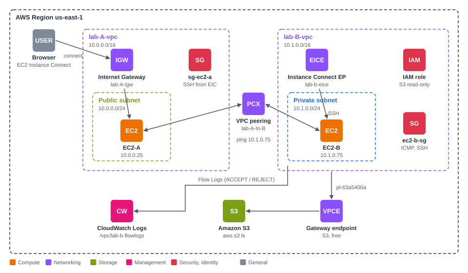

# AWS VPC Connectivity

AWS SAA-C03 · VPC Part 2 · `us-east-1`

## What this covers

How VPCs connect to each other, to AWS services, and to on-premises networks, and how that traffic is logged, inspected, firewalled and billed.

| Module | Core idea |
|---|---|
| VPC Peering | Private VPC-to-VPC link, not transitive, routes on both sides |
| VPC Endpoints | Gateway (S3, DynamoDB, free, route table) vs Interface (PrivateLink, ENI, paid) |
| VPC Flow Logs | ACCEPT / REJECT metadata, SG vs NACL troubleshooting |
| Site-to-Site VPN, CloudHub | Encrypted IPsec over the internet, branches through one VGW |
| Direct Connect | Dedicated link, VIF types, DX Gateway, encryption and resiliency |
| Transit Gateway | Transitive hub, RAM sharing, route-table isolation, ECMP, multicast |
| Traffic Mirroring | Full packet copies to IDS appliances |
| IPv6, Egress-only IGW | Dual-stack, IPv6 outbound only |
| Networking Costs | Same AZ free, cross-AZ, cross-Region, egress, endpoints vs NAT |
| Network Firewall | VPC-wide L3 to L7 filtering, domain lists, IPS |

## Lab results

| Test | Result |
|---|---|
| Ping VPC-A → VPC-B, no peering | 4 sent, 0 received, 100% loss |
| Peering Active, no routes | 100% loss |
| Route on VPC-A side only | 100% loss (no return path) |
| Routes on both sides, ICMP rule missing | 100% loss |
| Routes on both sides, SG fixed | 4/4 received, avg RTT 0.256 ms |
| Flow Logs, curl to TCP 80 | REJECT, 3 packets / 180 bytes (SYN retries) |
| Flow Logs, 10 pings | ACCEPT in and out, 10 packets / 840 bytes each way |
| `aws s3 ls` from private EC2-B, no endpoint | `Connect timeout on endpoint URL` |
| `aws s3 ls` after gateway endpoint + route | Bucket listed instantly, no IGW or NAT |
| Shell into private EC2-B | Through EC2 Instance Connect Endpoint, source `10.1.0.61` |

## Issues solved

| Issue | Fix |
|---|---|
| Launch wizard merged two inbound rules into one (no ICMP rule) | Rebuilt `ec2-b-sg`: SSH from `10.1.0.0/16`, ICMP from `10.0.0.0/16` |
| SSH source for a private instance reached through an EIC Endpoint | Source is the endpoint's VPC range, with Preserve client IP off |
| Connect page defaulted to the public EC2 Instance Connect card | Selected the EC2 Instance Connect Endpoint card |
| Gateway endpoint without a route table association (no `pl-…` route) | Recreated it with the private route table selected |
| S3 test run in the local terminal instead of EC2-B | Re-ran inside EC2-B, checked the prompt |
| Console-created Flow Logs role and policy left after teardown | Detached and deleted with the CLI |

## Key takeaways

- An **Active** peering connection moves nothing until **both** route tables point to it and the target's **Security Group** allows the protocol.
- A **timeout** means the network path is missing. **Access Denied** means IAM.
- **Gateway endpoints** work through route tables and cost nothing. **Interface endpoints** are ENIs and reach further.
- Inbound ACCEPT with an outbound REJECT on the reply is always the **NACL**.

## Files

| File | Contents |
|---|---|
| [notes.md](notes.md) | All 10 modules with diagrams, the full lab step by step with screenshots, troubleshooting log, cheat sheet, acronyms |
| [commands.md](commands.md) | Session commands, CLI teardown and verification, account checks, CLI-only redo |
| `images/diagrams/` | 11 architecture diagrams (SVG) |
| `images/screenshots/` | 29 lab screenshots, account IDs and public IPs redacted |
