# AWS VPC Connectivity: Peering, Endpoints, Flow Logs, Hybrid and Firewall

AWS SAA-C03 · VPC Part 2 · Region `us-east-1` · Running example: Menniboe Farm orders platform

This is a reference guide for VPC connectivity. It covers how VPCs talk to each other, how private subnets reach AWS services, how traffic is logged and inspected, how on-premises networks connect, what data transfer costs, and how a whole VPC is firewalled. It ends with a full hands-on build that proves the core ideas in the console.

---

## Table of contents

- [Module 1 VPC Peering](#module-1-vpc-peering)
- [Module 2 VPC Endpoints](#module-2-vpc-endpoints)
- [Module 3 VPC Flow Logs](#module-3-vpc-flow-logs)
- [Module 4 Site-to-Site VPN and VPN CloudHub](#module-4-site-to-site-vpn-and-vpn-cloudhub)
- [Module 5 AWS Direct Connect](#module-5-aws-direct-connect)
- [Module 6 AWS Transit Gateway](#module-6-aws-transit-gateway)
- [Module 7 VPC Traffic Mirroring](#module-7-vpc-traffic-mirroring)
- [Module 8 IPv6 and the Egress-only Internet Gateway](#module-8-ipv6-and-the-egress-only-internet-gateway)
- [Module 9 Networking Costs](#module-9-networking-costs)
- [Module 10 AWS Network Firewall](#module-10-aws-network-firewall)
- [Lab Peering Flow Logs and Private Access to S3](#lab-peering-flow-logs-and-private-access-to-s3)
  - [Step 1 Create VPC-A](#step-1-create-vpc-a)
  - [Step 2 Create VPC-B](#step-2-create-vpc-b)
  - [Step 3 Launch EC2-A](#step-3-launch-ec2-a)
  - [Step 4 Create the IAM role for EC2-B](#step-4-create-the-iam-role-for-ec2-b)
  - [Step 5 Launch EC2-B](#step-5-launch-ec2-b)
  - [Step 6 Baseline ping test](#step-6-baseline-ping-test)
  - [Step 7 Create and accept the peering connection](#step-7-create-and-accept-the-peering-connection)
  - [Step 8 Add the route on the VPC-A side](#step-8-add-the-route-on-the-vpc-a-side)
  - [Step 9 Add the return route on the VPC-B side](#step-9-add-the-return-route-on-the-vpc-b-side)
  - [Step 10 Fix the EC2-B security group](#step-10-fix-the-ec2-b-security-group)
  - [Step 11 Turn on VPC Flow Logs](#step-11-turn-on-vpc-flow-logs)
  - [Step 12 Read ACCEPT and REJECT records](#step-12-read-accept-and-reject-records)
  - [Step 13 Create the EC2 Instance Connect Endpoint](#step-13-create-the-ec2-instance-connect-endpoint)
  - [Step 14 Baseline S3 test from EC2-B](#step-14-baseline-s3-test-from-ec2-b)
  - [Step 15 Create the S3 gateway endpoint](#step-15-create-the-s3-gateway-endpoint)
  - [Step 16 Teardown and verification](#step-16-teardown-and-verification)
- [Troubleshooting log](#troubleshooting-log)
- [Questions answered during the session](#questions-answered-during-the-session)
- [Service selection cheat sheet](#service-selection-cheat-sheet)
- [Acronyms](#acronyms)

---

## Module 1 VPC Peering

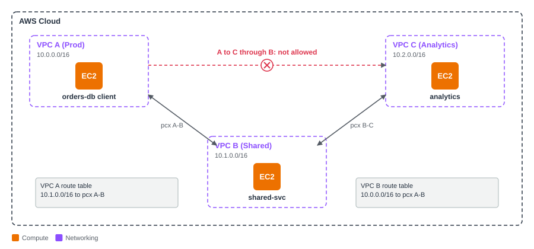

**What it is:** a private connection between two VPCs. Traffic uses private IP addresses and stays on the AWS backbone, so the two VPCs behave like one network.

**Key facts**

| Rule | Detail |
|---|---|
| No overlapping CIDRs | `10.0.0.0/16` cannot peer with another `10.0.0.0/16` |
| Not transitive | A↔B and B↔C does **not** give A↔C. Each pair needs its own connection |
| Routes on both sides | Each VPC needs `peer CIDR → pcx-…`. An Active connection alone moves no traffic |
| Cross-account and cross-Region | Supported. Inter-Region traffic is encrypted |
| Security Group references | A peer's SG can be referenced, but only in the **same Region** |
| No edge-to-edge routing | A cannot use B's IGW, NAT Gateway, VPN or Direct Connect |
| Handshake | Requester creates, accepter approves. Unaccepted requests expire after **7 days** |

**Connections:** peering is the simple option for a few VPCs. With many VPCs, the full mesh grows fast (n × (n−1) / 2 links), and Transit Gateway takes over.

| Pros | Cons |
|---|---|
| No hourly cost, only data transfer | Not transitive, full mesh at scale |
| Low latency, no single point of failure | Routes and SGs to manage on both sides |
| Works across accounts and Regions | CIDRs must be planned to never overlap |

> [!TIP]
> **Exam clues:** "A peered with B and B peered with C, A cannot reach C" → create **A↔C peering**. "Many VPCs plus on-premises" → **Transit Gateway**. "Peering Active but no traffic" → check **both route tables**, then **Security Groups**.

**Menniboe Farm example:** the orders app runs in a Prod VPC, and the analytics team owns a separate account and VPC. Peering lets analytics read the orders database privately. When a third Shared-Services VPC appears, each pair needs its own peering link.

---

## Module 2 VPC Endpoints

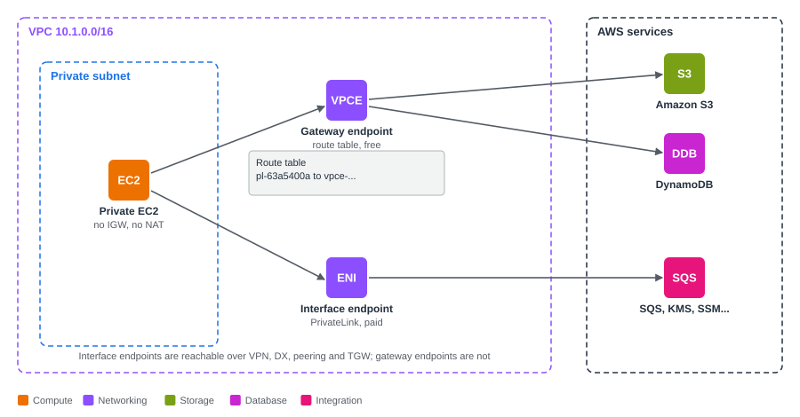

**What they are:** a private path from a VPC to AWS services. Instances in a private subnet reach S3, SQS, DynamoDB and others without an Internet Gateway, a NAT Gateway or the public internet.

| | Gateway endpoint | Interface endpoint (PrivateLink) |
|---|---|---|
| Services | S3 and DynamoDB only | Most AWS services, including S3 and DynamoDB |
| How it works | Route table target through a **prefix list** (`pl-…`) | **ENI** with a private IP in your subnet |
| Attach to | Route tables | Subnets (one ENI per AZ) |
| Security | Endpoint policy + route table | Security Group on the ENI + endpoint policy |
| Cost | **Free** | Per hour + per GB |
| Reachable from on-prem, peered VPC, other Region | No | Yes (VPN, Direct Connect, peering, TGW) |
| DNS | Unchanged, public S3 name still used | Needs **Enable DNS hostnames** and **DNS resolution** for private DNS |

**Connections:** a gateway endpoint replaces the NAT Gateway for S3 and DynamoDB traffic and removes the per-GB processing charge. Interface endpoints extend private service access to anything routed into the VPC.

| Pros | Cons |
|---|---|
| Traffic stays on the AWS network | Gateway type covers only two services |
| Gateway type is free | Interface type costs per AZ per hour |
| Endpoint policies restrict what can be reached | One more thing to check when access fails |

> [!TIP]
> **Exam clues:** "Private EC2 needs S3 at lowest cost" → **Gateway endpoint**. "On-premises servers need private S3 access over Direct Connect" → **Interface endpoint**. "Endpoint exists but EC2 still can't reach the service" → route table association (gateway), ENI Security Group (interface), endpoint policy, or VPC DNS settings.

**Menniboe Farm example:** a private-subnet Lambda writing order receipts to S3 was sending traffic through a NAT Gateway and paying per-GB processing. A gateway endpoint makes the same traffic private and free.

---

## Module 3 VPC Flow Logs

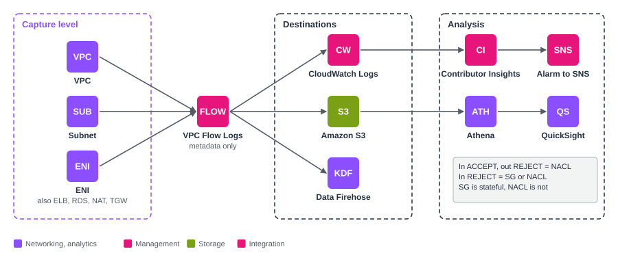

**What they are:** records of IP traffic **metadata** on network interfaces: source, destination, ports, protocol, packets, bytes, and whether it was accepted or rejected. They never capture packet contents.

| Item | Detail |
|---|---|
| Capture levels | VPC, subnet or ENI |
| Also covers managed ENIs | ELB, RDS, ElastiCache, Redshift, WorkSpaces, NAT Gateway, Transit Gateway |
| Destinations | CloudWatch Logs, S3, Amazon Data Firehose |
| Aggregation interval | 1 minute or 10 minutes |
| Default record format | `version account-id interface-id srcaddr dstaddr srcport dstport protocol packets bytes start end action log-status` |
| Protocol numbers | `1` ICMP · `6` TCP · `17` UDP |

**Security Group vs NACL from the `action` field**

| Pattern | Cause |
|---|---|
| Inbound REJECT | Security Group or NACL |
| Inbound ACCEPT, outbound reply REJECT | **NACL** (an SG is stateful and always allows the reply) |
| Outbound ACCEPT, inbound reply REJECT (traffic the instance started) | **NACL** |

**Analysis patterns:** S3 + **Athena** (+ QuickSight) for SQL over the logs. CloudWatch Logs + **Contributor Insights** for top talkers, or a metric filter → alarm → SNS for alerts.

| Pros | Cons |
|---|---|
| No performance impact | Metadata only, no payload |
| Proves which layer dropped traffic | Records arrive with a delay of minutes |
| Cheap long-term storage in S3 | Settings can't be edited after creation |

> [!TIP]
> **Exam clues:** "Find which IPs are hitting the instance most" → Flow Logs + Contributor Insights. "Query months of traffic records with SQL" → Flow Logs to S3 + Athena. "Inspect the payload" → **not** Flow Logs, use Traffic Mirroring.

**Menniboe Farm example:** the website stops answering on port 443. Flow Logs show inbound ACCEPT and outbound REJECT on ephemeral ports, which points to a NACL missing an outbound rule for 1024–65535.

---

## Module 4 Site-to-Site VPN and VPN CloudHub

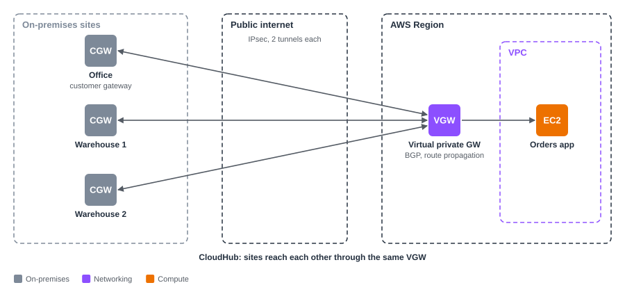

**What it is:** an encrypted IPsec connection from an on-premises network to a VPC over the public internet.

| Component | Role |
|---|---|
| Virtual Private Gateway (VGW) | AWS-side VPN concentrator, attached to the VPC, custom ASN possible |
| Customer Gateway (CGW) | AWS resource that represents the on-premises device |
| Tunnels | 2 per connection for redundancy, about 1.25 Gbps each |

**Setup facts**
- CGW IP: the device's public IP. Behind NAT (NAT-T enabled), use the **NAT device's public IP**.
- Turn on **route propagation** for the VGW in subnet route tables, or traffic won't flow even with the tunnel UP.
- Pinging EC2 from on-prem needs **inbound ICMP** in the Security Group.
- **Accelerated Site-to-Site VPN** uses Global Accelerator edge locations and requires a **Transit Gateway**.

**VPN CloudHub:** several sites each connect a VPN to the **same VGW** with dynamic routing (BGP). Sites then reach each other through AWS in a hub-and-spoke model, still encrypted over the internet.

| Pros | Cons |
|---|---|
| Set up in minutes, low cost | Internet performance is not consistent |
| Encrypted by default | About 1.25 Gbps per tunnel to a VGW |
| CloudHub links branches cheaply | Depends on on-prem device configuration |

> [!TIP]
> **Exam clues:** "Connectivity needed this week" → **VPN**. "Branch offices must talk to each other and the VPC at low cost" → **CloudHub**. "Tunnel UP but no traffic" → **route propagation**.

**Menniboe Farm example:** the office and the warehouse each get a VPN to the same VGW. Both reach the orders app privately, and the warehouse reaches the office print server through CloudHub.

---

## Module 5 AWS Direct Connect

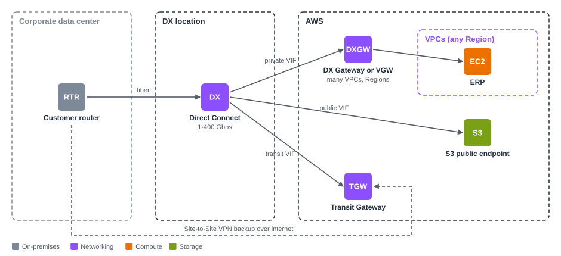

**What it is:** a dedicated private network link from a data center to AWS through a Direct Connect location. No internet path, so bandwidth and latency are consistent.

**Virtual interfaces**

| VIF | Reaches |
|---|---|
| Private VIF | VPC resources through a VGW or Direct Connect Gateway |
| Public VIF | AWS public endpoints such as S3 and DynamoDB |
| Transit VIF | A Transit Gateway |

**Direct Connect Gateway:** one DX connection reaches many VPCs in many Regions and accounts (no overlapping CIDRs).

| | Dedicated | Hosted |
|---|---|---|
| Speeds | 1, 10, 100, 400 Gbps | 50 Mbps up to 25 Gbps |
| Port | Physical port for one customer | Shared, through a DX Partner |
| Ordering | Request to AWS, completed by a partner | Ordered from a partner, capacity adjustable |

**Encryption and resiliency**
- DX is private but **not encrypted**. Options: **IPsec VPN over DX**, or **MACsec** on dedicated 10/100/400 Gbps.
- High resiliency: one connection at each of **two DX locations**. Maximum resiliency: **two connections at each of two locations**.
- Low-cost backup: a **Site-to-Site VPN** that takes over if DX fails.
- Lead time is often **more than a month**.
- **SiteLink** sends site-to-site traffic over the AWS backbone through DX locations.

| Pros | Cons |
|---|---|
| Consistent bandwidth and latency | Weeks to provision |
| Lower data transfer out rate | Not encrypted by default |
| Scales to 400 Gbps | Physical single points of failure without redundancy |

> [!TIP]
> **Exam clues:** "Fast and cheap" → VPN. "Consistent, high bandwidth" → DX. "Encrypted DX" → VPN over DX or MACsec. "DX failover on a budget" → VPN backup. "Needs it next week" → not DX.

**Menniboe Farm example:** nightly multi-TB backups to S3 plus a latency-sensitive ERP. Use a 10 Gbps dedicated DX, a public VIF for S3, a private VIF for the VPC, and a VPN as backup.

---

## Module 6 AWS Transit Gateway

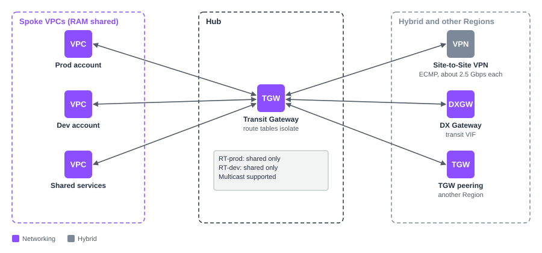

**What it is:** a regional network hub. VPCs, VPNs and Direct Connect attach to one TGW, and routing between them is **transitive**.

| Feature | Detail |
|---|---|
| Scale | Thousands of VPCs and on-premises networks |
| Cross-account | Shared through **AWS Resource Access Manager (RAM)** |
| Isolation | **TGW route tables** decide which attachments talk (Dev and Prod reach Shared only) |
| Attachments | VPC, Site-to-Site VPN, DX Gateway (transit VIF), TGW peering, Connect (SD-WAN) |
| Multicast | The only AWS networking service that supports **IP multicast** |
| ECMP | VPN to TGW uses both tunnels, about **2.5 Gbps per connection**, more connections scale further |
| Cost | Per attachment-hour + per GB processed |

| | VPC peering | Transit Gateway |
|---|---|---|
| Transitive | No | Yes |
| Best for | A few VPCs | Many VPCs plus on-premises |
| Cost | Data transfer only | Hourly per attachment + per GB |

> [!TIP]
> **Exam clues:** "Hundreds of VPCs across accounts" → TGW + RAM. "Increase VPN bandwidth" → TGW + **ECMP**. "Multicast" → TGW. "Share one DX across accounts" → DX → transit VIF → DX Gateway → TGW.

**Menniboe Farm example:** 15 VPCs across Prod, Dev and Analytics accounts plus two offices on VPN. Peering would need over 100 links. One TGW shared through RAM, with route tables isolating Dev from Prod, does it with one hub.

---

## Module 7 VPC Traffic Mirroring

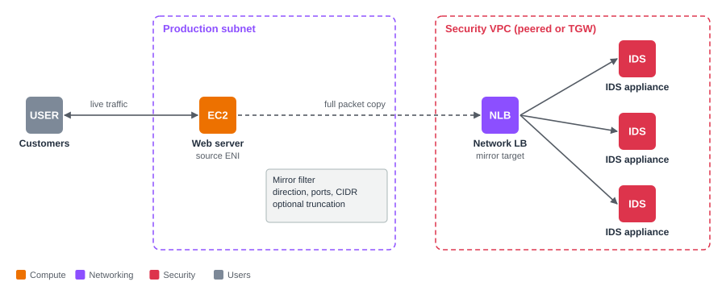

**What it is:** copies **full packets, including payload,** from an ENI to security or monitoring appliances. It's non-intrusive, so the source traffic is untouched.

| Component | Detail |
|---|---|
| Source | An ENI |
| Target | Another ENI, a Network Load Balancer, or a Gateway Load Balancer endpoint |
| Filter | Direction, protocol, ports, CIDR, optional packet truncation |
| Session | Ties source, target and filter together |
| Reach | Same VPC, or another VPC through peering or TGW |

| | Flow Logs | Traffic Mirroring |
|---|---|---|
| Captures | Metadata | Full packets |
| Answers | Who talked to whom, allowed or not | What was inside the traffic |

> [!TIP]
> **Exam clues:** "Inspect payloads with an IDS without affecting production" → Traffic Mirroring to an **NLB** in front of the appliance fleet.

**Menniboe Farm example:** security suspects malware on one web server. Its ENI is mirrored through an NLB to an IDS fleet that inspects payloads without touching the live server.

---

## Module 8 IPv6 and the Egress-only Internet Gateway

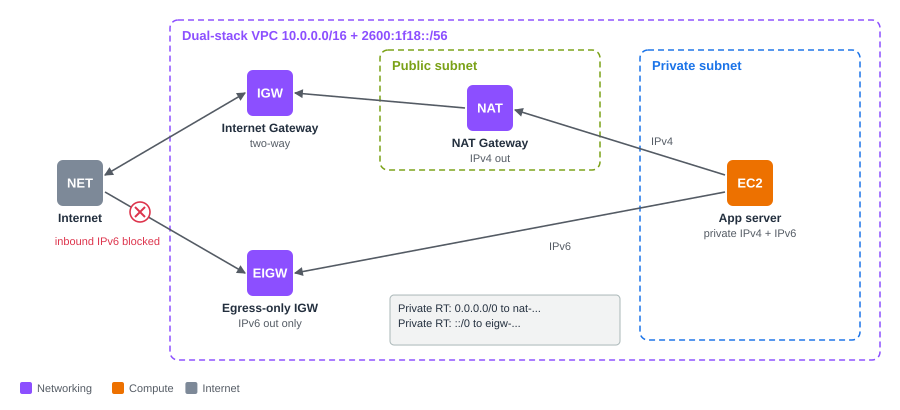

**IPv6 in a VPC**
- IPv4 **cannot be disabled**. IPv6 is added as **dual-stack**: a `/56` for the VPC and `/64` per subnet.
- Every IPv6 address is **public and globally unique**.
- EC2 gets at least a private IPv4 address and a public IPv6 address.
- Launch fails in a subnet that still has free IPv6 addresses → the subnet ran out of **IPv4**. Fix: add a new IPv4 CIDR.

**Egress-only Internet Gateway (EIGW):** the IPv6 equivalent of a NAT Gateway. Outbound IPv6 is allowed, inbound connections from the internet are blocked. Route: `::/0 → eigw-…`.

| Subnet | IPv4 route | IPv6 route |
|---|---|---|
| Public | `0.0.0.0/0 → IGW` | `::/0 → IGW` |
| Private | `0.0.0.0/0 → NAT Gateway` | `::/0 → Egress-only IGW` |

> [!TIP]
> **Exam clues:** "Private IPv6 instances need outbound only" → **EIGW**. "Cannot launch, IPv6 addresses free" → **out of IPv4**.

**Menniboe Farm example:** private app servers download OS patches over IPv6 but must never be reachable from the internet. NAT Gateway for IPv4, EIGW for IPv6.

---

## Module 9 Networking Costs

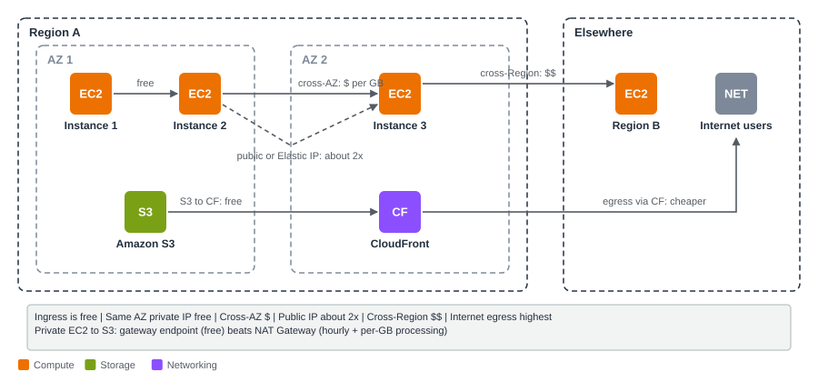

| Traffic | Relative cost |
|---|---|
| Into AWS (ingress) | Free |
| Same AZ, private IP | Free |
| Between AZs, private IP | Per GB in each direction |
| Between AZs, public or Elastic IP | About 2x the private-IP rate |
| Between Regions | Higher, per GB |
| Out to the internet | Highest |

**Cost patterns**
- Use **private IPs** between instances.
- Same AZ is cheapest, at the cost of availability.
- Minimize egress: process data in AWS and send only results out.
- **Direct Connect** egress is cheaper than internet egress.
- S3 uploads are free. **S3 → CloudFront is free**, and CloudFront → internet is cheaper than S3 → internet.
- **NAT Gateway** = hourly + per-GB processing + transfer. A **gateway endpoint** for S3 or DynamoDB has no hourly or processing fee.

> [!TIP]
> **Exam clues:** "Reduce cost of private EC2 traffic to S3" → gateway endpoint. "Cut transfer cost between two instances" → same AZ + private IP. "Cheapest public downloads" → CloudFront in front of S3.

**Menniboe Farm example:** a nightly job moves 2 TB from private EC2 to S3 through a NAT Gateway. A gateway endpoint removes the processing fee with no code change.

---

## Module 10 AWS Network Firewall

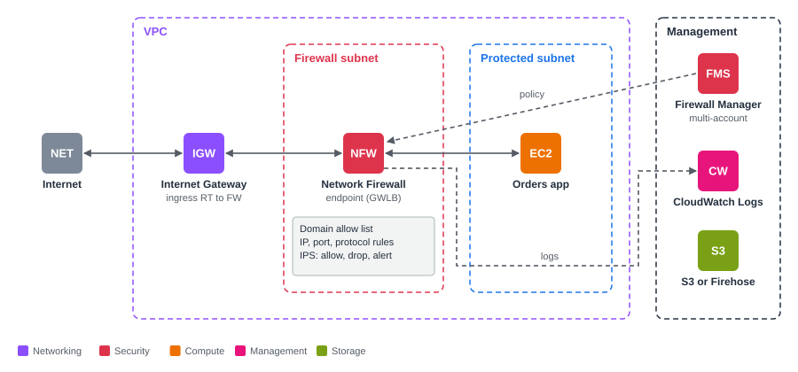

**What it is:** a managed firewall for a **whole VPC**, Layer 3 to Layer 7, inspecting traffic in any direction (VPC to VPC, to and from the internet, Direct Connect and VPN).

| Feature | Detail |
|---|---|
| Placement | Firewall endpoints in a dedicated **firewall subnet**, route tables send traffic through them |
| Engine | Gateway Load Balancer under the hood, managed by AWS |
| Rules | IP/port, protocol, **stateful domain lists**, regex pattern matching |
| Actions | Allow, drop, alert, plus active flow inspection (IPS) |
| Management | **AWS Firewall Manager** across accounts |
| Logs | S3, CloudWatch Logs, Data Firehose |

| Service | Layer | Scope |
|---|---|---|
| NACL | L3/L4, stateless | Subnet |
| Security Group | L3/L4, stateful | ENI |
| AWS WAF | L7 HTTP | ALB, API Gateway, CloudFront, AppSync |
| AWS Shield | DDoS | Edge and resources |
| **AWS Network Firewall** | **L3 to L7** | **Entire VPC** |
| AWS Firewall Manager | Central policy | Across accounts |

> [!TIP]
> **Exam clues:** "Allow outbound only to approved domains" → Network Firewall domain list. "IPS for all VPC traffic" → Network Firewall. "Central rules for many accounts" → Firewall Manager.

**Menniboe Farm example:** compliance requires outbound access only to approved domains (OS updates, payment API) with all traffic inspected. SGs and NACLs can't filter by domain, so Network Firewall with a domain allow list and IPS rules is the fit.

---

## Lab Peering Flow Logs and Private Access to S3

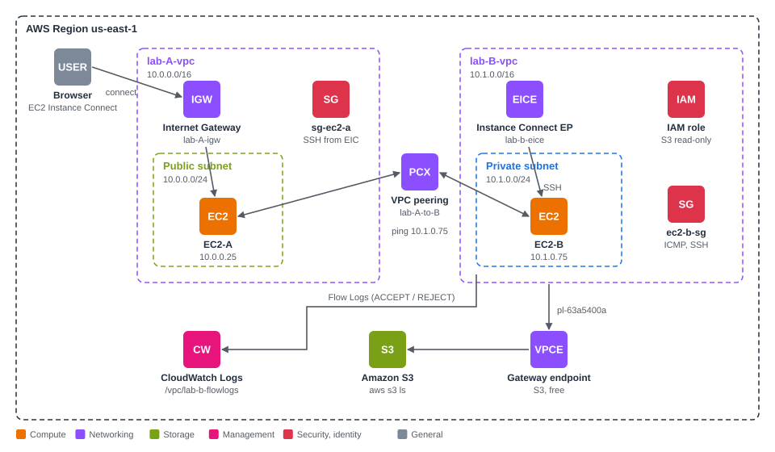

**What we build:** two VPCs with non-overlapping CIDRs, one public test instance and one private instance, joined by VPC peering. VPC-B gets Flow Logs, an EC2 Instance Connect Endpoint and an S3 gateway endpoint.

**What we prove**

| # | Proof |
|---|---|
| 1 | Two VPCs are isolated by default |
| 2 | Peering needs a route on **both** sides plus a Security Group rule |
| 3 | Flow Logs show ACCEPT and REJECT decisions |
| 4 | A private instance with no IGW or NAT reaches S3 only through a gateway endpoint and its route |

**Resource map**

| Resource | Name | Value |
|---|---|---|
| VPC-A | `lab-A-vpc` | `10.0.0.0/16`, public subnet `10.0.0.0/24`, IGW |
| VPC-B | `lab-B-vpc` | `10.1.0.0/16`, private subnet `10.1.0.0/24`, no IGW, no NAT |
| EC2-A | `EC2-A` | `10.0.0.25`, public IP, SG `sg-ec2-a` |
| EC2-B | `EC2-B` | `10.1.0.75`, no public IP, SG `ec2-b-sg`, role `lab-ec2-b-s3-read` |
| Peering | `lab-A-to-B` | `pcx-07f4ad586a2c525e2` |
| Flow log | `lab-b-flowlogs` | CloudWatch Logs `/vpc/lab-b-flowlogs`, 1 minute |
| EIC Endpoint | `lab-b-eice` | `eice-0cd257eabf8d42a4c`, Preserve client IP off |
| Gateway endpoint | `lab-b-s3-gw` | `com.amazonaws.us-east-1.s3`, prefix list `pl-63a5400a` |

> [!NOTE]
> **Cost:** two t3.micro instances for about 2 hours, a few MB of CloudWatch Logs. Peering within one AZ, the EIC Endpoint and the gateway endpoint are free.

---

### Step 1 Create VPC-A

**Why this step:** VPC-A is the requester side of the peering. It gets a public subnet and an Internet Gateway so EC2-A can be reached from the browser. Its CIDR `10.0.0.0/16` must not overlap VPC-B, because peering refuses overlapping ranges.

**Console:** Region **us-east-1** → **VPC → Your VPCs → Create VPC**

| Field | Value |
|---|---|
| Resources to create | VPC and more |
| Name tag auto-generation | ✔ `lab-A` |
| IPv4 CIDR block | `10.0.0.0/16` |
| IPv6 CIDR block | No IPv6 CIDR block |
| Tenancy | Default |
| Encryption settings | Defaults |
| Number of AZs | 1 → Customize AZs → `us-east-1a` |
| Public subnets | 1 → `10.0.0.0/24` |
| Private subnets | 0 |
| NAT gateways | None |
| VPC endpoints | None |
| DNS options | ✔ Enable DNS hostnames · ✔ Enable DNS resolution |

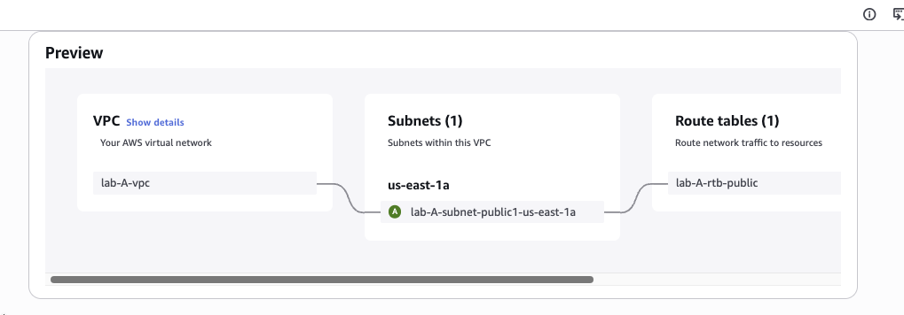

The workflow creates the VPC, DNS settings, subnet, IGW (attached), public route table, the `0.0.0.0/0 → igw` route and the subnet association.

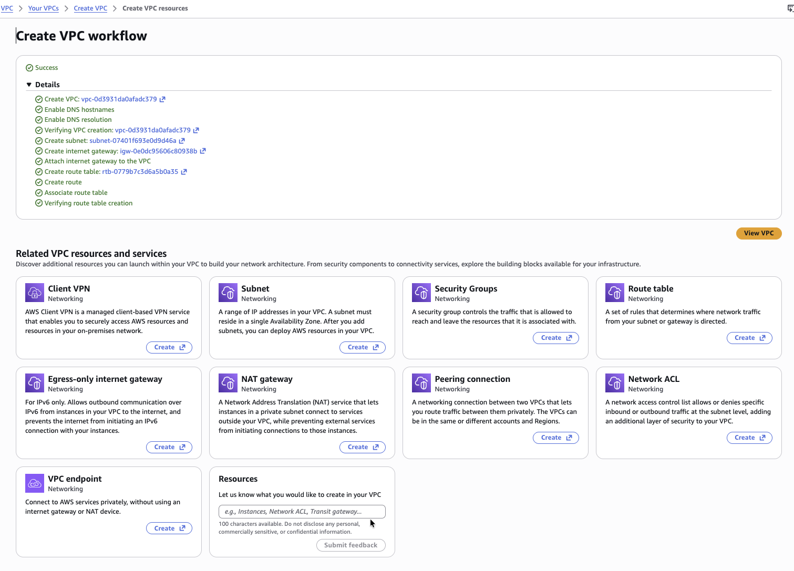

---

### Step 2 Create VPC-B

**Why this step:** VPC-B is the accepter side. It has **only a private subnet**, no IGW and no NAT, so it has no way out. That sets up both baseline failures: no ping from VPC-A, no access to S3.

**Console:** **VPC → Your VPCs → Create VPC**

| Field | Value |
|---|---|
| Resources to create | VPC and more |
| Name tag auto-generation | ✔ `lab-B` |
| IPv4 CIDR block | `10.1.0.0/16` |
| IPv6 CIDR block | No IPv6 CIDR block |
| Tenancy | Default |
| Number of AZs | 1 → `us-east-1a` |
| Public subnets | 0 |
| Private subnets | 1 → `10.1.0.0/24` |
| NAT gateways | None |
| VPC endpoints | **None** (the wizard may default to S3 Gateway) |
| DNS options | ✔ Enable DNS hostnames · ✔ Enable DNS resolution |

The preview must show **Network connections (0)**.

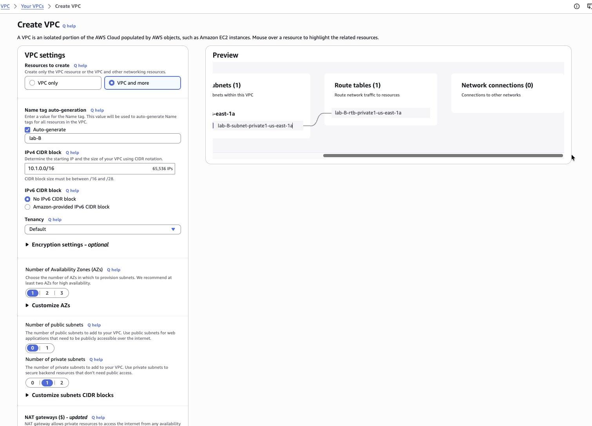

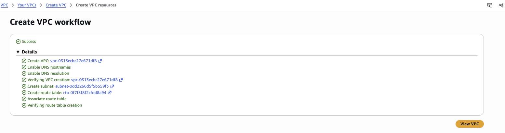

---

### Step 3 Launch EC2-A

**Why this step:** EC2-A runs the ping tests. It sits in the public subnet with a public IP so EC2 Instance Connect can open a browser shell, with no key pair. It only needs SSH inbound: the ping replies come back because Security Groups are stateful.

**Console:** **EC2 → Instances → Launch instances**

| Section | Field | Value |
|---|---|---|
| Name and tags | Name | `EC2-A` |
| AMI | Quick Start | Amazon Linux 2023, 64-bit (x86) |
| Instance type | | t3.micro |
| Key pair | | Proceed without a key pair |
| Network settings → Edit | VPC | `lab-A-vpc` |
| | Subnet | `lab-A-subnet-public1-us-east-1a` |
| | Auto-assign public IP | Enable |
| | Firewall | Create security group `sg-ec2-a`, description `SSH from EC2 Instance Connect` |
| | Inbound rule 1 | SSH · TCP 22 · Source: prefix list `com.amazonaws.us-east-1.ec2-instance-connect` (or Anywhere for a short-lived lab) |
| Storage | Root volume | 8 GiB gp3 |
| Advanced details | IAM instance profile | None |
| | Metadata version | V2 only (token required) |
| Summary | Number of instances | 1 |

Result: private IP `10.0.0.25`, IMDSv2 required, credit specification `unlimited` (t3 default).

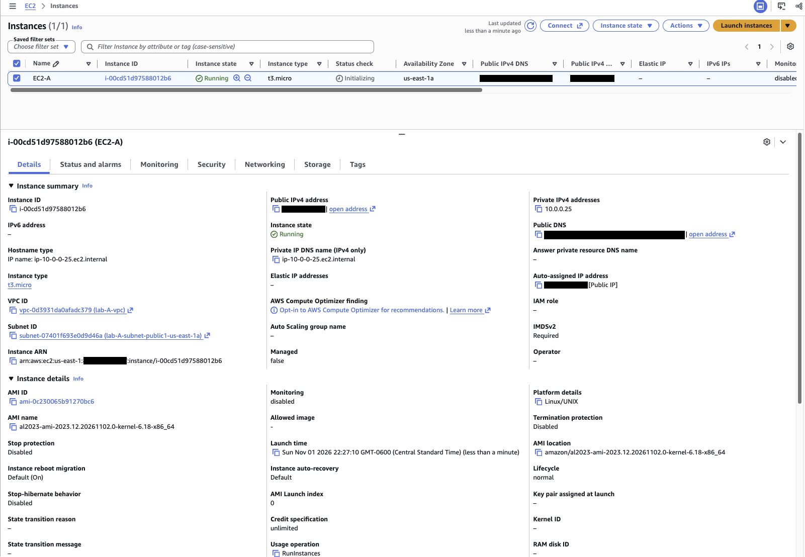

---

### Step 4 Create the IAM role for EC2-B

**Why this step:** EC2-B runs `aws s3 ls` later, and every CLI call needs credentials. An instance role gives temporary credentials without access keys. Having the role in place means a later S3 failure can only be a **network** problem.

**Console:** **IAM → Roles → Create role**

| Page | Field | Value |
|---|---|---|
| Trusted entity | Type | AWS service |
| | Use case | EC2 |
| Permissions | Policy | `AmazonS3ReadOnlyAccess` |
| | Permissions boundary | Not set |
| Name and review | Role name | `lab-ec2-b-s3-read` |
| | Description | `Lets EC2-B list S3 for the gateway endpoint test` |
| | Trust policy | `"Service": "ec2.amazonaws.com"` |

The console also creates the **instance profile** with the same name, which is what EC2 actually attaches.

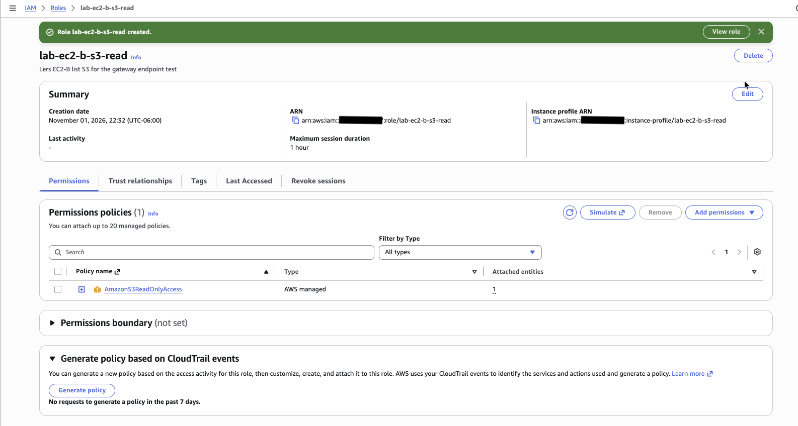

---

### Step 5 Launch EC2-B

**Why this step:** EC2-B is the ping target and the S3 client. It has **no public IP**, so the only ways in are peering (from VPC-A) and the EC2 Instance Connect Endpoint (inside VPC-B).

**Console:** **EC2 → Instances → Launch instances**

| Section | Field | Value |
|---|---|---|
| Name and tags | Name | `EC2-B` |
| AMI | Quick Start | Amazon Linux 2023, 64-bit (x86) |
| Instance type | | t3.micro |
| Key pair | | Proceed without a key pair |
| Network settings → Edit | VPC | `lab-B-vpc` |
| | Subnet | `lab-B-subnet-private1-us-east-1a` |
| | Auto-assign public IP | Disable |
| | Firewall | Create security group `ec2-b-sg`, description `ICMP from VPC-A, SSH from VPC-B` |
| | Inbound rule 1 | SSH · TCP 22 · Source `10.1.0.0/16` |
| | Inbound rule 2 | All ICMP - IPv4 · Source `10.0.0.0/16` · `ping from VPC-A` |
| Storage | Root volume | 8 GiB gp3 |
| Advanced details | IAM instance profile | `lab-ec2-b-s3-read` |
| | Metadata version | V2 only |

Result: private IP `10.1.0.75`, no public IP, IAM role attached.

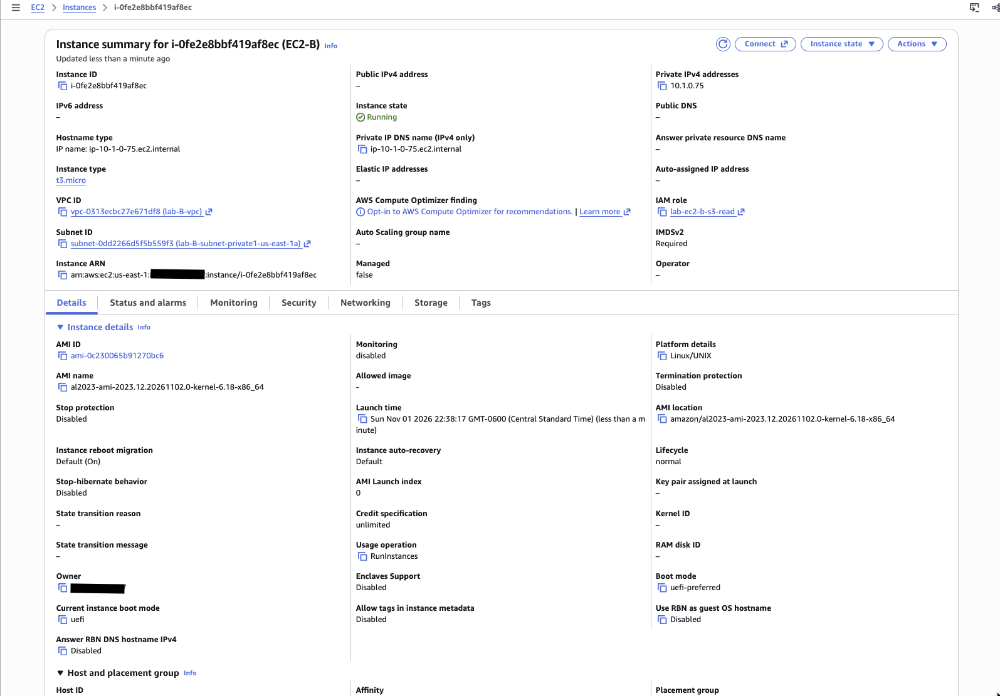

> [!WARNING]
> Always open the instance's **Security** tab after a wizard launch. In this lab the two inbound rules saved as one merged rule. See [Step 10](#step-10-fix-the-ec2-b-security-group).

---

### Step 6 Baseline ping test

**Why this step:** proving the failure first makes the fix meaningful. VPC-A's route table only has `10.0.0.0/16 local` and `0.0.0.0/0 → igw`, so `10.1.0.75` falls through to the IGW, and a private address can't be routed on the internet.

**Console:** **EC2 → EC2-A → Connect → EC2 Instance Connect** (public IP, user `ec2-user`) → **Connect**

```bash
ping -c 4 10.1.0.75
```

Result: `4 packets transmitted, 0 received, 100% packet loss`.

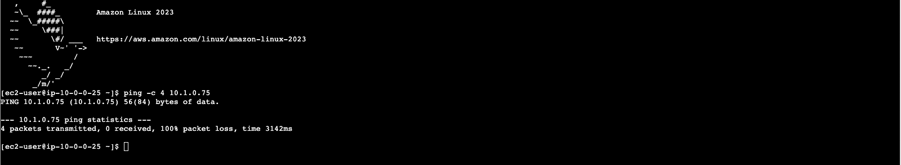

---

### Step 7 Create and accept the peering connection

**Why this step:** peering is the private bridge. It's a request/accept handshake, and an Active connection by itself still passes no traffic.

**Console:** **VPC → Peering connections → Create peering connection**

| Field | Value |
|---|---|
| Name | `lab-A-to-B` |
| VPC ID (Requester) | `lab-A-vpc` |
| Account | My account |
| Region | This Region (us-east-1) |
| VPC ID (Accepter) | `lab-B-vpc` |

Status **Pending acceptance**, with a 7-day expiration and Accepter CIDRs still empty.

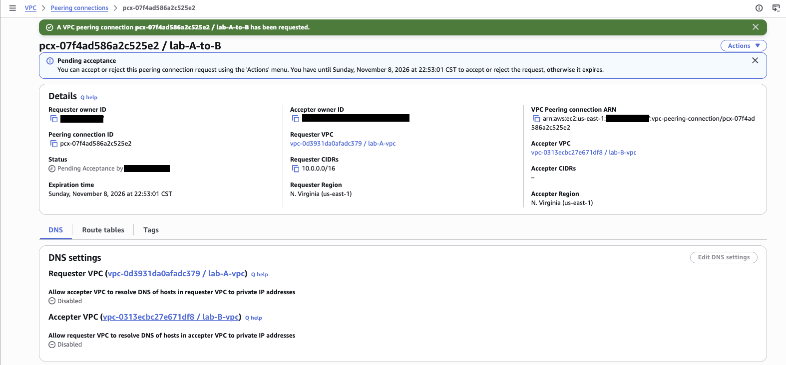

**Actions → Accept request.** Status **Active**, Accepter CIDRs `10.1.0.0/16`. Skip the "Modify my route tables now" banner.

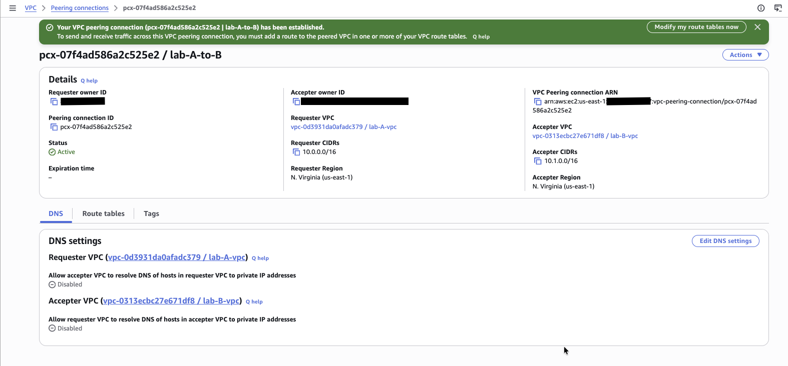

```bash
ping -c 4 10.1.0.75
```

Result: still 100% packet loss. The bridge exists, but no route table points to it.

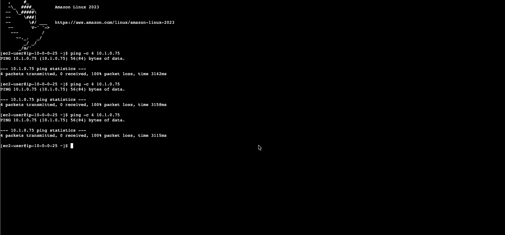

---

### Step 8 Add the route on the VPC-A side

**Why this step:** each route table needs `peer CIDR → pcx`. Doing only one side first shows why both are needed: the request reaches EC2-B, but the reply has no way back.

**Console:** **VPC → Route tables → lab-A-rtb-public → Routes → Edit routes → Add route**

| Destination | Target |
|---|---|
| `10.1.0.0/16` | Peering Connection → `pcx-07f4ad586a2c525e2` |

| Destination | Target | Route origin |
|---|---|---|
| `0.0.0.0/0` | `igw-0e0dc95606c80938b` | Create Route |
| `10.0.0.0/16` | local | Create Route Table |
| `10.1.0.0/16` | `pcx-07f4ad586a2c525e2` | Create Route |

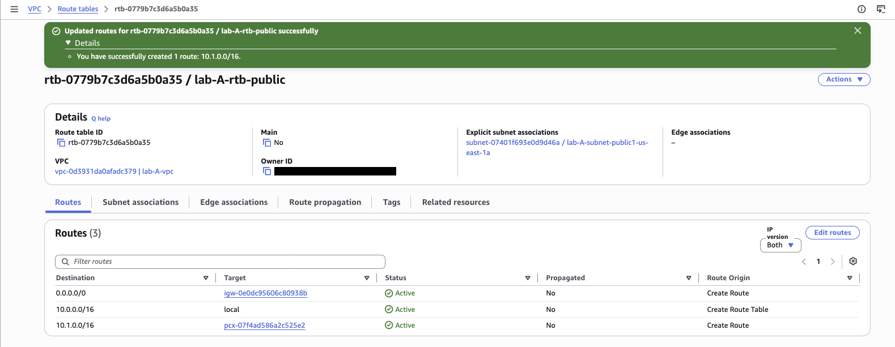

Ping result: still 100% packet loss.

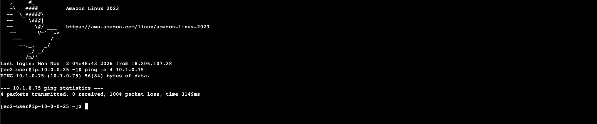

---

### Step 9 Add the return route on the VPC-B side

**Why this step:** EC2-B's reply to `10.0.0.25` needs a route back. VPC-B has no default route, so without it the reply is dropped.

**Console:** **VPC → Route tables → lab-B-rtb-private1-us-east-1a → Routes → Edit routes → Add route**

| Destination | Target |
|---|---|
| `10.0.0.0/16` | Peering Connection → `pcx-07f4ad586a2c525e2` |

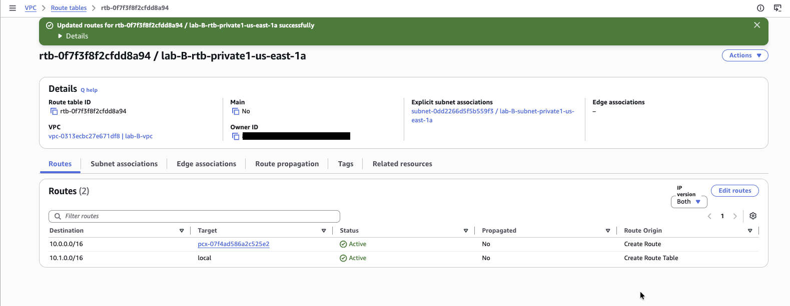

Ping result: **still 100% packet loss**, even with both routes Active.

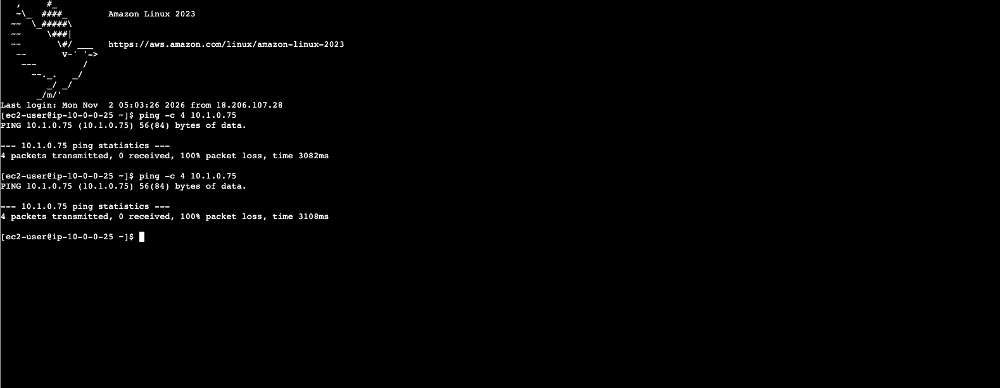

---

### Step 10 Fix the EC2-B security group

**Why this step:** with peering and both routes proven, the next layer that drops packets is the target's Security Group.

**Layer check**

| Layer | Status |
|---|---|
| Peering | Active |
| Route A to B, route B to A | Active |
| NACLs | Default NACL, allows all |
| `sg-ec2-a` outbound | Allows all |
| `ec2-b-sg` inbound | **Wrong** |

> [!WARNING]
> **Error found:** `ec2-b-sg` had a single rule, **SSH · TCP 22 · 10.0.0.0/16 · "ping from VPC"**. The launch wizard merged the two rules: SSH's type with the ICMP rule's source and description. There was **no ICMP rule**, so pings arrived through peering and were silently dropped.

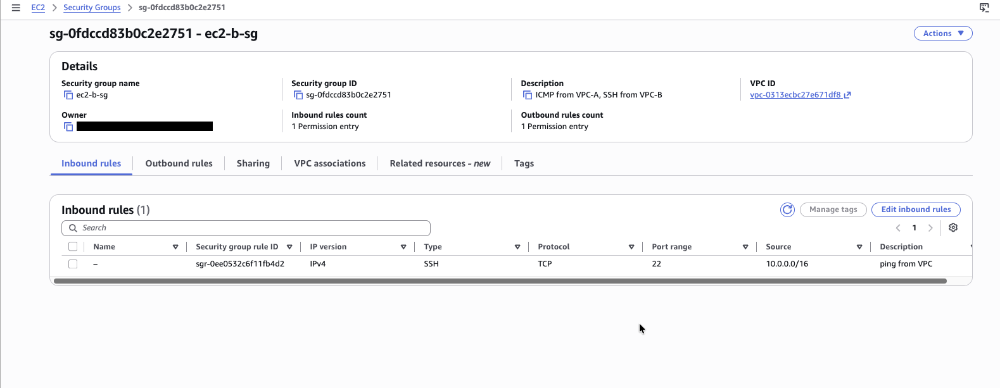

**Fix:** **EC2 → Security Groups → ec2-b-sg → Inbound rules → Edit inbound rules**

| Type | Protocol | Port | Source | Description |
|---|---|---|---|---|
| SSH | TCP | 22 | `10.1.0.0/16` | `SSH from VPC-B (EIC endpoint)` |
| All ICMP - IPv4 | ICMP | All | `10.0.0.0/16` | `ping from VPC-A` |

Security Group changes apply immediately.

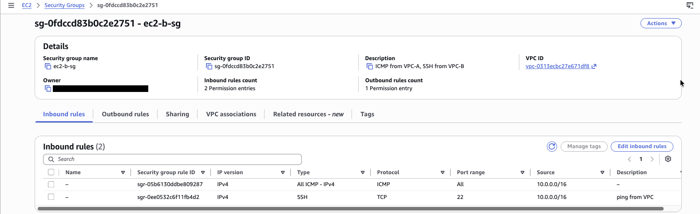

```bash
ping -c 4 10.1.0.75
```

Result: `4 received, 0% packet loss`, `rtt min/avg/max = 0.237/0.256/0.277 ms`.

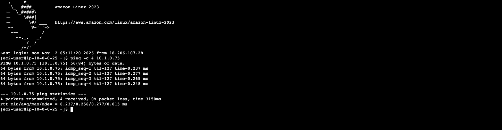

> [!IMPORTANT]
> Peering needs three things to line up: an **Active** connection, a route on **both** sides, and a **Security Group** rule on the target for that protocol from the peer CIDR.

---

### Step 11 Turn on VPC Flow Logs

**Why this step:** the Security Group drop above had to be found by checking each layer by hand. Flow Logs record the decision directly as ACCEPT or REJECT.

**Console:** **VPC → Your VPCs → lab-B-vpc → Flow logs → Create flow log**

| Field | Value |
|---|---|
| Name | `lab-b-flowlogs` |
| Filter | All |
| Maximum aggregation interval | 1 minute |
| Destination | Send to CloudWatch Logs |
| Destination log group | `/vpc/lab-b-flowlogs` |
| Service access | Create and use a new service role |
| Log record format | AWS default format |

The console created the role `VPCFlowLogs-Cloudwatch-…` and a customer-managed policy `service-role/VPCFlowLogs-CloudWatch-Policy-…`. Both need deleting at teardown.

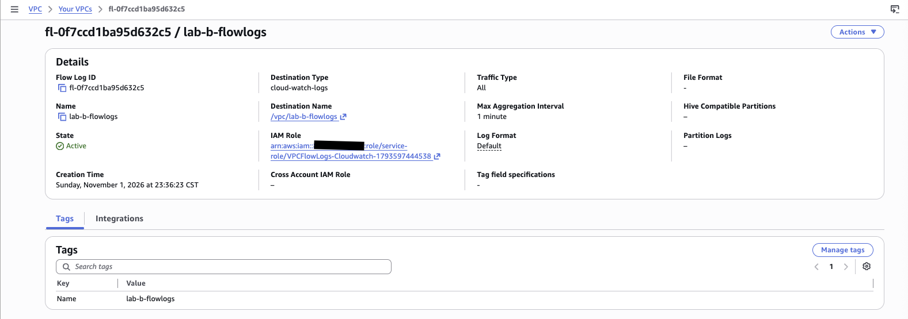

> [!TIP]
> If the role dropdown only offers existing roles, create one with a custom trust policy for `vpc-flow-logs.amazonaws.com` (see `commands.md`).

---

### Step 12 Read ACCEPT and REJECT records

**Why this step:** generate one allowed flow and one blocked flow, then read both in CloudWatch.

**EC2-A terminal**

```bash
ping -c 10 10.1.0.75
curl -m 3 http://10.1.0.75
```

`curl` ends in a timeout: a Security Group drops silently, it never sends "connection refused".

**Console:** **CloudWatch → Logs → Log groups → /vpc/lab-b-flowlogs → eni-0671e0895101b2969-all**, filter `10.0.0.25`.

| srcaddr → dstaddr | Ports | Protocol | Packets / bytes | Action | Meaning |
|---|---|---|---|---|---|
| `10.0.0.25 → 10.1.0.75` | 50818 → 80 | 6 TCP | 3 / 180 | **REJECT** | curl, 3 SYN retries, no rule for port 80 |
| `10.0.0.25 → 10.1.0.75` | 0 → 0 | 1 ICMP | 10 / 840 | ACCEPT | 10 pings in |
| `10.1.0.75 → 10.0.0.25` | 0 → 0 | 1 ICMP | 10 / 840 | ACCEPT | 10 replies out, allowed by SG state |

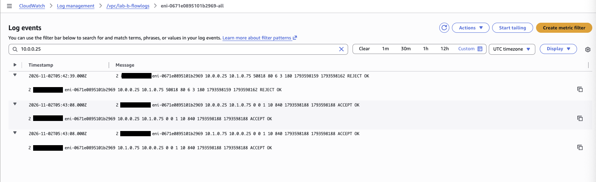

> [!NOTE]
> The first records for a new flow log can take a few minutes to appear.

---

### Step 13 Create the EC2 Instance Connect Endpoint

**Why this step:** the S3 test must run **on EC2-B**, which has no public IP. The EIC Endpoint is a free, private way into the VPC with no bastion host, no public IP and no key pair.

**Console:** **VPC → Endpoints → Create endpoint**

| Field | Value |
|---|---|
| Name tag | `lab-b-eice` |
| Type | EC2 Instance Connect Endpoint |
| VPC | `lab-B-vpc` |
| Security groups | `default` of lab-B-vpc (outbound all) |
| Preserve Client IP | Unchecked |
| Subnet | `lab-B-subnet-private1-us-east-1a` |

With Preserve Client IP off, SSH reaches EC2-B **from the endpoint's private IP** (`10.1.0.x`), which is why the SSH rule source is `10.1.0.0/16`.

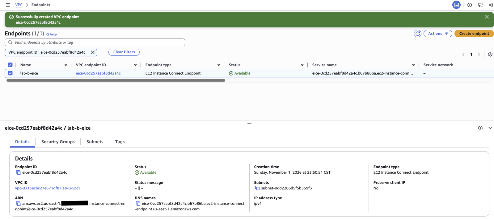

---

### Step 14 Baseline S3 test from EC2-B

**Why this step:** EC2-B has credentials but no network path to S3. Its route table only has `10.1.0.0/16 local` and `10.0.0.0/16 → pcx`, and peering has no edge-to-edge routing, so VPC-A's IGW can't be borrowed.

**Console:** **EC2 → EC2-B → Connect** → card **EC2 Instance Connect Endpoint**

| Field | Value |
|---|---|
| Private IP address | `10.1.0.75` |
| EC2 Instance Connect Endpoint | `lab-b-eice` |
| Username | `ec2-user` |
| Max tunnel session duration | Default |

> [!WARNING]
> **Error found:** the Connect page opened on the default **EC2 Instance Connect** card, which showed "No public IPv4 or IPv6 address assigned" and "Instance is not in public subnet". Fix: select the **EC2 Instance Connect Endpoint** card.

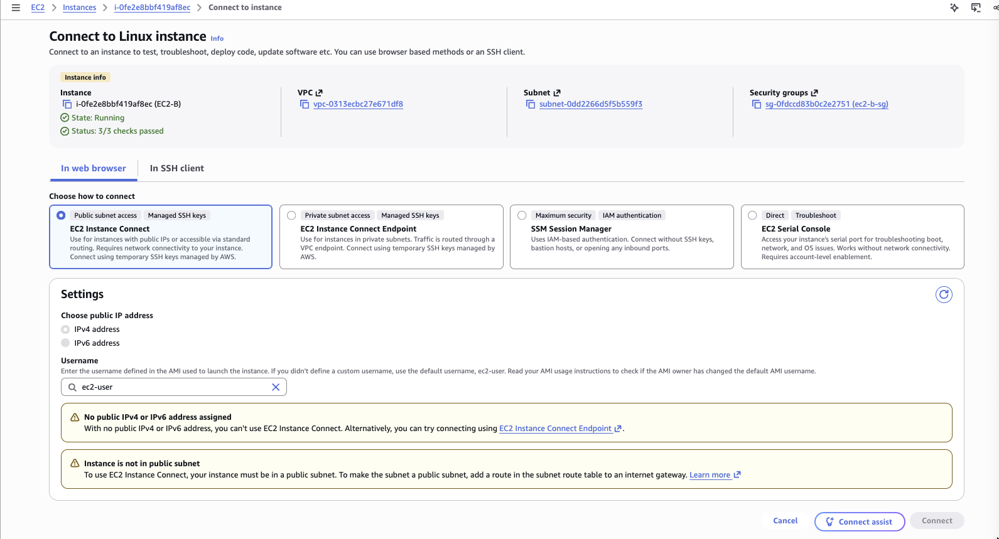

```bash
aws configure list
aws s3 ls --region us-east-1 --cli-connect-timeout 5 --cli-read-timeout 5
```

| Output | Meaning |
|---|---|
| `access_key`, `secret_key` type `iam-role`, region type `imds` | Credentials come from the instance role |
| `Connect timeout on endpoint URL: "https://s3.us-east-1.amazonaws.com/"` | Network failure, not a permission failure |

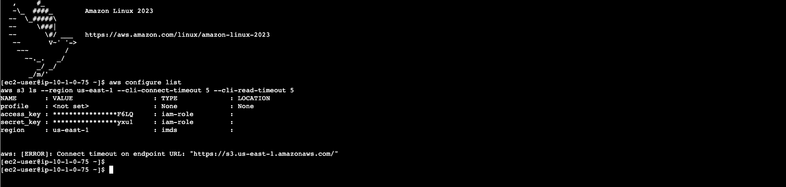

---

### Step 15 Create the S3 gateway endpoint

**Why this step:** a gateway endpoint adds a route for S3's IP ranges (a prefix list) that points to the endpoint. It works by **routing**, so it attaches to **route tables**, not subnets.

**Console:** **VPC → Endpoints → Create endpoint**

| Field | Value |
|---|---|
| Name tag | `lab-b-s3-gw` |
| Type | AWS services |
| Services | `com.amazonaws.us-east-1.s3` with **Type = Gateway** |
| VPC | `lab-B-vpc` |
| Route tables | ✔ `lab-B-rtb-private1-us-east-1a` |
| Policy | Full access |

Endpoint details: Type Gateway, **Private DNS names enabled = No** (gateway endpoints don't use DNS; the route table steers traffic).

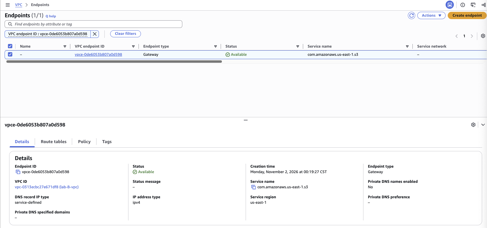

> [!WARNING]
> **Error found:** the VPC-B route table still had only 2 routes, with no `pl-…` route. The endpoint was not associated with a route table, so S3 traffic still had nowhere to go.

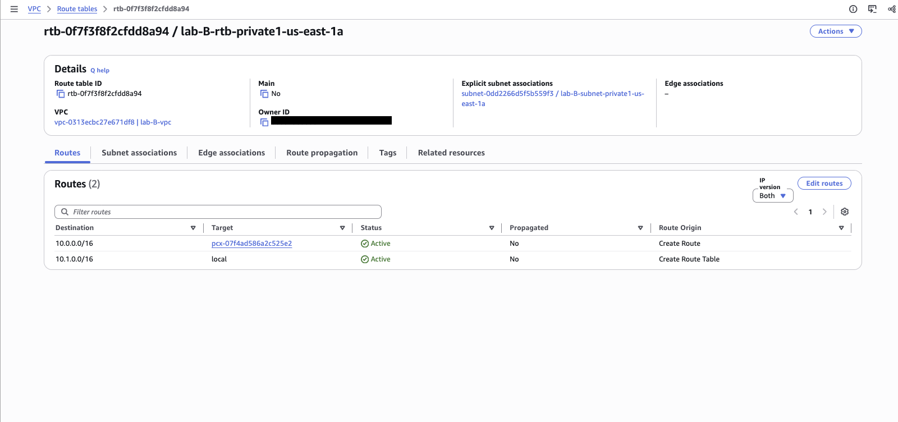

> [!WARNING]
> **Follow-up:** the endpoint list then showed only `lab-b-eice` (`eice-…`). The S3 gateway endpoint (`vpce-…`) was gone. The two prefixes belong to two different endpoints.

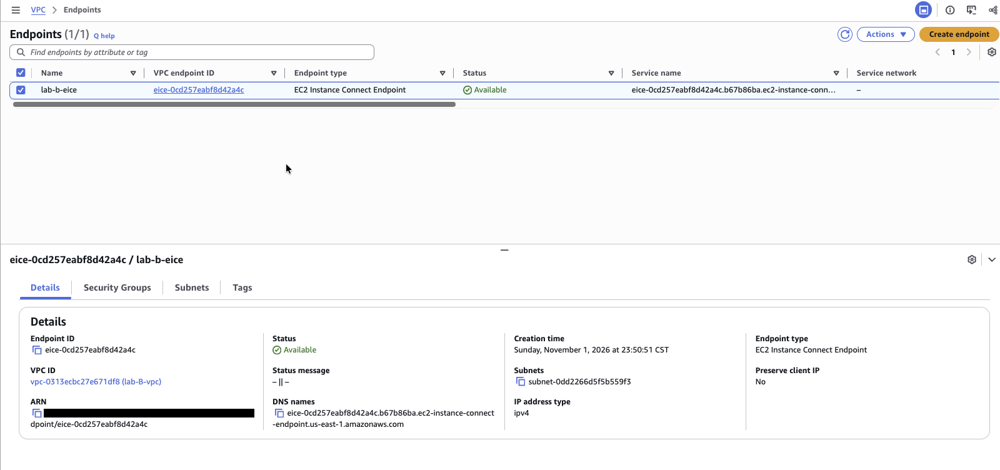

**Fix:** recreate the gateway endpoint with the route table ticked, or for an existing endpoint use **Actions → Manage route tables → ✔ lab-B-rtb-private1-us-east-1a → Modify route tables**. The route table must show:

| Destination | Target |
|---|---|
| `10.0.0.0/16` | `pcx-07f4ad586a2c525e2` |
| `10.1.0.0/16` | local |
| `pl-63a5400a` | `vpce-…` |

> [!WARNING]
> **Error found:** the S3 test was first run in the **Mac terminal** (`(base) … aws_labs %`). It listed the bucket, but over the home internet with local credentials, so it proved nothing about the endpoint. The prompt must read `[ec2-user@ip-10-1-0-75 ~]$`.

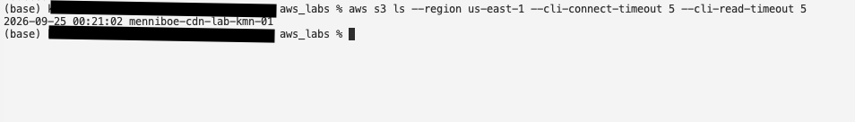

**EC2-B terminal**

```bash
aws s3 ls --region us-east-1 --cli-connect-timeout 5 --cli-read-timeout 5
```

Result: `menniboe-cdn-lab-kmn-01` returned instantly from an instance with no IGW and no NAT. `Last login … from 10.1.0.61` is the EIC Endpoint's private IP. Timestamps differ from the Mac by 5 hours because EC2 shows UTC.

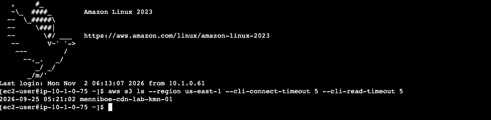

---

### Step 16 Teardown and verification

**Why this order:** a VPC can't be deleted while instances, endpoint ENIs, flow logs or peering still use it, so resources go from the inside out. The full CLI teardown is in `commands.md`.

| Order | Resource | Console path |
|---|---|---|
| 1 | EC2-A, EC2-B | EC2 → Instances → Terminate |
| 2 | `lab-b-eice`, `lab-b-s3-gw` | VPC → Endpoints → Delete VPC endpoints |
| 3 | `lab-b-flowlogs`, `/vpc/lab-b-flowlogs` | VPC → lab-B-vpc → Flow logs → Delete · CloudWatch → Log groups → Delete |
| 4 | `lab-A-to-B` | VPC → Peering connections → Delete (✔ delete related route entries) |
| 5 | `lab-A-vpc`, `lab-B-vpc` | VPC → Your VPCs → Delete VPC (removes subnets, route tables, IGW, SGs) |
| 6 | `lab-ec2-b-s3-read`, `VPCFlowLogs-Cloudwatch-…` + its policy | IAM → Roles → Delete · IAM → Policies → Delete |

**Verification (CLI):** only the default VPC `172.31.0.0/16` remains, and endpoints, peering, flow logs, `/vpc` log groups and lab roles return empty.

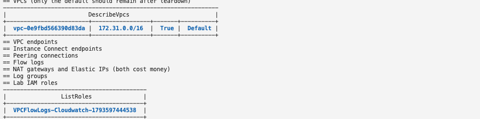

**Account-wide check:** Resource Groups & Tag Editor (All regions, All resource types) lists every resource. Expected leftovers are free defaults (default VPC parts in every Region, AWS-managed KMS keys, RDS default groups) and resources kept on purpose (CloudFront site, its S3 bucket, ACM certificate, Route 53 hosted zone). The Forbidden errors at the top of Tag Editor come from retired services the account isn't enabled for and are harmless.

---

## Troubleshooting log

| # | Symptom | Cause | Fix | Lesson |
|---|---|---|---|---|
| 1 | Ping 100% loss before peering | No path between VPCs; `10.1.0.75` matched `0.0.0.0/0 → igw` | Expected baseline | VPCs are isolated by default |
| 2 | Ping 100% loss with peering Active | No route points to the pcx | Add routes | An Active connection moves no traffic |
| 3 | Ping 100% loss with only VPC-A route | Reply from EC2-B has no route back | Add `10.0.0.0/16 → pcx` in VPC-B | Routes on **both** sides |
| 4 | Ping 100% loss with both routes Active | `ec2-b-sg` had no ICMP rule; wizard merged two rules into SSH from `10.0.0.0/16` | Edit rules: SSH from `10.1.0.0/16`, ICMP from `10.0.0.0/16` | Check the SG after every wizard launch |
| 5 | SSH source looked wrong | EIC Endpoint connects from its own private IP inside VPC-B | SSH source `10.1.0.0/16`, Preserve client IP off | SG source = whoever starts that traffic |
| 6 | `curl` to port 80 timed out | No SG rule for TCP 80 | Expected, recorded as REJECT | SGs drop silently, no "refused" |
| 7 | Connect page warnings: no public IP, not in public subnet | Default card is EC2 Instance Connect (public) | Pick the EC2 Instance Connect Endpoint card | Private instances use the endpoint card |
| 8 | `aws s3 ls` timed out on EC2-B | No route to S3 (no IGW, NAT or endpoint) | Expected baseline | Timeout = network, Access Denied = IAM |
| 9 | No `pl-…` route after creating gateway endpoint | Endpoint not associated with the route table | Manage route tables, or recreate with RT ticked | Gateway endpoints work only through routes |
| 10 | Endpoint list showed only the `eice-…` endpoint | Gateway endpoint no longer existed | Recreate it | `eice-` and `vpce-` are different endpoints |
| 11 | `aws s3 ls` worked but on the Mac | Command ran in the local terminal | Re-run inside EC2-B | Always check the prompt |
| 12 | Gateway endpoint Name showed "–" | Name tag didn't save | Tags → Manage tags → `Name` | Cosmetic |

---

## Questions answered during the session

**Why does the SSH rule on EC2-B use `10.1.0.0/16` and not `10.0.0.0/16`?**
A Security Group checks the packet's source IP. The SSH session reaches EC2-B from the EC2 Instance Connect Endpoint, which lives inside VPC-B and has a `10.1.0.x` address (`10.1.0.61` in this lab). The ICMP rule stays `10.0.0.0/16` because pings really do start on EC2-A in VPC-A.

**Which Security Group gets edited, EC2-A's or EC2-B's?**
EC2-B's (`ec2-b-sg`). Inbound rules belong on the instance receiving the traffic. EC2-A's group already allowed SSH from EC2 Instance Connect and all outbound.

**Why are the endpoint IDs different?**
`eice-…` is the EC2 Instance Connect Endpoint (shell access). `vpce-…` is a VPC endpoint (here the S3 gateway endpoint). They're separate resources with separate purposes.

**How do I check for anything still running?**
Resource Groups & Tag Editor (All regions, All resource types), Billing → Bills → Charges by service, and per-service CLI checks (`commands.md`). AWS-managed KMS keys are free; a customer-managed key in `PendingDeletion` is removed automatically when its waiting period ends.

---

## Service selection cheat sheet

| Requirement | Choose |
|---|---|
| Connect two or three VPCs privately | VPC peering |
| Many VPCs, many accounts, plus on-prem | Transit Gateway + RAM |
| Isolate Dev from Prod on a shared hub | TGW route tables |
| More VPN bandwidth | TGW + ECMP |
| Multicast | Transit Gateway |
| Private EC2 to S3 or DynamoDB, cheapest | Gateway endpoint |
| Private access to other AWS services, or from on-prem | Interface endpoint (PrivateLink) |
| Who talked to whom, allowed or not | VPC Flow Logs |
| Inspect payloads with an IDS | Traffic Mirroring → NLB |
| Encrypted on-prem link this week | Site-to-Site VPN |
| Branch offices talking through AWS | VPN CloudHub |
| Consistent high bandwidth to AWS | Direct Connect |
| Encrypt Direct Connect | VPN over DX or MACsec |
| Cheap DX backup | Site-to-Site VPN |
| One DX to many VPCs and Regions | Direct Connect Gateway |
| IPv6 outbound only | Egress-only Internet Gateway |
| Domain filtering and IPS for a whole VPC | AWS Network Firewall |
| Central firewall rules across accounts | AWS Firewall Manager |
| Shell on a private instance without a bastion | EC2 Instance Connect Endpoint |
| Cheapest instance-to-instance transfer | Same AZ, private IP |
| Cheapest public downloads from S3 | CloudFront in front of S3 |

---

## Acronyms

| Acronym | Meaning |
|---|---|
| ACL / NACL | (Network) Access Control List |
| AMI | Amazon Machine Image |
| ARN | Amazon Resource Name |
| AZ | Availability Zone |
| BGP | Border Gateway Protocol |
| CGW | Customer Gateway |
| CIDR | Classless Inter-Domain Routing |
| CLI | Command Line Interface |
| DX | AWS Direct Connect |
| DXGW | Direct Connect Gateway |
| ECMP | Equal-Cost Multi-Path |
| EIC / EICE | EC2 Instance Connect / EC2 Instance Connect Endpoint |
| EIGW | Egress-only Internet Gateway |
| ENI | Elastic Network Interface |
| GWLB | Gateway Load Balancer |
| IAM | Identity and Access Management |
| ICMP | Internet Control Message Protocol |
| IDS / IPS | Intrusion Detection / Prevention System |
| IGW | Internet Gateway |
| IMDS | Instance Metadata Service |
| IPsec | Internet Protocol Security |
| MACsec | Media Access Control Security |
| NAT | Network Address Translation |
| NLB | Network Load Balancer |
| pcx | VPC peering connection (ID prefix) |
| pl | Prefix list (ID prefix) |
| RAM | AWS Resource Access Manager |
| RT / rtb | Route table |
| SG | Security Group |
| SSH | Secure Shell |
| TGW | Transit Gateway |
| VGW | Virtual Private Gateway |
| VIF | Virtual Interface |
| VPC | Virtual Private Cloud |
| vpce | VPC endpoint (ID prefix) |
| VPN | Virtual Private Network |
