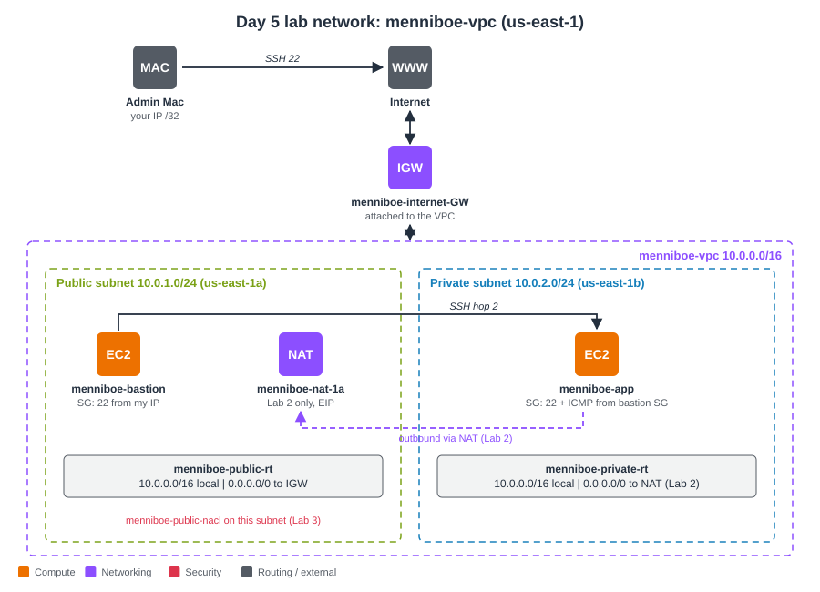

# AWS VPC Fundamentals

AWS SAA-C03, Section 27 (VPC Part 1): CIDR, VPCs, subnets, Internet Gateway, route tables, bastion host, NAT instance and gateway, NACLs and security groups. Built by hand in the AWS console in `us-east-1`, using Menniboe Farm as the running example.

## What I learned

- A subnet is **public only because of its route table** (`0.0.0.0/0 → IGW`); reachability needs four things: an attached IGW, the route, a public IP, and SG + NACL rules that allow it.
- AWS reserves **5 IPs per subnet** (usable = 2^(32 − prefix) − 5).
- **Bastion pattern** with SG-to-SG trust and SSH ProxyJump (`ssh -J`), keeping the key on the laptop via the SSH agent.
- **NAT gateway** gives outbound-only internet; one per AZ for HA; deleting it leaves a **Blackhole** route and an unreleased **Elastic IP**.
- **NACLs are stateless** (replies need ephemeral ports 1024–65535) and evaluate the **lowest rule number first**; security groups are stateful and allow-only.

## Key lab results

| Lab | Result |
|---|---|
| 1. VPC + bastion | 251 usable IPs per /24 subnet; bastion `curl` returned its public IP while the host saw `10.0.1.218`; ping bastion → app: 4/4 received, ~0.5 ms across AZs; SSH hop via bastion worked; private server: **NO INTERNET PATH** |
| 2. NAT gateway | Private server's `curl` returned the **NAT's Elastic IP**; after deleting the NAT the route turned **Blackhole**; Elastic IP released; back to NO INTERNET PATH (timestamped) |
| 3. NACL | Test A deny-all: timeout · Test B inbound 22 only: **still timeout** (stateless) · Test C + outbound 1024–65535: connected · Test D rule 90 DENY beats rule 100 ALLOW: timeout |
| Teardown | CLI-verified: no instances, NAT gateways, Elastic IPs or ENIs; only the default VPC remains |

## Issues solved

| Issue | Fix |
|---|---|
| Subnet CIDR typed `10.0.0.1/24` | `10.0.1.0/24` (block starts on its network address) |
| Console showed the wrong route table after association | Refresh; verify in the subnet's Route table tab |
| SG `Invalid rule description` with rollback | Plain-text descriptions only |
| App SG missing the ICMP rule | Added All ICMP - IPv4 from the bastion SG |
| Private instance launched without a key pair | Terminated and relaunched with the key |
| zsh redirection error from `<PLACEHOLDER>` | Replace the whole placeholder |
| Old terminal output mistaken for a new result | Prefix tests with `date;` |
| Blackhole route and leftover Elastic IP after NAT deletion | Removed route, released Elastic IP |

## Files

| File | Contents |
|---|---|
| [notes.md](notes.md) | All 9 modules, full console redo of 3 labs, screenshots, errors and fixes, troubleshooting log, cheat sheet, acronyms |
| [commands.md](commands.md) | Every command from the session plus a CLI-only redo |
| `images/diagrams/` | Architecture, module and lab diagrams (SVG) |
| `images/screenshots/` | Console and terminal screenshots (account ID and IPs redacted) |
