# AWS VPC Fundamentals: CIDR to NACLs and Security Groups

AWS SAA-C03, Section 27 (VPC Part 1). A reference guide covering every concept and a full console redo of three hands-on labs, built in `us-east-1` using Menniboe Farm (a farm co-op with an online store and orders system) as the running example.

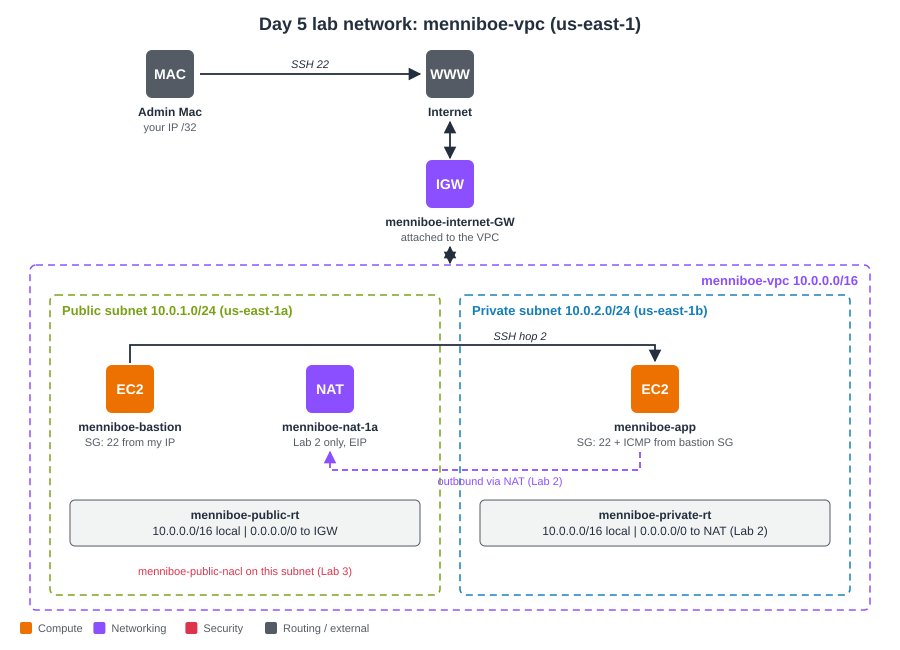

## Table of contents

- [Current state notes](#current-state-notes)
- [Block A Addressing](#block-a-addressing)
  - [Module 1 CIDR and private vs public IP](#module-1-cidr-and-private-vs-public-ip)
  - [Module 2 Default VPC](#module-2-default-vpc)
  - [Module 3 VPC overview](#module-3-vpc-overview)
- [Block B Getting online](#block-b-getting-online)
  - [Module 4 Subnets](#module-4-subnets)
  - [Module 5 Internet Gateway and route tables](#module-5-internet-gateway-and-route-tables)
- [Block C Reaching private things](#block-c-reaching-private-things)
  - [Module 6 Bastion host](#module-6-bastion-host)
  - [Module 7 NAT instance](#module-7-nat-instance)
  - [Module 8 NAT gateway](#module-8-nat-gateway)
- [Block D Traffic filtering](#block-d-traffic-filtering)
  - [Module 9 NACLs vs security groups](#module-9-nacls-vs-security-groups)
- [Lab 1 VPC bastion and private server](#lab-1-vpc-bastion-and-private-server)
  - [Step 1 Create the VPC](#step-1-create-the-vpc)
  - [Step 2 Turn on DNS hostnames](#step-2-turn-on-dns-hostnames)
  - [Step 3 Create the public and private subnets](#step-3-create-the-public-and-private-subnets)
  - [Step 4 Create the Internet Gateway](#step-4-create-the-internet-gateway)
  - [Step 5 Attach the Internet Gateway](#step-5-attach-the-internet-gateway)
  - [Step 6 Create the public route table](#step-6-create-the-public-route-table)
  - [Step 7 Add the internet route](#step-7-add-the-internet-route)
  - [Step 8 Associate the public subnet](#step-8-associate-the-public-subnet)
  - [Step 9 Turn on auto-assign public IPv4](#step-9-turn-on-auto-assign-public-ipv4)
  - [Step 10 Create the private route table](#step-10-create-the-private-route-table)
  - [Step 11 Associate the private subnet](#step-11-associate-the-private-subnet)
  - [Step 12 Create the bastion security group](#step-12-create-the-bastion-security-group)
  - [Step 13 Create the app security group](#step-13-create-the-app-security-group)
  - [Step 14 Prepare the key pair](#step-14-prepare-the-key-pair)
  - [Step 15 Launch the bastion host](#step-15-launch-the-bastion-host)
  - [Step 16 SSH into the bastion](#step-16-ssh-into-the-bastion)
  - [Step 17 Launch the private app server](#step-17-launch-the-private-app-server)
  - [Step 18 Ping the app server from the bastion](#step-18-ping-the-app-server-from-the-bastion)
  - [Step 19 SSH to the app server through the bastion](#step-19-ssh-to-the-app-server-through-the-bastion)
- [Lab 2 NAT gateway](#lab-2-nat-gateway)
  - [Step 1 Create the NAT gateway](#lab-2-step-1-create-the-nat-gateway)
  - [Step 2 Route the private subnet to the NAT](#lab-2-step-2-route-the-private-subnet-to-the-nat)
  - [Step 3 Prove outbound internet](#lab-2-step-3-prove-outbound-internet)
  - [Step 4 Delete the NAT gateway](#lab-2-step-4-delete-the-nat-gateway)
  - [Step 5 Release the Elastic IP](#lab-2-step-5-release-the-elastic-ip)
  - [Step 6 Remove the blackhole route](#lab-2-step-6-remove-the-blackhole-route)
- [Lab 3 NACL stateless filtering and rule order](#lab-3-nacl-stateless-filtering-and-rule-order)
  - [Step 1 Find your public IP](#lab-3-step-1-find-your-public-ip)
  - [Step 2 Create the custom NACL](#lab-3-step-2-create-the-custom-nacl)
  - [Step 3 Test A associate the NACL](#lab-3-step-3-test-a-associate-the-nacl)
  - [Step 4 Test B allow SSH inbound only](#lab-3-step-4-test-b-allow-ssh-inbound-only)
  - [Step 5 Test C allow replies on ephemeral ports](#lab-3-step-5-test-c-allow-replies-on-ephemeral-ports)
  - [Step 6 Test D lower-numbered DENY](#lab-3-step-6-test-d-lower-numbered-deny)
- [Final network console resource map](#final-network-console-resource-map)
- [Teardown](#teardown)
- [Troubleshooting log](#troubleshooting-log)
- [Questions answered during the session](#questions-answered-during-the-session)
- [Service selection cheat sheet](#service-selection-cheat-sheet)
- [Acronyms](#acronyms)

---

## Current state notes

> [!IMPORTANT]
> **Exam answer vs current AWS (October 2026)**
> - **Regional NAT Gateway (Nov 2025):** a NAT gateway can be created in *regional* availability mode: you choose the VPC (not a subnet) and it expands across AZs automatically. The console now shows an **Availability mode: Zonal / Regional** choice. The exam still expects **one zonal NAT gateway per AZ** for HA.
> - **Public IPv4 charge (since Feb 2024):** every public IPv4 costs about $0.005/hr, attached or idle. Bastions, NAT gateways, Elastic IPs and public EC2s all carry it.
> - **VPC encryption control (paid since Mar 2026):** a new option on the Create VPC page. *Monitor mode* reports unencrypted traffic; *Enforce mode* blocks resources that can't encrypt in transit. Both modes are billed per non-empty VPC. Not on SAA-C03; left at **None** in the lab.

---

## Block A Addressing

### Module 1 CIDR and private vs public IP

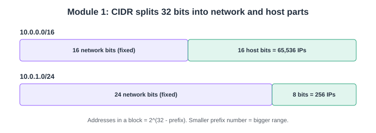

**What it means.** CIDR (Classless Inter-Domain Routing) writes an IP range as a base address plus a slash number, for example `10.0.0.0/16`. The slash number says how many of the 32 bits are fixed (network part). The rest are free (host part).

| Prefix | Mask | Addresses | Typical AWS use |
|---|---|---|---|
| /32 | 255.255.255.255 | 1 | One exact IP (SG rule for your laptop) |
| /28 | 255.255.255.240 | 16 | Smallest subnet or VPC block |
| /24 | 255.255.255.0 | 256 | Common subnet size |
| /20 | 255.255.240.0 | 4,096 | Default VPC subnets |
| /16 | 255.255.0.0 | 65,536 | Largest VPC block |
| /0 | 0.0.0.0 | All | "Anywhere" |

- Addresses in a block = 2^(32 − prefix). Smaller prefix number = bigger range.
- A block must **start on its network address**: `10.0.1.0/24` is valid, `10.0.0.1/24` is not.

**Private ranges (RFC 1918):** `10.0.0.0/8`, `172.16.0.0/12` (default VPC uses `172.31.0.0/16`), `192.168.0.0/16`. Never routed on the internet.

**Public IPs** are unique worldwide. An EC2 instance never sees its own public IP; the Internet Gateway translates private ↔ public 1:1.

> [!TIP]
> Exam clues: "allow only the admin's laptop" → `x.x.x.x/32`. "Allow from anywhere" → `0.0.0.0/0`.

**Menniboe Farm:** the farm VPC uses `10.0.0.0/16`; the farmhouse office router uses `192.168.1.0/24`, so they never clash when a VPN is added later.

### Module 2 Default VPC

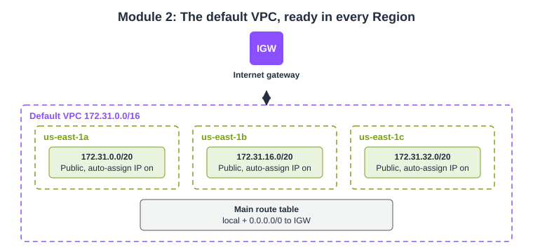

**What it means.** Every account has a default VPC in every Region, ready to use.

| Piece | Setting |
|---|---|
| CIDR | `172.31.0.0/16` |
| Subnets | One per AZ, each /20, all public (auto-assign public IPv4 on) |
| Internet Gateway | Attached |
| Main route table | local + `0.0.0.0/0 → IGW` |
| Default NACL | Allows all |
| DNS resolution and hostnames | Both on |

| Pros | Cons |
|---|---|
| Zero setup, instant internet | Everything public by default |
| Good for quick tests | No private subnets |
| Can be recreated if deleted | `172.31.0.0/16` may overlap networks you connect later |

> [!TIP]
> Exam clue: "launched an instance and it got a public IP with no configuration" → it's in the **default VPC**. Production → **custom VPC** with public and private subnets.

### Module 3 VPC overview

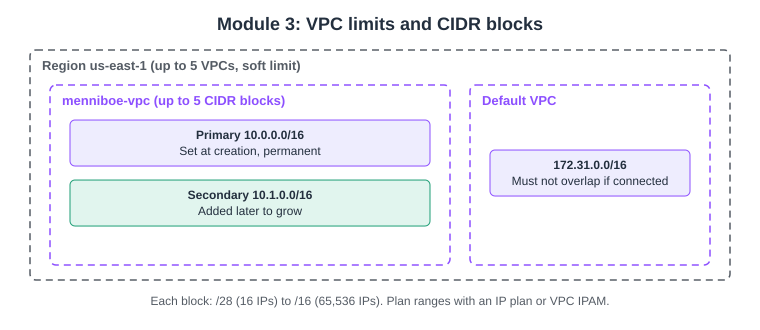

**What it means.** A VPC is your isolated network in one Region, spanning all its AZs.

| Setting | Value |
|---|---|
| VPCs per Region | 5 (soft limit) |
| CIDR blocks per VPC | 5 (1 primary, up to 4 secondary) |
| Block size | /28 to /16 |
| IPv6 | Optional (AWS assigns a /56) |
| DNS settings | Turn on both resolution and hostnames |

**The overlap rule.** A VPC CIDR must not overlap any network it will ever connect to (peering, Transit Gateway, VPN, Direct Connect). Overlap can't be fixed with routing; you rebuild.

**Why AWS doesn't warn about overlap at creation:** overlap between isolated VPCs is legal and often deliberate (identical dev/test/prod), AWS can't know your future connections, and it can't see your on-prem networks. AWS catches it at connect time (peering request fails). To prevent it up front: **Amazon VPC IPAM** hands out non-overlapping CIDRs from central pools and flags existing overlaps.

| Pros | Cons |
|---|---|
| Full control of IP plan, routing, filtering | Bad CIDR choice is painful to undo |
| Free (you pay for NAT, public IPs, etc.) | Hard cap of 5 CIDR blocks |
| Grow with secondary CIDRs | Multi-VPC designs need planning up front |

> [!TIP]
> Exam clues: "running out of IPs" → **secondary CIDR**. "Can't peer two VPCs" → **overlapping CIDRs**. "Centrally prevent overlaps across accounts" → **VPC IPAM**.

---

## Block B Getting online

### Module 4 Subnets

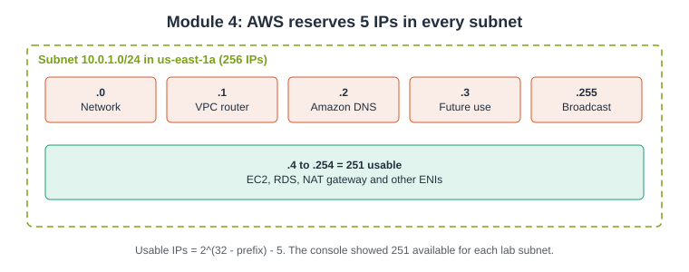

**What it means.** A subnet is a slice of the VPC CIDR in **exactly one AZ**.

| Reserved in `10.0.1.0/24` | Purpose |
|---|---|
| `10.0.1.0` | Network address |
| `10.0.1.1` | VPC router |
| `10.0.1.2` | Amazon DNS |
| `10.0.1.3` | Future use |
| `10.0.1.255` | Broadcast (reserved anyway) |

- **Usable IPs = 2^(32 − prefix) − 5.** /24 → 251, /27 → 27, /28 → 11.
- Subnet CIDR must sit inside the VPC CIDR and not overlap other subnets.
- "Public" is **not** a subnet setting; it comes from the route table. *Auto-assign public IPv4* decides whether new instances get a public IP.

| Pros | Cons |
|---|---|
| Separate tiers (web, app, data) | 5 IPs lost per subnet |
| Spread across AZs for HA | Too-small subnets break scaling |

> [!TIP]
> Exam clue: "29 instances, smallest subnet" → /27 gives only 27 usable, so **/26** (59).

### Module 5 Internet Gateway and route tables

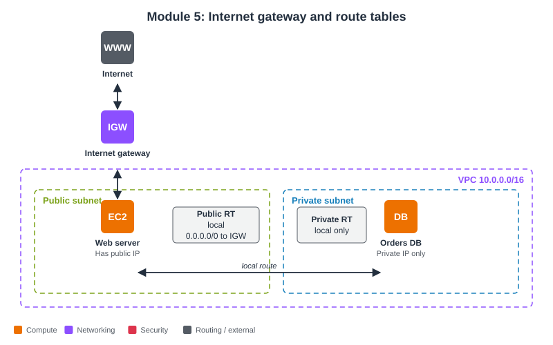

**Internet Gateway (IGW):** the VPC's door to the internet. Free, managed, HA, no bandwidth limit, one per VPC. Must be **attached** and **routed to**.

**Route tables:**
- Every table has a `local` route (`10.0.0.0/16 → local`) that can't be deleted, so all subnets reach each other, even across AZs.
- Each subnet uses exactly **one** route table; unassociated subnets use the **main** table. Keep main bare; associate subnets explicitly.
- **Longest prefix wins:** `10.0.0.0/16 → local` beats `0.0.0.0/0`.
- A route whose target was deleted shows **Blackhole**: traffic is silently dropped.

**Internet checklist: all four must be true**

| # | Requirement |
|---|---|
| 1 | IGW attached to the VPC |
| 2 | Subnet route table has `0.0.0.0/0 → igw-xxxx` |
| 3 | Instance has a public IPv4 or Elastic IP |
| 4 | Security group and NACL allow the traffic |

| Pros | Cons |
|---|---|
| Free, unlimited, no single point of failure | Two-way: public subnets need tight SGs |
| Simple routing model | One missing item = silent timeout |

> [!TIP]
> Exam clues: "public subnet instance can't reach internet" → walk the checklist. "Private instance needs outbound" → NAT, not an IGW route.

---

## Block C Reaching private things

### Module 6 Bastion host

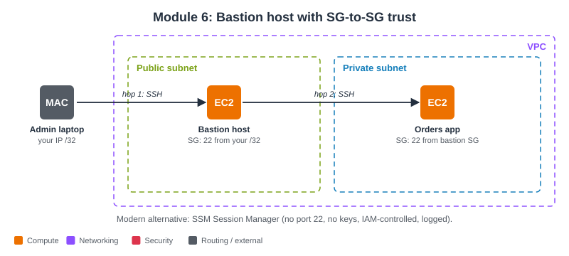

**What it means.** A small EC2 in a public subnet that admins SSH into first, then hop to private instances.

- Bastion SG: SSH 22 from your IP `/32` only.
- Private SG: SSH 22 **from the bastion's security group** (SG reference, not an IP).
- Keep the key on your laptop: SSH agent + ProxyJump (`ssh -J`), never copy the `.pem` onto the bastion.
- Modern alternatives: **SSM Session Manager** (no port 22, no keys, IAM-controlled, logged) and **EC2 Instance Connect Endpoint**.

| Pros | Cons |
|---|---|
| Simple, well known | Public instance to patch and harden |
| One controlled entry point | Keys to manage |
| SG-to-SG trust is easy to audit | Costs an instance plus a public IPv4 |

### Module 7 NAT instance

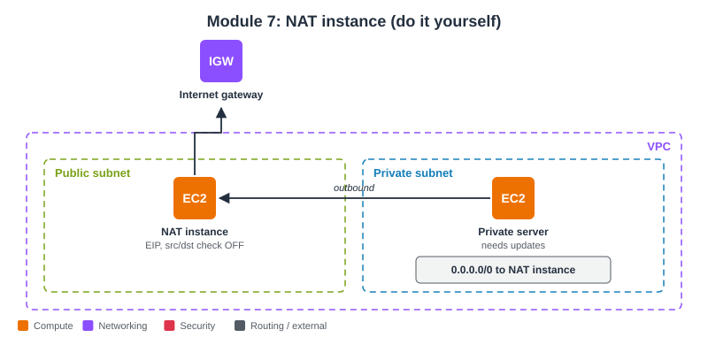

**What it means.** An EC2 configured to do NAT: private instances start outbound connections; the internet can't start connections back.

- Public subnet, Elastic IP, **source/destination check disabled**.
- Private route table: `0.0.0.0/0 → NAT instance`.
- You patch it, size it and build failover. Supports security groups; can double as a bastion.

> [!WARNING]
> "NAT instance configured but private instances still can't reach the internet" → source/destination check is still **enabled**.

### Module 8 NAT gateway

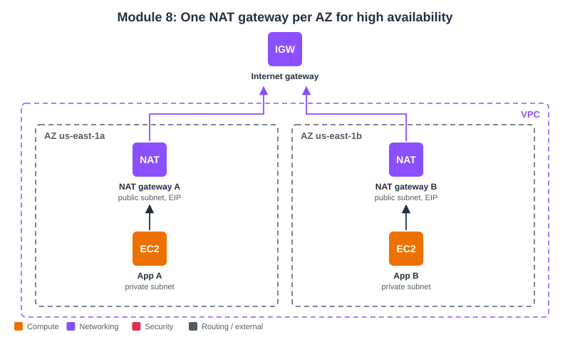

**What it means.** AWS-managed NAT. Path: **private subnet → NAT gateway → IGW**.

- Created in a **public subnet** with an **Elastic IP**, in one AZ.
- Scales 5 → 100 Gbps; **no security group**; billed per hour + per GB + public IPv4.
- **HA rule:** one NAT gateway per AZ, each AZ's private route table pointing at its own NAT. (Regional mode does this automatically in current AWS.)

| Feature | NAT gateway | NAT instance |
|---|---|---|
| Managed by | AWS | You |
| Availability | HA within AZ; one per AZ for full HA | Your own failover |
| Bandwidth | Up to 100 Gbps | Instance type |
| Security group | No | Yes |
| Source/dest check | N/A | Must disable |
| Bastion / port forwarding | No | Yes |
| Cost | Hourly + per GB | EC2 + network |

> [!TIP]
> Exam clues: "outbound internet, HA, least ops" → **NAT gateway in each AZ**. "AZ failed, other AZ lost internet" → they shared one NAT gateway.

**Menniboe Farm:** orders servers in both AZs pull payment-SDK updates through their own AZ's NAT gateway.

---

## Block D Traffic filtering

### Module 9 NACLs vs security groups

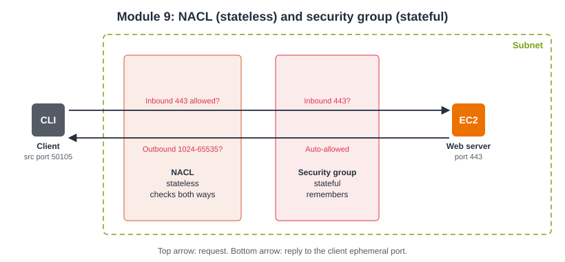

**What it means.** Two firewall layers. NACL = subnet border, **stateless**. Security group = instance, **stateful**.

**Ephemeral ports:** clients reply-listen on a random temporary port (Linux ~32768–60999, Windows 49152–65535). NACL rules carrying replies must allow **TCP 1024–65535**.

| | Security group | NACL |
|---|---|---|
| Level | Instance (ENI) | Subnet |
| State | Stateful | Stateless |
| Rules | Allow only | Allow and deny |
| Evaluation | All rules | Lowest number first, first match wins |
| Sources | CIDRs or SGs | CIDRs only |
| Default | New SG: no inbound, all outbound | Default NACL allows all; new custom NACL denies all |

**ICMP (Internet Control Message Protocol):** the network's status and error messages. No ports, only types: 8 Echo Request and 0 Echo Reply (ping), 3 Destination Unreachable, 11 Time Exceeded (traceroute). That's why an ICMP SG rule shows **Port range: All**.

> [!TIP]
> Exam clues: "block one malicious IP" → **NACL DENY** (SGs can't deny). "Inbound allowed in NACL but no response" → missing **ephemeral ports** outbound. "Rule 100 ALLOW all, rule 200 DENY an IP" → the IP is **allowed**.

**Menniboe Farm:** a bot scrapes the price list from one IP → NACL rule **90 DENY** that `/32`, before rule 100 ALLOW 443.

---

## Lab 1 VPC bastion and private server

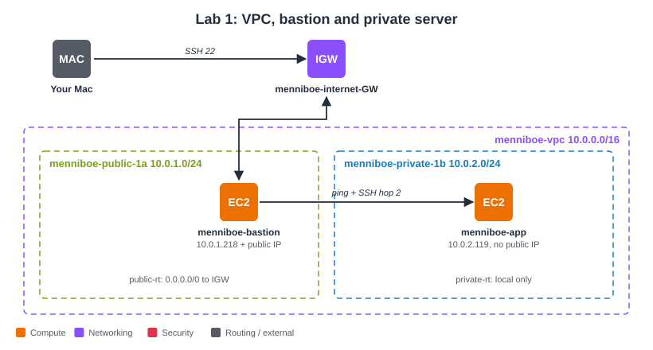

**What we build:** `menniboe-vpc` by hand (VPC only, no wizard), one public and one private subnet, an Internet Gateway, two route tables, two security groups, a bastion and a private app server.

**What it proves:** a subnet is public only because of its route table; the private server has no internet path; SG-to-SG trust lets you reach it only through the bastion.

**Resources built**

| Resource | Name | ID / value |
|---|---|---|
| VPC | `menniboe-vpc` | `vpc-07b4089d20fdd22ec`, `10.0.0.0/16` |
| Public subnet | `menniboe-public-1a` | `subnet-034f805ec714828ca`, `10.0.1.0/24`, us-east-1a |
| Private subnet | `menniboe-private-1b` | `subnet-04a5f9947ebaae2d8`, `10.0.2.0/24`, us-east-1b |
| Internet Gateway | `menniboe-internet-GW` | `igw-0f18b6b30dc64c179` |
| Main route table | `Menniboe-main-RT` | `rtb-06ae95ac38122d59b` (local only, no subnets) |
| Public route table | `menniboe-public-rt` | `rtb-0b6c682a94d7ed294` |
| Private route table | `menniboe-private-rt` | `rtb-08e18a12618eadd15` |
| Bastion SG | `menniboe-bastion-sg` | `sg-00ffd0a6c85d4ed6a` |
| App SG | `menniboe-apposg` | `sg-0d0fcba2bf5cb4a7a` |
| Key pair | `MSuccess` | RSA, `.pem` |
| Bastion | `menniboe-bastion` | `i-0bf24178279c145ea`, `10.0.1.218` + public IP |
| App server | `menniboe-app` | `i-0567eb8b4ed0d33c2`, `10.0.2.119` |

### Step 1 Create the VPC

**Why this step:** the VPC is the empty address space everything else lives in. "VPC only" means you build each piece and see what it does.

**Console:** VPC → Your VPCs → Create VPC

| Field | Value |
|---|---|
| Resources to create | VPC only |
| Name tag | `menniboe-vpc` |
| IPv4 CIDR block | IPv4 CIDR manual input |
| IPv4 CIDR | `10.0.0.0/16` |
| IPv6 CIDR block | No IPv6 CIDR block |
| Tenancy | Default |
| VPC encryption control | None |

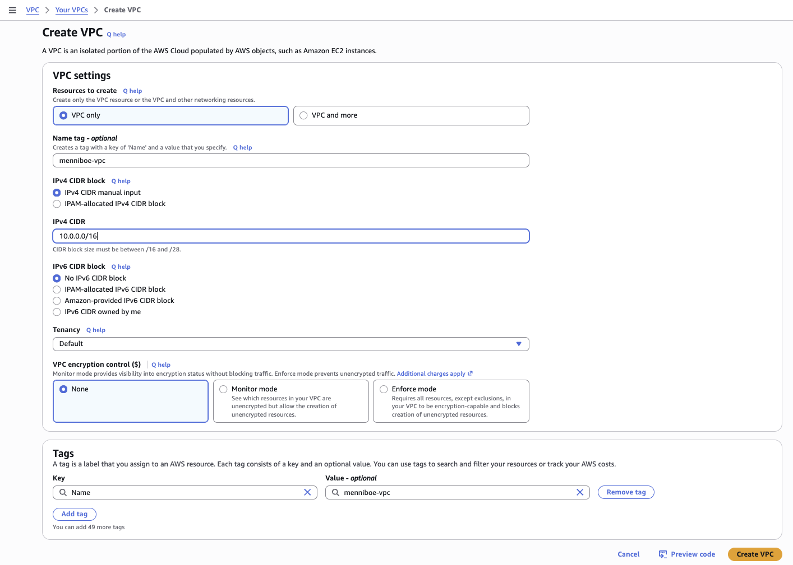

AWS also created a **main route table**, a **default NACL** (allow all) and a **default security group**.

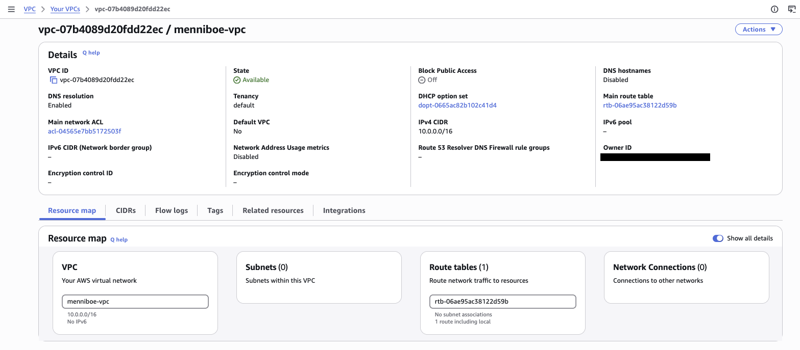

### Step 2 Turn on DNS hostnames

**Why this step:** custom VPCs start with DNS hostnames off. With it on, instances with public IPs get public DNS names, like the default VPC.

**Console:** VPC → Actions → Edit VPC settings

| Field | Value |
|---|---|
| DHCP option set | Leave current |
| Enable DNS resolution | Checked |
| Enable DNS hostnames | **Checked** |
| Network Address Usage metrics | Unchecked |

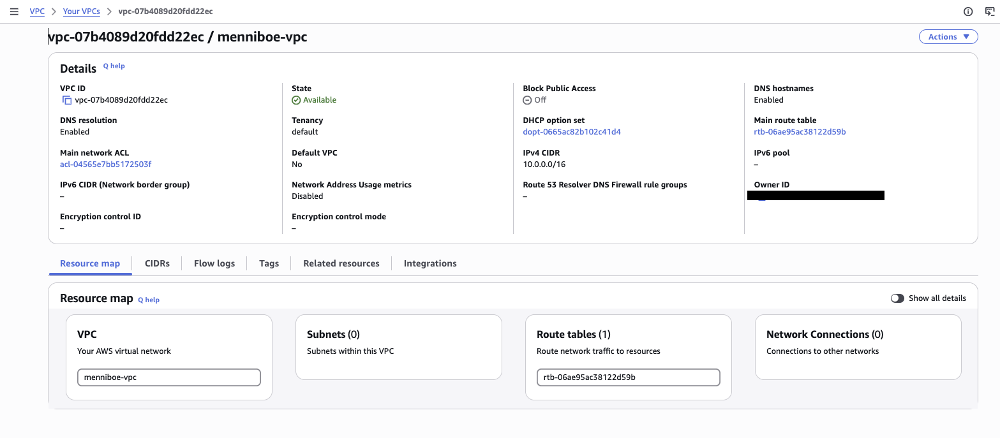

### Step 3 Create the public and private subnets

**Why this step:** every resource needs a subnet, and a subnet pins resources to one AZ. Both subnets start private (they use the main route table).

**Console:** VPC → Subnets → Create subnet (both added in one form with **Add new subnet**)

| Field | Subnet 1 | Subnet 2 |
|---|---|---|
| VPC ID | `menniboe-vpc` | `menniboe-vpc` |
| Subnet name | `menniboe-public-1a` | `menniboe-private-1b` |
| Availability Zone | us-east-1a (`use1-az1`) | us-east-1b (`use1-az2`) |
| IPv4 VPC CIDR block | `10.0.0.0/16` | `10.0.0.0/16` |
| IPv4 subnet CIDR block | `10.0.1.0/24` | `10.0.2.0/24` |

> [!WARNING]
> **Error caught before Create:** the public subnet CIDR was typed `10.0.0.1/24` (digits swapped). A block must start on its network address; in a /24 the last number must be 0. **Fix:** `10.0.1.0/24`.

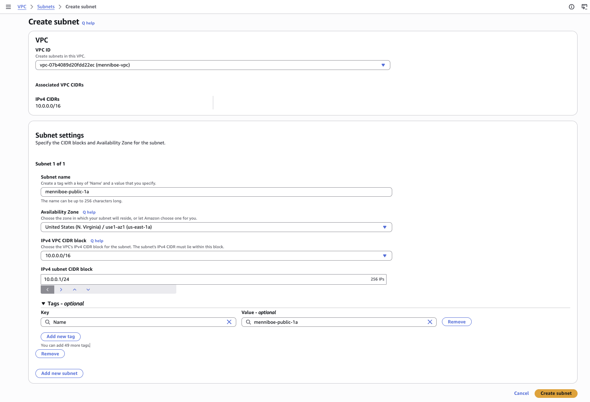

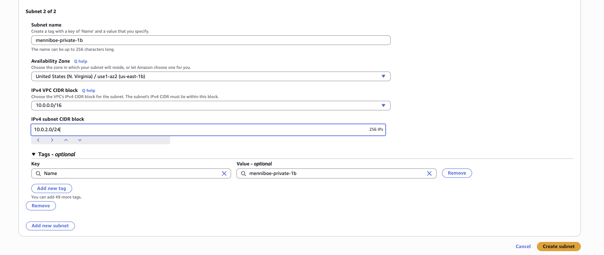

> [!NOTE]
> **AZ name vs AZ ID:** `us-east-1a` is a per-account name; `use1-az1` is the physical zone ID, identical across accounts. AZ IDs matter when aligning zones across accounts (shared VPCs, PrivateLink).

Each subnet showed **251 available IPv4 addresses** (256 − 5 reserved).


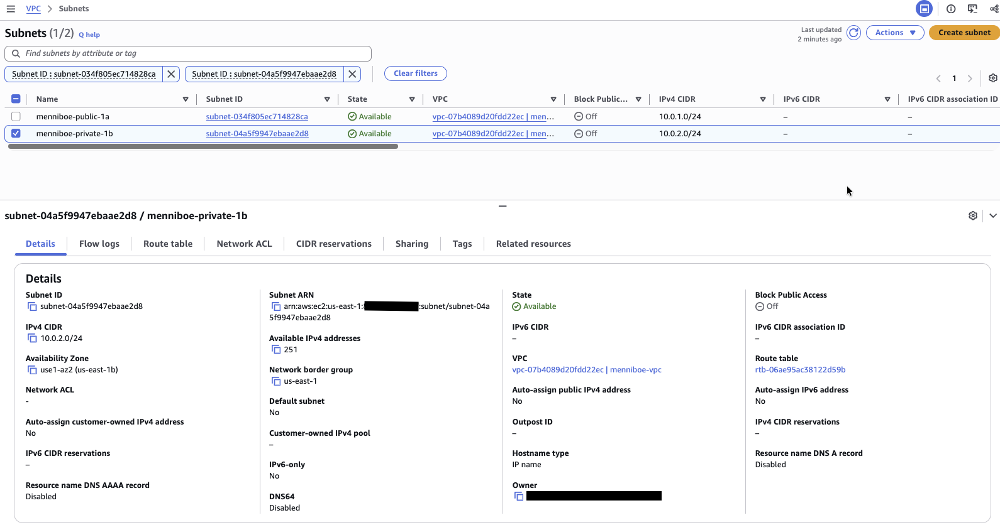

### Step 4 Create the Internet Gateway

**Why this step:** the VPC has no door to the internet yet. A new IGW starts **Detached**.

**Console:** VPC → Internet gateways → Create internet gateway → Name tag `menniboe-internet-GW`

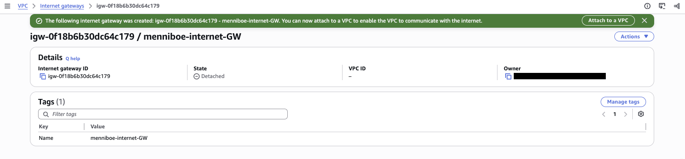

### Step 5 Attach the Internet Gateway

**Why this step:** attaching links the IGW to the VPC (checklist item 1). No subnet uses it until a route points to it.

**Console:** Actions → Attach to VPC → `menniboe-vpc` → Attach internet gateway

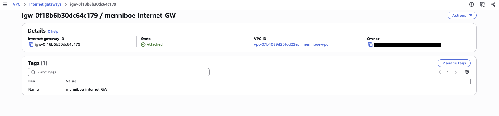

### Step 6 Create the public route table

**Why this step:** keep the main table private; give the public subnet its own table.

**Console:** VPC → Route tables → Create route table → Name `menniboe-public-rt`, VPC `menniboe-vpc`

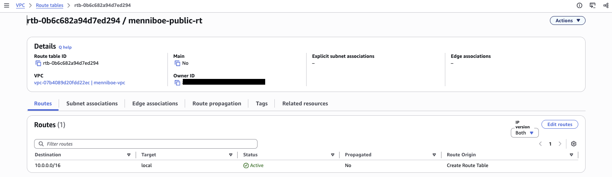

### Step 7 Add the internet route

**Why this step:** the route `0.0.0.0/0 → igw` sends non-VPC traffic to the IGW (checklist item 2).

**Console:** Routes → Edit routes → Add route

| Destination | Target |
|---|---|
| `10.0.0.0/16` | local |
| `0.0.0.0/0` | Internet Gateway → `igw-0f18b6b30dc64c179` |

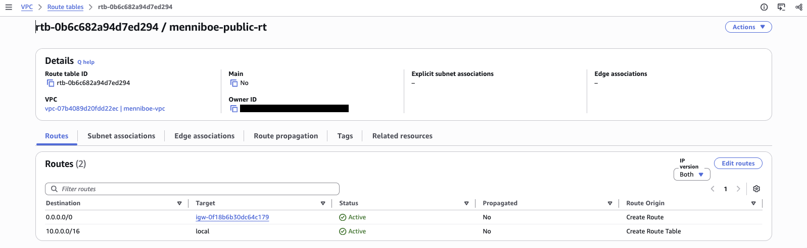

### Step 8 Associate the public subnet

**Why this step:** this is the moment the subnet **becomes public**.

**Console:** Subnet associations → Edit subnet associations → check only `menniboe-public-1a` → Save

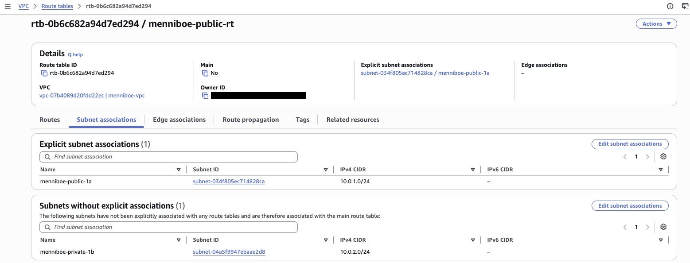

"Subnets without explicit associations" lists subnets that fall back to the main table; here that's still the private subnet.

### Step 9 Turn on auto-assign public IPv4

**Why this step:** instances also need a public IP (checklist item 3). Only on the public subnet.

**Console:** Subnets → `menniboe-public-1a` → Actions → Edit subnet settings

| Field | Value |
|---|---|
| Enable auto-assign public IPv4 address | **Checked** |
| Auto-assign customer-owned IPv4 | Unavailable (no Outposts) |
| Resource name DNS A record | Unchecked |
| Resource name DNS AAAA record / DNS64 | Unavailable (no IPv6 in this VPC) |
| Hostname type | IP name |

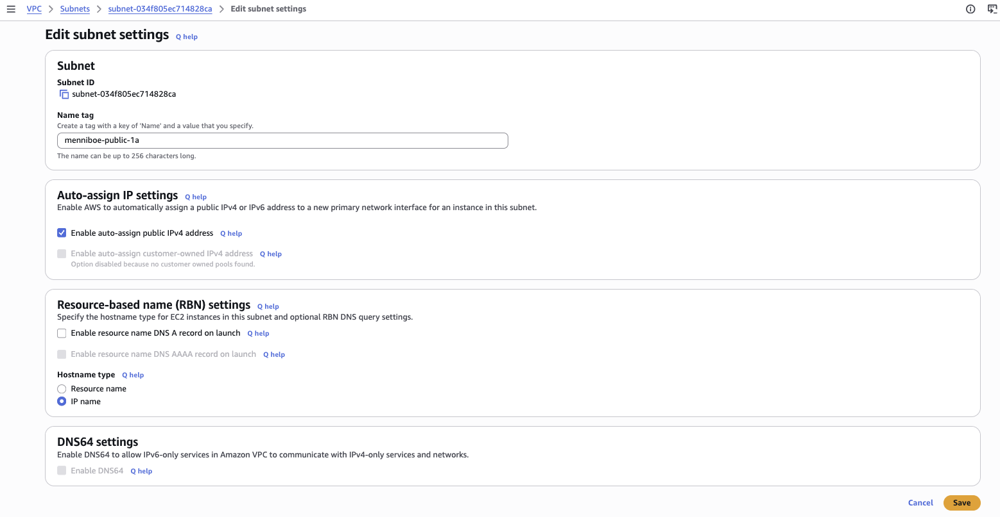

> [!WARNING]
> **Stale console panel:** after saving, the subnet details still showed the **main** route table. The association had saved; the panel was cached. **Fix:** refresh and check the subnet's **Route table** tab, which showed `menniboe-public-rt`.

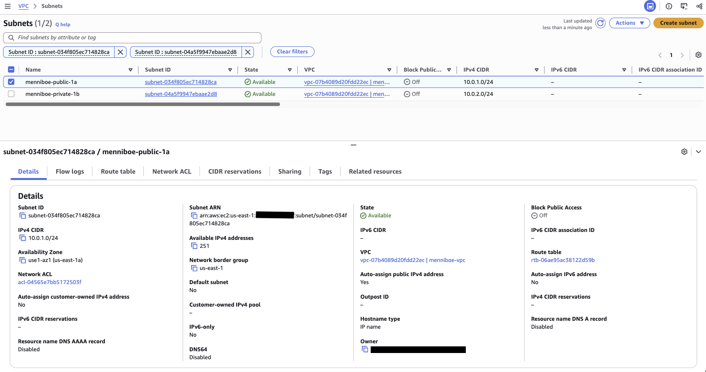

### Step 10 Create the private route table

**Why this step:** in Lab 2 the private subnet gets a NAT route. Putting it on **main** would leak NAT access to every future unassociated subnet.

**Console:** Create route table → Name `menniboe-private-rt`, VPC `menniboe-vpc` (local route only)

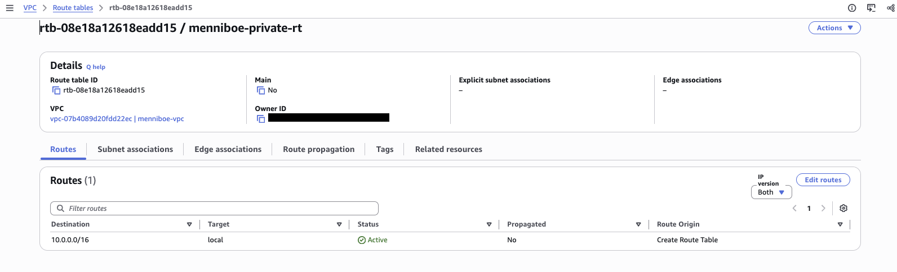

### Step 11 Associate the private subnet

**Why this step:** moves `menniboe-private-1b` off main; main stays a bare safety net.

**Console:** Subnet associations → Edit → check only `menniboe-private-1b` → Save

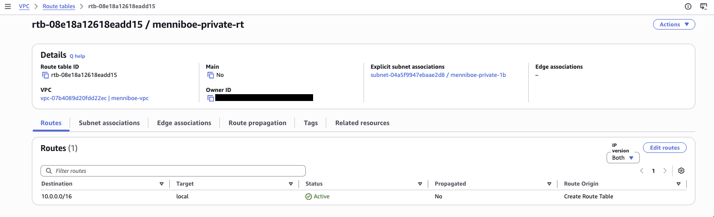

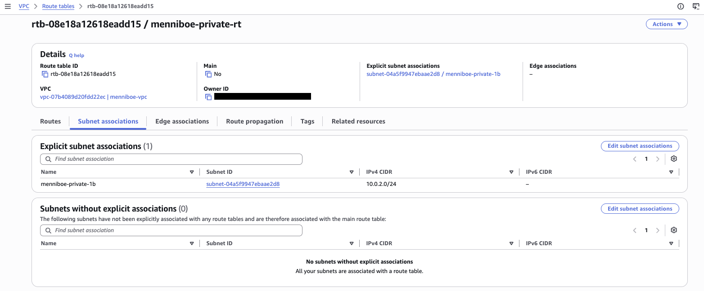

"Subnets without explicit associations (0)": every subnet now has its own table. The **Routes** tab shows destinations and targets; the **Subnet associations** tab shows which subnets use the table.

### Step 12 Create the bastion security group

**Why this step:** routing decides where traffic can go; security groups decide who's allowed in. The bastion is the one door, SSH from your IP only.

**Console:** VPC → Security groups → Create security group

| Field | Value |
|---|---|
| Security group name | `menniboe-bastion-sg` |
| Description | `SSH from my IP only` |
| VPC | `menniboe-vpc` (change from default) |
| Inbound | SSH, TCP 22, Source **My IP**, description `Admin Laptop` |
| Outbound | All traffic → `0.0.0.0/0` (default) |

> [!WARNING]
> **Error:** `Invalid rule description. Valid descriptions are strings less than 256 characters from the following set: a-zA-Z0-9. _-:/()#,@[]+=&;{}!$*`. AWS created the group, failed on the rule, then **rolled back** (deleted the group). **Cause:** a character outside the set (apostrophe, quote, emoji, smart character from voice-to-text). **Fix:** plain text only.

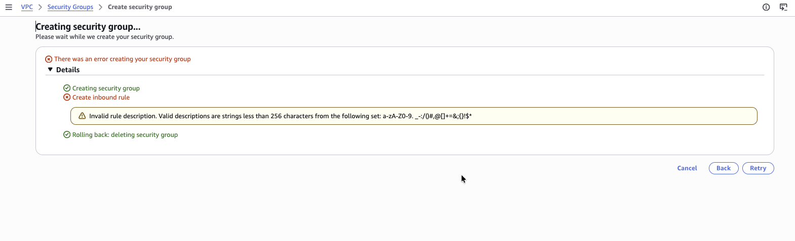

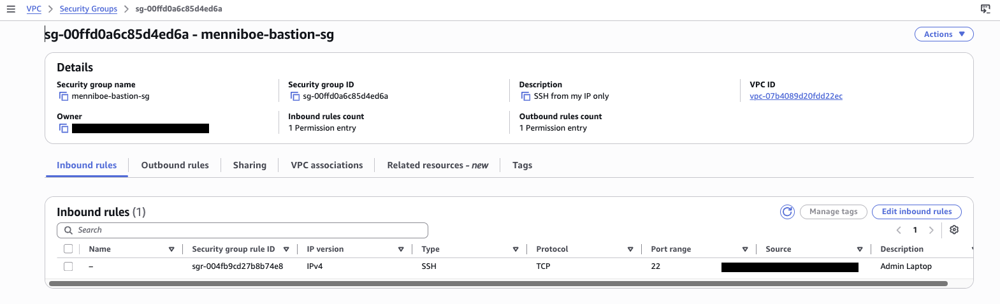

### Step 13 Create the app security group

**Why this step:** the private server accepts SSH and ping **only from the bastion's SG**, not from any IP.

| Field | Value |
|---|---|
| Security group name | `menniboe-apposg` |
| Description | `SSH and ping from bastion SG only` |
| VPC | `menniboe-vpc` |
| Inbound rule 1 | SSH, TCP 22, Source Custom → `sg-00ffd0a6c85d4ed6a` |
| Inbound rule 2 | All ICMP - IPv4, Source Custom → `sg-00ffd0a6c85d4ed6a` |
| Outbound | All traffic (default) |

> [!WARNING]
> **Error:** the group was created with only the SSH rule. Without ICMP, the ping test would time out and look like a routing problem. **Fix:** Edit inbound rules → add All ICMP - IPv4 from the bastion SG. Also: an SG **name can't be changed** after creation (`menniboe-apposg` kept as is).

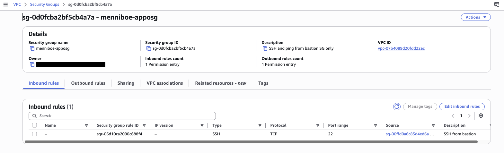

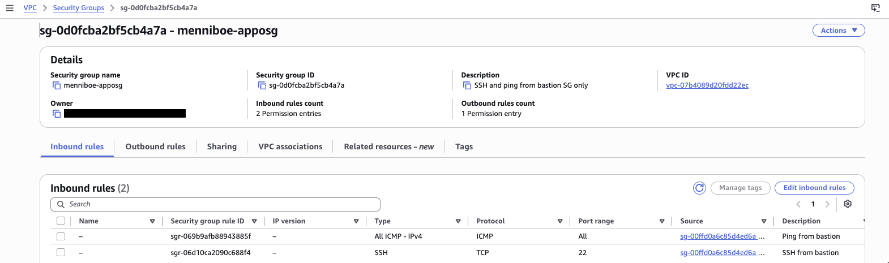

### Step 14 Prepare the key pair

**Why this step:** an SG only opens the port; the key proves identity. Used the existing RSA key `MSuccess` (key pairs are Regional; it lives in us-east-1).

```bash
ls -l ~/.ssh
chmod 400 ~/.ssh/MSuccess.pem
```

Permissions must read `-r--------`. (`cat ~/.ssh` fails with "Is a directory": use `ls` for folders.)

### Step 15 Launch the bastion host

**Why this step:** the first compute; all four checklist items line up for the first time.

**Console:** EC2 → Launch instances

| Section | Value |
|---|---|
| Name | `menniboe-bastion` |
| AMI | Amazon Linux 2023, 64-bit (x86) |
| Instance type | t3.micro |
| Key pair | `MSuccess` |
| Network settings → Edit | VPC `menniboe-vpc`, subnet `menniboe-public-1a`, auto-assign public IP Enable |
| Firewall | Select existing: `menniboe-bastion-sg` |
| Storage | 8 GiB gp3 |
| Advanced details | Defaults |

> [!IMPORTANT]
> Always click **Edit** in Network settings; otherwise the wizard uses the default VPC.

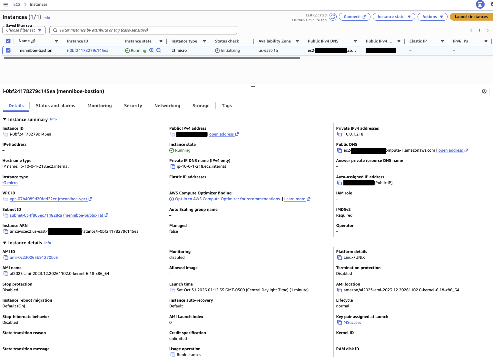

Private IP `10.0.1.218`, auto-assigned public IP, public DNS (from Step 2), IMDSv2 required.

### Step 16 SSH into the bastion

**Why this step:** end-to-end test of the four checklist items, then an outbound test.

```bash
ssh -i ~/.ssh/MSuccess.pem ec2-user@BASTION_IP
curl -s https://checkip.amazonaws.com
```

The `curl` printed the bastion's **public** IP while the prompt showed `ip-10-0-1-218`: the IGW translated private → public.

### Step 17 Launch the private app server

**Why this step:** the orders server sits in the private subnet with no public IP; the only way in is the bastion.

| Section | Value |
|---|---|
| Name | `menniboe-app` |
| AMI / type | Amazon Linux 2023, t3.micro |
| Key pair | **`MSuccess`** |
| Network | VPC `menniboe-vpc`, subnet `menniboe-private-1b`, auto-assign public IP **Disable** |
| Firewall | `menniboe-apposg` |

> [!WARNING]
> **Error:** the first launch showed **Key pair assigned at launch: –**. SSH would fail with `Permission denied (publickey)`. A launch key pair can't be added to a running instance from the console. **Fix:** terminate and relaunch with `MSuccess` selected.

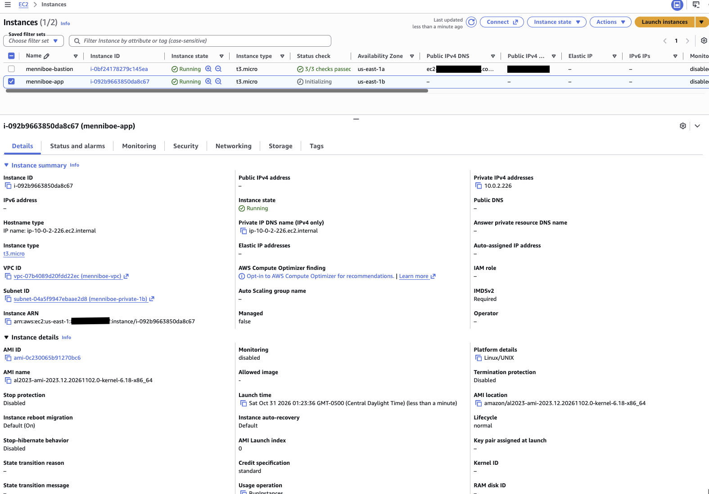

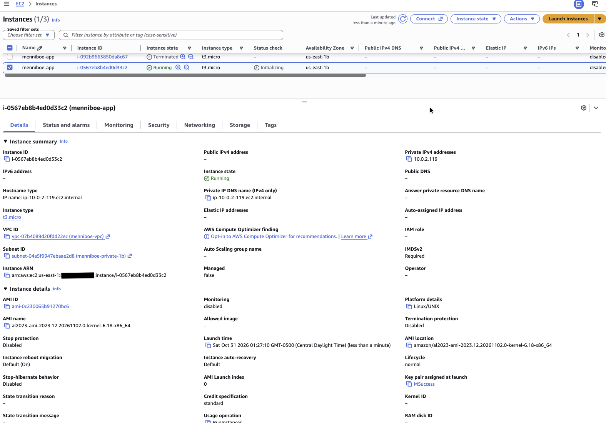

### Step 18 Ping the app server from the bastion

**Why this step:** test the network path alone before SSH (local route, default NACL, ICMP rule).

```bash
ping -c 4 10.0.2.119
```

Result: `4 packets transmitted, 4 received, 0% packet loss`, ~0.5 ms across AZs.

### Step 19 SSH to the app server through the bastion

**Why this step:** proves the full bastion pattern with the key kept on the Mac.

```bash
ssh-add --apple-use-keychain ~/.ssh/MSuccess.pem
ssh -J ec2-user@BASTION_IP ec2-user@10.0.2.119
curl -s --max-time 5 https://checkip.amazonaws.com || echo "NO INTERNET PATH"
```

Result: `[ec2-user@ip-10-0-2-119 ~]$` prompt, then **NO INTERNET PATH** (truly private).

> [!NOTE]
> **SSH agent:** a background program on the Mac that holds the key and answers login challenges. `ssh-add` loads it; `--apple-use-keychain` stores any passphrase in the macOS Keychain. With `ssh -J`, both logins are proven from the Mac; the bastion only relays encrypted traffic and never holds the key. `ssh-add -l` lists keys; `ssh-add -d` removes one.

> [!WARNING]
> **Error:** `zsh: no such file or directory: BASTION_PUBLIC_IP`. In zsh, `<` and `>` are redirection, so `<BASTION_PUBLIC_IP>` was read as an input file. **Fix:** replace the whole placeholder, brackets included.

> [!NOTE]
> Not errors: **"connection is not using a post-quantum key exchange algorithm"** (newer Mac OpenSSH prefers quantum-resistant key exchange that Amazon Linux doesn't offer yet; the session is still encrypted) and **`<no hostip for proxy command>`** (normal with `-J`: the bastion makes the connection, not the Mac).

---

## Lab 2 NAT gateway

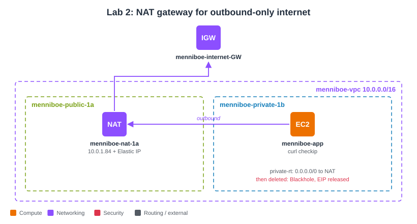

**What it proves:** one route gives a private server outbound-only internet; the internet sees only the NAT's Elastic IP.

> [!WARNING]
> Billing: NAT gateway ~$0.045/hr + per GB + its public IPv4. Build, test and delete in one sitting.

### Lab 2 Step 1 Create the NAT gateway

**Why this step:** outbound-only internet for the private subnet. It lives in the **public** subnet with an Elastic IP.

**Console:** VPC → NAT gateways → Create NAT gateway

| Field | Value |
|---|---|
| Name | `menniboe-nat-1a` |
| Availability mode | Zonal |
| Subnet | `menniboe-public-1a` |
| Connectivity type | Public |
| Elastic IP allocation ID | Allocate Elastic IP |

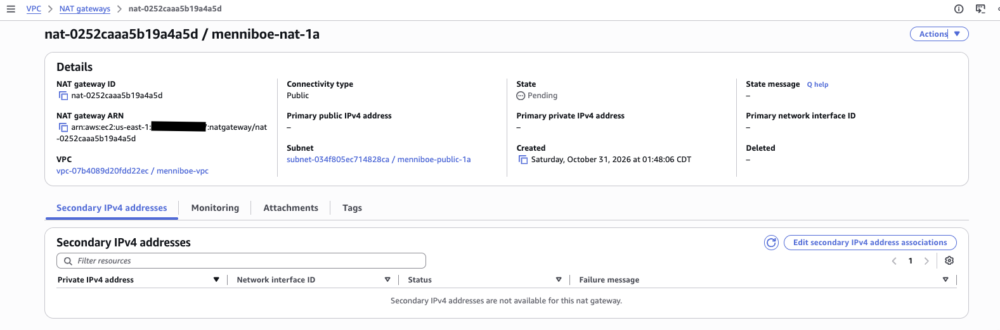

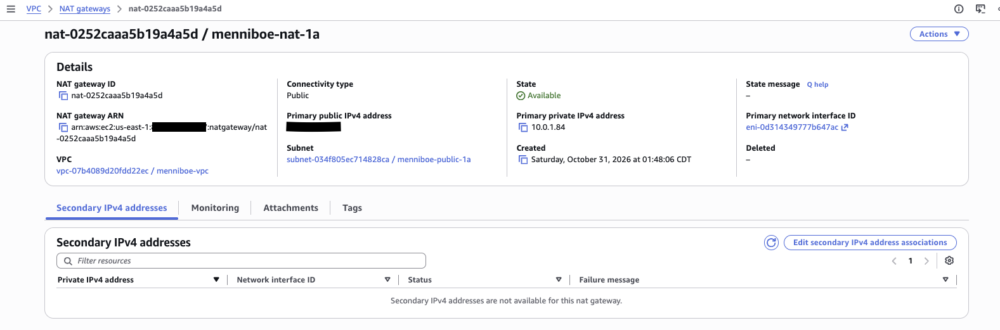

The NAT gateway got its own private IP (`10.0.1.84`) and network interface: it's a managed ENI in your subnet.

### Lab 2 Step 2 Route the private subnet to the NAT

**Why this step:** the app server's table must send `0.0.0.0/0` to the NAT.

| Route table | Destination | Target |
|---|---|---|
| `menniboe-private-rt` | `0.0.0.0/0` | `nat-0252caaa5b19a4a5d` |

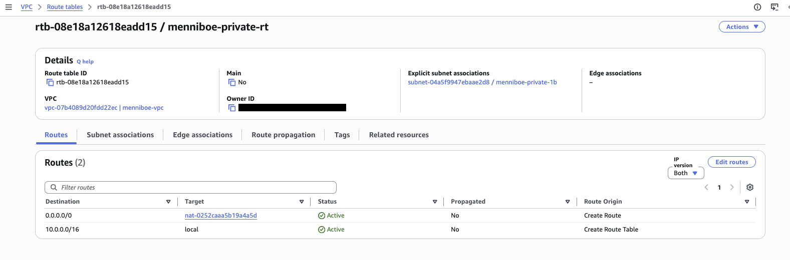

Public vs private route table: the only difference is the target of `0.0.0.0/0` (IGW vs NAT).

### Lab 2 Step 3 Prove outbound internet

```bash
curl -s --max-time 5 https://checkip.amazonaws.com || echo "NO INTERNET PATH"
```

Result: the **NAT's Elastic IP** (not the bastion's IP, nothing in `10.0.2.x`). The NAT rewrote the source address.

> [!NOTE]
> The NAT gateway sat in us-east-1a and the app in us-east-1b: the single-NAT design the exam warns about (cross-AZ data charges, and a 1a outage cuts 1b's internet).

### Lab 2 Step 4 Delete the NAT gateway

**Console:** NAT gateways → `menniboe-nat-1a` → Actions → Delete NAT gateway → type `delete`

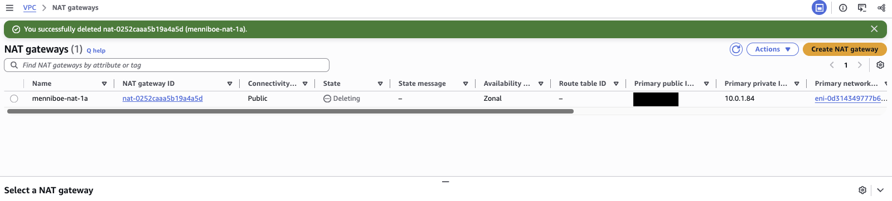

The private route turned into a **Blackhole** (target gone, traffic silently dropped).

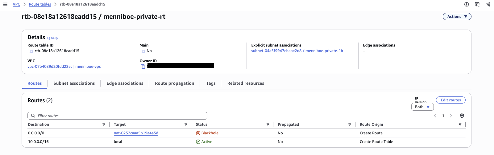

### Lab 2 Step 5 Release the Elastic IP

**Why this step:** deleting the NAT gateway does **not** release its Elastic IP; it keeps billing.

**Console:** VPC → Elastic IP addresses → select it → Actions → Release Elastic IP addresses → Release

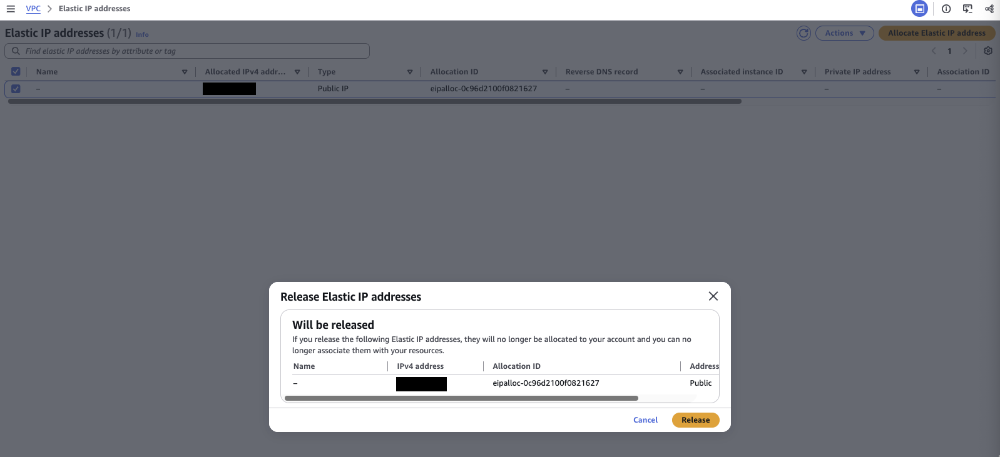

The bastion's IP isn't listed: auto-assigned public IPs are released with the instance; only Elastic IPs need manual release.

### Lab 2 Step 6 Remove the blackhole route

**Console:** `menniboe-private-rt` → Routes → Edit routes → Remove the `0.0.0.0/0` row → Save

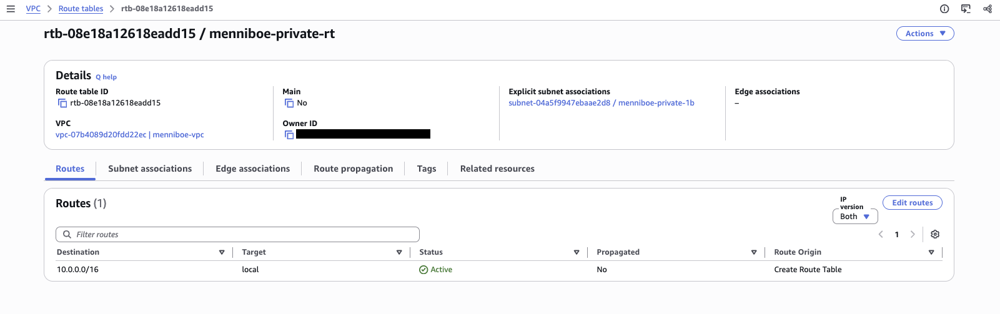

```bash
date; curl -s --max-time 5 https://checkip.amazonaws.com || echo "NO INTERNET PATH"
```

Result: timestamp, then **NO INTERNET PATH**.

> [!WARNING]
> **Error:** an earlier pasted result still showed the NAT's IP after cleanup. It was old terminal output copied by mistake. **Fix:** prefix test commands with `date;` so every result is self-dated.

| Moment | Private route table | `curl` from app |
|---|---|---|
| Lab 1 | local only | NO INTERNET PATH |
| NAT in place | `0.0.0.0/0 → nat-...` | NAT Elastic IP |
| After cleanup | local only | NO INTERNET PATH |

---

## Lab 3 NACL stateless filtering and rule order

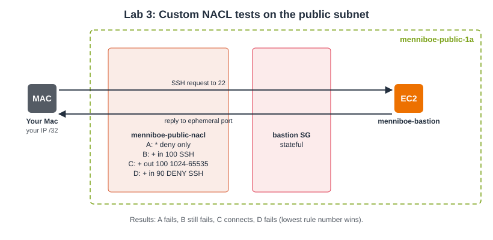

**What it proves:** a new custom NACL denies everything; stateless filtering needs a rule per direction with ephemeral ports; the lowest rule number wins. The test is your Mac's SSH to the bastion.

| Test | Rules | SSH | Proves |
|---|---|---|---|
| A | `*` DENY only | Fails | New custom NACL = deny all |
| B | + inbound 100 ALLOW SSH from your /32 | Still fails | Reply needs its own outbound rule |
| C | + outbound 100 ALLOW TCP 1024–65535 to your /32 | Works | Replies go to ephemeral ports |
| D | + inbound 90 DENY SSH from your /32 | Fails | Lowest number wins |

### Lab 3 Step 1 Find your public IP

NACLs have no "My IP" shortcut and can't reference SGs. Run this **on the Mac** (not inside SSH: there it prints the bastion's IP; check the prompt):

```bash
curl -s https://checkip.amazonaws.com
```

### Lab 3 Step 2 Create the custom NACL

**Console:** VPC → Network ACLs → Create network ACL → Name `menniboe-public-nacl`, VPC `menniboe-vpc`

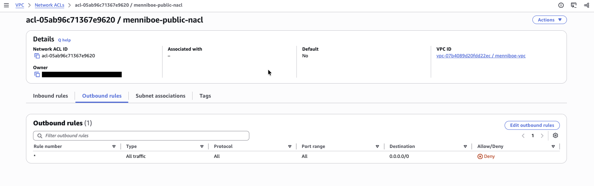

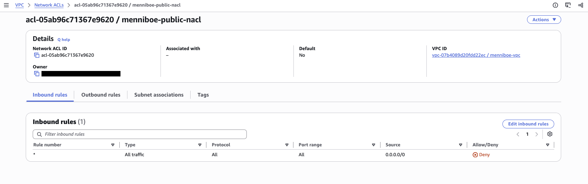

Only the `*` / All traffic / `0.0.0.0/0` / **Deny** rule in each direction.

### Lab 3 Step 3 Test A associate the NACL

**Console:** Subnet associations → Edit → check only `menniboe-public-1a` → Save (replaces the default NACL)

```bash
ssh -o ConnectTimeout=10 ec2-user@BASTION_IP
```

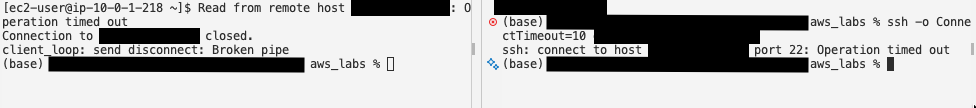

The open session died (`Operation timed out`, `Broken pipe`); new connections timed out. A NACL timeout looks exactly like an SG timeout: check both layers.

### Lab 3 Step 4 Test B allow SSH inbound only

| Rule # | Type | Port | Source | Allow/Deny |
|---|---|---|---|---|
| 100 | SSH (22) | 22 | `YOUR_IP/32` | Allow |

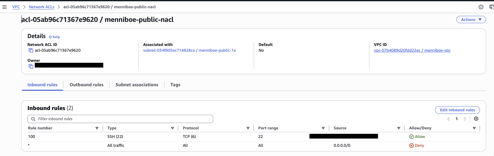

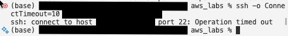

| Packet | NACL direction | Rule | Result |
|---|---|---|---|
| Mac :5xxxx → bastion :22 | Inbound | 100 ALLOW | Passes |
| Bastion :22 → Mac :5xxxx | Outbound | `*` DENY | **Dropped** |

### Lab 3 Step 5 Test C allow replies on ephemeral ports

| Rule # | Type | Port range | Destination | Allow/Deny |
|---|---|---|---|---|
| 100 (outbound) | Custom TCP | 1024-65535 | `YOUR_IP/32` | Allow |

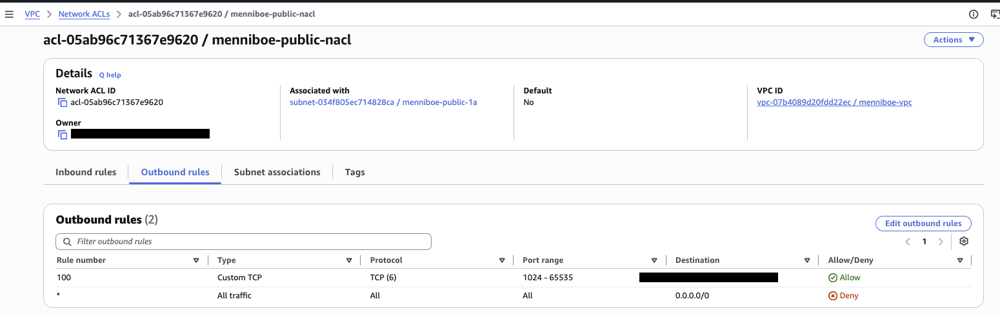

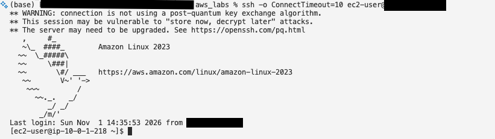

> [!NOTE]
> The SSH banner line `Last login: ... from ...` shows your home IP. Redact it in screenshots.

### Lab 3 Step 6 Test D lower-numbered DENY

| Rule # | Type | Port | Source | Allow/Deny |
|---|---|---|---|---|
| 90 | SSH (22) | 22 | `YOUR_IP/32` | **Deny** |
| 100 | SSH (22) | 22 | `YOUR_IP/32` | Allow |


Rule 90 matched first; rule 100 was never reached. Even the open session froze: a stateless NACL re-checks every packet.

---

## Final network console resource map


| Column | Shows |
|---|---|
| Subnets (2) | `menniboe-public-1a` (us-east-1a), `menniboe-private-1b` (us-east-1b) |
| Route tables (3) | `menniboe-public-rt` (1 subnet, 2 routes), `menniboe-private-rt` (1 subnet, local only), `Menniboe-main-RT` (no subnets) |
| Network connections (1) | `menniboe-internet-GW`: "Internet routes to 1 public subnet, 0 private subnets route to the Internet" |

---

## Teardown

| Order | Action | Why |
|---|---|---|
| 1 | Delete NAT gateway, release Elastic IP, remove blackhole route | Done in Lab 2 (stops hourly billing) |
| 2 | Terminate `menniboe-bastion` and `menniboe-app` | ENIs block VPC deletion; stops compute + public IPv4 billing |
| 3 | CLI check: no instances, NAT gateways, Elastic IPs or ENIs in the VPC | Proves nothing billable is left |
| 4 | Delete `menniboe-vpc` (Actions → Delete VPC → type `delete`) | Removes subnets, route tables, IGW, custom NACL, SGs with it |
| 5 | CLI check: only the default VPC remains | Final proof |

`MSuccess` key pair kept on purpose (Regional, free, used in other labs). See [commands.md](commands.md) for every verification command.

---

## Troubleshooting log

| # | Symptom | Cause | Fix |
|---|---|---|---|
| 1 | Subnet CIDR `10.0.0.1/24` | Digits swapped; block must start on network address | `10.0.1.0/24` |
| 2 | Subnet details showed main route table after association | Cached console panel | Refresh; verify in the Route table tab |
| 3 | `Invalid rule description` + SG rolled back | Character outside allowed set | Plain-text descriptions |
| 4 | App SG had 1 rule, not 2 | ICMP rule not added | Edit inbound rules → All ICMP - IPv4 from bastion SG |
| 5 | Key pair assigned at launch: – | Key pair not selected | Terminate, relaunch with `MSuccess` |
| 6 | `cat: ~/.ssh: Is a directory` | `cat` reads files | `ls -l ~/.ssh` |
| 7 | `zsh: no such file or directory: BASTION_PUBLIC_IP` | `<` `>` are zsh redirection | Replace the whole placeholder |
| 8 | `checkip` printed the bastion's IP, not the Mac's | Ran inside the SSH session | Run on the Mac (check the prompt) |
| 9 | NAT IP shown after cleanup | Old terminal output pasted | Prefix tests with `date;` |
| 10 | Private route `0.0.0.0/0` = Blackhole | NAT gateway deleted | Remove route (or recreate NAT) |
| 11 | Elastic IP still allocated after NAT deletion | NAT deletion doesn't release EIPs | Release Elastic IP |
| 12 | SSH timed out after NACL association | New custom NACL denies all | Add inbound + outbound ephemeral rules |
| 13 | SSH still timed out with inbound 22 allowed | Stateless NACL, no outbound rule for replies | Outbound TCP 1024–65535 |
| 14 | SSH blocked although rule 100 allows | Rule 90 DENY matches first | Remove or renumber the DENY |

---

## Questions answered during the session

| Question | Answer |
|---|---|
| Why doesn't AWS warn about overlapping CIDRs at creation? | Overlap between isolated VPCs is legal and often deliberate; AWS can't know future connections or see on-prem networks. Peering fails at connect time. Use VPC IPAM to prevent overlaps. |
| What is VPC encryption control? | Audit (Monitor) or require (Enforce) encryption in transit inside and between VPCs in a Region. Paid since March 2026. Not on SAA-C03. |
| Why isn't the public subnet listed under "Subnets without explicit associations"? | That list is VPC-wide subnets falling back to main; the public subnet has its own table. |
| Why doesn't the Routes tab list the associated subnet? | Routes = where traffic goes (destination → target). Associations = which subnets use the table. |
| What does ICMP mean? | Internet Control Message Protocol: status and error messages, no ports, message types (ping = 8 request, 0 reply). |
| What does `ssh-add --apple-use-keychain` do? | Loads the key into the SSH agent (and stores any passphrase in the Keychain) so `ssh -J` can prove both logins from the Mac without copying the key. |

---

## Service selection cheat sheet

| Need | Answer |
|---|---|
| More IPs in a VPC | Secondary CIDR |
| Prevent overlapping CIDRs across accounts | VPC IPAM |
| Make a subnet public | `0.0.0.0/0 → IGW` + public IPs |
| SSH to private instances (classic) | Bastion + SG-to-SG trust |
| SSH to private instances, no ports or keys | SSM Session Manager |
| Outbound-only internet, least ops | NAT gateway |
| HA outbound internet | One NAT gateway per AZ (or regional mode) |
| NAT instance not forwarding | Disable source/destination check |
| Block one IP | NACL DENY with a lower rule number |
| Replies blocked at the subnet | NACL ephemeral ports 1024–65535 |
| Private servers silently lost internet | Look for a Blackhole route |
| Idle public IPv4 on the bill | Release unattached Elastic IPs |

---

## Acronyms

| Acronym | Meaning |
|---|---|
| AMI | Amazon Machine Image |
| ARN | Amazon Resource Name |
| AZ | Availability Zone |
| CIDR | Classless Inter-Domain Routing |
| DNS | Domain Name System |
| EC2 | Elastic Compute Cloud |
| EIP | Elastic IP address |
| ENI | Elastic Network Interface |
| HA | High availability |
| ICMP | Internet Control Message Protocol |
| IGW | Internet Gateway |
| IMDSv2 | Instance Metadata Service version 2 |
| IPAM | IP Address Manager |
| NACL | Network Access Control List |
| NAT | Network Address Translation |
| RFC | Request for Comments |
| RT | Route table |
| SG | Security Group |
| SSH | Secure Shell |
| SSM | AWS Systems Manager |
| TCP | Transmission Control Protocol |
| VPC | Virtual Private Cloud |
