# AWS SAA-C03 Day 3: Monitoring, Audit, IAM Advanced and Organizations

Reference guide for Sections 24–25: CloudWatch, EventBridge, CloudTrail, AWS Config, Organizations, SCPs, IAM conditions, policy evaluation, permission boundaries, IAM Identity Center, Directory Service and Control Tower. Four console-first labs are included, each with full redo steps, the real screenshots, and the errors hit along the way.

Running example: **Menniboe Farm**, a farm business (goats, pigs, chickens, tilapia ponds, rubber trees, vegetables) with an online store and order system on AWS.

> [!NOTE]
> All labs ran in **us-east-1** and were fully torn down afterwards. Console screens reflect the October 2026 layouts (EventBridge rules now live inside each event bus, the IAM Policy Simulator has a new layout, CloudWatch alarms offer a Logs data source).

---

## Table of contents

- [Day 3 big picture](#day-3-big-picture)
- [Current names vs exam wording](#current-names-vs-exam-wording)
- **Section 24: Monitoring and audit**
  - [Module 1 CloudWatch Metrics](#module-1-cloudwatch-metrics)
  - [Module 2 CloudWatch Logs and the agent](#module-2-cloudwatch-logs-and-the-agent)
  - [Module 3 CloudWatch Alarms](#module-3-cloudwatch-alarms)
  - [Module 4 Amazon EventBridge](#module-4-amazon-eventbridge)
  - [Module 5 CloudWatch Insights family](#module-5-cloudwatch-insights-family)
  - [Module 6 AWS CloudTrail](#module-6-aws-cloudtrail)
  - [Module 7 AWS Config](#module-7-aws-config)
  - [CloudWatch vs CloudTrail vs Config](#cloudwatch-vs-cloudtrail-vs-config)
- **Section 25: IAM advanced and Organizations**
  - [Module 8 AWS Organizations and SCPs](#module-8-aws-organizations-and-scps)
  - [Module 9 IAM conditions and resource-based policies](#module-9-iam-conditions-and-resource-based-policies)
  - [Module 10 Policy evaluation and permission boundaries](#module-10-policy-evaluation-and-permission-boundaries)
  - [Module 11 IAM Identity Center](#module-11-iam-identity-center)
  - [Module 12 AWS Directory Service](#module-12-aws-directory-service)
  - [Module 13 AWS Control Tower](#module-13-aws-control-tower)
- **Hands-on labs**
  - [Lab 1 Metric filter to alarm to SNS email](#lab-1-metric-filter-to-alarm-to-sns-email)
    - [Step 1.1 Create the SNS topic](#step-11-create-the-sns-topic)
    - [Step 1.2 Subscribe and confirm your email](#step-12-subscribe-and-confirm-your-email)
    - [Step 1.3 Create the log group](#step-13-create-the-log-group)
    - [Step 1.4 Create the metric filter](#step-14-create-the-metric-filter)
    - [Step 1.5 Create the CloudWatch alarm](#step-15-create-the-cloudwatch-alarm)
    - [Step 1.6 Send test log lines from CloudShell](#step-16-send-test-log-lines-from-cloudshell)
    - [Step 1.7 Verify the alarm cycle](#step-17-verify-the-alarm-cycle)
  - [Lab 2 CloudTrail to EventBridge to SNS](#lab-2-cloudtrail-to-eventbridge-to-sns)
    - [Step 2.1 Create the CloudTrail trail](#step-21-create-the-cloudtrail-trail)
    - [Step 2.2 Create the EventBridge rule](#step-22-create-the-eventbridge-rule)
    - [Step 2.3 Create the test security group and trigger the rule](#step-23-create-the-test-security-group-and-trigger-the-rule)
    - [Step 2.4 Verify the alert and Event history](#step-24-verify-the-alert-and-event-history)
  - [Lab 3 AWS Config restricted-ssh with auto-remediation](#lab-3-aws-config-restricted-ssh-with-auto-remediation)
    - [Step 3.1 Set up the Config recorder and rule](#step-31-set-up-the-config-recorder-and-rule)
    - [Step 3.2 Investigate the noncompliant result](#step-32-investigate-the-noncompliant-result)
    - [Step 3.3 Create the remediation IAM role](#step-33-create-the-remediation-iam-role)
    - [Step 3.4 Attach automatic remediation](#step-34-attach-automatic-remediation)
    - [Step 3.5 Trigger a fresh evaluation](#step-35-trigger-a-fresh-evaluation)
    - [Step 3.6 Verify the fix in three places](#step-36-verify-the-fix-in-three-places)
  - [Lab 4 Permission boundary blocks privilege escalation](#lab-4-permission-boundary-blocks-privilege-escalation)
    - [Step 4.1 Create the boundary policy](#step-41-create-the-boundary-policy)
    - [Step 4.2 Create the test role and set the boundary](#step-42-create-the-test-role-and-set-the-boundary)
    - [Step 4.3 Test in the IAM Policy Simulator](#step-43-test-in-the-iam-policy-simulator)
    - [Step 4.4 Switch Role and hit the boundary live](#step-44-switch-role-and-hit-the-boundary-live)
- [Teardown](#teardown)
- [Troubleshooting log](#troubleshooting-log)
- [Service selection cheat sheet](#service-selection-cheat-sheet)
- [Acronyms](#acronyms)

---

## Day 3 big picture

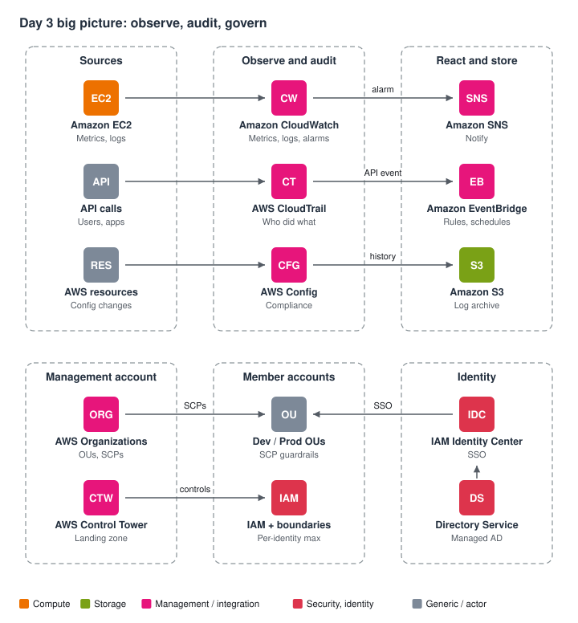

The day answers two questions:

1. **What is happening in my account?** CloudWatch watches performance, CloudTrail records who did what, and AWS Config tracks what changed and whether it is compliant. SNS, EventBridge and S3 react to and store what they see.
2. **Who is allowed to do it, across many accounts?** Organizations and Control Tower govern member accounts with SCPs and controls, IAM conditions and permission boundaries cap individual identities, and IAM Identity Center with Directory Service provides one login for everyone.

| Block | Modules |
|---|---|
| CloudWatch core | 1 Metrics, 2 Logs and the agent, 3 Alarms |
| Events and visibility | 4 EventBridge, 5 Insights family |
| Audit and compliance | 6 CloudTrail, 7 Config |
| Organizations and advanced IAM | 8 Organizations and SCPs, 9 Conditions and resource policies, 10 Policy evaluation and boundaries |
| Identity at scale | 11 Identity Center, 12 Directory Service, 13 Control Tower |

## Current names vs exam wording

| Current name | Exam may say | Note |
|---|---|---|
| Control Tower **controls** | **guardrails** | The Controls Library is now the Control Catalog |
| **IAM Identity Center** | **AWS SSO** | Same service |
| **Amazon Data Firehose** | Kinesis Data Firehose | Used by Metric Streams and log subscriptions |
| **CloudWatch agent** | CloudWatch **Unified** Agent | Logs plus system metrics |
| Simple AD | Simple AD | Closed to new customers July 30, 2026; still the exam answer for cheap basic AD |
| CloudWatch alarm on a **log query** | Metric filter → alarm | The new Logs data source skips the metric filter; the exam answer is still metric filter → alarm |

---

# Section 24: Monitoring and audit

## Module 1 CloudWatch Metrics

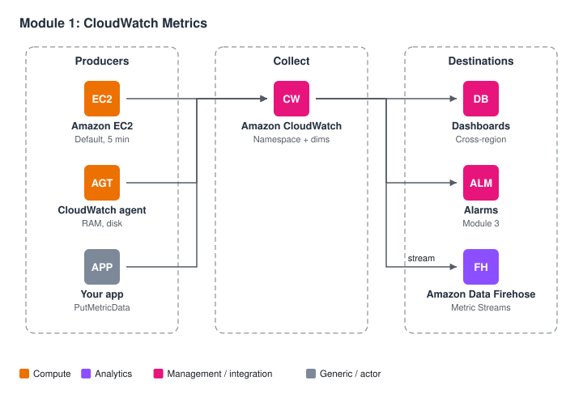

**What it is.** A metric is a time-ordered set of numeric data points about something AWS watches: CPU utilization, network in, request count, queue depth. CloudWatch is the central scoreboard for those numbers.

**Key vocabulary**

| Term | Meaning |
|---|---|
| Namespace | The folder a metric lives in: `AWS/EC2`, `AWS/SQS`, or custom such as `MenniboeFarm/Orders` |
| Dimension | An attribute that narrows a metric: `InstanceId`, `AutoScalingGroupName`, `Environment` (up to 30) |
| Timestamp | Every data point has one |
| Dashboard | Graphs of metrics, can combine Regions and accounts |

**EC2 monitoring levels**

| Level | Frequency | Cost | Why it matters |
|---|---|---|---|
| Basic (default) | 5 minutes | Free | Fine for most dashboards |
| Detailed | 1 minute | Paid | Faster Auto Scaling decisions |

> [!IMPORTANT]
> EC2 does **not** publish memory (RAM), disk space used, or process counts. AWS sees the hypervisor, not inside your OS. Use the **CloudWatch agent** or push a custom metric.

**Custom metrics**
- Sent with the `PutMetricData` API.
- Standard resolution 1 minute; high resolution 1, 5, 10 or 30 seconds (higher cost).
- Accepts data points up to 2 weeks in the past and 2 hours in the future, so keep instance clocks correct.

**Metric Streams.** Near-real-time push of metrics out of CloudWatch to **Amazon Data Firehose**, then S3, Redshift or OpenSearch, or directly to partners such as Datadog, Splunk, Dynatrace and New Relic. You can filter to a subset of namespaces.

**How it connects.** Metrics feed alarms (Module 3), Auto Scaling policies, dashboards and Metric Streams.

| Pros | Cons |
|---|---|
| Built in for almost every service | OS-level metrics need extra work |
| No setup for default metrics | Detailed and high-resolution monitoring cost more |
| Custom metrics for anything | Clock skew can drop data points |

**Exam clues**
- *Monitor EC2 memory usage* → CloudWatch agent / custom metric.
- *Faster Auto Scaling response* → detailed monitoring.
- *Near-real-time metrics to a third party or S3* → Metric Streams via Firehose.

**Menniboe Farm.** CPU for the orders server appears automatically. RAM comes from the CloudWatch agent, and open orders become a custom metric `MenniboeFarm/Orders → OpenOrders`.

## Module 2 CloudWatch Logs and the agent

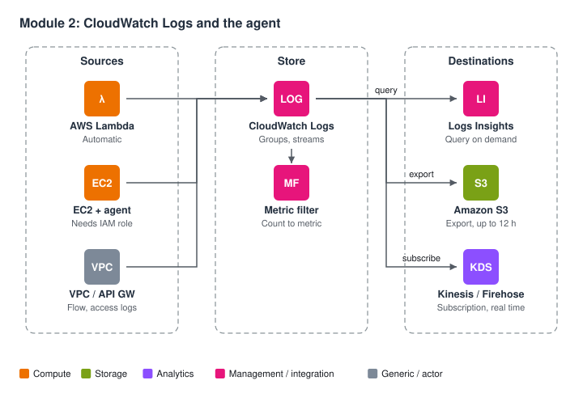

**What it is.** A central store for text logs from applications and AWS services.

**Key facts**
- **Log group**: usually one per application (`/menniboe/orders-api`). **Log stream**: one per source inside the group (an instance, container or file).
- **Retention**: 1 day to 10 years, or never expire. The default is **never expire**, which quietly costs money.
- Encrypted by default; you can use your own KMS key.
- Sources: SDK and agent, Lambda (automatic), ECS, Elastic Beanstalk, VPC Flow Logs, API Gateway, CloudTrail, Route 53 query logs.
- The **Infrequent Access** log class is cheaper but does **not** support metric filters.

| Feature | Output | Real time | Use it for |
|---|---|---|---|
| Metric filter | A **number** (count of matches) | Yes | Alarms on patterns; not retroactive |
| Subscription filter | The **log events** themselves | Yes | Streaming to Kinesis Data Streams, Firehose or Lambda (and SIEMs) |
| Export to S3 | Log **files** | No, up to 12 hours | Archiving (`CreateExportTask`) |
| Logs Insights | Query **results** | On demand | Investigating across log groups and accounts |
| Live Tail | New events as they arrive | Yes | Debugging |

> [!TIP]
> Memory hook: **metric filter counts, subscription filter carries.** Both work in real time; the difference is what comes out.

**Cross-account aggregation.** Subscription filters in many accounts send to a destination in one central logging account, backed by Kinesis and an IAM role.

**The agent.** Nothing from inside a server reaches CloudWatch by default. Install an agent and give it permissions (IAM role on EC2, credentials on premises).

| Agent | Collects |
|---|---|
| CloudWatch Logs Agent (legacy) | Logs only |
| CloudWatch agent (exam: Unified Agent) | Logs **plus** RAM, disk, swap, processes, netstat; config stored in SSM Parameter Store |

| Pros | Cons |
|---|---|
| One place for all logs | Never-expire default adds cost |
| Real-time streaming options | Export to S3 is slow |
| Cross-account aggregation | Agent must be installed and permissioned |

**Exam clues**
- *Real-time log processing* → subscription filter, not export.
- *Batch logs to S3* → `CreateExportTask`.
- *RAM and logs from EC2 and on premises* → the agent.
- *Metric filter did not count old errors* → filters are not retroactive.

**Menniboe Farm.** `ERROR payment failed` lines become a `PaymentFailures` metric (built in Lab 1). A subscription filter streams every line to Firehose → S3, and Logs Insights answers "which customers hit errors today?"

## Module 3 CloudWatch Alarms

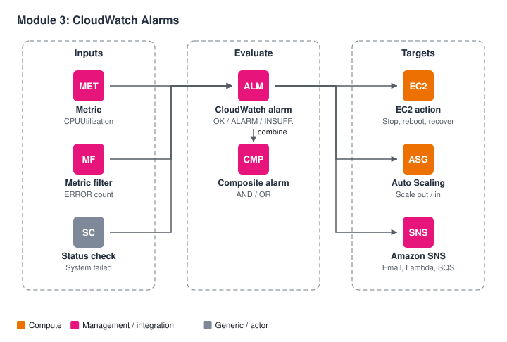

**What it is.** An alarm watches one metric (or a metric math expression) and acts when it crosses a threshold for a set number of evaluation periods.

**Key facts**
- **States**: `OK`, `ALARM`, `INSUFFICIENT_DATA` (new alarm, or the metric stopped reporting).
- **Period**: length of each evaluation window; high-resolution metrics allow 10 s or 30 s.
- **Targets**: EC2 actions (stop, terminate, reboot, recover), Auto Scaling policies, SNS.
- **Composite alarms** combine alarms with AND / OR to reduce noise.
- **Missing data treatment**: missing, good (not breaching), bad (breaching), ignore. For sparse log metrics, *good* lets the alarm settle back to OK.
- Newer options: **warm-up period** (delay evaluation after creation) and a **Logs** data source (alarm directly on a log query).

**EC2 instance recovery**

| Status check | What is broken | Owner | Alarm action |
|---|---|---|---|
| System (`StatusCheckFailed_System`) | Host hardware, power, network | AWS | **Recover**: same instance ID, private IP, public IP, Elastic IP, metadata, placement group |
| Instance (`StatusCheckFailed_Instance`) | OS, config, memory, file system | You | Reboot or fix it yourself |

> [!IMPORTANT]
> An Auto Scaling group of 1 **replaces** a failed instance (new ID, new private IP, Elastic IP not reattached). If the requirement says *same IP*, the answer is system status check + **recover**.

Test notifications without breaking anything:

```bash
aws cloudwatch set-alarm-state --alarm-name "MyAlarm" --state-value ALARM --state-reason "testing"
```

| Pros | Cons |
|---|---|
| Native automation: recover, scale, notify | One metric per alarm; logic needs composite alarms |
| Composite alarms cut noise | Missing data shows INSUFFICIENT_DATA unless handled |
| Easy to test with `set-alarm-state` | High-resolution alarms cost more |

**Exam clues**
- *Recover EC2 with the same IP after hardware failure* → system check + recover.
- *Reduce alarm noise / combine conditions* → composite alarm.
- *Alert on a pattern in logs* → metric filter → alarm.

**Menniboe Farm.** If the tilapia pond monitor's host fails, a recover alarm brings it back with the same Elastic IP so sensors keep reporting. A composite alarm pages the owner only when `PaymentFailures` **and** order latency are both high.

## Module 4 Amazon EventBridge

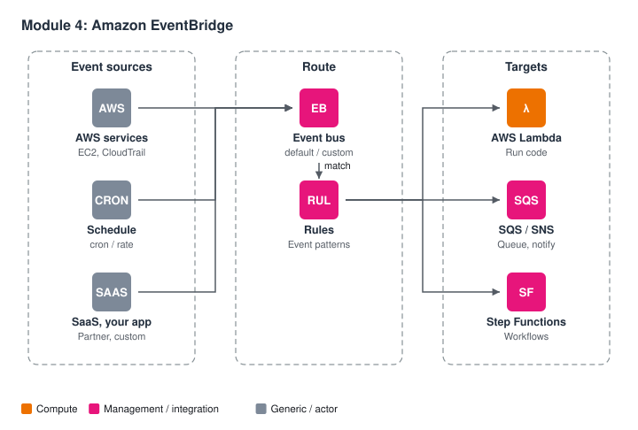

**What it is.** A serverless event router (formerly CloudWatch Events). Something happens, a rule matches it, and EventBridge delivers it to a target. Alarms react to numbers; EventBridge reacts to things happening.

| Concept | Options |
|---|---|
| Rule types | **Schedule** (cron / rate, a serverless cron) and **Event pattern** (match EC2 state changes, S3 uploads, CloudTrail API calls) |
| Bus types | **Default** (AWS service events), **Partner** (SaaS such as Zendesk, Datadog, Auth0), **Custom** (your apps via `PutEvents`) |
| Targets | Lambda, SQS, SNS, Step Functions, Kinesis, ECS tasks, CodePipeline and more |
| Archive and replay | Keep events and replay them after a bug fix |
| Schema Registry | Infers event structure, generates code bindings |
| Cross-account | Resource-based policy on a bus (or `aws:PrincipalOrgID`) lets other accounts send events |
| Newer siblings | **EventBridge Scheduler** (schedules at scale) and **Pipes** (one source → one target with filtering and enrichment) |

> [!NOTE]
> In the 2026 console, rules are created from **Event buses → default → Create rule**. Schedule-style rules have moved to EventBridge Scheduler.

| Pros | Cons |
|---|---|
| Serverless, no polling | At-least-once delivery; targets must handle duplicates |
| Huge source and target catalog, including SaaS | Pattern syntax takes practice |
| Archive/replay, cross-account buses | Not a stream: no ordering or long retention like Kinesis |

**Exam clues**
- *Run Lambda every hour, serverless* → schedule rule (or Scheduler).
- *Alert when root signs in or an API is called* → CloudTrail → EventBridge rule → SNS.
- *Receive events from a SaaS app* → partner event bus.
- *Re-process past events* → archive and replay.

**Menniboe Farm.** A nightly schedule totals egg sales with Lambda; an event-pattern rule emails the owner when anyone calls `TerminateInstances` on the pond monitor.

## Module 5 CloudWatch Insights family

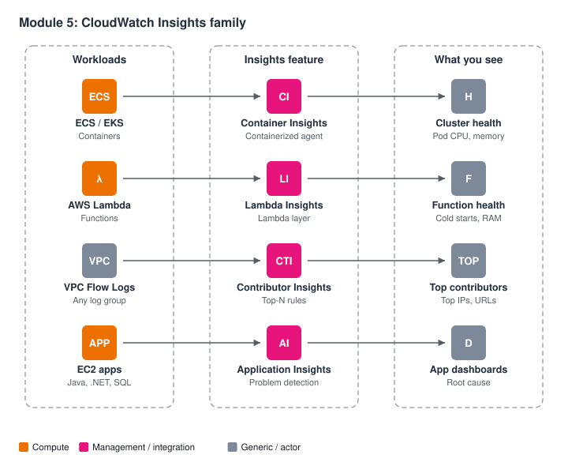

| Feature | Works on | Answers | How it collects |
|---|---|---|---|
| Container Insights | ECS, EKS, K8s on EC2, Fargate | How healthy are clusters, tasks, pods? | Containerized CloudWatch agent |
| Lambda Insights | Lambda | CPU, memory, network, cold starts per function | A Lambda layer |
| Contributor Insights | Any log group (VPC Flow Logs, DNS logs, app logs) | **Who adds the most?** Top-N IPs, users, URLs | Rules over log fields (built-in rules available) |
| Application Insights | Apps on EC2 (Java, .NET, IIS, SQL Server) + ALB, RDS, SQS | What is wrong with my app and why? | Automated dashboards (SageMaker-powered); findings to EventBridge and OpsCenter |

> [!TIP]
> *Top-N* or *who adds the most* in a question → **Contributor Insights**.

| Pros | Cons |
|---|---|
| Ready-made views, little setup | Each adds metric and log ingestion cost |
| Containers, serverless and classic apps covered | Application Insights limited to supported stacks |
| Output works with normal alarms | Contributor Insights needs structured logs |

**Menniboe Farm.** Container Insights shows the Fargate store's task memory creeping up before a crash; Contributor Insights on ALB logs reveals one IP hammering the order-chicks page.

## Module 6 AWS CloudTrail

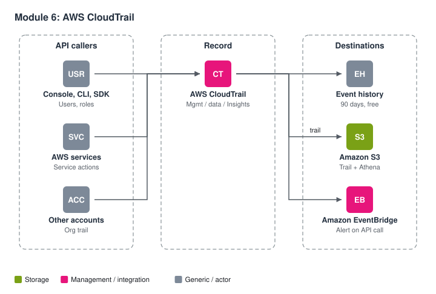

**What it is.** A record of every API call in an account: **who**, **what**, **when**, **from which IP**, and whether it succeeded. Console clicks, CLI, SDKs and AWS services acting on your behalf are all API calls underneath.

**Key facts**
- On by default. **Event history** keeps **90 days** of management events, free.
- A **trail** delivers events to S3 (and optionally CloudWatch Logs) for longer retention; query with Athena or use CloudTrail Lake.
- Console trails are **multi-region** by default. An **organization trail** (from the management account) covers every account.
- An active trail is what makes **"AWS API Call via CloudTrail"** events available to EventBridge rules.
- **Log file integrity validation** writes digest files that prove logs were not altered.

| Event type | Captures | Default |
|---|---|---|
| Management events | Control plane: `CreateBucket`, `AttachRolePolicy`, `RunInstances` (read / write split possible) | Yes |
| Data events | Data plane, high volume: S3 `GetObject` / `PutObject`, Lambda `Invoke` | No, extra cost |
| Insights events | Unusual write activity vs a learned baseline | No, extra cost |

> [!NOTE]
> `DeleteBucket` acts on the bucket itself, so it is a **management** event and is logged by default.

| Pros | Cons |
|---|---|
| On by default, 90 days free | Only 90 days without a trail |
| Complete who/what/when/where audit | Data and Insights events cost extra |
| Org-wide trail from one place | Delivery is minutes, not instant |

**Exam clues**
- *Who deleted the bucket?* → CloudTrail.
- *Keep API history beyond 90 days* → trail to S3 + Athena.
- *Log S3 object-level reads/writes* → data events.
- *Unusual burst of API activity* → CloudTrail Insights.
- *Notify when a specific API is called* → CloudTrail → EventBridge → SNS.

**Menniboe Farm.** The product-photos bucket disappears; CloudTrail shows `DeleteBucket` by `intern-01` from a specific IP at 3:14 p.m.

## Module 7 AWS Config

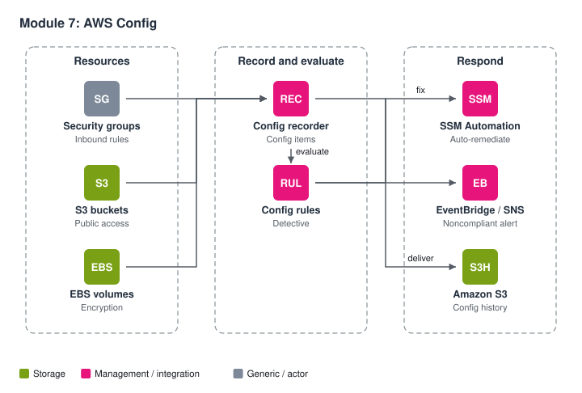

**What it is.** A recorder of how resources are configured **over time**, plus rules that check whether they are compliant. It answers *what did this look like last Tuesday?* and *is it compliant right now?*

**Key facts**
- The **configuration recorder** captures each change as a **configuration item** and delivers history to S3.
- **Rules**: AWS managed (such as `restricted-ssh`, `encrypted-volumes`, `s3-bucket-public-read-prohibited`) or custom (Lambda or Guard). Triggered on change, periodically (1/3/6/12/24 h), or both.
- **Detective, not preventive.** Config flags noncompliance; it never blocks the action. Prevention is IAM and SCPs.
- **Remediation** runs SSM Automation documents, manually or automatically, with retries. Automatic remediation fires on a **new** noncompliant evaluation.
- **Timeline** shows each configuration change linked to the CloudTrail event that caused it.
- **Aggregator** = one view across accounts and Regions. **Conformance packs** = rules + remediation bundled.
- Regional and not free: billed per configuration item and per rule evaluation.

| Pros | Cons |
|---|---|
| Full configuration history plus compliance | Does not prevent bad changes |
| Auto-remediation through SSM | Cost grows with resources and rules |
| Org-wide view via aggregator | Regional; enable per Region |

**Exam clues**
- *Ensure SSH is not open to 0.0.0.0/0* → Config rule (`restricted-ssh`).
- *Automatically fix noncompliant resources* → Config remediation with SSM Automation.
- *How did a resource's configuration change over time?* → Config timeline.
- *Prevent the action entirely* → IAM or SCP, not Config.

**Menniboe Farm.** `restricted-ssh` flags the pond monitor's security group, SSM Automation removes the open rule, and the timeline names who opened it (built in Lab 3).

## CloudWatch vs CloudTrail vs Config

| Service | Question | Data | Example on an ALB |
|---|---|---|---|
| CloudWatch | How is it performing? | Metrics, logs, alarms, events | Request count, 5xx errors, latency |
| CloudTrail | Who did what, when? | API calls | Who changed the ALB listener |
| AWS Config | What changed, and is it compliant? | Configuration over time | Track SG rules; check a certificate is attached |

> [!TIP]
> Labs 2 and 3 show why they work best together: an EventBridge rule on one API name missed a `ModifySecurityGroupRules` change, while Config caught the resulting configuration regardless of which API made it.

---

# Section 25: IAM advanced and Organizations

## Module 8 AWS Organizations and SCPs

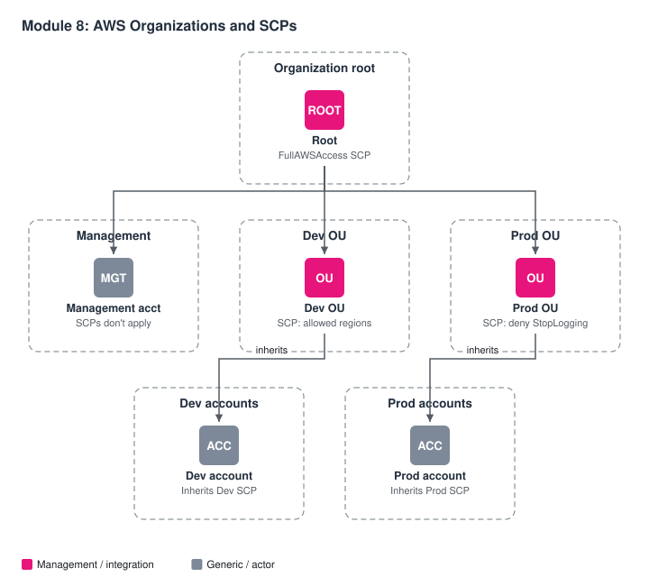

**What it is.** Manage many AWS accounts as one. One **management account** runs the organization; the rest are **member accounts** grouped into **organizational units (OUs)**.

**Key facts**
- Hierarchy: root → OUs (nestable) → accounts. Organize by environment, business unit or project.
- **Consolidated billing**: one bill, aggregated volume discounts, Reserved Instance and Savings Plans discounts shared by default.
- API-driven account creation; org-wide CloudTrail, tag policies, backup policies, AI services opt-out policies.
- Move an account: leave the old org, then accept an invitation from the new one.

**Service Control Policies (SCPs)**
- JSON policies attached to the root, an OU or an account.
- They set the **maximum** permissions and **never grant** anything.
- Apply to every user and role in **member** accounts, **including the member root user**.
- Do **not** apply to the management account or service-linked roles.
- Default `FullAWSAccess` allows everything. **Deny-list** style keeps it and adds denies; **allow-list** style removes it and allows specific services.
- An account is limited by every SCP from the root down; an explicit deny anywhere wins.
- **Resource Control Policies (RCPs)** are the newer resource-side counterpart.

Region-restriction SCP pattern:

```json
{
  "Version": "2012-10-17",
  "Statement": [
    {
      "Sid": "DenyOutsideAllowedRegions",
      "Effect": "Deny",
      "NotAction": ["iam:*", "organizations:*", "cloudfront:*", "route53:*", "sts:*", "support:*"],
      "Resource": "*",
      "Condition": { "StringNotEquals": { "aws:RequestedRegion": ["us-east-1", "eu-west-1"] } }
    }
  ]
}
```

> [!NOTE]
> The `NotAction` list exempts global services whose API calls go through us-east-1, so the SCP does not break them.

| Pros | Cons |
|---|---|
| Central billing with shared discounts | SCPs skip the management account |
| Guardrails no member admin can bypass | SCPs never grant; IAM still needed |
| Automated account creation | A mis-scoped deny can lock teams out |

**Exam clues**
- *Block an action for every account, even its root user* → SCP.
- *Restrict accounts to Regions* → SCP with `aws:RequestedRegion`.
- *SCP not restricting the management account* → by design.
- *Share RI discounts across accounts* → consolidated billing.

**Menniboe Farm.** A Prod OU SCP denies `cloudtrail:StopLogging`, so even a Prod admin cannot switch off auditing.

## Module 9 IAM conditions and resource-based policies

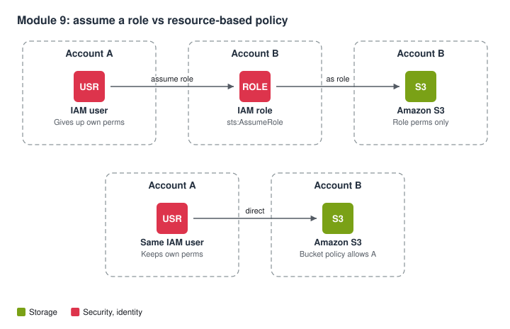

| Condition key | Typical use |
|---|---|
| `aws:SourceIp` | Deny unless calls come from the office IP range |
| `aws:RequestedRegion` | Allow or deny by Region (also in SCPs) |
| `aws:ResourceTag`, `ec2:ResourceTag`, `aws:PrincipalTag` | ABAC: devs may only stop instances tagged `Team=Dev` |
| `aws:MultiFactorAuthPresent` | Require MFA for destructive actions |
| `aws:PrincipalOrgID` | Resource policy: allow only principals in my organization |
| `aws:SecureTransport` | Deny S3 requests not over HTTPS |

> [!WARNING]
> S3 ARNs: `s3:ListBucket` applies to the **bucket** (`arn:aws:s3:::menniboe-photos`), while `s3:GetObject` / `PutObject` apply to **objects** (`arn:aws:s3:::menniboe-photos/*`). Mixing them up is a classic Access Denied cause.

**Assume a role vs resource-based policy**

| Approach | Your own permissions | Use when |
|---|---|---|
| Assume a role (`sts:AssumeRole`) | **Given up** while acting as the role | You only need the other account's permissions |
| Resource-based policy (bucket, queue, topic, key policy) | **Kept** | You need permissions in both accounts at the same time |

Cross-account access needs an allow on **both sides**: the caller's identity policy and the resource policy.

**EventBridge targets**: Lambda, SNS, SQS, S3 and API Gateway **support** resource-based policies; Kinesis Data Streams, Step Functions, ECS tasks and SSM Run Command **require** an IAM role. (The 2026 console defaults to an execution role even for SNS.)

| Pros | Cons |
|---|---|
| Fine-grained "only if" control | Conditions are easy to typo and hard to debug |
| Resource policies keep caller permissions | Not every service supports resource policies |
| `aws:PrincipalOrgID` simplifies org sharing | Roles need trust and permission policies |

**Menniboe Farm.** The accounting Lambda reads its own DynamoDB ledger and writes invoices to the store account's bucket using a bucket policy that allows the farm's org ID, so it never switches identity.

## Module 10 Policy evaluation and permission boundaries

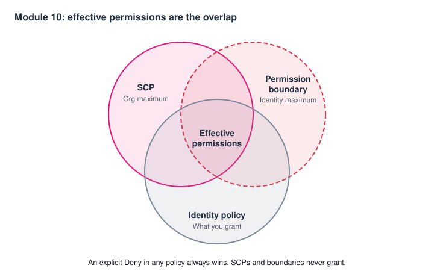

**Evaluation order (simplified)**

| Step | Check | If it fails |
|---|---|---|
| 1 | Start from implicit deny | – |
| 2 | Any explicit `Deny` in any policy? | Denied, stop |
| 3 | SCP allows it? | Denied |
| 4 | Resource-based policy allows it (same account)? | Can grant on its own |
| 5 | Identity-based policy allows it? | Denied |
| 6 | Permission boundary allows it? | Denied |
| 7 | Session policy allows it (if used)? | Denied |
| – | All passed | **Allowed** |

**Permission boundaries**
- A **managed policy** attached to an IAM **user or role** (not a group) as the **maximum** it can ever have.
- Never grants anything. Effective permissions = **identity policy ∩ boundary ∩ SCP**.
- Use cases: let developers create roles safely, delegate IAM to non-admins, cap one identity without touching the whole account.
- Enforce with a condition on role creation:

```json
{
  "Effect": "Allow",
  "Action": "iam:CreateRole",
  "Resource": "*",
  "Condition": { "StringEquals": { "iam:PermissionsBoundary": "arn:aws:iam::<account-id>:policy/menniboe-dev-boundary" } }
}
```

> [!TIP]
> Also deny `iam:DeleteRolePermissionsBoundary`, `iam:PutRolePermissionsBoundary` and edits to the boundary policy itself, or developers could remove the cap later.

| Term | Meaning |
|---|---|
| **Implicit deny** | Nothing allows it (for example, outside the boundary) |
| **Explicit deny** | A `"Effect": "Deny"` statement matches; always wins |

| Pros | Cons |
|---|---|
| Safe IAM delegation | More layers make debugging harder |
| Blocks privilege escalation | Cannot attach to groups |
| Per identity, unlike SCPs | Never grants; often misunderstood |

**Exam clues**
- *Let developers create IAM roles without escalating privileges* → permission boundary.
- *User has AdministratorAccess but is still denied* → check SCP, boundary, explicit deny.
- *Limit one user* → boundary. *Limit a whole account* → SCP.

**Menniboe Farm.** A contractor can create Lambda execution roles, but a boundary limits every role to Lambda, CloudWatch Logs and the orders table (proven in Lab 4).

## Module 11 IAM Identity Center

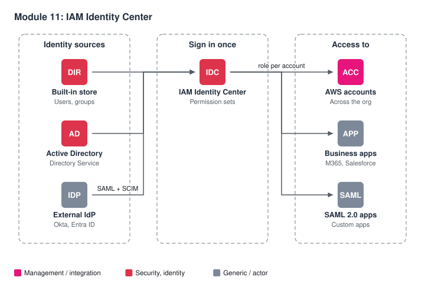

**What it is.** The successor to AWS SSO: **one login** for every account in an organization plus business apps. Users sign in once at the user portal and choose the account and role they need.

**Key facts**
- The recommended way to give **workforce** users access to many accounts, instead of IAM users in each account.
- **Identity sources**: the built-in Identity Center directory; Active Directory (AWS Managed Microsoft AD, or self-managed AD via AD Connector or a two-way trust); or an **external IdP** (Okta, Microsoft Entra ID) using **SAML 2.0** for sign-in and **SCIM** for user and group sync.
- **Permission sets**: collections of policies (AWS managed, customer managed, inline, optional boundary). Identity Center creates a matching IAM role in each assigned account.
- **Assignments** link who (user / group) + which account + which permission set.
- **ABAC**: identity-source attributes (department, cost center) can be passed as session tags and used in policy conditions.
- Enabled from the management account or a delegated administrator.

| Pros | Cons |
|---|---|
| One login for every account and app | Needs Organizations for multi-account |
| Central permission sets | Changes must be re-provisioned to accounts |
| Plugs into existing AD or IdP | Simple AD not supported as a source |

**Exam clues**
- *Single sign-on to many accounts in an organization* → IAM Identity Center.
- *Use existing corporate credentials for console access* → Identity Center + AD or external IdP.
- *Same permissions for a team across accounts* → permission set.
- *Customers signing in to your app* → Amazon Cognito, not Identity Center.

**Menniboe Farm.** The farm manager, store developer and accountant sign in once with their Entra ID logins; the developer gets *DeveloperAccess* in Dev, the accountant *Billing* in the management account.

## Module 12 AWS Directory Service

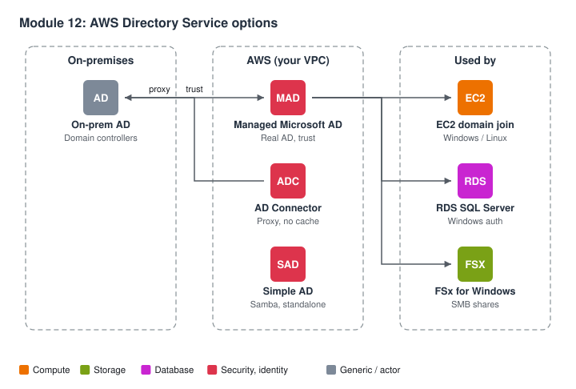

**What it is.** Microsoft Active Directory (users, computers, groups, policies in domains, trees and forests, served by domain controllers) brought into AWS so EC2, RDS for SQL Server, FSx for Windows File Server and WorkSpaces can use it.

| Option | What it is | On-prem link | Choose when |
|---|---|---|---|
| **AWS Managed Microsoft AD** | Real Microsoft AD run by AWS (2+ DCs across AZs) | One- or two-way **trust** | Full AD features, MFA, trusts, users managed in AWS |
| **AD Connector** | **Proxy** that redirects requests to on-prem AD | Required; nothing stored in AWS | Use existing on-prem users with no copy in AWS |
| **Simple AD** | AD-compatible, Samba-based | **None** (cannot join or trust) | Small, low-cost, basic AD with no on-prem |

> [!WARNING]
> AD Connector does **no caching**: if the link to on premises breaks, sign-ins fail. Plan for VPN or Direct Connect.

| Pros | Cons |
|---|---|
| Reuse existing AD skills and users | Managed AD costs more |
| Fully managed domain controllers | AD Connector depends on the on-prem link |
| Plugs into EC2, RDS, FSx, WorkSpaces | Simple AD is limited and closing to new customers |

**Exam clues**
- *AD in AWS with a trust to on-prem* → Managed Microsoft AD.
- *Use on-prem users, store nothing in AWS* → AD Connector.
- *Cheap basic AD, no on-prem* → Simple AD.
- *FSx for Windows or RDS SQL Server with Windows auth* → Managed Microsoft AD.

**Menniboe Farm.** AD Connector lets office staff sign in to WorkSpaces with existing logins; moving to Managed Microsoft AD later adds FSx shares and resilience.

## Module 13 AWS Control Tower

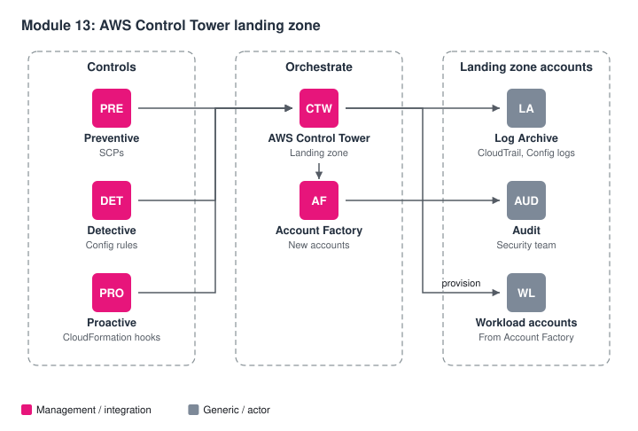

**What it is.** Best-practice multi-account setup and governance in a few clicks, built on Organizations, SCPs, Config, CloudTrail and IAM Identity Center.

**Key facts**
- **Landing zone**: a Security OU with a **Log Archive** account (central CloudTrail and Config logs) and an **Audit** account (security team), plus Identity Center and an org trail.
- **Account Factory**: provisions new accounts with preapproved settings (built on Service Catalog).
- **Dashboard**: compliance across all accounts, drift detection.

| Control type | Enforced by | Behavior |
|---|---|---|
| Preventive | SCPs | Blocks the action |
| Detective | AWS Config rules | Detects and reports (example: `restricted-ssh`, alias `AWS-GR_RESTRICTED_SSH`) |
| Proactive | CloudFormation hooks | Checks resources before deployment |

Controls are also grouped by guidance: mandatory, strongly recommended, elective.

| Pros | Cons |
|---|---|
| Best-practice setup in clicks | Opinionated, less flexible |
| Standardized new accounts | Adopting a complex existing org takes planning |
| One compliance dashboard | Uses Config, which adds cost |

**Exam clues**
- *Quickly set up a secure multi-account environment* → Control Tower.
- *Automate new accounts with baselines* → Account Factory.
- *Organizations vs Control Tower* → Organizations is the engine; Control Tower is the governance autopilot.

**Menniboe Farm.** For a second site and an online feed shop, Account Factory creates `feed-shop-prod` with the standard VPC and controls, and all logs land in Log Archive.

---

# Hands-on labs

> [!NOTE]
> Console-first labs. CLI equivalents for every step are in [commands.md](commands.md). Account IDs, email addresses, public IPs and access keys are redacted in all screenshots.

## Lab 1 Metric filter to alarm to SNS email

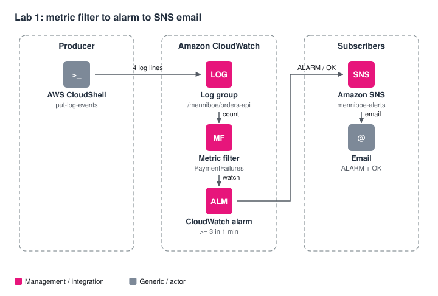

**What we're building:** a log group for the orders API, a metric filter that counts `payment failed` lines, an alarm on that count, and an SNS topic that emails on ALARM and OK.

**What we hope to prove:** a word in your logs can page you within about a minute with no code, and the alarm moves `INSUFFICIENT_DATA → OK → ALARM → OK`.

| Step | Build | Feeds into |
|---|---|---|
| 1.1 | SNS topic `menniboe-alerts` | Alarm target (reused in Labs 2–3) |
| 1.2 | Email subscription | Where alerts land |
| 1.3 | Log group `/menniboe/orders-api` | Stores the log lines |
| 1.4 | Metric filter `PaymentFailures` | Turns lines into a number |
| 1.5 | CloudWatch alarm | Watches the number, notifies SNS |
| 1.6 | CloudShell test logs | Triggers the chain |
| 1.7 | Verify | Proof |

### Step 1.1 Create the SNS topic

**Why this step:** an alarm cannot email anyone directly. It publishes to an SNS topic, and SNS delivers to subscribers. The topic must exist before it can be chosen as the alarm's target.

**Console:** SNS → Topics → Create topic

| Section | Setting | Value |
|---|---|---|
| Details | Type | **Standard** |
| | Name | `menniboe-alerts` |
| | Display name | `Menniboe Alerts` |
| Encryption | | Off |
| Access policy | Method | Basic (owner-only publishers and subscribers) |
| Archive policy | | Off |
| Delivery status logging | | Off |
| Tags | | `Project` = `day3-lab` |
| Active tracing | | Don't use |

> [!WARNING]
> **Error caught before Create:** the form was on **FIFO** (name preview showed `menniboe-alerts.fifo`). FIFO topics deliver only to SQS, so email would be impossible, and topic type cannot be changed after creation. **Fix:** switch Type to **Standard**.

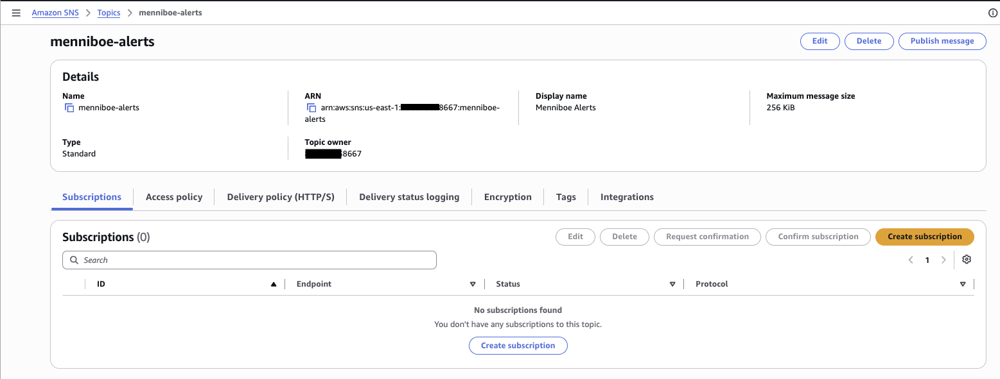

### Step 1.2 Subscribe and confirm your email

**Why this step:** a topic with no subscribers delivers to nobody. SNS requires the email owner to confirm, which prevents spam through SNS.

**Console:** topic page → Create subscription

| Setting | Value |
|---|---|
| Protocol | **Email** |
| Endpoint | Your email address |
| Subscription filter policy | Off |
| Redrive policy (DLQ) | Off |

Open the *AWS Notification - Subscription Confirmation* email and click the link, then click the **Confirm subscription** button on the page that opens.

> [!NOTE]
> The confirmation page now has an extra **Confirm subscription** button so email link scanners cannot auto-confirm. The topic page also needs a refresh to show the new subscription.

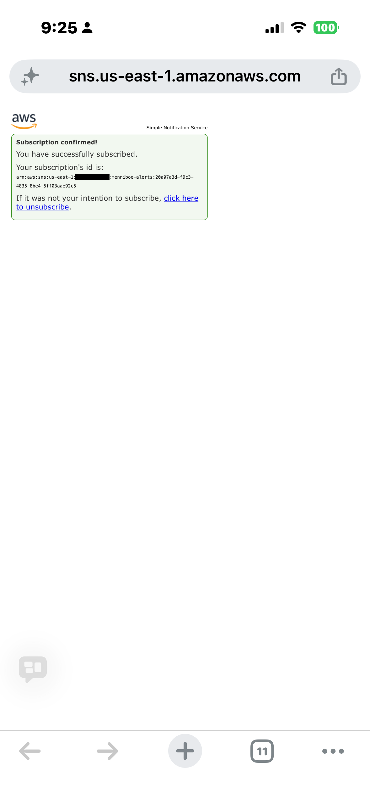

### Step 1.3 Create the log group

**Why this step:** this is where the orders API's lines are stored and where the metric filter attaches. Short retention avoids the never-expire default.

**Console:** CloudWatch → Logs → Log groups (Log management) → Create log group

| Setting | Value |
|---|---|
| Log group name | `/menniboe/orders-api` |
| Retention | **1 day** |
| Log class | **Standard** |
| KMS key ARN | Empty |
| Deletion protection | Off |
| Tags | `Project` = `day3-lab` |

> [!WARNING]
> **Infrequent Access** log class does not support metric filters and cannot be changed later. Choose **Standard**.

> [!TIP]
> The leading `/` is a naming convention, not a requirement. It mirrors AWS's own `/aws/lambda/...` groups, enables prefix search, and lets one IAM statement cover a family: `arn:aws:logs:us-east-1:<account-id>:log-group:/menniboe/*`.

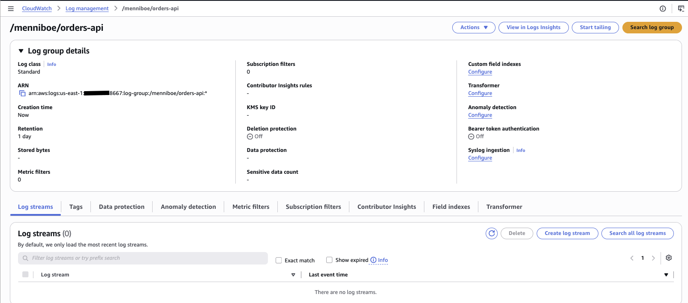

### Step 1.4 Create the metric filter

**Why this step:** alarms can only watch numbers. The metric filter adds 1 to `PaymentFailures` for every matching line.

**Console:** log group → Metric filters tab → Create metric filter

**Page 1: Define pattern**

| Setting | Value |
|---|---|
| Filter pattern | `"payment failed"` (quotes = whole phrase) |
| Enable on transformed logs | Off (no transformer) |
| Field selection criteria | Empty (for centralized log groups) |
| Test pattern | Custom log data, then Test pattern |

```
INFO order 1001 placed
ERROR payment failed order 1002
ERROR payment failed order 1003
```

Expected: **2 matches out of 3**.

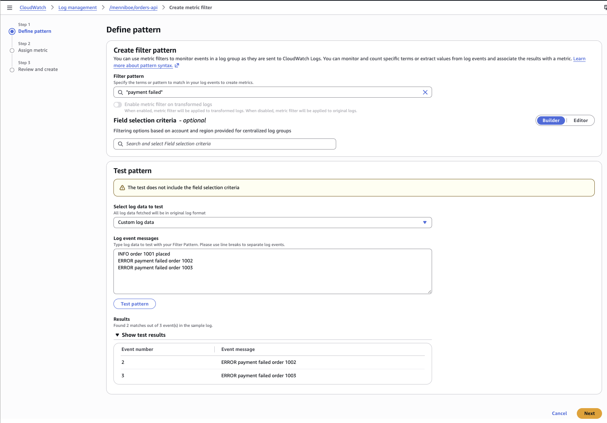

**Page 2: Assign metric**

| Setting | Value |
|---|---|
| Filter name | `PaymentFailuresFilter` |
| Metric namespace | Create new → `MenniboeFarm/Orders` |
| Metric name | `PaymentFailures` |
| Metric value | `1` |
| Default value | `0` |
| Unit | Count |
| Dimensions | None (a default value cannot be combined with dimensions) |

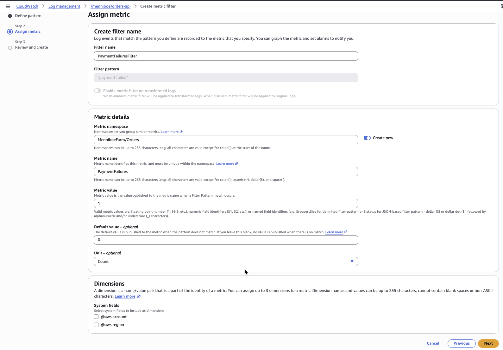

**Page 3:** Review and create → Create metric filter.

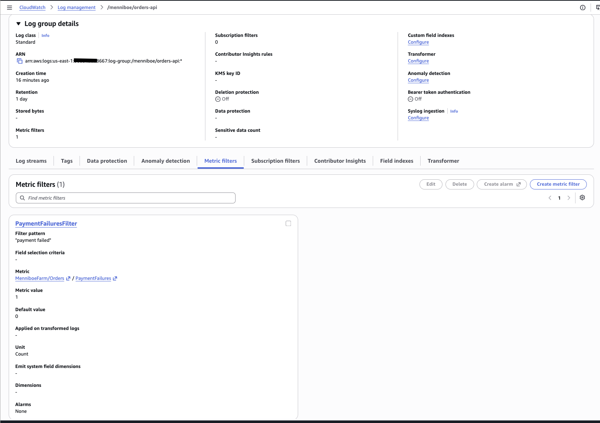

> [!NOTE]
> The metric does not appear under Metrics until the first log line arrives, so the alarm is created from the filter card (tick the card → **Create alarm**), which pre-fills the metric.

### Step 1.5 Create the CloudWatch alarm

**Why this step:** the alarm watches `PaymentFailures` every minute and publishes to SNS on ALARM and on OK.

**Page 1: Specify metric and conditions**

| Section | Setting | Value |
|---|---|---|
| Data source | | **Metrics** (Logs = new log-query alarms; Alarms = composite) |
| Type | | Classic (not PromQL) |
| Metric | Namespace / name | `MenniboeFarm/Orders` / `PaymentFailures` |
| | Statistic | **Sum** |
| | Period | **1 minute** |
| Conditions | Threshold type | Static |
| | Whenever PaymentFailures is | **Greater/Equal (>=)** |
| | than | `3` |
| Additional configuration | Datapoints to alarm | 1 out of 1 |
| | Missing data treatment | **Treat missing data as good (not breaching)** |
| | Evaluation window | Default (sliding) |
| | Warm-up treatment | Off |

> [!WARNING]
> **Errors caught before Next:** the condition was **Greater (>)**, which would need 4 failures, and missing data was **treat as missing**, which would leave the alarm stuck in INSUFFICIENT_DATA. **Fix:** Greater/Equal and *treat as good*.

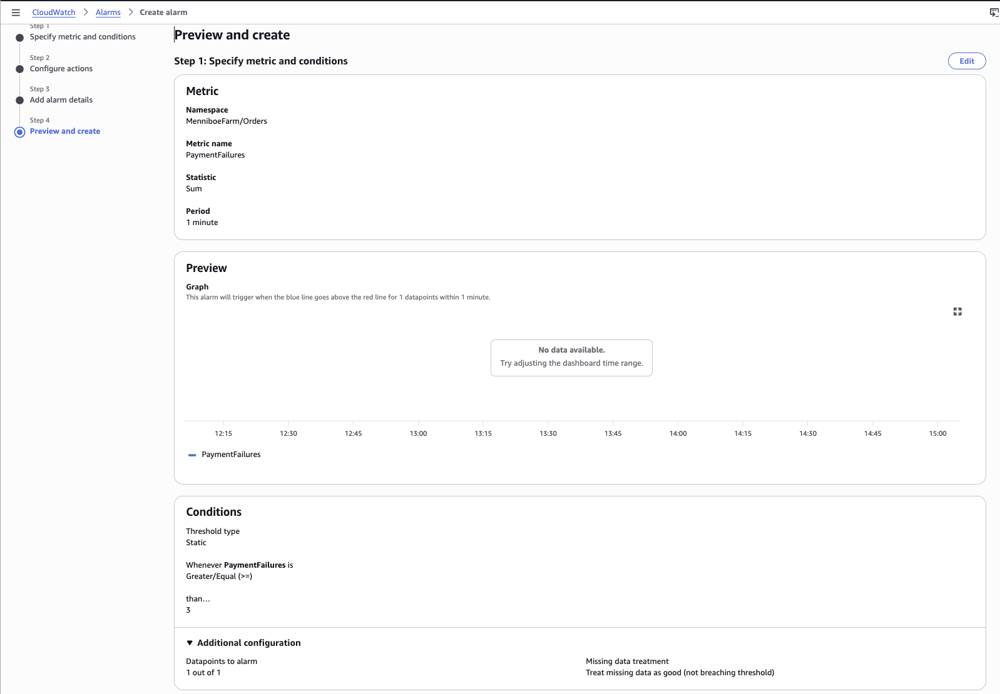

**Page 2: Configure actions**

| Notification | Trigger | Topic |
|---|---|---|
| #1 | In alarm | Existing → `menniboe-alerts` |
| #2 | OK | Existing → `menniboe-alerts` |

Lambda, Auto Scaling, EC2, Systems Manager and Investigation actions: none.

> [!WARNING]
> First attempt had only the In-alarm notification. **Fix:** Add notification → OK → `menniboe-alerts`.

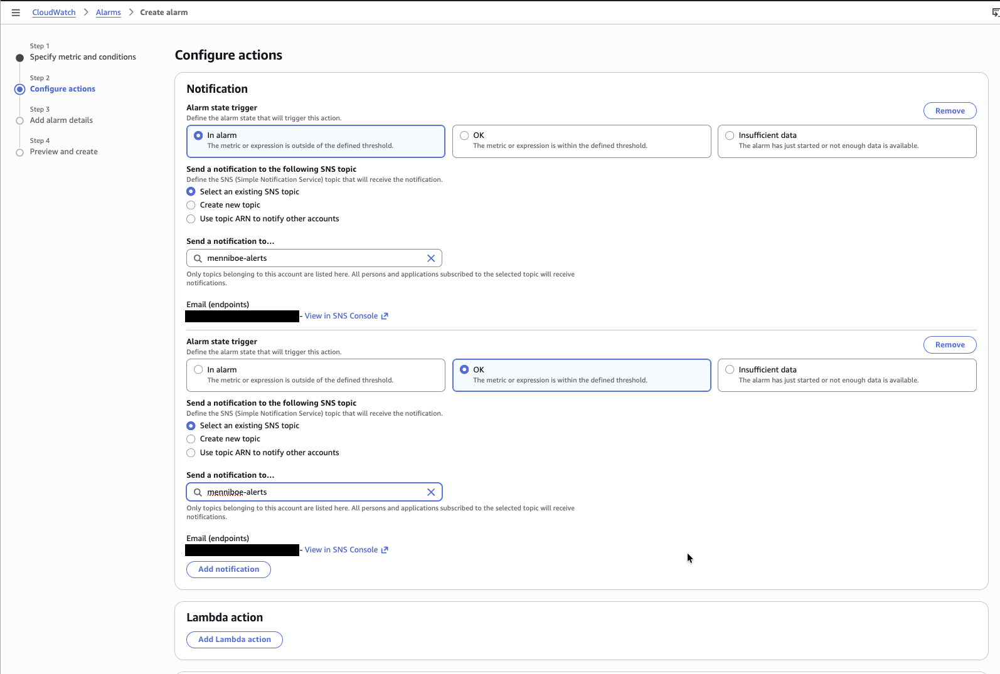

**Page 3:** name `Menniboe-PaymentFailures-High`, description `3 or more payment failures in 1 minute on /menniboe/orders-api`, tag `Project` = `day3-lab`. Include tags in actions: disabled.

**Page 4:** Preview and create → Create alarm.

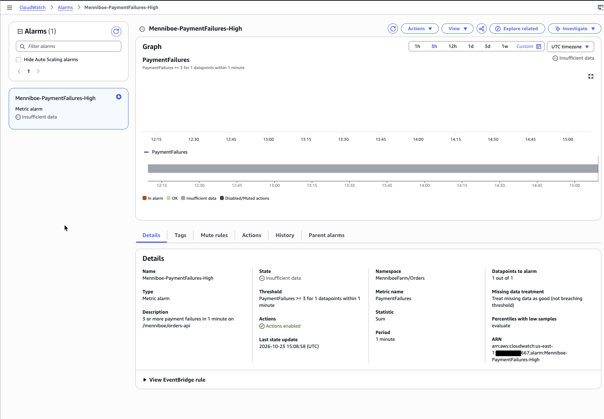

### Step 1.6 Send test log lines from CloudShell

**Why this step:** act as the orders API and write 1 normal line plus 3 failures in the same minute, which should trip `>= 3`.

There is no console button for writing log events. Open **CloudShell** (us-east-1):

```bash
aws logs create-log-stream --log-group-name /menniboe/orders-api --log-stream-name orders-api-test
NOW=$(date +%s%3N)
cat > events.json <<EOF
[
  {"timestamp": $NOW,           "message": "INFO order 2000 placed"},
  {"timestamp": $((NOW+1000)),  "message": "ERROR payment failed order 2001"},
  {"timestamp": $((NOW+2000)),  "message": "ERROR payment failed order 2002"},
  {"timestamp": $((NOW+3000)),  "message": "ERROR payment failed order 2003"}
]
EOF
aws logs put-log-events --log-group-name /menniboe/orders-api --log-stream-name orders-api-test --log-events file://events.json
```

Success = only `nextSequenceToken` returned, no `rejectedLogEventsInfo`.

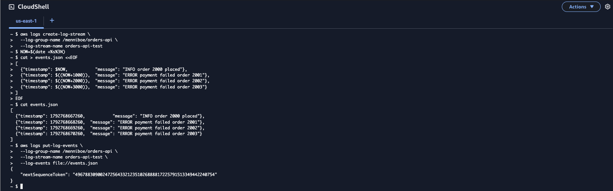

### Step 1.7 Verify the alarm cycle

**Why this step:** confirm every link: lines stored → filter counted 3 → alarm fired → SNS emailed → alarm recovered.

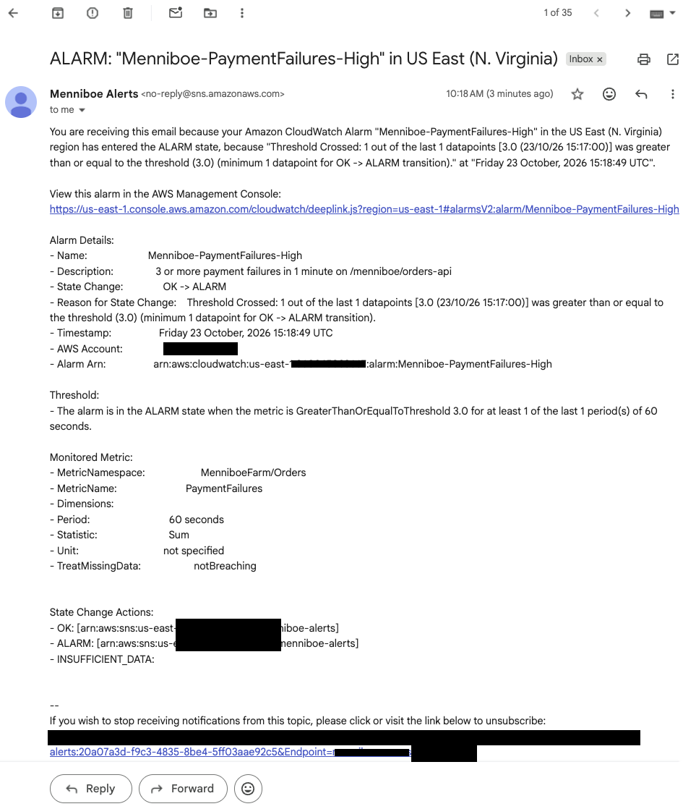

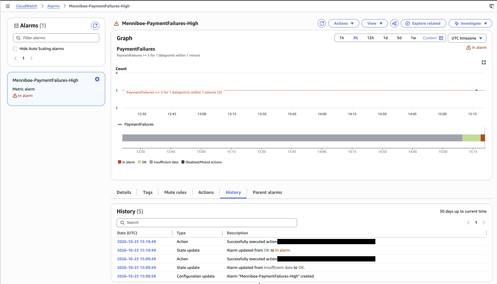

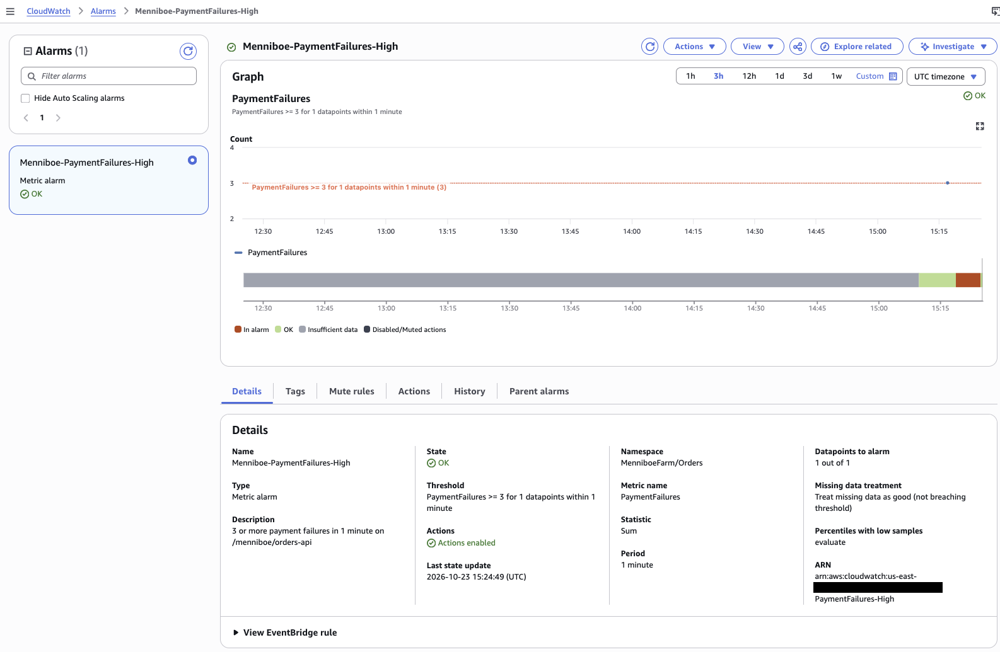

**Results**

| Time (UTC) | Event |
|---|---|
| 15:08:58 | Alarm created |
| 15:09:49 | Insufficient data → **OK** (+ OK email) |
| 15:17:00 | Data point = **3.0** |
| 15:18:49 | OK → **ALARM** (+ ALARM email) |
| 15:24:49 | ALARM → **OK** (missing data treated as good) |

> [!NOTE]
> The return to OK took about 6 minutes, not 1: with missing data, CloudWatch looks back over several periods for late data before applying *treat as good*.

---

## Lab 2 CloudTrail to EventBridge to SNS

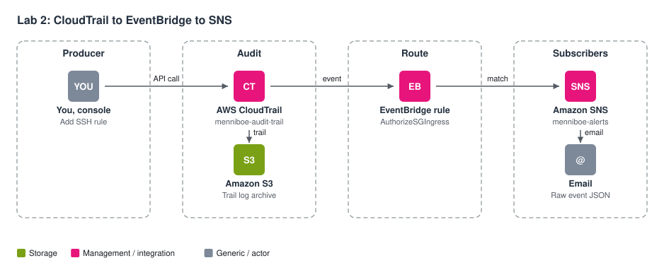

**What we're building:** a CloudTrail trail archiving API calls to S3, an EventBridge rule matching `AuthorizeSecurityGroupIngress`, and the `menniboe-alerts` topic as target.

**What we hope to prove:** "who did what" can page you in near real time, with who, which security group and which IP in the alert.

| Step | Build | Feeds into |
|---|---|---|
| 2.1 | Trail → S3 | Enables "AWS API Call via CloudTrail" events, plus >90-day retention |
| 2.2 | EventBridge rule → SNS | Filters one API call and forwards it |
| 2.3 | Test SG + inbound rule | Triggers the API call (SG reused in Lab 3) |
| 2.4 | Verify | Proof |

### Step 2.1 Create the CloudTrail trail

**Why this step:** EventBridge receives API-call events only while a trail is logging, and the trail's S3 archive is the exam answer for retention beyond 90 days. One trail of management events is free.

**Console:** CloudTrail → Trails → Create trail

**Page 1: Trail attributes**

| Setting | Value |
|---|---|
| Trail name | `menniboe-audit-trail` (console trails are multi-region) |
| Enable for all accounts in my organization | Unchecked / greyed out |
| Storage location | Create new S3 bucket |
| Trail log bucket | `day3-lab-aws-cloudtrail-logs-klm` (globally unique; suffix added) |
| Log file SSE-KMS encryption | Unchecked (avoids KMS key cost; SSE-S3 still applies) |
| Log file validation | Enabled |
| Recursive logging | Default (Enabled) |
| SNS notification delivery | Off |
| CloudWatch Logs | Off |
| Tags | `Project` = `day3-lab` |

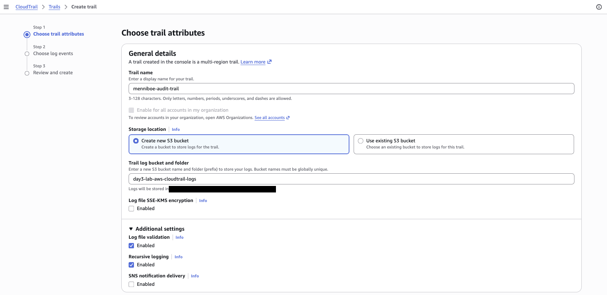

**Page 2: Log events**

| Setting | Value |
|---|---|
| Management events | ✔ |
| Data / Insights / Network activity events | ☐ |
| API activity | **Write** only (uncheck Read) |
| Exclude KMS / RDS Data API events | ☐ |

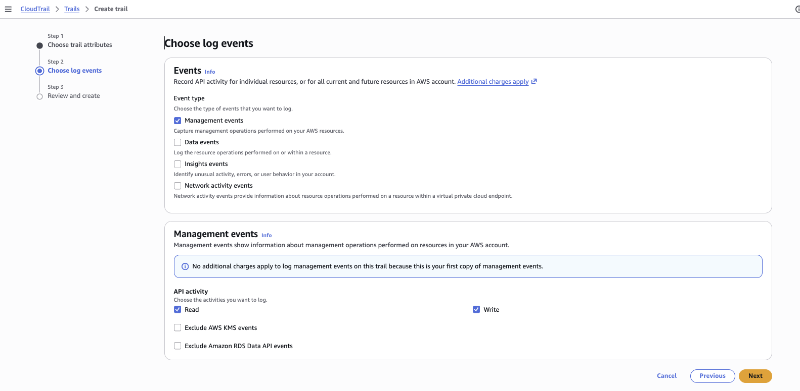

**Page 3:** Review → Create trail.

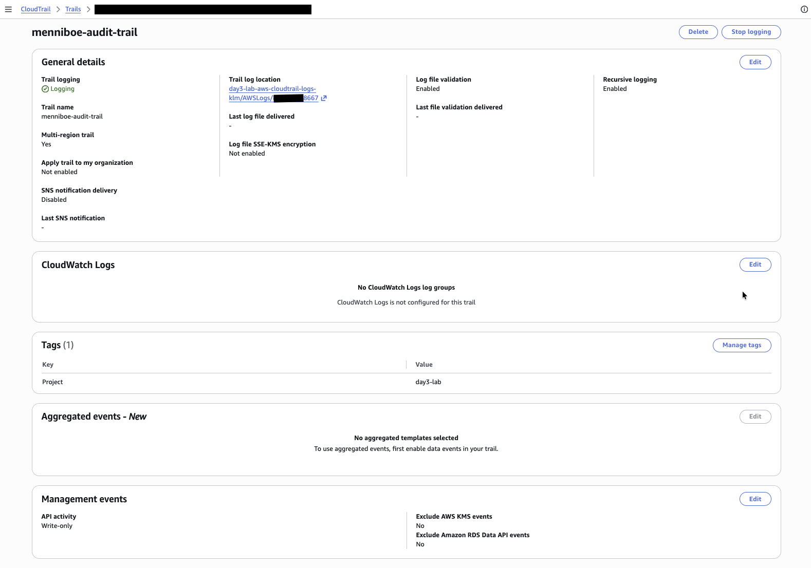

> [!NOTE]
> *Last log file delivered: -* is normal at first; CloudTrail writes a file to S3 about every 5 minutes. **Stop logging** is exactly the `StopLogging` call that the Module 8 SCP blocks.

### Step 2.2 Create the EventBridge rule

**Why this step:** the default bus receives every CloudTrail write event; the rule keeps only the one we care about and forwards it to SNS.

**Console:** EventBridge → **Event buses** → `default` → Create rule (Advanced builder)

> [!WARNING]
> **Navigation change:** *Rules* no longer appears in the left menu. Rules live inside each event bus. Do not click *Create event bus*.

**Page 1: Define rule detail**

| Setting | Value |
|---|---|
| Name | `menniboe-sg-ingress-alert` |
| Description | `Email when any security group inbound rule is added` |
| Event bus | default |
| Enable the rule | On |

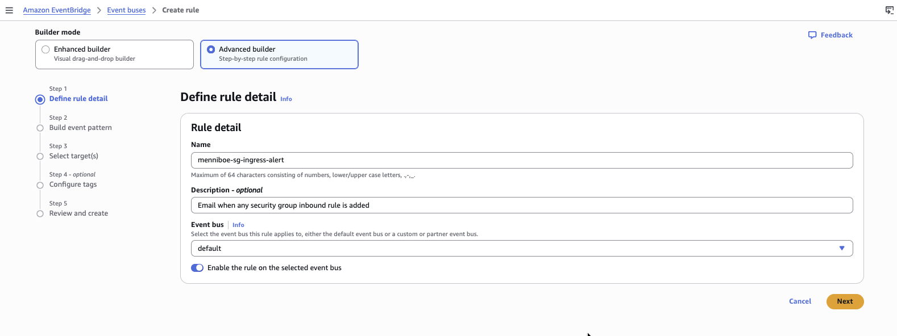

**Page 2: Build event pattern** → Event source *AWS events or EventBridge partner events* → Creation method **Custom pattern (JSON editor)**:

```json
{
  "source": ["aws.ec2"],
  "detail-type": ["AWS API Call via CloudTrail"],
  "detail": {
    "eventSource": ["ec2.amazonaws.com"],
    "eventName": ["AuthorizeSecurityGroupIngress"]
  }
}
```

> [!WARNING]
> **Error:** *Event pattern cannot be empty.* The pattern form was chosen but the AWS service dropdown was never filled. **Fix:** switch to the JSON editor and paste the pattern.

**Page 3: Select targets**

| Setting | Value |
|---|---|
| Target type | AWS service → **SNS topic** |
| Target location | Target in this account |
| Topic | `menniboe-alerts` |
| Permissions | Use execution role → Create default role (`Amazon_EventBridge_Invoke_Sns_...`) |
| Target input | Matched events |
| Retry policy | 24 h / 185 attempts |
| Dead-letter queue | None |

> [!NOTE]
> SNS targets support a resource-based policy (the classic exam answer), but the 2026 console defaults to an **execution role**. Both work. Add the wizard-created role to the teardown list.

**Page 4:** Tags `Project` = `day3-lab`. **Page 5:** Review → Create rule.

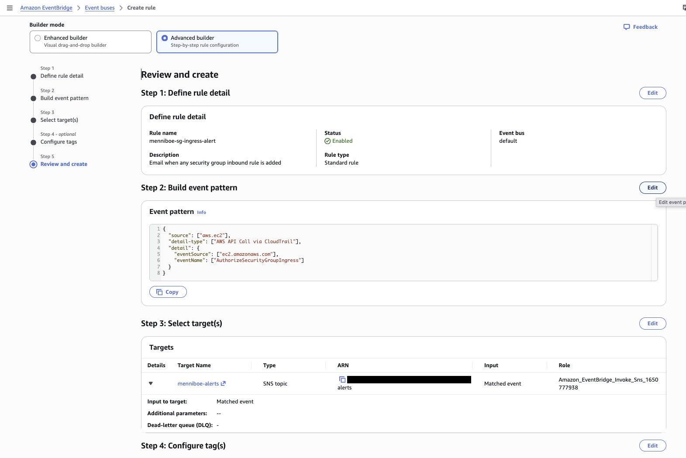

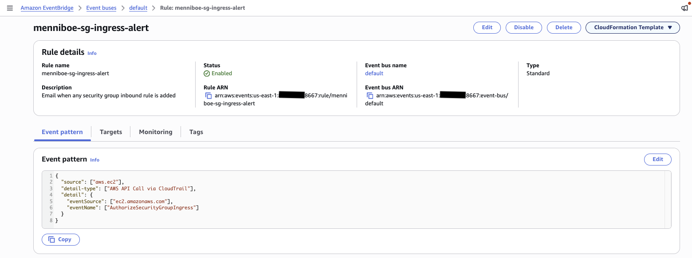

### Step 2.3 Create the test security group and trigger the rule

**Why this step:** create the group **empty**, so the inbound rule added afterwards is one clean `AuthorizeSecurityGroupIngress` call.

**Console:** EC2 → Security Groups → Create security group

| Setting | Value |
|---|---|
| Name | `menniboe-lab-sg` |
| Description | `Day 3 lab test SG - safe to delete` |
| VPC | Default VPC |
| Inbound rules | None |
| Outbound rules | Default (all traffic) |
| Tags | `Project` = `day3-lab` |

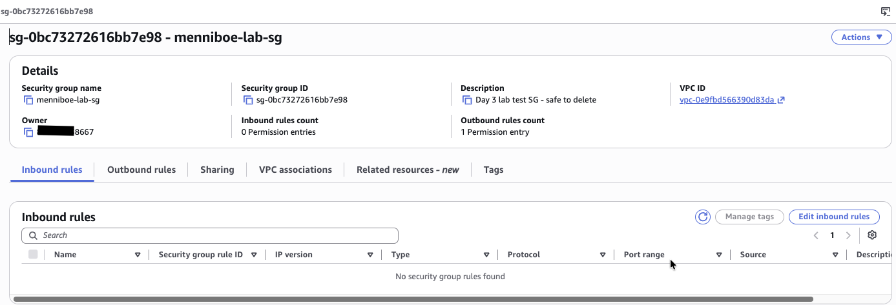

Then **Edit inbound rules → Add rule**: Type **SSH**, Source **Anywhere-IPv4 `0.0.0.0/0`** (no instance attached, so nothing is exposed), description `Lab trigger - remove after test` → Save rules.

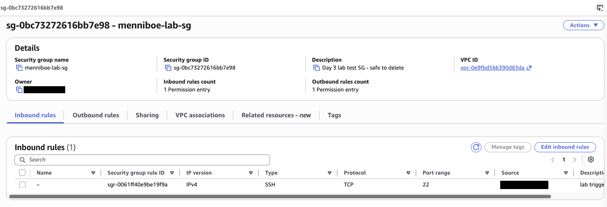

> [!NOTE]
> The rule was saved with **My IP (`/32`)** as source. Any inbound rule triggers Lab 2. It was later edited to `0.0.0.0/0` for Lab 3, which exposed the detection gap below.

### Step 2.4 Verify the alert and Event history

**Why this step:** the email is the real-time view; Event history is the investigation view.

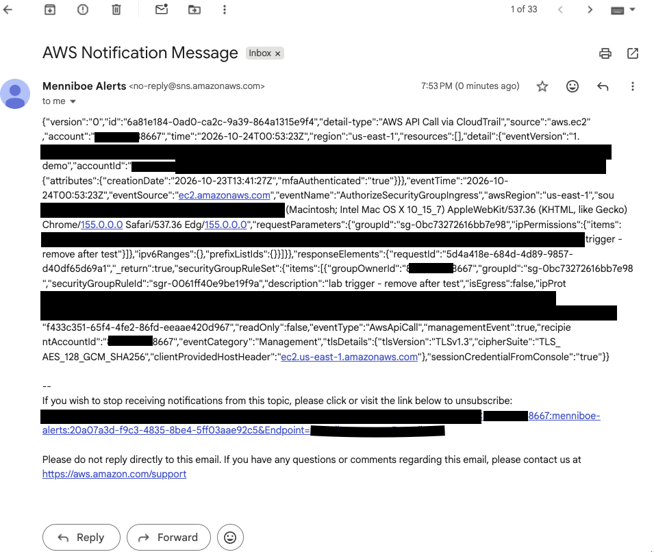

| Question | Field in the event | Value |
|---|---|---|
| What | `eventName` | `AuthorizeSecurityGroupIngress` |
| Who | `userIdentity.userName` | `success-demo` (MFA true) |
| How | `sessionCredentialFromConsole` | Console |
| From where | `sourceIPAddress` | (redacted) |
| On what | `requestParameters.groupId` | `sg-0bc73272616bb7e98` |
| When | `eventTime` | 2026-10-24 00:53:23 UTC |
| Success | `responseElements._return` | true |

Alert latency: under 1 minute.

**Console:** CloudTrail → Event history → Lookup attribute *Event name* = `AuthorizeSecurityGroupIngress`

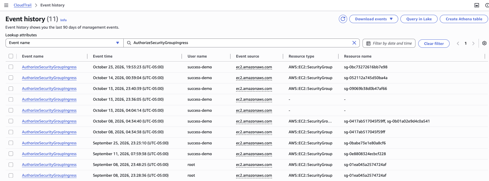

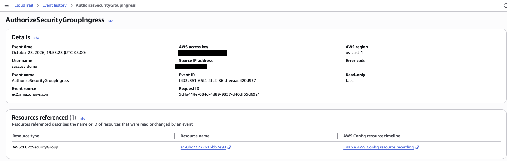

> [!IMPORTANT]
> **Audit finding:** Event history showed two `AuthorizeSecurityGroupIngress` calls by **root** on the default security group (Sep 8). That explains its extra inbound rule, and it is a reminder not to use the root user for daily work.

> [!WARNING]
> **Detection gap found:** editing the rule source to `0.0.0.0/0` called **`ModifySecurityGroupRules`**, not `AuthorizeSecurityGroupIngress`, so **no email** was sent for the riskier change. Fix the pattern to list every API that can open a port:
>
> ```json
> "eventName": ["AuthorizeSecurityGroupIngress", "ModifySecurityGroupRules"]
> ```

---

## Lab 3 AWS Config restricted-ssh with auto-remediation

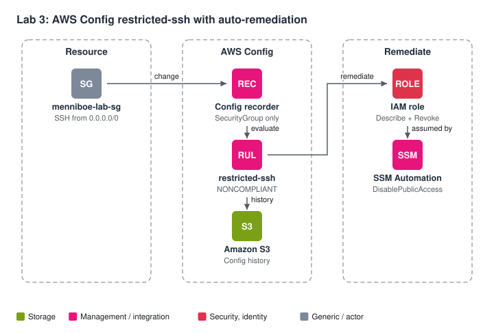

**What we're building:** a Config recorder for security groups only, the managed rule `restricted-ssh`, and automatic remediation with `AWS-DisablePublicAccessForSecurityGroup` running as a least-privilege role.

**What we hope to prove:** Config detects the risky change (even the one Lab 2 missed), shows its history linked to CloudTrail, and fixes it automatically.

| Step | Build | Feeds into |
|---|---|---|
| 3.1 | Recorder (SGs only) + S3 + `restricted-ssh` | Config sees and evaluates SG changes |
| 3.2 | Investigate result | Timeline explains NONCOMPLIANT |
| 3.3 | IAM role for SSM Automation | Permission to revoke the rule |
| 3.4 | Automatic remediation | Config runs the fix |
| 3.5 | Re-evaluate | Triggers the remediation |
| 3.6 | Verify | Proof |

### Step 3.1 Set up the Config recorder and rule

**Why this step:** Config cannot evaluate anything until a recorder is running. Recording only security groups keeps cost to cents.

**Console:** Config → Get started (not 1-click setup, which records everything)

**Page 1: Settings**

| Section | Setting | Value |
|---|---|---|
| Recording strategy | | Specific resource types |
| | Resource type / frequency | AWS EC2 SecurityGroup / Continuous |
| Data governance | IAM role | Create AWS Config service-linked role |
| Delivery channel | S3 bucket | Create a bucket → `config-bucket-day3-lab-klm` |
| | Prefix | Empty |
| SNS topic | | Off |

> [!WARNING]
> **Error:** *S3 bucket name (required)* was left empty. **Fix:** enter a globally unique name.

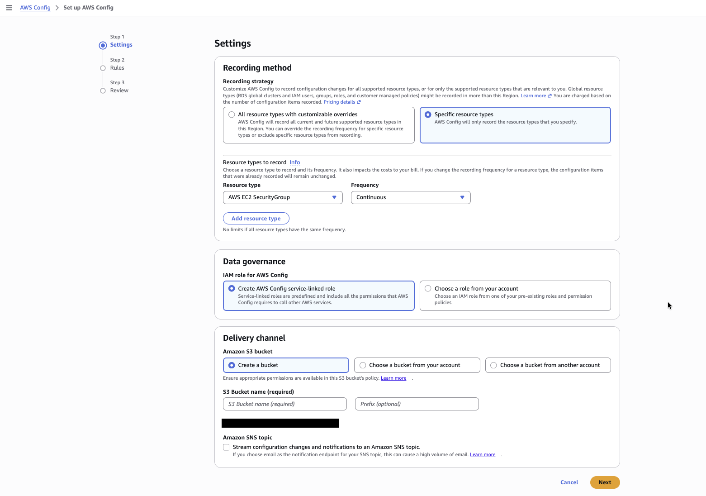

**Page 2: Rules** → search `restricted-ssh` → tick it only (AWS::EC2::SecurityGroup, change-triggered, DETECTIVE).

**Page 3: Review** → Confirm.

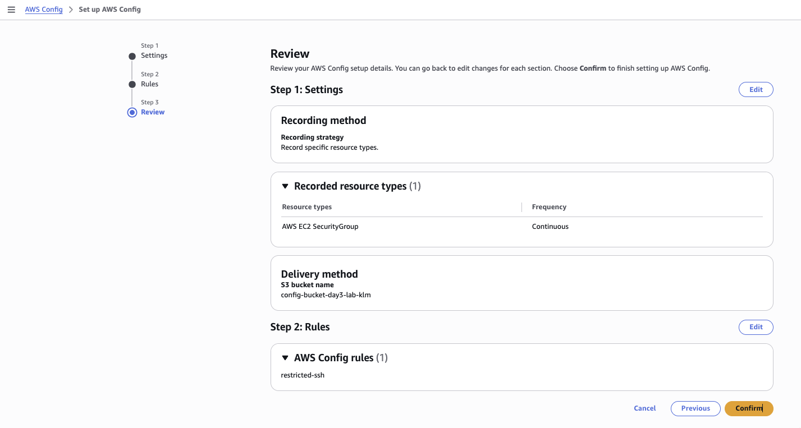

> [!NOTE]
> Right after setup the dashboard showed **Rate exceeded** banners (console API throttling, harmless), **Resource inventory (0)** (display lag), and a brief **Recorder insufficient permissions** spike while the service-linked role propagated.

### Step 3.2 Investigate the noncompliant result

**Why this step:** when Config flags something, first check what the resource actually looks like and what changed it.

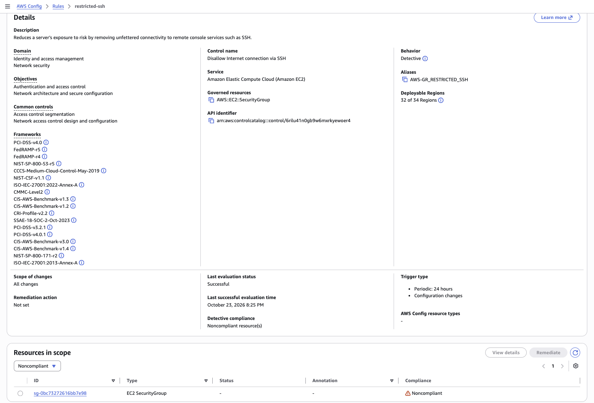

The rule page also shows **Aliases `AWS-GR_RESTRICTED_SSH`** (the Control Tower detective control), mapped frameworks (CIS, PCI-DSS, NIST, ISO 27001, SOC 2), and trigger type *Periodic 24 h + Configuration changes*.

**Console:** Resources in scope → `sg-0bc73272616bb7e98` → Resource timeline

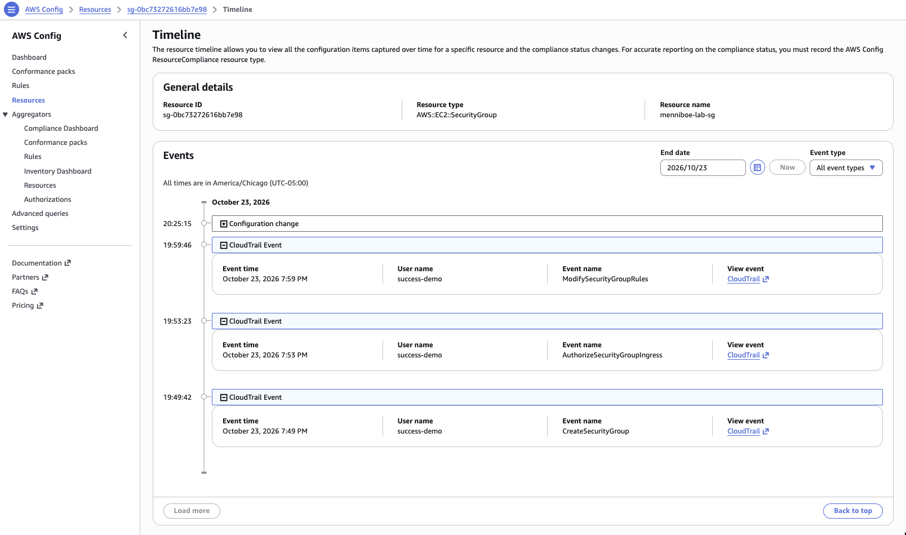

| Time | API (CloudTrail) | Result |
|---|---|---|
| 7:49 PM | `CreateSecurityGroup` | Empty group |
| 7:53 PM | `AuthorizeSecurityGroupIngress` | SSH from `/32`, Lab 2 emailed |
| 7:59 PM | **`ModifySecurityGroupRules`** | Source → `0.0.0.0/0`, **no email** |
| 8:25 PM | First configuration item | `cidrIp: 0.0.0.0/0` → **NONCOMPLIANT** |

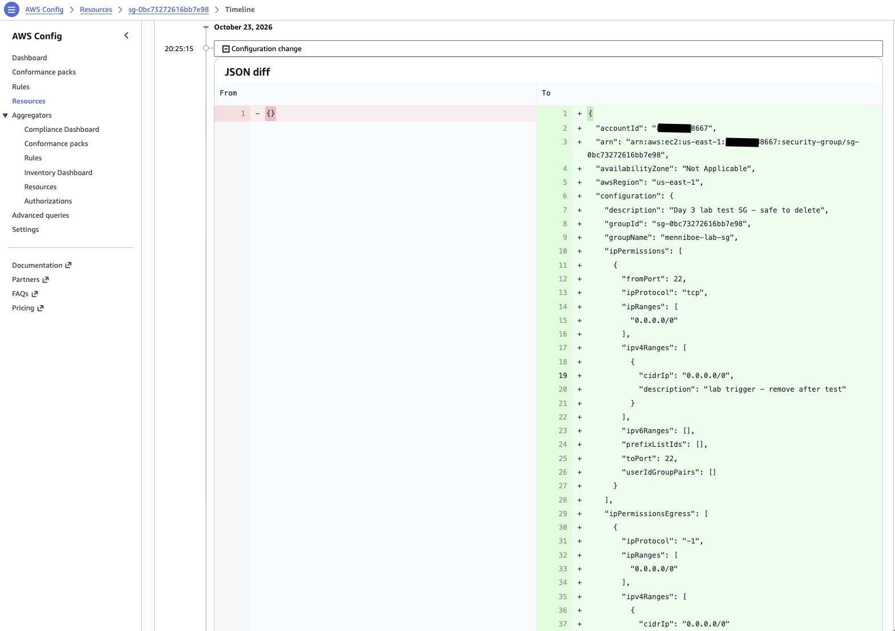

> [!TIP]
> The first configuration item diffs from `{}` because nothing was recorded before. Later changes show only what changed in red and green.

### Step 3.3 Create the remediation IAM role

**Why this step:** SSM Automation runs the fix **as a role**. It needs a trust policy for Systems Manager and permission to read and revoke security group rules, nothing more.

**Console:** IAM → Roles → Create role

| Page | Setting | Value |
|---|---|---|
| Trusted entity | Type / service / use case | AWS service / Systems Manager / Systems Manager |
| Add permissions | Method | **Create inline policy** (JSON below) |
| Name | Role name | `day3-lab-config-role` |
| | Inline policy name | `day3-lab-config-rolePolicy` |

```json
{
  "Version": "2012-10-17",
  "Statement": [
    {
      "Sid": "AllowRevokeOpenSecurityGroupRules",
      "Effect": "Allow",
      "Action": ["ec2:DescribeSecurityGroups", "ec2:RevokeSecurityGroupIngress"],
      "Resource": "*"
    }
  ]
}
```

Policy summary: **EC2 — Limited: List, Write — All resources**.

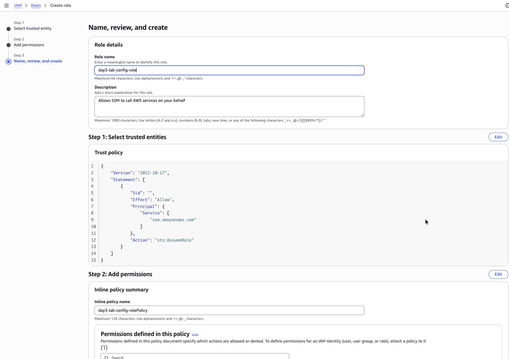

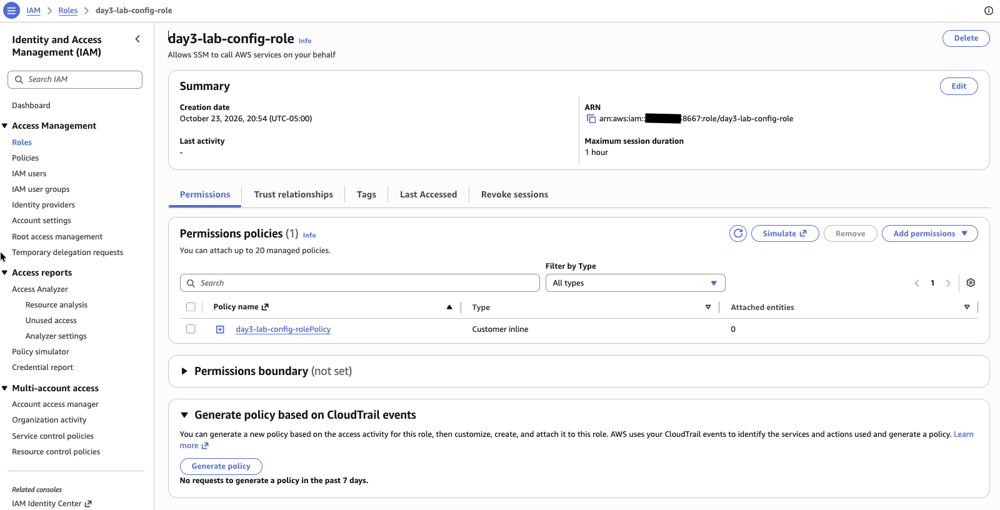

### Step 3.4 Attach automatic remediation

**Why this step:** connect the rule to the fix so every noncompliant evaluation runs the SSM document automatically.

**Console:** Config → Rules → `restricted-ssh` → Actions → Manage remediation

| Section | Setting | Value |
|---|---|---|
| Method | | **Automatic remediation** |
| Retries | Maximum retry attempts / window | `5` / `60` seconds |
| Action | | `AWS-DisablePublicAccessForSecurityGroup` |
| Rate limits | Concurrent / error rate | `2` / `5` |
| Resource ID parameter | | **GroupId** |
| Parameters | `GroupId` | `RESOURCE_ID` (auto) |
| | `IpAddressToBlock` | Empty (blocks all SSH and RDP from IPv4 and IPv6) |
| | `AutomationAssumeRole` | `arn:aws:iam::<account-id>:role/day3-lab-config-role` |

> [!WARNING]
> **Error:** *Maximum retry attempts* was `0` (allowed range 1–25). **Fix:** `5`, and type the placeholder values in explicitly.

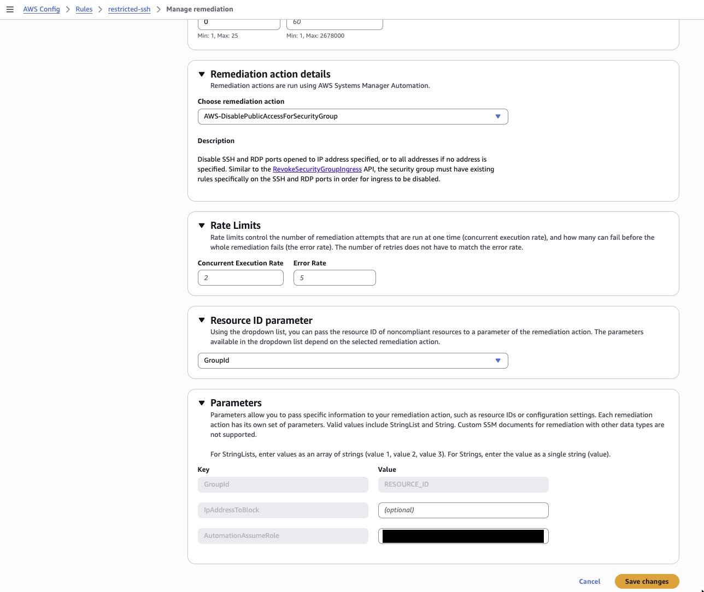

### Step 3.5 Trigger a fresh evaluation

**Why this step:** automatic remediation fires on a **new** noncompliant evaluation. The only evaluation so far happened before the remediation existed, so nothing ran (Status `-`).

**Console:** rule page → Actions → **Re-evaluate**, wait 2–3 minutes, refresh *Resources in scope*.

Fallback: select the resource → **Remediate** (manual trigger, same document and role).

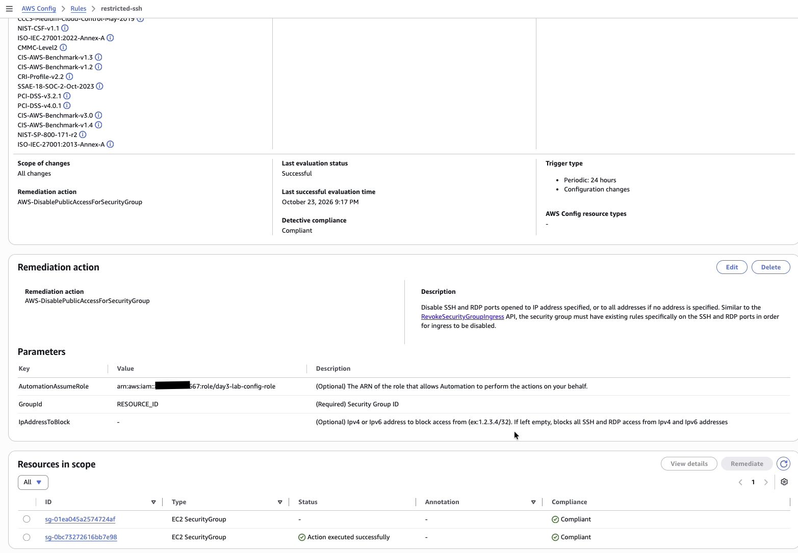

### Step 3.6 Verify the fix in three places

**1. The resource:** EC2 → Security Groups → `menniboe-lab-sg` → Inbound rules: *No security group rules found*.


**2. The compliance result:** `restricted-ssh` → Detective compliance **Compliant** at 9:17 PM; both security groups compliant.

**3. The audit trail:** resource timeline.


| Question | Evidence |
|---|---|
| What changed | `ipPermissions` from the port 22 / `0.0.0.0/0` block to `[]`; status `ResourceDiscovered → OK` |
| Who changed it | `Automation-3e5711cb-...`, the SSM Automation session assuming `day3-lab-config-role` |
| When | Revoked 9:14 PM → new configuration item 9:16:48 → Compliant 9:17 |

> [!NOTE]
> Four `RevokeSecurityGroupIngress` calls appear, consistent with the document covering SSH and RDP for IPv4 and IPv6; only the IPv4 port 22 rule existed. *Stopped recording changes to compliance events* appears because the `AWS::Config::ResourceCompliance` type was not recorded (to keep cost down).

---

## Lab 4 Permission boundary blocks privilege escalation


**What we're building:** a boundary policy allowing only S3 and CloudWatch read actions, and a test role with `AdministratorAccess` plus that boundary.

**What we hope to prove:** effective permissions = identity policy ∩ boundary, even when the identity policy allows everything.

| Step | Build | Feeds into |
|---|---|---|
| 4.1 | Boundary policy `menniboe-dev-boundary` | Maximum for capped identities |
| 4.2 | Role `menniboe-dev-test-role` + boundary | An admin that is not really an admin |
| 4.3 | IAM Policy Simulator | Allowed / denied and why |
| 4.4 | Switch Role | Real denials in the real console |

### Step 4.1 Create the boundary policy

**Why this step:** a boundary is an ordinary managed policy used as a cap; it must exist before the role.

**Console:** IAM → Policies → Create policy → JSON

```json
{
  "Version": "2012-10-17",
  "Statement": [
    {
      "Sid": "DevBoundaryReadOnlyS3AndCloudWatch",
      "Effect": "Allow",
      "Action": [
        "s3:ListAllMyBuckets",
        "s3:GetBucketLocation",
        "s3:ListBucket",
        "s3:GetObject",
        "cloudwatch:Get*",
        "cloudwatch:List*",
        "cloudwatch:Describe*"
      ],
      "Resource": "*"
    }
  ]
}
```

| Setting | Value |
|---|---|
| Policy name | `menniboe-dev-boundary` |
| Description | `Permission boundary - caps any identity to S3 and CloudWatch read (Day 3 lab)` |
| Tags | `Project` = `day3-lab` |

Summary: CloudWatch (Full: List, Limited: Read) and S3 (Limited: List, Read); the other 476 services are not allowed.


### Step 4.2 Create the test role and set the boundary

**Why this step:** a role is easy to cap and to step into with Switch Role; trusting this account lets your own user assume it.

**Console:** IAM → Roles → Create role

| Page | Setting | Value |
|---|---|---|
| Trusted entity | Type | AWS account → This account |
| | Require external ID / MFA | Off / Off |
| Add permissions | Policy | `AdministratorAccess` |
| | Set permissions boundary | **Use a permissions boundary** → `menniboe-dev-boundary` |
| Name | Role name | `menniboe-dev-test-role` |
| | Description | `Test role - AdministratorAccess capped by menniboe-dev-boundary (Day 3 lab)` |

> [!WARNING]
> **Error:** the role was created with **Permissions boundary (not set)**, making it a real full admin. **Fix:** role page → Permissions boundary → **Set permissions boundary** → `menniboe-dev-boundary`. The summary must show two entries: AdministratorAccess (permissions policy) and the boundary.


### Step 4.3 Test in the IAM Policy Simulator

**Why this step:** the simulator evaluates real policies without running anything and names the layer that decided each result.

**Console:** role page → **Simulate** → Add actions: S3 `ListAllMyBuckets`, IAM `CreateUser`, EC2 `RunInstances` → Simulate. Then set *Permissions boundaries* to **None** and simulate again.


| Action | Boundary = None | Boundary = menniboe-dev-boundary |
|---|---|---|
| `s3:ListAllMyBuckets` | Allowed | Allowed (explicit allow in 1 statement) |
| `iam:CreateUser` | Allowed | **Denied** (implicitly denied by a permissions boundary) |
| `ec2:RunInstances` (5 resource types) | Allowed | **Denied** (implicitly denied by a permissions boundary) |

### Step 4.4 Switch Role and hit the boundary live

**Why this step:** the simulator predicts; Switch Role proves it with temporary STS credentials.

**Console:** account menu → Switch role

| Field | Value |
|---|---|
| Account ID | Account ID or alias |
| IAM role name | `menniboe-dev-test-role` |
| Display name | `DEV-capped` |
| Display color | Red |

The console immediately hit a denial loading the simulator:


*User: `arn:aws:sts::<account-id>:assumed-role/menniboe-dev-test-role/success-demo` — Action: `iam:ListRoles` — Context: **no permissions boundary allows the action**.*

S3 bucket list works (inside the boundary):


EC2 Launch an instance breaks (outside the boundary):


> [!TIP]
> Permission denials often look like other errors: *The AMI ID is not valid* and an empty VPC dropdown here really mean `ec2:DescribeImages` and `ec2:DescribeVpcs` were denied.

After **Switch back**, the same page loads normally:


---

## Teardown

Reverse order of creation. Full CLI with verification is in [commands.md](commands.md#teardown).

| Order | Lab | Delete |
|---|---|---|
| T1 | 4 | Role `menniboe-dev-test-role` (detach AdministratorAccess, remove boundary) → policy `menniboe-dev-boundary` |
| T2 | 3 | Remediation → rule `restricted-ssh` → stop and delete recorder and delivery channel → bucket `config-bucket-day3-lab-klm` → role `day3-lab-config-role` (optional: `AWSServiceRoleForConfig`) |
| T3 | 2/3 | Security group `menniboe-lab-sg` |
| T4 | 2 | Rule targets → rule `menniboe-sg-ingress-alert` → role `Amazon_EventBridge_Invoke_Sns_...` and its policy → trail `menniboe-audit-trail` → bucket `day3-lab-aws-cloudtrail-logs-klm` |
| T5 | 1 | Alarm → log group `/menniboe/orders-api` (takes the metric filter) → topic `menniboe-alerts` (takes the subscription) |
| T6 | All | Verify: every check returns `[]`; S3 lists only the kept portfolio bucket |

> [!IMPORTANT]
> Keep unrelated long-lived resources (the CloudFront portfolio bucket and the account Budget). Verification returned `[]` for all ten checks.

## Troubleshooting log

| # | Lab / step | Symptom | Cause | Fix |
|---|---|---|---|---|
| 1 | 1.1 | Name showed `.fifo` | FIFO type selected; FIFO can't email | Switch to Standard before Create |
| 2 | 1.2 | Subscriptions (0) after confirming | Page loaded before subscription; new Confirm button | Click Confirm subscription on the page, refresh |
| 3 | 1.4 | Metric missing from Metrics list | No log data yet | Create the alarm from the filter card |
| 4 | 1.5 | Condition `>` and missing-data *missing* | Defaults | Greater/Equal; treat missing as good |
| 5 | 1.5 | Only ALARM notification | OK notification not added | Add notification → OK |
| 6 | 1.7 | OK took ~6 min | Missing-data lookback | Expected behavior |
| 7 | 2.2 | Rules not in left menu | 2026 console moved rules into buses | Event buses → default → Create rule |
| 8 | 2.2 | *Event pattern cannot be empty* | Pattern form dropdown not set | Paste pattern in JSON editor |
| 9 | 2.2 | Execution role instead of resource policy | Console default | Keep; delete role at teardown |
| 10 | 2.3/3.2 | No email when source changed to 0.0.0.0/0 | Edit calls `ModifySecurityGroupRules` | Add it to the pattern; rely on Config for configuration state |
| 11 | 3.1 | Bucket name required | Field left empty | Enter unique name |
| 12 | 3.1 | Rate exceeded banners | Console API throttling | Close and refresh |
| 13 | 3.2 | Unexpected NONCOMPLIANT | SG had been edited to `0.0.0.0/0` | Confirmed via resource timeline |
| 14 | 3.4 | Retry attempts 0 invalid | Range 1–25 | Set 5 |
| 15 | 3.5 | Remediation status `-` | No new evaluation since attaching | Re-evaluate (or Remediate manually) |
| 16 | 3.6 | Resource inventory (0) | Inventory display lag | Use rule's Resources in scope link |
| 17 | 4.2 | Boundary (not set) | Boundary skipped during creation | Set permissions boundary on the role |
| 18 | 4.4 | "AMI not valid", empty VPC list | Describe calls denied by boundary | Expected; proves the cap |

## Service selection cheat sheet

| If the question says | Choose |
|---|---|
| EC2 memory or disk usage | CloudWatch agent / custom metric |
| Near-real-time metrics to a third party | Metric Streams (Firehose) |
| Real-time log processing / SIEM | Subscription filter |
| Alert on a word in logs | Metric filter → alarm |
| Recover EC2 with the same IPs | System status check + recover |
| Reduce alarm noise | Composite alarm |
| Serverless cron | EventBridge schedule / Scheduler |
| React to an API call | CloudTrail → EventBridge rule |
| Top-N talkers in logs | Contributor Insights |
| Container or Fargate metrics | Container Insights |
| Who did it | CloudTrail |
| API logs beyond 90 days | Trail → S3 + Athena |
| Compliant? How did it change? | AWS Config |
| Auto-fix noncompliant resources | Config remediation + SSM Automation |
| Block an action for every account, even root | SCP |
| Share a resource with the whole org | Resource policy + `aws:PrincipalOrgID` |
| Need permissions in two accounts at once | Resource-based policy, not a role |
| Developers create roles safely | Permission boundary |
| One login to many accounts | IAM Identity Center |
| AD in AWS with trust to on-prem | Managed Microsoft AD |
| On-prem AD, nothing copied to AWS | AD Connector |
| Best-practice multi-account setup | Control Tower |

## Acronyms

| Acronym | Meaning |
|---|---|
| ABAC | Attribute-Based Access Control |
| AD | Active Directory |
| ALB | Application Load Balancer |
| AMI | Amazon Machine Image |
| API | Application Programming Interface |
| ARN | Amazon Resource Name |
| ASG | Auto Scaling Group |
| AZ | Availability Zone |
| CI | Configuration Item |
| CIDR | Classless Inter-Domain Routing |
| DC | Domain Controller |
| DLQ | Dead-Letter Queue |
| EBS | Elastic Block Store |
| ECS / EKS | Elastic Container Service / Elastic Kubernetes Service |
| FIFO | First-In, First-Out |
| IAM | Identity and Access Management |
| IdP | Identity Provider |
| JSON | JavaScript Object Notation |
| KMS | Key Management Service |
| MFA | Multi-Factor Authentication |
| OU | Organizational Unit |
| RCP | Resource Control Policy |
| RDP | Remote Desktop Protocol |
| SAML | Security Assertion Markup Language |
| SCIM | System for Cross-domain Identity Management |
| SCP | Service Control Policy |
| SG | Security Group |
| SIEM | Security Information and Event Management |
| SNS / SQS | Simple Notification Service / Simple Queue Service |
| SSH | Secure Shell |
| SSM | AWS Systems Manager |
| SSO | Single Sign-On |
| STS | Security Token Service |
| VPC | Virtual Private Cloud |
