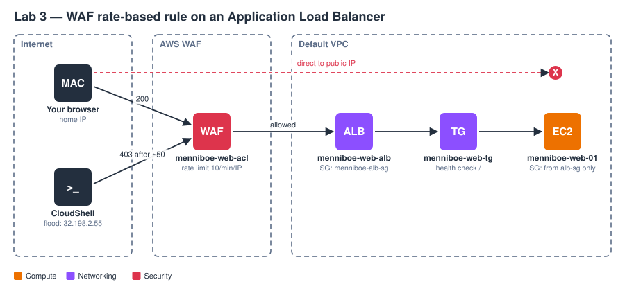

# AWS Security and Encryption

AWS Solutions Architect Associate (SAA-C03), Section 26. KMS, SSE-KMS with S3 Bucket Keys, Parameter Store, Secrets Manager, ACM, CloudHSM, WAF, Shield, Firewall Manager, GuardDuty, Inspector and Macie, with three console-first labs on the Menniboe Farm co-op theme.

## What I learned

- **Encryption types:** in flight (TLS), server-side at rest (SSE), client-side; the deciding question is who encrypts and who holds the key.
- **KMS:** symmetric vs asymmetric keys; AWS owned, AWS managed and customer managed keys; envelope encryption and the 4 KB limit; request quotas and S3 Bucket Keys; key policies; multi-Region keys; cross-account snapshot and AMI sharing; SSE-KMS replication.
- **Secrets:** Parameter Store (hierarchy, SecureString, tiers) vs Secrets Manager (rotation through Lambda, staging labels, multi-Region secrets).
- **Certificates and hardware:** ACM validation, renewal, imported-certificate alerts and Region rules; CloudHSM vs KMS.
- **Perimeter:** WAF Web ACLs, rate-based rules and the Global Accelerator + ALB pattern; Shield Standard vs Advanced; Firewall Manager; DDoS-resilient architecture.
- **Detection:** GuardDuty (threats), Inspector (vulnerabilities), Macie (PII in S3).

## Lab results

| Lab | Result |
|---|---|
| **1: KMS + S3** | Object encrypted with `menniboe-orders-key` and a Bucket Key. CloudTrail `GenerateDataKey` was invoked by `fas.s3.amazonaws.com` with the **bucket** ARN as encryption context. A role with S3 read only got **AccessDenied on `kms:Decrypt`**; after adding it as a key user, the download worked. |
| **2: Parameter Store vs Secrets Manager** | SecureString returned `AQICAH…` ciphertext without `--with-decryption`; one `GetParametersByPath` call returned the whole `/menniboe/dev` tree; `KeyId = alias/menniboe-orders-key`. Secrets Manager returned decrypted JSON with `AWSCURRENT` and a random ARN suffix. |
| **3: WAF on an ALB** | Direct access to the instance timed out (SG source = ALB SG). Flood from one IP: **50 × 200, then 70 × 403**. A different IP loaded the page at the same moment. The block lifted on its own once the rate dropped. WAF sampled requests showed **71** BLOCK rows for the flooding IP. |
| **Teardown** | 11 steps in reverse order; the tag sweep found only the KMS key, pending deletion (7-day window). |

## Issues solved

- KMS key review showed no tags → added the tag before Finish.
- AccessDenied on `kms:Decrypt` for an S3 read-only role → granted access on the **key**, not the bucket.
- Secrets Manager key field typed but not selected → selected from the dropdown, confirmed on Review.
- Target group healthy threshold stuck at 5 → edited to 2.
- WAF opened in the new console → switched to the old console's Web ACL wizard.
- Rate-based block started after ~50 requests, and lifted before the per-IP test → WAF evaluates rates every few seconds; used a stop-at-403 loop.
- Sampled requests showed only ALLOW → filtered to the rule metric.

## Files

| File | Contents |
|---|---|
| [notes.md](notes.md) | All 15 modules with diagrams, the three labs step by step with console values and screenshots, troubleshooting log, cheat sheet, acronyms |
| [commands.md](commands.md) | Every CLI command, CLI equivalents of the console steps, and the full teardown |
| `images/diagrams/` | 18 SVG diagrams (15 modules, 3 labs) |
| `images/screenshots/` | 46 redacted lab screenshots |
