# AWS Security and Encryption: KMS, Parameter Store, Secrets Manager, ACM, CloudHSM, WAF, Shield, GuardDuty, Inspector, Macie

AWS Solutions Architect Associate (SAA-C03), Stephane Maarek Section 26. Running example: **Menniboe Farm**, a farm business that has grown into a regional co-op with an online shop, an orders database, partner accounts and an analytics account.

---

## Table of contents

- [Part 1: Concepts](#part-1-concepts)
  - [Block 1: Encryption foundations and KMS](#block-1-encryption-foundations-and-kms)
    - [Module 1: Encryption 101](#module-1-encryption-101)
    - [Module 2: AWS KMS overview](#module-2-aws-kms-overview)
    - [Module 3: KMS key policies and cross-account snapshot copy](#module-3-kms-key-policies-and-cross-account-snapshot-copy)
  - [Block 2: KMS across Regions and accounts, Parameter Store](#block-2-kms-across-regions-and-accounts-parameter-store)
    - [Module 4: KMS multi-Region keys](#module-4-kms-multi-region-keys)
    - [Module 5: S3 replication and AMI sharing with KMS](#module-5-s3-replication-and-ami-sharing-with-kms)
    - [Module 6: SSM Parameter Store](#module-6-ssm-parameter-store)
  - [Block 3: Secrets, certificates and dedicated hardware](#block-3-secrets-certificates-and-dedicated-hardware)
    - [Module 7: AWS Secrets Manager](#module-7-aws-secrets-manager)
    - [Module 8: AWS Certificate Manager](#module-8-aws-certificate-manager)
    - [Module 9: AWS CloudHSM](#module-9-aws-cloudhsm)
  - [Block 4: Perimeter protection](#block-4-perimeter-protection)
    - [Module 10: AWS WAF](#module-10-aws-waf)
    - [Module 11: AWS Shield](#module-11-aws-shield)
    - [Module 12: AWS Firewall Manager and DDoS best practices](#module-12-aws-firewall-manager-and-ddos-best-practices)
  - [Block 5: Threat detection and data discovery](#block-5-threat-detection-and-data-discovery)
    - [Module 13: Amazon GuardDuty](#module-13-amazon-guardduty)
    - [Module 14: Amazon Inspector](#module-14-amazon-inspector)
    - [Module 15: Amazon Macie](#module-15-amazon-macie)
- [Part 2: Hands-on labs](#part-2-hands-on-labs)
  - [Lab 1: S3 encrypted with a customer managed KMS key](#lab-1-s3-encrypted-with-a-customer-managed-kms-key)
    - [Lab 1 Step 1: Create the customer managed key](#lab-1-step-1-create-the-customer-managed-key)
    - [Lab 1 Step 2: Create the SSE-KMS bucket](#lab-1-step-2-create-the-sse-kms-bucket)
    - [Lab 1 Step 3: Upload an object and confirm encryption](#lab-1-step-3-upload-an-object-and-confirm-encryption)
    - [Lab 1 Step 4: Find the key usage in CloudTrail](#lab-1-step-4-find-the-key-usage-in-cloudtrail)
    - [Lab 1 Step 5: Create a role with S3 read but no KMS](#lab-1-step-5-create-a-role-with-s3-read-but-no-kms)
    - [Lab 1 Step 6: Switch role and try to read the file](#lab-1-step-6-switch-role-and-try-to-read-the-file)
    - [Lab 1 Step 7: Grant key access and retry](#lab-1-step-7-grant-key-access-and-retry)
  - [Lab 2: Parameter Store vs Secrets Manager](#lab-2-parameter-store-vs-secrets-manager)
    - [Lab 2 Step 1: Create a String and a SecureString](#lab-2-step-1-create-a-string-and-a-securestring)
    - [Lab 2 Step 2: Read the parameters from CloudShell](#lab-2-step-2-read-the-parameters-from-cloudshell)
    - [Lab 2 Step 3: Store the secret in Secrets Manager](#lab-2-step-3-store-the-secret-in-secrets-manager)
    - [Lab 2 Step 4: Read the secret from CloudShell](#lab-2-step-4-read-the-secret-from-cloudshell)
  - [Lab 3: WAF rate-based rule on an ALB](#lab-3-waf-rate-based-rule-on-an-alb)
    - [Lab 3 Step 1: ALB security group](#lab-3-step-1-alb-security-group)
    - [Lab 3 Step 2: Launch the web server](#lab-3-step-2-launch-the-web-server)
    - [Lab 3 Step 3: Prove direct access is blocked](#lab-3-step-3-prove-direct-access-is-blocked)
    - [Lab 3 Step 4: Create the target group](#lab-3-step-4-create-the-target-group)
    - [Lab 3 Step 5: Create the ALB](#lab-3-step-5-create-the-alb)
    - [Lab 3 Step 6: Baseline through the ALB](#lab-3-step-6-baseline-through-the-alb)
    - [Lab 3 Step 7: Create the Web ACL](#lab-3-step-7-create-the-web-acl)
    - [Lab 3 Step 8: Flood test](#lab-3-step-8-flood-test)
    - [Lab 3 Step 9: Prove blocking is per IP](#lab-3-step-9-prove-blocking-is-per-ip)
    - [Lab 3 Step 10: Sampled requests](#lab-3-step-10-sampled-requests)
  - [Teardown](#teardown)
- [Troubleshooting log](#troubleshooting-log)
- [Service selection cheat sheet](#service-selection-cheat-sheet)
- [Acronyms](#acronyms)

---

# Part 1: Concepts

## Block 1: Encryption foundations and KMS

### Module 1: Encryption 101

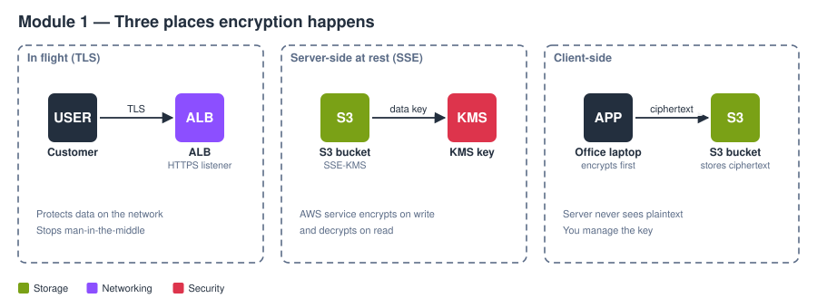

Encryption protects data so that only someone holding the right key can read it. The deciding question is always **who encrypts, and who holds the key**.

| Type | Who encrypts | Where keys live | Example |
|---|---|---|---|
| **In flight (TLS)** | Client and server | TLS/SSL certificates | HTTPS to an Application Load Balancer |
| **Server-side at rest (SSE)** | The AWS service, after it receives the data | A key management service (KMS) | S3 SSE-KMS, EBS encryption |
| **Client-side** | Your application, before sending | You manage the key | Encrypt a file locally, upload the ciphertext to S3 |

- **In flight:** data is encrypted before sending and decrypted on receipt. TLS stops man-in-the-middle attacks. ALB, CloudFront and API Gateway all terminate TLS.
- **Server-side at rest:** the service encrypts with a data key before writing to disk and decrypts on read. The application never touches the key; the service needs permission to use it.
- **Client-side:** the server only ever stores ciphertext and can't decrypt it. Use it when the storage layer can't be trusted, or compliance requires that AWS never sees plaintext.

| Approach | Pros | Cons |
|---|---|---|
| In flight (TLS) | Protects data on networks; easy with ACM | Doesn't protect stored data |
| Server-side (SSE) | Transparent to apps; integrated with KMS and CloudTrail | The service can decrypt (with key permission) |
| Client-side | Server never sees plaintext; full key control | You build and run encryption and key management |

> [!TIP]
> **Exam clues:** "the server must never see unencrypted data" → client-side encryption. "Encrypt at rest with minimal effort" → server-side encryption (usually KMS). "Prevent man-in-the-middle" → TLS/HTTPS.

**Menniboe Farm:** the order site runs over HTTPS (in flight), order records in S3 use SSE-KMS (at rest), and payroll files are encrypted on the office laptop before upload (client-side).

### Module 2: AWS KMS overview

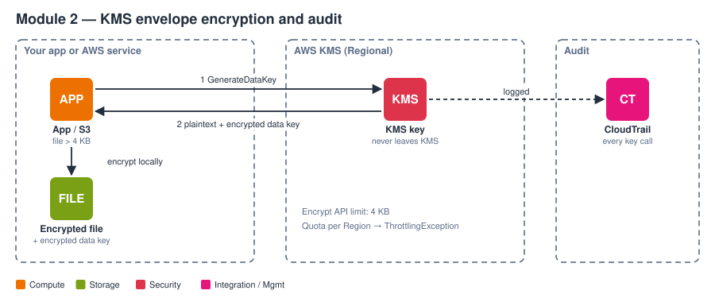

**AWS Key Management Service (KMS)** creates and controls encryption keys. AWS runs the hardware; you control the keys through policies. It is integrated with **IAM** for authorization and **CloudTrail** for auditing every key call, and it is the encryption engine behind S3, EBS, RDS, DynamoDB, SQS, Lambda environment variables, Secrets Manager and Parameter Store.

**Key types**

| Type | How it works | Use |
|---|---|---|
| **Symmetric (AES-256)** | One key encrypts and decrypts. You never see the key material; you call the API | Default; used by almost every AWS service |
| **Asymmetric (RSA, ECC)** | Public key encrypts or verifies; private key decrypts or signs. Public key is downloadable | Encryption by parties outside AWS; digital signatures |

**Key ownership**

| Kind | Example | Cost | Rotation |
|---|---|---|---|
| AWS owned | SSE-S3, default SQS/DynamoDB encryption | Free | Handled invisibly by AWS |
| AWS managed | `aws/rds`, `aws/ebs`, `aws/s3` | Free | Automatic, yearly |
| **Customer managed** | A key you create | ~$1/month + API calls | Optional automatic (configurable period) or on-demand |
| Imported key material | You bring the key bytes | ~$1/month | Manual only |

API calls cost about $0.03 per 10,000 requests.

**Behaviors to know**

- **Keys are Regional.** Copying an encrypted snapshot to another Region re-encrypts it with a key in the destination Region.
- **4 KB limit on `Encrypt`.** Larger data uses **envelope encryption**: `GenerateDataKey` returns a plaintext data key (encrypt locally, then discard) and an encrypted copy stored next to the data. S3 and EBS do this for you.
- **Request quotas.** Heavy SSE-KMS traffic can return `ThrottlingException`. Fixes: exponential backoff, a quota increase, **S3 Bucket Keys**, or client-side data key caching.
- **Deletion waiting period** of 7–30 days, during which deletion can be cancelled. A deleted key makes its data permanently unreadable.

| Pros | Cons |
|---|---|
| Fully managed, integrated with most services | Regional |
| IAM + key policies give fine-grained control | Request quotas can throttle heavy SSE-KMS workloads |
| Every key use logged in CloudTrail | Customer managed keys cost ~$1/month each |

> [!TIP]
> **Exam clues:** "audit every use of the key" → KMS + CloudTrail. "Encrypt data larger than 4 KB" → envelope encryption / `GenerateDataKey`. "Control rotation and lifecycle" → customer managed key. "`ThrottlingException` on S3 SSE-KMS" → S3 Bucket Keys (least overhead), backoff, or a quota increase.

**Menniboe Farm:** the co-op uses a customer managed key, `menniboe-orders-key`, with yearly rotation. CloudTrail shows which function decrypted order data and when.

### Module 3: KMS key policies and cross-account snapshot copy

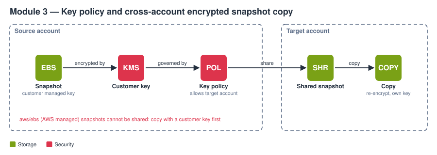

Every KMS key has a **key policy**, a resource-based policy. **Without a key policy that allows access, nobody can use the key, not even the root user.**

| Policy | What it does |
|---|---|
| **Default key policy** | Grants the account root principal `kms:*`. This **delegates** to IAM, so IAM policies in the account can grant key access |
| **Custom key policy** | Names specific users and roles, separates key **administrators** from key **users**, and can grant **other accounts**. Required for cross-account access |

**Cross-account encrypted snapshot copy**

1. Snapshot encrypted with a **customer managed key**.
2. Key policy authorizes the target account (`kms:Decrypt`, `kms:DescribeKey`, `kms:CreateGrant`).
3. Share the snapshot with the target account.
4. In the target account, copy the snapshot and re-encrypt with a key it owns.
5. Create a volume from the copy.

> [!WARNING]
> Snapshots encrypted with the AWS managed `aws/ebs` key can't be shared. Copy and re-encrypt with a customer managed key first.

> [!TIP]
> **Exam clues:** "share encrypted snapshot or data with another account" → customer managed key + key policy that names the account. "Nobody can use the key, not even admins" → the key policy doesn't allow it.

**Menniboe Farm:** the auditing partner's account gets `kms:Decrypt` and `kms:CreateGrant` in the key policy, copies the shared snapshot, and re-encrypts it under its own key.

## Block 2: KMS across Regions and accounts, Parameter Store

### Module 4: KMS multi-Region keys

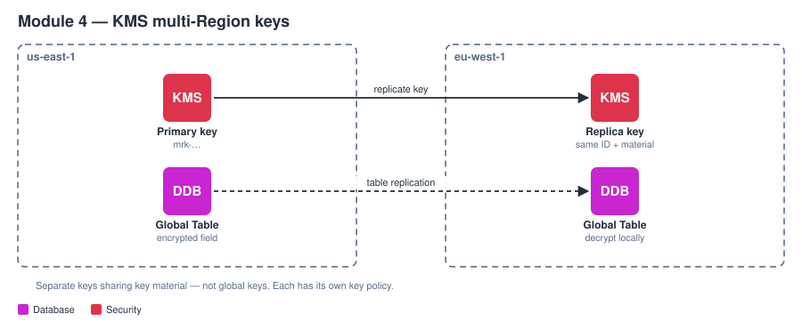

A set of KMS keys in different Regions sharing the **same key ID and key material**: one **primary**, plus **replicas**. Data encrypted in one Region can be decrypted in another without re-encrypting or calling KMS across Regions.

- Each key is managed independently: its own key policy, enabled state and CloudTrail logs. They are **not global keys**.
- Automatic rotation is set on the primary and syncs to replicas.
- **Use cases:** global client-side encryption; client-side encryption of attributes in **DynamoDB Global Tables** or **Aurora Global Database**; DR and active-active apps needing local decryption.

| Pros | Cons |
|---|---|
| Local decrypt in every Region, no cross-Region dependency | AWS recommends them only when needed: one key material in many places widens blast radius |
| Same key ID simplifies global apps | Each replica's policy still needs managing |

> [!TIP]
> **Exam clue:** "encrypt in one Region, decrypt in another with the same key" or "client-side encryption on DynamoDB Global Tables" → KMS multi-Region keys.

**Menniboe Farm:** the orders Global Table runs in `us-east-1` and `eu-west-1`; the customer phone field is encrypted client-side with a multi-Region key so the EU app decrypts locally during a US outage.

### Module 5: S3 replication and AMI sharing with KMS

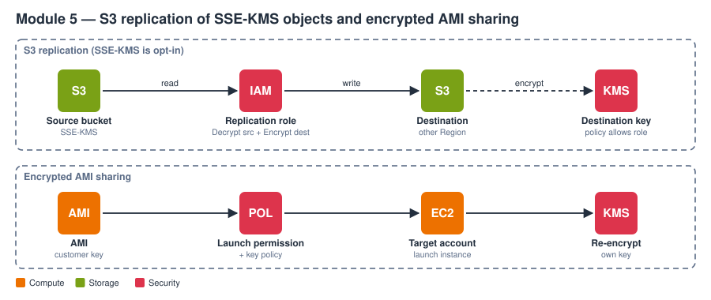

**S3 replication and encryption**

| Object encryption | Replicated by default? |
|---|---|
| Unencrypted | Yes |
| SSE-S3 | Yes |
| SSE-C | Yes |
| **SSE-KMS** | **No, opt in** |

To replicate SSE-KMS objects: enable the KMS option in the replication rule, choose the **destination KMS key**, allow the replication role in the **destination key policy**, and give the role **`kms:Decrypt` on the source key** and **`kms:Encrypt` on the destination key**. Watch for KMS throttling at volume. Multi-Region keys still get decrypted and re-encrypted by S3, which treats them as independent keys.

**Sharing a KMS-encrypted AMI**

1. AMI encrypted with a **customer managed key**.
2. Add the target account to the AMI's **launch permission**.
3. Allow the target account in the **key policy**.
4. Target identity needs `kms:DescribeKey`, `kms:ReEncrypt*`, `kms:CreateGrant`, `kms:Decrypt`.
5. Launch, then re-encrypt the volumes with the target's own key.

> [!TIP]
> **Exam clues:** "SSE-KMS objects not replicating" → KMS opt-in option and KMS permissions. "Share an encrypted AMI" → launch permission + key policy + KMS permissions in the target account.

**Menniboe Farm:** the IT contractor shares a hardened `farm-POS` AMI; Menniboe launches register servers and re-encrypts with `menniboe-orders-key`.

### Module 6: SSM Parameter Store

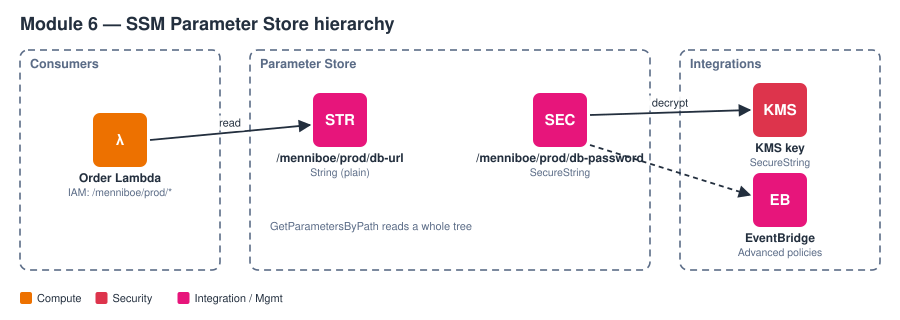

Serverless storage for **configuration and secrets**, part of AWS Systems Manager.

- `String`, `StringList`, or **`SecureString`** (KMS-encrypted).
- Versioning, IAM access control, EventBridge notifications, CloudFormation integration.
- **Path hierarchy** (e.g. `/menniboe/prod/db-password`). IAM can scope by path; `GetParametersByPath` reads a whole tree (`--recursive` for nested paths).
- Special paths: `/aws/reference/secretsmanager/<name>` reads a Secrets Manager secret; `/aws/service/ami-amazon-linux-latest/...` returns public AWS parameters such as the latest AMI ID.

| | Standard | Advanced |
|---|---|---|
| Max parameters | 10,000 | 100,000 |
| Max value size | 4 KB | 8 KB |
| Parameter policies | No | Yes |
| Cost | Free | ~$0.05/parameter/month |

**Parameter policies (Advanced):** `Expiration` (forces update or delete), `ExpirationNotification` and `NoChangeNotification` (EventBridge events).

| Pros | Cons |
|---|---|
| Free or cheap, simple, hierarchical | **No built-in automatic rotation** |
| SecureString uses KMS; IAM by path | 4 KB limit on Standard tier |

> [!TIP]
> **Exam clues:** "store config and secrets cheaply, organized by environment" → Parameter Store. "Automatically rotate the RDS password" → Secrets Manager.

**Menniboe Farm:** the order Lambda reads `/menniboe/prod/db-url` and the SecureString `/menniboe/prod/db-password`; its role can only read `/menniboe/prod/*`.

## Block 3: Secrets, certificates and dedicated hardware

### Module 7: AWS Secrets Manager

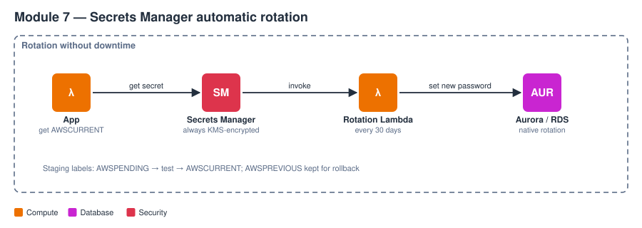

A managed service for **storing and rotating secrets**: database passwords, API keys, OAuth tokens.

- **Automatic rotation every X days** using a **Lambda** function.
- **Native rotation** for **RDS, Aurora, Redshift, DocumentDB**. AWS provides the rotation function.
- Always encrypted with KMS.
- **Staging labels:** `AWSCURRENT` (what apps get), `AWSPENDING` (new value under test), `AWSPREVIOUS` (rollback).
- **Multi-Region secrets:** read-only replicas kept in sync; a replica can be promoted for DR.
- Secret ARNs end with a **random 6-character suffix**, so IAM policies should use `name-*`.
- ~$0.40/secret/month plus API calls.

| | Parameter Store | Secrets Manager |
|---|---|---|
| Built for | Config + basic secrets | Secrets |
| Automatic rotation | No (DIY with EventBridge + Lambda) | Yes |
| RDS/Aurora integration | No | Native |
| Encryption | Optional (`SecureString`) | Always (KMS) |
| Cost | Free (Standard) | ~$0.40/secret/month |
| Cross-Region replication | No | Yes |

> [!TIP]
> **Exam clues:** "rotate database credentials automatically" → Secrets Manager. "Cheapest place for config" → Parameter Store. "Config cheap **and** one password rotated" → both: Secrets Manager for the password, Parameter Store Standard for the rest.

**Menniboe Farm:** the Aurora orders password rotates every 30 days in Secrets Manager; the Lambda fetches it at runtime, so no developer ever knows it.

### Module 8: AWS Certificate Manager

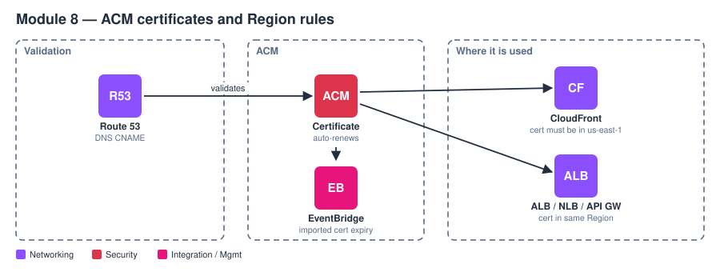

ACM provisions, manages and deploys **TLS certificates** for HTTPS.

- Free public certificates for integrated services; **automatic renewal** for ACM-issued certificates.
- Integrates with **ALB, NLB, CloudFront, API Gateway**, Elastic Beanstalk.
- **DNS validation** (preferred, CNAME in Route 53, hands-off renewal) or **email validation**.
- **Imported certificates:** no auto-renewal. ACM sends daily **EventBridge** expiry events starting 45 days before expiry (configurable), and the AWS Config rule **`acm-certificate-expiration-check`** can flag them.

| Certificate used by | Request it in |
|---|---|
| CloudFront | **us-east-1** |
| API Gateway edge-optimized | **us-east-1** |
| API Gateway Regional | Same Region as the API |
| ALB / NLB | Same Region as the load balancer |

> [!IMPORTANT]
> **Real world vs exam.** Since June 2025, ACM offers paid **exportable public certificates** that can be installed anywhere, including EC2. Since February 2026, ACM public certificates are valid for at most **198 days** (CA/Browser Forum 200-day cap from March 15, 2026) and renew 45 days before expiry. The SAA exam predates both: if it says ACM certificates can't go on EC2, use the exam answer.

> [!TIP]
> **Exam clues:** "HTTPS on ALB or CloudFront with minimal management" → ACM. "Imported certificate expiring, need an alert" → ACM EventBridge expiry events or the Config rule. "CloudFront custom domain" → certificate in us-east-1. "CloudFront → ALB with HTTPS on both hops" → one certificate in us-east-1 **and** one in the ALB's Region.

**Menniboe Farm:** the shop ALB uses a DNS-validated ACM certificate; the partner portal's imported third-party certificate triggers an EventBridge alert before it expires.

### Module 9: AWS CloudHSM

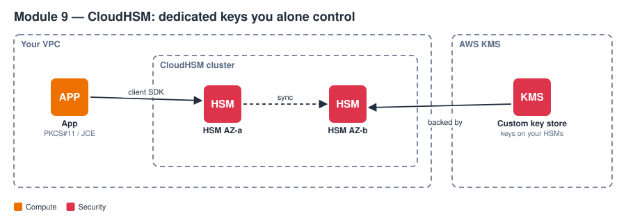

**Dedicated hardware security modules** in your VPC. AWS maintains the hardware; **you alone manage the keys and HSM users**, and AWS can't access or recover them.

- Cluster across **multiple AZs**; keys sync between HSMs.
- Symmetric and asymmetric keys; standard APIs (PKCS#11, JCE, OpenSSL, CNG/KSP) through the client SDK.
- IAM controls the **cluster**; keys and users **inside** the HSM are yours.
- **KMS custom key store:** KMS keys backed by your CloudHSM, so you get KMS integrations and CloudTrail with your own hardware.
- Expensive, billed per HSM per hour.

> [!NOTE]
> Current hardware is **hsm2m.medium** (FIPS 140-3 Level 3). The older hsm1.medium is at end of support. Course material saying "FIPS 140-2 Level 3" makes the same exam point: dedicated, Level 3, customer-owned keys.

| | KMS | CloudHSM |
|---|---|---|
| Tenancy | Multi-tenant | **Single-tenant** |
| Key management | AWS runs it; you control by policy | **You manage keys and users** |
| AWS access to keys | Operates the service | **None** |
| High availability | Built in | Multi-AZ cluster you deploy |
| Integration | Native | Custom key store or client SDK |
| Cost | Low | High |

> [!TIP]
> **Exam clues:** "dedicated / single-tenant", "FIPS Level 3", "exclusive control of keys", "AWS must not have access" → CloudHSM.

**Menniboe Farm:** if the co-op processes card payments directly and an auditor requires single-tenant hardware, it adds a two-AZ CloudHSM cluster as a KMS custom key store.

## Block 4: Perimeter protection

### Module 10: AWS WAF

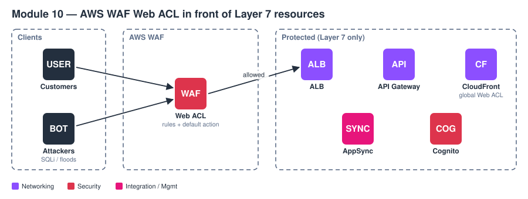

A **Layer 7 (HTTP/HTTPS)** firewall. Deploy on **ALB, API Gateway, CloudFront, AppSync, Cognito user pools**. Not on NLB or raw EC2, because they don't speak HTTP to WAF.

A **Web ACL** holds rules and a **default action** (Allow or Block). Rules can match:

- **IP sets** (up to 10,000 IPs per set)
- Headers, body, URI, query string
- **SQL injection** and **XSS** patterns
- Size constraints, **geo-match**
- **Rate-based rules**: count requests per aggregation key (e.g. source IP) over a window (1, 2, 5 or 10 minutes, minimum limit 10) and act above the limit; the action is removed when the rate falls below the limit
- **Managed rule groups** from AWS and AWS Marketplace

Actions: **Allow, Block, Count** (test mode), **CAPTCHA, Challenge**. Rules run top-down by priority; the first terminating match wins. Capacity is measured in **WCUs**: up to 5,000 per Web ACL, extra charges above 1,500.

Web ACLs are **Regional**, except for **CloudFront** (global, managed from us-east-1).

| Pros | Cons |
|---|---|
| Blocks SQLi, XSS, bad bots, floods at Layer 7 | Not for NLB or raw EC2 |
| Managed rule groups need little upkeep | Needs tuning to avoid false positives |
| Rate-based rules for basic Layer 7 DDoS | Billed per Web ACL, rule and million requests |

> [!TIP]
> **Exam clue:** "fixed IP and WAF" → Global Accelerator (static anycast IPs) in front of an ALB with WAF.

> [!NOTE]
> WAF Classic is retired. The WAF console now has a new experience ("protection packs (web ACLs)") and the standard Web ACL wizard; both create the same Web ACL.

**Menniboe Farm:** the shop ALB's Web ACL uses the AWS SQLi and core rule sets, a rate limit per IP, and a geo-match rule for shipping countries.

### Module 11: AWS Shield

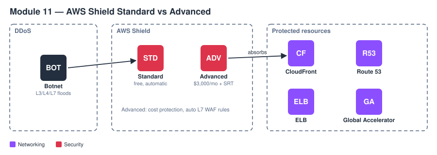

Protection against **DDoS** attacks.

| | Shield Standard | Shield Advanced |
|---|---|---|
| Cost | Free, automatic | ~$3,000/month per organization (1-year) + data fees |
| Protects against | Layer 3/4 (SYN/UDP floods, reflection) | More sophisticated Layer 3/4/7 |
| Resources | All customers | EC2, ELB, CloudFront, Global Accelerator, Route 53 |
| 24/7 experts | No | **Shield Response Team (SRT)** |
| Cost protection | No | Credits for DDoS-driven scaling charges |
| Automatic Layer 7 mitigation | No | Creates and deploys WAF rules during an attack |

> [!TIP]
> **Exam clues:** "free DDoS protection" → Shield Standard. "24/7 DDoS team", "DDoS cost protection" → Shield Advanced.

**Menniboe Farm:** Shield Standard today; Shield Advanced once a holiday-season DDoS could cost more in scaling than the subscription.

### Module 12: AWS Firewall Manager and DDoS best practices

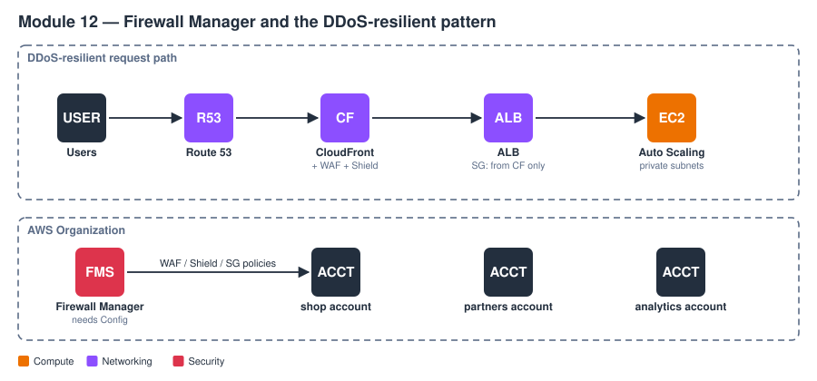

**Firewall Manager** manages security rules **across all accounts in an AWS Organization**, applying them automatically to **new resources**. Requires **AWS Organizations** and **AWS Config**. Policies are per Region. It can enforce:

- WAF rules (ALB, API Gateway, CloudFront)
- Shield Advanced (ALB, CLB, NLB, Elastic IP, CloudFront)
- Security groups (EC2, ALB, ENI)
- AWS Network Firewall
- Route 53 Resolver DNS Firewall

| Service | Role |
|---|---|
| WAF | Defines Web ACL rules per resource |
| Shield | DDoS protection |
| Firewall Manager | Deploys and enforces WAF, Shield, SG and Network Firewall policies across accounts |

**DDoS resiliency (AWS whitepaper)**

| Layer | Use |
|---|---|
| Edge | CloudFront, Global Accelerator, Route 53 (with Shield) |
| Application (L7) | CloudFront caching; WAF rate-based rules |
| Infrastructure | ELB to spread load; Auto Scaling to absorb spikes |
| Attack surface reduction | Hide back ends behind CloudFront/API Gateway/ELB; tight security groups and NACLs; API Gateway throttling |

> [!IMPORTANT]
> Put as little as possible directly on the internet. Let CloudFront, Route 53 and ELB face the world behind Shield and WAF; keep instances and origins private.

> [!TIP]
> **Exam clues:** "one ALB" → WAF. "Same WAF rules on all accounts and new resources" → Firewall Manager.

**Menniboe Farm:** one Firewall Manager policy gives every ALB in the shop, partners and analytics accounts the standard Web ACL and audits security groups for SSH open to `0.0.0.0/0`.

## Block 5: Threat detection and data discovery

### Module 13: Amazon GuardDuty

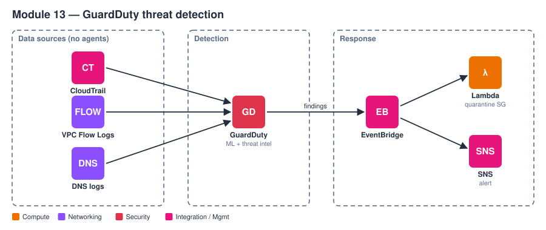

**Intelligent threat detection** using machine learning, anomaly detection and threat intelligence. One click to enable, 30-day trial, no agents for core sources.

- **Core sources:** CloudTrail management events, VPC Flow Logs, DNS logs. GuardDuty reads these from internal streams; you don't need to enable Flow Logs or a trail yourself.
- **Optional protection plans:** S3 Protection, EKS Protection and Runtime Monitoring (EKS, ECS on Fargate, EC2), Malware Protection (EBS and S3 uploads), RDS Protection, Lambda Protection.
- Findings → **EventBridge** → Lambda (remediation) or SNS (alerts).

> [!TIP]
> **Exam clues:** "detect cryptocurrency mining", "compromised instance", "unusual API activity", "CloudTrail + VPC Flow Logs + DNS logs" → GuardDuty.

**Menniboe Farm:** a crypto-mining finding triggers a Lambda that swaps the instance into a quarantine security group, and SNS emails the admin.

### Module 14: Amazon Inspector

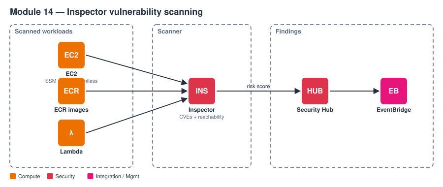

**Automated, continuous vulnerability scanning** with a risk score per finding.

| Target | How | Finds |
|---|---|---|
| EC2 | SSM Agent or agentless (EBS snapshots) | OS package CVEs, unintended network reachability |
| ECR images | On push and continuously | Package CVEs in images |
| Lambda | On deploy and update | Code and dependency CVEs |

Findings go to **Security Hub** and **EventBridge**. Inspector covers **only EC2, ECR and Lambda**, and only known vulnerabilities and exposure.

> [!TIP]
> **Exam clues:** "CVEs on EC2", "scan ECR images", "network reachability of EC2" → Inspector.

**Menniboe Farm:** a critical OpenSSL CVE in a new `farm-pos` image stops the deployment pipeline until the image is rebuilt.

### Module 15: Amazon Macie

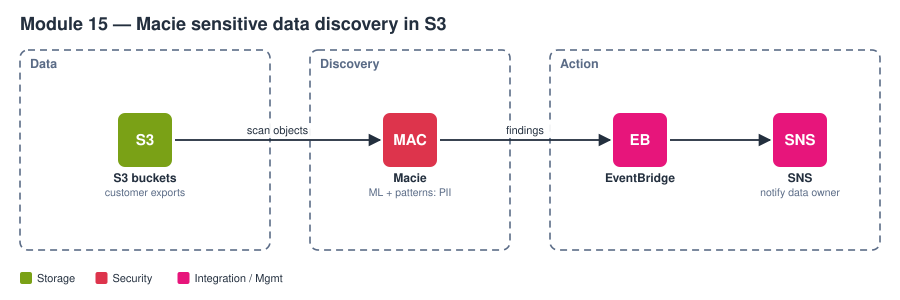

Fully managed **data security and privacy** service that uses ML and pattern matching to find **sensitive data (PII) in S3**: names, addresses, phone numbers, card numbers, passport numbers. It also reports bucket posture (public, unencrypted). Findings go to EventBridge and Security Hub.

> [!TIP]
> **Exam clue:** "find PII in S3" → Macie. If the data is in a database or on EC2, it isn't Macie.

**Menniboe Farm:** a customer export dropped in `menniboe-analytics-raw` is flagged, and the data owner is told to move it to the restricted, KMS-encrypted bucket.

**The detection trio**

| Service | Question | Looks at |
|---|---|---|
| GuardDuty | Is someone attacking or misusing my account now? | CloudTrail, VPC Flow Logs, DNS logs (+ plans) |
| Inspector | Are my workloads vulnerable? | EC2, ECR, Lambda |
| Macie | Where is my sensitive data? | S3 |

---

# Part 2: Hands-on labs

All labs ran in **us-east-1**, console-first, with every resource tagged `Project = saa-day4`. Replace `<ACCOUNT_ID>` with your own account ID where it appears.

## Lab 1: S3 encrypted with a customer managed KMS key

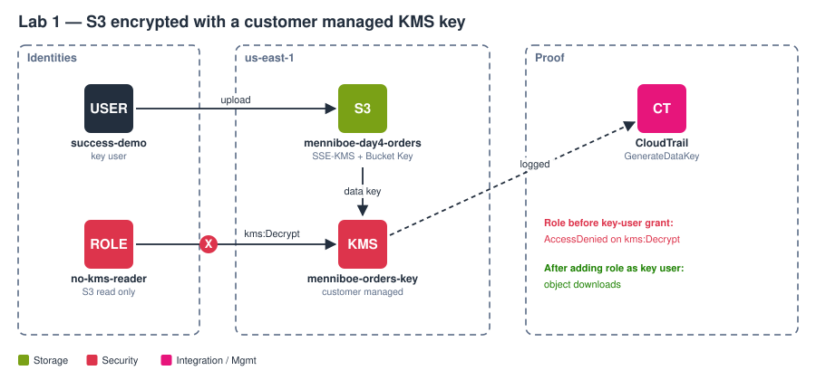

**Goal:** prove that reading an SSE-KMS object needs **S3 permission and KMS permission**, and that every key use is logged.

### Lab 1 Step 1: Create the customer managed key

**Why this step:** everything in Lab 1 depends on a key you control. AWS managed keys can't have custom policies, can't be shared, and can't be disabled.

**Console:** KMS → Customer managed keys → **Create key**

| Page | Field | Value |
|---|---|---|
| Configure key | Key type | Symmetric |
| | Key usage | Encrypt and decrypt |
| | Advanced → Key material origin | KMS - recommended |
| | Advanced → Regionality | Single-Region key |
| Add labels | Alias | `menniboe-orders-key` |
| | Description | `Day 4 lab - encrypt Menniboe order objects in S3` |
| | Tags | `Project` = `saa-day4` |
| Key administrative permissions | Key administrators | your IAM user (`success-demo`) |
| | Key deletion | Allow key administrators to delete this key: checked |
| Key usage permissions | This account | your IAM user |
| | Other AWS accounts | none |
| Edit key policy | (review only) | |
| Review | | **Finish** |

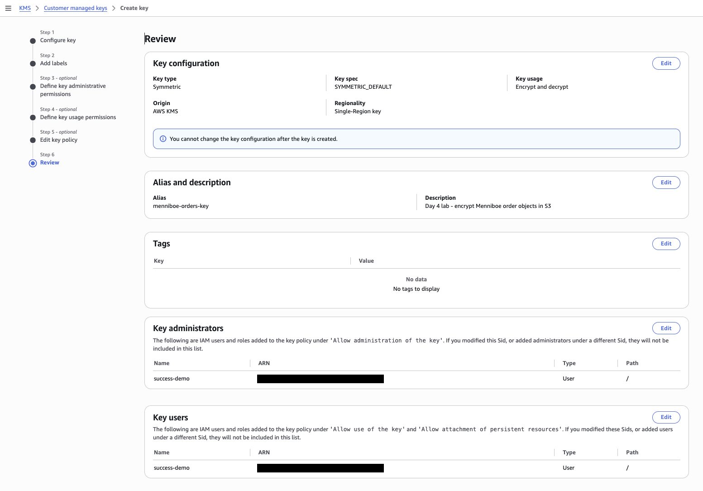

> [!WARNING]
> **Error:** the Review page showed **Tags: No data**; the tag hadn't been added. **Fix:** click **Edit** on Tags, add `Project = saa-day4`, click Next back to Review.

The wizard's key policy starts with the **"Enable IAM User Permissions"** statement: `kms:*` for the account root principal. That statement delegates to IAM, so IAM policies in the account can grant key access.

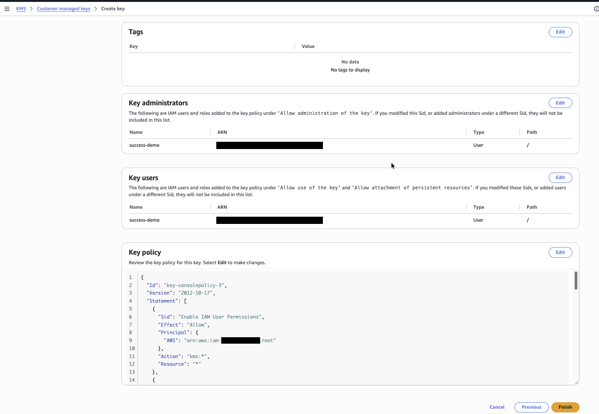

**Enable rotation:** key → **Key material and rotations** tab → Automatic key rotation → **Edit** → Enable, period `365` days → **Save**. Result: Status Enabled, next rotation one year out. The same key ID and alias continue across rotations; older material stays available for decryption.

> [!NOTE]
> Older guides call this tab "Key rotation". It's now **Key material and rotations** and also offers on-demand rotation.

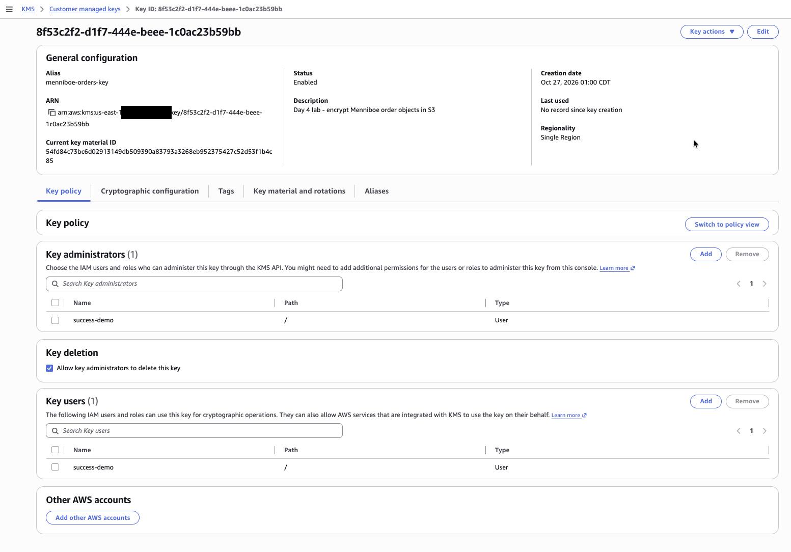

### Lab 1 Step 2: Create the SSE-KMS bucket

**Why this step:** setting the key as **default encryption** makes every new object use it automatically. **Bucket Key** cuts KMS calls.

**Console:** S3 → **Create bucket**

| Section | Field | Value |
|---|---|---|
| General configuration | Region | US East (N. Virginia) us-east-1 |
| | Bucket type | General purpose |
| | Bucket name | `menniboe-day4-orders-<initials><digits>` (lab used `menniboe-day4-orders-klm`) |
| Object Ownership | | ACLs disabled (recommended), bucket owner enforced |
| Block Public Access | Block all public access | Checked |
| Bucket Versioning | | Disable |
| Tags | | `Project` = `saa-day4` |
| Default encryption | Encryption type | SSE-KMS |
| | AWS KMS key | Choose from your keys → `menniboe-orders-key` |
| | Bucket Key | Enable |
| Advanced settings | Object Lock | Disable |

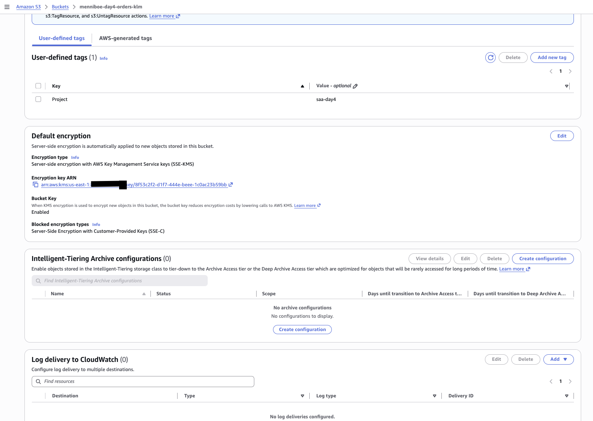

> [!NOTE]
> New buckets show **Blocked encryption types: SSE-C**. AWS now blocks SSE-C on new buckets by default; it can be re-enabled. The exam still lists SSE-C as one of the S3 encryption options.

### Lab 1 Step 3: Upload an object and confirm encryption

**Why this step:** proves the bucket applies the key without the uploader choosing anything, and triggers the first KMS call.

Create `orders-2026-10.csv`:

```
order_id,customer,product,qty
1001,Ama,goat milk,4
1002,Kofi,tilapia,2
1003,Esi,rubber latex,10
```

**Console:** bucket → **Upload**

| Section | Field | Value |
|---|---|---|
| Files and folders | Add files | `orders-2026-10.csv` |
| Properties | Storage class | Standard |
| | Server-side encryption | Do not specify an encryption key |
| | Checksums | CRC64NVME (recommended), no precalculated value |
| | Tags | `Project` = `saa-day4` |

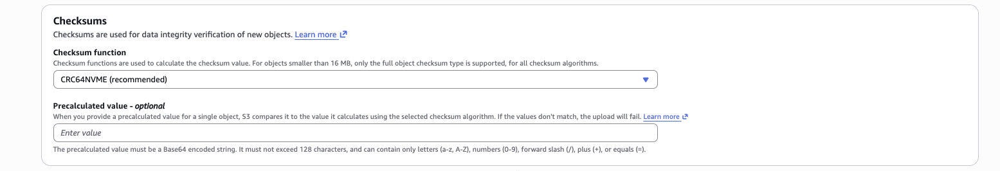

> [!NOTE]
> **Checksums** are about **integrity** (unchanged bytes), not confidentiality. S3 fingerprints the object (CRC64NVME by default). A precalculated value makes the upload fail if your local checksum doesn't match.

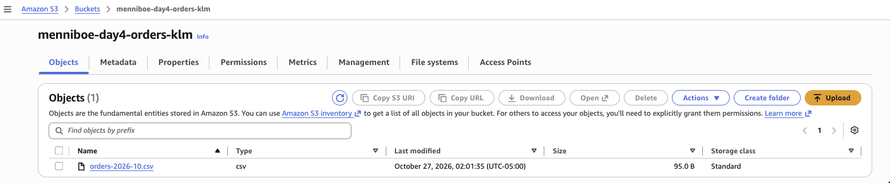

The object list doesn't show encryption. Open the object → **Properties** → **Server-side encryption settings**:

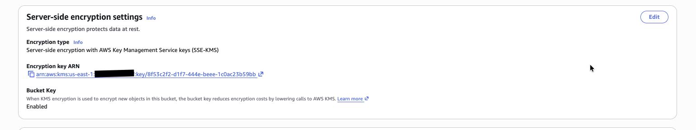

Result: SSE-KMS, `menniboe-orders-key`, Bucket Key Enabled.

### Lab 1 Step 4: Find the key usage in CloudTrail

**Why this step:** proves every key use is audited, and shows S3 calling KMS on your behalf.

**Console:** CloudTrail → **Event history** → Lookup attribute **Event source** = `kms.amazonaws.com`, last hour → open **GenerateDataKey**.

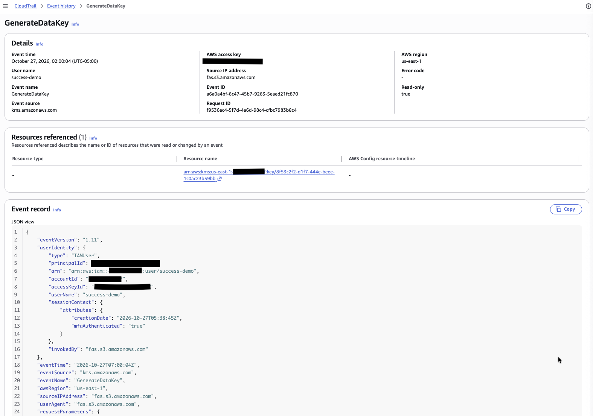

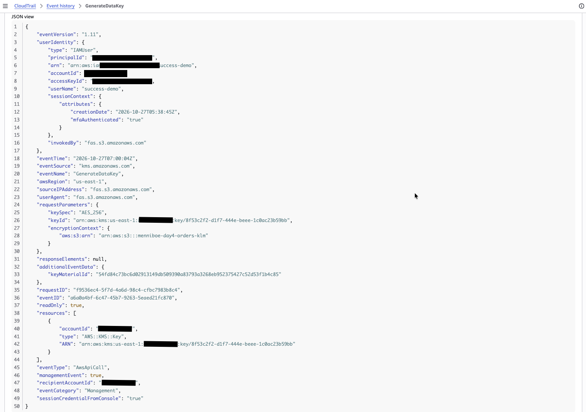

| Field | Value | Meaning |
|---|---|---|
| `userName` | `success-demo` | KMS saw your identity, so you need key-user permission |
| `invokedBy` / `sourceIPAddress` | `fas.s3.amazonaws.com` | S3 called KMS for you using **forward access sessions** |
| `eventName` | `GenerateDataKey` | Envelope encryption |
| `encryptionContext.aws:s3:arn` | `arn:aws:s3:::menniboe-day4-orders-klm` | **Bucket** ARN, not object ARN: the Bucket Key at work |
| `keyMaterialId` | matches the key's current material | The material that will rotate |
| `managementEvent` | `true` | KMS calls are management events, visible in free Event history |

### Lab 1 Step 5: Create a role with S3 read but no KMS

**Why this step:** an identity with full S3 read and no KMS permission is needed to prove the second lock.

**Console:** IAM → Roles → **Create role**

| Page | Field | Value |
|---|---|---|
| Trusted entity | Type | AWS account → This account |
| | Require external ID / MFA | Unchecked |
| Permissions | Policy | `AmazonS3ReadOnlyAccess` only |
| | Permissions boundary | None |
| Name and create | Role name | `menniboe-s3-readonly-no-kms` |
| | Description | `Day 4 lab - S3 read only, no KMS permissions` |
| | Tags | `Project` = `saa-day4` |

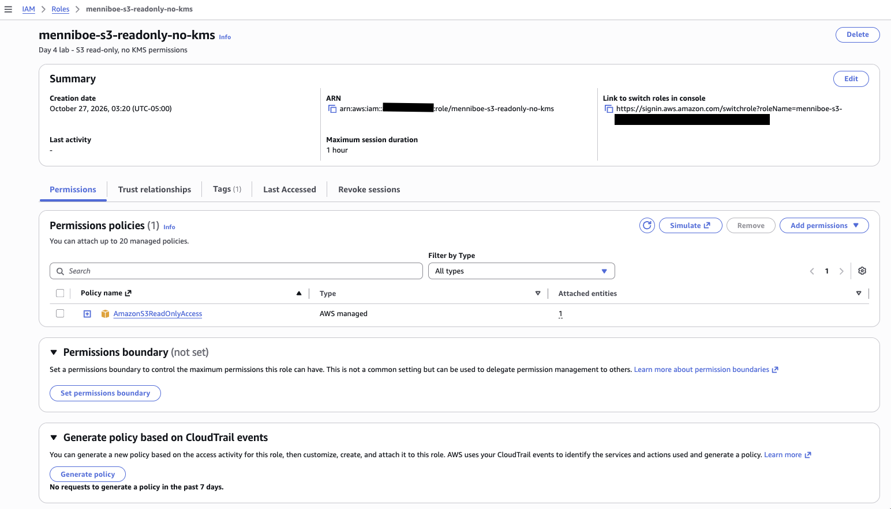

### Lab 1 Step 6: Switch role and try to read the file

**Why this step:** S3 allows the read, then needs KMS to decrypt the data key, and KMS refuses.

1. Use the role's **Link to switch roles in console**: Display name `no-kms-reader`, color Red → **Switch Role**.
2. S3 → bucket → the object list loads (S3 read works).
3. Select `orders-2026-10.csv` → **Open**.

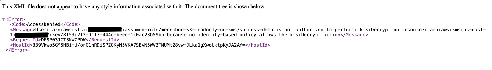

Result: `AccessDenied ... is not authorized to perform: kms:Decrypt ... because no identity-based policy allows the kms:Decrypt action`. The denied action is a **KMS** action, not S3.

### Lab 1 Step 7: Grant key access and retry

**Why this step:** the fix belongs on the key; S3 permissions stay identical.

1. Switch back to `success-demo`.
2. KMS → `menniboe-orders-key` → Key policy → **Key users** → **Add** → `menniboe-s3-readonly-no-kms` → **Add**.

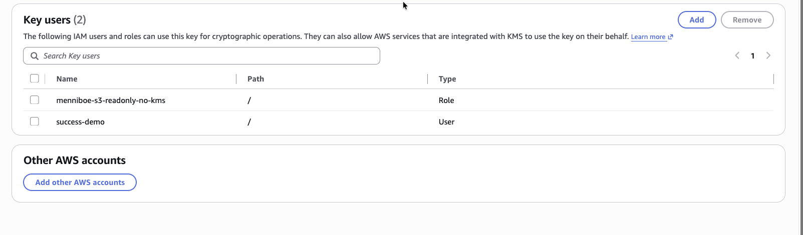

3. Switch to `no-kms-reader` → S3 → object → **Open**. The file downloads.

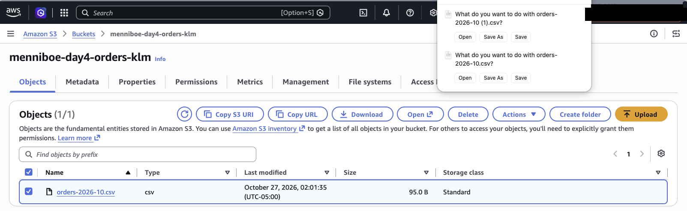

**Lab 1 results**

| Test | Identity | S3 | KMS | Result |
|---|---|---|---|---|
| Upload | success-demo | Yes | Key user | Encrypted with the key + Bucket Key |
| Audit | | | | `GenerateDataKey`, context = bucket ARN |
| Read #1 | no-kms-reader | Read only | None | AccessDenied on `kms:Decrypt` |
| Read #2 | no-kms-reader | Read only | Key user | Download works |

## Lab 2: Parameter Store vs Secrets Manager

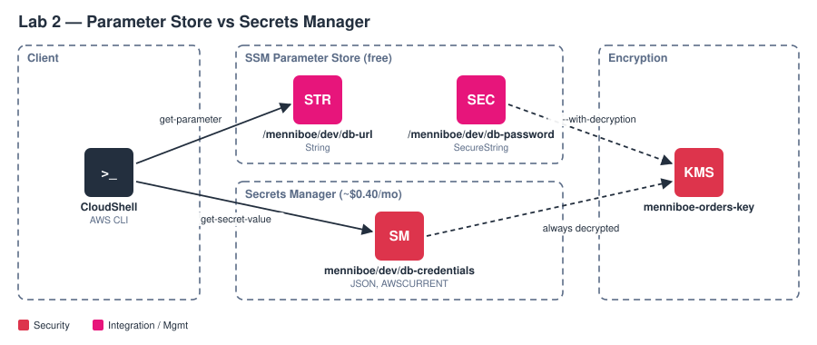

**Goal:** store the same password both ways, both encrypted with `menniboe-orders-key`, and compare how they're read.

### Lab 2 Step 1: Create a String and a SecureString

**Why this step:** shows plain config next to a KMS-encrypted value in the same hierarchy.

**Console:** Systems Manager → Application tools → **Parameter Store** → **Create parameter** (twice)

| Field | Parameter 1 | Parameter 2 |
|---|---|---|
| Name | `/menniboe/dev/db-url` | `/menniboe/dev/db-password` |
| Description | `Day 4 lab - dev database endpoint` | `Day 4 lab - dev database password` |
| Tier | Standard | Standard |
| Type | String | SecureString |
| Data type | text | |
| KMS key source | | My current account |
| KMS Key ID | | `alias/menniboe-orders-key` |
| Value | `menniboe-dev-db.example.internal:5432` | a test password |
| Tags | `Project` = `saa-day4` | `Project` = `saa-day4` |

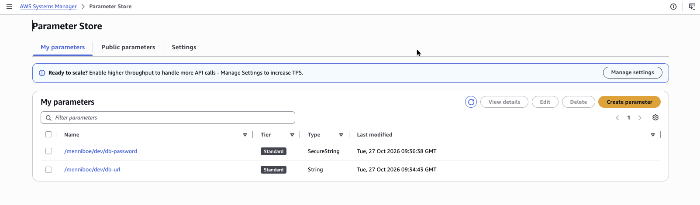

> [!NOTE]
> The **higher throughput** banner raises Parameter Store's default request rate for a per-request charge. Not needed for a lab.

### Lab 2 Step 2: Read the parameters from CloudShell

**Why this step:** shows what an application receives through the API.

```bash
aws ssm get-parameter --name /menniboe/dev/db-url
```
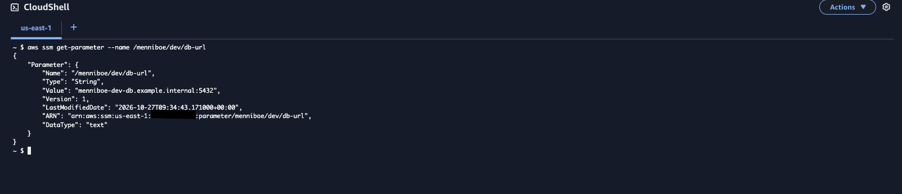

`Value` is plain text; `Version: 1` (every change creates a new version, readable as `name:1`).

```bash
aws ssm get-parameter --name /menniboe/dev/db-password
```
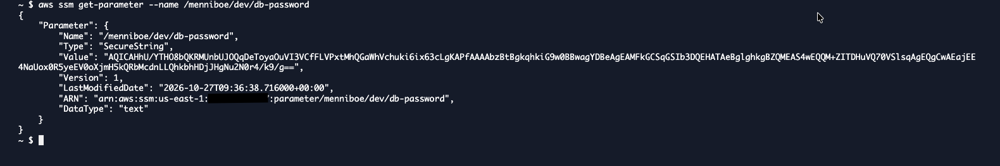

Without decryption, `Value` is KMS ciphertext (`AQICAH...`). No KMS call happens. Standard SecureStrings are at most 4 KB, so Parameter Store encrypts them directly with KMS.

```bash
aws ssm get-parameter --name /menniboe/dev/db-password --with-decryption
```
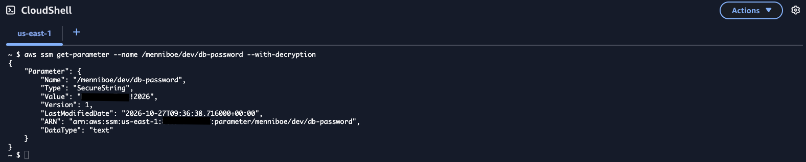

Reading needs `ssm:GetParameter` **and** `kms:Decrypt`.

```bash
aws ssm get-parameters-by-path --path /menniboe/dev --with-decryption \
  --query "Parameters[].{Name:Name,Type:Type,Value:Value}" --output table
```
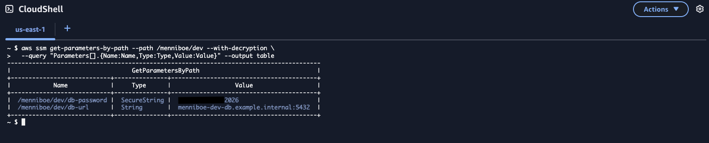

```bash
aws ssm describe-parameters \
  --parameter-filters "Key=Name,Values=/menniboe/dev/db-password" \
  --query "Parameters[].{Name:Name,Type:Type,Tier:Tier,KeyId:KeyId}" --output table
```
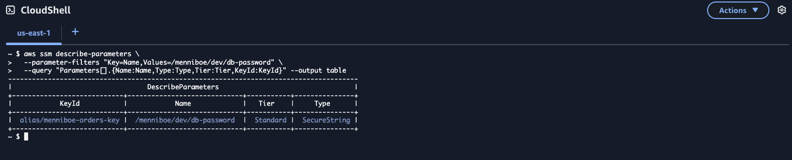

`KeyId = alias/menniboe-orders-key`.

### Lab 2 Step 3: Store the secret in Secrets Manager

**Why this step:** Secrets Manager adds always-on encryption, staging labels and rotation.

**Console:** Secrets Manager → **Store a new secret**

| Page | Field | Value |
|---|---|---|
| Choose secret type | Secret type | Other type of secret |
| | Key/value pairs | `username`, `password`, `engine` = `postgres`, `host` = `menniboe-dev-db.example.internal`, `port` = `5432` |
| | Encryption key | `menniboe-orders-key` (selected from the dropdown) |
| Configure secret | Secret name | `menniboe/dev/db-credentials` |
| | Description | `Day 4 lab - dev DB credentials` |
| | Tags | `Project` = `saa-day4` |
| | Resource permissions | None |
| | Replicate secret | Off |
| Configure rotation | Automatic rotation | Off |
| Review | | **Store** |

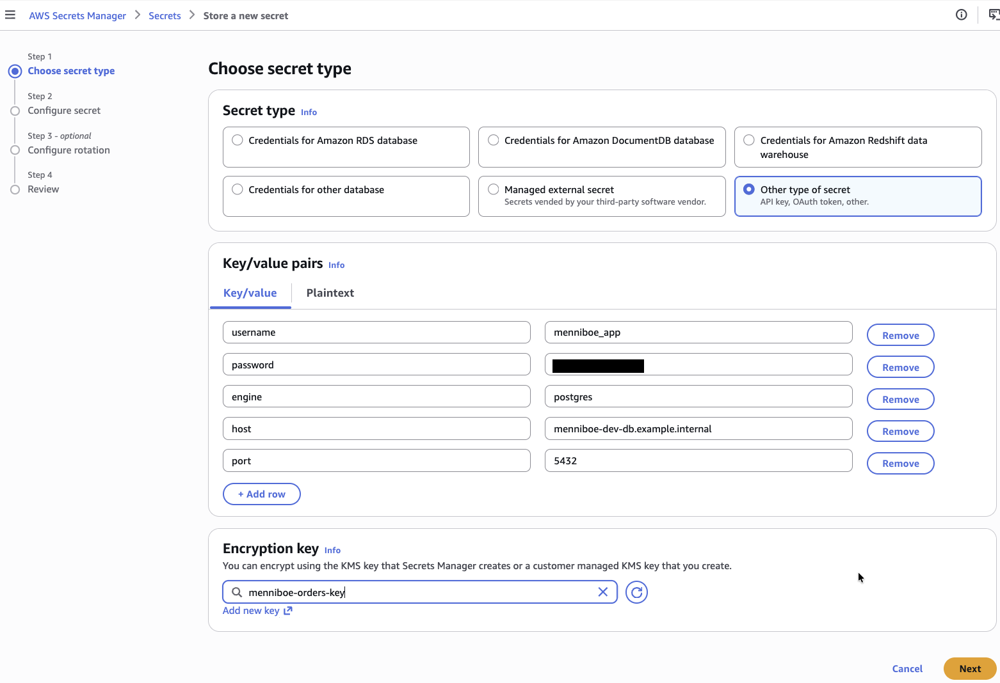

> [!WARNING]
> **Error:** the encryption key field showed typed text with the cursor still in it, not a selected key. **Fix:** click the field and pick the key from the dropdown. The Review page confirmed `menniboe-orders-key`.

**"Other type of secret"** stores the same JSON shape without needing a real RDS instance. RDS/Aurora/Redshift/DocumentDB secret types have native rotation.

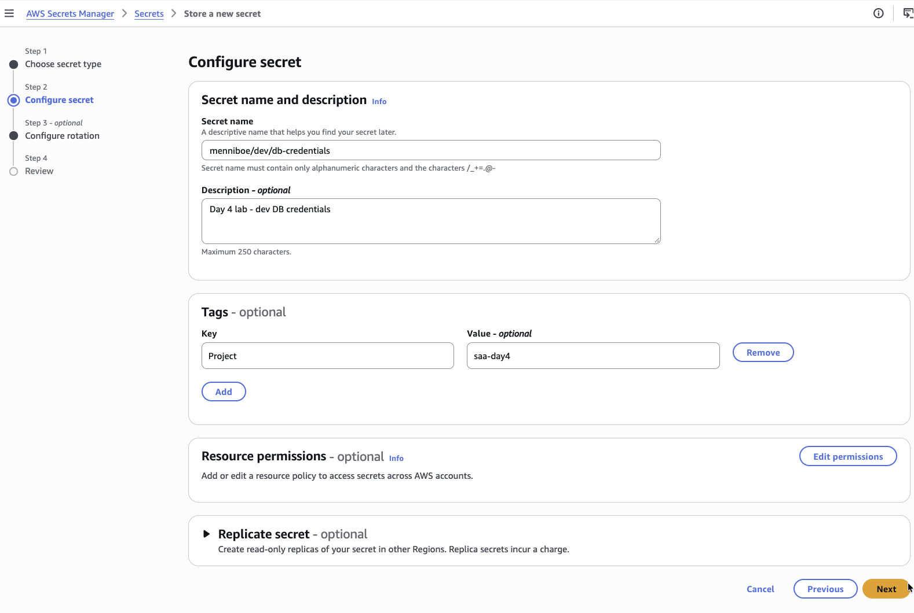

**Resource permissions** (a resource policy) enable cross-account access, which also needs a customer managed key. **Replicate secret** creates multi-Region replicas, each billed and each needing a key in its Region.

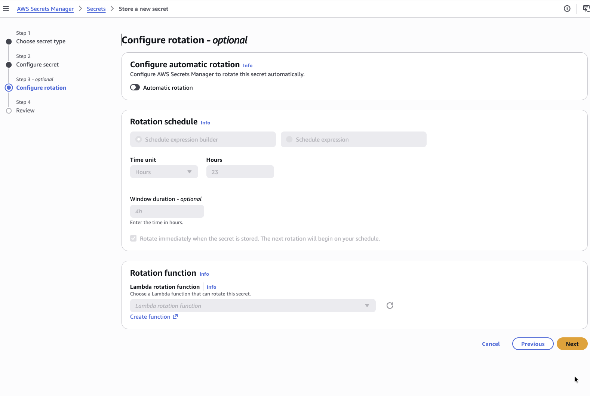

Rotation needs a **schedule** and a **Lambda rotation function**. Staging labels make it seamless: `AWSPENDING` is tested before becoming `AWSCURRENT`; `AWSPREVIOUS` is kept for rollback.

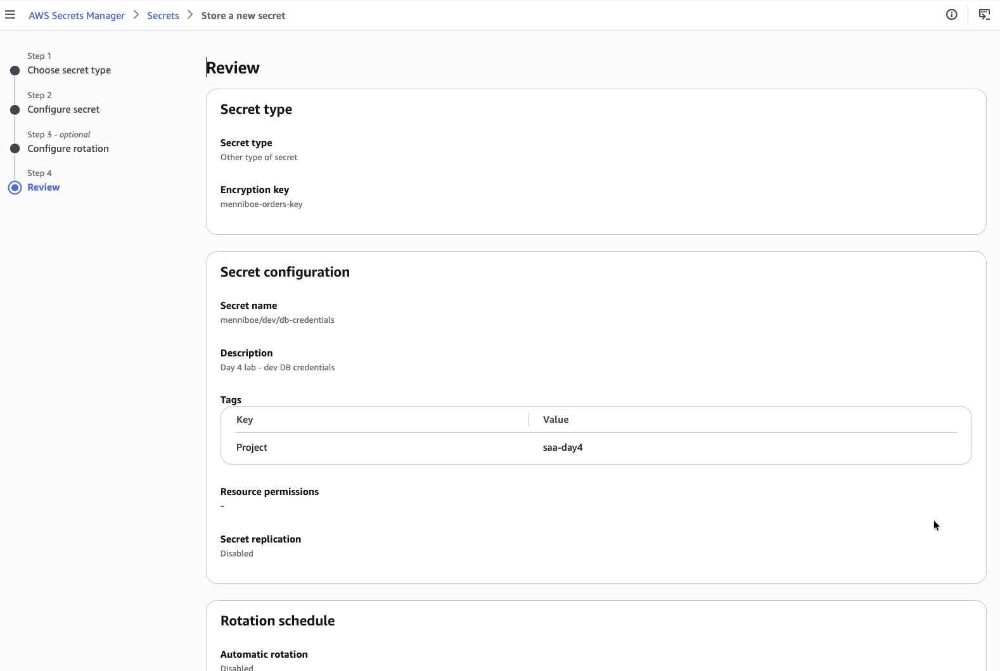

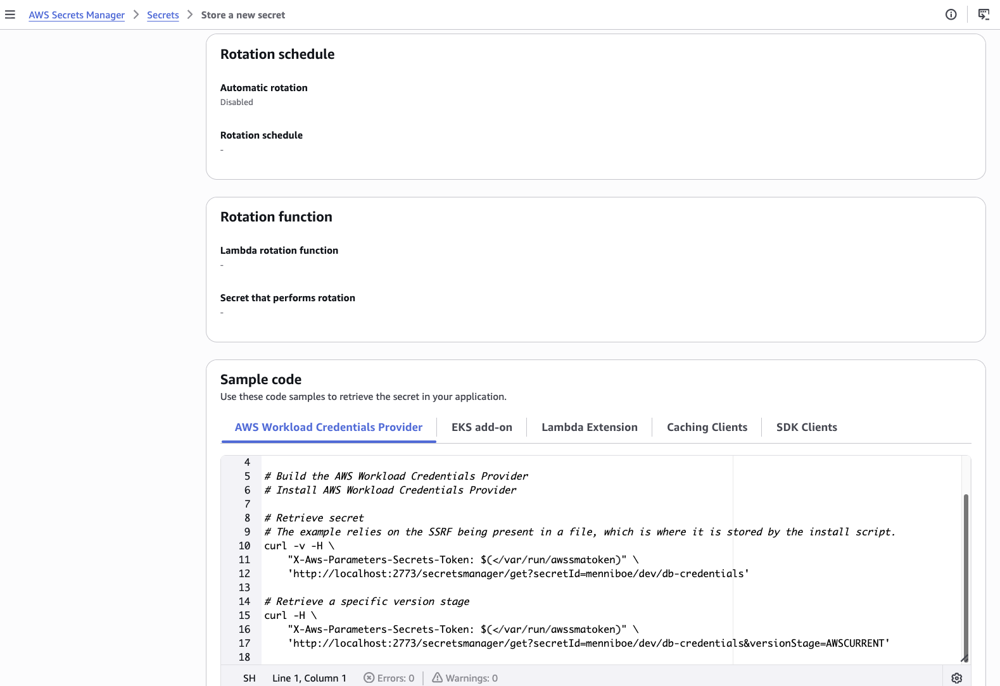

| Sample code tab | What it is |
|---|---|
| AWS Workload Credentials Provider | Local agent; app calls `http://localhost:2773/...` and gets a cached secret |
| EKS add-on | Same idea for pods |
| Lambda Extension | Same idea inside Lambda |
| Caching Clients | In-app caching libraries |
| SDK Clients | `get_secret_value(SecretId=...)` |

The `X-Aws-Parameters-Secrets-Token` header protects the local endpoint against SSRF. Caching reduces cost and API calls.

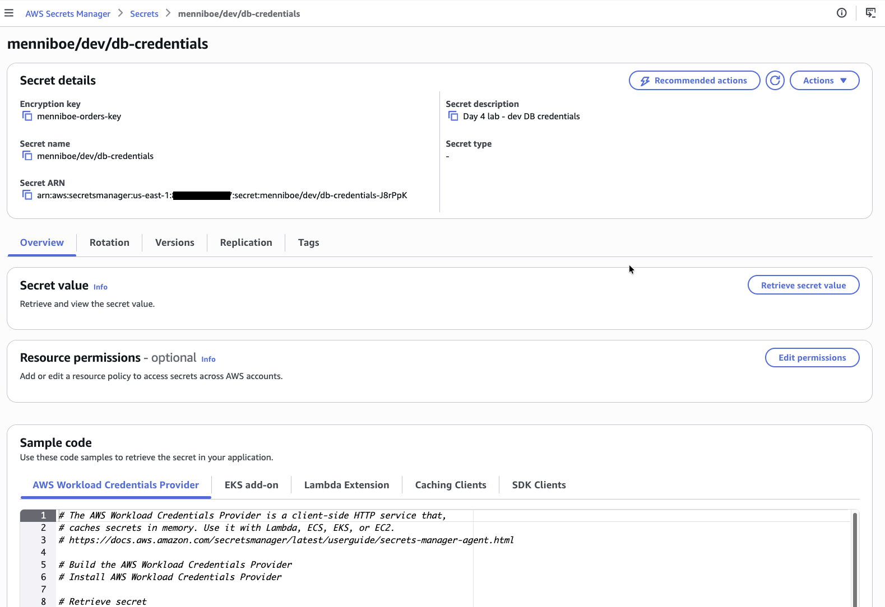

The ARN ends in a random suffix (`-J8rPpK`). Recreating the secret gives a different ARN, so IAM policies should use `menniboe/dev/db-credentials-*`.

### Lab 2 Step 4: Read the secret from CloudShell

**Why this step:** Secrets Manager always returns decrypted values; there's no decryption flag.

```bash
aws secretsmanager get-secret-value --secret-id menniboe/dev/db-credentials
```

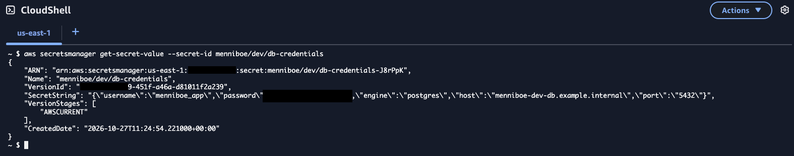

`SecretString` is a JSON **string** (parse with `json.loads`); `port` comes back as `"5432"`; `VersionStages` = `["AWSCURRENT"]`.

**Lab 2 results**

| | Parameter Store (SecureString) | Secrets Manager |
|---|---|---|
| Encrypted with | `menniboe-orders-key` | `menniboe-orders-key` |
| Read call | `get-parameter --with-decryption` | `get-secret-value` |
| Without decrypt flag | Ciphertext | Not applicable |
| Versions | `Version: 1` | `VersionId` + staging labels |
| ARN | Fixed path | Random 6-character suffix |
| Rotation | None | Lambda-based |
| Cost | Free (Standard) | ~$0.40/secret/month |

## Lab 3: WAF rate-based rule on an ALB


**Goal:** EC2 web server behind an ALB protected by a WAF Web ACL with a rate-based rule. Prove that a flooding IP gets `403` while other visitors still get the page, and that the instance can't be reached directly.

### Lab 3 Step 1: ALB security group

**Why this step:** the ALB is the only public entry point; the instance will only trust this group.

**Console:** EC2 → Security Groups → **Create security group**

| Field | Value |
|---|---|
| Name | `menniboe-alb-sg` |
| Description | `Day 4 lab - ALB allows HTTP from internet` |
| VPC | Default VPC |
| Inbound | HTTP, TCP 80, Anywhere-IPv4 `0.0.0.0/0`, `Public web traffic` |
| Outbound | All traffic (default) |
| Tags | `Project` = `saa-day4` |

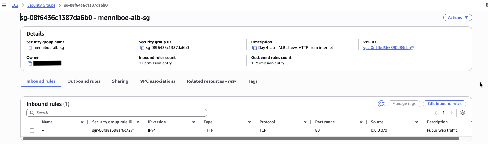

### Lab 3 Step 2: Launch the web server

**Why this step:** WAF needs something to protect. The instance's inbound source is the **ALB's security group**, not an IP range.

**Console:** EC2 → **Launch instances**

| Section | Field | Value |
|---|---|---|
| Name and tags | Name | `menniboe-web-01` (+ `Project` = `saa-day4` on instance and volume) |
| AMI | | Amazon Linux 2023, 64-bit (x86) |
| Instance type | | t3.micro |
| Key pair | | Proceed without a key pair |
| Network settings | VPC / Subnet | Default VPC / No preference |
| | Auto-assign public IP | Enable (outbound for `dnf`; no NAT gateway in the default VPC) |
| | Security group | Create `menniboe-web-sg`, `Day 4 lab - web server allows HTTP only from ALB` |
| | Inbound rules | Remove SSH; HTTP TCP 80, Source **Custom** = `menniboe-alb-sg`, `HTTP from ALB only` |
| Storage | | 8 GiB gp3 (default) |
| Advanced details | IAM instance profile | None |
| | Metadata version | V2 only (token required) |
| | User data | script below |

```bash
#!/bin/bash
dnf install -y httpd
echo "<h1>Menniboe Farm shop</h1><p>Served by $(hostname -f)</p>" > /var/www/html/index.html
systemctl enable --now httpd
```

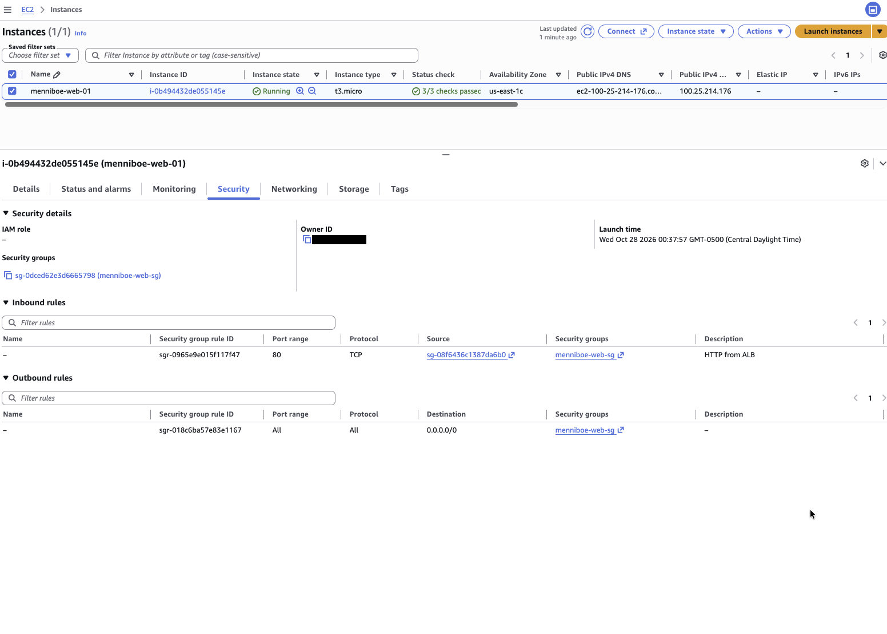

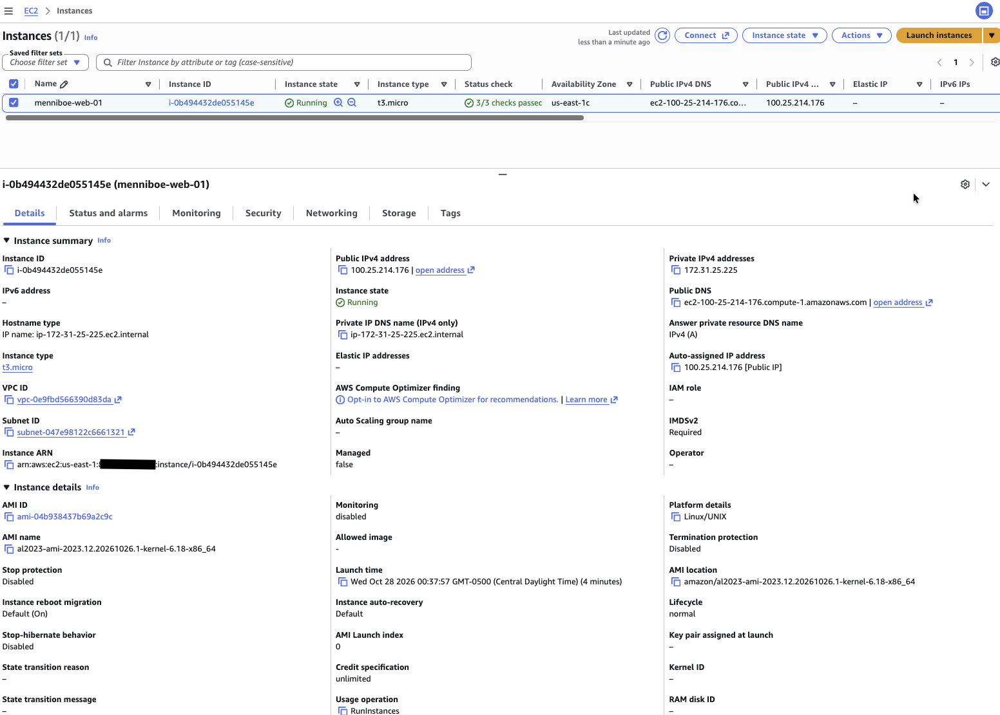

Result: Running, **3/3 checks passed** (system, instance, and the newer **attached EBS** status check), IMDSv2 required.

### Lab 3 Step 3: Prove direct access is blocked

**Why this step:** proves the security-group chain; nobody can go around the ALB, and so around WAF.

Open `http://<instance-public-ip>` in a browser.

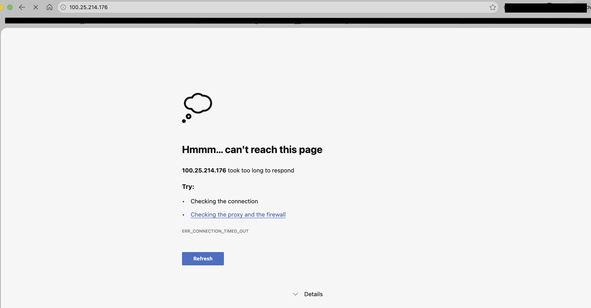

Result: `ERR_CONNECTION_TIMED_OUT`. Security groups silently drop disallowed traffic, so the client times out instead of being refused.

### Lab 3 Step 4: Create the target group

**Why this step:** the ALB forwards to a target group, which health-checks its targets.

**Console:** EC2 → Target Groups → **Create target group**

| Section | Field | Value |
|---|---|---|
| Basic configuration | Target type | Instances |
| | Name | `menniboe-web-tg` |
| | Protocol : Port | HTTP : 80 |
| | IP address type / VPC / Protocol version | IPv4 / Default VPC / HTTP1 |
| Health checks | Protocol / Path | HTTP / `/` |
| Advanced health check | Port | Traffic port |
| | Healthy / Unhealthy threshold | 2 / 2 |
| | Timeout / Interval | 5 s / 10 s |
| | Success codes | 200 |
| Tags | | `Project` = `saa-day4` |
| Register targets | | `menniboe-web-01`, port 80 → Include as pending below |

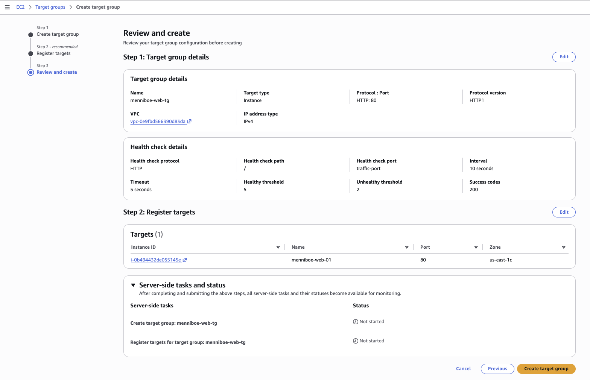

> [!WARNING]
> **Error:** Review showed **Healthy threshold 5** instead of 2 (about 50 s to become healthy instead of about 20 s). **Fix:** Edit Step 1 → Advanced health check settings → `2`.

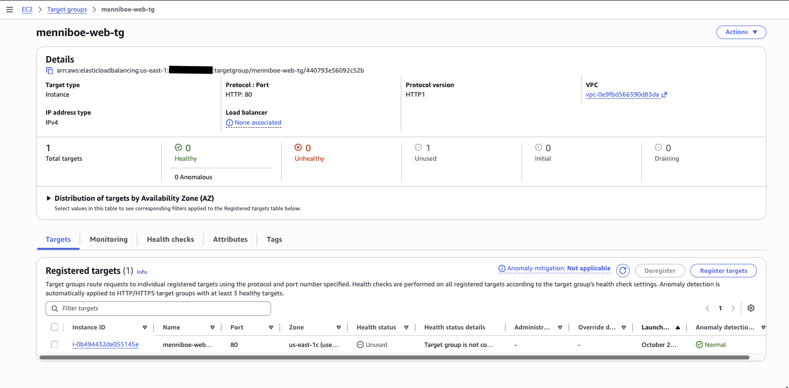

Status **Unused** ("Target group is not configured to receive traffic from the load balancer") until an ALB uses it. **Anomaly detection** (3+ healthy targets) can shift traffic away from a target performing worse than its peers.

### Lab 3 Step 5: Create the ALB

**Why this step:** the ALB is the public front door and the resource WAF attaches to.

**Console:** EC2 → Load Balancers → **Create load balancer** → Application Load Balancer

| Section | Field | Value |
|---|---|---|
| Basic configuration | Name | `menniboe-web-alb` |
| | Scheme / IP type | Internet-facing / IPv4 |
| Network mapping | VPC | Default VPC |
| | AZs | us-east-1a, us-east-1b, us-east-1c (must include the instance's AZ) |
| Security groups | | Remove `default`; select `menniboe-alb-sg` |
| Listeners and routing | | HTTP : 80 → Forward to `menniboe-web-tg` |
| Service integrations | CloudFront + WAF / WAF / Global Accelerator | Unchecked |
| Tags | | `Project` = `saa-day4` |

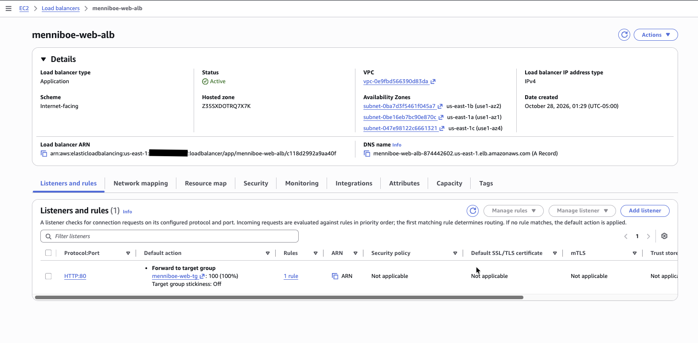

The **hosted zone ID** is what a Route 53 alias record uses. AZ IDs (`use1-az1`) identify the same physical AZ in every account; AZ names are shuffled per account.

### Lab 3 Step 6: Baseline through the ALB

**Why this step:** a known-good state before WAF.


"Served by ip-172-31-25-225.ec2.internal": the ALB reached the instance over the VPC's private network.

> [!NOTE]
> A page loading isn't proof of health: if **all** targets are unhealthy, an ALB **fails open** and still routes to them. Check the Targets tab.

### Lab 3 Step 7: Create the Web ACL

**Why this step:** the Web ACL holds the rate-based rule and the default action, and attaches to the ALB.

The WAF console opens in the new experience ("protection packs (web ACLs)"). Use **Switch to the old WAF console** (bottom of the left menu) for the classic wizard.


**Old console:** Web ACLs → US East (N. Virginia) → **Create web ACL**

**Page 1: Describe web ACL**

| Field | Value |
|---|---|
| Resource type | Regional resources |
| Region | US East (N. Virginia) |
| Name | `menniboe-web-acl` |
| Description | `Day 4 lab - rate limiting for Menniboe shop ALB` |
| CloudWatch metric name | `menniboe-web-acl` |
| Associated AWS resources | Add → Application Load Balancer → `menniboe-web-alb` |
| Resource level DDoS protection | Active under DDoS |


**Resource level DDoS protection** (ALB only) uses an AWS-managed list of low-reputation sources: **Active under DDoS** blocks them only under very high request volume; **Always on** blocks them all the time.

**Page 2: Add rules** → Add my own rules and rule groups

| Field | Value |
|---|---|
| Rule type | Rule builder (visual editor) |
| Name | `menniboe-rate-limit` |
| Type | Rate-based rule |
| Rate limit | `10` (minimum) |
| Evaluation window | 1 minute (60 seconds) |
| Request aggregation | Source IP address |
| Scope | Consider all requests |
| Action | Block |
| Custom response | Off |
| Labels | None (remove the empty row) |


> [!WARNING]
> **Error:** the **Add label** section was expanded with an empty `namespace:name` row, which can fail validation. **Fix:** **Remove** the empty row before **Add rule**.

| Aggregation option | When to use it |
|---|---|
| Source IP address | WAF directly in front of the ALB |
| IP address in header | A proxy such as CloudFront sits in front, so use `X-Forwarded-For` |
| Custom keys | Combinations (IP + URI, API key header) |
| Count all | Rate limit everything matching a scope-down statement |

Default web ACL action: **Allow**.


**WCUs:** 2/5,000. **Page 3:** one rule, nothing to reorder. **Page 4:** metric `menniboe-rate-limit`, sampled requests enabled. **Page 5:** **Create web ACL**.


### Lab 3 Step 8: Flood test

**Why this step:** proves the rule blocks one IP that goes over the limit.

```bash
curl -s https://checkip.amazonaws.com
ALB="http://<alb-dns-name>"
for i in $(seq 1 120); do echo "$i $(curl -s -o /dev/null -w '%{http_code}' $ALB)"; sleep 0.5; done
```

Result from CloudShell (`32.198.2.55`): requests **1–50 → 200**, **51–120 → 403**.

> [!NOTE]
> The block didn't start at request 11 because WAF evaluates rates in the background every few seconds. At 2 requests per second, the block took about 25 seconds to appear.

### Lab 3 Step 9: Prove blocking is per IP

**Why this step:** the rule should stop the flooder, not every customer.

> [!WARNING]
> **Error:** the first follow-up `curl` returned the Menniboe page, because the block had already lifted once the rate dropped below the limit. **Fix:** a loop that stops on the first `403`, then test immediately.

```bash
for i in $(seq 1 150); do c=$(curl -s -o /dev/null -w '%{http_code}' $ALB); echo "$i $c"; [ "$c" = "403" ] && break; sleep 0.5; done
curl -s $ALB
```

Result: blocked at request 43; `curl` returned WAF's default `403 Forbidden` HTML. In the same minute, the browser from a different IP loaded the page:


### Lab 3 Step 10: Sampled requests

**Why this step:** see the blocks from inside WAF.

**Console:** Web ACL → **Sampled requests**


> [!WARNING]
> **Error:** the first page showed only ALLOW rows (default action). **Fix:** set the metric dropdown to `menniboe-rate-limit` and refresh.


**Lab 3 results**

| Test | From | Result |
|---|---|---|
| Direct to instance public IP | Browser | Timeout |
| Through ALB, no WAF | Browser | 200, target Healthy |
| Flood, 120 requests at 2/s | CloudShell | 50 × 200, then 70 × 403 |
| Same moment, normal browsing | Browser (other IP) | 200 |
| After the flood stops | CloudShell | 200 (block lifts automatically) |
| WAF console | | BLOCK rows for `32.198.2.55` |

## Teardown

Reverse order of creation; the KMS key goes last because everything else was encrypted with it. Full CLI in [commands.md](commands.md#teardown).

| # | Resource | Why this order | Verify |
|---|---|---|---|
| 1 | Web ACL (disassociate, then delete with lock token) | Billed hourly; can't delete while associated | `list-web-acls` → `[]` |
| 2 | ALB | Most expensive; holds the target group and `alb-sg` | `[]` |
| 3 | Target group | Free once the ALB is gone | `[]` |
| 4 | EC2 instance | Uses `web-sg`; public IPv4 is billed | `terminated`, no tagged volumes |
| 5 | `menniboe-web-sg`, then `menniboe-alb-sg` | `web-sg` references `alb-sg` | `[]` |
| 6 | Secret (`--force-delete-without-recovery`) | Encrypted with the key | `[]` |
| 7 | Parameters | SecureString encrypted with the key | `[]` |
| 8 | S3 bucket (empty, then delete) | Object encrypted with the key | no output |
| 9 | IAM role (detach policy, delete) | Named in the key policy | `NoSuchEntity` |
| 10 | KMS key (schedule deletion, 7 days) | Last; nothing depends on it | `PendingDeletion` |
| 11 | Tag sweep | Catches leftovers | only the pending KMS key |

> [!NOTE]
> Secrets Manager's console only schedules deletion (7–30-day recovery window); the CLI flag deletes immediately. KMS never deletes immediately: the 7–30-day waiting period lets you cancel if something still needs the key. After a role is deleted, the key policy shows its unique ID (`AROA...`); a new role with the same name would not inherit access.

---

# Troubleshooting log

| # | Where | Symptom | Cause | Fix |
|---|---|---|---|---|
| 1 | KMS create key | Review shows Tags: No data | Tag not added on Add labels | Edit Tags, add `Project = saa-day4` |
| 2 | KMS rotation | No "Key rotation" tab | Tab renamed | Use **Key material and rotations** |
| 3 | S3 object list | Encryption not visible | Encryption is per object | Object → Properties → Server-side encryption settings |
| 4 | S3 open as role | `AccessDenied ... kms:Decrypt` | Role had S3 but no KMS permission (expected) | Add role as key user in the key policy |
| 5 | Secrets Manager | Key field looked filled but wasn't selected | Typed search text | Select the key from the dropdown; confirm on Review |
| 6 | Target group | Healthy threshold 5 on Review | Value not saved | Edit, set to 2 |
| 7 | WAF console | Wizard looked different | New "protection packs" console | Switch to the old WAF console |
| 8 | WAF rule | Empty label row | Section expanded with blank input | Remove the row |
| 9 | Flood test | 403 only after ~50 requests | WAF evaluates rates every few seconds | Expected; send enough traffic |
| 10 | Per-IP test | CloudShell got 200 again | Block lifts when rate drops below limit | Stop-at-403 loop, test immediately |
| 11 | Sampled requests | Only ALLOW rows | Viewing all metrics | Filter to `menniboe-rate-limit` |
| 12 | CloudShell | `zsh: bad pattern` / `no matches found` | Pasted expected JSON; zsh treats `[ ]` as globs | Paste only commands |

---

# Service selection cheat sheet

| If the scenario says... | Choose |
|---|---|
| Server must never see plaintext | Client-side encryption |
| Encrypt at rest with minimal effort; audit key use | KMS (SSE-KMS) + CloudTrail |
| Data larger than 4 KB with KMS | Envelope encryption (`GenerateDataKey`) |
| KMS `ThrottlingException` on S3, least overhead | S3 Bucket Keys |
| Share encrypted snapshot or AMI with another account | Customer managed key + key policy (+ launch permission) |
| Same key to decrypt in another Region | KMS multi-Region keys |
| SSE-KMS objects not replicating | KMS replication option + `kms:Decrypt`/`kms:Encrypt` |
| Cheap hierarchical config and secrets | Parameter Store |
| Automatic database password rotation | Secrets Manager |
| Cheap config **and** one rotated password | Secrets Manager (password) + Parameter Store Standard (rest) |
| Free TLS for ALB / CloudFront | ACM (CloudFront → us-east-1) |
| CloudFront → ALB with HTTPS on both hops | Certificates in us-east-1 **and** the ALB's Region |
| Alert before imported certificate expires | ACM EventBridge events / `acm-certificate-expiration-check` |
| Dedicated hardware, exclusive keys, FIPS Level 3 | CloudHSM |
| Block SQLi, XSS, bad IPs, countries, floods | AWS WAF |
| Static IP + WAF | Global Accelerator → ALB with WAF |
| Free DDoS protection | Shield Standard |
| 24/7 DDoS team, DDoS cost protection | Shield Advanced |
| WAF/SG rules across all accounts and new resources | Firewall Manager |
| Block external principals from org resources (S3, KMS, SQS) | Resource control policy (RCP) |
| Crypto mining, compromised instance, odd API calls | GuardDuty |
| CVEs in EC2, ECR, Lambda | Inspector |
| PII in S3 | Macie |

---

# Acronyms

| Acronym | Meaning |
|---|---|
| ACL | Access Control List |
| ACM | AWS Certificate Manager |
| AES | Advanced Encryption Standard |
| ALB / NLB | Application / Network Load Balancer |
| AMI | Amazon Machine Image |
| ARN | Amazon Resource Name |
| AZ | Availability Zone |
| CA | Certificate Authority |
| CVE | Common Vulnerabilities and Exposures |
| DDoS | Distributed Denial of Service |
| ECC | Elliptic Curve Cryptography |
| ECR | Elastic Container Registry |
| ENI | Elastic Network Interface |
| FAS | Forward Access Sessions |
| FIPS | Federal Information Processing Standard |
| HSM | Hardware Security Module |
| IMDSv2 | Instance Metadata Service version 2 |
| KMS | Key Management Service |
| PII | Personally Identifiable Information |
| RCP / SCP | Resource / Service Control Policy |
| RSA | Rivest–Shamir–Adleman |
| SG | Security Group |
| SQLi | SQL injection |
| SRT | Shield Response Team |
| SSE (-S3, -KMS, -C) | Server-Side Encryption (S3-managed, KMS, customer-provided keys) |
| SSM | AWS Systems Manager |
| SSRF | Server-Side Request Forgery |
| TG | Target Group |
| TLS / SSL | Transport Layer Security / Secure Sockets Layer |
| TTL | Time To Live |
| WAF | Web Application Firewall |
| WCU | Web ACL Capacity Unit |
| XSS | Cross-Site Scripting |
