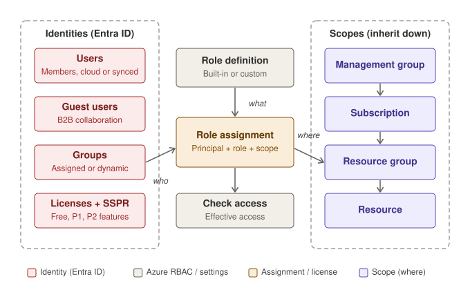

# Microsoft Entra ID and Azure RBAC

AZ-104 · Manage Azure identities and governance

## What I learned

Azure answers two separate questions. **Who are you?** is handled by **Microsoft Entra ID**: the tenant holds users, groups, guests, licenses and sign-in methods. **What can you do, and where?** is handled by **Azure RBAC**: a role assignment gives a principal a role at a scope, and that access flows down the scope tree from management group to subscription to resource group to resource.

- **Tenant vs subscription:** one tenant, many subscriptions; each subscription trusts one tenant. Moving a subscription wipes its role assignments.
- **Users and groups:** cloud-only vs synced users, Member vs Guest, Security vs Microsoft 365 groups, Assigned vs Dynamic membership (P1).
- **Licensing:** Free, P1 and P2 editions, group-based licensing, and why usage location matters. License assignment now lives in the Microsoft 365 admin center.
- **B2B guests:** invitation, redemption, `#EXT#` identities, and tenant-wide external collaboration settings.
- **SSPR:** scope (Selected = one group), the converged Authentication methods policy, admin rules, and password writeback.
- **Two role systems:** Entra roles (directory) vs Azure roles (resources); a Global Administrator can't see subscriptions without elevate access.
- **RBAC:** the three parts of a role assignment, Owner vs Contributor vs User Access Administrator, control plane vs data plane, inherited vs direct scope, and effective access as the union of all assignments minus denies.

## Lab results

| Result | Evidence |
|---|---|
| Tenant mapped end to end | 1 tenant → Tenant Root Group → 2 subscriptions → resource groups; admin is Global Administrator (Entra) **and** Owner (Azure) |
| Inheritance seen live | Owner shows **This resource** on the subscription and **Subscription (Inherited)** on its resource group |
| Identities built | 3 members, 2 Security groups, 1 guest (Pending acceptance → Accepted) |
| Group-based access works | `grp-farm-ops` → **Contributor** on `rg-harvest-lab`; Check access shows **Group assignment: grp-farm-ops** |
| Boundary holds | Member sees **1 of 2** resource groups, **1 of 2** subscriptions (My role: *Resource access*); **0** assignments on NetworkWatcherRG |
| Contributor can build | Member created a VNet in `rg-harvest-lab` |
| Contributor can't grant or escalate | *Add role assignment (disabled)*; creating a resource group denied at subscription scope |
| Clean teardown | Tenant back to **1 user, 0 groups**; deleted users held 30 days, then permanently removed |

## Issues solved

| Issue | Fix |
|---|---|
| Premium trial unavailable, then offered only through a paid checkout | Ran the lab on Entra ID Free; premium settings toured instead of enabled |
| Country entered in **Office location** instead of **Usage location** | Corrected the field before creating the user |
| SSPR blade and role-assignable groups unavailable | Confirmed both are P1 features; used the Authentication methods policy |
| Test user forced to register MFA | Security defaults plus mandatory Azure portal MFA; registered, then removed after teardown |

## Files

| File | Contents |
|---|---|
| [notes.md](notes.md) | Concepts for all nine modules, console tour, both labs step by step, troubleshooting log, cheat sheet, acronyms |
| [commands.md](commands.md) | Azure CLI and Microsoft Graph equivalents for a CLI-only redo, teardown and verification, repo commands |
| `images/diagrams/` | Architecture and concept diagrams (SVG) |
| `images/screenshots/` | Redacted lab screenshots |
