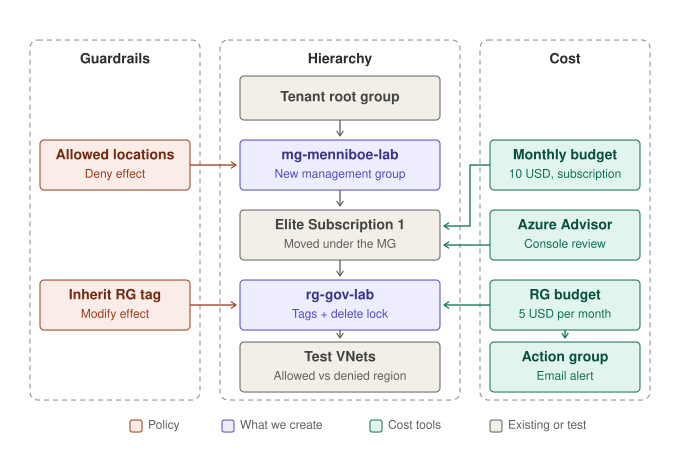

# AZ-104: Azure Governance and Cost Management

Covers the **Manage Azure subscriptions and governance** part of AZ-104, built hands-on in the Azure portal with the Menniboe Farm theme.

## What I learned

- How **Azure Resource Manager** checks every request (identity, RBAC, Policy, locks) and how resource groups, subscriptions, and **management groups** form the scope hierarchy that assignments inherit through
- **Azure Policy** definitions vs assignments; the Deny, Audit, Modify and DeployIfNotExists effects; initiatives; remediation with managed identities; exclusions and exemptions; enforcement modes, including the new **Enroll** preview
- **Resource locks** (CanNotDelete vs ReadOnly) and why they stop even Owners
- **Tags**: why they don't inherit, Policy-based tag inheritance vs Cost Management tag inheritance, and Azure vs AWS tag rules
- **Cost Management**: cost analysis, budgets (Actual vs Forecasted), action groups, exports
- **Azure Advisor** and savings options: reservations, savings plans, Azure Hybrid Benefit, Spot VMs

## Key lab results

| Test | Result |
|---|---|
| Policy assigned at a management group reached a resource group 2 levels down | Proven |
| VNet in West Europe (blocked region) | **Denied** in preflight; Activity log named `Allowed locations - Menniboe Lab` with scope `mg-menniboe-lab` |
| VNet in East US with **no tags typed** | Created with `cc : farm-ops` only (Modify policy); `env` absent |
| Delete a VNet inside a CanNotDelete-locked resource group, as Owner | **Blocked**; error named the resource group as the locked scope |
| Email action group | Verified (2 confirmation emails) |
| Permanent monthly lab budget | `budget-sub-labs-monthly`: $10, alerts at 50% actual, 100% forecast, 100% actual |
| Subscription spend Jul–Sep 2026 | $16.41 total; $0 in November |
| Teardown | Verified clean by CLI |

## Issues solved

- Policy enforcement **preselected as Enroll** at management group scope → set to **Default**
- "Validation passed" but deployment failed, with an empty Errors panel and no deployment record → found the deny in the **Activity log** (rejected in preflight)
- A second Deny from Microsoft's **`sys.blockwesteurope`** at the tenant root
- **`Microsoft.Insights` not registered** when creating the action group → registered the resource provider
- Budget **"Unique email address is required"** → retyped the email cleanly
- **AuthorizationFailed** on `az account management-group list` (no rights at the root) → verified in the portal, chained checks with `;`

## Files

| File | Contents |
|---|---|
| [notes.md](notes.md) | Full reference guide: 9 modules, the lab step by step with screenshots, troubleshooting log, cheat sheet, acronyms |
| [commands.md](commands.md) | Verification commands run in Cloud Shell, plus CLI equivalents for a CLI-only redo |
| `images/diagrams/` | 11 SVG diagrams |
| `images/screenshots/` | 28 redacted portal and Cloud Shell screenshots |
