# AZ-104: Azure Governance and Cost Management

Reference guide for the **Manage Azure subscriptions and governance** part of the AZ-104 identity and governance domain. It covers Azure Resource Manager, resource groups, subscriptions, management groups, Azure Policy, resource locks, tags, Cost Management, and Azure Advisor, plus a full console lab built on the Menniboe Farm theme.

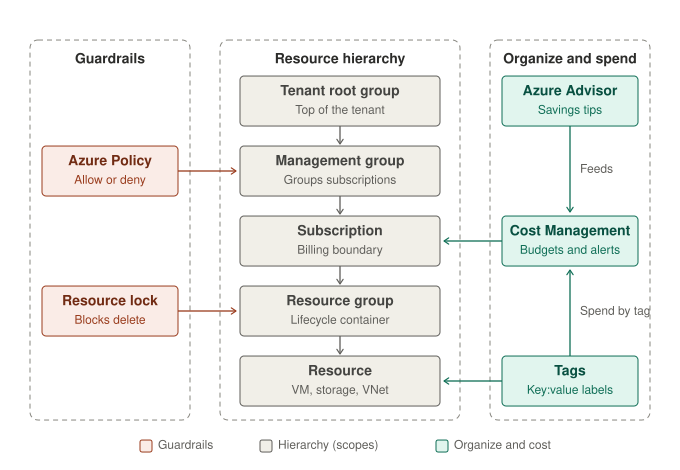

> [!NOTE]
> Every request in Azure passes through one gate, Azure Resource Manager (ARM), which checks identity, RBAC (role-based access control), Azure Policy, and resource locks in that order. Everything you attach at one scope (a policy, a role, a lock, a budget) applies to everything below it. Tags are the exception: they don't inherit on their own.

---

## Table of contents

**Concepts**
- [Module 1: Azure Resource Manager and resource groups](#module-1-azure-resource-manager-and-resource-groups)
- [Module 2: Subscriptions](#module-2-subscriptions)
- [Module 3: Management groups](#module-3-management-groups)
- [Module 4: Azure Policy basics](#module-4-azure-policy-basics)
- [Module 5: Policy effects, initiatives and remediation](#module-5-policy-effects-initiatives-and-remediation)
- [Module 6: Resource locks](#module-6-resource-locks)
- [Module 7: Tags and tag inheritance](#module-7-tags-and-tag-inheritance)
- [Module 8: Cost Management, budgets and alerts](#module-8-cost-management-budgets-and-alerts)
- [Module 9: Azure Advisor and ways to save](#module-9-azure-advisor-and-ways-to-save)
- [Look-alike names: NSG vs AWS security group vs resource group](#look-alike-names-nsg-vs-aws-security-group-vs-resource-group)
- [Current status notes (2026)](#current-status-notes-2026)

**Hands-on lab: Governance and cost guardrails**
- [Lab overview](#lab-overview)
- [Step 1: Create the management group](#step-1-create-the-management-group)
- [Step 2: Move the subscription into the management group](#step-2-move-the-subscription-into-the-management-group)
- [Step 3: Create the resource group rg-gov-lab](#step-3-create-the-resource-group-rg-gov-lab)
- [Step 4: Assign Allowed locations at the management group](#step-4-assign-allowed-locations-at-the-management-group)
- [Step 5: Assign Inherit a tag from the resource group if missing](#step-5-assign-inherit-a-tag-from-the-resource-group-if-missing)
- [Step 6: Test Deny with a VNet in a blocked region](#step-6-test-deny-with-a-vnet-in-a-blocked-region)
- [Step 7: Test the allowed region and automatic tagging](#step-7-test-the-allowed-region-and-automatic-tagging)
- [Step 8: Add a CanNotDelete lock](#step-8-add-a-cannotdelete-lock)
- [Step 9: Test the lock](#step-9-test-the-lock)
- [Step 10: Create an email action group](#step-10-create-an-email-action-group)
- [Step 11: Create a resource group budget](#step-11-create-a-resource-group-budget)
- [Step 12: Create the permanent subscription budget](#step-12-create-the-permanent-subscription-budget)
- [Step 13: Review cost analysis](#step-13-review-cost-analysis)
- [Step 14: Review Azure Advisor](#step-14-review-azure-advisor)
- [Step 15: Find the policy managed identity in IAM](#step-15-find-the-policy-managed-identity-in-iam)
- [Teardown](#teardown)
- [Verify the teardown](#verify-the-teardown)

**Reference**
- [Troubleshooting log](#troubleshooting-log)
- [Service selection cheat sheet](#service-selection-cheat-sheet)
- [Acronyms](#acronyms)

---

## Module 1: Azure Resource Manager and resource groups

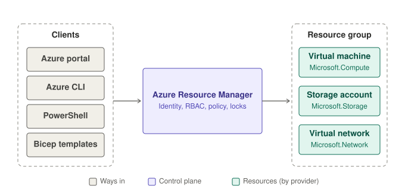

**What it is.** Azure Resource Manager (ARM) is Azure's control plane. Every request, whether it comes from the portal, the Azure CLI (command-line interface), PowerShell, or a Bicep or ARM template, goes to ARM. ARM authenticates you through Microsoft Entra ID, checks RBAC, checks Azure Policy, checks resource locks, and then hands the work to the right **resource provider** (`Microsoft.Compute`, `Microsoft.Storage`, `Microsoft.Network`, and so on). A **resource group** is the logical container that every resource lives in.

**Key facts**
- The check order is identity, then RBAC, then Policy, then locks. That's why a lock stops even an Owner: the lock check runs after RBAC has already said yes.
- Resource providers must be **registered** in a subscription. The error "subscription is not registered to use namespace…" means you need to register the provider. It isn't a permissions problem. (This happened in the lab with `Microsoft.Insights`; see [Step 10](#step-10-create-an-email-action-group).)
- Each resource belongs to exactly one resource group, and resource groups can't be nested.
- A resource group's region only says where its **metadata** is stored. Its resources can live in any region.
- Deleting a resource group deletes everything inside it. There's no recycle bin.
- Resource groups can't be renamed. To rename one, create a new group and move the resources.
- Group resources by **lifecycle**: things that are created, updated, and deleted together.

**Moving resources**
- You can move resources between resource groups, or between subscriptions in the same tenant.
- During a move, both the source and destination groups are locked for changes, but the resources keep running.
- The **resource ID changes**, because it contains the subscription and resource group, so scripts, alerts and direct role assignments that use the old ID must be updated.
- A move doesn't change the region. To change regions, use Azure Resource Mover or redeploy.
- Not every resource type can move, and some must move together with their dependencies. Azure validates the move first.

**How it connects:** Role and policy assignments on a resource group flow down to its resources. Tags do not.

| Pros of resource groups | Cons and limits |
|---|---|
| One unit for access, policy, cost, and cleanup | No nesting |
| Lifecycle cleanup with one delete | That same delete is a production hazard without locks |
| Resources can span regions | Can't be renamed |

> [!TIP]
> **Exam clue:** "VM moved to another resource group, what changes?" The resource ID changes. The region doesn't, and the tags don't.

**Menniboe example:** The tilapia-pond monitoring system (VM, storage, VNet) lives in `rg-pond-monitor`. It's moved from the sandbox to the production subscription without downtime, and only one alert rule that used the old resource ID needs updating.

---

## Module 2: Subscriptions

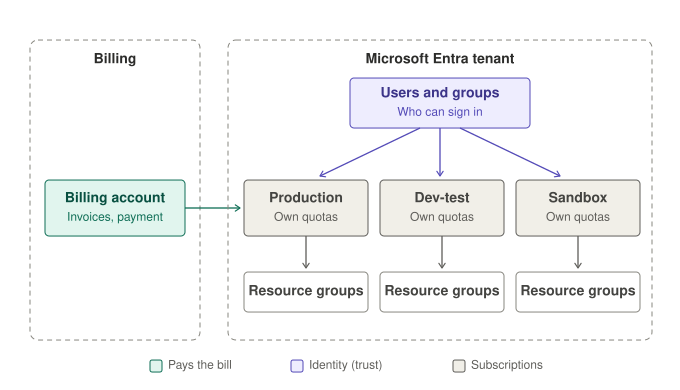

**What it is.** A subscription is the agreement under which you use Azure and get billed. It's three boundaries at once:
- **Billing:** costs roll up to one bill.
- **Access:** a role at subscription scope covers everything inside it.
- **Limits and quotas:** for example, vCPU (virtual CPU) quotas per region.

**Key facts**
- A subscription trusts **exactly one** Microsoft Entra tenant. A tenant can have many subscriptions.
- **Offer types:** Free, Pay-As-You-Go, EA (Enterprise Agreement), MCA (Microsoft Customer Agreement), CSP (Cloud Solution Provider), and Visual Studio or Dev/Test.
- **Spending limits** exist only on credit-based offers, such as free trial and Visual Studio credits. Pay-As-You-Go has none.
- A "quota exceeded" error means you should request a quota increase or use another region. It isn't a permissions problem.
- The classic administrator roles (Account Administrator, Service Administrator, Co-Administrator) were retired in 2024. Use RBAC roles instead.

**Actions on a subscription**

| Action | What changes | What stays |
|---|---|---|
| Rename | Display name only | Everything else |
| **Change directory** | The tenant it trusts. **All RBAC role assignments are removed**, custom roles don't carry over, and managed identities and Key Vault access must be fixed | Resources and billing |
| Transfer billing ownership | Who pays | Tenant, access, resources |
| Cancel | Resources are disabled; data is deleted after a waiting period (typically 90 days); can be reactivated within that window | — |

> [!WARNING]
> **Change directory** wipes access. Plan role reassignment in the new tenant before doing it.

**Menniboe example:** Production, Dev-Test, and Sandbox are three subscriptions in one tenant. Each has its own bill and quota, and Contributor on Sandbox gives nothing in Production.

---

## Module 3: Management groups

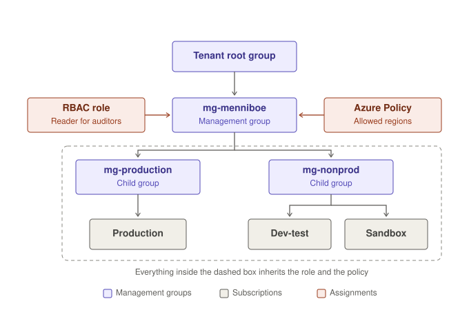

**What it is.** A management group is a container above subscriptions. Policies and RBAC assigned at a management group are inherited by every child management group, subscription, resource group, and resource beneath it. It's similar to an OU (organizational unit) in AWS Organizations.

**Key facts**
- The **tenant root group** is created automatically. Its ID equals the tenant ID, and it can't be moved or deleted.
- New subscriptions land at the root by default, unless a **default management group** is set in the hierarchy settings.
- The hierarchy can go **6 levels** deep below the root (not counting the root or the subscription level).
- A tenant can hold up to **10,000** management groups.
- Each management group and each subscription has **exactly one parent**.
- An inherited assignment **can't be removed or overridden** from below. Only someone with rights at the higher scope can change it, add an exclusion, or create an exemption.
- By default, a **Global Administrator has no Azure resource rights at the root**. To get them, turn on **"Access management for Azure resources,"** which grants User Access Administrator at root scope. Turn it off after use.
- Moving a subscription between management groups needs write rights on the management groups involved plus sufficient rights on the subscription. After the move, it loses its old parent's assignments and gains the new parent's.
- Management groups are free, and budgets can be scoped to them.

> [!IMPORTANT]
> Reading the whole management group hierarchy (`az account management-group list`) needs rights at the root. A subscription Owner without them gets **AuthorizationFailed**, which happened during this lab's teardown check.

**Menniboe example:** `mg-menniboe` has `mg-production` and `mg-nonprod` under it. An "allowed regions" policy and Reader for auditors are assigned once at `mg-menniboe`, and a new fish-feed subscription placed under `mg-nonprod` is covered instantly.

---

## Module 4: Azure Policy basics

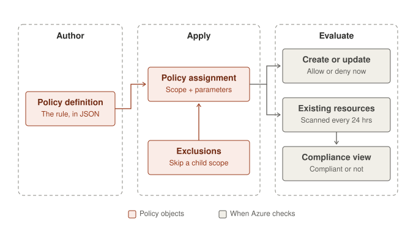

**What it is.** RBAC controls **who** can act. Azure Policy controls **what** can exist. Policy runs inside ARM, so it checks every request from every tool, and it can block even an Owner.

**The two pieces**
- **Policy definition:** the rule, written in JSON (JavaScript Object Notation) as "if condition, then effect." There are hundreds of built-ins (Allowed locations, Require a tag, Allowed VM size SKUs). Custom definitions are saved at a management group or subscription and can only be assigned at or below that level.
- **Policy assignment:** puts a definition into effect at a **scope** (management group, subscription, or resource group), with **parameters**. A definition does nothing until it's assigned.

**Exceptions**
- **Exclusion:** set on the assignment; removes a child scope from it.
- **Exemption:** a separate object with a category (**Waiver** or **Mitigated**) and an optional expiry date. Use it when you need an audit trail.

**Timing**
- Create and update requests are evaluated **immediately**.
- Existing resources are **not changed or deleted**. They're scanned (about every 24 hours, and shortly after a new assignment) and marked compliant or non-compliant.
- A new assignment can take up to about 30 minutes to take effect.

**Enforcement mode**

| Portal | API and CLI | Behavior |
|---|---|---|
| Default (formerly shown as Enabled) | `Default` | Enforces the effect |
| Do not enforce (Disabled) | `DoNotEnforce` | Evaluates and reports only |
| Enroll (preview) | `Enroll` | Enforces only on scopes or resources added through separate policy enrollments |

> [!WARNING]
> At management group scope, the portal now **preselects Enroll** for supported definitions. With no enrollments, nothing is enforced. Switch it to **Default** for a normal assignment (see [Step 4](#step-4-assign-allowed-locations-at-the-management-group)).

> [!TIP]
> **Exam clue:** "Stop a person or team from doing X" points to RBAC. "Make sure nothing non-compliant gets created, whatever the role" points to Azure Policy.

---

## Module 5: Policy effects, initiatives and remediation

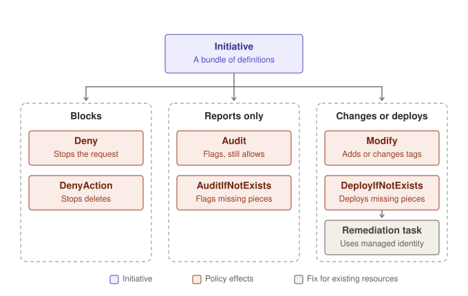

| Effect | What it does | When it runs | Fixes existing resources? |
|---|---|---|---|
| **Deny** | Blocks a non-compliant create or update | On request | No; existing resources are only flagged |
| **DenyAction** | Blocks a specific action, usually delete | On request | No |
| **Audit** | Allows the request, logs it as non-compliant | On request and scan | No |
| **AuditIfNotExists** | Flags a missing related resource (for example, a VM without a monitoring extension) | After create | No |
| **Append** | Adds fields (older; largely replaced by Modify for tags) | On request | No |
| **Modify** | Adds, updates, or removes tags and properties | On request | Yes, with a remediation task |
| **DeployIfNotExists (DINE)** | Deploys a missing related resource (for example, diagnostic settings) | After create | Yes, with a remediation task |
| **Disabled** | Turns the policy off without deleting the assignment | — | — |
| **Manual** | Self-attested controls | — | — |

**Evaluation order:** Disabled, then Append and Modify, then Deny, then Audit. AuditIfNotExists and DINE run after the resource provider succeeds. So a Modify policy can add a tag **before** a Deny policy checks for it.

**Remediation**
- Modify and DINE act on new and updated resources automatically. Existing resources need a **remediation task**.
- Those assignments need a **managed identity** (system-assigned or user-assigned) with a role that allows the change, such as Contributor or Tag Contributor. The portal creates it and grants the role.
- If a remediation task fails, check the identity and its role first.

**Initiatives** (policy set definitions) bundle definitions so you assign them once and get one compliance score. One example is the **Microsoft cloud security benchmark**, which Microsoft Defender for Cloud assigns to subscriptions by default. It's the source of the compliance numbers you see on a "fresh" subscription.

> [!TIP]
> **Exam clue:** "Every storage account, including existing ones, must send logs to Log Analytics, without blocking anyone" points to DeployIfNotExists, a managed identity, and a remediation task.

---

## Module 6: Resource locks

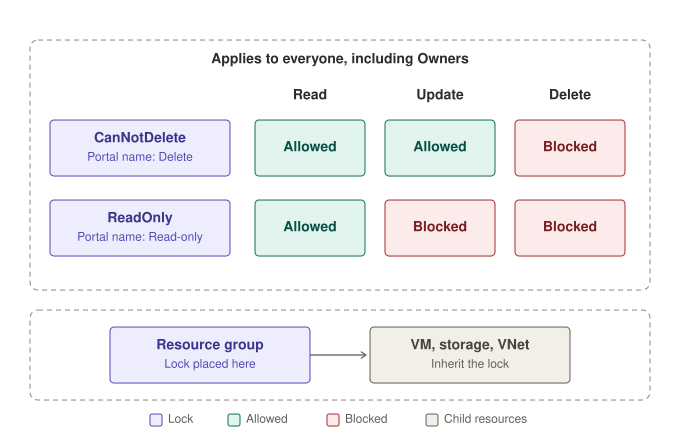

| Lock (API name) | Portal name | Read | Update | Delete |
|---|---|---|---|---|
| CanNotDelete | Delete | Yes | Yes | **No** |
| ReadOnly | Read-only | Yes | **No** | **No** |

**Key facts**
- Locks can be set at a subscription, resource group, or resource. They're inherited, and the most restrictive lock wins.
- Locks apply to **everyone, including Owners**.
- Removing a lock needs `Microsoft.Authorization/locks/*`. Among the built-in roles, only **Owner** and **User Access Administrator** have it. Contributor can't remove locks.
- Locks protect the **control plane only**. A CanNotDelete lock on a SQL database doesn't stop someone from deleting tables, so a lock is not a backup.
- **ReadOnly side effects:** listing storage account keys and starting, stopping, or restarting VMs count as write-type operations, so they're blocked.
- A lock on a resource group, or on any resource inside it, blocks the group's deletion. Look for locks when a teardown fails with "scope locked."

> [!TIP]
> **Exam clue:** "Prevent anyone, including administrators, from accidentally deleting this resource group" points to a CanNotDelete lock.

---

## Module 7: Tags and tag inheritance

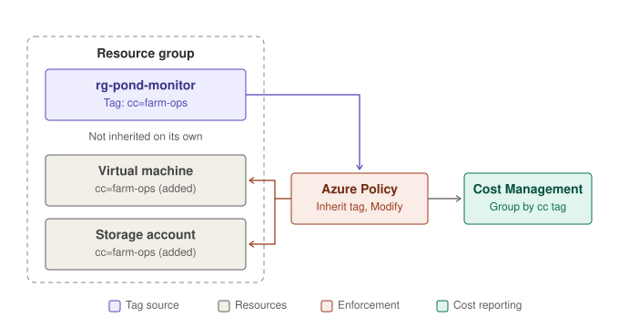

**What it is.** A tag is a name and value pair (for example `cc=farm-ops`) on a resource, resource group, or subscription. It's metadata for search, filtering, and cost reports. It doesn't change how the resource behaves.

**Key facts**
- **Tags are not inherited.** Resource group and subscription tags don't flow down on their own. That makes them the exception to Azure's top-down inheritance.
- To put a group's tag on its resources, use Azure Policy: **"Inherit a tag from the resource group if missing"** (Modify, adds only if absent), or **"Inherit a tag from the resource group"** (overwrites). Use remediation for existing resources. To require a tag up front, use **"Require a tag on resources"** (Deny).
- **Cost Management tag inheritance** (EA and MCA) applies resource group and subscription tags to **usage records in cost reports** only. It doesn't tag the resources themselves.
- Tags show up in costs **from the moment they're applied**. Earlier usage isn't relabeled.
- **Limits:** up to 50 tags per object; names up to 512 characters (128 for storage accounts); values up to 256 characters.
- Tag **names aren't case-sensitive; values are**. The characters `< > % & \ ? /` aren't allowed in names.
- Tags are stored in plain text, so never put secrets in them.
- The **Tag Contributor** role lets someone manage tags without any other access.

**Azure vs AWS tags**

| | AWS | Azure |
|---|---|---|
| Parts | Key / Value | Name / Value |
| Special `Name` tag | Sets the console display name | None; the name is a separate property |
| Case | Keys and values case-sensitive | Names case-insensitive; values case-sensitive |
| Cost reports | Must be activated as cost allocation tags | Appear in Cost analysis automatically |
| Enforcement | AWS Organizations tag policies | Azure Policy |

---

## Module 8: Cost Management, budgets and alerts

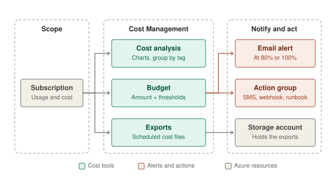

**What it is.** Microsoft Cost Management is free. It has three main jobs: **cost analysis** (where the money went), **budgets** (a target plus warnings), and **exports** (scheduled cost files to a storage account).

**Key facts**
- **Scopes:** billing account, management group, subscription, resource group.
- **Roles:** Cost Management Reader to view; Cost Management Contributor, Contributor, or Owner to create budgets and exports.
- **Actual vs amortized cost:** actual shows a reservation as one purchase in the month you bought it; amortized spreads it across the term.
- Cost data refreshes within **8 to 24 hours**, and a new budget starts being evaluated "in a few hours."
- **A budget never stops spending.** It only notifies. To shut things down automatically, pair it with an **action group** that runs an **Automation runbook**.
- **Budget settings:** amount, reset period (monthly, quarterly, annually), start date (the first of a month), expiration, and optional filters.
- **Alert conditions:** each has a type (**Actual** or **Forecasted**) and a percentage. Recipients are emails, plus action groups at subscription or resource group scope.
- **Other cost alerts:** credit alerts (EA prepayment), department spending quota alerts (EA), anomaly alerts, and scheduled alerts.

**Action group** (Azure Monitor): notifications (email, SMS (short message service), push, voice) and actions:

| Action type | Use |
|---|---|
| Automation Runbook | Stop or deallocate VMs at budget |
| Azure Function | Custom code |
| Event Hub | Stream alerts to a SIEM (security information and event management) tool |
| ITSM | Create tickets in an ITSM (IT service management) tool such as ServiceNow |
| Logic App | No-code workflows, Teams messages |
| Secure Webhook | Call an API with Entra ID authentication |
| Webhook | Plain HTTP POST |

> [!TIP]
> **Exam clue:** "Automatically stop VMs when spend reaches X" points to a budget, an action group, and a runbook. A budget alone is wrong, and Pay-As-You-Go has no spending limit.

---

## Module 9: Azure Advisor and ways to save

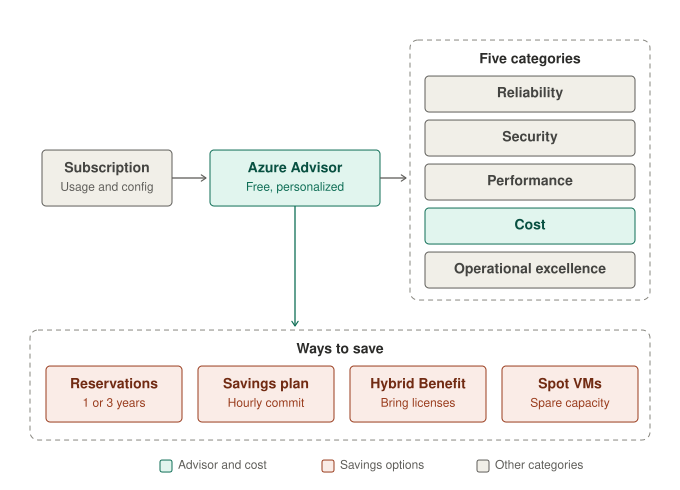

**Azure Advisor** is free and gives personalized recommendations in five categories: **Reliability, Security, Performance, Cost, and Operational Excellence**. Its security recommendations come from Microsoft Defender for Cloud. Advisor Score tracks how closely you follow them. You can dismiss or postpone recommendations, and alerts can go to action groups. Recommendations refresh about daily, and you can configure the VM right-sizing CPU (central processing unit) threshold and lookback period (default 7 days).

**Stopped vs deallocated:** shutting down from inside the OS (operating system) leaves the VM "Stopped," and compute is still billed. Stopping it from the portal or CLI gives "Stopped (deallocated)," and compute isn't billed. Disks are billed in both cases.

| Option | Commitment | Savings (up to) | Best for |
|---|---|---|---|
| Reservation | 1 or 3 years, specific resource type and region | ~72% | Stable, predictable workloads |
| Savings plan for compute | 1 or 3 years, hourly spend across sizes, regions, and compute services | ~65% | Workloads that change size or region |
| Azure Hybrid Benefit | Existing Windows Server or SQL Server licenses with Software Assurance (also RHEL and SUSE) | License cost | Any time existing licenses are mentioned |
| Spot VMs | None; can be evicted with ~30 seconds' notice | ~90% | Batch, testing, interruptible jobs |
| Auto-shutdown | Per-VM schedule | Off-hours compute | Dev and test VMs |

If both a reservation and a savings plan exist, reservations apply first. **Calculators:** the Pricing Calculator estimates cost before you deploy; the TCO (Total Cost of Ownership) Calculator compares on-premises with Azure.

---

## Look-alike names: NSG vs AWS security group vs resource group

| | Azure resource group | AWS security group | Azure NSG (network security group) | Entra ID security group |
|---|---|---|---|---|
| What it is | A container for resources | An instance-level firewall | A subnet or NIC firewall | A group of users |
| Rules | — | Allow only | Allow **and** deny | — |
| Order | — | All rules together (union) | Priority 100–4096, lowest number first, first match wins | — |
| State | — | Stateful | Stateful | — |
| Attaches to | — | ENI (elastic network interface), up to 5 per ENI | Subnet and/or NIC (network interface card), 1 each | Used in RBAC role assignments |
| Defaults | — | No inbound, all outbound | AllowVNetInBound, AllowAzureLoadBalancerInBound, DenyAllInBound (can't delete; override with lower numbers) | — |

Groups of machines: an AWS security group can reference another security group; Azure uses an ASG (application security group).

---

## Current status notes (2026)

> [!NOTE]
> - **Azure Blueprints** is being retired. The phased retirement started July 31, 2026; assignments can't be modified after December 31, 2026; retirement is January 31, 2027. The replacement is **Deployment Stacks** (plus Template Specs). Older exam questions may still mention Blueprints as "a package of policies, roles and templates."
> - **Reserved VM Instances** for some legacy VM series can't be bought or renewed after July 1, 2026. Use newer series or a savings plan.
> - **Enroll** enforcement mode (preview) appears in the portal and is preselected at management group scope.
> - Built-in policy definitions are **versioned** (for example `1.*.*`).
> - New subnets default to **private subnet** (no default outbound access).

---

# Hands-on lab: Governance and cost guardrails

## Lab overview

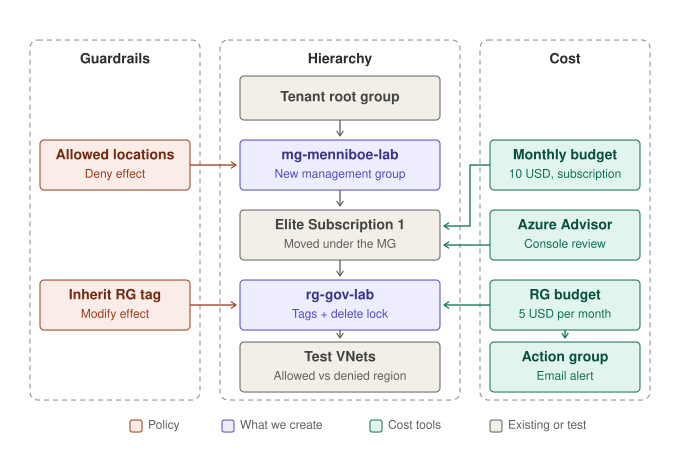

**What we built:** a management group with a subscription moved under it, a tagged resource group, two policies (Deny for regions, Modify for tags), a CanNotDelete lock, an email action group, a resource group budget, and a permanent monthly subscription budget. We also reviewed cost analysis, Advisor, and IAM (identity and access management).

**What we proved**
1. A policy assigned at a management group reaches a resource group two levels down.
2. Deny blocks a resource in the wrong region, even for an Owner.
3. Modify adds the resource group's `cc` tag to a new resource, which proves tags don't inherit by themselves.
4. A lock on the resource group stops an Owner from deleting a resource inside it.
5. Budgets alert through a verified action group.

**Cost:** about $0. Management groups, policies, locks, tags, budgets, Advisor, empty VNets, and action group email are free.

| Name | Type | Scope or location | Kept after lab |
|---|---|---|---|
| `mg-menniboe-lab` (Menniboe Lab) | Management group | Under Tenant Root Group | No |
| `rg-gov-lab` | Resource group | Elite Subscription 1, East US, tags `cc=farm-ops`, `env=lab` | No |
| `Allowed locations - Menniboe Lab` | Policy assignment (Deny) | mg-menniboe-lab | No |
| `Inherit cc tag - rg-gov-lab` | Policy assignment (Modify) | rg-gov-lab | No |
| `vnet-deny-test` | VNet (West Europe) | rg-gov-lab | Never created (denied) |
| `vnet-tag-test` | VNet (East US) | rg-gov-lab | No |
| `lock-nodelete-gov-lab` | Lock (Delete) | rg-gov-lab | No |
| `rg-cost-alerts` | Resource group | Elite Subscription 1 | **Yes** |
| `ag-lab-cost-email` (LabCost) | Action group (Global) | rg-cost-alerts | **Yes** |
| `budget-rg-gov-lab` | Budget, $5 monthly | rg-gov-lab | No |
| `budget-sub-labs-monthly` | Budget, $10 monthly | Elite Subscription 1 | **Yes** |

---

## Step 1: Create the management group

**Why this step:** Everything else hangs from this. A policy assigned here flows down to the subscription, the resource group, and every resource. Using our own group instead of the root keeps the lab isolated.

**Console:** search **Management groups**. Tenant Root Group already existed, so the page showed **+ Create**, not "Start using management groups."

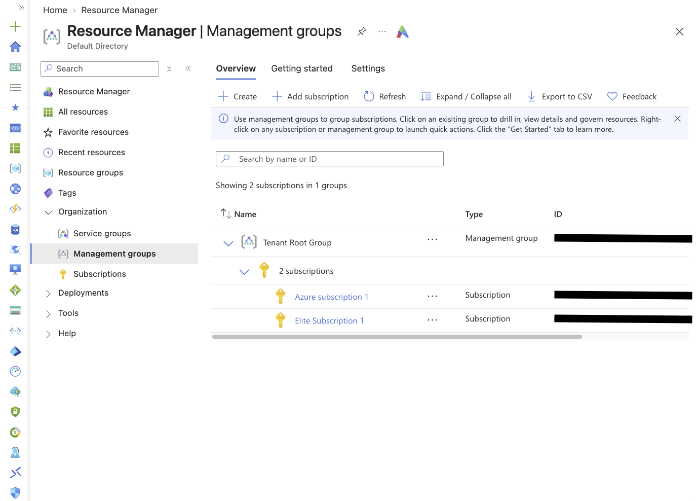

**+ Create** panel:

| Field | Value |
|---|---|
| Management group ID | `mg-menniboe-lab` (permanent) |
| Management group display name | `Menniboe Lab` (can be renamed) |

Click **Submit**, then **Refresh**.

> [!NOTE]
> In the list view, the new management group appears as a **sibling** of the subscriptions under Tenant Root Group, not below them. Management groups can never sit under a subscription. Their IDs are readable (what you typed), while subscriptions and the root have GUID (globally unique identifier) IDs.

---

## Step 2: Move the subscription into the management group

**Why this step:** An empty management group passes nothing down. Moving one subscription inside means our policies reach it, while the other subscription stays untouched.

**Console:** on the **Elite Subscription 1** row, click **⋯** and then **Move**. Set **New parent management group** to `Menniboe Lab (mg-menniboe-lab)` and click **Save**.

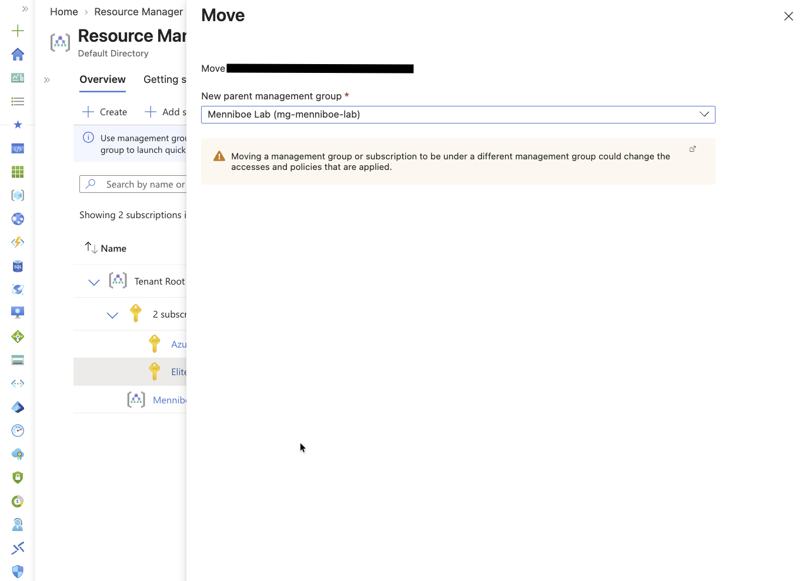

> [!NOTE]
> The warning, "Moving … could change the accesses and policies," is the inheritance rule. Moving while the group still has no assignments means nothing changes yet.

Result:
```
Tenant Root Group
├── Azure subscription 1
└── Menniboe Lab (mg-menniboe-lab)
    └── Elite Subscription 1
        └── rg-gov-lab (Step 3)
```

---

## Step 3: Create the resource group rg-gov-lab

**Why this step:** This is the bottom of the test hierarchy. Its `cc` tag is what the Modify policy copies, it's what gets locked, and it's the scope of the small budget.

**Console:** **Resource groups**, then **+ Create**.

| Tab | Field | Value |
|---|---|---|
| Basics | Subscription | Elite Subscription 1 |
| Basics | Resource group | `rg-gov-lab` |
| Basics | Region | (US) East US (metadata location only) |
| Tags | `cc` | `farm-ops` |
| Tags | `env` | `lab` |
| Review + create | — | Validation passed, then **Create** |

---

## Step 4: Assign Allowed locations at the management group

**Why this step:** This is a Deny guardrail, assigned at the top of the lab tree and inherited two levels down. It blocks any new resource outside East US, even for an Owner.

**Console:** **Policy**, then **Authoring**, then **Assignments**, then **Assign policy**.

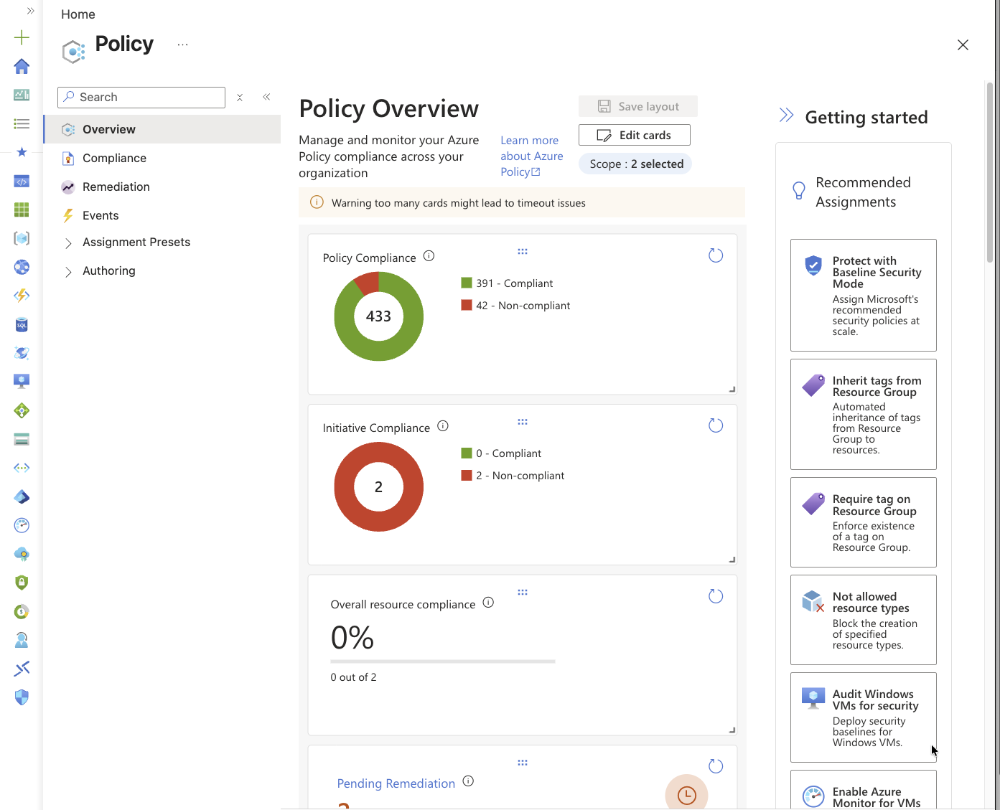

> [!NOTE]
> Policy overview on a new subscription: 433 policy evaluations and 2 non-compliant initiatives. These come from the **Microsoft cloud security benchmark**, which Defender for Cloud assigns automatically, not from anything we assigned.

| Tab | Field | Value |
|---|---|---|
| Basics | Scope | Management group **Menniboe Lab** (subscription and resource group empty) |
| Basics | Exclusions, Resource selectors, Overrides | Empty |
| Basics | Policy definition | Built-in **Allowed locations** (not "Allowed locations for resource groups") |
| Basics | Version | Default (`1.*.*`) |
| Basics | Assignment name | `Allowed locations - Menniboe Lab` |
| Basics | Description | `Lab: deny resources outside East US` |
| Basics | Policy enforcement | **Default** |
| Parameters | Allowed locations | **East US** only (`["eastus"]`) |
| Remediation | Create a remediation task | Unchecked (Deny doesn't support remediation) |
| Managed identity | Create a Managed Identity | Unchecked (not needed for Deny) |
| Non-compliance messages | Message | `Lab rule: resources must be created in East US. Change the region and try again.` |

> [!WARNING]
> **Error/gotcha:** Policy enforcement was **preselected as Enroll**. A popup said, "New: Policy assignments default to Enroll." With Enroll and no enrollments, the Deny would never block anything. **Fix:** select **Default**.

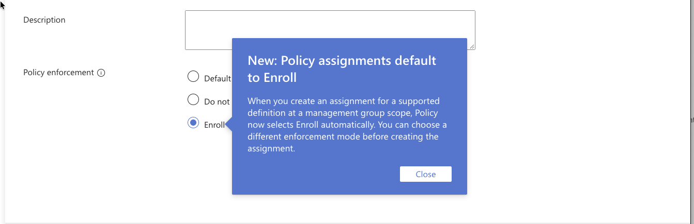

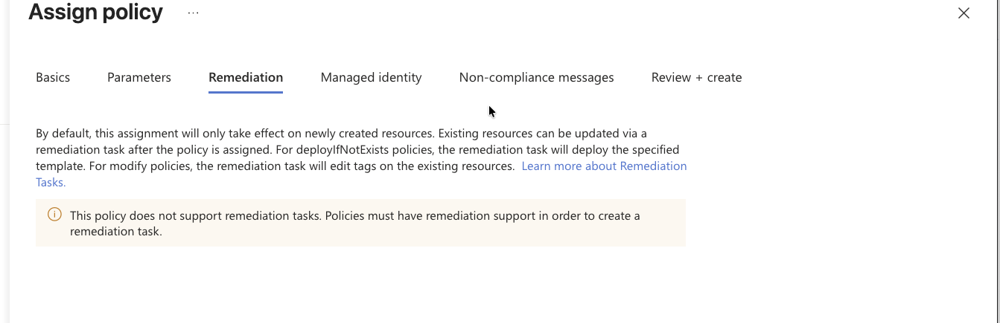

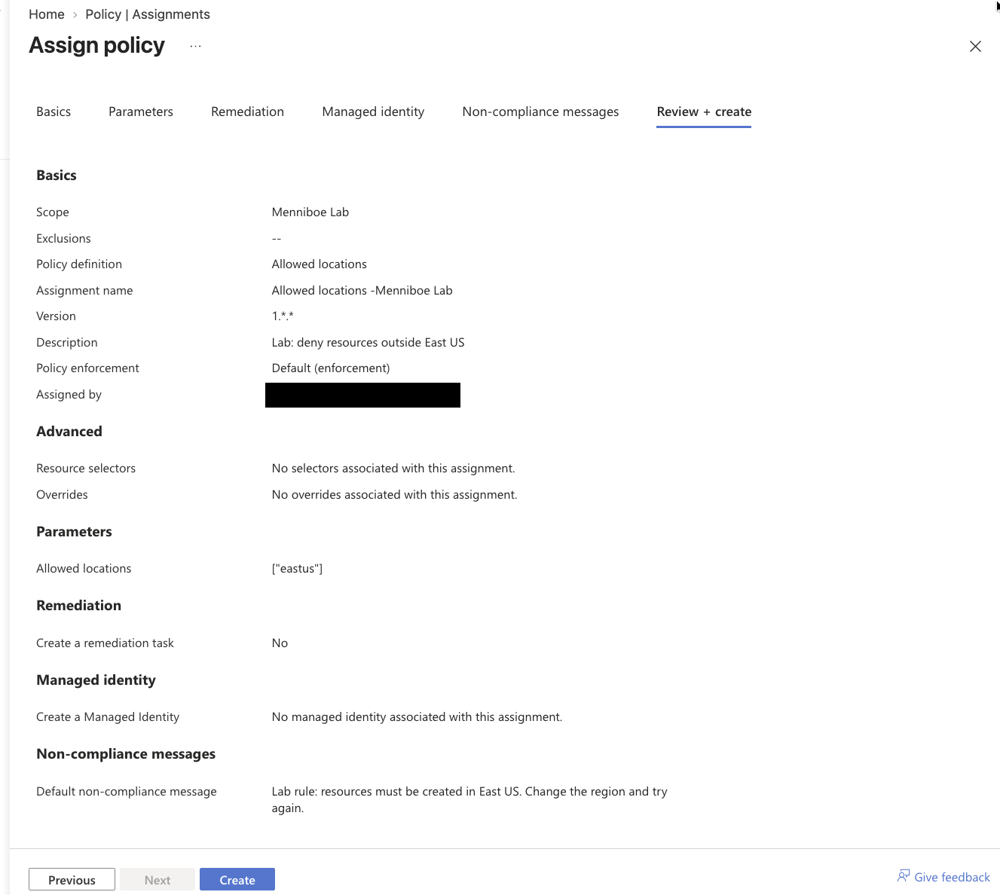

---

## Step 5: Assign Inherit a tag from the resource group if missing

**Why this step:** This proves that tags don't inherit by themselves. The Modify effect copies `cc` from rg-gov-lab to new resources, and because it changes resources, it needs a managed identity.

**Console:** **Assignments**, then **Assign policy**.

| Tab | Field | Value |
|---|---|---|
| Basics | Scope | Menniboe Lab, then Elite Subscription 1, then **rg-gov-lab** |
| Basics | Policy definition | Built-in **Inherit a tag from the resource group if missing** |
| Basics | Assignment name | `Inherit cc tag - rg-gov-lab` |
| Basics | Description | `Lab: copy the cc tag from the resource group to new resources` |
| Basics | Policy enforcement | Default (Enroll isn't preselected at resource group scope) |
| Parameters | Tag Name | `cc` |
| Remediation | Create a remediation task | Unchecked (the group is empty; nothing to fix yet) |
| Managed identity | Create a Managed Identity | **Checked**, System assigned, location East US |
| Non-compliance messages | Message | `Lab rule: resources in rg-gov-lab must carry the cc tag from the resource group.` |

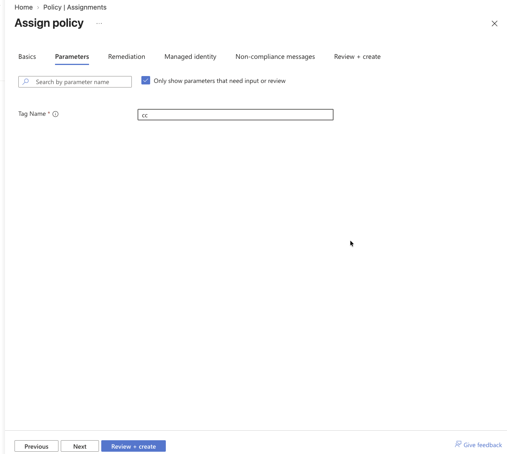

> [!TIP]
> Click **Next**, not **Review + create**, on the Parameters tab, or you'll skip the Remediation and Managed identity tabs.

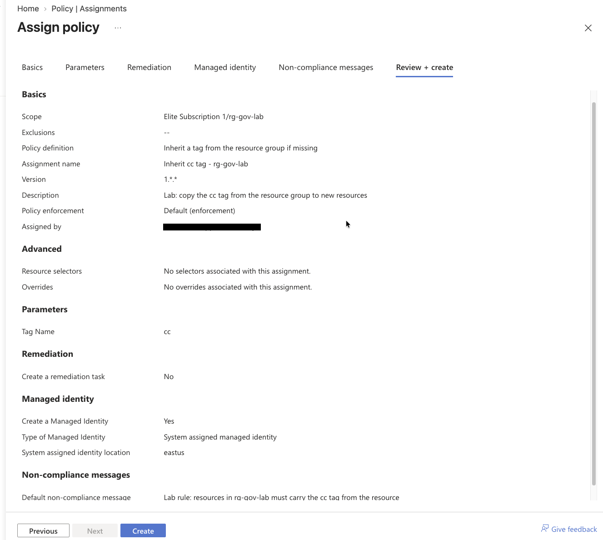

On **Create**, Azure creates the assignment and a system-assigned identity, and gives that identity a role (Contributor) on rg-gov-lab. That's a real RBAC role assignment, which you can see in [Step 15](#step-15-find-the-policy-managed-identity-in-iam).

---

## Step 6: Test Deny with a VNet in a blocked region

**Why this step:** It proves inheritance and Deny. RBAC says yes because you're Owner, and Policy says no.

**Console:** **Virtual networks**, then **+ Create**.

| Tab | Field | Value |
|---|---|---|
| Basics | Subscription and resource group | Elite Subscription 1 / rg-gov-lab |
| Basics | Name | `vnet-deny-test` |
| Basics | Region | **(Europe) West Europe** (deliberately not allowed) |
| Security | Virtual network encryption, Azure Bastion, Azure Firewall, DDoS Network Protection | All **unchecked** (Bastion, Firewall, and DDoS (distributed denial of service) protection are paid) |
| IP addresses | Address space and subnet | Defaults `10.0.0.0/16`, `default 10.0.0.0/24`; IPv6 unchecked |
| Tags | — | Empty |

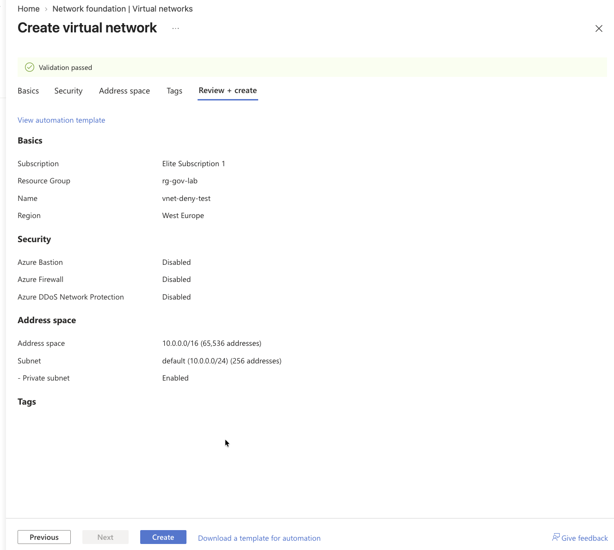

> [!NOTE]
> "Validation passed" on Review + create is mostly a **form** check. The real policy check happens in ARM **preflight** when you click Create.

**Result:** Deployment failed. The Errors panel was empty, which is a portal display quirk.

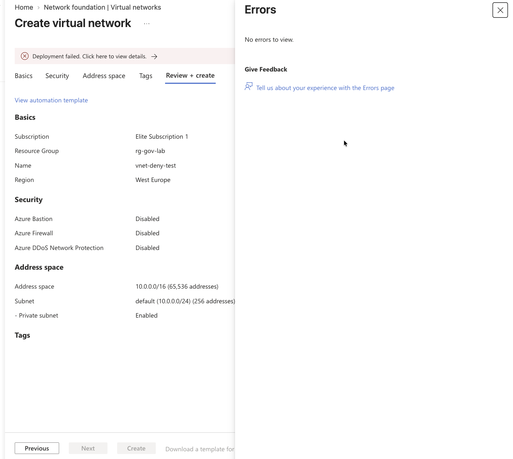

**Rg-gov-lab, then Deployments:** empty. Policy rejected the request in **preflight**, so no deployment record was ever created.

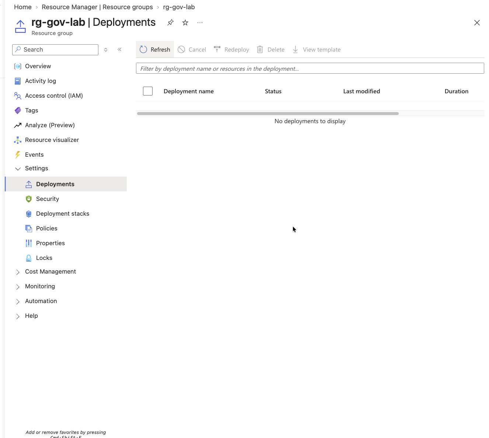

**Rg-gov-lab, then Activity log:** this is where denials are recorded.

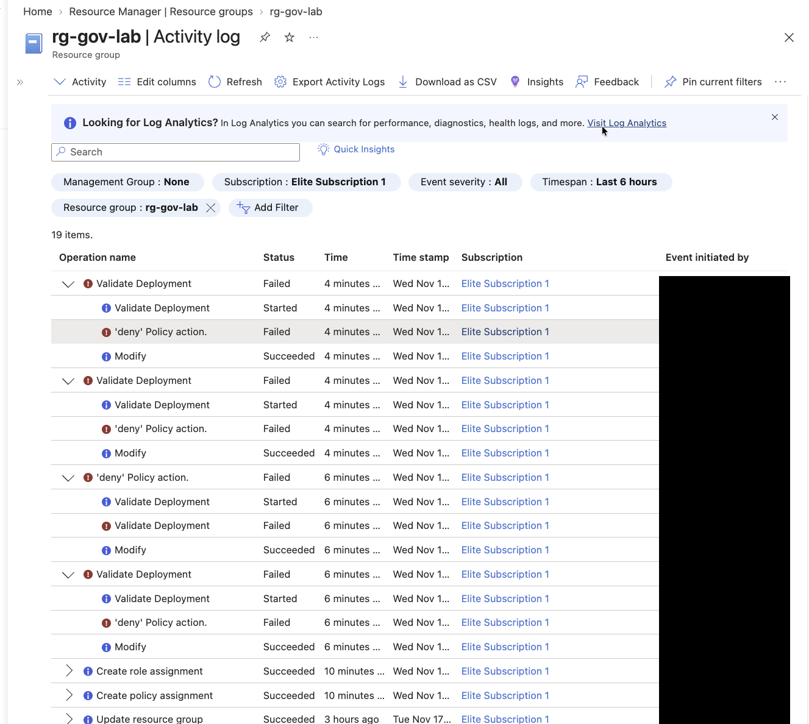

| Entry | Meaning |
|---|---|
| Validate Deployment: Started | You clicked Create, and preflight starts |
| Modify: Succeeded | The tag policy ran first (Modify runs before Deny) |
| 'deny' Policy action: Failed | Allowed locations rejected West Europe |
| Validate Deployment: Failed | The request was refused, and no deployment was created |

The event's **JSON**, then `properties.policies`, names the exact assignment:

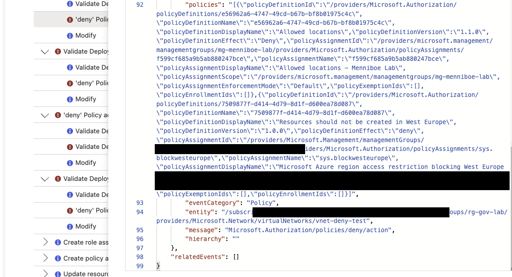

| Field | Value |
|---|---|
| policyDefinitionDisplayName | Allowed locations |
| policyDefinitionEffect | Deny |
| policyAssignmentDisplayName | Allowed locations - Menniboe Lab |
| policyAssignmentScope | `/providers/microsoft.management/managementgroups/mg-menniboe-lab` |
| policyAssignmentEnforcementMode | Default |

> [!IMPORTANT]
> A **second** Deny also matched: **"Microsoft Azure region access restriction blocking West Europe region"** (`sys.blockwesteurope`), assigned by Microsoft at the **tenant root group**. Some subscription types have certain regions restricted. Lessons: when several Deny policies match, **any one** blocks the request. For future region tests, use a region outside your allowed list that isn't already restricted (for example West US 2).

> [!WARNING]
> The Activity log JSON **claims** section shows your tenant ID, IP address, object ID and other account identifiers. Never commit that part of the JSON unredacted.

---

## Step 7: Test the allowed region and automatic tagging

**Why this step:** Deny should allow East US, and Modify should add `cc` even with the Tags tab empty.

Same wizard as Step 6, with **Name** `vnet-tag-test`, **Region** (US) East US, Security all unchecked, IP defaults, and **Tags empty**. Then **Create** and **Go to resource**.

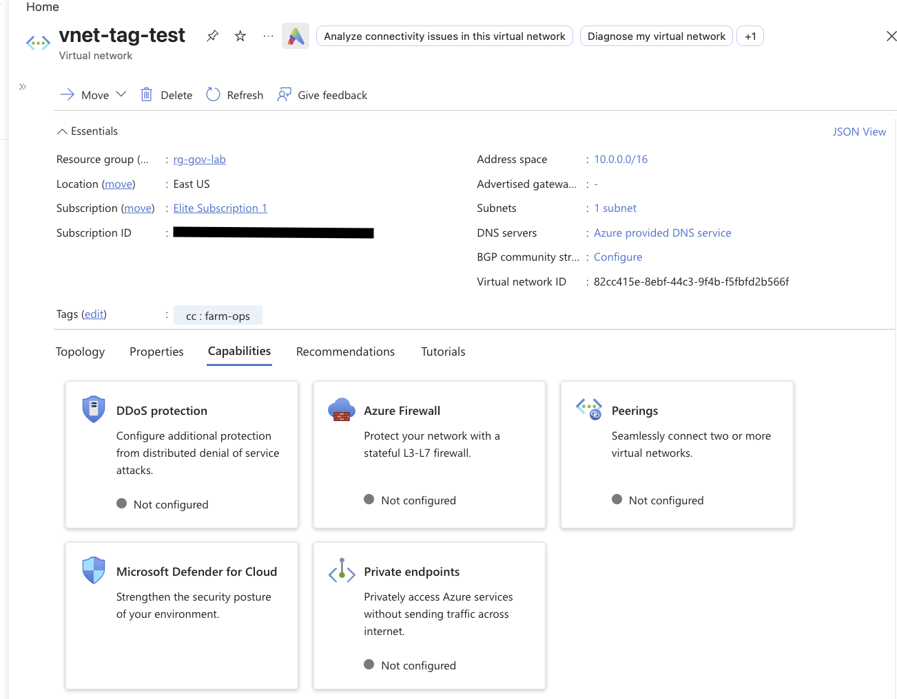

**Result:** Location East US; Tags show `cc : farm-ops` only.
- Deny allowed the request, because the region is allowed.
- Modify copied `cc` from the resource group.
- `env` is absent, which proves the policy copies only the named tag and that tags don't inherit by themselves.

---

## Step 8: Add a CanNotDelete lock

**Why this step:** Policy controls what can exist; a lock protects what already exists, even from an Owner.

**Console:** rg-gov-lab, then **Settings**, then **Locks**, then **+ Add**.

| Field | Value |
|---|---|
| Lock name | `lock-nodelete-gov-lab` |
| Lock type | **Delete** (CanNotDelete) |
| Notes | `Lab: prove CanNotDelete blocks even an Owner` |

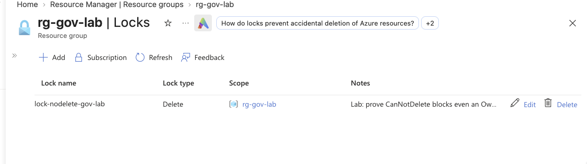

---

## Step 9: Test the lock

**Why this step:** Deleting a **resource inside** the locked group proves both inheritance and the Owner override, while risking only one empty VNet.

**Console:** vnet-tag-test, then **Delete**, then confirm.

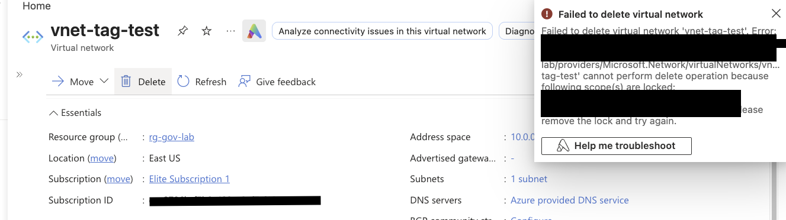

**Result:** "Failed to delete virtual network 'vnet-tag-test' … cannot perform delete operation because following scope(s) are locked: …/resourceGroups/rg-gov-lab. Please remove the lock and try again." The lock's scope is the **resource group**, and that's inheritance.

---

## Step 10: Create an email action group

**Why this step:** It's a reusable notification target that both budgets (and future alerts) can point to. It lives in its own `rg-cost-alerts` group so it survives teardown.

**Console:** **Monitor**, then **Alerts**, then **Action groups**, then **+ Create**.

| Tab | Field | Value |
|---|---|---|
| Basics | Subscription | Elite Subscription 1 |
| Basics | Resource group | **Create new** `rg-cost-alerts` |
| Basics | Region | **Global** |
| Basics | Action group name | `ag-lab-cost-email` |
| Basics | Display name | `LabCost` (12-character limit) |
| Notifications | Type and name | Email/SMS message/Push/Voice, `notify-lab-email` |
| Notifications | Panel | **Email** checked (your address); SMS, Push, Voice unchecked; common alert schema **Yes** |
| Actions | — | Empty |
| Tags | — | Empty |

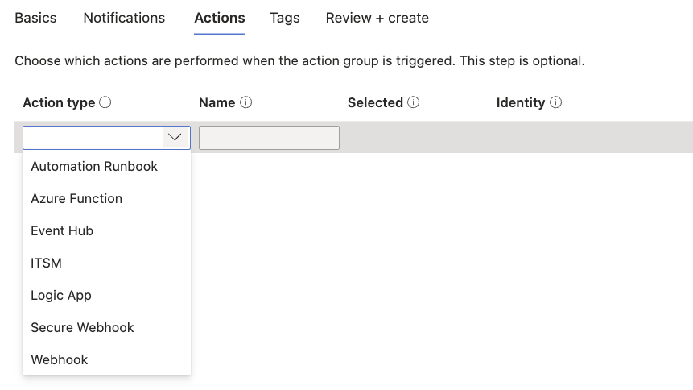

> [!WARNING]
> **Error:** "Failed to create action group. Error: The subscription is not registered to use namespace 'microsoft.insights'."
> **Cause:** Azure Monitor's resource provider wasn't registered in this newer subscription. The resource group was still created, which shows it wasn't a permissions problem.
> **Fix:** Subscriptions, then Elite Subscription 1, then **Settings**, then **Resource providers**. Search `Microsoft.Insights`, click **Register**, wait for **Registered**, then click Create again.

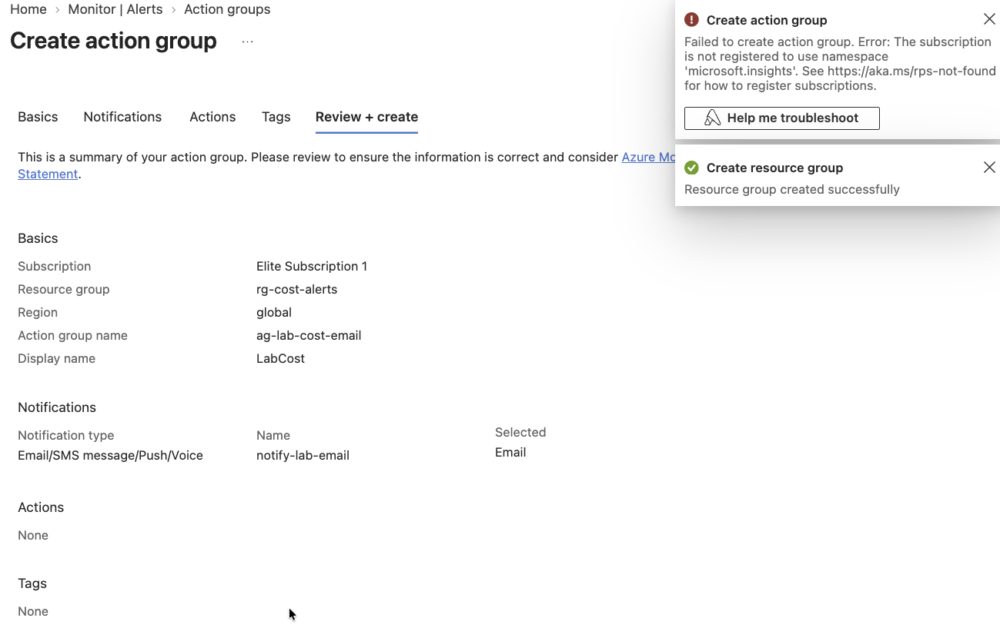

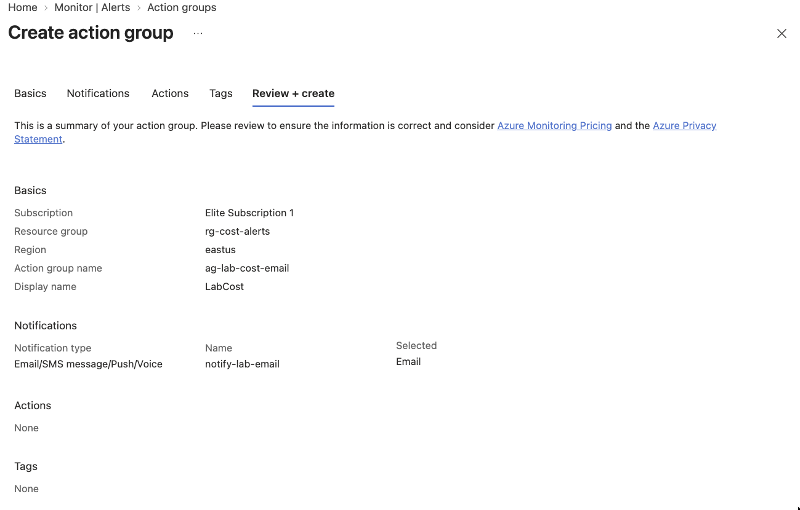

**Result:** Azure sent a verification email. After verifying, a second email confirmed "added to an Azure Monitor action group."

> [!TIP]
> Budgets use `Microsoft.Consumption` and `Microsoft.CostManagement`. If you get a similar "not registered" error there, the fix is the same.

---

## Step 11: Create a resource group budget

**Why this step:** It shows every budget setting on a single-project scope, which is the exam version. A budget's scope is **what it watches**, while the action group's location only stores that object.

**Console:** rg-gov-lab, then **Cost Management**, then **Budgets**, then **+ Add**.

| Tab | Field | Value |
|---|---|---|
| Create a budget | Scope | rg-gov-lab |
| Create a budget | Name | `budget-rg-gov-lab` |
| Create a budget | Reset period | Monthly |
| Create a budget | Creation date | First of the month (default) |
| Create a budget | Expiration date | End of next month |
| Create a budget | Amount | `5` |
| Set alerts | Forecasted 80% ($4) | `ag-lab-cost-email` |
| Set alerts | Actual 100% ($5) | `ag-lab-cost-email` |
| Set alerts | Alert recipients (email) | Your address (**required** in this portal) |
| Set alerts | Languages | Default |

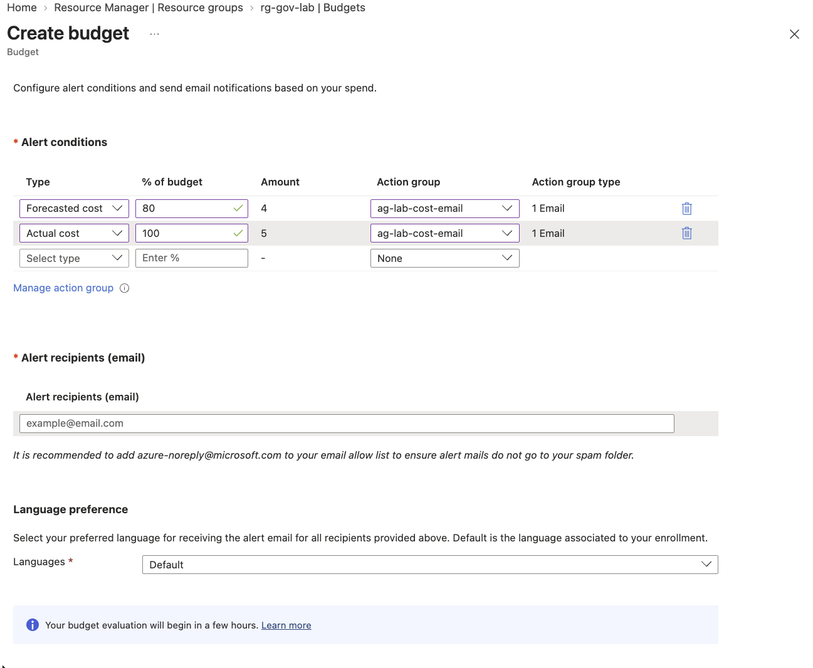

> [!WARNING]
> **Error:** "Unique email address is required." The form saw the address twice, for example from a re-added row or stray whitespace.
> **Fix:** delete the row with the trash icon, retype the address once with no spaces, and press **Tab**.

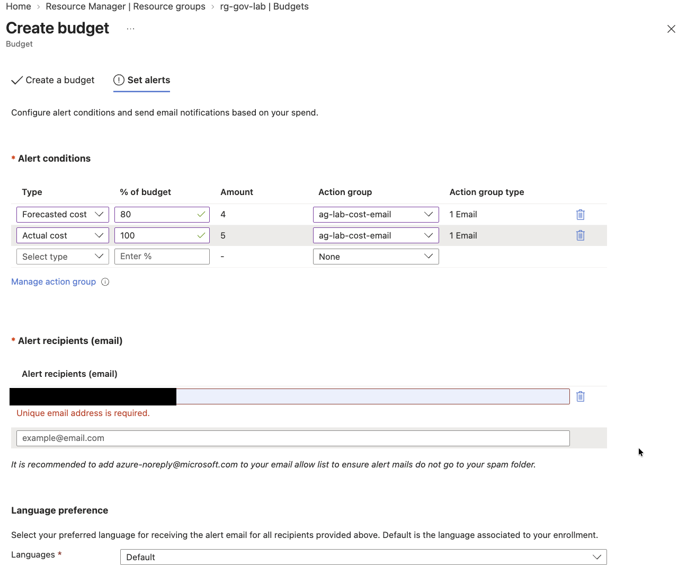

> [!TIP]
> Add `azure-noreply@microsoft.com` to your safe senders so alerts don't land in spam.

---

## Step 12: Create the permanent subscription budget

**Why this step:** It covers every resource group in the subscription, including future labs. It's **kept** after teardown.

An older annual $15 budget (`New-Demo`, created July 2026) was found on the subscription and deleted, because an annual budget warns too slowly for labs.

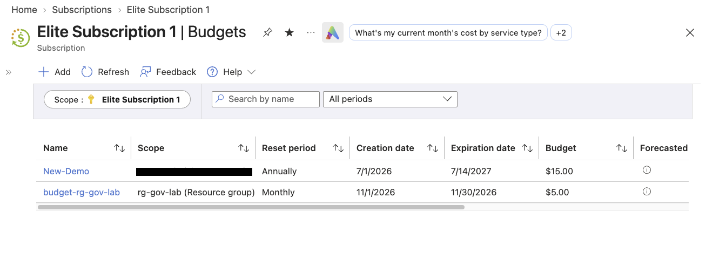

| Tab | Field | Value |
|---|---|---|
| Create a budget | Scope | **Elite Subscription 1** |
| Create a budget | Name | `budget-sub-labs-monthly` |
| Create a budget | Reset period | Monthly |
| Create a budget | Expiration | Latest allowed (at least 12/31/2027) |
| Create a budget | Amount | `10` |
| Set alerts | Actual 50% ($5) | `ag-lab-cost-email` |
| Set alerts | Forecasted 100% ($10) | `ag-lab-cost-email` |
| Set alerts | Actual 100% ($10) | `ag-lab-cost-email` |
| Set alerts | Recipients, language | Your email, Default |

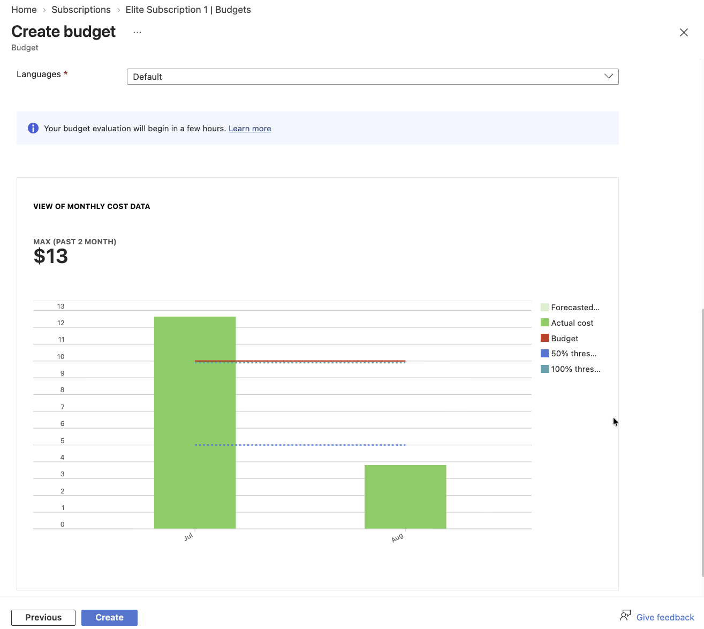

The history chart showed **July ≈ $12.70** (over $10, so all alerts would have fired; hourly networking labs) and **August ≈ $3.80**.

---

## Step 13: Review cost analysis

**Why this step:** Budgets warn you; cost analysis shows why.

**Console:** Elite Subscription 1, then **Cost Management**, then **Cost analysis**.

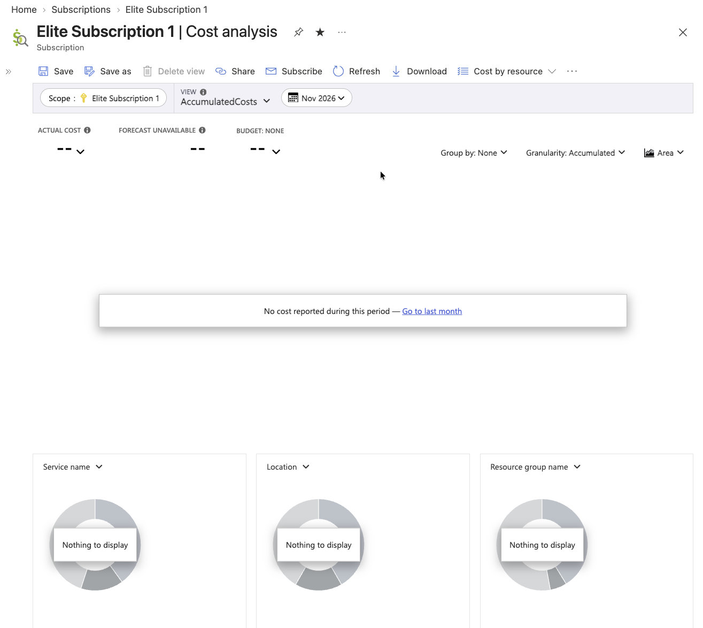

November: **no cost reported**, Forecast unavailable, Budget: None (the new budget wasn't evaluated yet).

With the date range set to **Jul–Sep 2026**:

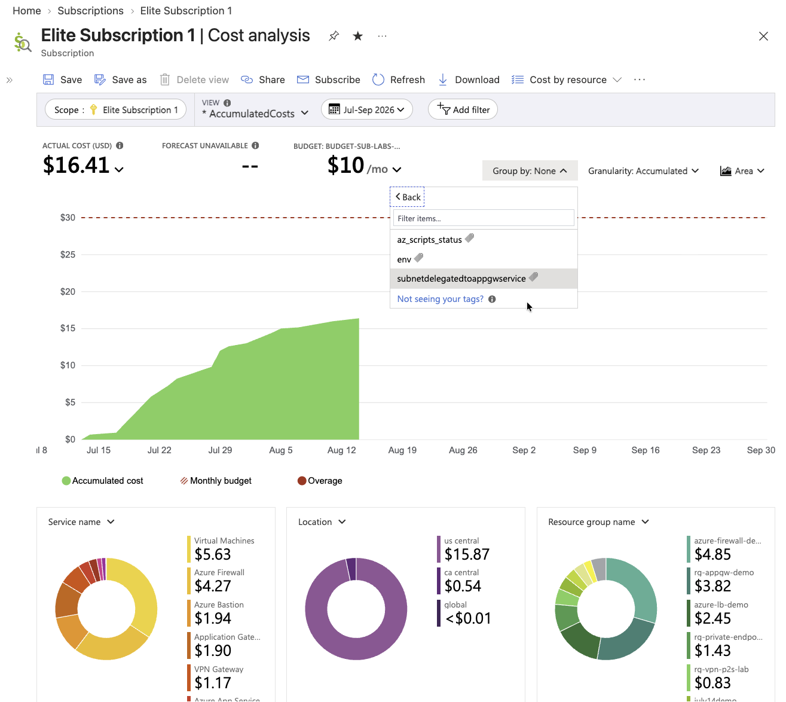

| Finding | Value |
|---|---|
| Total | $16.41; flat after about Aug 14 (teardowns worked) |
| Budget line | $30 = $10/month × 3 months (the new budget is connected) |
| Top services | Virtual Machines $5.63, Azure Firewall $4.27, Bastion $1.94, Application Gateway $1.90, VPN Gateway $1.17 |
| Top resource groups | azure-firewall-demo $4.85, rg-appgw-demo $3.82, azure-lb-demo $2.45 |
| Group by Tag list | `az_scripts_status`, `env`, `subnetdelegatedtoappgwservice`, **no `cc`** |

> [!NOTE]
> `cc` is missing because the tag list only includes tags on resources **with cost in the selected period**, and tags never apply retroactively. The `cc` tag was added today to a free VNet.

---

## Step 14: Review Azure Advisor

**Console:** **Advisor**, then **Cost**. **Result:** no recommendations. Nothing idle or underused remains, since earlier labs were torn down. Recommendations refresh about daily, and VM right-sizing rules are set under **Configuration**.

---

## Step 15: Find the policy managed identity in IAM

**Console:** rg-gov-lab, then **Access control (IAM)**, then **Role assignments**.

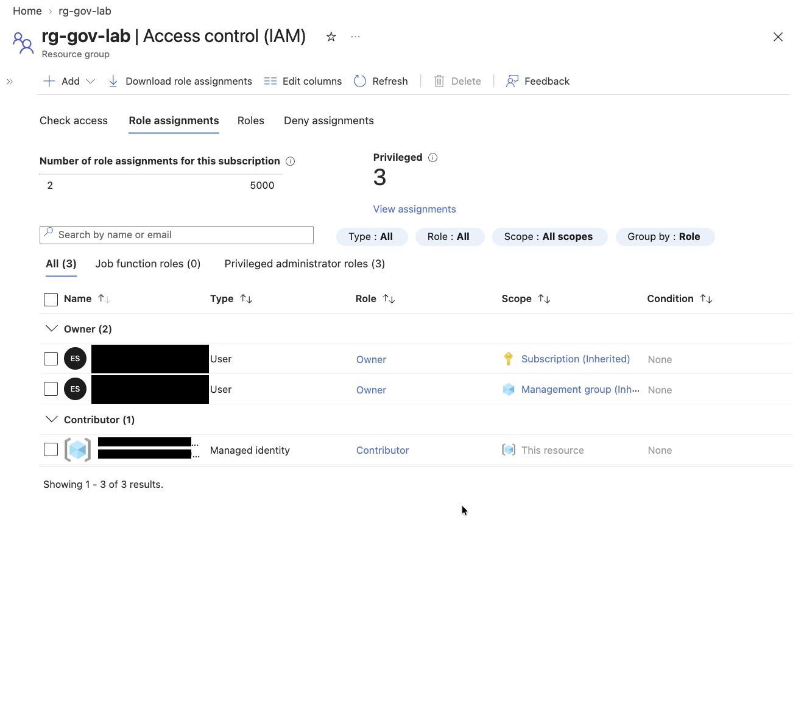

| Row | Type | Role | Scope | Why |
|---|---|---|---|---|
| Your account | User | Owner | Subscription (Inherited) | Subscription Owner, flowing down |
| Your account | User | Owner | Management group (Inherited) | Creating a management group makes you its Owner |
| Policy identity | Managed identity | Contributor | This resource | Lets Modify write tags; least privilege at one group |

> [!TIP]
> One person can have **several inherited paths** to the same role. Check all of them when auditing access.

---

## Teardown

Reverse order of creation:

| # | Remove | Console path | Why this order |
|---|---|---|---|
| 1 | `lock-nodelete-gov-lab` | rg-gov-lab, Locks, Delete | Nothing inside can be deleted while it's locked |
| 2 | `budget-rg-gov-lab` | rg-gov-lab, Cost Management, Budgets, Delete budget | Explicit cleanup |
| 3 | `Inherit cc tag - rg-gov-lab` | Policy, Assignments, ⋯, Delete assignment | Also deletes its system-assigned identity |
| 4 | `Allowed locations - Menniboe Lab` | Policy, Assignments, ⋯, Delete assignment | It's above the resource group, so deleting the group can't remove it |
| 5 | `rg-gov-lab` | Delete resource group, type the name, force delete unchecked | Removes vnet-tag-test and the leftover role assignment |
| 6 | Move Elite Subscription 1 to Tenant Root Group | Management groups, ⋯, Move | A management group must be empty before it can be deleted |
| 7 | `mg-menniboe-lab` | Menniboe Lab, Delete | Last piece of the hierarchy |

> [!NOTE]
> Why remove the resource group–scoped items before deleting the group? The lock **had** to go first, and the management group assignment **had** to be removed separately. The tag policy, its role and the budget would most likely have gone with the group, but removing them explicitly gives certainty, a clean identity removal, and a clear stopping point if something fails.

**Kept:** `rg-cost-alerts`, `ag-lab-cost-email`, `budget-sub-labs-monthly`, and the `Microsoft.Insights` registration.

---

## Verify the teardown

The first combined check stopped at the management group listing:

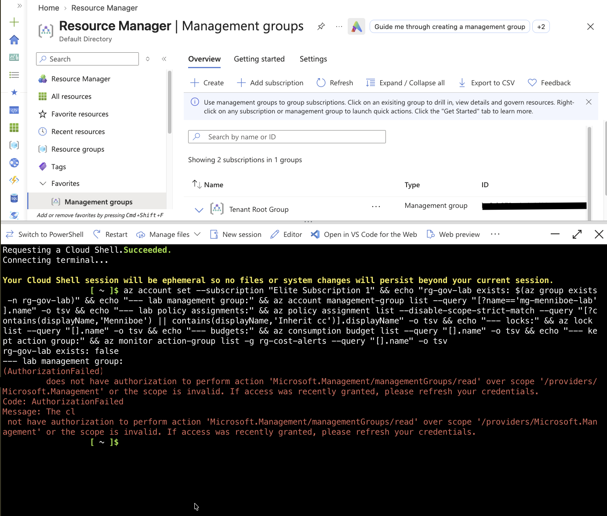

> [!WARNING]
> **Error:** `(AuthorizationFailed) … does not have authorization to perform action 'Microsoft.Management/managementGroups/read' over scope '/providers/Microsoft.Management'`.
> **Cause:** listing every management group needs rights at the tenant root. The account is Owner on the subscription only, and its Owner role on mg-menniboe-lab went away when that group was deleted.
> **Fix:** confirm the management group in the portal instead, and chain the remaining checks with `;` rather than `&&`, so one failure doesn't stop the rest.

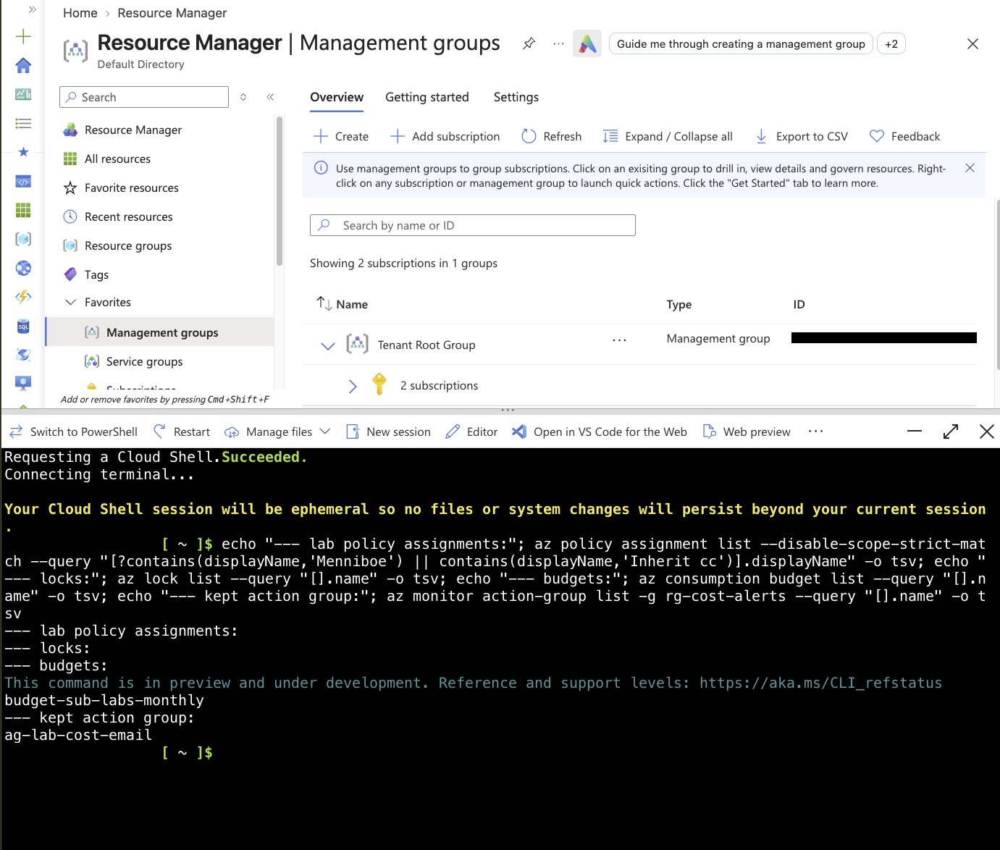

| Check | Result |
|---|---|
| rg-gov-lab | `false` (deleted) |
| Management groups | Root plus 2 subscriptions only (portal) |
| Lab policy assignments | None |
| Locks | None |
| Budgets | `budget-sub-labs-monthly` |
| Action group | `ag-lab-cost-email` |

---

## Troubleshooting log

| # | Where | Symptom | Cause | Fix |
|---|---|---|---|---|
| 1 | Step 4 | Enforcement preselected as **Enroll** | New preview default at management group scope | Select **Default** |
| 2 | Step 6 | "Validation passed," then "Deployment failed" with an empty Errors panel | Portal validation is a form check; the Deny happens in preflight; the panel loaded early | Read the error in the **Activity log** |
| 3 | Step 6 | No deployment under Deployments | Policy rejected the request in preflight, so no record was created | Use the Activity log, then the JSON, then `properties.policies` |
| 4 | Step 6 | Two Deny policies listed | Microsoft-managed `sys.blockwesteurope` at the tenant root | Expected; use a non-restricted region for tests |
| 5 | Step 9 | "cannot perform delete operation because following scope(s) are locked" | CanNotDelete lock on the resource group (inherited) | Expected; remove the lock in teardown |
| 6 | Step 10 | "subscription is not registered to use namespace 'microsoft.insights'" | Azure Monitor provider not registered | Register `Microsoft.Insights` under Resource providers |
| 7 | Step 11 | "Unique email address is required" | Duplicate or whitespace entry | Delete the row, retype once, press Tab |
| 8 | Step 13 | `cc` missing from Group by: Tag | No cost on `cc`-tagged resources in the period; tags aren't retroactive | Expected |
| 9 | Verify | AuthorizationFailed on `management-group list` | No rights at the tenant root | Verify in the portal; use `;` chaining |

---

## Service selection cheat sheet

| Requirement | Use |
|---|---|
| Stop **who** can do something | RBAC role at the right scope |
| Stop **what** can be created, for everyone | Azure Policy (Deny) |
| Report but don't block | Audit, or enforcement mode DoNotEnforce |
| Add or fix tags automatically | Modify (with remediation for existing resources) |
| Deploy a missing companion (diagnostics, extension) | DeployIfNotExists (with managed identity and remediation) |
| Block deletes across many subscriptions | DenyAction policy at a management group |
| Stop accidental deletes of one group, even by Owners | CanNotDelete lock |
| Freeze a resource completely | ReadOnly lock (watch the key-listing and VM restart side effects) |
| Apply rules to many subscriptions at once | Assign at a management group |
| Exception with an audit trail and expiry | Policy exemption |
| Cost reports by a resource group's tag (EA or MCA) | Cost Management tag inheritance |
| Tags physically on resources | Inherit-tag policy |
| Warn on spend | Budget (Actual or Forecasted alerts) |
| Auto-stop on spend | Budget, action group, Automation runbook |
| Stable 24/7 workload | Reservation |
| Workload changing size or region | Savings plan for compute |
| Existing Windows or SQL licenses | Azure Hybrid Benefit |
| Interruptible batch work | Spot VMs |
| Estimate before building | Pricing Calculator |
| On-premises vs Azure | TCO Calculator |
| Global Administrator can't see subscriptions | Turn on "Access management for Azure resources" |
| Moving a subscription to another tenant | Change directory (reassign all RBAC afterward) |

---

## Acronyms

| Acronym | Meaning |
|---|---|
| AD DS | Active Directory Domain Services |
| ARM | Azure Resource Manager |
| ASG | Application security group |
| CLI | Command-line interface |
| CPU | Central processing unit |
| CSP | Cloud Solution Provider |
| DDoS | Distributed denial of service |
| DINE | DeployIfNotExists |
| EA | Enterprise Agreement |
| ENI | Elastic network interface (AWS) |
| GUID | Globally unique identifier |
| IAM | Identity and access management |
| ITSM | IT service management |
| JSON | JavaScript Object Notation |
| MCA | Microsoft Customer Agreement |
| MG | Management group |
| NIC | Network interface card |
| NSG | Network security group |
| OS | Operating system |
| OU | Organizational unit (AWS Organizations) |
| RBAC | Role-based access control |
| RG | Resource group |
| RHEL | Red Hat Enterprise Linux |
| SAS | Shared access signature |
| SIEM | Security information and event management |
| SKU | Stock-keeping unit |
| SMS | Short message service |
| SQL | Structured Query Language |
| TCO | Total cost of ownership |
| vCPU | Virtual CPU |
| VM | Virtual machine |
| VNet | Virtual network |
