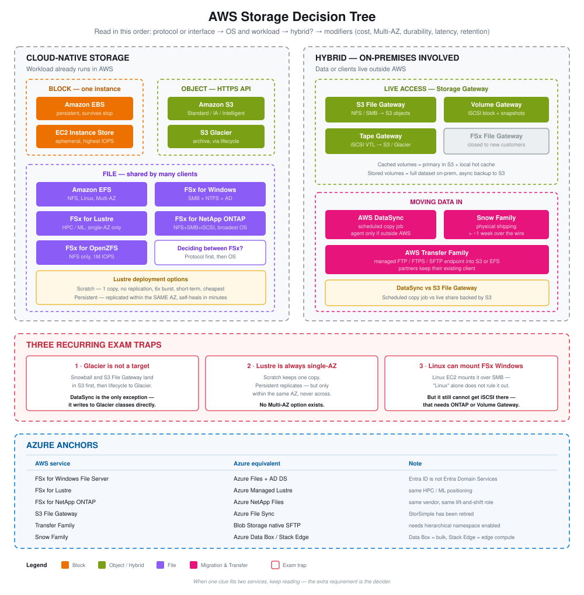

# AWS SAA — Storage Extras

Eight-module study block covering the storage services beyond S3 and EBS: Snow Family, the four FSx flavors, Storage Gateway, Transfer Family, DataSync, and how to choose between them under exam conditions.

---

## Modules covered

| # | Module | Core idea |
|---|---|---|
| 1 | **Snow Family** | Ship a physical device when the network would take more than ~a week |
| 2 | **FSx overview + FSx for Windows File Server** | FSx is "RDS, but for file systems"; Windows flavor = SMB + NTFS + Active Directory |
| 3 | **FSx for Lustre** | Linux + cluster — HPC and ML, sub-millisecond, S3 data repository, always single-AZ |
| 4 | **FSx for NetApp ONTAP and OpenZFS** | Lift-and-shift targets; ONTAP has the broadest protocol set and deduplication |
| 5 | **AWS Storage Gateway** | The bridge from on-premises file, block, and tape protocols into S3 |
| 6 | **AWS Transfer Family** | Managed FTP/FTPS/SFTP endpoint landing files in S3 or EFS |
| 7 | **AWS DataSync** | Scheduled, incremental copy job that preserves permissions and metadata |
| 8 | **Capstone** | Decision tree, reading order, and the three recurring traps |

---

## The decision method

Read a scenario question in this order — the first clue narrows the field, later clues break ties:

1. **Protocol or interface** — NFS, SMB, iSCSI, object, mounted path?
2. **OS and workload** — Windows or Linux? HPC/ML? Lift-and-shift?
3. **Hybrid?** — is anything on-premises?
4. **Modifiers** — cost, Multi-AZ, durability, latency, retention

**The habit that matters most:** when one clue fits two services, keep reading. The extra requirement is the decider.

---

## The three traps

1. **Nothing writes straight to Glacier except DataSync.** Snowball and S3 File Gateway land in S3 first, then lifecycle.
2. **FSx for Lustre is always single-AZ.** Persistent replicates within one AZ. No Multi-AZ option exists.
3. **Linux can mount FSx for Windows over SMB** — "Linux" alone doesn't rule it out. But it still can't get iSCSI there.

---

## Quick separators

| Confusion | Separator |
|---|---|
| Snowball Storage vs Compute Optimized | Does processing happen *on the device*? |
| Lustre Scratch vs Persistent | Is data loss on server failure acceptable? |
| ONTAP vs OpenZFS | Deduplication and protocol breadth — ONTAP has both |
| Volume Gateway cached vs stored | Where does the *primary* copy live? |
| DataSync vs S3 File Gateway | Scheduled copy job vs live share |
| Transfer Family → S3 vs EFS | Who picks up the file next — an object-aware consumer, or an app opening a path? |

---

## Files

- [`notes.md`](notes.md) — full module-by-module reference with concepts, comparison tables, Azure anchors, and the exam signal cheat sheet
- [`commands.md`](commands.md) — console navigation paths for each service
- [`images/`](images/) — seven diagrams, one per visual concept:

| Diagram | Module |
|---|---|
| `storage-decision-tree.svg` | Capstone — the whole map, traps, and Azure anchors |
| `snow-family.svg` | 1 — bulk migration vs edge computing, and the no-direct-Glacier trap |
| `fsx-windows.svg` | 2 — SMB clients, Active Directory, domain controllers, DFS hybrid path |
| `lustre-scratch-vs-persistent.svg` | 3 — one copy vs replicated, single-AZ trap, S3 data repository |
| `fsx-ontap-vs-openzfs.svg` | 4 — protocols, client compatibility, the deduplication separator |
| `storage-gateway-types.svg` | 5 — S3 File, Volume, and Tape Gateway side by side |
| `transfer-family.svg` | 6 — protocols into S3 or EFS, identity providers, the S3-vs-EFS rule |
| `datasync-agent-rule.svg` | 7 — when an agent is required, and the Glacier exception |

---

## Related

Hands-on builds for DataSync and S3 File Gateway — including a working NFS share backed by S3 — are in `aws-storage-hands-on/`.
