# AWS Storage Hands-On — Reference Guide

Full tutorial and redo guide for two labs: **AWS DataSync (S3 to S3)** and **Amazon S3 File Gateway (NFS share backed by S3)**.

Everything below is copy-paste ready. Console steps list every field on every tab, not just the ones the lab needed.

---

## Table of contents

- [Architecture](#architecture)
- [Acronyms](#acronyms)
- [Core concepts](#core-concepts)
  - [Where each storage service fits](#where-each-storage-service-fits)
  - [AWS DataSync](#aws-datasync)
  - [AWS Storage Gateway](#aws-storage-gateway)
  - [Permission vs reachability](#permission-vs-reachability)
  - [Bucket ARN vs object ARN](#bucket-arn-vs-object-arn)
- [Lab 1 — DataSync S3 to S3](#lab-1--datasync-s3-to-s3)
  - [1.1 Create the two buckets](#11-create-the-two-buckets)
  - [1.2 Stage test files in the source](#12-stage-test-files-in-the-source)
  - [1.3 Create the IAM role](#13-create-the-iam-role)
  - [1.4 Create source and destination locations](#14-create-source-and-destination-locations)
  - [1.5 Create and start the task](#15-create-and-start-the-task)
  - [1.6 Poll to completion and verify](#16-poll-to-completion-and-verify)
  - [1.7 Prove the transfer is incremental](#17-prove-the-transfer-is-incremental)
  - [1.8 Tear down Lab 1](#18-tear-down-lab-1)
- [Lab 2 — S3 File Gateway](#lab-2--s3-file-gateway)
  - [2.1 Create the backing bucket](#21-create-the-backing-bucket)
  - [2.2 Launch the gateway appliance](#22-launch-the-gateway-appliance)
  - [2.3 Connect to AWS and activate](#23-connect-to-aws-and-activate)
  - [2.4 Configure the cache disk](#24-configure-the-cache-disk)
  - [2.5 Create the NFS file share](#25-create-the-nfs-file-share)
  - [2.6 Launch the NFS client and check the security group](#26-launch-the-nfs-client-and-check-the-security-group)
  - [2.7 Mount the share](#27-mount-the-share)
  - [2.8 Prove file-to-object](#28-prove-file-to-object)
  - [2.9 Tear down Lab 2](#29-tear-down-lab-2)
- [Exam scenarios](#exam-scenarios)
- [Service availability changes](#service-availability-changes)
- [Error index](#error-index)

---

## Architecture

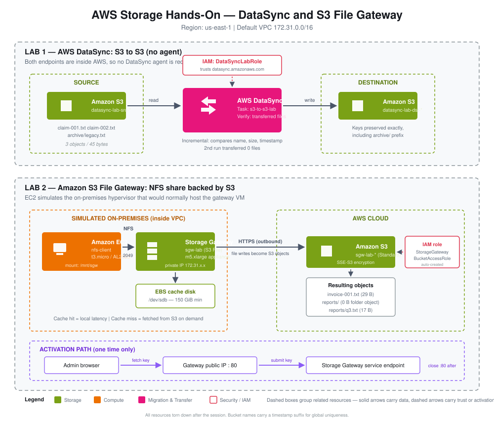

---

## Acronyms

| Acronym | Meaning | Note |
|---|---|---|
| **ACL** | Access Control List | Per-object or per-file permission list |
| **AMI** | Amazon Machine Image | The prebuilt VM image an EC2 instance boots from |
| **ARN** | Amazon Resource Name | Globally unique identifier for an AWS resource |
| **AZ** | Availability Zone | Isolated datacenter group within a Region |
| **CIDR** | Classless Inter-Domain Routing | IP range notation, e.g. `172.31.0.0/16` |
| **DFS** | Distributed File System | Microsoft feature for a unified namespace across file servers |
| **DSSE-KMS** | Dual-layer Server-Side Encryption with KMS keys | Two independent layers of encryption |
| **EBS** | Elastic Block Store | Network-attached block volumes for EC2 |
| **EC2** | Elastic Compute Cloud | Virtual machines |
| **EFS** | Elastic File System | Managed NFS, multi-AZ |
| **FIPS** | Federal Information Processing Standards | US government crypto compliance standard |
| **FSx** | Amazon FSx | Managed third-party file systems (Windows, Lustre, ONTAP, OpenZFS) |
| **HDD** | Hard Disk Drive | Cheaper, throughput-oriented storage |
| **HPC** | High Performance Computing | Clustered compute workloads |
| **IAM** | Identity and Access Management | AWS permissions service |
| **IOPS** | Input/Output Operations Per Second | Storage throughput measure |
| **iSCSI** | Internet Small Computer Systems Interface | Block storage over IP |
| **KMS** | Key Management Service | Managed encryption keys |
| **LDAP** | Lightweight Directory Access Protocol | Directory lookup protocol used by AD |
| **MIME** | Multipurpose Internet Mail Extensions | Content-type labelling, e.g. `text/plain` |
| **NAS** | Network Attached Storage | File storage served over a network |
| **NFS** | Network File System | Linux/Unix file sharing protocol |
| **NTFS** | New Technology File System | Windows filesystem with its own ACLs |
| **POSIX** | Portable Operating System Interface | Unix filesystem semantics (owner, group, mode bits) |
| **RPC** | Remote Procedure Call | Mechanism NFS uses; needs `rpcbind` on port 111 |
| **S3** | Simple Storage Service | Object storage |
| **SAA** | Solutions Architect Associate | The certification this track targets |
| **SG** | Security Group | Stateful virtual firewall on an ENI |
| **SMB** | Server Message Block | Windows file sharing protocol |
| **SSD** | Solid State Drive | Low-latency storage |
| **SSE-S3** | Server-Side Encryption with S3-managed keys | Default S3 encryption |
| **SSE-KMS** | Server-Side Encryption with KMS keys | Customer-controlled key encryption |
| **STS** | Security Token Service | Issues temporary credentials when a role is assumed |
| **VPC** | Virtual Private Cloud | Isolated network |
| **VTL** | Virtual Tape Library | Tape interface emulated over S3/Glacier |

---

## Core concepts

### Where each storage service fits

| Category | Service | Interface |
|---|---|---|
| Block | EBS, EC2 Instance Store | Attached volume |
| File | EFS, FSx (Windows, Lustre, ONTAP, OpenZFS) | NFS / SMB |
| Object | S3, S3 Glacier | HTTPS API |
| Hybrid bridge | Storage Gateway | NFS / SMB / iSCSI → S3 |
| Transfer | DataSync, Transfer Family, Snow Family | Scheduled copy / managed endpoint / physical device |

> [!NOTE]
> S3 is a proprietary object store, not a filesystem. Everything in this guide is about bridging that gap — either by copying objects around (DataSync) or by dressing the bucket up as a filesystem (File Gateway).

---

### AWS DataSync

A managed data transfer service that copies between storage endpoints on a schedule or on demand.

**Three building blocks:**

1. **Location** — a reusable pointer to one endpoint (an S3 bucket, an NFS share, an FSx file system). Build once, reuse in many tasks.
2. **Task** — joins a source location to a destination location, plus options. Creating a task does nothing on its own; it is a saved definition.
3. **Task execution** — one actual run of a task. A task owns many executions.

The execution ARN is nested inside the task ARN:

```
arn:aws:datasync:us-east-1:<account>:task/task-06f20a0586d1b043b/execution/exec-0afaa31bb0017deeba
```

That nesting is the model made visible — delete the task and its execution history goes with it.

**Key behaviours:**

| Behaviour | Detail |
|---|---|
| Agent required? | Only for on-premises or another cloud. **AWS to AWS needs no agent.** |
| Incremental? | Yes — compares file name, size, timestamp; transfers only the delta |
| Scan cost | Every run scans all files even when it transfers none; billing is per GB **transferred** |
| Targets | S3 (including Glacier classes), EFS, all FSx flavors |
| Metadata | Preserves permissions and metadata — a signature exam phrase |
| Scheduling | Hourly, daily, weekly — never continuous, so there is always some lag |
| Throughput | Up to 10 Gbps per task, with an optional bandwidth limit |

> [!IMPORTANT]
> DataSync is the **only** one of the transfer services that can write directly to Glacier storage classes. Snowball and S3 File Gateway both land data in S3 first, and a lifecycle policy moves it to Glacier afterwards.

**Verification modes:**

- `ONLY_FILES_TRANSFERRED` — checksums just the files moved. Cheaper, right for incremental syncs.
- `POINT_IN_TIME_CONSISTENT` — re-verifies the entire dataset on both ends. Slower and more expensive.

---

### AWS Storage Gateway

A virtual appliance that gives on-premises systems a familiar file, volume, or tape interface backed by AWS storage. In production the VM runs on VMware ESXi, Microsoft Hyper-V, or Linux KVM inside the data center. This lab ran it on EC2, which simulates that hypervisor.

**Four gateway types:**

| Type | Protocol | Backed by | Use case |
|---|---|---|---|
| **S3 File Gateway** | NFS, SMB | S3 objects | Expose a bucket as a file share, with local cache |
| **Volume Gateway — cached** | iSCSI | S3, with EBS snapshots | Primary data in S3, hot cache on-prem |
| **Volume Gateway — stored** | iSCSI | On-prem disk, async backup to S3 | Full dataset stays local |
| **Tape Gateway** | iSCSI VTL | S3, archive to Glacier | Replace physical tape libraries |
| **FSx File Gateway** | SMB | FSx for Windows | *No longer available to new customers* |

**How S3 File Gateway works:**

A client mounts an NFS or SMB share. The gateway translates those filesystem calls into HTTPS requests against S3. Recently used data stays on a local cache disk; everything else is fetched on demand.

> [!TIP]
> Cache behaviour is the thing to understand. On a **cache miss**, the gateway transparently pulls the object from S3 and serves it — the full dataset is always visible regardless of cache size. But a cache hit feels like local disk (single-digit ms) while a miss is an S3 round trip (tens to hundreds of ms). **Latency is variable by design.** If a scenario demands uniformly low latency, File Gateway is the wrong answer — reach for FSx or EFS.

**Cache sizing:** minimum 150 GiB allocated to Cache. The EC2 default settings provision exactly this as a second EBS volume.

**The metric that matters:** `CachePercentDirty` — data written to the cache but not yet uploaded to S3. If it climbs and stays high, writes are arriving faster than the uplink can drain them. That is the real-world symptom of an undersized connection, and it is why `df` is useless here.

---

### Permission vs reachability

Every access failure in AWS is one of two things, and they are independent:

| | Question | Controlled by |
|---|---|---|
| **Permission** | Am I *allowed* to do this? | IAM policies, bucket policies, NFS allowed-clients, squash level |
| **Reachability** | Can the packet physically *arrive*? | VPC routing, security groups, public vs private IP, VPN, Direct Connect |

> [!WARNING]
> Widening an NFS share's allowed-clients to `0.0.0.0/0` does **not** make a gateway on `172.31.23.174` reachable from the internet. RFC 1918 addresses are not routable across the public internet. Allowed-clients is an application-level ACL; it decides which source IPs the share will *accept*, never whether a packet can arrive. To reach it from outside you need Site-to-Site VPN, Direct Connect, or a client inside the VPC.

Conflating the two is the single biggest time-waster when debugging AWS access, and the exam tests it sideways.

---

### Bucket ARN vs object ARN

S3 has two distinct resource types, and each action attaches to exactly one of them:

| Action type | Examples | Resource ARN |
|---|---|---|
| Bucket-level | `ListBucket`, `GetBucketLocation`, `ListBucketMultipartUploads` | `arn:aws:s3:::my-bucket` |
| Object-level | `GetObject`, `PutObject`, `DeleteObject` | `arn:aws:s3:::my-bucket/*` |

> [!WARNING]
> Put `s3:ListBucket` on a `/*` ARN and IAM does not throw an error — the statement simply never matches. The service then fails with Access Denied when it tries to enumerate the bucket. This silent mismatch is why the IAM policy in Lab 1 is split into two statements.

Scoping to named buckets instead of `arn:aws:s3:::*` is a separate idea: that is least privilege.

---

# Lab 1 — DataSync S3 to S3

**Goal:** prove that AWS-to-AWS transfer needs no agent, and that DataSync is incremental.
**Interface:** CLI
**Cost:** fractions of a cent.

> [!NOTE]
> All `export` variables live only in the current terminal session. Close the tab and later steps fail with empty names. Stay in one shell for the whole lab.

---

## 1.1 Create the two buckets

```bash
export AWS_REGION=us-east-1
export SUFFIX=$(date +%s)
export SRC_BUCKET=datasync-lab-src-$SUFFIX
export DST_BUCKET=datasync-lab-dst-$SUFFIX

aws s3 mb s3://$SRC_BUCKET --region $AWS_REGION
aws s3 mb s3://$DST_BUCKET --region $AWS_REGION
```

Confirm:

```bash
echo "SRC=$SRC_BUCKET"
echo "DST=$DST_BUCKET"
```

**Expected output:**

```
SRC=datasync-lab-src-1791867411
DST=datasync-lab-dst-1791867411
```

> [!TIP]
> **Why the timestamp?** S3 bucket names live in one global namespace shared by every AWS account on earth — not scoped to your account or Region. `datasync-lab-src` was claimed years ago. An EC2 instance name is just a tag on your own resource, so collisions there don't matter.

**Console equivalent:** S3 → Create bucket → General purpose → name → Region us-east-1 → ACLs disabled → Block all public access checked → Versioning disabled → SSE-S3 → Bucket Key enabled → Object Lock disabled → Create.

---

## 1.2 Stage test files in the source

```bash
mkdir -p /tmp/datasync-lab && cd /tmp/datasync-lab
echo "claim record 001" > claim-001.txt
echo "claim record 002" > claim-002.txt
mkdir -p archive && echo "old record" > archive/legacy.txt

aws s3 cp . s3://$SRC_BUCKET/ --recursive
aws s3 ls s3://$SRC_BUCKET/ --recursive
```

**Expected output:**

```
upload: archive/legacy.txt to s3://datasync-lab-src-1791867411/archive/legacy.txt
upload: ./claim-002.txt to s3://datasync-lab-src-1791867411/claim-002.txt
upload: ./claim-001.txt to s3://datasync-lab-src-1791867411/claim-001.txt
2026-10-13 00:02:17         11 archive/legacy.txt
2026-10-13 00:02:17         17 claim-001.txt
2026-10-13 00:02:17         17 claim-002.txt
```

> [!IMPORTANT]
> **There is no `archive` folder.** S3 is a flat key-value store. The full key is `archive/legacy.txt`, and `archive/` is just a **prefix** — characters at the front of the key. The console draws a folder icon because it groups keys by the `/` delimiter.
>
> So "preserving folder structure" really means **preserving the key exactly, character for character**. That is what the Step 1.6 verification is checking. Contrast this with [Step 2.8](#28-prove-file-to-object), where File Gateway behaves differently.

**Console equivalent:** S3 → source bucket → Upload → Add files → the two claim files → Upload. Then Create folder `archive` → open it → Upload → `legacy.txt`.

---

## 1.3 Create the IAM role

DataSync is a service, not a user, so it cannot use your credentials. You create a role that **trusts the DataSync service** to assume it, carrying a policy that grants S3 access to just these two buckets.

Two distinct pieces: a **trust policy** (who may wear this hat) and a **permissions policy** (what the hat can do).

**Trust policy and role:**

```bash
cat > trust.json <<'EOF'
{"Version":"2012-10-17","Statement":[{"Effect":"Allow",
"Principal":{"Service":"datasync.amazonaws.com"},"Action":"sts:AssumeRole"}]}
EOF

aws iam create-role --role-name DataSyncLabRole \
  --assume-role-policy-document file://trust.json
```

**Permissions policy:**

```bash
cat > policy.json <<EOF
{"Version":"2012-10-17","Statement":[
{"Effect":"Allow","Action":["s3:GetBucketLocation","s3:ListBucket","s3:ListBucketMultipartUploads"],
"Resource":["arn:aws:s3:::$SRC_BUCKET","arn:aws:s3:::$DST_BUCKET"]},
{"Effect":"Allow","Action":["s3:AbortMultipartUpload","s3:DeleteObject","s3:GetObject","s3:ListMultipartUploadParts","s3:PutObject","s3:GetObjectTagging","s3:PutObjectTagging"],
"Resource":["arn:aws:s3:::$SRC_BUCKET/*","arn:aws:s3:::$DST_BUCKET/*"]}]}
EOF

aws iam put-role-policy --role-name DataSyncLabRole \
  --policy-name DataSyncLabS3 --policy-document file://policy.json

export ROLE_ARN=$(aws iam get-role --role-name DataSyncLabRole --query Role.Arn --output text)
echo $ROLE_ARN
```

**Expected output:**

```
arn:aws:iam::<account-id>:role/DataSyncLabRole
```

> [!WARNING]
> Notice the two statements: the first lists bucket ARNs with **no** `/*`, the second lists the same buckets **with** `/*`. This is not stylistic. See [Bucket ARN vs object ARN](#bucket-arn-vs-object-arn) — merging them breaks the policy silently.

**Console equivalent:** IAM → Roles → Create role → Trusted entity type: AWS service → Service: DataSync → Use case: DataSync → Next → Next → Role name `DataSyncLabRole` → Create. Then open the role → Add permissions → Create inline policy → JSON tab → paste → name it `DataSyncLabS3`.

---

## 1.4 Create source and destination locations

```bash
export SRC_LOC=$(aws datasync create-location-s3 \
  --s3-bucket-arn arn:aws:s3:::$SRC_BUCKET \
  --s3-config BucketAccessRoleArn=$ROLE_ARN \
  --region $AWS_REGION --query LocationArn --output text)

export DST_LOC=$(aws datasync create-location-s3 \
  --s3-bucket-arn arn:aws:s3:::$DST_BUCKET \
  --s3-config BucketAccessRoleArn=$ROLE_ARN \
  --region $AWS_REGION --query LocationArn --output text)

echo "$SRC_LOC -> $DST_LOC"
```

**Expected output:**

```
arn:aws:datasync:us-east-1:<account-id>:location/loc-0d686d6afdb8314f5 -> arn:aws:datasync:us-east-1:<account-id>:location/loc-009ed26ed7e15555d
```

> [!NOTE]
> **Two S3 locations and no agent.** That is the AWS-to-AWS rule in action — nothing here bridges a network boundary, so there is nothing for an agent to do.

> [!WARNING]
> **Possible error:** a message saying DataSync is unable to assume the role.
> **Cause:** IAM roles take a few seconds to propagate globally, and the role was created moments ago.
> **Fix:** wait roughly 15 seconds and rerun. This is a normal race condition, not a policy mistake.

**Console equivalent:** DataSync → Locations → Create location → Location type: Amazon S3 → Region → S3 bucket: source → S3 storage class: Standard → Folder: blank → IAM role: Autogenerate or `DataSyncLabRole` → Create. Repeat for the destination.

---

## 1.5 Create and start the task

```bash
export TASK=$(aws datasync create-task \
  --source-location-arn $SRC_LOC --destination-location-arn $DST_LOC \
  --name s3-to-s3-lab \
  --options VerifyMode=ONLY_FILES_TRANSFERRED,LogLevel=OFF \
  --region $AWS_REGION --query TaskArn --output text)

echo "TASK=$TASK"

export EXEC=$(aws datasync start-task-execution --task-arn $TASK \
  --region $AWS_REGION --query TaskExecutionArn --output text)

echo "EXEC=$EXEC"
```

> [!CAUTION]
> **Error hit here:** running this with `LogLevel=BASIC` fails.
>
> ```
> aws: [ERROR]: An error occurred (InvalidRequestException) when calling the CreateTask
> operation: No LogLevel may be set without a CloudWatch Log Group ARN. LogLevel was set to BASIC.
> errorCode: LogLevelSetWithNoLogGroup
> TASK=
>
> aws: [ERROR]: An error occurred (ParamValidation): argument --task-arn: expected one argument
> EXEC=
> ```
>
> **Cause:** DataSync will not accept a logging level with nowhere to send the logs.
>
> **Watch the cascade.** `create-task` failed, so `$TASK` was never set. The next command then ran with an empty `--task-arn`, producing a second, unrelated-looking error. One root failure, two messages.
>
> **General lesson:** when a parameter-validation error names a variable, check whether the command that *set* that variable actually succeeded.
>
> **Fix A (used here):** set `LogLevel=OFF`.
>
> **Fix B (production habit):** create a log group first and pass its ARN.
> ```bash
> aws logs create-log-group --log-group-name /aws/datasync/lab --region $AWS_REGION
> export LOG_ARN=$(aws logs describe-log-groups --log-group-name-prefix /aws/datasync/lab \
>   --region $AWS_REGION --query 'logGroups[0].arn' --output text)
> # then add to create-task:  --cloud-watch-log-group-arn $LOG_ARN  with LogLevel=BASIC
> ```

**Expected output:**

```
EXEC=arn:aws:datasync:us-east-1:<account-id>:task/task-06f20a0586d1b043b/execution/exec-0afaa31bb0017deeba
```

**Console equivalent:** DataSync → Tasks → Create task → Source: Choose an existing location → select source → Next → Destination: existing location → Next → Task name `s3-to-s3-lab`, Verification: Verify only the data transferred, Transfer mode: Transfer only data that has changed, Bandwidth: Use available, Schedule: Not scheduled, Logging: off → Next → Create → Start → Start with defaults.

---

## 1.6 Poll to completion and verify

`start-task-execution` returns immediately — it does not wait. The transfer runs asynchronously through LAUNCHING → PREPARING → TRANSFERRING → VERIFYING → SUCCESS.

```bash
aws datasync describe-task-execution --task-execution-arn $EXEC \
  --region $AWS_REGION \
  --query '{Status:Status,Files:FilesTransferred,Bytes:BytesTransferred}'
```

Rerun until `Status` is `SUCCESS`.

**Expected output progression:**

```json
{
    "Status": "LAUNCHING",
    "Files": 0,
    "Bytes": 0
}
```
```json
{
    "Status": "SUCCESS",
    "Files": 3,
    "Bytes": 45
}
```

> [!WARNING]
> **A metric is only meaningful once the operation reports a terminal state.** `Files: 0` during LAUNCHING is the starting value for every run, including one that goes on to move 3 files. Do not read it as a result.

Arithmetic check: 17 + 17 + 11 = 45 bytes, matching the source listing exactly.

Verify the destination:

```bash
aws s3 ls s3://$DST_BUCKET/ --recursive
```

**Expected output:**

```
2026-10-13 00:25:15         11 archive/legacy.txt
2026-10-13 00:25:15         17 claim-001.txt
2026-10-13 00:25:17         17 claim-002.txt
```

The `archive/` prefix survived intact — the key came across character for character rather than flattening.

📸 *Screenshot placeholder: DataSync console → task → History tab → execution detail showing Status and Performance panel.*

---

## 1.7 Prove the transfer is incremental

Nothing in the source has changed. Run it again:

```bash
export EXEC2=$(aws datasync start-task-execution --task-arn $TASK \
  --region $AWS_REGION --query TaskExecutionArn --output text)

sleep 30

aws datasync describe-task-execution --task-execution-arn $EXEC2 \
  --region $AWS_REGION \
  --query '{Status:Status,Files:FilesTransferred,Bytes:BytesTransferred}'
```

**Expected output:**

```json
{
    "Status": "SUCCESS",
    "Files": 0,
    "Bytes": 0
}
```

> [!IMPORTANT]
> **This is the behaviour the exam leans on.** DataSync scans both ends, compares name, size, and timestamp, and transfers only what differs. The signature scenario is *"nightly sync of a large dataset where only a small percentage changes"* — the wrong answer is always something that recopies everything.
>
> Subtlety: the scan still walks every file, so a zero-transfer run is not instant on a large dataset. Billing is per GB **transferred**, not per GB scanned.

---

## 1.8 Tear down Lab 1

Delete in dependency order — task first (executions go with it), then locations, then buckets, then the role.

```bash
aws datasync delete-task --task-arn $TASK --region $AWS_REGION
aws datasync delete-location --location-arn $SRC_LOC --region $AWS_REGION
aws datasync delete-location --location-arn $DST_LOC --region $AWS_REGION

aws s3 rb s3://$SRC_BUCKET --force
aws s3 rb s3://$DST_BUCKET --force

aws iam delete-role-policy --role-name DataSyncLabRole --policy-name DataSyncLabS3
aws iam delete-role --role-name DataSyncLabRole
```

Confirm:

```bash
aws s3 ls | grep datasync-lab
aws datasync list-tasks --region $AWS_REGION
```

**Expected output:**

```json
{
    "Tasks": []
}
```

> [!CAUTION]
> `rb --force` deletes every object then the bucket. There is no undo and no recycle bin. Fine in a lab; never let it become muscle memory in a real account.

> [!NOTE]
> IAM will not delete a role that still has inline policies attached, which is why `delete-role-policy` comes first.

---

# Lab 2 — S3 File Gateway

**Goal:** expose an S3 bucket as an NFS share and prove that a filesystem write becomes an S3 object.
**Interface:** Console (the moving parts are easier to see), with CLI equivalents.
**Cost:** roughly $0.25–0.30/hour — the appliance is an `m5.xlarge` plus a 150 GiB volume. **Tear down the same session.**

```
Linux client  --NFS-->  Gateway (EC2 VM)  --HTTPS-->  S3 bucket
                              |
                         cache disk (EBS)
```

In production the gateway VM runs **on-premises** on VMware, Hyper-V, or KVM — bridging a data center to AWS is the entire point. Running it on EC2 here simulates that data center.

---

## 2.1 Create the backing bucket

**Console:** S3 → Create bucket

| Field | Value |
|---|---|
| Bucket type | General purpose |
| Bucket name | `sgw-lab-<timestamp>` |
| Region | US East (N. Virginia) us-east-1 — must match the gateway |
| Object Ownership | ACLs disabled (recommended) |
| Block Public Access | All four boxes checked |
| Bucket Versioning | Disable |
| Tags | optional, e.g. `lab=storage-gateway` |
| Default encryption | SSE-S3 (Amazon S3 managed keys) |
| Bucket Key | Enable |
| Object Lock | Disable |

**CLI equivalent:**

```bash
export AWS_REGION=us-east-1
export SGW_BUCKET=sgw-lab-$(date +%s)
aws s3 mb s3://$SGW_BUCKET --region $AWS_REGION
echo $SGW_BUCKET
```

> [!CAUTION]
> **Error hit here:**
>
> ```
> aws: [ERROR]: An error occurred (ParamValidation): argument --region: expected one argument
> sgw-lab-1791952330
> ```
>
> **Cause:** `$AWS_REGION` expanded to nothing — the `export AWS_REGION=us-east-1` line was skipped when pasting.
>
> **The trap:** the bucket-name variable *was* set (the echo printed it) but the bucket was never created. **A set variable proves nothing about whether the command succeeded.**
>
> **Fix:**
> ```bash
> export AWS_REGION=us-east-1
> aws s3 mb s3://$SGW_BUCKET --region $AWS_REGION
> aws s3 ls | grep sgw-lab
> ```

---

## 2.2 Launch the gateway appliance

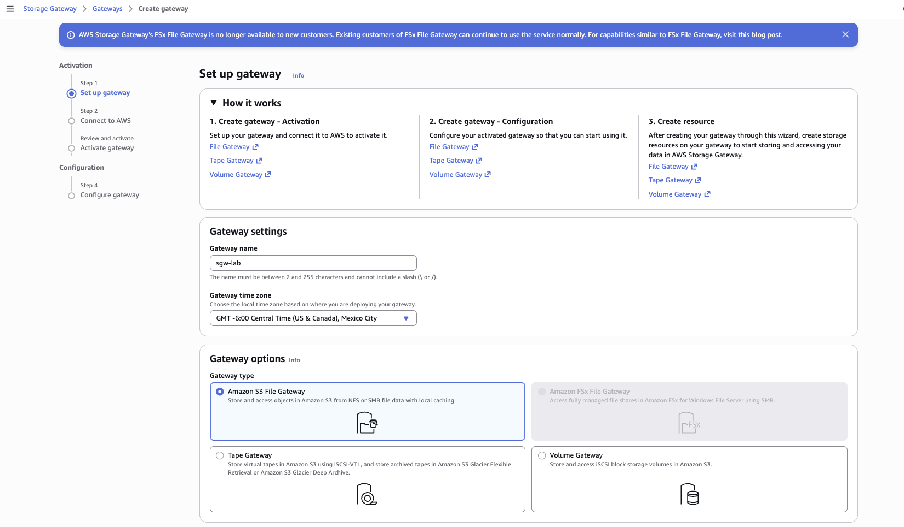

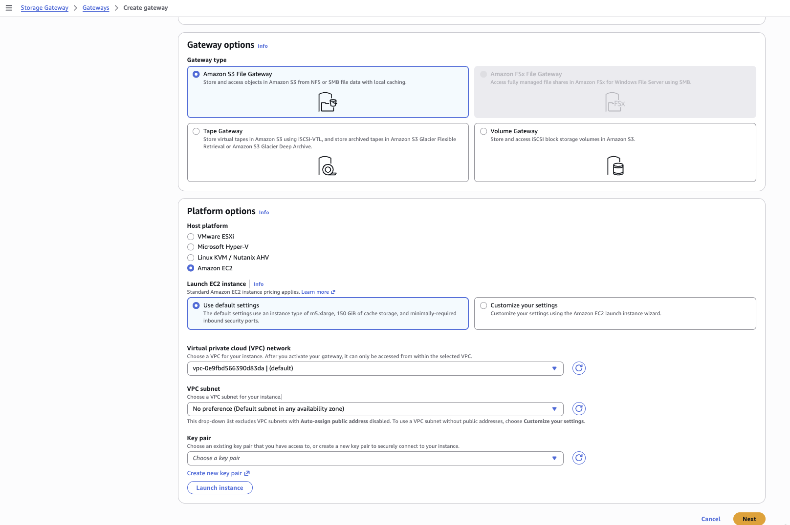

> [!WARNING]
> **Do not search the EC2 AMI catalog for the gateway image.** Searching Marketplace for "gateway" returns unrelated third-party products — Cisco Secure Firewall ASA Virtual, IT-Conductor Gateway, and similar. Launch from the Storage Gateway service console instead, which is also the intended path in real deployments.

**Console:** search **Storage Gateway** → **Create gateway**

**Step 1 — Set up gateway**

| Field | Value |
|---|---|
| Gateway name | `sgw-lab` |
| Gateway time zone | your local zone |
| Gateway type | **Amazon S3 File Gateway** |
| Host platform | **Amazon EC2** |
| Launch EC2 instance | **Use default settings** |
| VPC network | default VPC |
| VPC subnet | No preference (default subnet in any AZ) |
| Key pair | existing, or create new |

Then click **Launch instance**.

> [!TIP]
> Read the **Use default settings** tile: *m5.xlarge, 150 GiB of cache storage, and minimally-required inbound security ports.* It handles the instance type (a hard minimum — the gateway will not activate below it), the second EBS volume for cache, and the security group in one choice. Customizing by hand is how the cache disk gets forgotten.

> [!NOTE]
> **FSx File Gateway is greyed out** with a banner explaining it is no longer available to new customers. The other three types — S3 File, Tape, Volume — are all selectable. Useful confirmation of the deprecation.

Wait for **both status checks** to pass, then copy the **public IPv4 address**.

---

## 2.3 Connect to AWS and activate

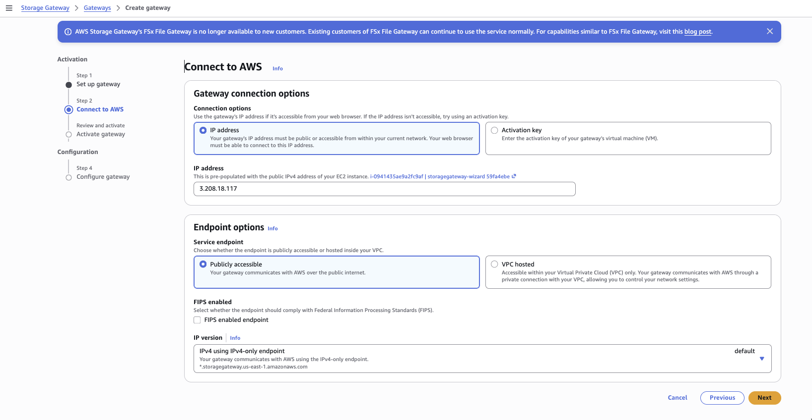

**Console:** back in the Storage Gateway tab → **Next**

**Step 2 — Connect to AWS**

| Field | Value |
|---|---|
| Connection options | **IP address** (pre-populated from the EC2 instance) |
| IP address | the gateway's public IPv4, e.g. `3.208.18.117` |
| Service endpoint | **Publicly accessible** |
| FIPS enabled endpoint | unchecked |
| IP version | IPv4 using IPv4-only endpoint |

> [!IMPORTANT]
> **Why port 80 inbound?** Read the IP address tile: *your web browser must be able to connect to this IP address.*
>
> The appliance generates a one-time **activation key** locally. It has no AWS credentials yet, so it cannot push that key out itself — your browser connects to it over plain HTTP on port 80, pulls the key, and hands it to AWS. Plain HTTP is acceptable because the key is single-use and short-lived.
>
> **After activation, port 80 serves no purpose and should be closed.** Everything afterwards is outbound HTTPS from the gateway.
>
> The **Activation key** option on the right exists for gateways with no browser-reachable IP: fetch the key from the VM's local console and paste it in manually. Same key, different delivery — useful on locked-down on-prem networks.

> [!NOTE]
> **VPC hosted** routes gateway-to-AWS traffic through a VPC endpoint so it never touches the public internet. That is the usual production choice alongside Direct Connect. This lab uses Publicly accessible for simplicity.

**Step 3 — Review and activate**

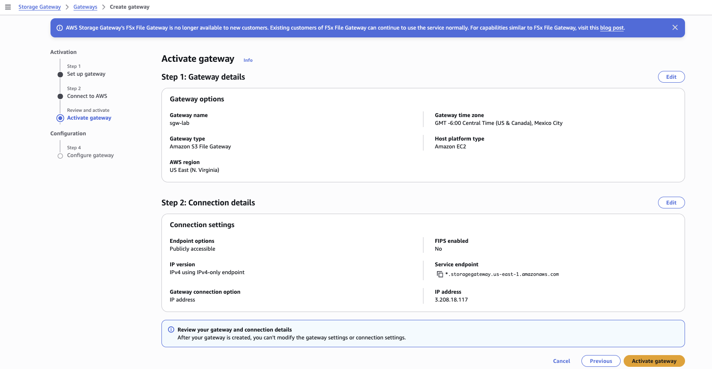

> [!WARNING]
> *"After your gateway is created, you can't modify the gateway settings or connection settings."* Gateway type, Region, and endpoint mode are baked in at activation. Changing any of them means deleting the gateway and starting over.

Click **Activate gateway**.

---

## 2.4 Configure the cache disk

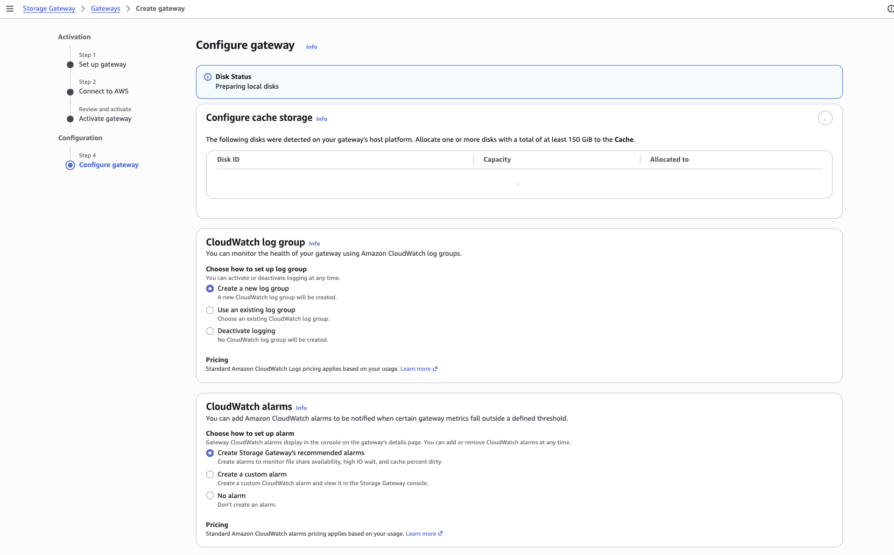

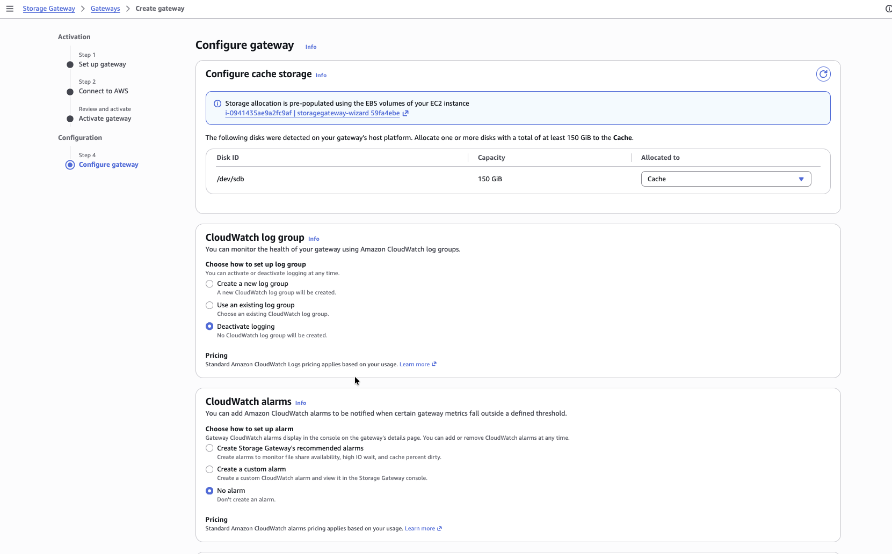

**Step 4 — Configure gateway.** The disk table starts empty while Disk Status reads **Preparing local disks**. Refresh after 30–60 seconds.

| Field | Value |
|---|---|
| Disk `/dev/sdb` (150 GiB) → Allocated to | **Cache** |
| CloudWatch log group | **Deactivate logging** (lab) — create a new group in production |
| CloudWatch alarms | **No alarm** (lab) — recommended alarms in production |

> [!TIP]
> The recommended alarms are *file share availability, high IO wait, and **cache percent dirty***. That last one is the metric to remember — see [AWS Storage Gateway](#aws-storage-gateway).

Click **Configure**. The gateway then shows **Running**.

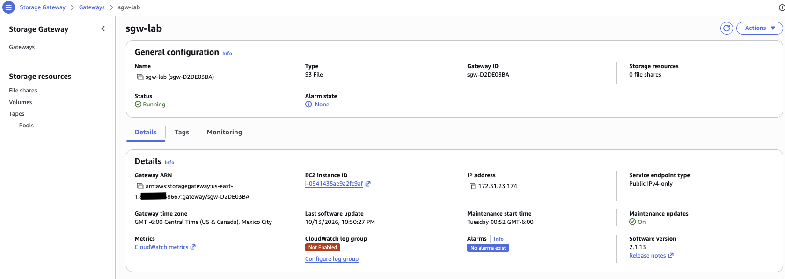

> [!IMPORTANT]
> Note the IP on this page: `172.31.23.174`, the **private** address — not the public one used for activation. The public IP mattered only so the browser could fetch the activation key. From here the gateway talks outbound to AWS, and clients reach it privately.

---

## 2.5 Create the NFS file share

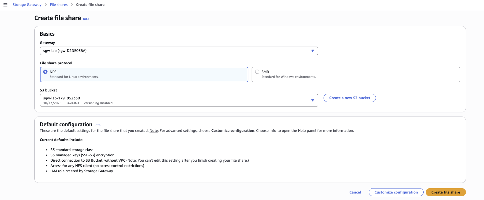

The gateway is running but has nowhere to put data. A **file share** binds one gateway to one S3 bucket and exposes it over NFS or SMB. One share, one bucket.

**Console:** File shares → **Create file share**

The simplified screen offers Gateway, protocol, bucket, and a defaults summary.

> [!WARNING]
> Two lines in that defaults list matter:
> - *"Access for any NFS client (no access control restrictions)"* — that is `0.0.0.0/0`.
> - *"Direct connection to S3 Bucket, without VPC (**You can't edit this setting after you finish creating your file share**)"* — another one-way door.
>
> Click **Customize configuration** rather than Create file share, so every setting is visible and the client CIDR gets narrowed deliberately.

### Customize — Step 1: Choose gateway

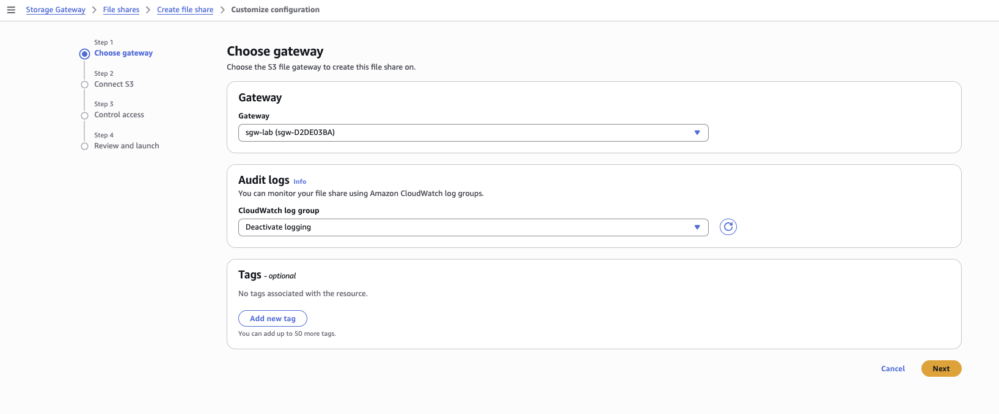

| Field | Value |
|---|---|
| Gateway | `sgw-lab (sgw-D2DE03BA)` |
| Audit logs → CloudWatch log group | **Deactivate logging** |
| Tags | none |

### Customize — Step 2: Connect S3

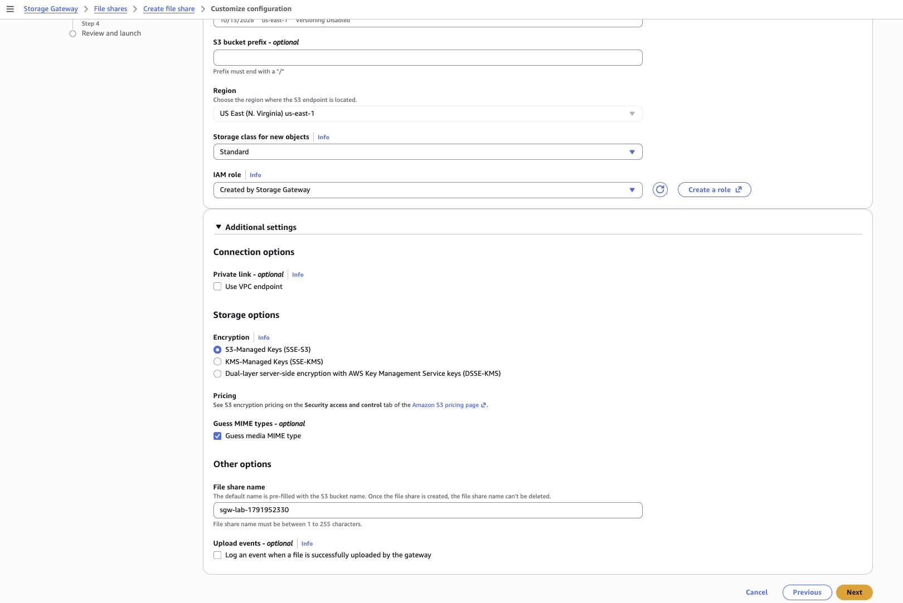

| Field | Value |
|---|---|
| S3 bucket | your `sgw-lab-*` bucket |
| S3 bucket prefix | blank |
| Region | US East (N. Virginia) us-east-1 |
| Storage class for new objects | **Standard** |
| IAM role | **Created by Storage Gateway** |
| Private link → Use VPC endpoint | unchecked |
| Encryption | **S3-Managed Keys (SSE-S3)** |
| Guess media MIME type | checked |
| File share name | defaults to the bucket name |
| Upload events | unchecked |

> [!NOTE]
> **Use VPC endpoint** would route gateway-to-S3 traffic privately rather than over the public S3 endpoint — the production pattern.
>
> **Guess media MIME type** sets each object's Content-Type from its file extension, which matters when the bucket also serves content to web clients.

### Customize — Step 3: Control access

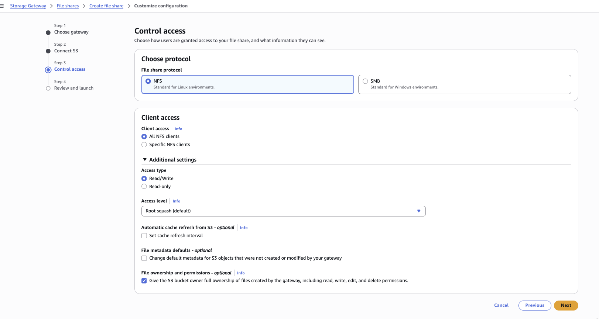

| Field | Value |
|---|---|
| File share protocol | **NFS** |
| Client access | **Specific NFS clients** → `172.31.0.0/16` |
| Access type | **Read/Write** |
| Access level | **Root squash (default)** |
| Automatic cache refresh from S3 | unchecked |
| File metadata defaults | unchecked |
| File ownership and permissions | **checked** — give the S3 bucket owner full ownership |

> [!WARNING]
> This page defaults to **All NFS clients** (`0.0.0.0/0`). Change it to **Specific NFS clients** with the VPC CIDR. It makes no practical difference inside a single-VPC lab, but it is the habit worth building — and see [Permission vs reachability](#permission-vs-reachability) for why widening it would not have helped anyway.

> [!TIP]
> **Automatic cache refresh from S3** is the answer to a classic exam scenario: *"files uploaded directly to S3 don't appear on the file share — why?"* If something other than the gateway writes to the bucket (a Lambda, another app, the console), the gateway's cached directory listing goes stale. This setting polls S3 to pick up outside changes.
>
> **Root squash** maps a client's root user to `nfsnobody`, so root on the client cannot act as root on the share.
>
> **Bucket owner full control** is the `bucket-owner-full-control` setting — without it, objects written by the gateway's role could end up owned by a different account's principal.

### Customize — Step 4: Review and launch

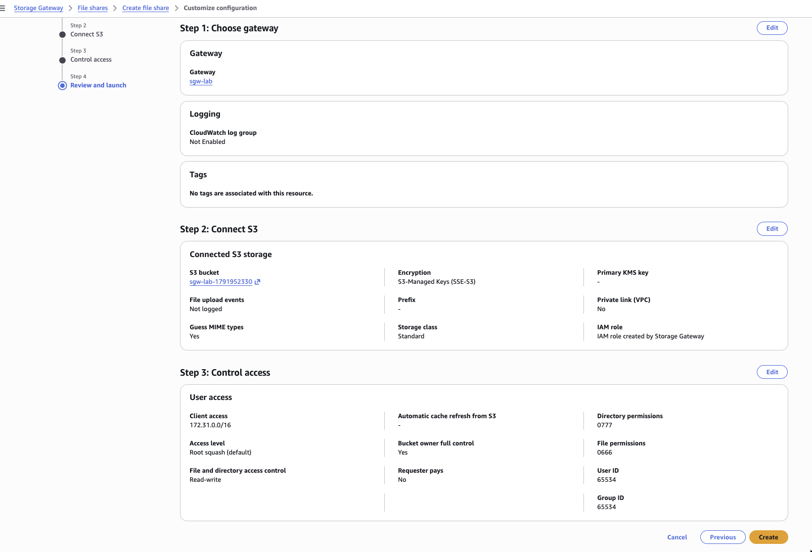

> [!NOTE]
> Three values surface only at review and are worth capturing:
> - **Directory permissions 0777 / File permissions 0666** — S3 objects have no POSIX permissions, so the gateway synthesizes them.
> - **User ID 65534 / Group ID 65534** — that is `nfsnobody`. Root squash made visible.
>
> This is File Gateway's real job in one screen: presenting a POSIX-shaped filesystem over something with no concept of POSIX underneath.

Click **Create**. The share reaches **Available** after a minute or two.

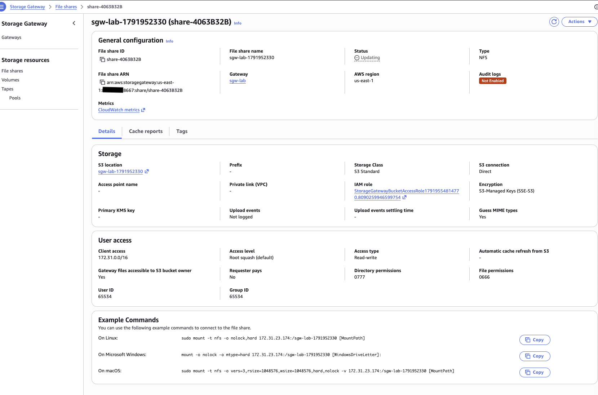

The detail page supplies ready-made mount commands:

```
On Linux:    sudo mount -t nfs -o nolock,hard 172.31.23.174:/sgw-lab-1791952330 [MountPath]
On Windows:  mount -o nolock -o mtype=hard 172.31.23.174:/sgw-lab-1791952330 [WindowsDriveLetter]:
On macOS:    sudo mount -t nfs -o vers=3,rsize=1048576,wsize=1048576,hard,nolock -v 172.31.23.174:/sgw-lab-1791952330 [MountPath]
```

Note the auto-created IAM role `StorageGatewayBucketAccessRole...` — the same two-ARN structure as Lab 1, trusting `storagegateway.amazonaws.com` instead.

---

## 2.6 Launch the NFS client and check the security group

The share is reachable only at a private address restricted to `172.31.0.0/16`, so the client must live inside the VPC.

**Console:** EC2 → Launch instance

| Field | Value |
|---|---|
| Name | `nfs-client` |
| AMI | Amazon Linux 2023 |
| Instance type | `t3.micro` |
| Key pair | Proceed without a key pair (using EC2 Instance Connect) |
| VPC | default — same as the gateway |
| Subnet | any |
| Auto-assign public IP | **Enable** — required for Instance Connect |
| Security group | create new, `nfs-client-sg`, inbound SSH 22 |
| Storage | 8 GiB gp3 |

### Check the gateway security group

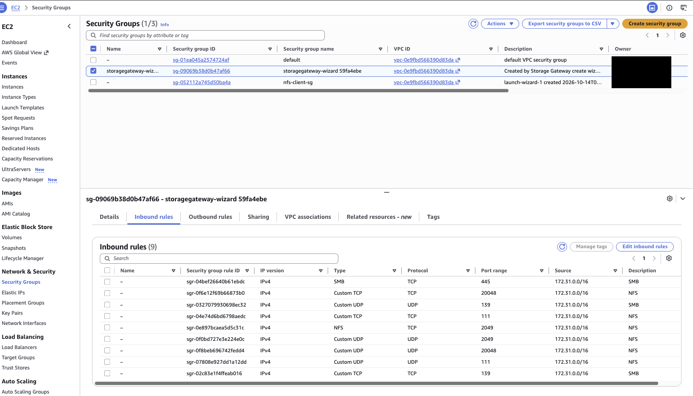

> [!NOTE]
> **No rule needs adding.** The wizard's default settings created `storagegateway-wizard …` with every rule sourced from `172.31.0.0/16` — the whole VPC CIDR — so the client is already permitted.

> [!IMPORTANT]
> **NFS is not one port.** Those nine rules are worth studying:
>
> | Port | Protocol | Service |
> |---|---|---|
> | 2049 | TCP + UDP | NFS itself |
> | 111 | TCP + UDP | `rpcbind` / portmapper — tells clients which ports the NFS services use |
> | 20048 | TCP + UDP | `mountd`, the mount daemon |
> | 445 | TCP | SMB |
> | 139 | TCP + UDP | SMB (NetBIOS) |
>
> NFS is a suite of RPC services, not a single listener. That is exactly why NFS is painful through firewalls and NAT, and part of why SMB tends to win in Windows environments.

### Connect via EC2 Instance Connect

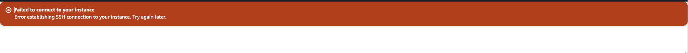

EC2 → Instances → `nfs-client` → **Connect** → **EC2 Instance Connect** tab → **Connect**

> [!CAUTION]
> **Error hit here:**
>
> ```
> Failed to connect to your instance
> Error establishing SSH connection to your instance. Try again later.
> ```
>
> The message is deliberately vague. Three prerequisites must all hold:
>
> 1. **Right instance.** Clicking Connect on `sgw-appliance` always fails — the gateway is a hardened image with no SSH user. It must be `nfs-client`.
> 2. **Public IP present.** Instance Connect reaches the instance from an AWS-owned range over the internet, so Auto-assign public IP had to be Enabled.
> 3. **Security group allows SSH from the right source.** Setting the SSH source to "My IP" blocks Instance Connect, because the traffic originates from AWS's EC2 Instance Connect service range, not your laptop.
>
> **Diagnose:**
> ```bash
> aws ec2 describe-instances \
>   --filters "Name=tag:Name,Values=nfs-client" \
>   --query 'Reservations[].Instances[].[InstanceId,State.Name,PublicIpAddress,SecurityGroups[0].GroupId]' \
>   --output table
> ```
>
> **Fix (usual cause):** EC2 → Security Groups → `nfs-client-sg` → Edit inbound rules → SSH rule → Source → Anywhere-IPv4 → Save. Also confirm status checks show 2/2 passed; a fresh instance refuses connections for the first minute or two.

---

## 2.7 Mount the share

Amazon Linux does not ship with NFS client tools.

```bash
sudo dnf install -y nfs-utils
sudo mkdir -p /mnt/sgw

sudo mount -t nfs -o nolock,hard 172.31.23.174:/sgw-lab-1791952330 /mnt/sgw

df -h /mnt/sgw
mount | grep sgw
```

**Expected output:**

```
Filesystem                         Size  Used Avail Use% Mounted on
172.31.23.174:/sgw-lab-1791952330  8.0E     0  8.0E   0% /mnt/sgw

172.31.23.174:/sgw-lab-1791952330 on /mnt/sgw type nfs4 (rw,relatime,vers=4.2,
rsize=1048576,wsize=1048576,namlen=255,hard,fatal_neterrors=none,proto=tcp,
timeo=600,retrans=2,sec=sys,clientaddr=172.31.31.118,local_lock=none,addr=172.31.23.174)
```

> [!IMPORTANT]
> **8.0E is 8 exabytes — and it is fiction.** S3 has no fixed size to report, but Linux tools demand a number, so the gateway returns the largest the filesystem interface can express.
>
> **You cannot use `df` to manage capacity on a File Gateway share.** Any monitoring or script that alerts on "disk nearly full" is useless here. The real constraint is cache size and upload throughput, which you watch through the `CachePercentDirty` metric.

> [!NOTE]
> **Mount options:** `nolock` disables NFS file locking, which S3 cannot support. `hard` makes the client retry indefinitely rather than failing an I/O on timeout — safer for data integrity. The mount negotiated up to `vers=4.2` from the v3 default.

> [!TIP]
> **If the mount hangs**, it is almost always reachability: wrong IP, or the client is outside the allowed CIDR. Ctrl-C and check both.

---

## 2.8 Prove file-to-object

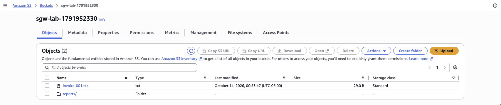

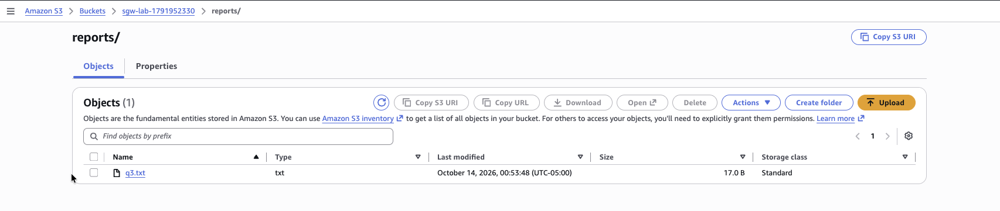

```bash
echo "invoice 001 from the gateway" | sudo tee /mnt/sgw/invoice-001.txt
sudo mkdir -p /mnt/sgw/reports
echo "quarterly report" | sudo tee /mnt/sgw/reports/q3.txt
ls -la /mnt/sgw
```

Check the bucket:

```bash
aws s3 ls s3://$SGW_BUCKET/ --recursive
```

*(If the client instance has no IAM role, this returns a credentials error — check the S3 console instead.)*

**Result:** `invoice-001.txt` (29 B, Standard) and `reports/q3.txt` (17 B, Standard). A write to a Linux filesystem path became an S3 object with the same name.

> [!IMPORTANT]
> **This is where File Gateway differs from DataSync.** The console shows `reports/` as **Type: Folder** with no size and no storage class — an actual **zero-byte object** named `reports/`.
>
> In [Step 1.2](#12-stage-test-files-in-the-source), DataSync only ever created `archive/legacy.txt`; the console *inferred* the folder from the key. Here the gateway had to materialize a real object, because NFS lets you create an empty directory and then list it, and S3 has no other way to represent "this directory exists but is empty."
>
> **Rule:** DataSync creates prefixes as a side effect of object keys. File Gateway creates explicit zero-byte folder objects, because POSIX semantics demand it. Same bucket, two different shapes, driven by what the client expects.

Test a cache hit:

```bash
cat /mnt/sgw/invoice-001.txt
```

The file is still local, so this is served from cache — fast and local-feeling, as opposed to the S3 round trip a miss would require.

---

## 2.9 Tear down Lab 2

> [!CAUTION]
> The `m5.xlarge` gateway bills by the hour until terminated. Do this in the same session.

**Unmount from the client:**

```bash
sudo umount /mnt/sgw
```

**Console:**
1. Storage Gateway → File shares → select the share → **Actions** → **Delete file share** → confirm
2. Gateways → `sgw-lab` → **Actions** → **Delete gateway** → type the confirmation → Delete
3. EC2 → Instances → select `sgw-appliance` **and** `nfs-client` → Instance state → **Terminate instance**

**Verify nothing is left billing:**

```bash
aws ec2 describe-instances \
  --filters "Name=instance-state-name,Values=running,pending" \
  --query 'Reservations[].Instances[].[InstanceId,InstanceType,Tags[?Key==`Name`].Value|[0]]' \
  --output table

aws ec2 describe-volumes \
  --filters "Name=status,Values=available" \
  --query 'Volumes[].[VolumeId,Size]' --output table
```

**Actual output — an orphan was found:**

```
|        DescribeVolumes        |
+-------------------------+-----+
|  vol-0ff13e725493fc6f3  |  80 |
```

> [!WARNING]
> **An 80 GiB volume survived in `available` state**, unattached, still billing roughly $6.40/month for nothing. It was the gateway appliance's **root** volume — the Storage Gateway wizard's volume settings differ from the EC2 default, so the 150 GiB cache disk was cleaned up and the root was not.
>
> **Fix:**
> ```bash
> aws ec2 delete-volume --volume-id vol-0ff13e725493fc6f3
> ```
>
> **Orphaned EBS volumes are the most common source of surprise lab bills**, because nothing in the console nags you about them. The same goes for unassociated Elastic IPs and old snapshots. Always run the two checks above after any lab.

**Delete the bucket when finished with the screenshots:**

```bash
aws s3 rb s3://$SGW_BUCKET --force
```

> [!TIP]
> When `--output table` has zero rows, the AWS CLI prints **nothing at all** rather than an empty table. Silence is the success signal here — unusual enough to be worth knowing.

---

## Exam scenarios

| Scenario wording | Answer | Why |
|---|---|---|
| Nightly sync of a large dataset where a small percentage changes | **DataSync** | Incremental by design; transfers only the delta |
| Copy from an on-premises NFS share to S3 | **DataSync with an agent** | Agent required whenever the source is outside AWS |
| Copy between two S3 buckets in different Regions | **DataSync, no agent** | Both endpoints are inside AWS |
| Data must land directly in a Glacier storage class | **DataSync** | The only transfer service that writes straight to Glacier |
| On-prem app needs a file share whose data actually lives in S3 | **S3 File Gateway** | NFS/SMB front end, S3 back end, local cache |
| On-prem app needs block volumes backed by AWS | **Volume Gateway** (iSCSI) | Cached = primary in S3; Stored = full dataset local |
| Replace a physical tape backup system | **Tape Gateway** | iSCSI VTL, tapes in S3, archive to Glacier |
| Workload needs **uniformly** low latency file access | **FSx or EFS, not File Gateway** | Gateway latency varies with cache hit/miss |
| Files uploaded straight to S3 don't appear on the file share | **Enable automatic cache refresh** | Gateway's directory listing is stale |
| Transfer would take more than ~a week over the network | **Snow Family** | Physical device shipping beats the link |
| Cross-account S3 access from your DataSync role | **Also need a bucket policy in the other account** | Both sides must grant; an IAM policy alone cannot authorize another account's resource |
| Dataset far larger than the gateway's cache disk | **Works fine** | Full dataset always visible; misses fetch from S3 |

> [!IMPORTANT]
> **Three recurring traps:**
> 1. Nothing writes straight to Glacier **except DataSync** — Snowball and File Gateway land in S3 first, then lifecycle.
> 2. FSx for Lustre is **always single-AZ**.
> 3. Linux **can** mount FSx for Windows over SMB, but still cannot get iSCSI there.
>
> And the habit that catches most mistakes: **when one clue fits two services, keep reading — the extra requirement is the decider.**

---

## Service availability changes

| Service | Change | Effective |
|---|---|---|
| FSx File Gateway | No longer available to new customers | Oct 28, 2024 |
| Storage Gateway Hardware Appliance | Discontinued; support through May 2028 | May 12, 2025 |
| Snowcone and 80 TB Snowball Edge | Discontinued | Nov 12, 2024 |
| Snowball Edge | Restricted to existing customers; new customers directed to DataSync, Data Transfer Terminal, partners, or Outposts | Nov 7, 2025 |

---

## Error index

| # | Error | Stage | Cause | Fix |
|---|---|---|---|---|
| 1 | `LogLevelSetWithNoLogGroup` | [1.5](#15-create-and-start-the-task) | `LogLevel=BASIC` with no CloudWatch log group ARN | Use `LogLevel=OFF`, or create a log group and pass `--cloud-watch-log-group-arn` |
| 2 | `argument --task-arn: expected one argument` | [1.5](#15-create-and-start-the-task) | Cascade — `$TASK` empty because `create-task` had failed | Fix the root error first |
| 3 | DataSync unable to assume role | [1.4](#14-create-source-and-destination-locations) | IAM role propagation delay | Wait ~15 s, rerun |
| 4 | `argument --region: expected one argument` | [2.1](#21-create-the-backing-bucket) | `$AWS_REGION` unset — export line skipped on paste | Re-export, rerun, verify the resource actually exists |
| 5 | Marketplace returns Cisco / IT-Conductor "gateway" products | [2.2](#22-launch-the-gateway-appliance) | Wrong entry point — searched the AMI catalog | Launch from Storage Gateway → Create gateway → Host platform: Amazon EC2 |
| 6 | `Failed to connect to your instance` (Instance Connect) | [2.6](#26-launch-the-nfs-client-and-check-the-security-group) | Wrong instance, no public IP, or SSH source scoped to "My IP" | Verify all three; widen the SSH source |
| 7 | Orphaned 80 GiB EBS volume after teardown | [2.9](#29-tear-down-lab-2) | Gateway wizard's root volume had DeleteOnTermination off | `aws ec2 delete-volume --volume-id <id>` |

---

*Region: us-east-1 · VPC CIDR: 172.31.0.0/16 · Account IDs and identifiers in screenshots are redacted.*
