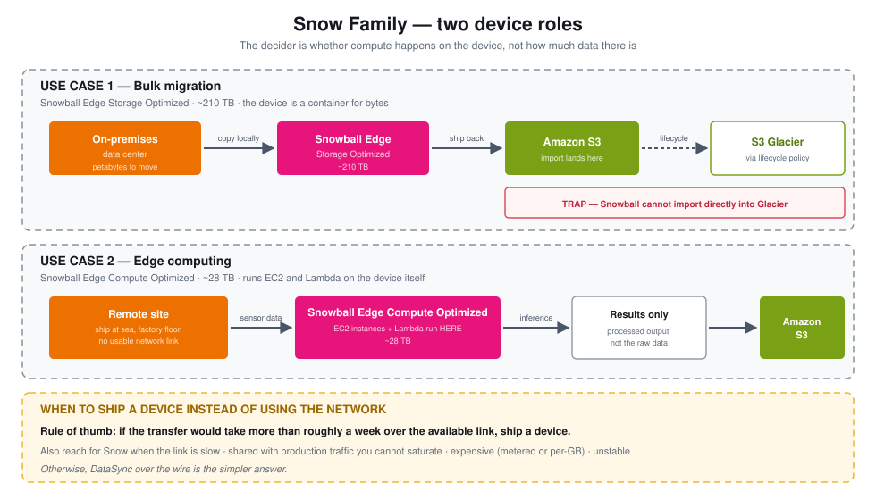
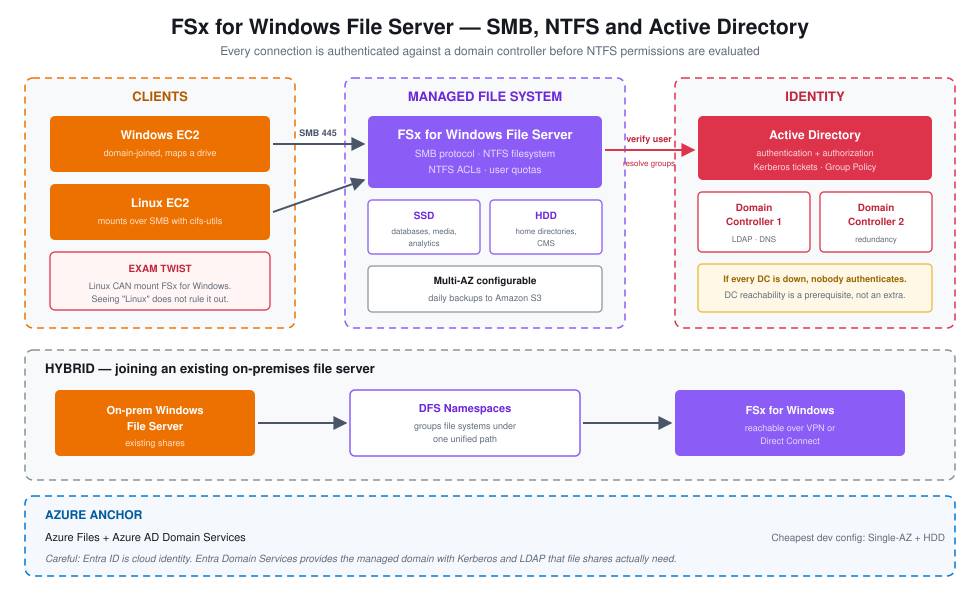
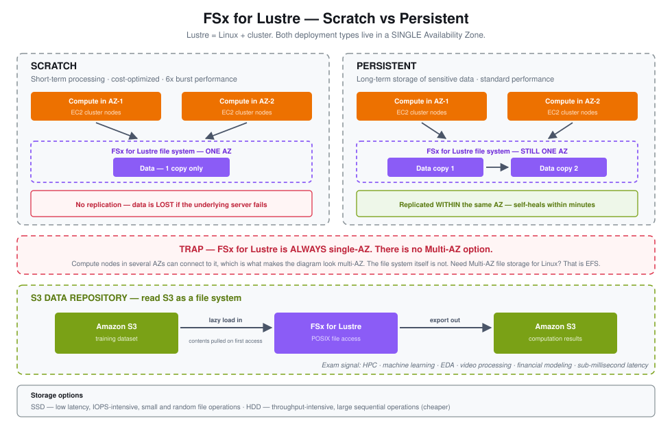
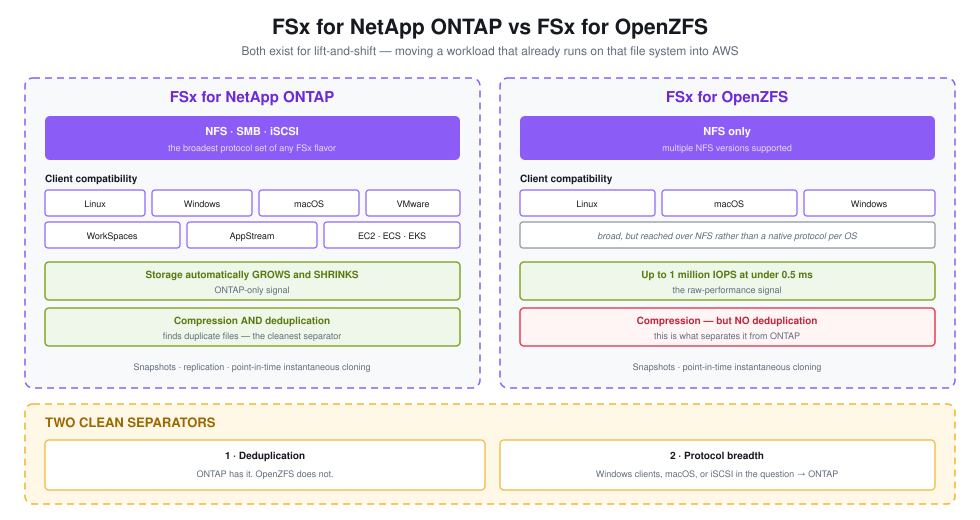
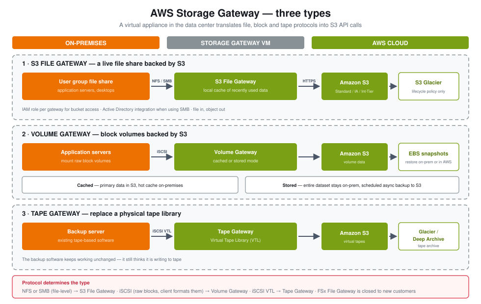
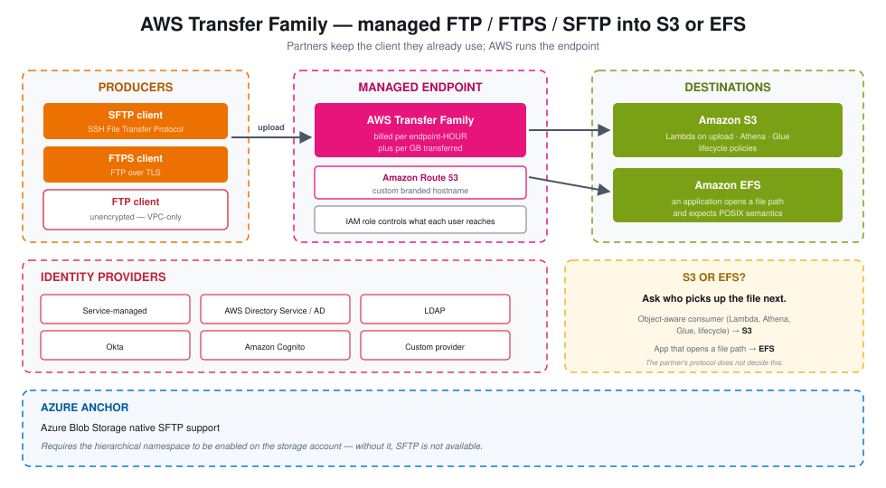
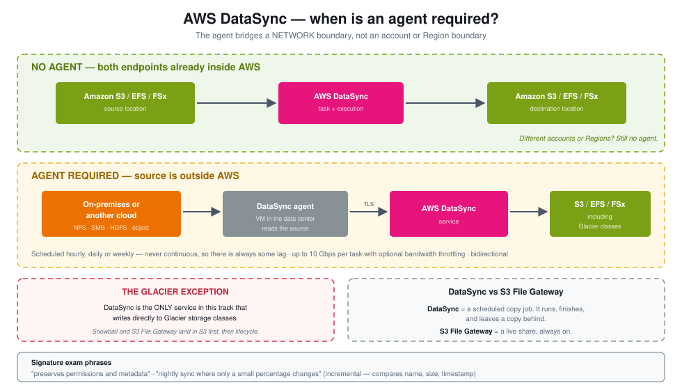

# AWS SAA — Storage Extras

Study reference for the eight-module "Storage Extras" track: Snow Family, the four FSx flavors, Storage Gateway, Transfer Family, DataSync, and the capstone decision tree.

Concepts and exam signals only. The hands-on builds live in `aws-storage-hands-on/`.

---

## Table of contents

- [Decision tree](#decision-tree)
- [Acronyms](#acronyms)
- [Module 1 — Snow Family](#module-1--snow-family)
- [Module 2 — FSx overview and FSx for Windows File Server](#module-2--fsx-overview-and-fsx-for-windows-file-server)
  - [Side note — what Active Directory actually is](#side-note--what-active-directory-actually-is)
  - [Side note — what a domain controller is](#side-note--what-a-domain-controller-is)
- [Module 3 — FSx for Lustre](#module-3--fsx-for-lustre)
- [Module 4 — FSx for NetApp ONTAP and OpenZFS](#module-4--fsx-for-netapp-ontap-and-openzfs)
- [FSx flavors side by side](#fsx-flavors-side-by-side)
- [Module 5 — AWS Storage Gateway](#module-5--aws-storage-gateway)
  - [Side note — NFS vs SMB vs iSCSI](#side-note--nfs-vs-smb-vs-iscsi)
- [Module 6 — AWS Transfer Family](#module-6--aws-transfer-family)
- [Module 7 — AWS DataSync](#module-7--aws-datasync)
- [Module 8 — Capstone: choosing between them](#module-8--capstone-choosing-between-them)
- [Azure anchors](#azure-anchors)
- [Service availability changes](#service-availability-changes)
- [Exam signal cheat sheet](#exam-signal-cheat-sheet)

---

## Decision tree

---

## Acronyms

| Acronym | Meaning |
|---|---|
| **ACL** | Access Control List |
| **AD** | Active Directory |
| **AD DS** | Active Directory Domain Services |
| **AZ** | Availability Zone |
| **CMS** | Content Management System |
| **DC** | Domain Controller |
| **DFS** | Distributed File System (Microsoft) |
| **EDA** | Electronic Design Automation |
| **EFS** | Elastic File System |
| **FTP / FTPS / SFTP** | File Transfer Protocol / FTP over TLS / SSH File Transfer Protocol |
| **FSx** | Amazon FSx — managed third-party file systems |
| **HDD** | Hard Disk Drive |
| **HPC** | High Performance Computing |
| **IOPS** | Input/Output Operations Per Second |
| **iSCSI** | Internet Small Computer Systems Interface |
| **LDAP** | Lightweight Directory Access Protocol |
| **NAS** | Network Attached Storage |
| **NFS** | Network File System |
| **NTFS** | New Technology File System |
| **ONTAP** | NetApp's storage operating system |
| **POSIX** | Portable Operating System Interface |
| **SMB** | Server Message Block |
| **SSD** | Solid State Drive |
| **VTL** | Virtual Tape Library |
| **ZFS** | Zettabyte File System |

---

# Module 1 — Snow Family

Physical devices AWS ships to you. You load data onto them locally and ship them back, bypassing the network entirely.

## The two device roles

| Device | Capacity | Purpose |
|---|---|---|
| **Snowball Edge Storage Optimized** | ~210 TB | Bulk data migration — the device is a container for bytes |
| **Snowball Edge Compute Optimized** | ~28 TB | Edge computing — runs EC2 instances and Lambda functions on the device itself |

> [!IMPORTANT]
> **The decider is whether compute happens on the device.** Storage Optimized moves data. Compute Optimized *processes* data where it sits — a ship at sea running ML inference, a factory floor pre-processing sensor data, a remote site with no usable link. If the scenario mentions running anything on the device, capacity is irrelevant.

## When to choose Snow over the network

The rule of thumb: **if the transfer would take more than roughly a week over the available link, ship a device.**

Also reach for Snow when the link is:
- slow
- shared with production traffic you can't saturate
- expensive (metered or per-GB)
- unstable

> [!WARNING]
> **Snowball cannot import directly into Glacier.** Data lands in S3 first; a lifecycle policy then transitions it to Glacier or Deep Archive. This is a recurring distractor — see [the three traps](#module-8--capstone-choosing-between-them).

## Process

1. Order the device in the console
2. AWS ships it
3. Connect it to your local network, use the Snowball client to copy data
4. Ship it back
5. AWS imports the data into your S3 bucket
6. Apply a lifecycle policy if the data belongs in Glacier

**Azure anchor:** Azure Data Box for bulk migration; Azure Stack Edge for the edge-compute role.

---

# Module 2 — FSx overview and FSx for Windows File Server

## The framing that makes FSx click

> [!TIP]
> **FSx is "RDS, but for file systems."**
>
> RDS lets you launch MySQL or PostgreSQL on AWS as a managed service instead of running the database yourself. FSx does exactly that for *file systems* — launch Lustre, Windows File Server, NetApp ONTAP, or OpenZFS without managing the underlying servers.

Four flavors, and the exam expects you to pick between them.

## FSx for Windows File Server

A fully managed Windows file share.

| Attribute | Detail |
|---|---|
| Protocol | **SMB** |
| Filesystem | **NTFS** |
| Authentication | **Microsoft Active Directory** integration |
| Access control | NTFS ACLs, plus user quotas |
| Performance | Tens of GB/s, millions of IOPS, hundreds of PB |
| Storage options | **SSD** for latency-sensitive work (databases, media processing, analytics); **HDD** for broad-spectrum work (home directories, CMS) |
| Availability | **Multi-AZ** configurable |
| Backup | Daily backups to S3 |
| Hybrid | Reachable from on-premises over VPN or Direct Connect |

> [!IMPORTANT]
> **Linux EC2 instances can mount FSx for Windows over SMB.** This is the twist the exam leans on — seeing "Linux" in a question does not rule out FSx for Windows. You need port 445 open plus the AD ports.

**DFS Namespaces** groups file systems under one unified path, which is how you join an FSx for Windows file system to an existing on-premises Windows File Server for a hybrid namespace.

**Cheapest dev configuration:** Single-AZ with HDD storage.

---

## Side note — what Active Directory actually is

Active Directory is Microsoft's **identity service**. It does two jobs:

- **Authentication** — proving you are who you say you are
- **Authorization** — deciding what you're allowed to touch once proven

Think of a building with a security desk. Your badge proves identity (authentication). The desk's list of which floors your badge opens is authorization. AD is both the badge system and the list.

Underneath:
- **Kerberos** is the ticket-based protocol that does the proving, so your password isn't sent around repeatedly
- **Group Policy** pushes configuration and rules down to machines and users centrally
- Users are organized into **groups**, and permissions attach to groups rather than individuals — which is why NTFS ACLs on an FSx share usually reference AD groups

---

## Side note — what a domain controller is

A **domain controller (DC)** is a server that holds a copy of the Active Directory database and answers questions about it.

What it does:
- Stores the directory — every user, group, and computer object
- Answers **LDAP** lookups ("who is this user, what groups are they in?")
- Issues Kerberos tickets
- Usually also serves **DNS**, because AD clients find services via DNS records

Organizations run **more than one** DC for redundancy. If the only DC is down, nobody can authenticate — logins fail across the board.

> [!NOTE]
> **Why FSx for Windows needs reachable DCs:** when a user connects to the share, FSx must verify that identity and resolve the user's group memberships to evaluate NTFS permissions. It cannot do that without talking to a domain controller. This is why FSx for Windows deployments specify AD details and why DC reachability is a prerequisite, not an afterthought.

**Azure anchor:** Azure Files with AD DS. Be careful: **Entra ID is not the same as Entra Domain Services** — Entra ID is cloud identity, Entra Domain Services provides the managed domain with Kerberos and LDAP that file shares need.

---

# Module 3 — FSx for Lustre

**Lustre = Linux + cluster.** The name tells you the workload.

| Attribute | Detail |
|---|---|
| Purpose | **Machine learning and HPC** — the keyword pair that signals Lustre |
| Other workloads | Video processing, financial modeling, electronic design automation |
| Performance | Hundreds of GB/s, millions of IOPS, **sub-millisecond latency** |
| Storage options | **SSD** for low-latency, IOPS-intensive, small and random file operations; **HDD** for throughput-intensive, large sequential operations |
| Hybrid | Reachable from on-premises over VPN or Direct Connect |

## S3 integration — the data repository

> [!IMPORTANT]
> Lustre can be linked to an S3 bucket as a **data repository**. You read S3 *as a file system* through FSx, and write computation results back out to S3. Objects are **lazy loaded** — the file appears in the namespace immediately, but its contents are pulled from S3 on first access.
>
> This is frequently tested. The scenario sounds like: *"the training dataset lives in S3 and the cluster needs POSIX file access to it."*

## Deployment options — Scratch vs Persistent

| | Scratch | Persistent |
|---|---|---|
| Copies of data | **One** | Replicated |
| Replication scope | None | **Within the same AZ only** |
| Failure behaviour | Data is lost if the underlying server fails | Files replaced transparently within minutes |
| Performance | **6x burst** over persistent | Standard |
| Cost | Cheaper | More expensive |
| Use case | Short-term processing, cost-optimized | Long-term storage of sensitive data |

> [!WARNING]
> **FSx for Lustre is ALWAYS single-AZ.** Persistent replicates, but only within one Availability Zone — never across them. There is no Multi-AZ Lustre option. Compute instances in several AZs can connect to it, which is what makes the diagram look multi-AZ, but the file system itself is not.

**Azure anchor:** Azure Managed Lustre.

---

# Module 4 — FSx for NetApp ONTAP and OpenZFS

Both exist primarily for **lift-and-shift**: moving a workload that already runs on that file system into AWS without rewriting it.

## FSx for NetApp ONTAP

| Attribute | Detail |
|---|---|
| Protocols | **NFS, SMB, and iSCSI** — the broadest set |
| OS compatibility | Linux, Windows, macOS, VMware Cloud on AWS, WorkSpaces, AppStream, EC2, ECS, EKS |
| Capacity | **Automatically grows and shrinks** |
| Efficiency | Compression **and deduplication** |
| Data management | Snapshots, replication, point-in-time instantaneous cloning |

## FSx for OpenZFS

| Attribute | Detail |
|---|---|
| Protocols | **NFS only** (multiple versions) |
| OS compatibility | Broad — Linux, macOS, Windows |
| Performance | Up to **1 million IOPS at under 0.5 ms** latency |
| Efficiency | Compression — **no deduplication** |
| Data management | Snapshots, point-in-time instantaneous cloning |

> [!TIP]
> **Two clean separators between ONTAP and OpenZFS:**
> 1. **Deduplication** — ONTAP has it, OpenZFS does not
> 2. **Protocol breadth** — ONTAP speaks NFS + SMB + iSCSI; OpenZFS speaks NFS only
>
> So a scenario naming Windows clients, macOS clients, or iSCSI points at ONTAP. A scenario emphasizing raw IOPS on NFS points at OpenZFS. Auto grow-and-shrink is an ONTAP-only signal too.

---

## FSx flavors side by side

| | **Windows File Server** | **Lustre** | **NetApp ONTAP** | **OpenZFS** |
|---|---|---|---|---|
| **Protocols** | SMB | Lustre client | NFS, SMB, iSCSI | NFS only |
| **Primary OS** | Windows (Linux can mount) | Linux | Linux, Windows, macOS, VMware, containers | Linux, macOS, Windows |
| **Multi-AZ** | Yes | **Never** | Yes | Yes |
| **Signature feature** | AD + NTFS ACLs + user quotas | S3 data repository, lazy loading | Auto grow/shrink, **dedup** | 1M IOPS, &lt;0.5 ms |
| **Deduplication** | — | — | **Yes** | **No** |
| **Cloning** | — | — | Instant | Instant |
| **Exam keywords** | SMB, Active Directory, NTFS, DFS, home directories | HPC, ML, EDA, video processing, financial modeling, sub-ms | lift-and-shift from NAS, broadest compatibility, macOS, iSCSI | lift-and-shift from ZFS, NFS-only, highest IOPS |

---

# Module 5 — AWS Storage Gateway

## Why it exists

S3 is a proprietary object store reached over HTTPS — it is not a file system. EFS is NFS-compliant; S3 is not. So how do you expose S3 data to an on-premises application server that only speaks file protocols?

**Storage Gateway is the bridge.** A virtual appliance runs in your data center on VMware ESXi, Microsoft Hyper-V, or Linux KVM (or on EC2) and translates file, block, or tape protocols into S3 API calls behind the scenes.

**Hybrid cloud use cases:**
- Disaster recovery — back up on-premises data to the cloud
- Backup and restore
- Cloud migration
- Tiering — hot data on-premises, cold data in the cloud
- The reverse — most data in AWS, with the gateway acting as a local low-latency cache

## The gateway types

### S3 File Gateway

| Attribute | Detail |
|---|---|
| Protocols | **NFS and SMB** |
| Backing store | S3 objects — Standard, Standard-IA, One Zone-IA, Intelligent-Tiering |
| Cache | Most recently used data cached locally for rapid access |
| Permissions | **An IAM role per gateway** to access the bucket |
| Authentication | Active Directory integration when using SMB |

> [!WARNING]
> **S3 File Gateway cannot write to Glacier directly.** Use a bucket lifecycle policy to transition objects to Glacier or Deep Archive after they land.

### Volume Gateway

Block storage over **iSCSI**, backed by S3, with volumes backed up as **EBS snapshots** that can restore on-premises volumes or become EBS volumes in AWS.

| Mode | Behaviour |
|---|---|
| **Cached volumes** | Primary data in S3, low-latency cache on-premises for the most recent data |
| **Stored volumes** | **Entire dataset stays on-premises**, with scheduled async backup to S3 |

> [!TIP]
> The separator is *where the primary copy lives.* "We need the full dataset locally for performance, but backed up to AWS" → **stored**. "We want AWS to hold the bulk, with hot data cached locally" → **cached**.

### Tape Gateway

For organizations with an existing physical tape backup workflow. Presents an **iSCSI VTL** (Virtual Tape Library) so the existing backup software keeps working unchanged, while the tapes themselves are stored in S3 and archived to Glacier or Glacier Deep Archive. Works with leading backup software vendors.

### FSx File Gateway

SMB access to FSx for Windows File Server. **No longer available to new customers** — see [service availability changes](#service-availability-changes).

---

## Side note — NFS vs SMB vs iSCSI

Three protocols, three different abstractions:

| Protocol | What the client sees | Native to | Gateway type |
|---|---|---|---|
| **NFS** | A mounted directory tree | Linux / Unix | S3 File Gateway |
| **SMB** | A mapped network drive or share | Windows | S3 File Gateway |
| **iSCSI** | A **raw block device** — an unformatted disk | OS-agnostic | Volume Gateway, Tape Gateway |

The key distinction: NFS and SMB are **file-level** — the server understands files and directories. iSCSI is **block-level** — it hands the client raw blocks, and the client's own OS puts a filesystem on top. That is why Volume Gateway is for volume backup rather than file sharing: the gateway has no idea what files are on those blocks.

**Azure anchor:** Azure File Sync. (StorSimple, the older equivalent, has been retired.)

---

# Module 6 — AWS Transfer Family

A **managed endpoint** that lets external parties push and pull files using protocols they already have, landing the data in S3 or EFS.

| Protocol | Note |
|---|---|
| **FTP** | Unencrypted — **VPC-only**, never exposed to the internet |
| **FTPS** | FTP over TLS |
| **SFTP** | SSH File Transfer Protocol — the common choice |

**Pricing:** per provisioned **endpoint-hour**, plus per GB transferred. The endpoint bills whether or not anyone uses it.

**Identity providers:**
- Service-managed (users stored in Transfer Family itself)
- AWS Directory Service / Active Directory
- LDAP
- Okta
- Amazon Cognito
- Custom identity provider

**Other pieces:** a **Route 53** custom hostname so partners connect to a stable branded address, and an **IAM role** controlling what each user can reach.

> [!IMPORTANT]
> **The S3-vs-EFS decision rule: ask who picks up the file next.**
>
> - An **object-aware consumer** — Lambda triggered on upload, Athena, Glue, a lifecycle policy → **S3**
> - An **application that opens a file path** and expects POSIX semantics → **EFS**
>
> The protocol the partner uses does not decide this. The downstream consumer does.

**Azure anchor:** Blob Storage native SFTP support, which requires the hierarchical namespace to be enabled.

---

# Module 7 — AWS DataSync

A managed **scheduled copy job** between storage endpoints.

| Attribute | Detail |
|---|---|
| Sources | NFS, SMB, HDFS, object storage, other clouds |
| Targets | **S3 (including Glacier classes)**, EFS, all FSx flavors |
| Agent | Required for **on-premises or another cloud** — **not** for AWS-to-AWS |
| Scheduling | Hourly, daily, weekly — **never continuous**, so there is always some lag |
| Metadata | **Preserves permissions and metadata** — a signature exam phrase |
| Throughput | Up to 10 Gbps per task, with optional bandwidth throttling |
| Direction | Bidirectional |

> [!IMPORTANT]
> **DataSync is the only service in this track that writes directly to Glacier storage classes.** Snowball and S3 File Gateway both land data in S3 first and rely on a lifecycle policy. If a question says data must go straight into an archive tier, DataSync is the answer.

> [!TIP]
> **DataSync vs S3 File Gateway** — the cleanest boundary in this whole track:
>
> - **DataSync** = a scheduled **copy job**. It runs, it finishes, it leaves a copy behind.
> - **S3 File Gateway** = a **live share** backed by S3. It is always on, and clients read and write through it continuously.
>
> "Sync nightly" → DataSync. "Users need a share they work in" → File Gateway.

---

# Module 8 — Capstone: choosing between them

## Reading order for a scenario question

Work through the question in this sequence. The first clue narrows the field; later clues break ties.

1. **Protocol or interface** — NFS, SMB, iSCSI, HTTPS/object, a mounted path? This eliminates most options immediately.
2. **OS and workload** — Windows or Linux? HPC/ML? Lift-and-shift from an existing system?
3. **Hybrid?** — is anything on-premises, or is this entirely inside AWS?
4. **Modifiers** — cost, Multi-AZ, durability, latency, retention period. These decide between the two or three options still standing.

> [!IMPORTANT]
> **The habit that matters most: when one clue fits two services, keep reading.** The extra requirement buried later in the question is the decider. Most wrong answers come from committing to a service on the first matching keyword and skipping the sentence that rules it out.

## The three recurring traps

> [!WARNING]
> **1. Nothing writes straight to Glacier except DataSync.** Snowball imports to S3, then lifecycle. S3 File Gateway writes to S3, then lifecycle.
>
> **2. FSx for Lustre is always single-AZ.** Persistent replicates within one AZ. There is no Multi-AZ option, period.
>
> **3. Linux can mount FSx for Windows over SMB** — so "Linux clients" does not eliminate it. But Linux still cannot get **iSCSI** from FSx for Windows; that needs ONTAP or Volume Gateway.

---

## Azure anchors

| AWS | Azure | Note |
|---|---|---|
| FSx for Windows File Server | Azure Files + AD DS | Entra ID ≠ Entra Domain Services |
| FSx for Lustre | Azure Managed Lustre | Same HPC/ML positioning |
| FSx for NetApp ONTAP | Azure NetApp Files | Same vendor, same lift-and-shift role |
| S3 File Gateway | Azure File Sync | StorSimple retired |
| Transfer Family | Blob Storage native SFTP | Requires hierarchical namespace |
| Snow Family | Azure Data Box / Azure Stack Edge | Data Box = bulk; Stack Edge = edge compute |
| S3 | Azure Blob Storage | Object storage |
| EFS | Azure Files | Managed file shares |
| EBS | Azure Managed Disks | Block storage |

---

## Service availability changes

| Service | Change | Effective |
|---|---|---|
| Snowcone and 80 TB Snowball Edge | Discontinued | Nov 12, 2024 |
| FSx File Gateway | No longer available to new customers | Oct 28, 2024 |
| Storage Gateway Hardware Appliance | Discontinued; support through May 2028 | May 12, 2025 |
| Snowball Edge | Restricted to existing customers — new customers directed to DataSync, Data Transfer Terminal, partners, or Outposts | Nov 7, 2025 |

> [!NOTE]
> These matter for the console as much as the exam: the FSx File Gateway tile is visibly greyed out in the Create Gateway wizard, with a banner explaining why.

---

## Exam signal cheat sheet

| Phrase in the question | Points to |
|---|---|
| HPC, machine learning, EDA, sub-millisecond | FSx for Lustre |
| SMB, Active Directory, NTFS, home directories, DFS | FSx for Windows File Server |
| Lift-and-shift from a NAS, macOS clients, iSCSI, deduplication, auto grow/shrink | FSx for NetApp ONTAP |
| Lift-and-shift from ZFS, NFS only, 1 million IOPS | FSx for OpenZFS |
| Expose S3 to on-prem over NFS/SMB, local cache | S3 File Gateway |
| On-prem servers need block volumes backed by AWS | Volume Gateway |
| Existing tape backup software must keep working | Tape Gateway |
| Partners upload via SFTP, keep their client | Transfer Family |
| Nightly sync, only a small percentage changes | DataSync |
| Preserves permissions and metadata | DataSync |
| Must land directly in an archive tier | DataSync |
| Transfer would take more than a week over the link | Snow Family |
| Run processing on the device at a remote site | Snowball Edge Compute Optimized |
| Uniform low latency required | FSx or EFS, **not** File Gateway |
| Multi-AZ file system for Linux | EFS (**not** Lustre) |
| Short-term, cost-optimized, data loss acceptable | Lustre Scratch |

---

*Source: session lecture modules 1–8. Companion hands-on builds for DataSync and S3 File Gateway are in `aws-storage-hands-on/`.*
