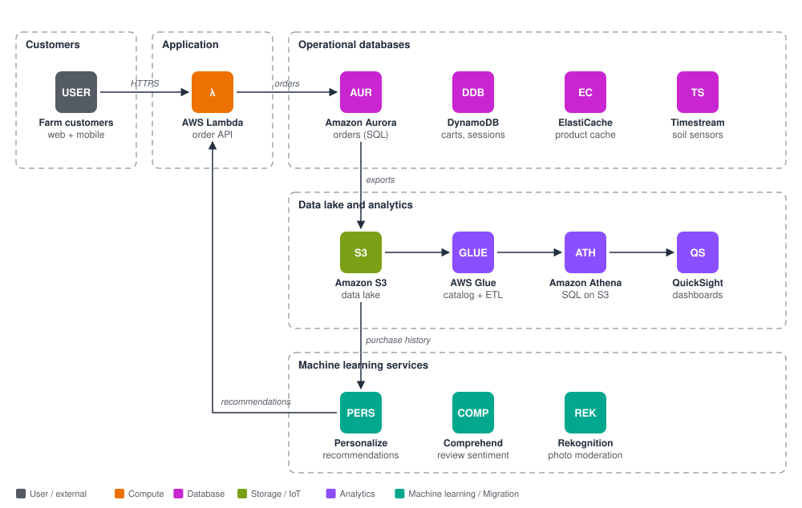
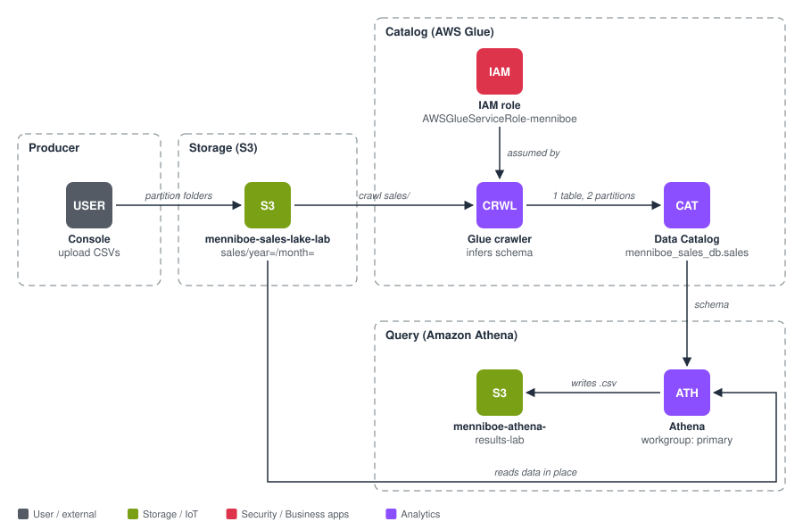

# AWS Databases, Data and Analytics, and Machine Learning

AWS Solutions Architect Associate (SAA-C03): Stephane Maarek course Sections 21–23. Running theme: **Menniboe Farm**, a farm business that grows into a regional co-op.

## What I learned

- **Choosing a database:** six filter questions map a workload to the right engine. Each data job gets a purpose-built store (polyglot persistence).
- **RDS, Aurora, ElastiCache:**
  - Multi-AZ is for availability, Read Replicas scale reads, and RDS Proxy fixes connection storms from Lambda.
  - Aurora Global Database handles cross-region DR.
  - ElastiCache caches with app code changes.
- **DynamoDB:** partition and sort key design, Query vs Scan, DAX for microsecond reads, Streams, Global Tables, TTL, PITR, and S3 for items over 400 KB.
- **Purpose-built databases:** DocumentDB (MongoDB), Keyspaces (Cassandra), Neptune (graph), Timestream (time series). QLDB is retired.
- **Analytics:**
  - Athena: serverless SQL on S3. Partitions, Parquet and compression cut scan cost.
  - Redshift: a warehouse with Spectrum and cross-region snapshots.
  - OpenSearch: search over DynamoDB.
  - EMR: Spot task nodes.
  - QuickSight: SPICE, plus column-level security.
  - Glue: crawlers, Data Catalog, ETL, Job Bookmarks.
  - Lake Formation: central row and column permissions.
  - MSK vs Kinesis, and Managed Service for Apache Flink.
  - The serverless IoT ingestion pipeline.
- **Machine learning:**
  - Rekognition + A2I, and Textract.
  - Transcribe, Polly, Translate, Comprehend and Comprehend Medical.
  - Lex + Connect, and Kendra.
  - Personalize vs SageMaker AI.

## Labs

| Lab | Built | Key result |
|---|---|---|
| **1. DynamoDB farm orders** | Table with PK `customerId` and SK `orderDate`, 3 items, Query vs Scan, TTL on `expiresAt` | Query: 2 scanned / 2 returned, **100% efficient, 0.5 RCU**. Scan: 3 scanned / 1 returned, **33% efficient, 2 RCU** |
| **2. Serverless data lake** | S3 partitioned CSVs → Glue crawler → Data Catalog → Athena | Crawler: 1 table, 2 partitions in 1 min 12 s. Partition filter cut data scanned from **0.22 KB to 0.11 KB (50%)** |

## Issues solved

- **Case-sensitive DynamoDB key name.** Caught before creating, since keys can't be changed later.
- **Syntax error in Create item.** It accepts one item per save.
- **Glue crawler pointed at the bucket root.** Corrected to `sales/`.
- **Athena result location reset.** Console query settings are a session override, so the location was set on the workgroup instead.
- **Zsh errors in the IAM cleanup scripts.** Variable splitting and `!` history expansion.
- **Leftover policies.** Wizard-created customer-managed IAM policies survive role deletion and had to be removed separately.

All resources were torn down and verified with the CLI.

## Files

| File | Contents |
|---|---|
| [notes.md](notes.md) | Full reference guide: all 14 modules with diagrams, pros/cons and connections; both labs step by step with screenshots, errors and fixes; cheat sheet; acronyms |
| [commands.md](commands.md) | Every command and SQL query, plus CLI equivalents for a redo, grouped by service |
| `images/diagrams/` | Architecture diagrams (SVG) |
| `images/screenshots/` | Lab screenshots (account IDs redacted) |
