# AWS Databases, Data and Analytics, and Machine Learning: Reference Guide

AWS Solutions Architect Associate (SAA-C03), Stephane Maarek course Sections 21–23. Running theme: **Menniboe Farm**, a farm business that grows into a regional co-op. Two hands-on labs: a DynamoDB orders table, and a serverless data lake with S3, Glue and Athena.

---

## Table of contents

- [Day architecture overview](#day-architecture-overview)
- **Part 1: Databases**
  - [Module 1: Choosing the right database](#module-1-choosing-the-right-database)
  - [Module 2: RDS, Aurora and ElastiCache](#module-2-rds-aurora-and-elasticache)
  - [Module 3: DynamoDB and S3 as a database](#module-3-dynamodb-and-s3-as-a-database)
  - [Module 4: Purpose-built databases](#module-4-purpose-built-databases)
- **Part 2: Data and analytics**
  - [Module 5: Amazon Athena](#module-5-amazon-athena)
  - [Module 6: Amazon Redshift](#module-6-amazon-redshift)
  - [Module 7: Amazon OpenSearch Service](#module-7-amazon-opensearch-service)
  - [Module 8: Amazon EMR](#module-8-amazon-emr)
  - [Module 9: Amazon QuickSight](#module-9-amazon-quicksight)
  - [Module 10: AWS Glue and AWS Lake Formation](#module-10-aws-glue-and-aws-lake-formation)
  - [Module 11: MSK, Managed Service for Apache Flink and the big data pipeline](#module-11-msk-managed-service-for-apache-flink-and-the-big-data-pipeline)
- **Part 3: Machine learning**
  - [Module 12: Rekognition and Textract](#module-12-rekognition-and-textract)
  - [Module 13: Language and speech services](#module-13-language-and-speech-services)
  - [Module 14: SageMaker AI and Personalize](#module-14-sagemaker-ai-and-personalize)
- **Lab 1: DynamoDB farm orders table**
  - [Lab 1 overview](#lab-1-overview)
  - [Lab 1 Step 1: Create the table](#lab-1-step-1-create-the-table)
  - [Lab 1 Step 2: Add items](#lab-1-step-2-add-items)
  - [Lab 1 Step 3: Query vs Scan](#lab-1-step-3-query-vs-scan)
  - [Lab 1 Step 4: Enable TTL](#lab-1-step-4-enable-ttl)
  - [Lab 1 Step 5: Teardown](#lab-1-step-5-teardown)
- **Lab 2: Serverless data lake with S3, Glue and Athena**
  - [Lab 2 overview](#lab-2-overview)
  - [Lab 2 Step 1: Create the two S3 buckets](#lab-2-step-1-create-the-two-s3-buckets)
  - [Lab 2 Step 2: Upload CSVs into partition folders](#lab-2-step-2-upload-csvs-into-partition-folders)
  - [Lab 2 Step 3: Create the Glue database](#lab-2-step-3-create-the-glue-database)
  - [Lab 2 Step 4: Create and run the Glue crawler](#lab-2-step-4-create-and-run-the-glue-crawler)
  - [Lab 2 Step 5: Set the Athena query result location](#lab-2-step-5-set-the-athena-query-result-location)
  - [Lab 2 Step 6: Query the data lake](#lab-2-step-6-query-the-data-lake)
  - [Lab 2 Step 7: Inspect the results bucket](#lab-2-step-7-inspect-the-results-bucket)
  - [Lab 2 Step 8: Teardown and verification](#lab-2-step-8-teardown-and-verification)
- [Troubleshooting log](#troubleshooting-log)
- [Service selection cheat sheet](#service-selection-cheat-sheet)
- [Acronyms](#acronyms)

---

## Day architecture overview


One business, many data jobs, each handled by the engine built for it. AWS calls this **polyglot persistence**:

| Layer | Service | Job at Menniboe Farm |
|---|---|---|
| Operational | Aurora | Orders and payments (transactions) |
| Operational | DynamoDB | Shopping carts and sessions (massive scale, flexible schema) |
| Operational | ElastiCache | Product catalog cache (microsecond reads) |
| Operational | Timestream | Soil sensor readings (time series) |
| Analytics | S3 + Glue + Athena + QuickSight | Sales data lake, SQL queries and dashboards |
| ML | Personalize, Comprehend, Rekognition | Recommendations, review sentiment, photo moderation |

---

# Part 1: Databases

## Module 1: Choosing the right database

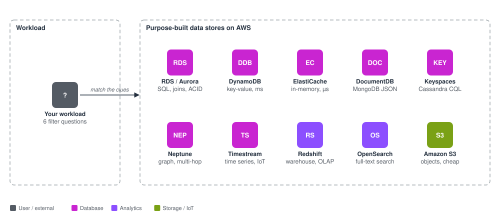

### What it means

AWS offers **purpose-built databases**, each tuned for one access pattern. Choosing well means reading the workload's requirements and matching them to an engine, not defaulting to a single database for everything.

### The 6 filter questions

1. **Workload pattern:** read-heavy, write-heavy or balanced? Steady or spiky throughput?
2. **Data size and lifespan:** how much data, how fast it grows, how long you keep it.
3. **Latency and concurrency:** milliseconds or seconds? How many concurrent users?
4. **Data model and queries:** joins? key lookups only? relationships? full-text search?
5. **Schema:** strict and enforced, or flexible and evolving?
6. **Durability and operations:** is it the source of truth? Who manages it? License costs?

### Database families

| Family | Clue words | AWS services |
|---|---|---|
| Relational (OLTP) | SQL, joins, transactions | RDS, Aurora |
| Key-value / NoSQL | Massive scale, millisecond latency, flexible schema | DynamoDB |
| In-memory | Microseconds, caching, sessions | ElastiCache, DAX |
| Document | JSON, MongoDB-compatible | DocumentDB |
| Wide-column | Apache Cassandra | Keyspaces |
| Graph | Relationships, social networks, fraud rings | Neptune |
| Time series | IoT readings, metrics over time | Timestream |
| Object store | Large files, cheap, durable | S3 |
| Warehouse / analytics (OLAP) | Reporting, aggregations on huge data | Redshift, Athena, EMR |
| Search | Full-text search, partial matches | OpenSearch |

### Pros and cons of polyglot persistence

| Pros | Cons |
|---|---|
| Each workload gets the right performance and cost profile | More services to operate, secure and monitor |
| Analytics runs separately from production databases | Data must be moved or synced between stores (exports, streams, ETL) |
| Teams can scale each store independently | More skills needed across the team |

### Real-world example

Menniboe Farm wants "customers who bought heirloom tomatoes also bought…", following customer → purchase → product relationships several hops deep with low latency. A relational database needs one more JOIN for every hop. A graph database (**Neptune**) stores the relationships directly, so it fits.

> [!TIP]
> **Exam clues:** "millisecond latency, millions of requests per second, flexible schema" → **DynamoDB**. "Social network, recommendations graph, fraud rings, knowledge graph, multiple hops" → **Neptune**.

---

## Module 2: RDS, Aurora and ElastiCache

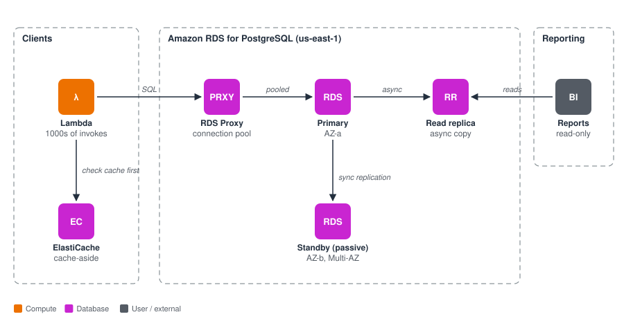

### What it means

- **RDS** is managed relational databases: PostgreSQL, MySQL, MariaDB, Oracle, SQL Server and Db2.
- **Aurora** is AWS's cloud-native MySQL/PostgreSQL-compatible engine.
- **ElastiCache** is a managed in-memory cache (Redis OSS, Valkey or Memcached) that sits in front of a database.

### RDS features that decide scenarios

| Feature | What it does | Use it when |
|---|---|---|
| **Multi-AZ** | Synchronous standby in another AZ with automatic failover. The standby is **passive** and serves no traffic | You need high availability and to survive an AZ failure |
| **Read Replicas** | Asynchronous copies (up to 15 for MySQL, MariaDB and PostgreSQL), can be cross-region | You need to scale reads, or reporting is slowing production |
| **RDS Proxy** | Pools and shares database connections; failover up to ~66% faster; IAM authentication with Secrets Manager; VPC-only | Lambda (or any spiky client) is exhausting connections |
| **RDS Custom** | OS-level access for Oracle and SQL Server | You must install custom software on the DB host |
| **Encryption at rest** | Chosen at launch with KMS | You need to encrypt data at rest |

> [!IMPORTANT]
> **Multi-AZ fixes availability, not connection overload.** The standby accepts no connections, so every client still hits the one primary. For "too many connections", use **RDS Proxy**.

> [!WARNING]
> **You can't enable encryption on a running unencrypted RDS instance.** Take a snapshot, copy the snapshot with encryption enabled, then restore a new instance from the encrypted copy.

### Aurora

- **Storage:** 6 copies across 3 AZs, and storage grows automatically.
- **Endpoints:** a **writer endpoint** for writes, and a **reader endpoint** that load-balances across up to 15 Aurora Replicas.
- **Aurora Serverless:** for unpredictable or intermittent workloads.
- **Global Database:** cross-region replication in about 1 second, and a secondary region can be promoted in under a minute.
- **Cloning:** a fast copy-on-write clone for test and staging.

### ElastiCache: Redis/Valkey vs Memcached

| | Redis OSS / Valkey | Memcached |
|---|---|---|
| High availability (Multi-AZ, replication) | Yes | No |
| Persistence and backups | Yes | No |
| Data structures | Rich (sorted sets for leaderboards) | Simple key-value |
| Threading | Single-threaded per shard | Multi-threaded |

> [!NOTE]
> ElastiCache needs **application code changes**. The app checks the cache first and falls back to the database (cache-aside, or lazy loading). Common uses are query caching, and session storage so app servers can stay stateless.

### How it connects

- Lambda → RDS Proxy → RDS.
- Reports → Read Replica, or the Aurora reader endpoint.
- App → ElastiCache → RDS/Aurora.
- Aurora/RDS snapshots → S3 export → Athena (Part 2).

### Pros and cons

| Service | Pros | Cons |
|---|---|---|
| RDS | Familiar SQL engines, managed backups and patching | Vertical scaling, a read-replica limit, you size the instances |
| Aurora | Faster, highly durable storage, Global Database, Serverless option | Costs more than RDS for small, steady workloads |
| ElastiCache | Microsecond reads, offloads the database | Code changes, cache invalidation logic, data can go stale |

### Real-world example

The farm's Aurora orders database slows every Monday when the weekly sales report runs. The fix: point the report at the **reader endpoint**, so checkout keeps the writer, and cache the product catalog in **ElastiCache**.

> [!TIP]
> **Exam clues:** "Lambda + too many connections" → **RDS Proxy**. "Survive an AZ failure" → **Multi-AZ**. "Scale reads" → **Read Replicas**. "DR in about 1 second, promote in under 1 minute" → **Aurora Global Database**. "Leaderboard" → **Redis**.

---

## Module 3: DynamoDB and S3 as a database

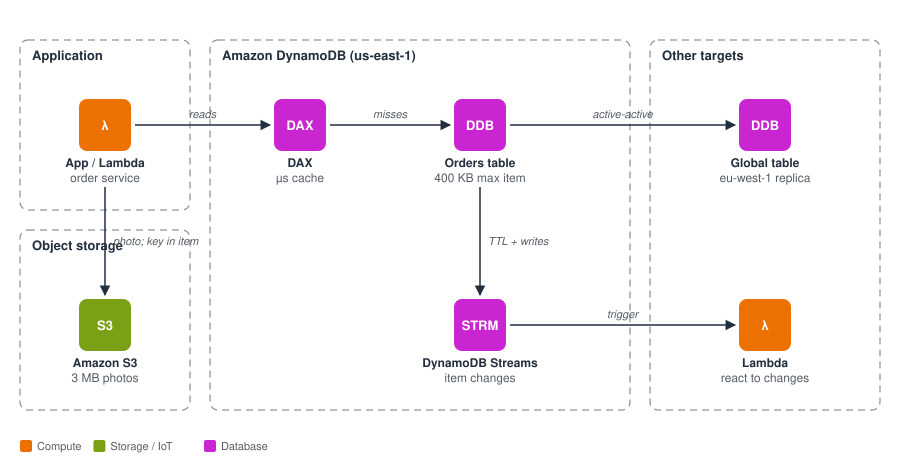

### What it means

DynamoDB is a serverless key-value / NoSQL database that scales to millions of requests per second with single-digit-millisecond latency.

### Core model

- **Primary key:** a partition key alone, or partition key + sort key (a **composite key**). The combination must be unique.
- The **partition key** is hashed to decide which partition stores the item.
- The **sort key** orders items within a partition, and enables range conditions like `begins_with` and `between`.
- **Max item size:** 400 KB. Attributes other than the keys are schemaless.

### Capacity modes

| Mode | Use when |
|---|---|
| **On-Demand** | Traffic is unknown or spiky; you pay per request |
| **Provisioned** (+ auto scaling) | Traffic is steady and predictable; cheaper at steady load |

A **Read Capacity Unit (RCU)** covers one strongly consistent read per second of up to 4 KB, or two eventually consistent reads.

### Key features

| Feature | What it does | Use it when |
|---|---|---|
| **DAX** | In-memory cache for DynamoDB, microsecond reads, same API | You need microsecond reads with minimal code change |
| **Streams** | An ordered log of item changes, which can trigger Lambda | You need to react to inserts and updates |
| **Global Tables** | Multi-region, active-active replication | You need low-latency reads and writes in several regions |
| **TTL** | Deletes items after an epoch timestamp, at no write cost | You need to expire sessions, carts or old data |
| **PITR** | Restore to any second in the last 1–35 days | You need to recover from an accidental write or delete |
| **Export to S3** | Bulk export without consuming RCUs (requires PITR) | You want to analyze the table with Athena |
| **GSI** | A Global Secondary Index, for queries on non-key attributes | You need frequent lookups by another attribute |

### DAX vs ElastiCache

- **DAX:** caches DynamoDB only, and needs almost no code change.
- **ElastiCache:** a general-purpose cache for any database. It needs code changes, and suits computed or aggregated results.

### S3 as a "database"

S3 is a key-value store for objects: the key is the object path, and the value is the file.

- **Good for:** large objects (up to 5 TB), static data, cheap storage with 11 nines of durability, and analytics through Athena.
- **Bad for:** frequent small updates, searching inside objects, and low-latency transactions.

### Pros and cons

| Pros | Cons |
|---|---|
| Serverless, scales automatically, millisecond latency | Access patterns must be designed up front (keys can't change) |
| Pay-per-request option, TTL, Streams, Global Tables | No joins; ad-hoc queries on non-key attributes need GSIs or Scans |
| Flexible schema | 400 KB item limit |

### Real-world example

Customers attach 3 MB photos of damaged produce to complaints. The photo goes to **S3**, and the S3 object key is stored in the DynamoDB order item as a pointer. Abandoned carts carry a **TTL** attribute and disappear after 24 hours.

> [!TIP]
> **Exam clues:** "DynamoDB + microseconds" → **DAX**. "Item over 400 KB" → **S3 + pointer**. "React to item changes" → **Streams + Lambda**. "Multi-region active-active" → **Global Tables**.

---

## Module 4: Purpose-built databases

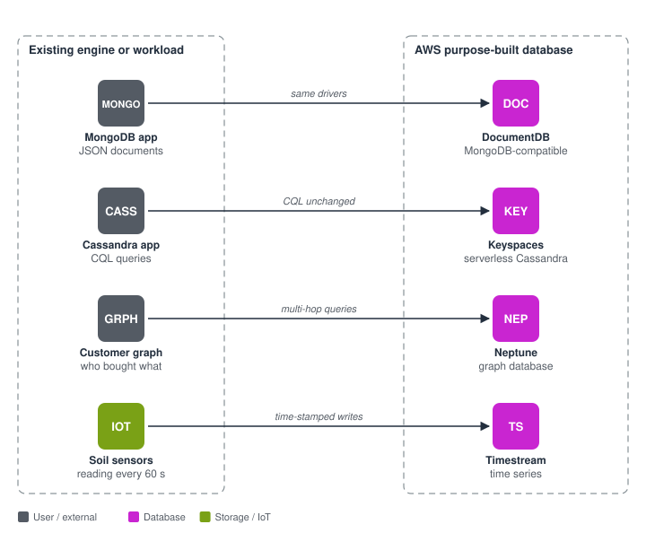

### What it means

When a workload already uses a specific engine, or has a specialized data shape, AWS has a managed service that "speaks" it.

| Service | What it is | Clue words | Key facts |
|---|---|---|---|
| **DocumentDB** | Document database, MongoDB-compatible | MongoDB, JSON documents | Aurora-style storage (6 copies across 3 AZs) |
| **Keyspaces** | Managed Apache Cassandra | Cassandra, CQL, wide-column | Serverless, single-digit ms, on-demand or provisioned |
| **Neptune** | Graph database | Relationships, social network, fraud rings, knowledge graph | Up to 15 read replicas, Neptune Streams |
| **Timestream** | Time-series database | IoT, sensor readings, telemetry | Recent data in a memory store, older data in a cheaper store |

### Engine drop-ins

| Existing engine | AWS service | Why not DynamoDB |
|---|---|---|
| MongoDB | DocumentDB | DynamoDB has its own API, so every query would be rewritten |
| Cassandra / CQL | Keyspaces | Same reason: DynamoDB doesn't understand CQL |
| MySQL / PostgreSQL | RDS or Aurora | DynamoDB has no SQL or joins |

> [!NOTE]
> **Service status changes:**
> - **QLDB** (Quantum Ledger Database, an immutable, cryptographically verifiable journal) reached end of support on **July 31, 2025**. Older practice questions may still map "immutable ledger" to QLDB.
> - **Timestream for LiveAnalytics** closed to new customers in 2025. **Timestream for InfluxDB** is the main offering now. For the exam, "time series" still means Timestream.

### Pros and cons

| Pros | Cons |
|---|---|
| Migrate an existing engine with little or no code change | Each is a separate service to learn and operate |
| A data model matched to the workload (graph, time series) | Compatibility isn't always 100% (check feature support) |

### Real-world example

| Farm need | Pick |
|---|---|
| Soil-moisture sensors report every 60 seconds | Timestream |
| An old inventory app runs on MongoDB | DocumentDB |
| A partner co-op's platform is built on Cassandra | Keyspaces |
| "Customers who bought X also bought Y" | Neptune |

> [!TIP]
> **Exam clue:** when the scenario names a source engine, pick the service that speaks it. **Cassandra → Keyspaces. MongoDB → DocumentDB.**

---

# Part 2: Data and analytics

## Module 5: Amazon Athena

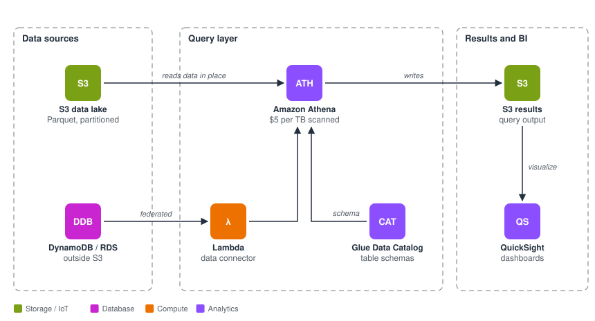

### What it means

Athena is a **serverless SQL query service** that runs directly against data **in S3**. There's nothing to load and no servers to manage. It reads table definitions from the **Glue Data Catalog** and writes every query result to S3.

### Key facts

- **Pricing:** about **$5 per TB of data scanned**, with a **10 MB minimum per query**.
- **Formats:** CSV, JSON, ORC, Avro, Parquet.
- **Workgroups:** separate teams, set the query result location, and enforce **data-scanned limits** for cost control.
- **Classic uses:** querying VPC Flow Logs, ALB logs, CloudTrail logs and S3 access logs.

### Performance and cost tuning

Every technique has one goal: **scan less data**.

| Technique | Why it helps |
|---|---|
| Columnar formats (Parquet, ORC) | Athena reads only the columns in the query (convert with Glue ETL) |
| Compression | Fewer bytes to scan |
| Partitioning (`s3://bucket/sales/year=2026/month=10/`) | Filters on partition columns skip whole folders (**partition pruning**) |
| Fewer, larger files (over about 128 MB) | Less per-file overhead than many tiny files |

### Federated Query

Athena can query data **outside S3** (DynamoDB, RDS, Redshift, ElastiCache, on-premises databases) through **Lambda-based data source connectors**. Results still land in S3.

### How it connects

- S3 (data) + Glue Data Catalog (schema) → Athena → S3 results bucket → QuickSight dashboards.

### Pros and cons

| Pros | Cons |
|---|---|
| Serverless, pay only per query | Cost and speed depend on data layout (partitions, formats) |
| Queries data in place, standard SQL | Not built for frequent, complex, join-heavy BI at scale (use Redshift) |
| Federated Query across sources | Not for transactional workloads |

### Real-world example

The co-op stores daily sales CSVs in S3 partitioned by `year/month`. "How many heirloom tomatoes did we sell in October?" reads only the `month=10` folder. Lab 2 proves this: the filtered query scanned **half** the data of the unfiltered one.

> [!TIP]
> **Exam clues:** "Reduce Athena cost" → **Parquet + compression + partitioning** (and larger files). "SQL across many sources without moving data" → **Athena Federated Query**.

---

## Module 6: Amazon Redshift

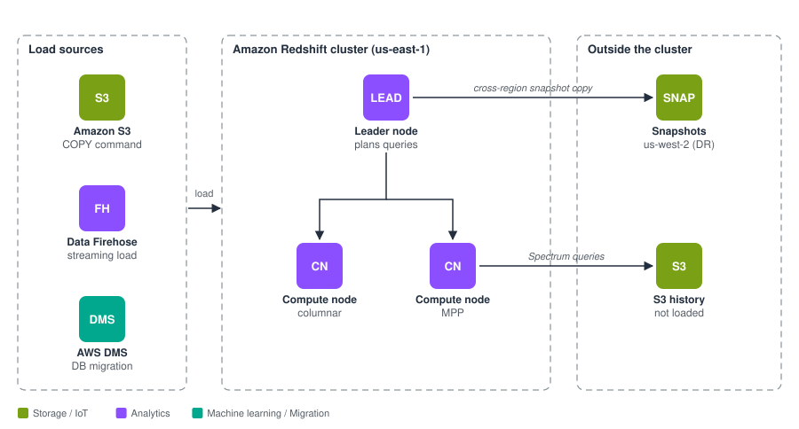

### What it means

Redshift is AWS's **data warehouse**, built for **OLAP**: complex analytics and aggregations across large volumes of historical data.

### How it works

- **Columnar storage + MPP** (Massively Parallel Processing): queries are split across nodes.
- **Leader node** plans the query and combines the results. **Compute nodes** store the data and do the work.
- **Provisioned clusters** (you choose the nodes) or **Redshift Serverless**.
- **Loading:** `COPY` from S3, Amazon Data Firehose for streaming, or DMS for database migration.

### Features

| Feature | What it does | Use it when |
|---|---|---|
| **Redshift Spectrum** | Queries S3 data from Redshift without loading it (needs a cluster) | You need to join warehouse tables with data in S3 |
| **Snapshots** | Incremental, stored in S3; automatic (about every 8 hours or 5 GB of changes) or manual | You need backups |
| **Cross-region snapshot copy** | Automatically copies snapshots to another region | You need DR in another region |
| **Enhanced VPC Routing** | Forces `COPY`/`UNLOAD` traffic through your VPC | You must keep load traffic private |

> [!WARNING]
> A **KMS-encrypted** cluster needs a **snapshot copy grant** in the destination region before cross-region snapshot copy works.

### Athena vs Redshift

| | Athena | Redshift |
|---|---|---|
| Model | Serverless, queries S3 as-is | Data is loaded into a warehouse |
| Best for | Ad-hoc queries, logs, occasional analysis | Frequent, complex joins, BI dashboards |
| Heavy query speed | Good | Faster (data is optimized in the warehouse) |

### Pros and cons

| Pros | Cons |
|---|---|
| Very fast analytics at scale, SQL, BI integrations | Loading pipelines, sizing (provisioned), higher baseline cost |
| Spectrum extends queries into S3 | Not for OLTP or single-row lookups |

### Real-world example

The co-op's hourly leadership dashboard joins 5 years of sales, supplier, weather and delivery data. That data goes into Redshift. Raw logs stay in S3 and are joined through Spectrum. Snapshots copy to **us-west-2** for DR.

> [!TIP]
> **Exam clues:** "Redshift DR in another region" → **cross-region snapshot copy**. Redshift has no read replicas.

---

## Module 7: Amazon OpenSearch Service

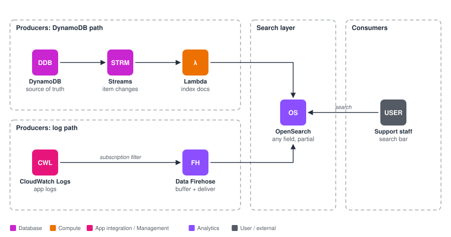

### What it means

OpenSearch (the successor to Elasticsearch) is managed **search and log analytics**. It can search **any field**, including **partial matches**, which DynamoDB can't do beyond its keys and indexes.

### Key facts

- Managed clusters or **OpenSearch Serverless**.
- Its own query language (SQL through a plugin), plus **OpenSearch Dashboards**.
- Security: Cognito, IAM, KMS at rest, TLS in transit.
- Usually a **complement** to another database, which stays the source of truth.

### Common pipelines

| Pattern | Flow |
|---|---|
| Search over DynamoDB | DynamoDB → Streams → Lambda → OpenSearch. Search returns IDs; fetch the full items from DynamoDB |
| Log analytics | CloudWatch Logs → subscription filter → Lambda or Firehose → OpenSearch |
| Streaming ingestion | Kinesis Data Streams → Firehose → OpenSearch |

### Pros and cons

| Pros | Cons |
|---|---|
| Full-text, fuzzy and partial search; fast log analytics | A separate copy of the data to keep in sync |
| Built-in dashboards | Cluster sizing and cost (unless you use Serverless) |

### Real-world example

A farm store search bar where "organ pep" finds "organic peppers": DynamoDB Streams feed changes to OpenSearch through Lambda.

> [!TIP]
> **Exam clue:** "Search any field / full-text / partial match on DynamoDB data" → **Streams → Lambda → OpenSearch**.

---

## Module 8: Amazon EMR

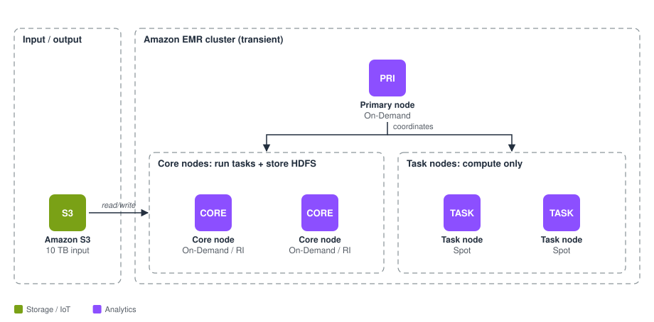

### What it means

EMR (Elastic MapReduce) runs managed **big data clusters** (Spark, Hadoop, Hive, HBase, Presto, Flink) for large-scale ETL, machine learning, web indexing and log processing. Options: EMR on EC2, EMR Serverless and EMR on EKS.

### Node types and purchasing

| Node | Role | Purchasing |
|---|---|---|
| **Primary** | Manages the cluster and coordinates tasks | On-Demand (Reserved for long-running clusters) |
| **Core** | Runs tasks **and stores HDFS data** | On-Demand or Reserved |
| **Task** (optional) | Runs tasks only, **no data** | **Spot** (an interruption loses only in-progress work) |

**Cluster styles:**

- **Long-running:** always on, and a good fit for Reserved Instances.
- **Transient:** launched for a job, then terminated.

### Pros and cons

| Pros | Cons |
|---|---|
| Full open-source big data stack, massive scale | More to manage than Glue or Athena; tuning needed |
| Spot task nodes cut cost sharply | The primary and core nodes are single points you must protect |

### Real-world example

A nightly Spark job on 10 TB of sensor, weather and sales data runs on a **transient** cluster: On-Demand primary and core nodes, plus **Spot** task nodes. It's terminated when the job is done.

> [!TIP]
> **Exam clue:** "EMR + cut cost + tolerate interruption + no data loss" → **Spot for task nodes**.

---

## Module 9: Amazon QuickSight

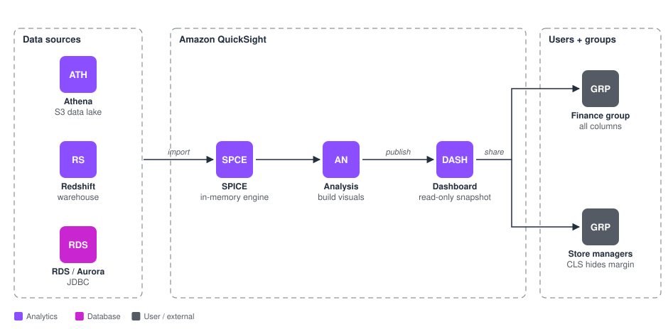

### What it means

QuickSight is AWS's serverless, ML-powered **BI (Business Intelligence)** service for interactive dashboards, billed per user or per session.

> [!NOTE]
> **Name change:** in October 2025 QuickSight became part of **Amazon Quick Suite** (since shortened to **Amazon Quick**). The BI capability continues as **Amazon Quick Sight**. Dashboards, datasets and SPICE work the same way, and the SAA-C03 exam still says **QuickSight**.

### Key facts

- **SPICE:** an in-memory engine used when you **import** data, for fast dashboards.
- **Enterprise edition:** adds **Column-Level Security (CLS)** and **Row-Level Security (RLS)**.
- **Sources:** RDS/Aurora, Athena, Redshift, S3, OpenSearch, Timestream, SaaS apps, on-premises databases via JDBC, and file uploads.
- **ML insights:** anomaly detection, forecasting, natural-language questions.

### Users and sharing

- QuickSight **users and groups exist only inside QuickSight**. They aren't IAM users; IAM only administers the service.
- You build an **analysis** and publish it as a **dashboard**, a read-only snapshot.
- You share the dashboard with users or groups, who also need access to the underlying data.

### Pros and cons

| Pros | Cons |
|---|---|
| Serverless, pay per user or session | Its own user model to manage |
| SPICE speed, CLS and RLS, ML insights | Advanced security features need Enterprise |

### Real-world example

Regional store managers see a sales dashboard, but **CLS** hides `profit_margin` from everyone except the finance group.

> [!TIP]
> **Exam clues:** "BI dashboards for business users" → **QuickSight**. "Hide a column" → **Enterprise + CLS**. "Share a dashboard" → a **QuickSight user or group**, not an IAM user.

---

## Module 10: AWS Glue and AWS Lake Formation

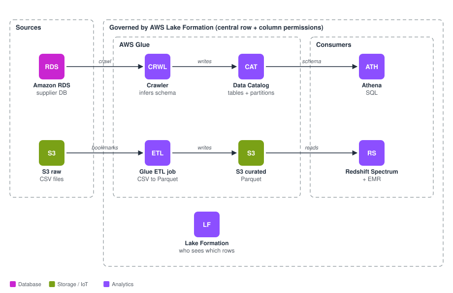

### What it means

- **AWS Glue** is **serverless ETL** (Extract, Transform, Load) plus the **Data Catalog**, the central metadata store that Athena, Redshift Spectrum and EMR read.
- **AWS Lake Formation**, built on Glue, sets up a **data lake** quickly and centralizes **fine-grained permissions**.

### Glue components

| Component | What it does |
|---|---|
| **Data Catalog** | Databases and tables: column names, types, partitions, S3 location |
| **Crawlers** | Scan S3, RDS, DynamoDB or JDBC sources and create or update catalog tables automatically |
| **ETL jobs** | Transform data, for example CSV → Parquet, and load it to S3 or Redshift |
| **Job Bookmarks** | Track what was already processed, so reruns only pick up new data |
| **Glue Studio** | A visual editor for building ETL jobs |
| **Glue DataBrew** | No-code data cleaning with 250+ prebuilt transformations |
| **Streaming ETL** | Spark Structured Streaming from Kinesis Data Streams, MSK or Kafka |

**Event-driven pattern:** S3 PUT → EventBridge or Lambda → start a Glue job.

### Lake Formation

- Blueprints to ingest from S3, RDS and other databases.
- Deduplication with ML Transforms (FindMatches).
- **Row-level and column-level permissions defined once**, then enforced across Athena, Redshift Spectrum, EMR and QuickSight, instead of separate bucket policies and IAM rules per tool.

### Pros and cons

| Service | Pros | Cons |
|---|---|---|
| Glue | Serverless, catalog shared by many tools, crawlers infer schemas | Crawler and ETL costs (per DPU-hour); inferred types sometimes need fixing |
| Lake Formation | Central fine-grained governance, faster data lake setup | Another permission layer to understand alongside IAM |

### Real-world example

The co-op catalogs sales CSVs with a crawler. A nightly Glue job converts them to Parquet with **Job Bookmarks** enabled. Lake Formation lets finance see `price` while drivers can't. Lab 2 builds the crawler-and-catalog half of this.

> [!TIP]
> **Exam clues:** "Serverless ETL / CSV → Parquet" → **Glue ETL**. "Central metadata for Athena and EMR" → **Glue Data Catalog** (+ crawlers). "Don't reprocess old data" → **Job Bookmarks**. "Data lake fast + central row/column permissions" → **Lake Formation**.

---

## Module 11: MSK, Managed Service for Apache Flink and the big data pipeline

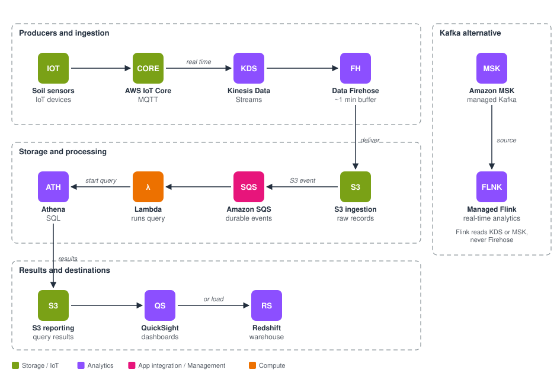

### Amazon MSK

MSK (Managed Streaming for Apache Kafka) is fully managed **Apache Kafka**. AWS runs the brokers across up to 3 AZs and recovers from common failures. Data is stored on EBS for as long as you want. **MSK Serverless** removes capacity management.

### Kinesis Data Streams vs MSK

| | Kinesis Data Streams | Amazon MSK |
|---|---|---|
| Message size | 1 MB limit | 1 MB default, configurable higher |
| Unit of scale | Shards (split and merge) | Topics with partitions (you can only add) |
| In-flight encryption | TLS | Plaintext or TLS |
| Retention | Up to 365 days | As long as you want (EBS) |
| Best for | AWS-native, simple streaming | Existing Kafka workloads, larger messages |

### Amazon Managed Service for Apache Flink

Formerly Kinesis Data Analytics for Apache Flink. It runs Flink applications (Java, Scala, SQL, Python) for **real-time stream processing**. It reads from **Kinesis Data Streams or MSK**, but **not from Firehose**.

> [!NOTE]
> **Kinesis Data Analytics for SQL applications** was discontinued: no new apps after October 15, 2025, and existing apps were deleted starting January 27, 2026. Managed Service for Apache Flink replaces it.

### The big data ingestion pipeline

1. **IoT devices** send data to **IoT Core**.
2. IoT Core pushes it to **Kinesis Data Streams** in real time.
3. **Amazon Data Firehose** buffers the data (about 1 minute) and delivers it to an **S3 ingestion bucket**, with optional Lambda transforms.
4. An S3 event (optionally through **SQS** for durability) triggers **Lambda**.
5. Lambda runs an **Athena** query.
6. Athena writes the results to an **S3 reporting bucket**.
7. **QuickSight** visualizes the results, or they're loaded into **Redshift**.

### Pros and cons

| Pros | Cons |
|---|---|
| Fully serverless; scales with volume; pay per use | Several services to wire together and secure with IAM |
| Near real-time insights | Firehose buffering adds about a minute of latency |

> [!TIP]
> **Exam clues:** "Kafka" or "messages over 1 MB" → **MSK**. "Real-time Flink analytics" → **Managed Service for Apache Flink** (from KDS or MSK). "Serverless IoT ingest, query and dashboard" → the pipeline above.

---

# Part 3: Machine learning

On SAA-C03, ML questions test **which managed AI service fits the job**, not model building. Learn each service by its verb: **see, read, listen, speak, translate, understand, chat, search, recommend, build.**

## Module 12: Rekognition and Textract

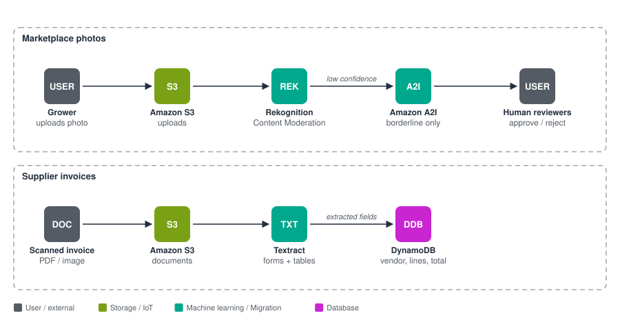

### Amazon Rekognition ("see")

Finds objects, people, text and scenes in **images and videos**:

- Labels (objects and scenes).
- Facial analysis and facial search (user verification).
- Text in images.
- Celebrity recognition.
- Pathing (tracking movement in video).

**Content Moderation** detects inappropriate or offensive content. You set a **minimum confidence threshold**, and borderline items go to human reviewers through **Amazon Augmented AI (A2I)**.

### Amazon Textract ("read documents")

Extracts **text, handwriting, forms (key-value pairs) and tables** from scanned documents and PDFs. Typical documents: invoices, financial reports, medical records, insurance claims, tax forms, IDs and passports.

| Clue | Service |
|---|---|
| Objects, faces, scenes, unsafe content in photos or video | Rekognition |
| Text, forms, tables, handwriting from documents | Textract |

### Real-world example

Grower photo uploads are labeled and moderated by **Rekognition**, and borderline ones go to **A2I** for human review. Scanned supplier invoices go through **Textract**, which pulls out the vendor, line items and totals.

---

## Module 13: Language and speech services

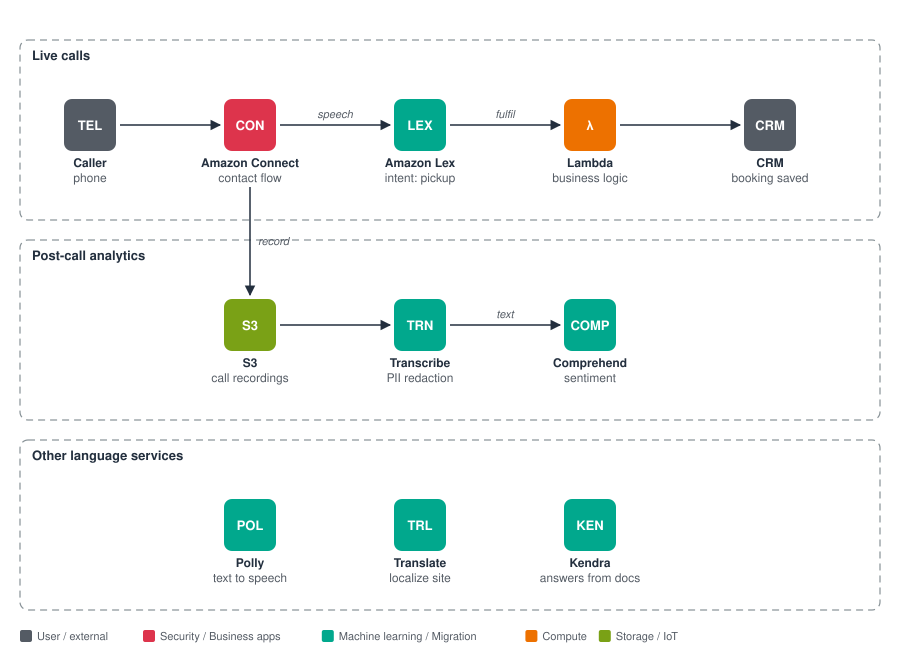

| Service | Verb | What it does | Key features |
|---|---|---|---|
| **Transcribe** | Listen | Speech → text (ASR) | **Automatic PII redaction**, automatic language identification, captions |
| **Polly** | Speak | Text → lifelike speech | **Lexicons** (how a word is pronounced), **SSML** (how speech is delivered: pauses, emphasis, whispering) |
| **Translate** | Translate | Language translation | Localizing websites and apps |
| **Comprehend** | Understand text | NLP: language, entities, key phrases, **sentiment**, topics | Custom classification and entity recognition |
| **Comprehend Medical** | Understand clinical text | Insights from doctor's notes and test results | Detects **PHI** (DetectPHI API) |
| **Lex** | Chat | Chatbots with ASR + NLU (intent recognition) | Same technology as Alexa |
| **Connect** | Call center | Cloud contact center, contact flows, CRM integration | No upfront payments |
| **Kendra** | Search documents | ML document search with **natural-language answers** | Learns from user feedback |

> [!IMPORTANT]
> **Easy pairs to mix up:**
> - Polly (text → speech) and Transcribe (speech → text) are mirror opposites.
> - Lexicons control pronunciation; SSML controls delivery.
> - Kendra answers natural-language questions from documents; OpenSearch does keyword search and log analytics.

### Real-world example

- A caller says "schedule a pickup." **Connect** answers the call, **Lex** finds the intent, and **Lambda** books it in the CRM.
- The recordings go through **Transcribe** with PII redaction, and **Comprehend** scores the sentiment.
- **Polly** reads farm announcements, with a lexicon so "Menniboe" is pronounced correctly.
- Staff ask **Kendra** policy questions and get answers from internal PDFs.

---

## Module 14: SageMaker AI and Personalize

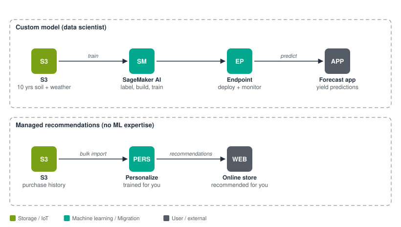

### Amazon SageMaker AI ("build")

A fully managed service for data scientists to **label data, build, train, tune, deploy and monitor** custom ML models. Amazon SageMaker was renamed **SageMaker AI** in December 2024.

### Amazon Personalize ("recommend")

A fully managed **real-time recommendation** service, using the same technology as Amazon.com:

- Ingest data from S3 (bulk) or the API (real time).
- Integrates with websites, apps, SMS and email.
- Live in **days**, with no ML expertise needed.

| Clue | Service |
|---|---|
| Custom model, data scientists, full control | SageMaker AI |
| Personalized recommendations, no ML expertise, fast | Personalize |
| Traverse relationships you store yourself (graph) | Neptune |

### Real-world example

The co-op's data scientist trains a **crop-yield forecasting** model in SageMaker AI. Meanwhile, the online store adds "recommended for you" produce boxes with **Personalize**, fed by purchase history in S3.

---

# Lab 1: DynamoDB farm orders table

## Lab 1 overview

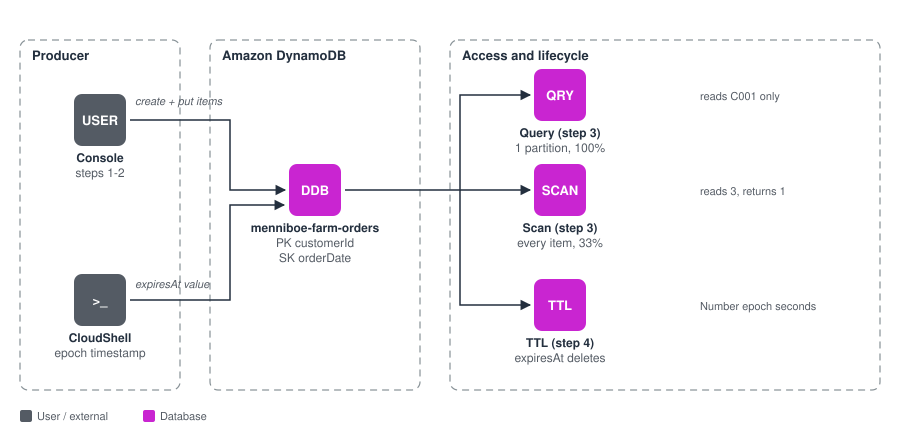

**Goal:** design a partition key and sort key, add orders, compare a **Query** with a **Scan**, and expire an item with **TTL**.

**What it proves:**

- Key design decides cost and speed.
- A Query reads one partition; a Scan reads everything.
- TTL cleans up data automatically.

| Item | Value |
|---|---|
| Region | us-east-1 (N. Virginia) |
| Table | `menniboe-farm-orders` |
| Cost | On-demand with 3 items: pennies at most |
| Tags | `Project` = `SAA-Day2` |

**How the steps connect:**

1. Create the table (the keys decide the layout).
2. Add items (they land in partitions by key).
3. Query vs Scan (the payoff of the key design).
4. TTL (lifecycle of that same data).
5. Teardown.

---

## Lab 1 Step 1: Create the table

**Why this step:** the partition key (`customerId`) decides which partition stores each order. The sort key (`orderDate`) keeps one customer's orders in date order inside that partition. **Keys can't be changed after the table is created**, so this is the lab's most important design choice.

**Console:** DynamoDB → **Tables** → **Create table**

| Section | Field | Value |
|---|---|---|
| Table details | Table name | `menniboe-farm-orders` |
| Table details | Partition key | `customerId` (String) |
| Table details | Sort key | `orderDate` (String) |
| Table settings | | **Customize settings** |
| Table class | | DynamoDB Standard |
| Capacity calculator | | Leave defaults (estimate only) |
| Read/write capacity settings | Capacity mode | **On-demand** |
| Maximum table throughput | | Leave both unchecked |
| Warm throughput | Read and write | Keep default values |
| Secondary indexes | | None |
| Vector indexes | | None |
| Encryption at rest | | **AWS-owned key** |
| Deletion protection | | Unchecked |
| Resource-based policy | | Leave empty |
| Tags | | `Project` = `SAA-Day2` |

Click **Create table**.

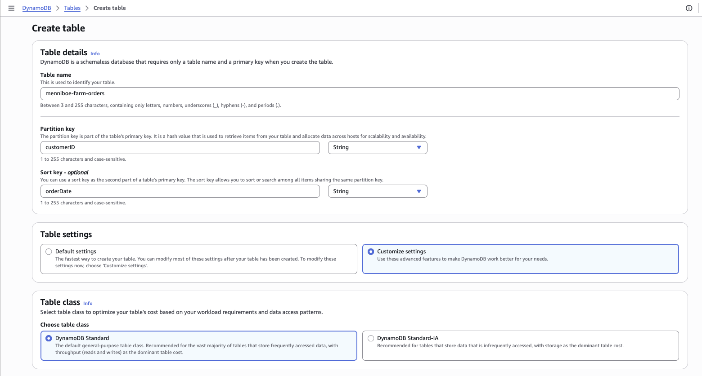

> [!WARNING]
> **Error caught before creating: key name case.** The partition key was typed as `customerID`, but the design is `customerId`. DynamoDB attribute names are **case-sensitive**, and keys can't be edited later. An item written with `customerId` would be rejected for a missing key.
> **Fix:** retype the key as `customerId` before clicking **Create table**.

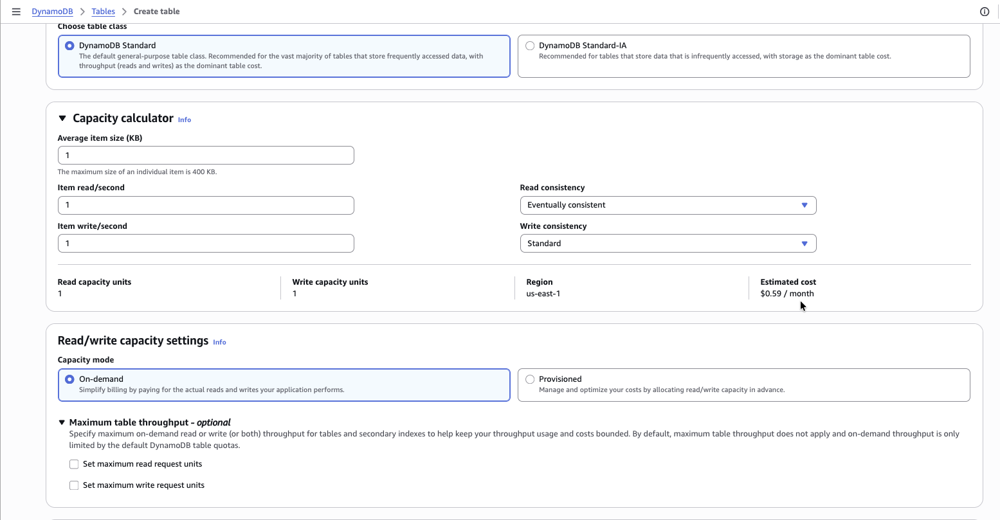

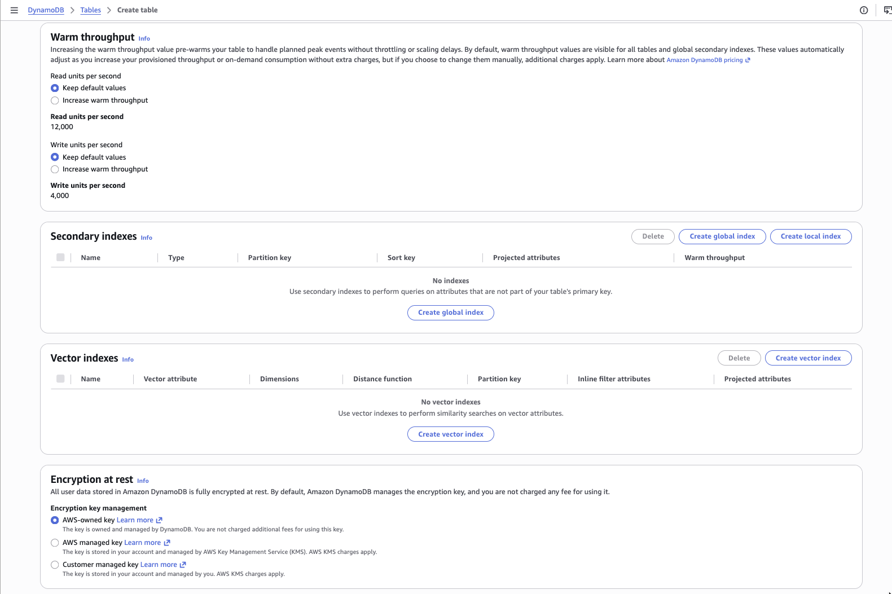

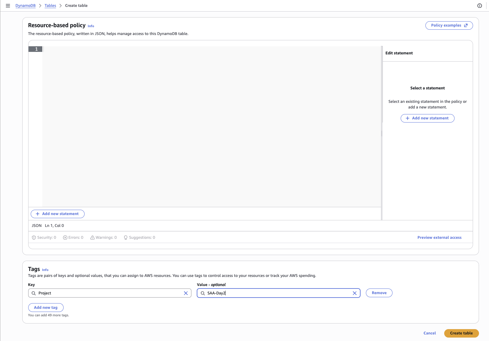

> [!NOTE]
> - The **capacity calculator** estimate ($0.59/month here) is for Provisioned mode; On-demand bills only actual requests.
> - **Vector indexes** are a newer DynamoDB feature for similarity search in AI apps. They're not needed here.

**Result:** the table is **Active**, with partition key `customerId (String)`, sort key `orderDate (String)`, item count 0 and PITR off.

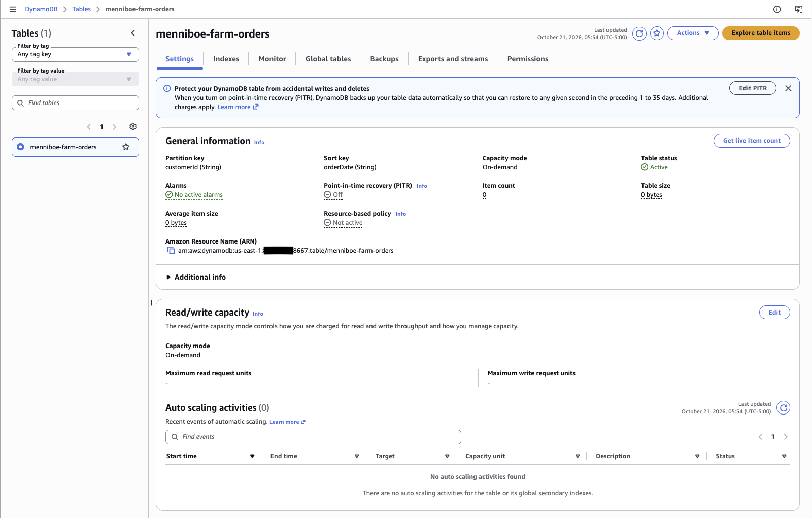

---

## Lab 1 Step 2: Add items

**Why this step:** items with the same `customerId` land in the **same partition**, sorted by `orderDate`. The attributes `product`, `qty` and `total` were never defined, which shows DynamoDB's flexible schema.

**Console:** **Explore table items** → **Create item** → **JSON view** → turn **off** "View DynamoDB JSON" → paste **one** item → **Create item**. Repeat for each item.

```json
{ "customerId": "C001", "orderDate": "2026-10-01", "product": "heirloom tomatoes", "qty": 5, "total": 22.50 }
```

```json
{ "customerId": "C001", "orderDate": "2026-10-15", "product": "organic peppers", "qty": 3, "total": 9.00 }
```

```json
{ "customerId": "C002", "orderDate": "2026-10-10", "product": "sweet corn", "qty": 12, "total": 18.00 }
```

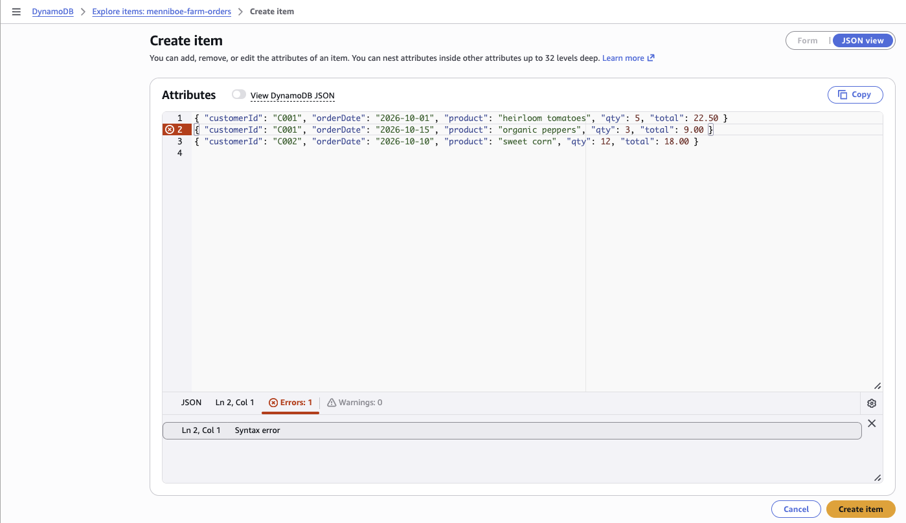

> [!WARNING]
> **Error: `Ln 2, Col 1 — Syntax error`.** All three JSON objects were pasted into one Create item editor. The editor accepts **exactly one item**, which is one JSON object, so the parser failed at the `{` on line 2.
> **Fix:** create the items one at a time. Bulk loads use `BatchWriteItem` (CLI/SDK, up to 25 items per call) or an import from S3.

**Result:** three items in the table.

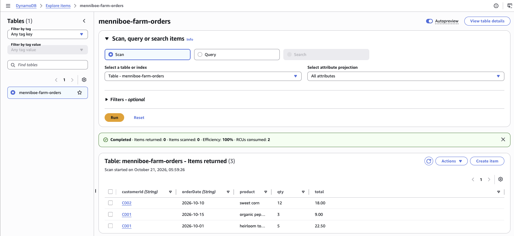

> [!NOTE]
> - **Uniqueness:** C001 has two orders because the **composite key** (`customerId` + `orderDate`) is unique. Writing C001 + 2026-10-01 again would **overwrite** Item 1.
> - **Order:** a Scan returns partitions in **hash order** (C002 before C001), not alphabetical order.
> - **Stale banner:** a banner showing "Items returned: 0" came from the autopreview scan that ran *before* the items were added.

---

## Lab 1 Step 3: Query vs Scan

**Why this step:** a **Query** uses the partition key to go straight to one partition. A **Scan** ignores the keys, reads every item, then filters. The banner's **Items scanned** and **Efficiency** values show the difference.

**Query (console):** Explore items →

| Field | Value |
|---|---|
| Mode | **Query** |
| Table or index | Table - menniboe-farm-orders |
| Partition key `customerId` | `C001` |
| Sort key `orderDate` | **Begins with** `2026-10` |
| Sort descending | Unchecked |
| Filters | None (remove any empty filter row) |

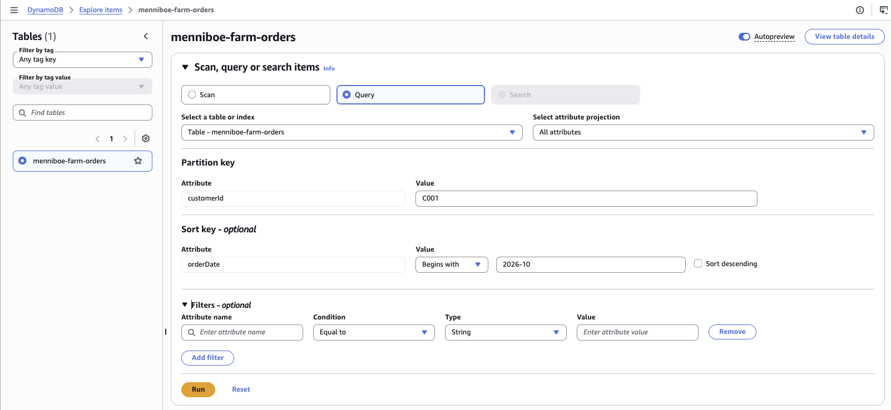

> [!TIP]
> An **empty filter row** under Filters can cause a validation error. Click **Remove**, or collapse Filters, before running a Query.

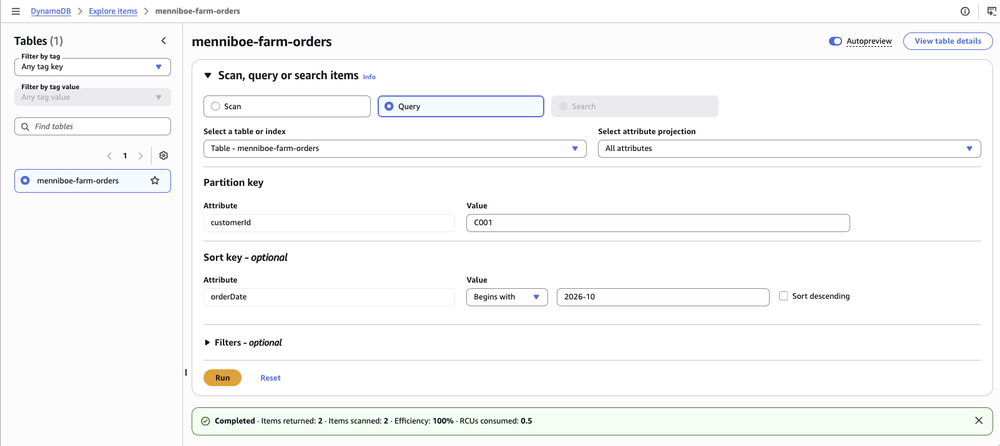

**Scan (console):**

| Field | Value |
|---|---|
| Mode | **Scan** |
| Filter | `product` · Equal to · String · `sweet corn` |

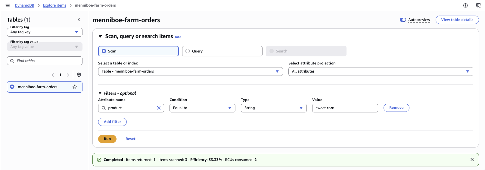

### Results

| | Query (C001) | Scan (product = sweet corn) |
|---|---|---|
| Items scanned | 2 | **3** (whole table) |
| Items returned | 2 | 1 |
| Efficiency | **100%** | **33.33%** |
| RCUs consumed | 0.5 | 2 |

**What the results mean:**

- **0.5 RCU:** two small items read with eventually consistent reads (the console default) fit in one 4 KB read, which costs half an RCU.
- **You pay for items scanned, not items returned.** On a large table a Scan reads everything to return little. For frequent lookups on a non-key attribute, add a **GSI**.

> [!NOTE]
> **"An item disappeared" after a Scan:** nothing was deleted. The results list shows **only what the last operation returned**. A plain Scan with no filter shows all items again.

---

## Lab 1 Step 4: Enable TTL

**Why this step:** this covers the end of the data's lifecycle. DynamoDB deletes an item after the epoch time in its TTL attribute, in the background, at **no write cost**. A real use is expiring abandoned carts.

### 4a. Get an epoch timestamp (CloudShell)

```bash
date -d '+10 minutes' +%s
```

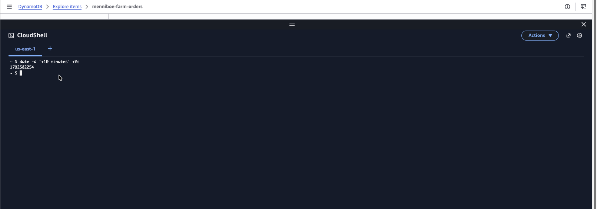

### 4b. Add the TTL attribute to one item

Explore items → open **C002** → JSON view → add `expiresAt` as a **Number** (no quotes) → **Save changes**.

```json
{ "customerId": "C002", "orderDate": "2026-10-10", "product": "sweet corn", "qty": 12, "total": 18.00, "expiresAt": 1792582254 }
```

> [!IMPORTANT]
> TTL only works on a **Number** attribute in **epoch seconds**. A quoted value (a String) is silently ignored, and the item never expires.

### 4c. Turn on TTL

**View table details** → **Settings** → **Time to Live (TTL)** → **Turn on**

| Field | Value |
|---|---|
| TTL attribute name | `expiresAt` |
| Preview: simulated date and time | An epoch value after the item's timestamp (for example now + 24 hours) |

Click **Run preview**, then **Turn on TTL**.

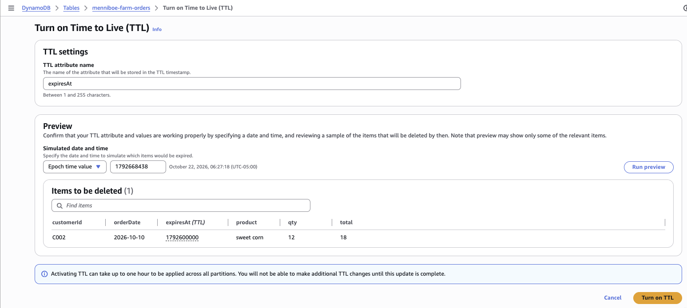

> [!WARNING]
> **Value mismatch:** the preview showed `expiresAt` = `1792600000`, the placeholder from the example JSON, not the CloudShell value `1792582254`. It still worked because it was in the future, but the item expires about 5 hours later than intended.
> **Habit:** compare pasted values with your own command output before saving.

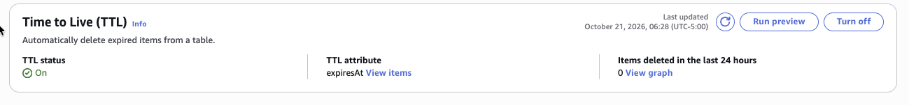

> [!NOTE]
> - Activating TTL can take **up to an hour** across partitions.
> - Expired items are deleted **within a few days**, not instantly, and can still appear in reads until then.
> - TTL deletions show up in DynamoDB Streams as system deletes, so you could archive them to S3 with Lambda.

---

## Lab 1 Step 5: Teardown

**Why this step:** the lab is proven. Deleting lab resources keeps the account clean.

**Console:** Tables → select `menniboe-farm-orders` → **Actions** → **Delete table**

| Option | Value |
|---|---|
| Delete all CloudWatch alarms for this table | Checked |
| Create an on-demand backup before deleting | **Unchecked** |
| Confirmation | `confirm` |

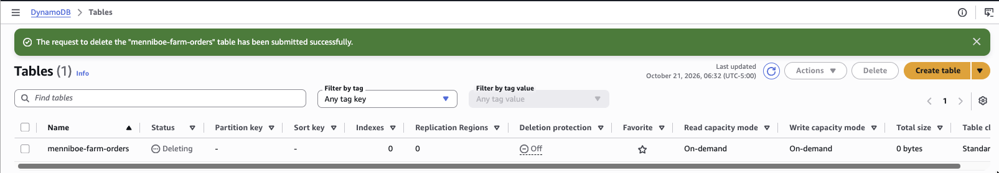

**Verify:**

```bash
aws dynamodb describe-table --table-name menniboe-farm-orders
# Expected: ResourceNotFoundException ... Requested resource not found
```

---

# Lab 2: Serverless data lake with S3, Glue and Athena

## Lab 2 overview


**Goal:** store partitioned farm sales CSVs in S3, catalog them with a Glue crawler, and query them with Athena, comparing data scanned with and without a partition filter.

**What it proves:**

- S3 stores, Glue describes, Athena queries in place.
- The Data Catalog is the "map" Athena relies on.
- Partition filters reduce the data scanned, which is what Athena bills on.

| Item | Value |
|---|---|
| Region | us-east-1 |
| Data bucket | `menniboe-sales-lake-lab` |
| Results bucket | `menniboe-athena-results-lab` |
| Glue database / table | `menniboe_sales_db` / `sales` |
| Crawler / IAM role | `menniboe-sales-crawler` / `AWSGlueServiceRole-menniboe` |
| Athena workgroup | `primary` |
| Tags | `Project` = `SAA-Day2` |
| Cost | A few cents (crawler about 0.04 DPU-hours; Athena 10 MB minimum per query) |

---

## Lab 2 Step 1: Create the two S3 buckets

**Why this step:** S3 is the data lake's storage layer. Athena writes every query result to S3, so it gets its **own bucket**. That keeps output separate from source data, so the crawler never catalogs Athena's results by mistake.

**Console:** S3 → **Create bucket** (repeat for each bucket name)

| Section | Value |
|---|---|
| Bucket type | General purpose |
| Bucket name | `menniboe-sales-lake-lab`, then `menniboe-athena-results-lab` (names are global; add a unique suffix if taken) |
| Object Ownership | ACLs disabled (recommended) |
| Block Public Access | Block all public access: **checked** |
| Bucket Versioning | Disable |
| Tags | `Project` = `SAA-Day2` |
| Default encryption | SSE-S3, Bucket Key **Enable** |
| Advanced: Object Lock | Disable |

---

## Lab 2 Step 2: Upload CSVs into partition folders

**Why this step:** the **Hive-style folder names** (`year=2026/month=10/`) are what Glue turns into **partition columns**, and what lets Athena skip folders. S3 "folders" are really **key prefixes**.

**September** (`sales/year=2026/month=09/sales.csv`):

```
order_id,product,quantity,price
901,heirloom tomatoes,4,4.50
902,sweet corn,10,1.50
903,organic peppers,2,3.00
```

**October** (`sales/year=2026/month=10/sales.csv`):

```
order_id,product,quantity,price
1001,heirloom tomatoes,5,4.50
1002,organic peppers,3,3.00
1003,sweet corn,12,1.50
```

**Console:** open `menniboe-sales-lake-lab`, then:

1. **Create folder** → `sales`.
2. Inside it, create `year=2026`.
3. Inside that, create `month=09` and `month=10`.
4. **Upload** each `sales.csv` (saved as plain text) into its month folder.

**CloudShell alternative (same result):** see [commands.md](commands.md#s3-data-lake).

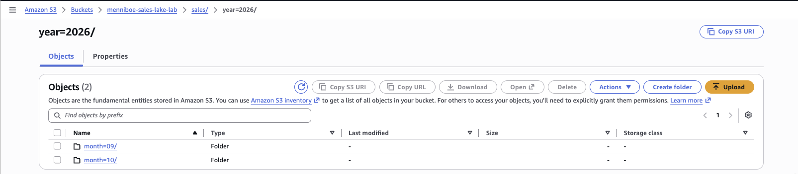

**Result:**

```
$ aws s3 ls s3://menniboe-sales-lake-lab/ --recursive
2026-10-21 23:12:55          0 sales/
2026-10-21 23:13:41          0 sales/year=2026/
2026-10-21 23:14:24          0 sales/year=2026/month=09/
2026-10-21 23:15:13        110 sales/year=2026/month=09/sales.csv
2026-10-21 23:14:41          0 sales/year=2026/month=10/
2026-10-21 23:15:45        113 sales/year=2026/month=10/sales.csv
```

> [!NOTE]
> The **0-byte keys ending in `/`** are folder markers created by the console's **Create folder** button. They hold no data and the crawler ignores them.

---

## Lab 2 Step 3: Create the Glue database

**Why this step:** the database is the container in the Data Catalog that the crawler writes the table into.

**Console:** AWS Glue → **Data Catalog** → **Databases** → **Add database**

| Field | Value |
|---|---|
| Database type | **Glue Database** |
| Name | `menniboe_sales_db` |
| Description | `Day 2 farm sales data lake` |
| Location | Leave blank |

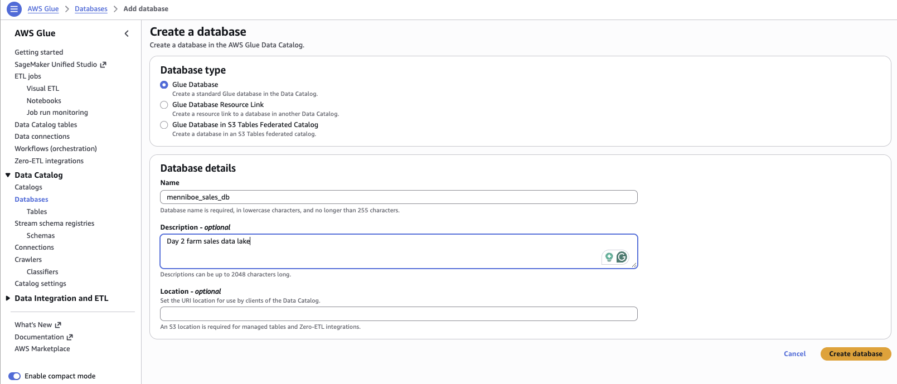

> [!TIP]
> - Use **underscores, not hyphens**. Athena reads an unquoted hyphen as a minus sign.
> - The other database types are a **Resource Link** (to a database in another account's catalog) and **S3 Tables Federated Catalog** (Apache Iceberg S3 Tables).
> - The catalog ID is your account ID: each account has one default Data Catalog per region.

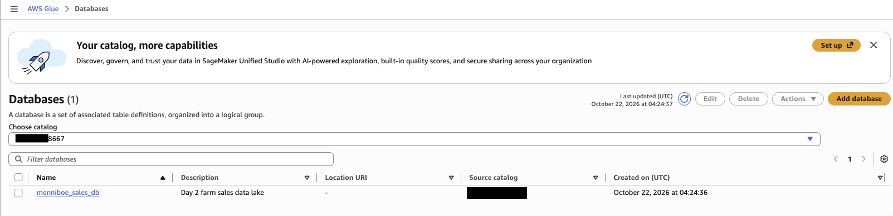

---

## Lab 2 Step 4: Create and run the Glue crawler

**Why this step:** to Athena, S3 objects are just bytes. The crawler reads the CSVs, infers column types, detects `year=` / `month=` as partitions, and writes the `sales` table into the catalog. It needs an **IAM role** because the crawler runs as the Glue service, not as you.

**Console:** AWS Glue → **Crawlers** → **Create crawler**

**Page 1: Set crawler properties**

| Field | Value |
|---|---|
| Name | `menniboe-sales-crawler` |
| Description | `Catalogs partitioned sales CSVs` |
| Tags | `Project` = `SAA-Day2` |

**Page 2: Choose data sources and classifiers**

| Field | Value |
|---|---|
| Is your data already mapped to Glue tables? | Not yet |
| Data source | S3, in this account |
| S3 path | `s3://menniboe-sales-lake-lab/sales/` |
| Subsequent crawler runs | Crawl all sub-folders |
| Custom classifiers | None |

**Page 3: Configure security settings**

| Field | Value |
|---|---|
| IAM role | **Create new IAM role** → `AWSGlueServiceRole-menniboe` |
| Lake Formation configuration | Unchecked |
| Security configuration | Blank |

The console attaches the AWS managed `AWSGlueServiceRole` policy and creates a customer-managed S3 policy scoped to the path.

**Page 4: Set output and scheduling**

| Field | Value |
|---|---|
| Target database | `menniboe_sales_db` |
| Table name prefix / max tables | Blank |
| Advanced options | Defaults (update the table definition on schema change; mark the table deprecated on deleted objects) |
| Schedule | On demand |

**Page 5: Review and create**

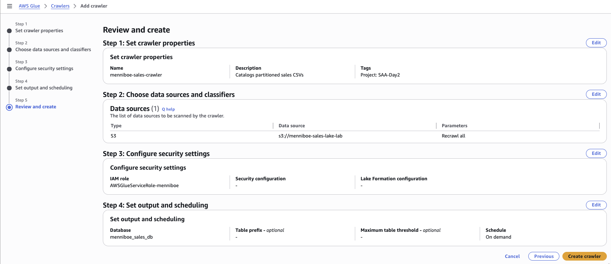

> [!WARNING]
> **Error caught at review: the data source pointed at the bucket root** (`s3://menniboe-sales-lake-lab`) instead of `…/sales/`. Crawling the root would make `sales/` an extra partition level, likely creating a table named after the bucket with a `partition_0` column.
> **Fix:** Edit Step 2 and set the path to `s3://menniboe-sales-lake-lab/sales/`. When using **Browse S3**, open the bucket and select the `sales/` folder.


Click **Create crawler** (the state is **READY**), then **Run crawler**.

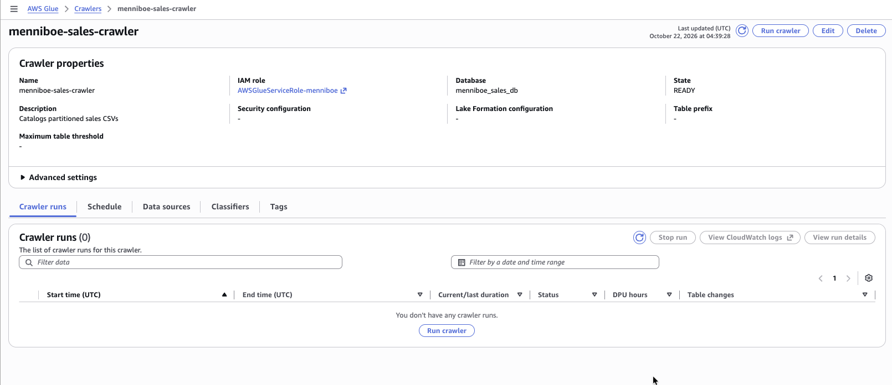

**Result:** **Completed** in 1 min 12 s, with **1 table change and 2 partition changes**, using **0.038 DPU-hours**.

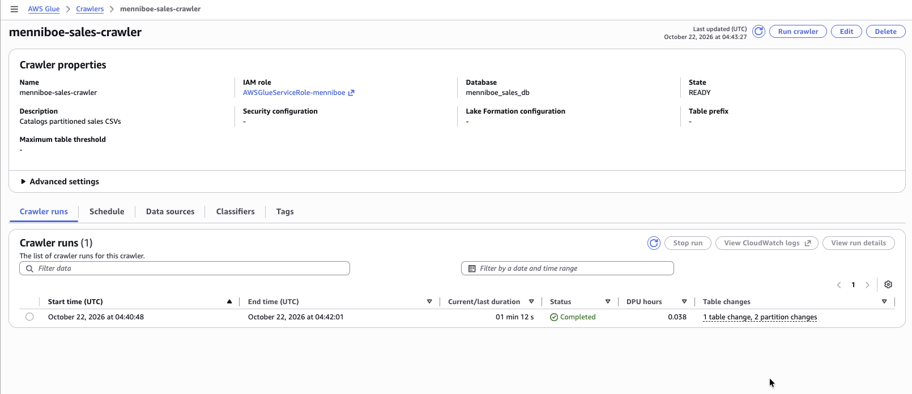

### Inspect the table

AWS Glue → **Data Catalog** → **Tables** → `sales`

| Column | Type | Role |
|---|---|---|
| `order_id` | bigint | Data |
| `product` | string | Data |
| `quantity` | bigint | Data |
| `price` | double | Data |
| `year` | string | **Partition (0)**, from the folder name |
| `month` | string | **Partition (1)**, from the folder name |

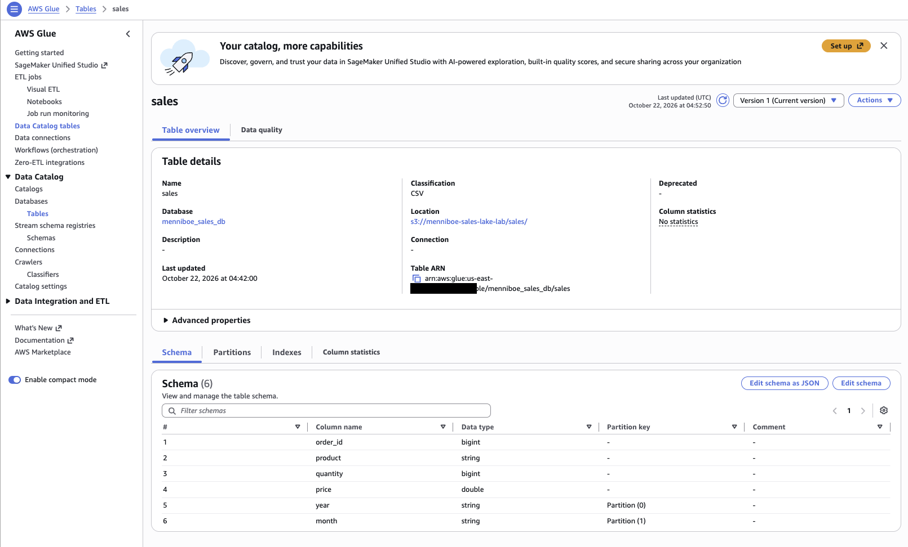

> [!NOTE]
> - Partition columns come from the **folder names**, not the CSV.
> - Partitions are **strings**, so compare them with quotes (`month = '10'`).
> - **Classification: CSV** tells Athena which SerDe (reader) to use.

---

## Lab 2 Step 5: Set the Athena query result location

**Why this step:** Athena refuses to run queries until it knows where in S3 to write the results.

**Console:** Athena → **Query editor**. The left panel already shows `AwsDataCatalog` → `menniboe_sales_db` → `sales (Partitioned)`, read from Glue.

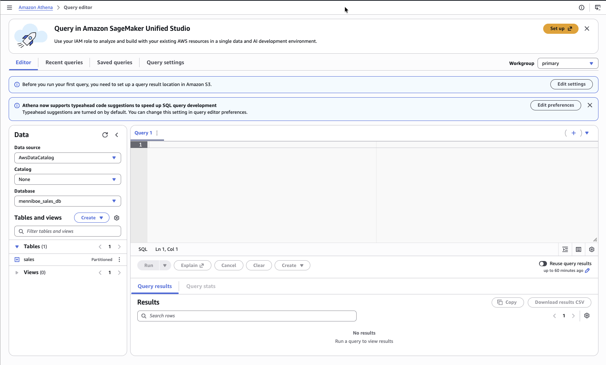

> [!WARNING]
> **Issue: the result location disappeared.** It was first set under **Query settings** → **Manage**, but after Athena was reopened from Glue's **Table data** link, the location showed **"-"** again. **Query settings are a client-side override** stored in the browser session ("Query settings temporarily override your workgroup configurations").
> **Fix:** set the location on the **workgroup**, which is stored in AWS and applies to every session.

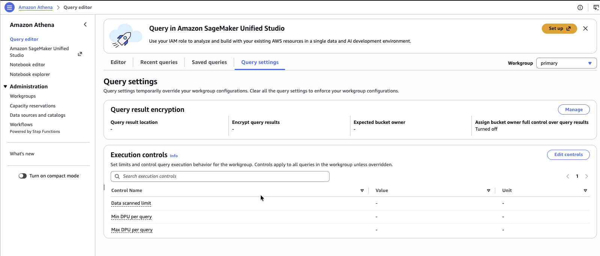

**Durable fix:** Athena → **Administration** → **Workgroups** → `primary` → **Edit** → **Query result configuration**

| Field | Value |
|---|---|
| Management of query results | **Customer managed** |
| Location of query result | `s3://menniboe-athena-results-lab/` |
| Expected bucket owner | Blank |
| Assign bucket owner full control | Unchecked |
| Encrypt query results | Unchecked (the bucket's SSE-S3 default still applies) |
| Override client-side settings | Unchecked |

Click **Save changes**.

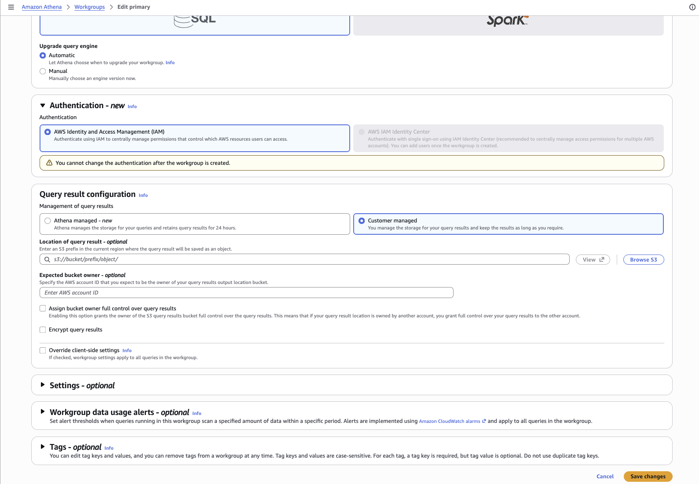

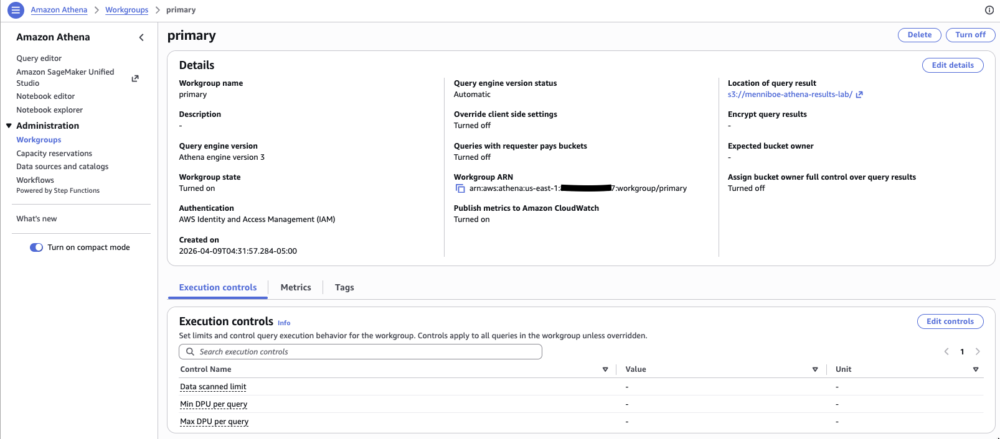

> [!NOTE]
> - **Athena managed** results need no bucket and are kept for **24 hours**. **Customer managed** means your bucket and your retention.
> - **Override client-side settings** lets admins **enforce** a results location and encryption for everyone in the workgroup.
> - **Execution controls** (such as the data-scanned limit) cap query cost per workgroup.

---

## Lab 2 Step 6: Query the data lake

**Why this step:** it proves the chain works end to end (schema from Glue, data from S3, results to S3) and measures **partition pruning**.

**Query 1: everything**

```sql
SELECT * FROM sales;
```

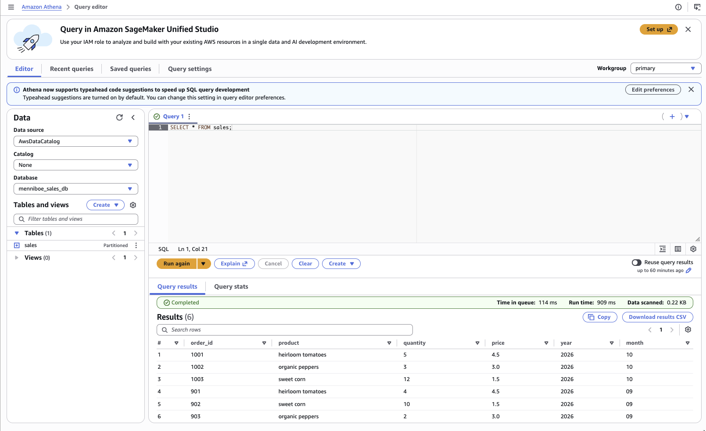

**Query 2: October only**

```sql
SELECT product,
       SUM(quantity)         AS total_qty,
       SUM(quantity * price) AS revenue
FROM sales
WHERE year = '2026' AND month = '10'
GROUP BY product
ORDER BY revenue DESC;
```

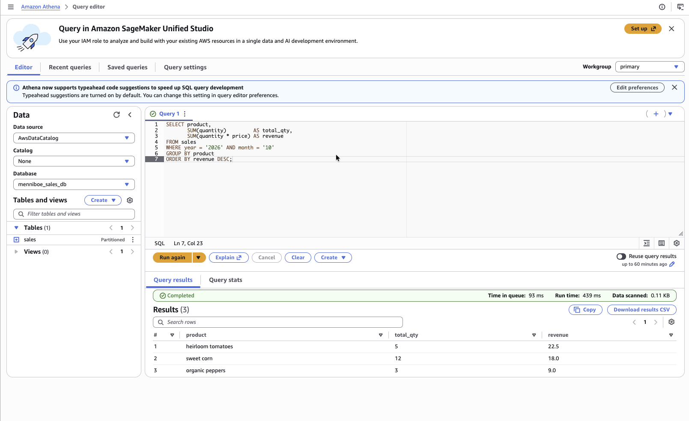

### Results

| Query | Folders read | Rows | Data scanned | Run time |
|---|---|---|---|---|
| `SELECT * FROM sales` | month=09 + month=10 | 6 | **0.22 KB** | 909 ms |
| `WHERE year='2026' AND month='10'` | month=10 only | 3 | **0.11 KB** | 439 ms |

The filtered query scanned **half the data**. With 60 monthly folders, filtering to one month would scan about 1/60th. Converting to Parquet would also skip the unused columns.

**October revenue:** heirloom tomatoes $22.50, sweet corn $18.00, organic peppers $9.00.

> [!TIP]
> To query in Athena from the Glue console, use the `sales` table's **Table data** link. It opens Athena with `SELECT * FROM "menniboe_sales_db"."sales" limit 10;` filled in.

---

## Lab 2 Step 7: Inspect the results bucket

**Why this step:** every query wrote its output to S3. This shows why the results bucket exists.

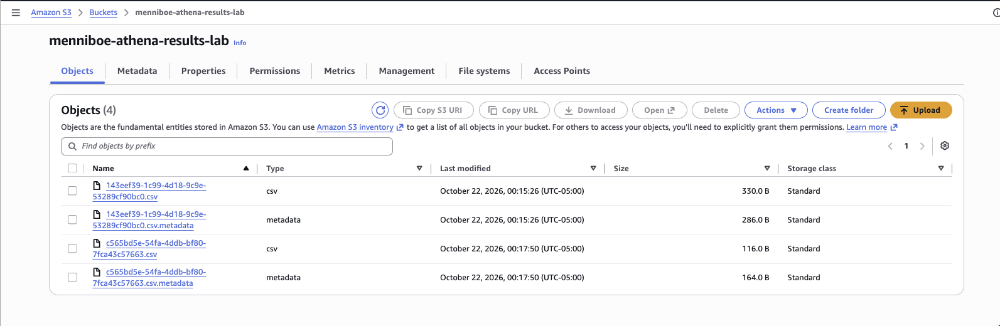

| Object | Meaning |
|---|---|
| `<query-execution-id>.csv` | The query result (330 B for 6 rows, 116 B for 3 rows) |
| `<query-execution-id>.csv.metadata` | The column names and types the console uses to display results |

> [!TIP]
> In production, add an **S3 Lifecycle rule** to expire result files after a few days.

---

## Lab 2 Step 8: Teardown and verification

**Why this step:** remove resources in **reverse order of creation**. The crawler can create new tables if it runs again, so it goes first.

| Order | Resource | Console path |
|---|---|---|
| 1 | Crawler `menniboe-sales-crawler` | Glue → Crawlers → Action → Delete crawler |
| 2 | Database `menniboe_sales_db` (deletes the `sales` table; S3 data untouched) | Glue → Databases → Delete |
| 3 | Both buckets | S3 → **Empty** (`permanently delete`) → **Delete** (type the bucket name) |
| 4 | IAM role `AWSGlueServiceRole-menniboe` | IAM → Roles → Delete |
| 5 | The leftover customer-managed S3 policy (`AWSGlueServiceRole-menniboe-EZCRC-s3Policy`) | IAM → Policies → Customer managed → Delete |

> [!IMPORTANT]
> **Deleting a role doesn't delete the customer-managed policies a console wizard created for it.** Find them with IAM → Policies → Filter: **Customer managed** (attached to nothing).

> [!NOTE]
> The `primary` workgroup still points at the deleted results bucket. Before the next Athena lab, set a new location or switch to **Athena managed**.

### Verify with the CLI

```bash
aws s3 ls | grep menniboe                                        # no output
aws glue get-crawler --name menniboe-sales-crawler               # EntityNotFoundException
aws glue get-database --name menniboe_sales_db                   # EntityNotFoundException
aws dynamodb describe-table --table-name menniboe-farm-orders    # ResourceNotFoundException
aws iam get-role --role-name AWSGlueServiceRole-menniboe         # NoSuchEntity
```

A "not found" error is AWS confirming the resource is gone.

### Account IAM cleanup (leftover lab roles and policies)

The role list had two kinds of roles:

| Kind | Examples | Action |
|---|---|---|
| **Service-linked roles** (`AWSServiceRoleFor…`) | RDS, ECS, ElastiCache, ELB, Global Accelerator, Support, Trusted Advisor | **Keep.** AWS creates and locks them, they're free, and they're recreated on next use. They're also not affected by SCPs |
| **Wizard-created lab roles** | Glue crawler, Firehose, Lambda, Storage Gateway roles | **Delete** once their labs are torn down |
| Reusable default | `ecsTaskExecutionRole` | Optional; kept for future ECS/Fargate labs |

The CLI cleanup scripts are in [commands.md](commands.md#iam-cleanup). Two shell errors came up along the way:

> [!WARNING]
> **Error: `ValidationError ... The specified value for roleName is invalid`.** The loop `for R in $ROLES` passed all four names as **one** value. **Zsh doesn't word-split plain variables** (bash does), and IAM rejected the spaces and tabs.
> **Fix:** feed the names one per line:
> ```bash
> echo "$ROLES" | tr '\t' '\n' | while read -r R; do delete_role "$R"; done
> ```

> [!WARNING]
> **Error: `zsh: event not found: starts_with(RoleName,`.** In zsh, `!` inside double quotes triggers **history expansion**, so the command aborted before reaching AWS.
> **Fix:** `setopt nobanghist` (turns history expansion off for the session), or write the filter without `!`: `starts_with(RoleName,'AWSServiceRoleFor') == \`false\``.

**Final state:** the only non-service-linked role left is `ecsTaskExecutionRole`. The three leftover customer-managed policies (Glue, Firehose, Storage Gateway) were deleted.

---

## Troubleshooting log

| # | Where | Symptom | Cause | Fix |
|---|---|---|---|---|
| 1 | Lab 1 Step 1 | Partition key typed `customerID` | Key names are case-sensitive and immutable | Retype as `customerId` before creating |
| 2 | Lab 1 Step 2 | `Ln 2, Col 1 — Syntax error` | Three JSON objects in one Create item editor | One item per Create item (bulk: `BatchWriteItem` or S3 import) |
| 3 | Lab 1 Step 3 | Items "disappear" after a Scan | The results list shows only returned items | Run a plain Scan; nothing was deleted |
| 4 | Lab 1 Step 4 | TTL preview showed a different epoch value | The placeholder was pasted instead of the CloudShell output | Check pasted values against your own output |
| 5 | Lab 2 Step 4 | Crawler source was the bucket root | Wrong folder picked in Browse S3 | Set the path to `s3://menniboe-sales-lake-lab/sales/` |
| 6 | Lab 2 Step 6 | Queries attempted from the Glue page | Glue catalogs data; Athena queries it | Use Athena, or Glue's **Table data** link |
| 7 | Lab 2 Step 5 | Result location reset to "-" | Query settings are a browser-session override | Set the location on the **workgroup** |
| 8 | Lab 2 Step 8 | `ValidationError … roleName is invalid` | Zsh doesn't word-split `$ROLES` | Pipe to `while read -r` |
| 9 | Lab 2 Step 8 | `zsh: event not found` | `!` history expansion inside double quotes | `setopt nobanghist`, or avoid `!` |
| 10 | Lab 2 Step 8 | Policies left after role deletion | Wizard-created customer-managed policies aren't deleted with the role | Delete unattached customer-managed policies |

---

## Service selection cheat sheet

| Scenario clue | Answer |
|---|---|
| SQL, joins, transactions | RDS / Aurora |
| Survive an AZ failure | Multi-AZ |
| Scale reads / reporting load | Read Replicas, Aurora reader endpoint |
| Lambda + too many connections | RDS Proxy |
| Encrypt an existing unencrypted RDS instance | Snapshot → encrypted copy → restore |
| Cross-region DR in about 1 s, promote in under 1 min | Aurora Global Database |
| Fast copy of a database for testing | Aurora cloning |
| Caching, sessions, leaderboards | ElastiCache (Redis OSS / Valkey) |
| Massive scale, ms latency, flexible schema | DynamoDB |
| DynamoDB + microseconds | DAX |
| React to DynamoDB changes | Streams + Lambda |
| Multi-region active-active NoSQL | Global Tables |
| Auto-delete old items | DynamoDB TTL |
| Item over 400 KB | S3 + pointer in DynamoDB |
| MongoDB | DocumentDB |
| Cassandra / CQL | Keyspaces |
| Graph relationships, multi-hop | Neptune |
| IoT time series | Timestream |
| Serverless SQL on S3 | Athena |
| Cut Athena cost | Parquet/ORC + compression + partitions + larger files |
| SQL across sources without moving data | Athena Federated Query |
| Data warehouse, complex BI | Redshift |
| Query S3 from Redshift | Redshift Spectrum |
| Redshift DR in another region | Cross-region snapshot copy (+ snapshot copy grant with KMS) |
| Full-text / partial-match search | OpenSearch |
| Managed Hadoop/Spark | EMR |
| EMR cost savings | Spot task nodes |
| BI dashboards | QuickSight (Amazon Quick Sight) |
| Hide a dashboard column | QuickSight Enterprise + CLS |
| Serverless ETL, CSV → Parquet | Glue ETL |
| Central schema / metadata | Glue Data Catalog + crawlers |
| Don't reprocess old data | Glue Job Bookmarks |
| No-code data cleaning | Glue DataBrew |
| Data lake fast + central row/column permissions | Lake Formation |
| Kafka, messages over 1 MB | MSK |
| Real-time stream analytics with Flink | Managed Service for Apache Flink (KDS or MSK, not Firehose) |
| Serverless IoT analytics pipeline | IoT Core → KDS → Firehose → S3 → Athena → QuickSight |
| Objects, faces, unsafe images | Rekognition (+ A2I for human review) |
| Forms, tables, handwriting | Textract |
| Speech → text, PII redaction | Transcribe |
| Text → speech | Polly (Lexicons = pronunciation, SSML = delivery) |
| Translate content | Translate |
| Sentiment, entities | Comprehend |
| PHI in clinical text | Comprehend Medical |
| Chatbot / intent | Lex |
| Cloud contact center | Connect |
| Natural-language answers from documents | Kendra |
| Recommendations, no ML expertise | Personalize |
| Custom ML model | SageMaker AI |

---

## Acronyms

| Acronym | Meaning |
|---|---|
| A2I | Amazon Augmented AI (human review of ML predictions) |
| ACID | Atomicity, Consistency, Isolation, Durability |
| ASR | Automatic Speech Recognition |
| AZ | Availability Zone |
| BI | Business Intelligence |
| CLS / RLS | Column-Level / Row-Level Security |
| CQL | Cassandra Query Language |
| CRM | Customer Relationship Management |
| DAX | DynamoDB Accelerator |
| DMS | Database Migration Service |
| DPU | Data Processing Unit (Glue compute billing unit) |
| DR | Disaster Recovery |
| EMR | Elastic MapReduce |
| ETL | Extract, Transform, Load |
| GSI / LSI | Global / Local Secondary Index |
| HDFS | Hadoop Distributed File System |
| IAM | Identity and Access Management |
| JDBC | Java Database Connectivity |
| KDS | Kinesis Data Streams |
| KMS | Key Management Service |
| ML | Machine Learning |
| MPP | Massively Parallel Processing |
| MSK | Managed Streaming for Apache Kafka |
| NLP / NLU | Natural Language Processing / Understanding |
| OLTP / OLAP | Online Transaction / Analytical Processing |
| PHI | Protected Health Information |
| PII | Personally Identifiable Information |
| PITR | Point-In-Time Recovery |
| PK / SK | Partition Key / Sort Key |
| QLDB | Quantum Ledger Database (retired July 31, 2025) |
| RCU / WCU | Read / Write Capacity Unit |
| RDS | Relational Database Service |
| RI | Reserved Instance |
| SerDe | Serializer/Deserializer (how Athena reads a file format) |
| SPICE | Super-fast, Parallel, In-memory Calculation Engine |
| SSE-S3 | Server-Side Encryption with S3 managed keys |
| SSML | Speech Synthesis Markup Language |
| TTL | Time To Live |
