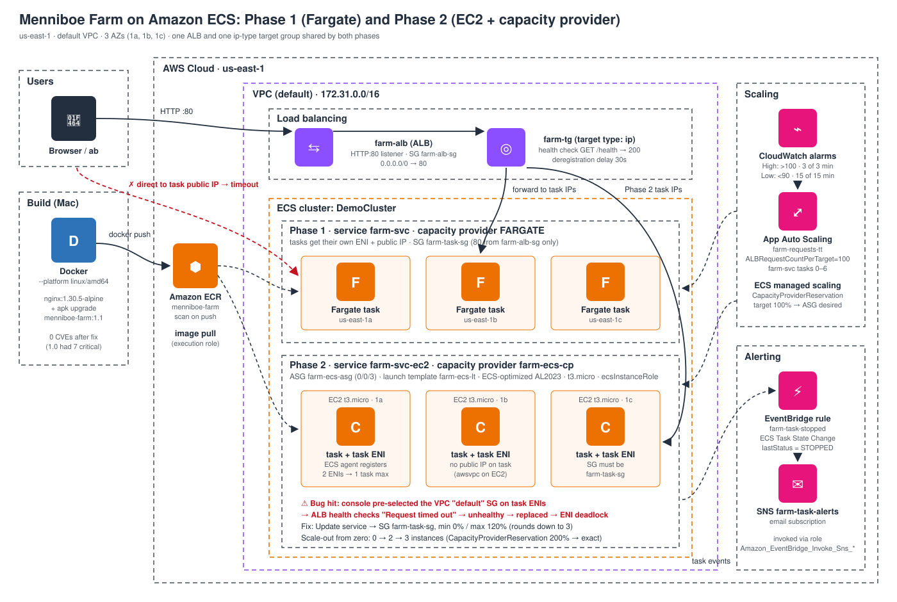

# Containers on AWS: ECS on Fargate and on EC2 (Menniboe Farm)

**Track:** AWS Solutions Architect Associate (SAA-C03): containers section (ECS, Fargate, ECR, EKS)
**Dates:** Oct 8 & Oct 10, 2026 · **Region:** us-east-1 · **Status:** ✅ completed and fully torn down

## What I learned

- **8 theory modules (48/48 quiz questions):**
  - Docker fundamentals
  - ECS clusters, tasks and services
  - Launch types (EC2, Fargate, Managed Instances)
  - The three ECS IAM roles
  - Load balancing with ALB/NLB
  - EFS and ephemeral storage
  - Service auto scaling and capacity providers
  - Event-driven patterns
  - ECR
  - EKS
- **Phase 1, Fargate:**
  - Built a custom nginx image for `linux/amd64` on Apple Silicon and pushed it to ECR with scan-on-push.
  - Fixed the scan findings: **7 critical / 45 high → 0** by moving to `nginx:1.30.5-alpine` and adding `apk upgrade`.
  - Ran 3 tasks across 3 AZs behind an ALB.
  - Locked the tasks down with SG-to-SG rules and proved it with a negative test.
  - Auto-scaled on `ALBRequestCountPerTarget`: 3 → 6 under ApacheBench load, then back down.
  - Wired **EventBridge → SNS** email alerts for stopped tasks.
- **Phase 2, EC2:**
  - Built the EC2 capacity chain: instance role → launch template (ECS-optimized AMI plus user data) → ASG (0/0/3) → capacity provider with managed scaling.
  - Watched ECS scale the ASG **from zero (0 → 2 → 3)** based on task demand.
  - Hit and fixed a real production-style outage.
- **Teardown:** deleted everything in dependency order using the CLI, then confirmed with a final sweep that nothing was left.

## Key results

| Result | Evidence |
|---|---|
| ECR image 1.1 scanned with **0 findings** (1.0 had 7 critical) | `screenshots/09-ecr-images-1.0-1.1.png` |
| ALB round-robins across 3 task IPs in 1a / 1b / 1c (Fargate and EC2) | `screenshots/25-27`, `82-84` |
| Direct access to a task's public IP **times out**, so only the ALB can reach the tasks | `screenshots/28-negative-test-direct-ip-timeout.png` |
| Target tracking scaled 3 → 6 tasks under about 100 req/s; scale-in took about 15 min (15 datapoints) | `screenshots/32`, `34` |
| A stopped task triggered an EventBridge → SNS email | `screenshots/43`, `44` |
| Capacity provider scaled the ASG 0 → 2 → 3, one task per t3.micro (ENI limit) | `screenshots/73`, `74` |
| Root cause found: **`default` SG on task ENIs** caused "Request timed out", then unhealthy tasks, then an ENI deadlock. Fixed with SG `farm-task-sg` and min 0% / max 120%. | `screenshots/76-81` |

## Top exam takeaways

1. **Task execution role** pulls images, writes logs and reads secrets before your app starts. The **task role** is what your app code uses. The **instance profile** is used by the ECS agent (EC2 launch type only).
2. **awsvpc mode:** every task gets its own ENI. Use target type **ip**. On EC2, the **ENI limit caps task density** (t3.micro allows 1 task). Fixes: a bigger instance or ENI trunking.
3. **Capacity provider managed scaling** scales the ASG on *task demand* (CapacityProviderReservation). Plain ASG CPU scaling isn't task-aware and can't scale from 0.
4. Target tracking **scales out fast (3 datapoints) and in slowly (15 datapoints)**.
5. You **can't change a running task's SG**. Change the service's network configuration and ECS redeploys.
6. Deployment percentages: **min 100 / max 200** starts new tasks first (no downtime, needs spare capacity). **Min 0 / max 100** stops old tasks first (downtime, no extra capacity). ECS **rounds max down**.

## Files

| File | What it is |
|---|---|
| [`notes.md`](notes.md) | Full reference guide: theory modules, every lab step (console + CLI), errors and fixes inline, screenshots |
| [`commands.md`](commands.md) | Every command, copy-paste ready, grouped by stage |
| `diagrams/architecture.svg` | Architecture diagram |
| `screenshots/` | 85 redacted screenshots from the session |
