# Notes: Containers on AWS (ECS, Fargate, ECR, EKS): Menniboe Farm Lab

> [!NOTE]
> **AWS SAA-C03: containers section.** Lab on **Oct 8** (Phase 1, Fargate) and **Oct 10, 2026** (Phase 2, EC2 + teardown) in `us-east-1`, default VPC.
> Every hands-on step has a **Console** version and a **CLI** version. Errors are written inline at the step where they happened. Screenshots are redacted (account ID, home IP, usernames).


---

## Table of contents

**Part A: Theory**
- [Module 1: Docker fundamentals](#module-1-docker-fundamentals)
- [Module 2: ECS clusters, tasks, services and launch types](#module-2-ecs-clusters-tasks-services-and-launch-types)
- [Module 3: IAM roles for ECS](#module-3-iam-roles-for-ecs)
- [Module 4: Load balancing ECS](#module-4-load-balancing-ecs)
- [Module 5: Storage (EFS and ephemeral)](#module-5-storage-efs-and-ephemeral)
- [Module 6: Auto scaling and capacity providers](#module-6-auto-scaling-and-capacity-providers)
- [Module 7: Event-driven ECS and ECR](#module-7-event-driven-ecs-and-ecr)
- [Module 8: Amazon EKS](#module-8-amazon-eks)
- [Questions I asked](#questions-i-asked)

**Part B: Lab Phase 1 (Fargate)**
- [Step 1: Tool check and folder](#step-1-tool-check-and-folder)
- [Step 2: App files (nginx config + Dockerfile)](#step-2-app-files-nginx-config--dockerfile)
- [Step 3: Build for amd64 and test locally](#step-3-build-for-amd64-and-test-locally)
- [Step 4: Create the ECR repo and push](#step-4-create-the-ecr-repo-and-push)
- [Step 5: Read the scan and remediate the CVEs (v1.1)](#step-5-read-the-scan-and-remediate-the-cves-v11)
- [Step 6: Create the ECS cluster](#step-6-create-the-ecs-cluster)
- [Step 7: Create the task definition](#step-7-create-the-task-definition)
- [Step 8: Security groups (SG-to-SG trust)](#step-8-security-groups-sg-to-sg-trust)
- [Step 9: Target group (type ip)](#step-9-target-group-type-ip)
- [Step 10: ALB and listener](#step-10-alb-and-listener)
- [Step 11: Create service farm-svc (Fargate)](#step-11-create-service-farm-svc-fargate)
- [Step 12: Verify round-robin across 3 AZs](#step-12-verify-round-robin-across-3-azs)
- [Step 13: Negative test (lockdown proof)](#step-13-negative-test-lockdown-proof)
- [Step 14: Service auto scaling (target tracking)](#step-14-service-auto-scaling-target-tracking)
- [Step 15: Load test and watch scale-out and scale-in](#step-15-load-test-and-watch-scale-out-and-scale-in)
- [Step 16: SNS topic for alerts](#step-16-sns-topic-for-alerts)
- [Step 17: EventBridge rule (task STOPPED → SNS)](#step-17-eventbridge-rule-task-stopped--sns)
- [Step 18: Test the alert](#step-18-test-the-alert)
- [Step 19: Pause Phase 1 (desired 0)](#step-19-pause-phase-1-desired-0)

**Part C: Lab Phase 2 (EC2 + capacity provider)**
- [Step 20: Dead end: "Update cluster" has no EC2 option](#step-20-dead-end-update-cluster-has-no-ec2-option)
- [Step 21: Create the ECS instance role (ecsInstanceRole)](#step-21-create-the-ecs-instance-role-ecsinstancerole)
- [Step 22: Launch template (ECS-optimized AMI + user data)](#step-22-launch-template-ecs-optimized-ami--user-data)
- [Step 23: Auto Scaling group (0/0/3)](#step-23-auto-scaling-group-003)
- [Step 24: Capacity provider with managed scaling](#step-24-capacity-provider-with-managed-scaling)
- [Step 25: Check task definition compatibility](#step-25-check-task-definition-compatibility)
- [Step 26: Create service farm-svc-ec2](#step-26-create-service-farm-svc-ec2)
- [Step 27: Watch the scale-out from zero](#step-27-watch-the-scale-out-from-zero)
- [Step 28: Debug: tasks replaced as unhealthy](#step-28-debug-tasks-replaced-as-unhealthy)
- [Step 29: Fix: correct SG + break the ENI deadlock](#step-29-fix-correct-sg--break-the-eni-deadlock)
- [Step 30: Verify through the ALB](#step-30-verify-through-the-alb)

**Part D: Teardown**
- [T1–T13: Teardown in dependency order](#part-d-teardown)

**Part E: Reference**
- [Errors and fixes (summary)](#errors-and-fixes-summary)
- [Phase 1 vs Phase 2](#phase-1-vs-phase-2)
- [Exam cheat sheet](#exam-cheat-sheet)
- [Acronyms](#acronyms)

---

# Part A: Theory

## Module 1: Docker fundamentals

| Term | Meaning |
|---|---|
| **Dockerfile** | Recipe: base image + steps (`FROM`, `RUN`, `COPY`, `EXPOSE`) |
| **Image** | Immutable, layered package built from the Dockerfile |
| **Container** | A **running instance of an image** |
| **Registry** | Where images are stored: Docker Hub, **Amazon ECR**, ECR Public Gallery |

**Workflow:** build → push (to the registry) → pull (by ECS/EKS) → run.

**Container vs VM:**
- A **container shares the host OS kernel**. It's light and starts in seconds.
- A **VM carries a full guest OS** on a hypervisor.

**Stateless vs stateful** (one of my questions):
- **Stateless:** the container keeps nothing between requests, so any copy can answer any request. You can kill it, replace it or scale it freely. Example: our nginx page.
- **Stateful:** the container holds data that must survive restarts, like a database or uploaded files. Put that state **outside** the container: EFS, RDS, DynamoDB or S3.

> [!TIP]
> **Apple Silicon trap:** a Mac M-series builds **arm64** images by default. AWS Fargate and x86 EC2 run **amd64**. Always add `--platform linux/amd64`, or the task fails with `exec format error`.

**Azure anchor:** ECR ≈ **Azure Container Registry**. Docker works the same everywhere.

---

## Module 2: ECS clusters, tasks, services and launch types

| ECS term | What it is | Analogy |
|---|---|---|
| **Cluster** | Logical grouping of capacity, tasks and services | The farm |
| **Task definition** | JSON blueprint: image, CPU/memory, ports, roles, logging, network mode | The recipe card |
| **Task** | A running copy of a task definition (1+ containers) | One batch cooked |
| **Service** | Keeps *N* tasks running, replaces failed ones, registers them with the LB | The kitchen manager |
| **ECS agent** | Runs on EC2 container instances and registers them with the cluster | The worker's badge |

**Launch types and capacity options:**

| Option | Who manages the servers | When to choose it |
|---|---|---|
| **Fargate** | AWS (serverless) | Default choice; no patching; pay per task vCPU/GB |
| **Fargate Spot** | AWS | Interruptible, up to about 70% cheaper |
| **EC2 (ASG capacity provider)** | You (AMI, patching, scaling) | GPUs, special instance types, daemon tasks, cost control at scale |
| **ECS Managed Instances** | AWS patches and scales EC2 for you | Need EC2 features without the operational work |

> [!IMPORTANT]
> EC2 container instances **must register** with the cluster. That needs the **ECS agent** (in the ECS-optimized AMI), `ECS_CLUSTER=<name>` in `/etc/ecs/ecs.config`, and an **instance profile**.

**Azure anchor:** Fargate ≈ **Azure Container Apps / ACI**. EC2 launch type ≈ containers on your own **VMSS**.

---

## Module 3: IAM roles for ECS

| Role | Used by | Needed for | Launch type |
|---|---|---|---|
| **EC2 instance profile** (`ecsInstanceRole`, policy `AmazonEC2ContainerServiceforEC2Role`) | The **ECS agent** on the instance | Registering with the cluster, reporting state | EC2 only |
| **Task execution role** (`ecsTaskExecutionRole`) | **ECS itself, before your app starts** | Pulling from ECR, writing CloudWatch logs, reading Secrets Manager or SSM secrets | Both |
| **Task role** | **Your application code** | Calling AWS APIs (S3, DynamoDB, …) | Both |

> [!TIP]
> Exam phrasing: *"container can't pull the image / can't write logs / can't read the secret at startup"* → **execution role**. *"App gets AccessDenied calling S3"* → **task role**. Give each service its **own task role** for least privilege.

**Azure anchor:** task role ≈ **managed identity** on a Container App. Instance profile ≈ the VM's managed identity.

---

## Module 4: Load balancing ECS

- **ALB** (layer 7: HTTP/HTTPS, path and host routing): the default choice for web apps.
- **NLB** (layer 4: TCP/UDP, static IPs, extreme performance).
- **CLB** is legacy and **can't front Fargate**, because it doesn't support ip targets.
- With **awsvpc** mode (Fargate always uses it), each task has its own ENI and IP, so the target group must use **target type `ip`**.
- **Dynamic host port mapping** (bridge mode on EC2): many tasks per instance, each on a random host port. The ALB handles this automatically.
- **SG-to-SG trust:** the task SG allows port 80 **only from the ALB's SG**, so nobody can reach the tasks directly.

**Reading HTTP results:**

| Result | Meaning |
|---|---|
| **503** | ALB is up but **no healthy targets** |
| **502** | ALB reached the target but got a bad or empty response |
| **000** (curl) / DNS fail | No ALB, no listener, or it can't be reached at all |
| **Timeout** to a task IP | A security group is silently dropping the traffic |

**Azure anchor:** ALB ≈ **Application Gateway**. Target group ≈ **backend pool**. SG ≈ **NSG**, and SG-to-SG ≈ **ASG (Application Security Group)** rules.

---

## Module 5: Storage (EFS and ephemeral)

- **EFS:** multi-AZ NFS, mountable by tasks on **both** Fargate and EC2. **"Fargate + EFS" = serverless compute plus persistent shared storage.**
- **Ephemeral storage:** Fargate gives **20 GiB by default** (configurable up to 200 GiB). It's lost when the task stops.
- **EBS** can be attached to ECS tasks (one volume per task). **S3 can't be mounted** as a file system.
- **EKS on Fargate → EFS is the only persistent storage option.**

**Azure anchor:** EFS ≈ **Azure Files**.

---

## Module 6: Auto scaling and capacity providers

**Two layers of scaling:**
1. **Service auto scaling** (Application Auto Scaling) changes the **task count**.
   - Metrics: **ECSServiceAverageCPUUtilization**, **ECSServiceAverageMemoryUtilization**, or **ALBRequestCountPerTarget**.
   - Policies: **target tracking** (keep the metric near a target), **step** (react to alarm bands), **scheduled** (known peaks).
   - Target tracking creates **2 CloudWatch alarms**:
     - **High** alarm: **3 datapoints in 3 min**, so scale-out is fast.
     - **Low** alarm: **15 datapoints in 15 min**, so scale-in is slow and cautious.
2. **Cluster capacity** (EC2 only) changes the **number of instances**.
   - The **capacity provider with managed scaling** publishes the `CapacityProviderReservation` metric (≈ instances needed ÷ instances running × 100).
   - It also creates a target-tracking policy on the **ASG** that keeps that metric at the target (100% = no spare instances).
   - Because this is **task-aware**, it can **scale from 0**. A CPU policy on the ASG can't, because there's no CPU to measure.

**Managed draining** adds an ASG **lifecycle hook** so ECS moves tasks off an instance before the instance is terminated.

**Azure anchor:** ASG ≈ **VMSS**. Launch template ≈ VMSS model. Target tracking ≈ **Azure Monitor autoscale**.

---

## Module 7: Event-driven ECS and ECR

**Event patterns:**
- **S3 upload → EventBridge rule → run an ECS task** (process the file)
- **EventBridge Scheduler → ECS task** (cron batch jobs)
- **SQS queue → ECS service** that scales on queue depth (`ApproximateNumberOfMessages`)
- **ECS Task State Change (STOPPED) → EventBridge → SNS** (alert), which we built in this lab

**ECR:**
- Private repos are controlled by **IAM** and repository policies.
- The **ECR Public Gallery** hosts public images.
- **Scan on push:** basic scanning, or enhanced scanning with Inspector.
- **Lifecycle policies** expire old or untagged images.
- **Cross-region and cross-account replication.**
- Tag **immutability**.

**Azure anchor:** EventBridge ≈ **Event Grid**. SNS ≈ **Event Grid / Service Bus topics** (alerting ≈ **Action Groups**).

---

## Module 8: Amazon EKS

- Managed **Kubernetes** control plane. Choose it when you need **Kubernetes compatibility or portability**, or the K8s ecosystem.
- **Worker options:**
  - **Managed node groups** (AWS manages the ASG and patching workflow)
  - **Self-managed nodes** (full control)
  - **Fargate** (serverless pods)
- **Storage:** CSI drivers for **EBS** (single-AZ, ReadWriteOnce) and **EFS** (multi-AZ, ReadWriteMany). On Fargate, **EFS only**.

**Azure anchor:** EKS ≈ **AKS**.

---

## Questions I asked

| My question | Answer in short |
|---|---|
| What's the difference between **stateless and stateful**? | Stateless keeps nothing between requests, so it's freely replaceable and scalable. Stateful holds data, so move that data to EFS, RDS or S3. See [Module 1](#module-1-docker-fundamentals). |
| How long will this module take? | 8 modules of theory, then a two-phase hands-on lab. It ran over 2 sessions. |
| How does this lab differ from my **SonarQube-on-Fargate** lab? Is there an EC2 launch step? Any recommendation? | SonarQube used Fargate only. This lab adds my own image + ECR + CVE fix, ALB + auto scaling + alerts, then the **EC2 launch type** (instance role, launch template, ASG, capacity provider). I went with the recommended path: Fargate first, then EC2. |
| How do I read this (scan) screenshot? | Severity counts per image tag. **1.0: 7 critical / 45 high / 42 medium / 12 low**; **1.1: 0**. The vulnerabilities came from the old base image packages. |
| When we ask for 3 tasks, **which component raises the ASG's desired count above 0**? | **The capacity provider's managed scaling** (not the ECS agent, not ASG CPU scaling, not the ALB). |
| With t3.micro, how many instances for 3 tasks? | **3**. t3.micro has 2 ENIs and one belongs to the instance, so there's 1 spare ENI = **1 awsvpc task per instance**. |
| Does the ASG go straight from 0 to 3? | No. **0 → 2 → 3**. With 0 instances, ECS can't measure capacity, so it reports reservation = 200% and takes a cautious first step. Once an instance registers, it computes the exact need. |
| Why can't the third task **squeeze onto** an existing instance with spare CPU and memory? | No **free ENI**. In awsvpc mode, ENIs (not CPU) are the limit. |
| Can I change the **SG on running tasks**? | No. The ENI's SG is fixed at launch. Change the **service** network configuration and ECS rolls out new tasks. |
| Can we do the teardown through the **CLI**? | Yes, in dependency order with `wait` commands. See [Part D](#part-d-teardown). |

---

# Part B: Lab Phase 1 (Fargate)

## Step 1: Tool check and folder

**CLI**
```bash
docker version --format '{{.Server.Version}}'      # 29.8.2
aws --version                                      # aws-cli/2.34.x
aws sts get-caller-identity                        # confirms who you are
mkdir -p ~/labs/menniboe-farm && cd ~/labs/menniboe-farm

export AWS_REGION=us-east-1
export ACCOUNT_ID=$(aws sts get-caller-identity --query Account --output text)
export REPO=menniboe-farm
export ECR_URI=$ACCOUNT_ID.dkr.ecr.$AWS_REGION.amazonaws.com
```
**Console:** no equivalent. The account ID is shown at the top right of the console under your username.

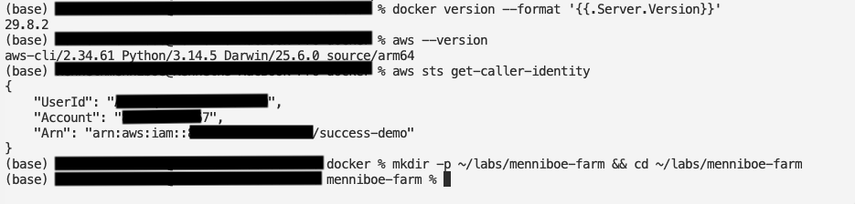

---

## Step 2: App files (nginx config + Dockerfile)

The config gives a `/health` endpoint for the ALB, plus a page that shows **which container answered**. That's how we see load balancing happen.

```bash
cat > default.conf <<'EOF'
server {
    listen 80;
    location /health { default_type text/plain; return 200 'ok'; }
    location / {
        default_type text/html;
        return 200 '<html><body style="font-family:sans-serif;text-align:center;margin-top:60px">
<h1>Menniboe Farm</h1>
<p>Served by container: <b>$hostname</b></p>
<p>Container IP: <b>$server_addr</b></p>
<p>Image: menniboe-farm:1.0</p>
</body></html>';
    }
}
EOF

cat > Dockerfile <<'EOF'
FROM nginx:1.27-alpine
COPY default.conf /etc/nginx/conf.d/default.conf
EXPOSE 80
EOF
```
**Console:** n/a. These are local files; create them in VS Code if you prefer.

---

## Step 3: Build for amd64 and test locally

**CLI**
```bash
docker build --platform linux/amd64 -t $REPO:1.0 -t $ECR_URI/$REPO:1.0 .
docker image inspect $REPO:1.0 --format '{{.Os}}/{{.Architecture}}'   # linux/amd64
docker run -d --platform linux/amd64 -p 8080:80 --name farm $REPO:1.0
sleep 3
curl -s localhost:8080/health; echo
curl -s localhost:8080 | grep -E "Menniboe|container|IP"
docker rm -f farm
```
**Console (Docker Desktop):** Images → `menniboe-farm:1.0` → ▶ Run → Optional settings → host port `8080` → Run. Then open `http://localhost:8080`.

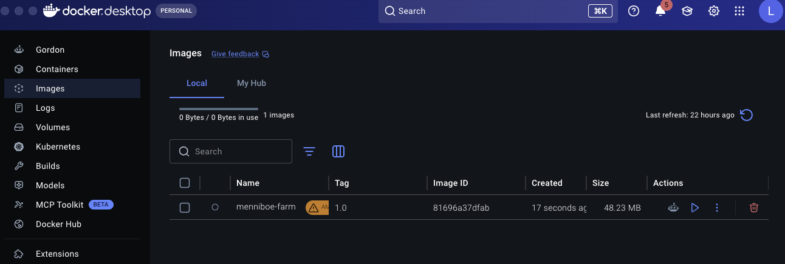

> [!WARNING]
> **Error: `zsh: command not found: REPOSITORY`.** I pasted the *output* of a command back into the terminal. It's harmless. Only paste the commands.

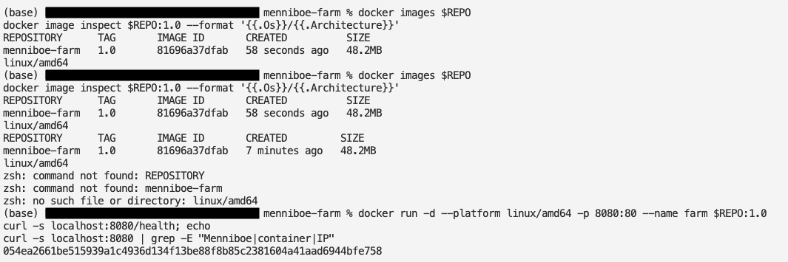

> [!WARNING]
> **Error: `localhost refused to connect` / curl printed nothing.** This was a **race condition**: curl ran before nginx had started inside the container.
> **Fix:** add `sleep 3` between `docker run` and `curl`, or just refresh.

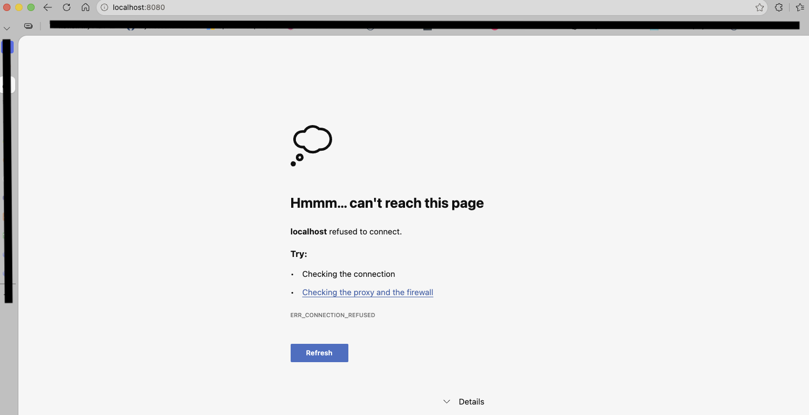
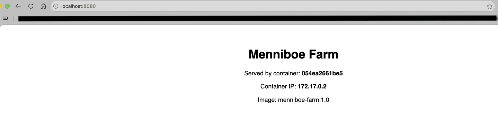

`$hostname` here is the **container ID** and the IP is **172.17.0.2** (the Docker bridge). On AWS these become the task's ENI IP.

---

## Step 4: Create the ECR repo and push

**CLI**
```bash
aws ecr create-repository --repository-name $REPO --region $AWS_REGION \
  --image-scanning-configuration scanOnPush=true \
  --query 'repository.[repositoryName,repositoryUri,imageScanningConfiguration.scanOnPush]' --output table
aws ecr get-login-password --region $AWS_REGION | docker login --username AWS --password-stdin $ECR_URI
docker push $ECR_URI/$REPO:1.0
```
**Console**
1. **ECR → Private registry → Repositories → Create repository**.
2. Visibility **Private**; name `menniboe-farm`; tag immutability **Mutable**; encryption **AES-256**.
3. Image scanning: **Scan on push** on (in the console it's set under *Features & Settings → Scanning* at registry level).
4. Click **Create**.
5. Select the repo → **View push commands** and run the 4 commands it shows. **Add `--platform linux/amd64` to the build command.**

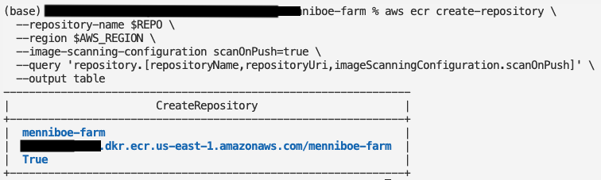
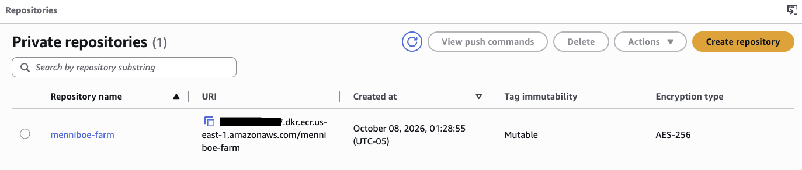

---

## Step 5: Read the scan and remediate the CVEs (v1.1)

**CLI**
```bash
aws ecr describe-image-scan-findings --repository-name $REPO --image-id imageTag=1.0 \
  --query 'imageScanFindings.findingSeverityCounts'
# 1.0 → CRITICAL 7, HIGH 45, MEDIUM 42, LOW 12

docker pull nginx:stable-alpine && docker run --rm nginx:stable-alpine nginx -v   # what's current

# Remediate: newer base + upgrade OS packages
cat > Dockerfile <<'EOF'
FROM nginx:1.30.5-alpine
RUN apk upgrade --no-cache
COPY default.conf /etc/nginx/conf.d/default.conf
EXPOSE 80
EOF
sed -i '' 's/menniboe-farm:1.0/menniboe-farm:1.1/' default.conf

docker build --platform linux/amd64 -t $REPO:1.1 -t $ECR_URI/$REPO:1.1 .
docker push $ECR_URI/$REPO:1.1
aws ecr describe-image-scan-findings --repository-name $REPO --image-id imageTag=1.1 \
  --query 'imageScanFindings.findingSeverityCounts'      # → {} (0 findings)
```
**Console:** ECR → `menniboe-farm` → **Images** → click the tag → **Vulnerabilities** tab (severity counts and CVE list). Use **Scan** to rescan.

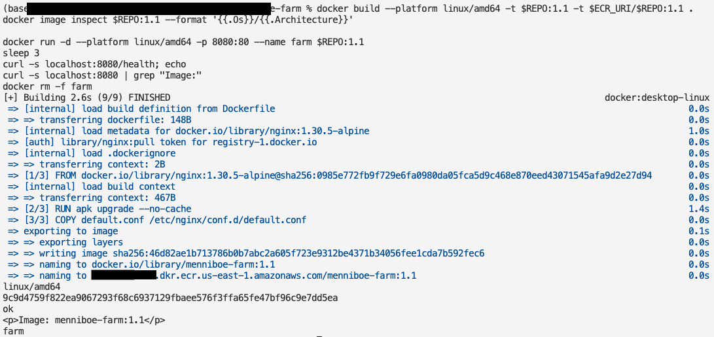
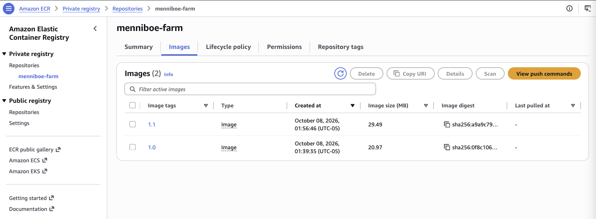

> [!TIP]
> Most CVEs come from the **base image's OS packages**, not your code. Fixes: newer base tag, `apk upgrade` / `apt-get upgrade`, minimal or distroless images. Keep 1.0 around to show the before and after, and use **lifecycle policies** in real life.

---

## Step 6: Create the ECS cluster

**Console**
1. **ECS → Clusters → Create cluster**.
2. Cluster name: `DemoCluster`.
3. Infrastructure: **Fargate only**.
4. Monitoring: Container Insights **Turned off** (to save cost); ECS Exec logging **Default**.
5. Encryption: defaults. Tags: none.
6. Click **Create**. This runs as a CloudFormation stack.

**CLI**
```bash
aws ecs create-cluster --cluster-name DemoCluster \
  --capacity-providers FARGATE FARGATE_SPOT
```

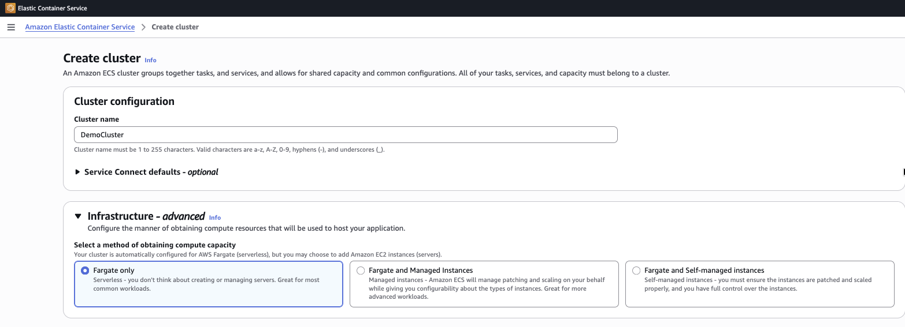
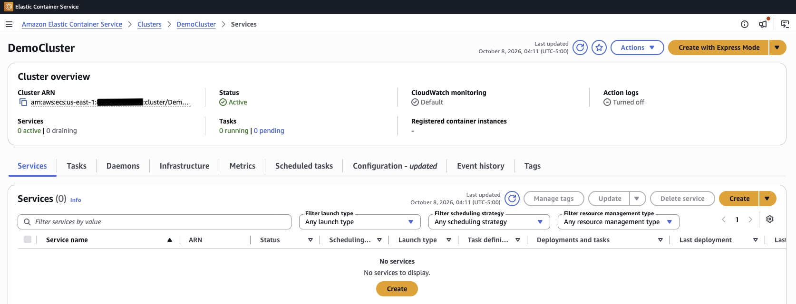

---

## Step 7: Create the task definition

**Console**
1. **ECS → Task definitions → Create new task definition**.
2. **Infrastructure requirements:**
   - Family `menniboe-farm`
   - Launch type **AWS Fargate** ✔ and **Amazon EC2 instances** ✔ (both, so Phase 2 can reuse it)
   - OS/Arch **Linux/X86_64**
   - Network mode **awsvpc**
   - Task size **0.25 vCPU / 0.5 GB**
   - Task role: none
   - Task execution role: **ecsTaskExecutionRole** (choose "Create new role" if it doesn't exist)
3. **Container 1:**
   - Name `menniboe-farm`
   - Image URI `<account>.dkr.ecr.us-east-1.amazonaws.com/menniboe-farm:1.1`
   - Essential **Yes**
   - Port mapping **80 / TCP / http**
4. **Logging:** **Use log collection** ✔ → Amazon CloudWatch. This auto-creates the `/ecs/menniboe-farm` log group.
5. Click **Create**.

**CLI**
```bash
cat > taskdef.json <<EOF
{
  "family": "menniboe-farm",
  "requiresCompatibilities": ["FARGATE","EC2"],
  "networkMode": "awsvpc",
  "cpu": "256", "memory": "512",
  "runtimePlatform": {"operatingSystemFamily":"LINUX","cpuArchitecture":"X86_64"},
  "executionRoleArn": "arn:aws:iam::$ACCOUNT_ID:role/ecsTaskExecutionRole",
  "containerDefinitions": [{
    "name": "menniboe-farm",
    "image": "$ECR_URI/$REPO:1.1",
    "essential": true,
    "portMappings": [{"containerPort":80,"protocol":"tcp"}],
    "logConfiguration": {"logDriver":"awslogs","options":{
      "awslogs-group":"/ecs/menniboe-farm","awslogs-region":"$AWS_REGION",
      "awslogs-stream-prefix":"ecs","awslogs-create-group":"true"}}
  }]
}
EOF
aws ecs register-task-definition --cli-input-json file://taskdef.json
```

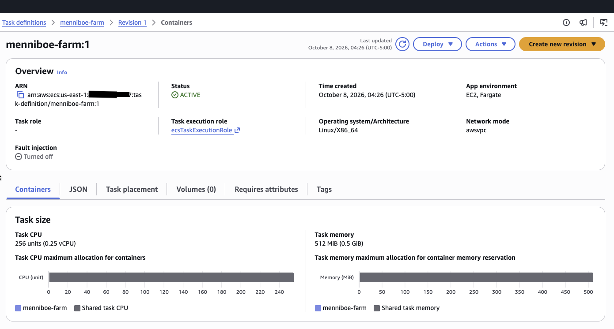
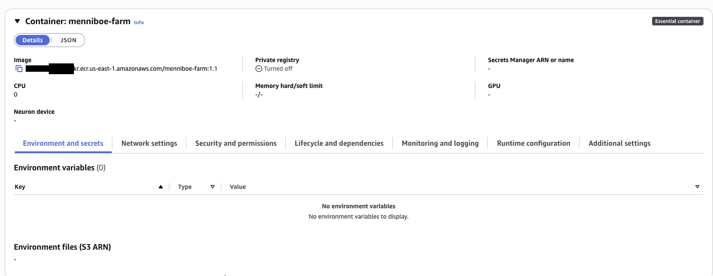

---

## Step 8: Security groups (SG-to-SG trust)

| SG | Inbound rule | Purpose |
|---|---|---|
| `farm-alb-sg` | HTTP 80 from `0.0.0.0/0` | Internet → ALB |
| `farm-task-sg` | HTTP 80 from **`farm-alb-sg`** | ALB → tasks only |

**CLI**
```bash
export VPC_ID=$(aws ec2 describe-vpcs --filters Name=isDefault,Values=true --query 'Vpcs[0].VpcId' --output text)
export SUBNETS=$(aws ec2 describe-subnets --filters Name=vpc-id,Values=$VPC_ID \
  Name=availability-zone,Values=us-east-1a,us-east-1b,us-east-1c --query 'Subnets[].SubnetId' --output text)
export ALB_SG=$(aws ec2 create-security-group --group-name farm-alb-sg --description "Menniboe farm ALB" \
  --vpc-id $VPC_ID --query GroupId --output text)
aws ec2 authorize-security-group-ingress --group-id $ALB_SG --protocol tcp --port 80 --cidr 0.0.0.0/0
export TASK_SG=$(aws ec2 create-security-group --group-name farm-task-sg --description "Menniboe farm tasks" \
  --vpc-id $VPC_ID --query GroupId --output text)
aws ec2 authorize-security-group-ingress --group-id $TASK_SG --protocol tcp --port 80 --source-group $ALB_SG
```
**Console**
1. **EC2 → Security Groups → Create security group** → name `farm-alb-sg`, VPC = default → Inbound: **HTTP**, source **Anywhere-IPv4** → Create.
2. Create `farm-task-sg` → Inbound: **HTTP**, source **Custom** → type `farm-alb-sg` and pick the SG → Create.

---

## Step 9: Target group (type ip)

**CLI**
```bash
export TG_ARN=$(aws elbv2 create-target-group --name farm-tg --protocol HTTP --port 80 \
  --vpc-id $VPC_ID --target-type ip --health-check-path /health --matcher HttpCode=200 \
  --query 'TargetGroups[0].TargetGroupArn' --output text)
aws elbv2 modify-target-group-attributes --target-group-arn $TG_ARN \
  --attributes Key=deregistration_delay.timeout_seconds,Value=30
```
**Console**
1. **EC2 → Target Groups → Create target group**.
2. Target type **IP addresses**; name `farm-tg`; HTTP **80**; VPC default; protocol version HTTP1.
3. Health check path `/health`. Click **Next**.
4. **Don't register any targets** (ECS registers them). Click **Create**.
5. Open `farm-tg` → **Attributes → Edit** → Deregistration delay **30** seconds.

> [!TIP]
> The default deregistration delay is **300 s**. Lowering it to 30 makes deployments and teardowns much faster in a lab.

---

## Step 10: ALB and listener

**CLI**
```bash
export ALB_ARN=$(aws elbv2 create-load-balancer --name farm-alb --type application --scheme internet-facing \
  --subnets ${=SUBNETS} --security-groups $ALB_SG --query 'LoadBalancers[0].LoadBalancerArn' --output text)
aws elbv2 wait load-balancer-available --load-balancer-arns $ALB_ARN
aws elbv2 create-listener --load-balancer-arn $ALB_ARN --protocol HTTP --port 80 \
  --default-actions Type=forward,TargetGroupArn=$TG_ARN
export ALB_DNS=$(aws elbv2 describe-load-balancers --load-balancer-arns $ALB_ARN --query 'LoadBalancers[0].DNSName' --output text)
```
**Console**
1. **EC2 → Load Balancers → Create → Application Load Balancer**.
2. Name `farm-alb`; **Internet-facing**; IPv4.
3. VPC default; mappings **us-east-1a, 1b, 1c**.
4. Security group: **farm-alb-sg** only. Remove `default`.
5. Listener **HTTP:80 → Forward to `farm-tg`**. Click **Create**.

> [!WARNING]
> **Error: curl returned `000`, then `LoadBalancerNotFound`.** The ALB was **never created**. `create-load-balancer` had failed with **InvalidSubnet**, because **zsh doesn't word-split `$SUBNETS`**: all 3 IDs were passed as one string.
> **Fix:** `--subnets ${=SUBNETS}`. Bash splits automatically; zsh needs `${=VAR}`.

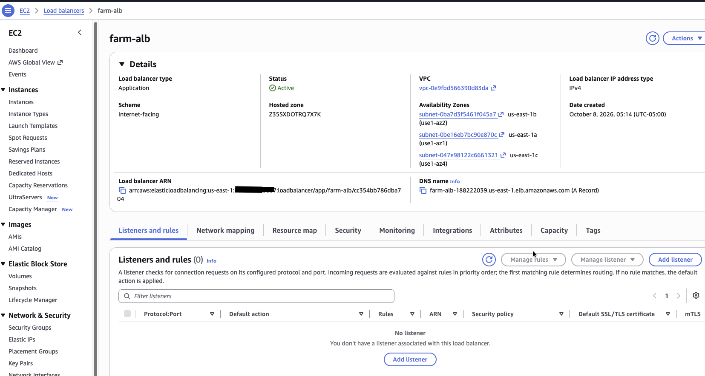

At this point the ALB returned **503**: the ALB is alive but has **no healthy targets**, which is expected before the service exists.

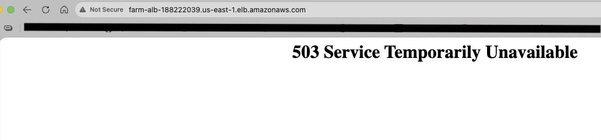
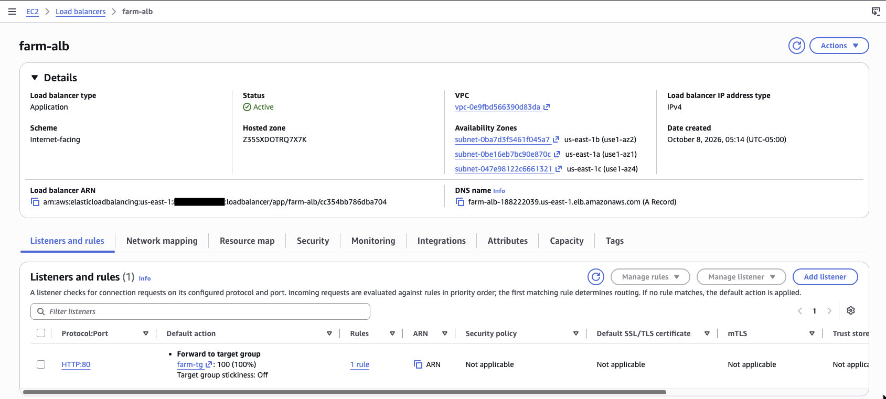

---

## Step 11: Create service farm-svc (Fargate)

**Console:** ECS → DemoCluster → Services → **Create**

| Section | Field | Value |
|---|---|---|
| Service details | Task definition family / revision | `menniboe-farm` / latest (1) |
| | Service name | `farm-svc` |
| Environment | Compute options | **Capacity provider strategy** → Use custom → **FARGATE**, base 0, weight 1 |
| | Platform version | LATEST |
| Deployment | Scheduling strategy | Replica |
| | Desired tasks | **3** |
| | AZ rebalancing | On |
| | Health check grace period | 30 s |
| | Deployment strategy | Rolling update, min **100%** / max **200%** |
| | Deployment failure detection | Circuit breaker ✔ + Rollback on failures ✔ |
| Networking | VPC / Subnets | default / **1a, 1b, 1c** |
| | Security group | **farm-task-sg** only |
| | Public IP | **Turned on** (default subnets have no NAT; needed to pull from ECR) |
| Load balancing | Type | Application Load Balancer → **Use existing** `farm-alb` |
| | Container | `menniboe-farm 80:80` |
| | Listener | **Use existing** `80:HTTP` |
| | Target group | **Use existing** `farm-tg` |
| Service auto scaling | (do later in Step 14) | — |

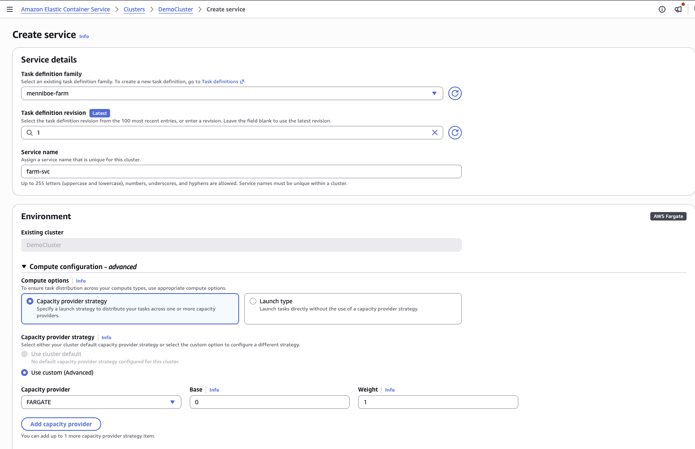
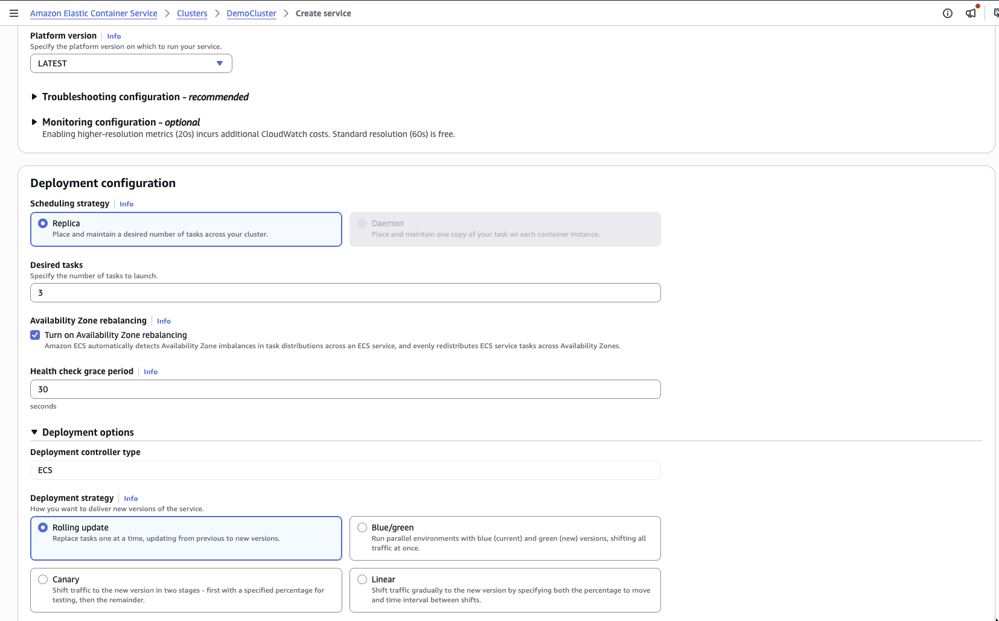
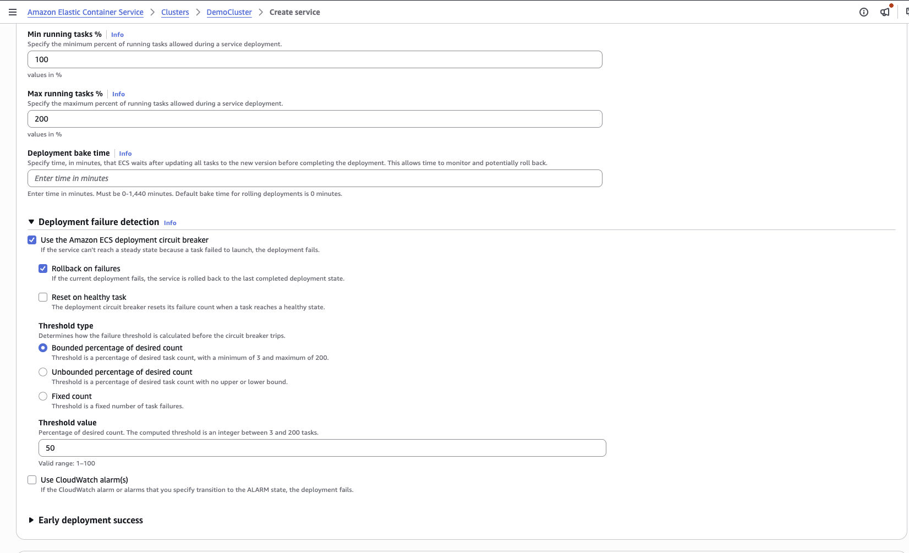

> [!WARNING]
> **Error caught before Create: the wrong SG (`farm-alb-sg`) was selected for the tasks.** It would have worked, but it breaks the lockdown design: the tasks would accept port 80 from the whole internet.
> **Fix:** remove `farm-alb-sg` and choose **farm-task-sg**.

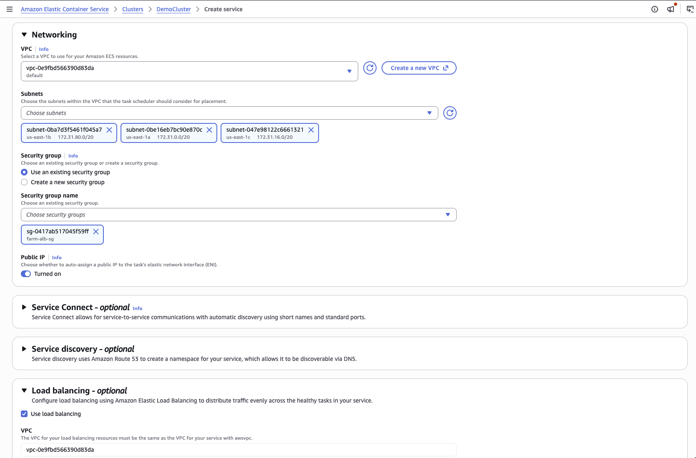
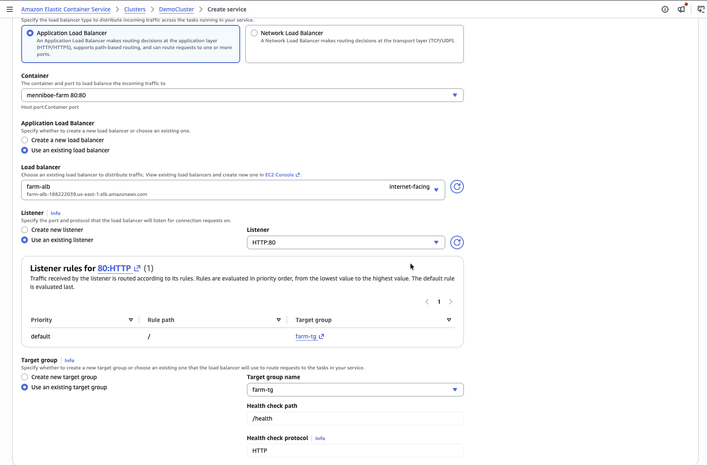

**CLI**
```bash
aws ecs create-service --cluster DemoCluster --service-name farm-svc \
  --task-definition menniboe-farm:1 --desired-count 3 \
  --capacity-provider-strategy capacityProvider=FARGATE,base=0,weight=1 \
  --network-configuration "awsvpcConfiguration={subnets=[$(echo $SUBNETS | tr ' ' ',')],securityGroups=[$TASK_SG],assignPublicIp=ENABLED}" \
  --load-balancers targetGroupArn=$TG_ARN,containerName=menniboe-farm,containerPort=80 \
  --health-check-grace-period-seconds 30 \
  --deployment-configuration "minimumHealthyPercent=100,maximumPercent=200,deploymentCircuitBreaker={enable=true,rollback=true}"
```

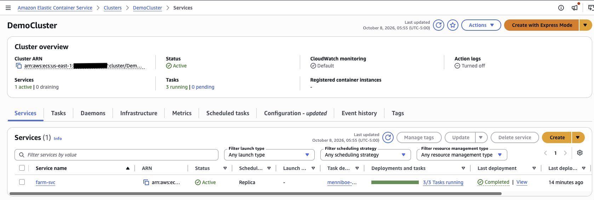

**Task lifecycle:** PROVISIONING (ENI attached) → PENDING (image pull) → ACTIVATING (registering in the target group) → RUNNING.

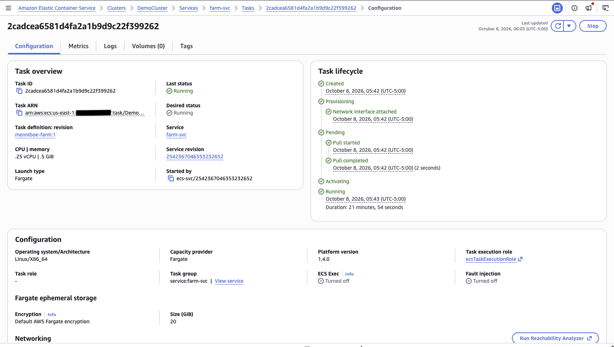
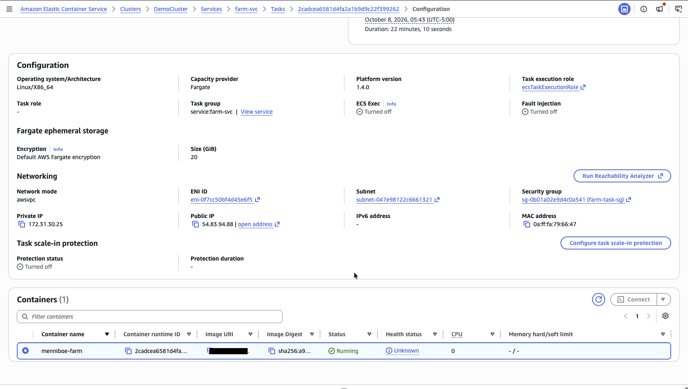

---

## Step 12: Verify round-robin across 3 AZs

```bash
for i in {1..6}; do curl -s http://$ALB_DNS | grep -o 'Container IP: <b>[0-9.]*'; done
```
**Console / browser:** open `http://<ALB DNS>` and hard-refresh (Cmd+Shift+R). The **Container IP** changes each time.

| Screenshot | Task IP |
|---|---|
| 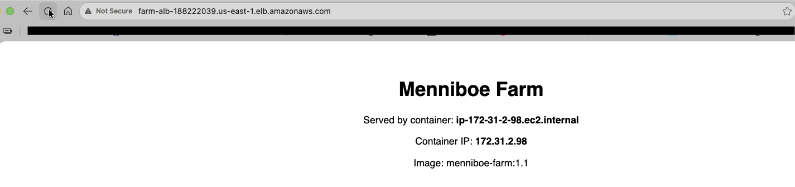 | 172.31.2.98 |
|  | 172.31.80.37 |
| 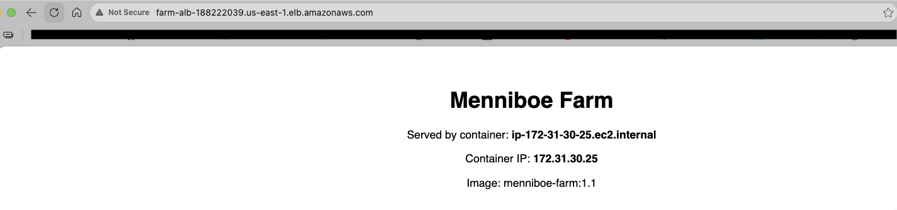 | 172.31.30.25 |

---

## Step 13: Negative test (lockdown proof)

Browse directly to a task's **public IP** (from the task's Networking section, e.g. `http://54.83.94.88`).

**Expected:** a **timeout**. `farm-task-sg` only allows the ALB's SG, so the packets are silently dropped. Because the result is a timeout and not "connection refused", you know a security group did it.

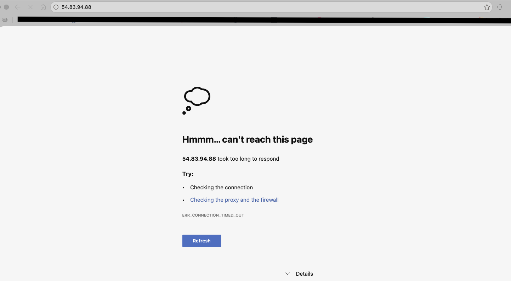

---

## Step 14: Service auto scaling (target tracking)

**Console:** farm-svc → **Service auto scaling** tab → **Set the number of tasks**
1. Min **2**, Max **6**.
2. **Create scaling policy:**
   - Type **Target tracking**
   - Name `farm-requests-tt`
   - Metric **ALBRequestCountPerTarget**
   - Target group `farm-tg`
   - Target value **100**
   - Cooldowns: defaults
   - Leave "Turn off scale-in" unchecked

**CLI**
```bash
aws application-autoscaling register-scalable-target --service-namespace ecs \
  --resource-id service/DemoCluster/farm-svc --scalable-dimension ecs:service:DesiredCount \
  --min-capacity 2 --max-capacity 6
LB_SUFFIX=$(echo $ALB_ARN | sed 's#.*:loadbalancer/##'); TG_SUFFIX=$(echo $TG_ARN | sed 's#.*:##')
aws application-autoscaling put-scaling-policy --service-namespace ecs \
  --resource-id service/DemoCluster/farm-svc --scalable-dimension ecs:service:DesiredCount \
  --policy-name farm-requests-tt --policy-type TargetTrackingScaling \
  --target-tracking-scaling-policy-configuration "{\"TargetValue\":100,\"PredefinedMetricSpecification\":{\"PredefinedMetricType\":\"ALBRequestCountPerTarget\",\"ResourceLabel\":\"$LB_SUFFIX/$TG_SUFFIX\"}}"
```

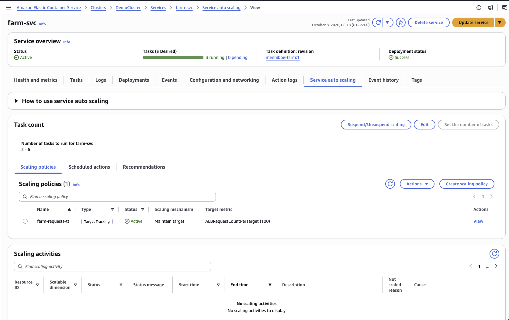

Target tracking auto-creates **two CloudWatch alarms**. **Don't edit them.**
- **AlarmHigh:** RequestCountPerTarget > 100 for **3 of 3** min
- **AlarmLow:** RequestCountPerTarget < 90 for **15 of 15** min

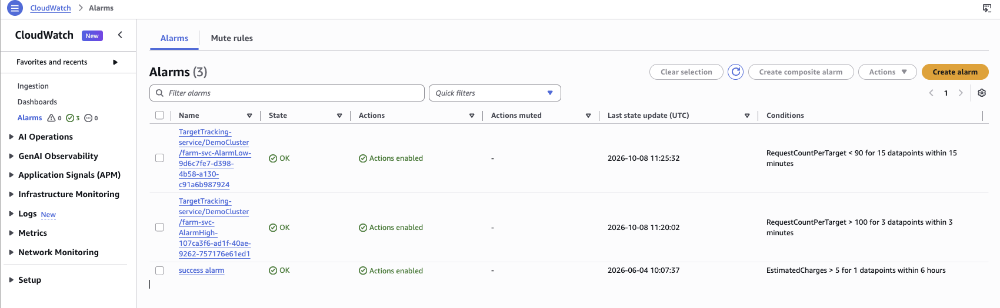

> [!NOTE]
> **Surprise: the service scaled *in* from 3 to 2 right after I created the policy.** There was no traffic, so AlarmLow fired and target tracking moved toward min = 2. That's expected behaviour, not a bug.

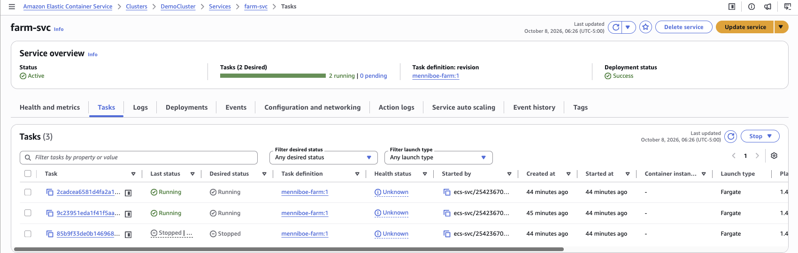

---

## Step 15: Load test and watch scale-out and scale-in

```bash
ab -t 360 -n 1000000 -c 10 http://$ALB_DNS/
```

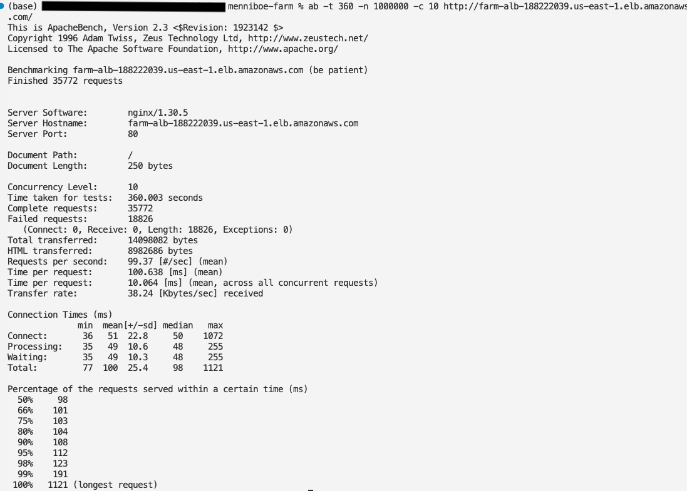

**Results:**
- **35,772 requests at about 99 req/s**, mean latency about 100 ms.
- **Scale-out:** within about 3 minutes, desired went 2 → **6** (the max).

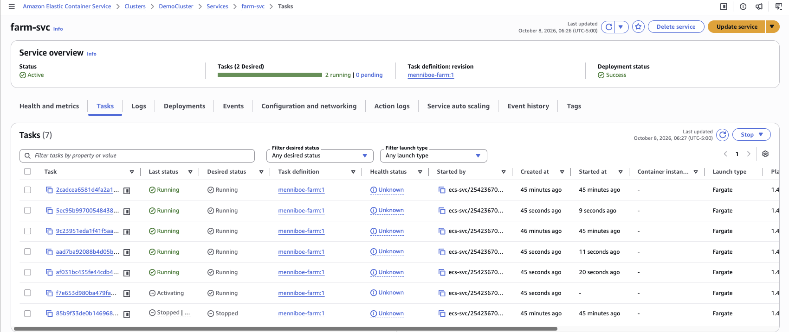

> [!NOTE]
> **"Failed requests: 18826 (Length: 18826)" is not a real failure.** ab compares every response's length to the first response. The page shows a **different container hostname and IP** each time, so the length varies. Connect, Receive and Exceptions were all **0**.

**Scale-in took about 15 minutes.** I first guessed "missing data treatment" was the cause. **That was wrong.** The real reason is the **AlarmLow rule of 15 datapoints in 15 minutes**. AWS scales in conservatively on purpose.

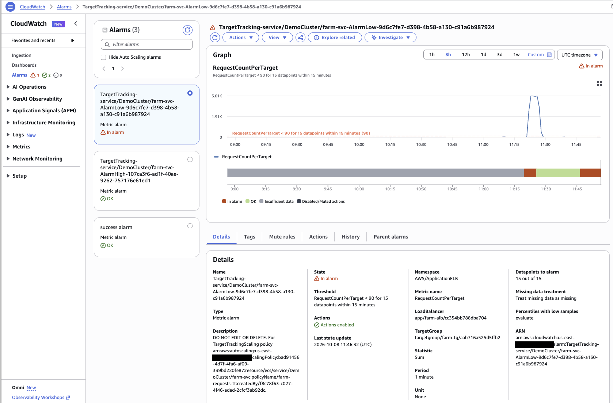

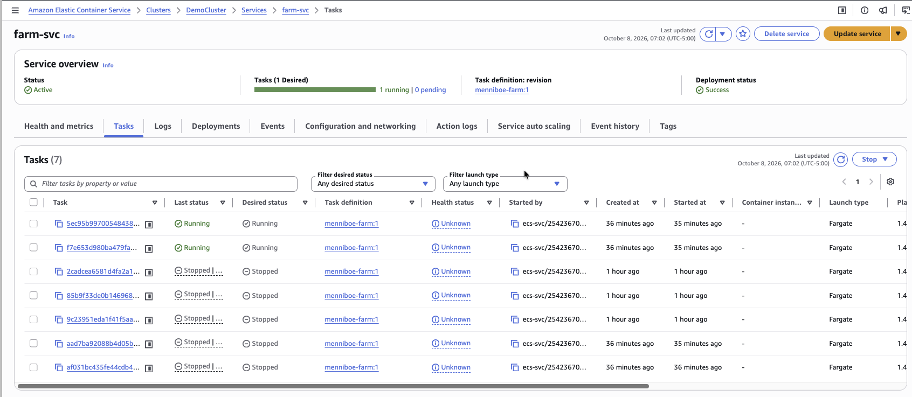

---

## Step 16: SNS topic for alerts

**Console**
1. **SNS → Topics → Create topic** → **Standard** → name `farm-task-alerts` → Create.
2. **Create subscription** → protocol **Email** → your address → Create.
3. **Confirm** from the email.

**CLI**
```bash
export TOPIC_ARN=$(aws sns create-topic --name farm-task-alerts --query TopicArn --output text)
aws sns subscribe --topic-arn $TOPIC_ARN --protocol email --notification-endpoint <your-email>
```

---

## Step 17: EventBridge rule (task STOPPED → SNS)

**Console**
1. **EventBridge → Buses → Rules**. Event bus **default** → **Create rule**.
2. Builder mode: **Advanced builder** (step-by-step).
3. **Step 1:** name `farm-task-stopped`; description "Email when any DemoCluster task stops"; bus **default**; type **Rule with an event pattern**.
4. **Step 2:** Event source **AWS events or EventBridge partner events** → Creation method **Custom pattern (JSON editor)** → paste:
   ```json
   {
     "source": ["aws.ecs"],
     "detail-type": ["ECS Task State Change"],
     "detail": {
       "clusterArn": [{ "suffix": "cluster/DemoCluster" }],
       "lastStatus": ["STOPPED"]
     }
   }
   ```
5. **Step 3:** Target type **AWS service** → **SNS topic** → target in this account → `farm-task-alerts` → **Use execution role** ✔ → **Create default role**. This makes `Amazon_EventBridge_Invoke_Sns_<id>`.
6. **Step 4:** tags (skip). **Step 5:** review, then **Create rule**.

> [!WARNING]
> **Error: I landed on "Create custom event bus".** ECS events go to the **default** bus. You don't need a custom bus. Go back to **Rules** on the default bus.

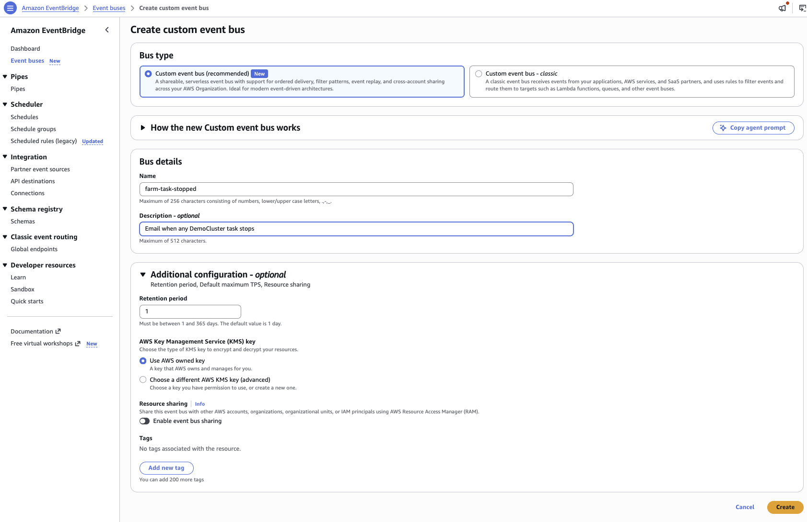
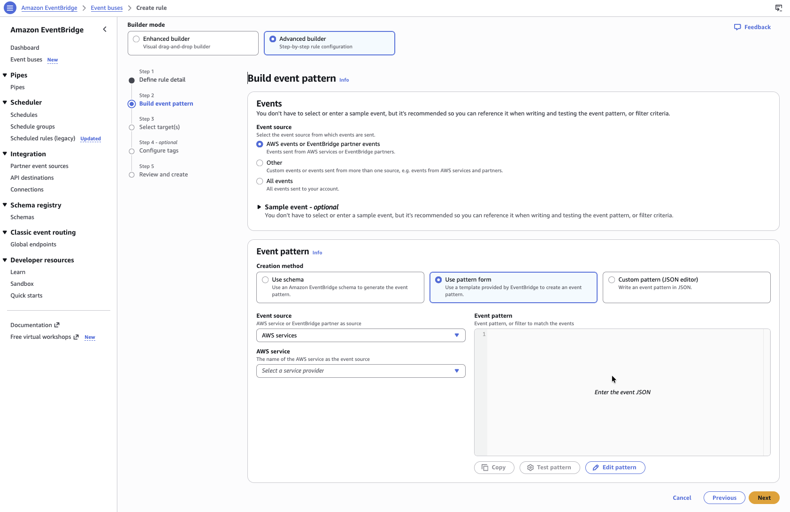
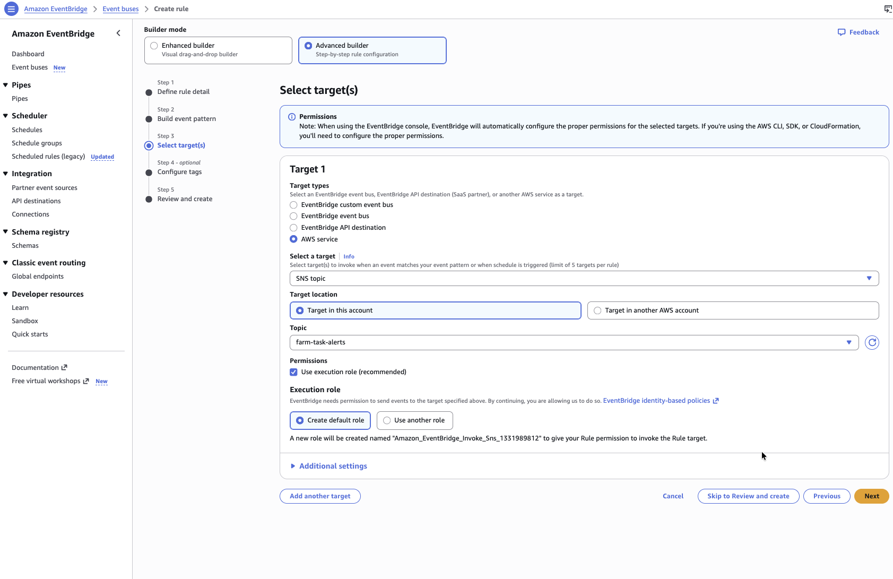
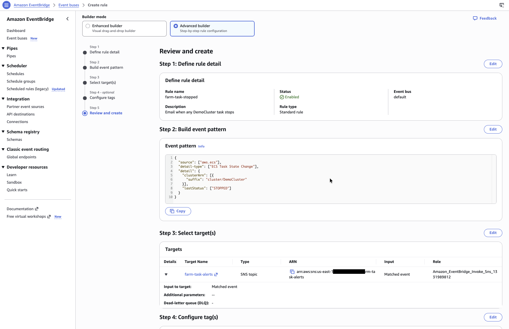
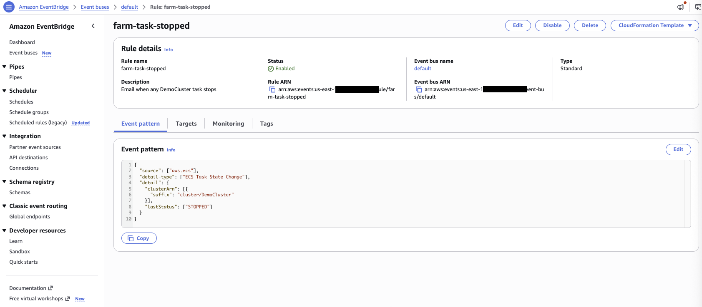

> [!NOTE]
> **Correction during the session:** I first said EventBridge needs an **SNS topic resource policy** to publish. When you create the rule in the **console**, it can instead use an **execution role**. Either works; the console's default role is the simplest.

**CLI**
```bash
aws events put-rule --name farm-task-stopped --event-bus-name default \
  --description "Email when any DemoCluster task stops" \
  --event-pattern '{"source":["aws.ecs"],"detail-type":["ECS Task State Change"],"detail":{"clusterArn":[{"suffix":"cluster/DemoCluster"}],"lastStatus":["STOPPED"]}}'
# Option A: SNS topic policy that allows events.amazonaws.com to sns:Publish, then:
aws events put-targets --rule farm-task-stopped --targets "Id"="sns1","Arn"="$TOPIC_ARN"
```

---

## Step 18: Test the alert

**Console:** farm-svc → **Tasks** → select a task → **Stop** → **Stop selected**. Within about 1 minute an email arrives with the full task JSON. The service replaces the task automatically.

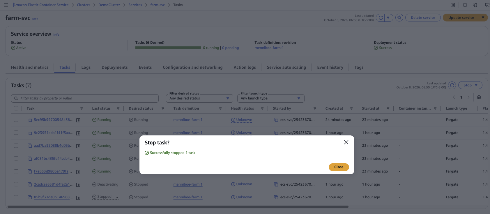

> [!WARNING]
> **Error: no alert email arrived.** The SNS subscription was **deactivated**, because an "unsubscribe" link in an earlier alert email had been clicked.
> **Fix:** use the **Resubscribe** link (or re-create the subscription) and confirm again.
> **Lesson:** every SNS email has an unsubscribe link. In production, confirm subscriptions with **`AuthenticateOnUnsubscribe=true`** so a single click can't silently remove an on-call alert.

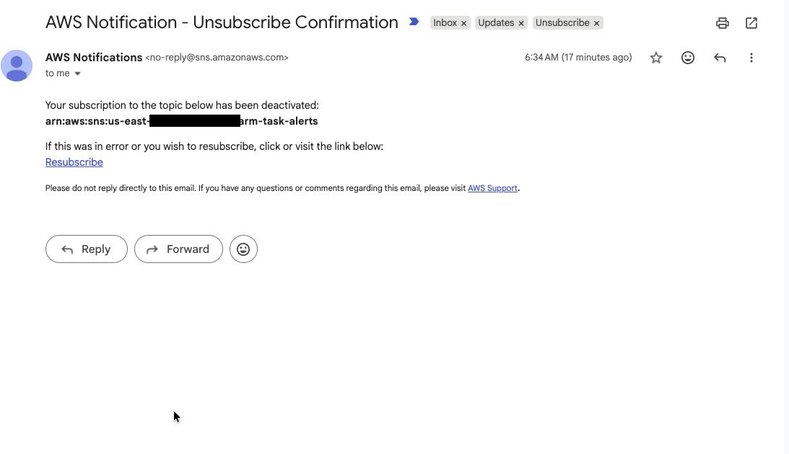

---

## Step 19: Pause Phase 1 (desired 0)

**Console:** farm-svc → **Service auto scaling** → set **min 0** / max 6 → **Update service** → desired **0**.
**CLI:**
```bash
aws application-autoscaling register-scalable-target --service-namespace ecs \
  --resource-id service/DemoCluster/farm-svc --scalable-dimension ecs:service:DesiredCount --min-capacity 0 --max-capacity 6
aws ecs update-service --cluster DemoCluster --service farm-svc --desired-count 0
```
> [!IMPORTANT]
> If min stays at 2, auto scaling **brings the tasks back** after you set desired to 0. Lower **min** first.

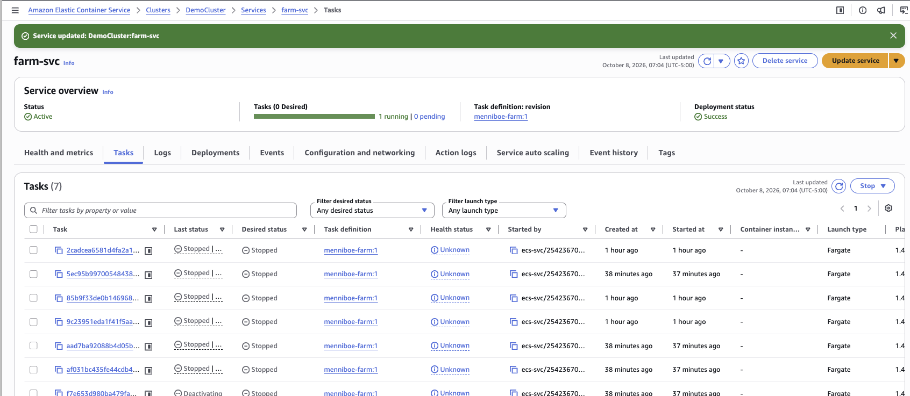

> [!CAUTION]
> The **ALB keeps billing** while paused (hourly plus LCU). We kept it on purpose for Phase 2.

---

# Part C: Lab Phase 2 (EC2 + capacity provider)

**Goal:** run the **same image and the same ALB/target group** on EC2 instances that ECS scales for us.

**The chain:**
1. IAM instance role
2. Launch template
3. Auto Scaling group
4. Capacity provider (managed scaling)
5. Service

## Step 20: Dead end: "Update cluster" has no EC2 option

> [!WARNING]
> **Error:** **Update cluster → Default capacity provider strategy** only lists FARGATE and FARGATE_SPOT, and I accidentally added **FARGATE** as the default strategy.
> **Fix:** click **Cancel** (nothing saved). EC2 capacity is added under **Cluster → Infrastructure tab → Capacity providers → Create**. With *EC2 Auto Scaling* selected, that requires an **existing ASG**, so we build that first. The other choice, **Managed Instances**, lets ECS manage the EC2 fleet itself.

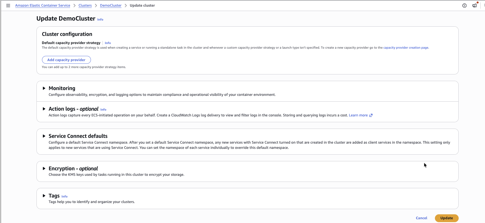
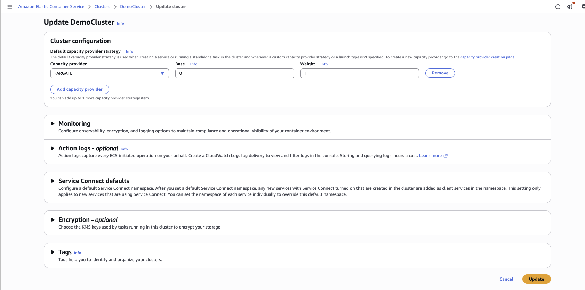
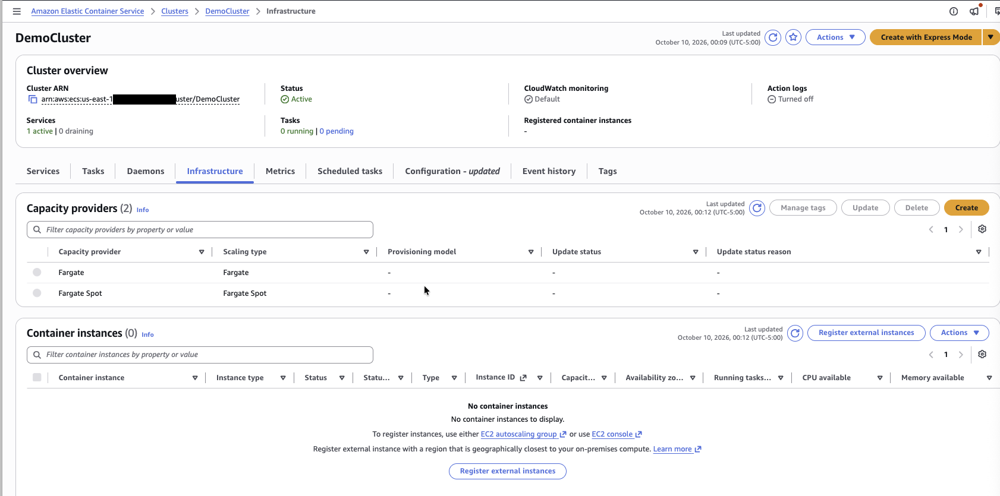
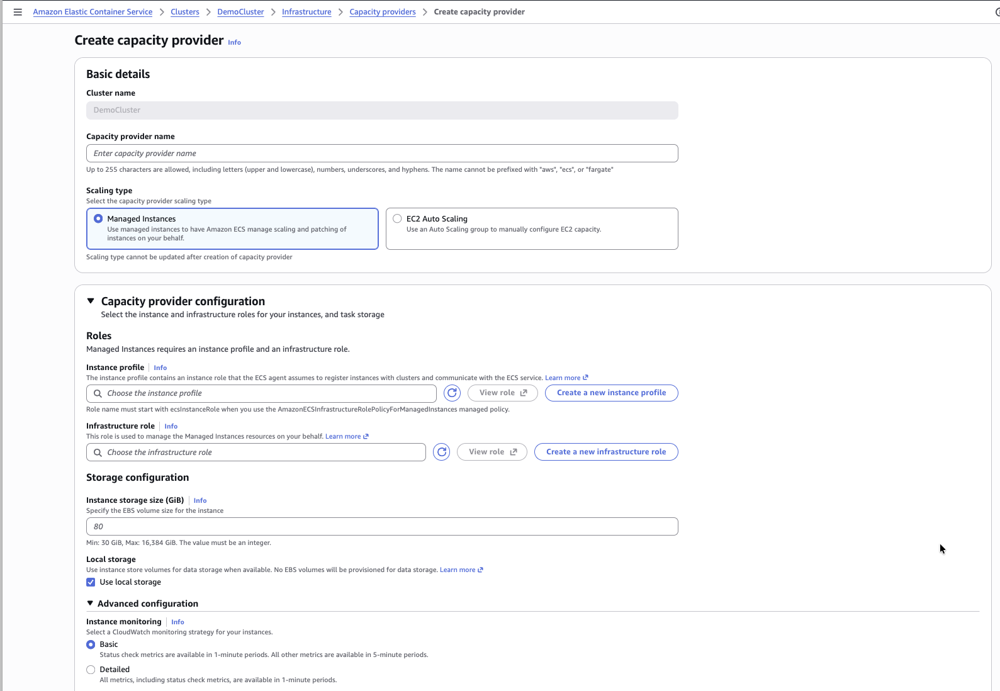
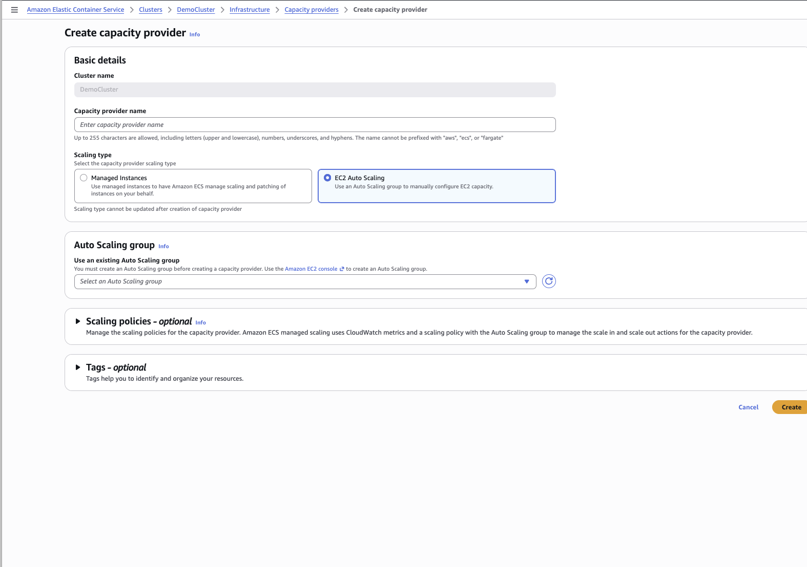

---

## Step 21: Create the ECS instance role (ecsInstanceRole)

**Console**
1. **IAM → Roles → Create role**.
2. Trusted entity **AWS service** → **EC2** → Next.
3. Attach **AmazonEC2ContainerServiceforEC2Role** → Next.
4. Name `ecsInstanceRole` → **Create role**.

Creating it from the console with EC2 as the trusted entity **also creates an instance profile with the same name**.

**CLI**
```bash
aws iam create-role --role-name ecsInstanceRole --assume-role-policy-document \
  '{"Version":"2012-10-17","Statement":[{"Effect":"Allow","Principal":{"Service":"ec2.amazonaws.com"},"Action":"sts:AssumeRole"}]}'
aws iam attach-role-policy --role-name ecsInstanceRole \
  --policy-arn arn:aws:iam::aws:policy/service-role/AmazonEC2ContainerServiceforEC2Role
aws iam create-instance-profile --instance-profile-name ecsInstanceRole
aws iam add-role-to-instance-profile --instance-profile-name ecsInstanceRole --role-name ecsInstanceRole
```

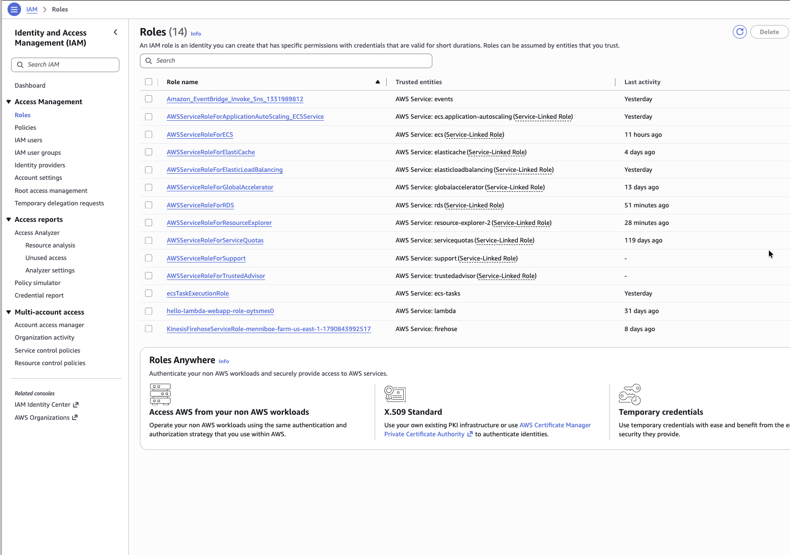
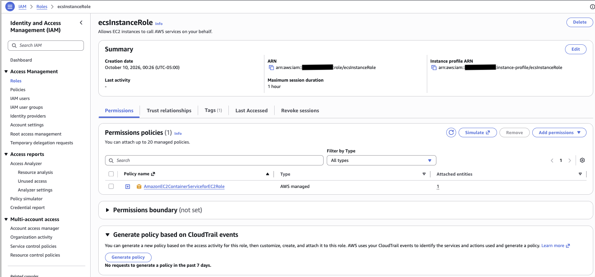

---

## Step 22: Launch template (ECS-optimized AMI + user data)

**Find the AMI:**
```bash
aws ssm get-parameter --name /aws/service/ecs/optimized-ami/amazon-linux-2023/recommended/image_id \
  --query 'Parameter.Value' --output text        # → ami-0fb0f484b75566814 (on Oct 10, 2026)
```

**Console:** **EC2 → Launch Templates → Create launch template**

| Section | Value |
|---|---|
| Name / description | `farm-ecs-lt` / "ECS container instances for DemoCluster" |
| Auto Scaling guidance | ✔ Provide guidance… |
| AMI | Paste the AMI ID in search → **Browse more AMIs → Community AMIs** tab → select **ami-0fb0f484b75566814** (ECS-optimized AL2023) |
| Instance type | **t3.micro** |
| Key pair | Don't include |
| Network settings: subnet | Don't include (the ASG picks subnets) |
| Security group | `default` (the instance's own SG; awsvpc tasks get their **own** SG) |
| Storage | AMI default |
| Advanced: IAM instance profile | **ecsInstanceRole** |
| Advanced: User data | see below |

```bash
#!/bin/bash
echo ECS_CLUSTER=DemoCluster >> /etc/ecs/ecs.config
```

> [!WARNING]
> **Error 1:** I picked the plain **Amazon Linux 2023 AMI** (`ami-0fef201115eefe936`). It has **no ECS agent**, so instances would never register with the cluster.
> **Error 2:** the instance type was **t2.micro**. Use **t3.micro** (current generation, Nitro).
> **Fix:** use the **ECS-optimized** AMI from the SSM parameter. Searching the ID under Quick Start finds 0 results; it's under **Community AMIs**.

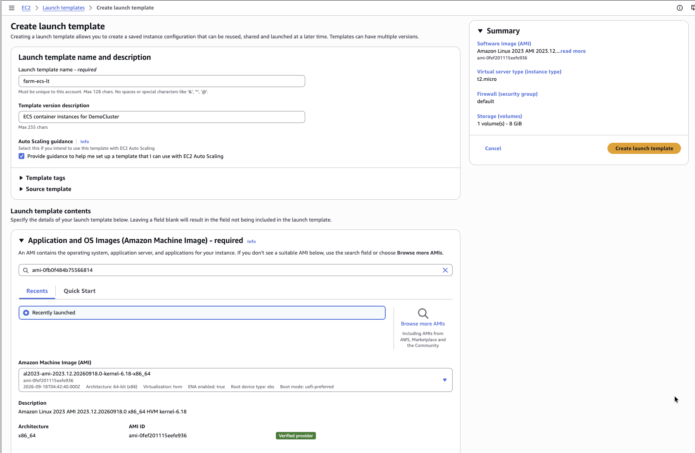


**CLI**
```bash
AMI=$(aws ssm get-parameter --name /aws/service/ecs/optimized-ami/amazon-linux-2023/recommended/image_id --query Parameter.Value --output text)
UD=$(printf '#!/bin/bash\necho ECS_CLUSTER=DemoCluster >> /etc/ecs/ecs.config\n' | base64)
aws ec2 create-launch-template --launch-template-name farm-ecs-lt \
  --version-description "ECS container instances for DemoCluster" \
  --launch-template-data "{\"ImageId\":\"$AMI\",\"InstanceType\":\"t3.micro\",\"IamInstanceProfile\":{\"Name\":\"ecsInstanceRole\"},\"UserData\":\"$UD\"}"
```

---

## Step 23: Auto Scaling group (0/0/3)

**Console:** **EC2 → Auto Scaling Groups → Create**

| Wizard page | Setting |
|---|---|
| 1. Launch template | Name `farm-ecs-asg`; template `farm-ecs-lt`, version Default |
| 2. Instance launch options | VPC default; subnets **1a, 1b, 1c**; AZ distribution **Balanced best effort** |
| 3. Integrations | **No load balancer** (the ALB targets *task ENIs*, not instances); health checks **EC2**, grace 300 s; VPC Lattice none; ARC zonal shift off |
| 4. Group size | Desired **0**, Min **0**, Max **3**; **No scaling policies**; maintenance **No policy**; scale-in protection **off**; group metrics **on**; default warmup off; deletion protection None |
| 5. Notifications | Skip |
| 6. Tags | `Project = menniboe-farm-lab`, tag new instances ✔ |
| 7. Review | Check all of the above → **Create** |

> [!IMPORTANT]
> **Why desired = 0:** the **capacity provider** will own the desired count. **Why no load balancer:** attaching the ASG to farm-tg would register the *instances*, which is wrong for awsvpc mode, where ECS registers the *task IPs*.


**CLI**
```bash
aws autoscaling create-auto-scaling-group --auto-scaling-group-name farm-ecs-asg \
  --launch-template LaunchTemplateName=farm-ecs-lt,Version='$Default' \
  --min-size 0 --max-size 3 --desired-capacity 0 \
  --vpc-zone-identifier "$(echo $SUBNETS | tr ' ' ',')" \
  --tags Key=Project,Value=menniboe-farm-lab,PropagateAtLaunch=true
```

---

## Step 24: Capacity provider with managed scaling

**Console:** ECS → DemoCluster → **Infrastructure** → Capacity providers → **Create**

| Field | Value |
|---|---|
| Capacity provider name | `farm-ecs-cp` (**not** the ASG's name) |
| Scaling type | **EC2 Auto Scaling** (can't be changed later) |
| Auto Scaling group | `farm-ecs-asg` |
| Managed instance draining | ✔ on (default) |
| Managed scaling | ✔ on |
| Scale-in protection (managed termination protection) | ☐ off (would need ASG scale-in protection) |
| Target capacity % | **100** |
| Tags | `Project = menniboe-farm-lab` |

> [!WARNING]
> **Error: the name field said `farm-ecs-asg`**, the same as the ASG. It would work, but it causes confusion at teardown. **Fix:** give it a distinct name (`farm-ecs-cp`).


**CLI**
```bash
ASG_ARN=$(aws autoscaling describe-auto-scaling-groups --auto-scaling-group-names farm-ecs-asg --query 'AutoScalingGroups[0].AutoScalingGroupARN' --output text)
aws ecs create-capacity-provider --name farm-ecs-cp \
  --auto-scaling-group-provider "autoScalingGroupArn=$ASG_ARN,managedScaling={status=ENABLED,targetCapacity=100},managedTerminationProtection=DISABLED,managedDraining=ENABLED"
aws ecs put-cluster-capacity-providers --cluster DemoCluster \
  --capacity-providers FARGATE FARGATE_SPOT farm-ecs-cp --default-capacity-provider-strategy '[]'
```

Behind the scenes, ECS added an **`ECSManagedAutoScalingPolicy-…`** target-tracking policy to the ASG, tracking `CapacityProviderReservation` at 100.

---

## Step 25: Check task definition compatibility

ECS → Task definitions → `menniboe-farm:1` → Overview → **App environment: `EC2, Fargate`** ✔. We can reuse it with no new revision.
```bash
aws ecs describe-task-definition --task-definition menniboe-farm:1 --query 'taskDefinition.compatibilities'
```

---

## Step 26: Create service farm-svc-ec2

**Console:** ECS → DemoCluster → Services → **Create**

| Section | Field | Value |
|---|---|---|
| Service details | Family / revision / name | `menniboe-farm` / 1 / `farm-svc-ec2` |
| Environment | Compute | Capacity provider strategy → **Use custom** → **farm-ecs-cp**, base 0, weight 1 (the "Amazon EC2" badge appears) |
| Deployment | Replica, desired **3**, AZ rebalancing on, grace **60**, rolling **100 / 200**, circuit breaker defaults | |
| Task placement | AZ balanced spread (default) | |
| Networking | Subnets 1a/1b/1c; **security group farm-task-sg ⚠️ (remove `default`)**; public IP not available on EC2 | |
| Load balancing | ALB → existing `farm-alb`; container `menniboe-farm 80:80`; **listener: Use an existing listener → 80:HTTP**; target group existing `farm-tg` | |
| Auto scaling | off | |
| Tags | `Project = menniboe-farm-lab` | |

> [!WARNING]
> **Error caught: the Listener was set to "Create new listener" on port 80.** farm-alb already has an HTTP:80 listener, so this fails with **DuplicateListener**.
> **Fix:** **Use an existing listener → 80:HTTP**.


> [!CAUTION]
> I clicked Create **without reviewing the Networking section**. The console had **pre-selected the VPC `default` security group**. That caused the outage in [Step 28](#step-28-debug-tasks-replaced-as-unhealthy).


**CLI** (the correct version)
```bash
aws ecs create-service --cluster DemoCluster --service-name farm-svc-ec2 \
  --task-definition menniboe-farm:1 --desired-count 3 \
  --capacity-provider-strategy capacityProvider=farm-ecs-cp,base=0,weight=1 \
  --network-configuration "awsvpcConfiguration={subnets=[$(echo $SUBNETS | tr ' ' ',')],securityGroups=[$TASK_SG]}" \
  --load-balancers targetGroupArn=$TG_ARN,containerName=menniboe-farm,containerPort=80 \
  --health-check-grace-period-seconds 60 \
  --placement-strategy type=spread,field=attribute:ecs.availability-zone
```

---

## Step 27: Watch the scale-out from zero

**Console:**
- EC2 → Auto Scaling groups → farm-ecs-asg → **Desired capacity** and the **Activity** tab.
- ECS → DemoCluster → **Infrastructure → Container instances**.

**CLI**
```bash
aws autoscaling describe-scaling-activities --auto-scaling-group-name farm-ecs-asg --max-items 5 \
  --query 'Activities[].{t:StartTime,d:Description}' --output table
aws ecs list-container-instances --cluster DemoCluster
```

**What happened:** **0 → 2 → 3** instances.
- With 0 instances, ECS reports **CapacityProviderReservation = 200%** and takes a cautious first step.
- After the first instance registered, ECS computed the exact need of 3.

Things to notice:
- The instances are spread across **use1-az1 (1a)** and **use1-az4 (1c)**.
- **Managed draining** auto-created the lifecycle hook **`ecs-managed-draining-termination-hook`** (CONTINUE, 3600 s).


**One task per t3.micro:** in awsvpc mode each task needs its own ENI. t3.micro has **2 ENIs** and the instance uses one, so **max 1 task per instance**, no matter how much CPU or memory is free.

> [!TIP]
> Exam: *"EC2 tasks stuck in PROVISIONING / PENDING although instances have spare CPU and memory, awsvpc mode"* → **ENI limit**. Fixes:
> - Bigger instance type
> - **ENI trunking** (`awsvpcTrunking` account setting on supported Nitro types such as m5/c5; **not t3**)
> - **bridge** mode with dynamic ports

---

## Step 28: Debug: tasks replaced as unhealthy

**Symptom:** 3 tasks Running, plus **3 more stuck in PROVISIONING**, although desired = 3.


**1. Service → Events** shows: *"Amazon ECS replaced 2 tasks due to an unhealthy status."*


**2. Target group → Targets:** all 3 are **Unhealthy: "Request timed out"** (`Target.Timeout`). The ALB **can't reach** the tasks, so this is a network or SG problem, not the app.


| Reason code | Points to |
|---|---|
| `Target.Timeout` | SG / NACL / routing: no reply at all |
| `Target.ResponseCodeMismatch` | Reached the app, wrong HTTP code or path |
| `Target.FailedHealthChecks` | Generic; read the detail text |

**3. Service → Configuration and networking:** Security group = `sg-01ea…`, shown only as an ID.


**4. Click the SG:** it's the VPC **`default`** SG. Its rules are "All traffic from *itself*" and "SSH 22 from my IP". **The ALB (in farm-alb-sg) isn't allowed**, so the health checks are dropped and time out.


**Why it got stuck (the deadlock):**
1. Unhealthy tasks get replaced.
2. With **min 100%**, ECS keeps the old tasks until their replacements run.
3. Every t3.micro's only spare ENI is held by an old task.
4. The ASG is already at **max 3**.
5. So the replacements can never place, and the old tasks never stop.

---

## Step 29: Fix: correct SG + break the ENI deadlock

**You can't change a running task's SG.** Change the service's network configuration so ECS deploys new tasks.

**Console:** farm-svc-ec2 → **Update service**
- **Min running tasks %: `0`**, which lets ECS stop the old tasks first and free their ENIs.
- **Max running tasks %: `120`**.
- Networking → Security group: remove `default`, add **farm-task-sg**.
- Click **Update**.

> [!WARNING]
> **Error: "The max running tasks value must be greater than 100 when Availability Zone rebalancing is turned on."** AZ rebalancing needs headroom above desired.
> **Fix:** ECS **rounds max down**. 3 × 120% = 3.6 → **3**, so the setting passes validation and still means "no extra task". (Alternative: turn AZ rebalancing off and use 100.)

| Max % | 3 × max | Rounded down |
|---|---|---|
| 100 | 3.0 | rejected (with rebalancing on) |
| **120** | 3.6 | **3** ✔ |
| 134 | 4.02 | 4 (would need a 4th ENI) |

**CLI**
```bash
aws ecs update-service --cluster DemoCluster --service farm-svc-ec2 \
  --network-configuration "awsvpcConfiguration={subnets=[$(echo $SUBNETS | tr ' ' ',')],securityGroups=[$TASK_SG]}" \
  --deployment-configuration minimumHealthyPercent=0,maximumPercent=120
```

**Task stop lifecycle:** RUNNING → **DEACTIVATING** (deregister from the target group, 30 s delay) → STOPPING → **DEPROVISIONING** (detach ENI) → STOPPED. The ENI is only free after deprovisioning.


> [!TIP]
> **min 100 / max 200:** start new tasks, then stop old ones. No downtime, but it needs spare capacity.
> **min 0 / max 100:** stop old tasks, then start new ones. Some downtime, but no extra capacity. Use it when capacity is the bottleneck.

---

## Step 30: Verify through the ALB

All 3 targets are **Healthy**: 172.31.12.46 (1a), 172.31.31.99 (1c), 172.31.80.119 (1b).


The browser round-robins across the 3 **task ENI IPs**, not the instances' IPs. That's why the same ip-type target group worked for both Fargate and EC2.

| | |
|---|---|
|  |  |
|  | |

---

# Part D: Teardown

> [!IMPORTANT]
> **Dependency order:** services → capacity provider → ASG → launch template → cluster → ALB → target group → SGs → EventBridge/SNS → ECR → logs → IAM → local. The full CLI is in [`commands.md`](commands.md#10-teardown). The console equivalents are below.

| # | Delete | Console | CLI key command | Gotcha |
|---|---|---|---|---|
| T1 | `farm-svc-ec2` | ECS → service → **Delete service** → ✔ Force delete → type `delete` | `aws ecs delete-service --force` + `wait services-inactive` | `--force` skips scaling to 0 first |
| T2 | `farm-svc` + auto scaling | Service auto scaling tab → delete policy → then Delete service (force) | `deregister-scalable-target`, then `delete-service --force` | Deregistering also removes the TargetTracking alarms |
| T3 | Capacity provider `farm-ecs-cp` | Cluster → **Update cluster** (remove it from the strategy) → Infrastructure → select CP → **Delete** | `put-cluster-capacity-providers '[]'` → `delete-capacity-provider` | Must detach from the cluster first; zsh: quote `'[]'` |
| T4 | ASG + 3 instances | EC2 → Auto Scaling groups → select → **Actions → Delete** (type `delete`) | `delete-auto-scaling-group --force-delete` + `ec2 wait instance-terminated ${=IDS}` | Force delete also skips the draining lifecycle hook |
| T5 | Launch template, cluster | EC2 → Launch Templates → **Delete template**; ECS → cluster → **Delete cluster** | `delete-launch-template`; `delete-cluster` | The cluster fails if instances or services remain |
| T6 | ALB (+listener), target group | EC2 → Load Balancers → **Actions → Delete**; Target Groups → **Delete** | `delete-load-balancer` + `wait load-balancers-deleted`; `delete-target-group` | TG only after the listener is gone |
| T7 | `farm-task-sg`, `farm-alb-sg` | EC2 → Security Groups → select → **Delete** (task SG first) | `delete-security-group` ×2 | The task SG references the ALB SG; a leftover ENI causes DependencyViolation |
| T8 | Rule `farm-task-stopped`, topic `farm-task-alerts` | EventBridge → Rules → **Delete**; SNS → Topics → **Delete** | `remove-targets` → `delete-rule`; `sns delete-topic` | Targets must be removed first (the console does it for you) |
| T9 | ECR repo, `/ecs/menniboe-farm` logs | ECR → repo → **Delete** (type `delete`); CloudWatch → Log groups → **Delete** | `ecr delete-repository --force`; `logs delete-log-group` | Log groups default to **Never expire** |
| T10 | `ecsInstanceRole` + instance profile | IAM → Roles → **Delete** (the console removes the profile too) | `remove-role-from-instance-profile` → `delete-instance-profile` → `detach-role-policy` → `delete-role` | Order matters in the CLI |
| T11 | `Amazon_EventBridge_Invoke_Sns_*` + its policy | IAM → Roles → Delete; IAM → Policies → filter "Customer managed" → Delete | detach → `delete-role` → `delete-policy` | The customer-managed policy would otherwise be orphaned |
| T12 | Final sweep | Billing → Cost Explorer next day; Resource Groups → Tag Editor (`Project=menniboe-farm-lab`) | 10 `describe`/`list` checks; every one empty ✔ | Watch for orphaned EIPs and stopped instances |
| T13 | Local images | Docker Desktop → Images → select → Delete | `docker rmi -f`, `docker logout`, `docker image prune -f` | Keep `Dockerfile` and `default.conf` for GitHub |

**Kept on purpose:**
- `ecsTaskExecutionRole` (shared with the SonarQube lab)
- Service-linked roles (`AWSServiceRoleForECS`, …)
- The `default` SG (can't be deleted)
- `/ecs/sonarqube-task` logs (from another lab)

> [!TIP]
> Later, remove the **SSH 22 from my home IP** rule from the default SG. It's an open door I no longer need.

---

# Part E: Reference

## Errors and fixes (summary)

| # | Where | Error / symptom | Root cause | Fix |
|---|---|---|---|---|
| 1 | Step 3 | `zsh: command not found: REPOSITORY` | Pasted command output back into the shell | Paste commands only |
| 2 | Step 3 | `localhost refused to connect` | curl ran before nginx was ready | `sleep 3` |
| 3 | Step 5 | 7 critical / 45 high CVEs | Old base image packages | `nginx:1.30.5-alpine` + `apk upgrade` → 0 |
| 4 | Step 10 | HTTP `000`, then `LoadBalancerNotFound` | `InvalidSubnet`: zsh didn't split `$SUBNETS` | `${=SUBNETS}` |
| 5 | Step 11 | Tasks set to farm-alb-sg | Wrong SG picked in the form | farm-task-sg |
| 6 | Step 14 | Scaled in 3→2 right after the policy was created | AlarmLow (no traffic) → min | Expected behaviour |
| 7 | Step 15 | ab "Failed requests: 18826" | Length mismatch from dynamic page | Ignore (not real errors) |
| 8 | Step 15 | Scale-in took about 15 min | AlarmLow needs 15/15 datapoints | Expected; not missing data |
| 9 | Step 17 | Landed on "Create custom event bus" | Wrong page | default bus → Rules |
| 10 | Step 18 | No alert email | Subscription deactivated by an unsubscribe click | Resubscribe; use AuthenticateOnUnsubscribe |
| 11 | Step 20 | No EC2 option in Update cluster; FARGATE added by accident | EC2 needs a CP backed by an ASG | Cancel → Infrastructure → Create CP after building the ASG |
| 12 | Step 22 | Plain AL2023 AMI, t2.micro | No ECS agent; old instance generation | ECS-optimized AMI (Community AMIs), t3.micro |
| 13 | Step 24 | CP named like the ASG | Copy/paste | `farm-ecs-cp` |
| 14 | Step 26 | "Create new listener" on :80 | Would cause DuplicateListener | Use existing 80:HTTP |
| 15 | Steps 26–28 | Targets "Request timed out" → replaced → 6 tasks, 3 stuck | Console pre-selected **default SG**; ENI deadlock | Update service: farm-task-sg, min 0 / max 120 |
| 16 | Step 29 | "Max must be > 100 with AZ rebalancing" | Rebalancing needs headroom | 120% (rounds down to 3) |
| 17 | T13 | `quote>` prompt | Multi-line paste split a quote | Ctrl+C, paste as one line |

## Phase 1 vs Phase 2

| | Phase 1 (Fargate) | Phase 2 (EC2 + capacity provider) |
|---|---|---|
| Who manages servers | AWS | Me: ASG, launch template, ECS AMI, instance profile |
| Scaling layers | Tasks only | Tasks **and** instances (managed scaling) |
| Task density limit | None to manage | **ENI limit** (1 task per t3.micro) |
| Public IP on task | Optional (used to pull from ECR) | Not supported; image pulls go through the instance |
| Same ALB / TG? | Yes (target type ip) | Yes (task ENI IPs) |
| Gotcha | zsh `$SUBNETS` | Default SG pre-selected, then ENI deadlock |

## Exam cheat sheet

- **Execution role** = pull, logs and secrets **before** the app starts. **Task role** = the app's API calls. **Instance profile** = the ECS agent on EC2.
- **awsvpc** → ENI per task → TG target type **ip**. CLB ✗ with Fargate.
- **Fargate + EFS** = serverless and persistent. EKS on Fargate → **EFS only**.
- **Target tracking:** out = 3 datapoints, in = 15 datapoints. Metrics: CPU, memory, **ALBRequestCountPerTarget**.
- **Capacity provider managed scaling** scales the ASG on task demand, including **from zero**. Target capacity 100% = no spare instances.
- **Managed draining** = an ASG lifecycle hook that moves tasks before termination.
- **ENI limit** causes tasks stuck in PROVISIONING on EC2 → bigger instance, ENI trunking, or bridge mode.
- **Task STOPPED → EventBridge (default bus) → SNS/Lambda** for alerts. **S3 → EventBridge → ECS RunTask** for file processing. **SQS depth** scales workers.
- **Rolling deployment:** min 100/max 200 = no downtime; min 0/max 100 = stop-first; ECS rounds max **down**.
- **503** = no healthy targets. **Timeout** = SG dropping traffic.

## Acronyms

| Acronym | Meaning |
|---|---|
| ab | ApacheBench (HTTP load-testing tool) |
| ALB / NLB / CLB | Application / Network / Classic Load Balancer |
| AL2023 | Amazon Linux 2023 |
| AMI | Amazon Machine Image |
| ARN | Amazon Resource Name |
| ASG | Auto Scaling Group (Azure: VMSS). *Azure ASG* = Application Security Group |
| AZ | Availability Zone |
| CP | Capacity Provider |
| CLI | Command Line Interface |
| CSI | Container Storage Interface (Kubernetes storage drivers) |
| CVE | Common Vulnerabilities and Exposures |
| DLQ | Dead-Letter Queue |
| EBS | Elastic Block Store |
| ECR | Elastic Container Registry |
| ECS | Elastic Container Service |
| EFS | Elastic File System |
| EIP | Elastic IP address |
| EKS | Elastic Kubernetes Service |
| ENI | Elastic Network Interface |
| IAM | Identity and Access Management |
| JSON | JavaScript Object Notation |
| K8s | Kubernetes |
| LB / TG | Load Balancer / Target Group |
| LCU | Load Balancer Capacity Unit (ALB billing) |
| LT | Launch Template |
| NACL | Network Access Control List |
| NAT | Network Address Translation |
| NFS | Network File System |
| SAA | AWS Solutions Architect Associate |
| SG | Security Group |
| SNS / SQS | Simple Notification Service / Simple Queue Service |
| SSM | AWS Systems Manager (Parameter Store) |
| TT | Target Tracking |
| VPC | Virtual Private Cloud |
| vCPU | Virtual CPU |

> [!TIP]
> **Redo checklist:**
> 1. Run Phase 1 Steps 1–11 (about 45 min).
> 2. Verify, negative test, auto scaling (Steps 12–15).
> 3. Alerts (Steps 16–18).
> 4. Phase 2 (Steps 21–30). **Check the Networking SG before clicking Create.**
> 5. Teardown T1–T13 the same day.
