# AWS Serverless — Reference Guide (SAA-C03)

A module-by-module reference for the Serverless section, followed by a complete redo guide for the Menniboe Farm serverless API lab.

## Table of contents

**Part 1: Concepts**
- [Module 1: What is serverless](#module-1-what-is-serverless)
- [Module 2: Lambda fundamentals](#module-2-lambda-fundamentals)
- [Module 3: Lambda limits](#module-3-lambda-limits)
- [Module 4A: Concurrency and throttling](#module-4a-concurrency-and-throttling)
- [Module 4B: Cold starts, provisioned concurrency, SnapStart](#module-4b-cold-starts-provisioned-concurrency-snapstart)
- [Module 5A: Lambda in a VPC and RDS Proxy](#module-5a-lambda-in-a-vpc-and-rds-proxy)
- [Module 5B: RDS invoking Lambda vs RDS event notifications](#module-5b-rds-invoking-lambda-vs-rds-event-notifications)
- [Module 6: CloudFront Functions vs Lambda@Edge](#module-6-cloudfront-functions-vs-lambdaedge)
- [Module 7: DynamoDB fundamentals](#module-7-dynamodb-fundamentals)
- [Module 8A: DAX and DynamoDB Streams](#module-8a-dax-and-dynamodb-streams)
- [Module 8B: Global Tables, TTL, backups, S3 import/export](#module-8b-global-tables-ttl-backups-s3-importexport)
- [Module 9: API Gateway](#module-9-api-gateway)
- [Module 10: Amazon Cognito](#module-10-amazon-cognito)
- [Module 11: Step Functions](#module-11-step-functions)
- [Module 12: Architecture case studies](#module-12-architecture-case-studies)

**Part 2: Hands-on lab (redo guide)**
- [Lab architecture](#lab-architecture)
- [Step 1: Create the DynamoDB table](#step-1-create-the-dynamodb-table)
- [Step 2: Create the Lambda function](#step-2-create-the-lambda-function)
- [Step 3: Find the execution role](#step-3-find-the-execution-role)
- [Step 4: Add the environment variable](#step-4-add-the-environment-variable)
- [Step 5: Add the code and deploy](#step-5-add-the-code-and-deploy)
- [Step 6: Create the test event](#step-6-create-the-test-event)
- [Step 7: Run the test (expected failure)](#step-7-run-the-test-expected-failure)
- [Step 8–9: Add the least-privilege IAM policy](#step-89-add-the-least-privilege-iam-policy)
- [Step 10: Re-run the test](#step-10-re-run-the-test)
- [Step 11: Confirm the item in DynamoDB](#step-11-confirm-the-item-in-dynamodb)
- [Step 12: Create the REST API](#step-12-create-the-rest-api)
- [Step 13: Create the /eggs resource](#step-13-create-the-eggs-resource)
- [Step 14–15: Create GET and POST methods](#step-1415-create-get-and-post-methods)
- [Step 16: Deploy to the dev stage](#step-16-deploy-to-the-dev-stage)
- [Step 17–19: Test GET and POST](#step-1719-test-get-and-post)
- [Step 20: Clean up](#step-20-clean-up)

**Part 3: Reference**
- [Errors and fixes](#errors-and-fixes)
- [Questions I asked](#questions-i-asked)
- [Exam memory hooks](#exam-memory-hooks)
- [Acronyms](#acronyms)

---

# Part 1: Concepts

## Module 1: What is serverless

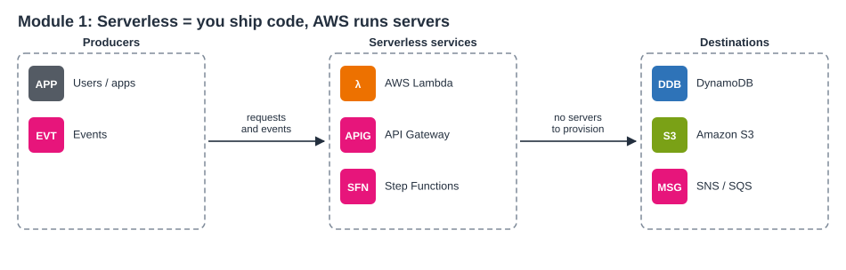

Serverless does **not** mean no servers. It means AWS provisions, patches, and scales them; you deploy code (or tables, APIs, workflows) and pay for what you use.

| Serverless | Not serverless (and why) |
|---|---|
| Lambda, DynamoDB, API Gateway, Cognito, S3, SNS, SQS, Step Functions, Fargate, Kinesis Data Firehose, Aurora Serverless | EC2, RDS (you pick capacity and pay while idle) |

> [!NOTE]
> Shared responsibility still applies. AWS secures the servers; you still own your code, IAM permissions, and data.

**Azure anchor:** Lambda ≈ Azure Functions, DynamoDB ≈ Cosmos DB, API Gateway ≈ API Management, Step Functions ≈ Logic Apps / Durable Functions, Cognito ≈ Entra External ID.

## Module 2: Lambda fundamentals

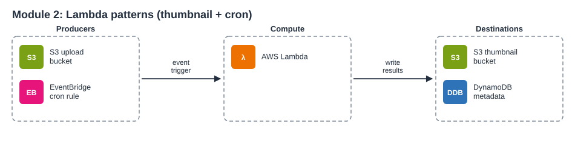

| | EC2 | Lambda |
|---|---|---|
| Unit | Virtual server | Function |
| Runs | Continuously | On demand, up to 15 min |
| Scaling | Auto Scaling group you configure | Automatic |
| Billing | Per second while running | Per request + per GB-second of compute |

- **Memory** 128 MB to 10 GB in 1 MB steps. More memory also gives more **CPU and network**.
- **Pricing**: 1M requests and 400,000 GB-seconds free per month; then $0.20 per 1M requests and about **$1 per ~60,000 GB-seconds**.

> [!WARNING]
> The lecture says "$1 per 600,000 GB-seconds." That's off by 10×. The real rate is about $0.0000166667 per GB-second, roughly $1 per 60,000.

- **Execution role**: the IAM role Lambda assumes to call other services (like an EC2 instance profile).
- **Runtimes**: Node.js, Python, Java, .NET, Ruby, plus custom runtimes (Go, Rust) and container images. For running Docker containers in general, the exam prefers **ECS/Fargate**.
- **Patterns**: S3 upload → Lambda → thumbnail (+ metadata in DynamoDB); **EventBridge cron rule → Lambda** = serverless cron job.

## Module 3: Lambda limits

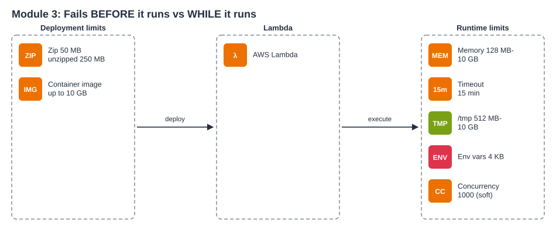

**Sorting question:** does it fail **before** it runs (deployment) or **while** it runs (runtime)?

| Deployment (before) | Runtime (while) |
|---|---|
| Zip: 50 MB compressed, 250 MB unzipped | Memory: 128 MB – 10 GB |
| Too big? Use a **container image** (up to 10 GB) | Timeout: **15 minutes** max |
| | `/tmp`: 512 MB – 10 GB |
| | Environment variables: **4 KB** total |
| | Concurrency: **1,000** per Region (soft quota) |

> [!TIP]
> Before picking "increase memory," ask: **is this a speed problem, a size problem, or a capacity problem?** Memory only fixes speed.

## Module 4A: Concurrency and throttling

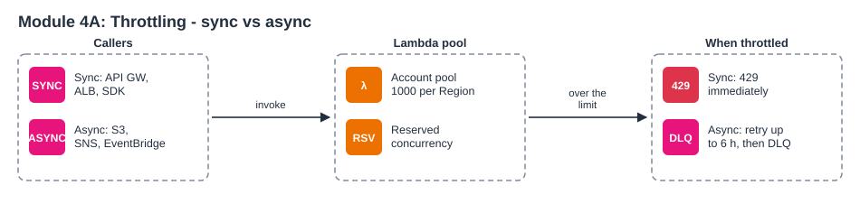

- **Analogy:** the Region's concurrency is one shared parking garage (1,000 spaces). One busy function can fill it and throttle every other function.
- **Reserved concurrency**: set per function. It both **caps** that function and **guarantees** it those spaces. Free.
- **Throttle behavior** depends on how the function was invoked:

| Invocation | Callers | When throttled |
|---|---|---|
| **Synchronous** (phone call: caller waits) | API Gateway, ALB, SDK/CLI | **429** returned immediately |
| **Asynchronous** (mailed letter: dropped off) | S3, SNS, EventBridge | Retries with backoff for up to **6 hours**, then **DLQ** |

> [!NOTE]
> My new account showed **Full account concurrency: 10**, not 1,000. New accounts often start low. Request more in **Service Quotas**.

## Module 4B: Cold starts, provisioned concurrency, SnapStart

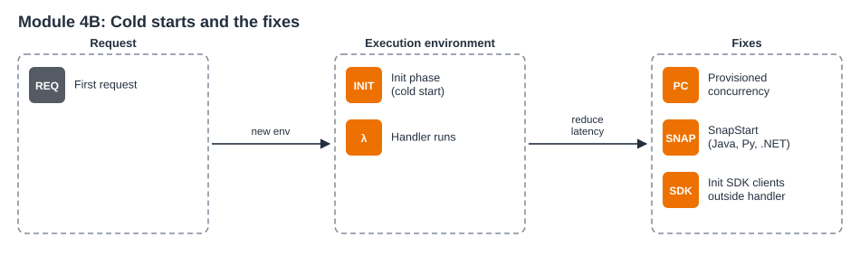

- **Cold start**: a new execution environment loads code and runs everything **outside** the handler (init). The first request is slower.
- **Warm start**: the environment is reused, so init is skipped.

| | Reserved concurrency | Provisioned concurrency |
|---|---|---|
| Solves | **Capacity** (cap + guarantee) | **Latency** (no cold starts) |
| Cost | Free | Paid, even when idle |
| Applies to | Function | A **version or alias** only |

- **SnapStart**: snapshots the initialized environment. Free for **Java**; Python and .NET also supported (with caching/restore charges).
- **Best practice (seen in the lab):** create SDK clients and DB connections **outside** the handler so warm invocations reuse them.

## Module 5A: Lambda in a VPC and RDS Proxy

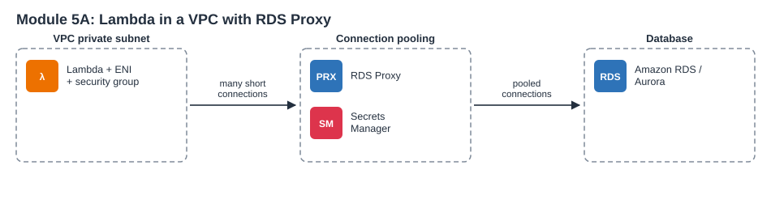

- By default Lambda runs in an **AWS-owned VPC**: internet yes, your private RDS no.
- **VPC-attached Lambda** needs: VPC + **subnets** + **security group** → Lambda creates an **ENI**. Needs the `AWSLambdaVPCAccessExecutionRole` permissions.
- A VPC-attached Lambda in a private subnet **loses internet access** unless there's a **NAT gateway** (or VPC endpoints for AWS services).
- **RDS Proxy**: pools connections so thousands of Lambda invocations don't exhaust the database. Up to **66% faster failover**, supports **IAM auth** with credentials in **Secrets Manager**. It's **never public**, so Lambda must be in the VPC.

## Module 5B: RDS invoking Lambda vs RDS event notifications

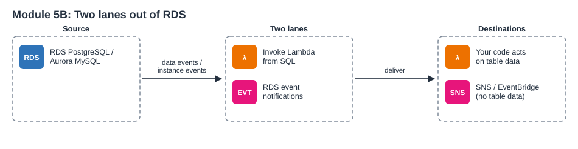

| | Lane 1: RDS invokes Lambda | Lane 2: RDS event notifications |
|---|---|---|
| What | **Data** events (rows changed) | **Instance** events (created, stopped, backup started) |
| Engines | RDS for PostgreSQL, Aurora MySQL | All RDS |
| Setup | From SQL inside the DB; needs IAM role + network path to Lambda | Console/API subscription |
| Destination | Lambda | SNS or EventBridge (never table data) |

```sql
SELECT * FROM aws_lambda.invoke(
  aws_commons.create_lambda_function_arn('my-function', 'us-east-1'),
  '{"order_id": 42}'::json,
  'Event'   -- async invoke
);
```

## Module 6: CloudFront Functions vs Lambda@Edge

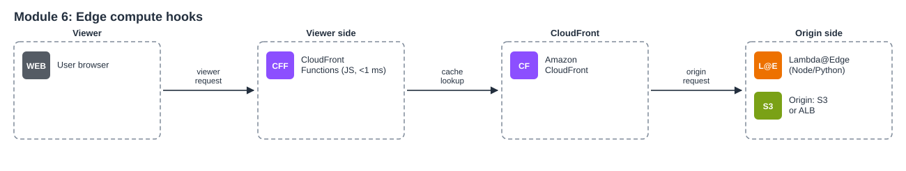

Four hooks: **viewer request → origin request → origin response → viewer response**.

| | CloudFront Functions | Lambda@Edge |
|---|---|---|
| Language | JavaScript | Node.js, Python |
| Hooks | Viewer request/response only | All four |
| Max time | < 1 ms | 5 s (viewer), 30 s (origin) |
| Scale | Millions req/s | Thousands req/s |
| Network / body access | No | Yes |
| Authoring | In CloudFront | In **us-east-1**, replicated globally |
| Use cases | Cache-key normalization, header rewrites, redirects, JWT checks | Calls to external services, body manipulation, heavier logic |

## Module 7: DynamoDB fundamentals

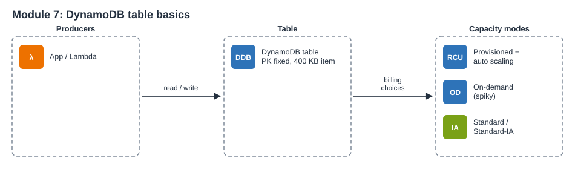

- Fully managed NoSQL, multi-AZ, single-digit millisecond. **No database to create**: you create **tables**.
- **Primary key** = partition key (+ optional sort key), fixed at creation.
- **Items** max **400 KB**; attributes are flexible and can be added anytime (great when the schema evolves fast).
- **Capacity modes**:
  - **Provisioned** (+ auto scaling): predictable traffic, cheaper. You buy RCUs/WCUs.
  - **On-demand**: unpredictable or spiky traffic, no planning, pay per request, nothing while idle.
- **Table classes**: Standard (frequently accessed) vs **Standard-IA** (cheaper storage, pricier reads/writes).

> [!NOTE]
> **RCU** = Read Capacity Unit: one strongly consistent read/s (or two eventually consistent) of up to 4 KB. **WCU** = Write Capacity Unit: one write/s of up to 1 KB. Detailed math is more Developer-exam territory.

## Module 8A: DAX and DynamoDB Streams

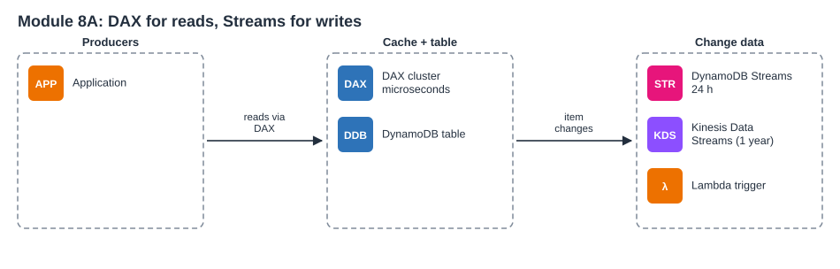

- **DAX**: in-memory cache in front of DynamoDB, **microsecond** reads, same API (no code changes), default 5-minute TTL, fewer RCUs.
- **DAX vs ElastiCache**: DAX for individual items and query results; ElastiCache for **aggregation** results you compute.
- **Change streams**:

| | DynamoDB Streams | Kinesis Data Streams |
|---|---|---|
| Retention | 24 hours | Up to 1 year |
| Consumers | Limited (Lambda triggers, KCL adapter) | Many (Firehose, analytics, Glue) |

> [!TIP]
> **DAX = reads go faster. Streams = writes trigger actions.**

## Module 8B: Global Tables, TTL, backups, S3 import/export

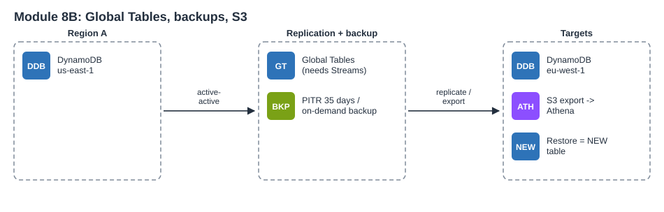

- **Global Tables**: multi-Region, **active-active** read/write. Requires **Streams**.
- **TTL**: delete items after an epoch-timestamp attribute expires. Deletes don't consume WCUs. Use for sessions, retention rules.
- **Backups**: **PITR** (continuous, up to 35 days), **on-demand** backups (kept until deleted), **AWS Backup** (lifecycle, cross-Region copies).
- **Every restore creates a NEW table.**
- **Export to S3**: needs PITR, uses no RCUs → query with **Athena**. **Import from S3** (CSV/JSON/ION) creates a new table, no WCUs used.

## Module 9: API Gateway

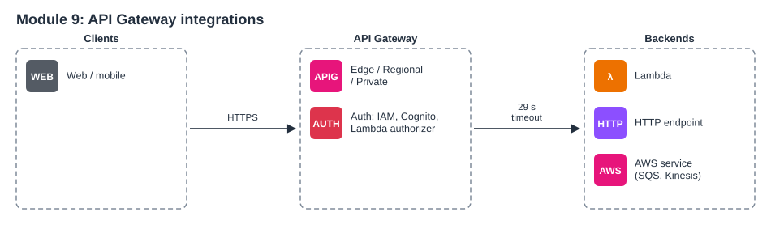

- **Integrations**: Lambda, HTTP (on-prem or ALB), **AWS service** (e.g., SQS, Kinesis, Step Functions) without credentials on clients.
- **Endpoint types**: **Edge-optimized** (default; via CloudFront POPs, API still in one Region), **Regional**, **Private** (VPC interface endpoint + resource policy).
- **Security**: IAM (internal apps), **Cognito** (external users), **Lambda authorizer** (custom logic).
- **Custom domain cert (ACM)**: edge-optimized → **us-east-1**; Regional → same Region as the API.
- **29-second** default integration timeout, regardless of Lambda's timeout.
- `Missing Authentication Token` on an unknown path = route doesn't exist.

> [!TIP]
> Anything touching CloudFront (edge-optimized API certs, Lambda@Edge) → **us-east-1**.

## Module 10: Amazon Cognito

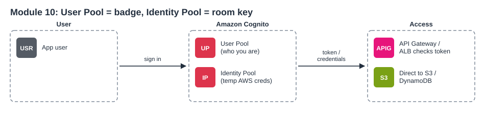

| | User Pool | Identity Pool |
|---|---|---|
| Hook | **ID badge**: who you are | **Room key**: temporary AWS credentials |
| Gives | Sign-in, MFA, social login, JWT token | STS credentials with an IAM role |
| Used by | **API Gateway / ALB** verify the token | App calls **S3 / DynamoDB directly** |

**Two-question test:** going through the front door (API Gateway/ALB)? → User Pool. Going **directly** to an AWS service? → Identity Pool.

Row-level security in DynamoDB via the Identity Pool role:

```json
{
  "Effect": "Allow",
  "Action": ["dynamodb:GetItem", "dynamodb:PutItem", "dynamodb:Query"],
  "Resource": "arn:aws:dynamodb:us-east-1:<account-id>:table/Todos",
  "Condition": {
    "ForAllValues:StringEquals": {
      "dynamodb:LeadingKeys": ["${cognito-identity.amazonaws.com:sub}"]
    }
  }
}
```

> [!WARNING]
> Never embed IAM access keys in a mobile or web app. Use Cognito temporary credentials.

## Module 11: Step Functions

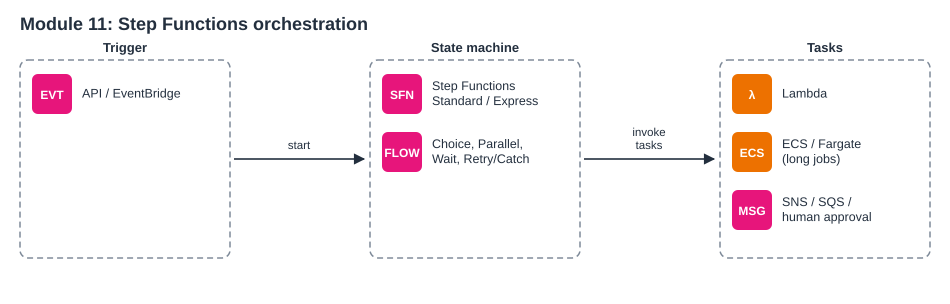

- Visual **state machine** for orchestration: sequence, **Parallel**, **Choice**, **Wait**, timeouts, **Retry/Catch**, human approval.
- Integrates with Lambda, ECS/Fargate tasks, EC2/on-prem activities, API Gateway, SQS, SNS, and more.
- **Standard** (up to 1 year, exactly-once) vs **Express** (up to 5 minutes, high volume).
- A step longer than Lambda's 15 minutes → run it as a **Fargate task** inside the workflow.

## Module 12: Architecture case studies

### 12A: MyTodoList

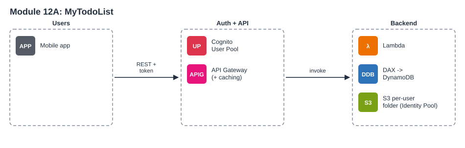

- API Gateway → Lambda → DynamoDB, authenticated with **Cognito User Pool**.
- Read-heavy → **DAX** in front of DynamoDB; static responses → **API Gateway caching**.
- Per-user S3 folders → **Identity Pool** temporary credentials.

### 12B: MyBlog.com

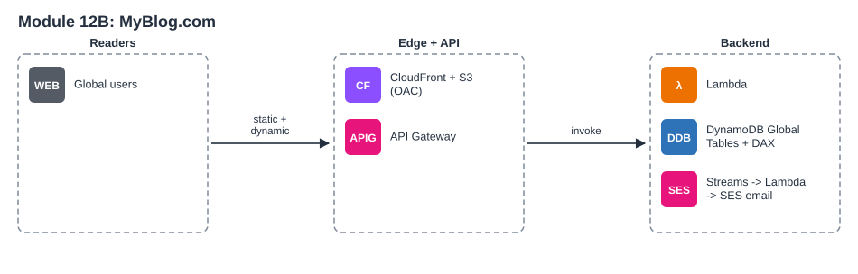

- Static: **CloudFront + S3 with OAC** (bucket only reachable via CloudFront).
- Dynamic public API: API Gateway → Lambda → **DynamoDB Global Tables + DAX** (no Cognito; it's public).
- Welcome email: **DynamoDB Streams → Lambda (IAM role for SES) → SES**.
- Thumbnails: **S3 event → Lambda → thumbnail bucket**.

> [!NOTE]
> The lecture calls uploading through CloudFront "S3 Transfer Acceleration." They're separate features. Transfer Acceleration is an S3 bucket setting that uses edge locations for faster uploads.

### 12C: Microservices

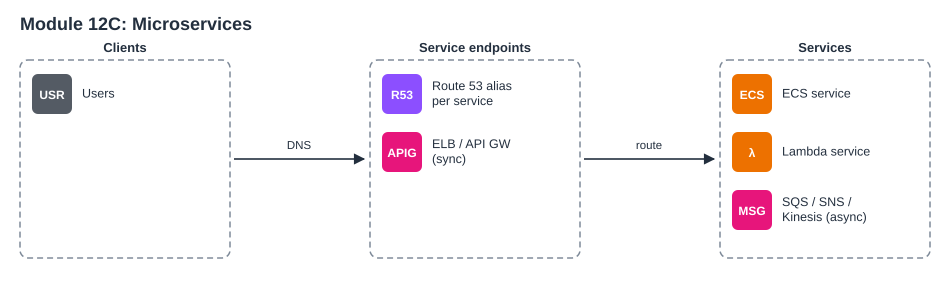

- Microservices are a **design**, not a service. Mix ECS, Lambda, and EC2 freely; Route 53 alias per service.
- **Sync** (API Gateway/ELB) when you need the answer; **async** (SQS, SNS, Kinesis, S3 triggers) when you don't.
- Serverless eases utilization worries, versioning (API Gateway stages), and client SDK generation (Swagger/OpenAPI).

### 12D: Software-update offloading

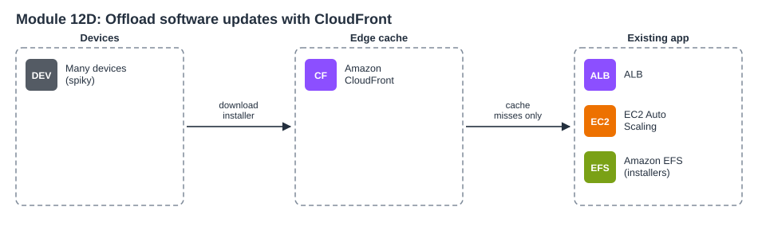

- Static installers, spiky demand, can't re-architect → put **CloudFront in front of the existing ALB**. EC2, EFS, and network costs drop because only cache misses reach the origin.
- New release still serving the old file? Publish under a **new file name** (best habit) or create a **CloudFront invalidation**.

---

# Part 2: Hands-on lab (redo guide)

## Lab architecture

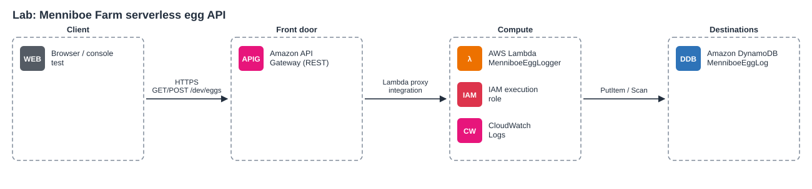

**Goal:** a public API that logs egg collections for Menniboe Farm.
**Flow:** Browser → API Gateway (`/dev/eggs`) → Lambda (`MenniboeEggLogger`) → DynamoDB (`MenniboeEggLog`).
**Region:** us-east-1. **Tag on everything:** `Project = menniboe-serverless-lab`. **Cost:** free tier.

## Step 1: Create the DynamoDB table

**Console:** Region **us-east-1** → **DynamoDB** → **Tables** → **Create table**.

| Section | Setting | Value / why |
|---|---|---|
| Table details | Table name | `MenniboeEggLog` |
| | Partition key | `collection_id` — **String** |
| | Sort key | blank |
| Table settings | | **Customize settings** (to see every section) |
| Table class | | **DynamoDB Standard** (frequent small reads/writes) |
| Capacity calculator | | Informational for Provisioned; leave defaults |
| Read/write capacity | Capacity mode | **On-demand**; max table throughput unchecked |
| Warm throughput | Read/write | **Keep default values** (pre-warming is for planned launches) |
| Secondary indexes | | none |
| Vector indexes | | none (similarity search on embeddings, for AI/RAG apps) |
| Encryption at rest | | **AWS-owned key** (free) |
| Deletion protection | | **off** for the lab (on in production) |
| Resource-based policy | | blank (cross-account access) |
| Tags | | `Project` = `menniboe-serverless-lab` |

Click **Create table** and wait for **Active**.

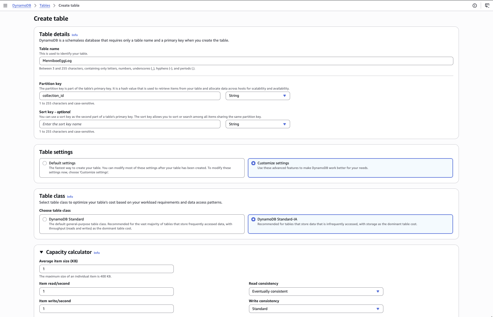
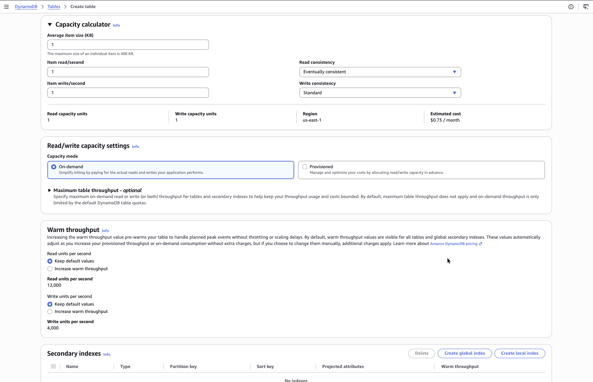
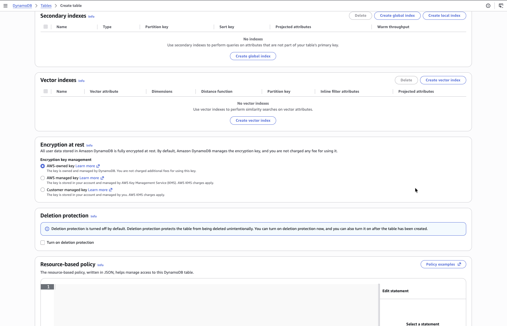
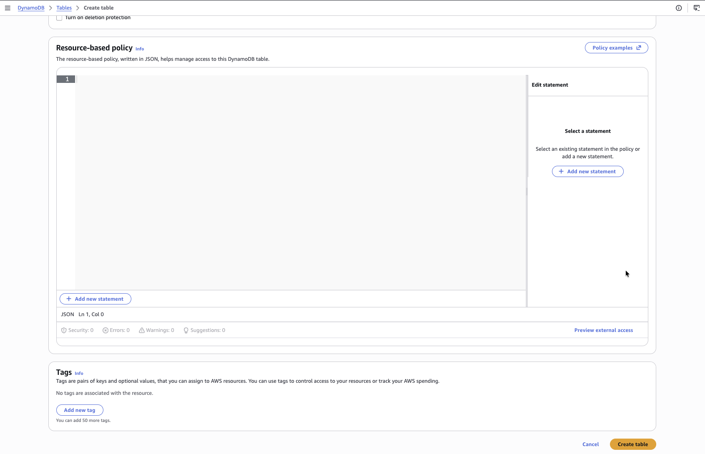

> [!WARNING]
> **Mistake I caught:** my first pass had **Standard-IA** selected. Standard-IA is cheaper storage but pricier per read/write, the wrong fit for a small, busy table. Switched to **Standard** (verify under **Additional info → Table class**, or **Actions → Update table class**). I also forgot the tag on the first pass.

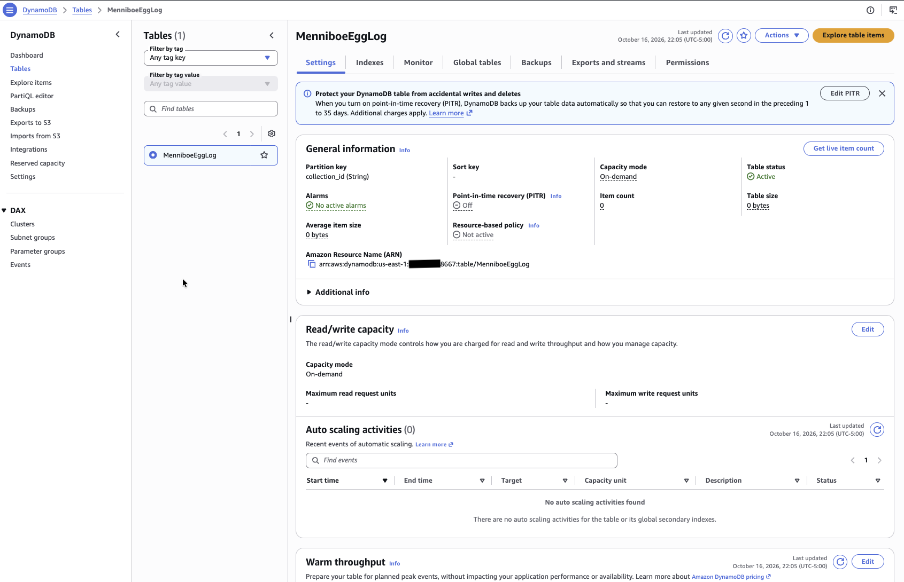
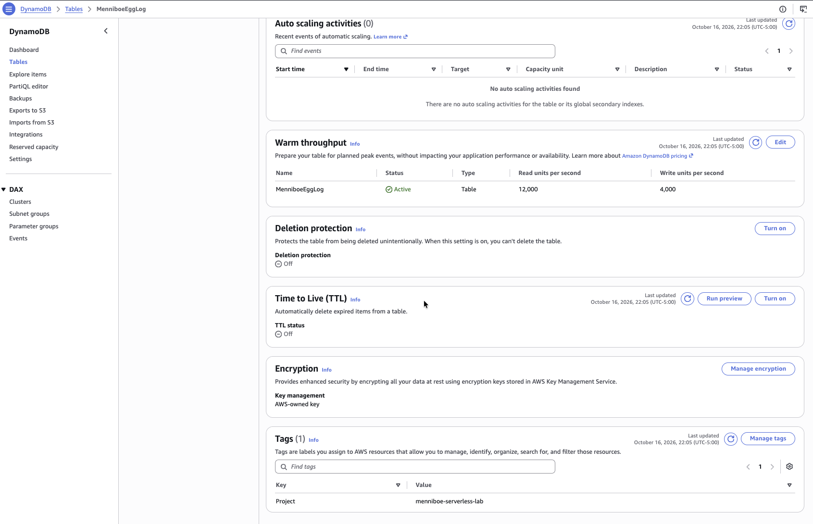

## Step 2: Create the Lambda function

**Console:** **Lambda** → **Event Functions** → **Create Event Function**.

> [!NOTE]
> The console now splits Lambda into **Event Functions** (classic Lambda) and **Web Functions** (Node.js-only HTTP servers). For the SAA exam, "Lambda function" = Event Function.

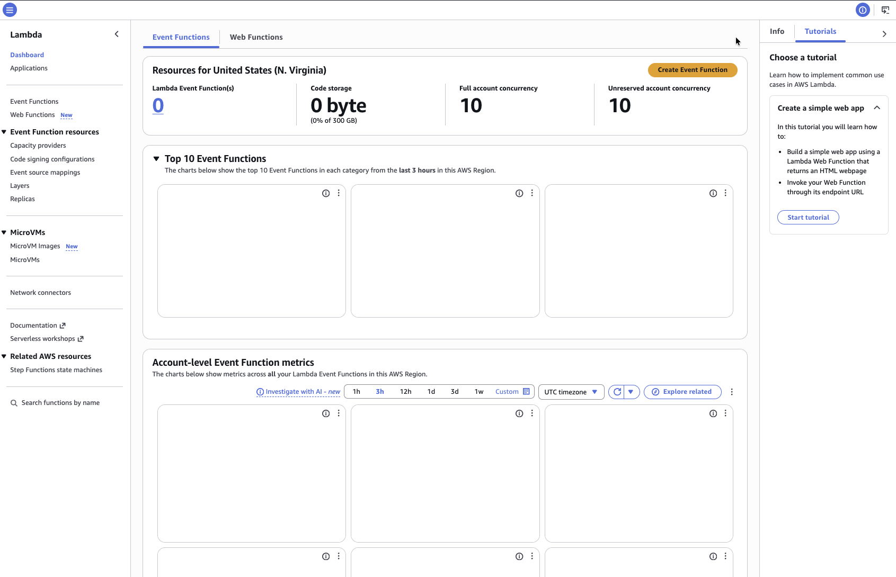

| Section | Setting | Value / meaning |
|---|---|---|
| Options | | **Author from scratch** (others: blueprint, container image) |
| Basic information | Function name | `MenniboeEggLogger` |
| | Runtime | **Python 3.14** |
| | Permissions | Default: new role with CloudWatch Logs permissions |
| Custom settings | Durable execution | off — checkpoint/resume long workflows (**can't change later**) |
| | EC2 capacity provider | off — run on chosen EC2 types (**can't change later**) |
| General | ARM64 architecture | **on** (Graviton, cheaper per GB-s) |
| | Custom execution role | off |
| Networking | Function URL | off (API Gateway is the front door) |
| | Tenant isolation mode | off — per-tenant environments for SaaS (**can't change later**) |
| | VPC | off (reach DynamoDB's public endpoint without NAT) |
| Security & governance | Code signing | off |
| | Encryption with AWS KMS | off (package already encrypted by default) |
| | Tags | **on** → `Project` = `menniboe-serverless-lab` |

Click **Create Event Function**.

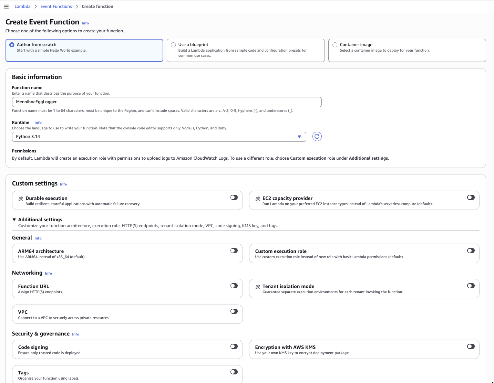
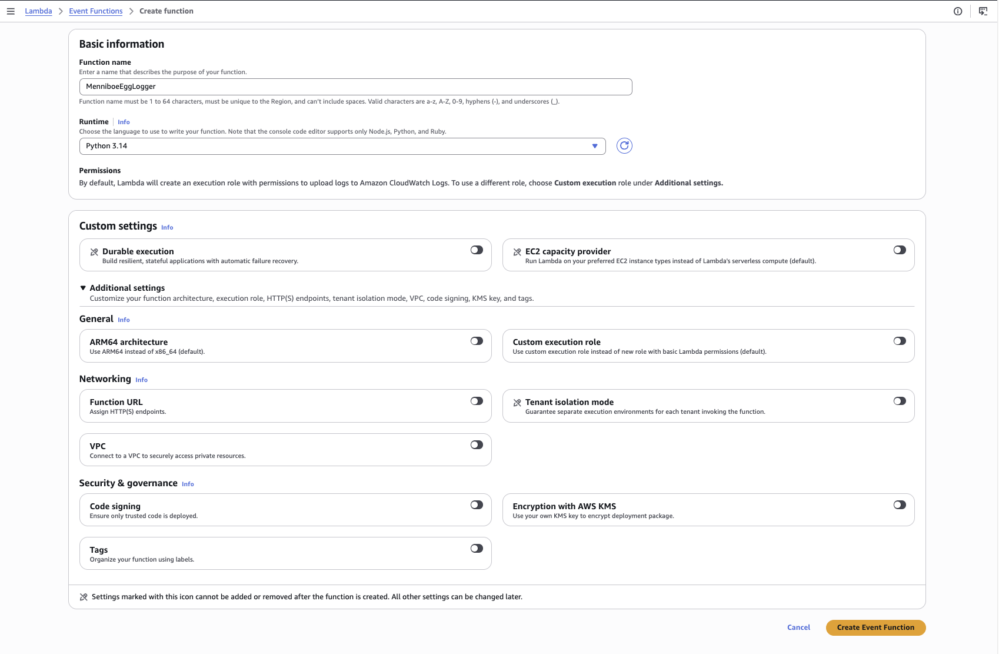
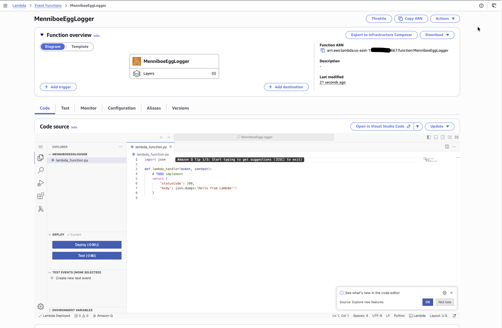

## Step 3: Find the execution role

**Configuration** → **Permissions** → **Execution role** → role name `MenniboeEggLogger-role-<random>`.

- Only service listed: **CloudWatch Logs** (`CreateLogGroup`, `CreateLogStream`, `PutLogEvents`) from `AWSLambdaBasicExecutionRole-<id>`.
- **Execution role** = what Lambda can do (outbound). **Resource-based policy** = who can invoke Lambda (inbound); empty until API Gateway is connected.

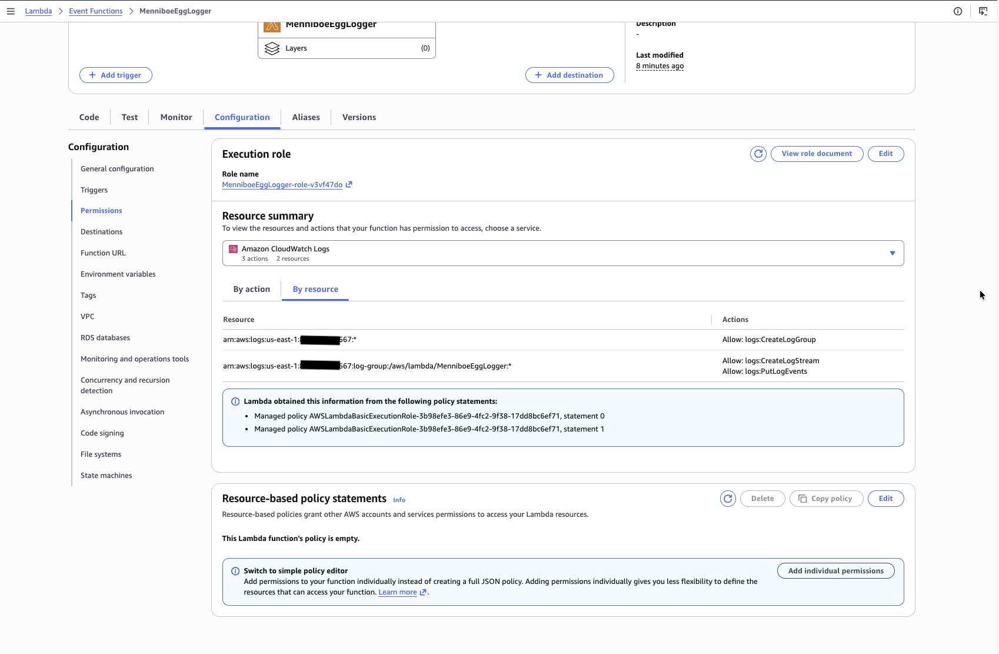

## Step 4: Add the environment variable

**Configuration** → **Environment variables** → **Edit** → **Add environment variable**:

- **Key:** `TABLE_NAME` — **Value:** `MenniboeEggLog`
- **Encryption in transit:** unchecked (for secrets, prefer Secrets Manager)
- **KMS key at rest:** **(default) aws/lambda**
- **Save**

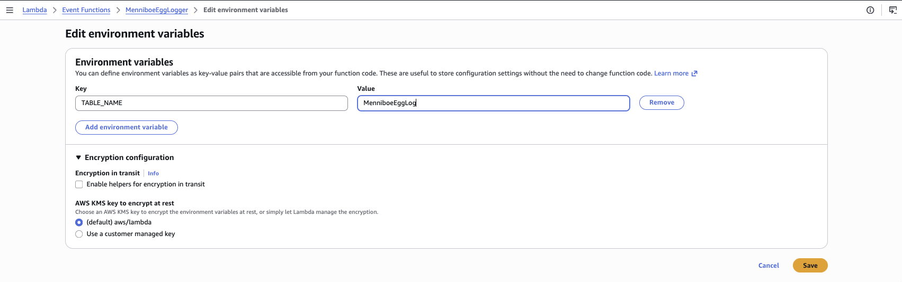
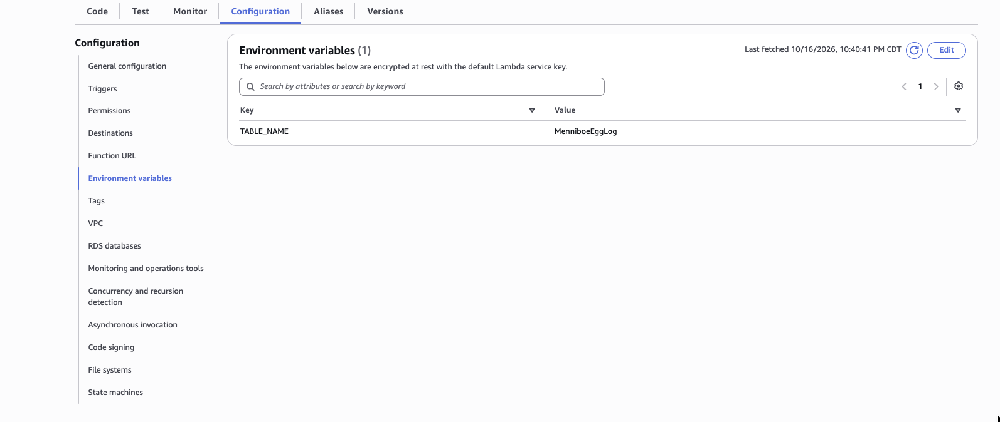

## Step 5: Add the code and deploy

**Code** tab → replace `lambda_function.py` → **Deploy**.

```python
import json
import os
import uuid
from datetime import datetime, timezone

import boto3

table = boto3.resource("dynamodb").Table(os.environ["TABLE_NAME"])


def lambda_handler(event, context):
    method = event.get("httpMethod", "POST")

    if method == "GET":
        items = table.scan(Limit=25).get("Items", [])
        return response(200, items)

    body = json.loads(event.get("body") or "{}")
    item = {
        "collection_id": str(uuid.uuid4()),
        "coop": body.get("coop", "main"),
        "eggs": int(body.get("eggs", 0)),
        "collected_at": datetime.now(timezone.utc).isoformat(),
    }
    table.put_item(Item=item)
    return response(201, item)


def response(status, payload):
    return {
        "statusCode": status,
        "headers": {"Content-Type": "application/json"},
        "body": json.dumps(payload, default=str),
    }
```

> [!TIP]
> `table = boto3.resource(...)` sits **outside** the handler, so it runs once at cold start and every warm invocation reuses the connection.

> [!WARNING]
> **Error:** `Unable to retrieve source code of your Lambda function. Please check your browser security policy or network configuration.`
> **Fix:** browser issue, not the function. Hard refresh, disable ad blockers/privacy extensions for the console, allow third-party cookies or use a private window, or switch browsers. Fallback: **Upload from → .zip file**. After the fix: `Successfully updated the function MenniboeEggLogger`.

## Step 6: Create the test event

**TEST EVENTS** → **Create new test event** → name `post-eggs` → **Private** → **Save**.

```json
{
  "httpMethod": "POST",
  "body": "{\"coop\": \"north\", \"eggs\": 12}"
}
```

The body is a **string**, exactly like API Gateway proxy integration sends it, which is why the code calls `json.loads`.

## Step 7: Run the test (expected failure)

Select `post-eggs` → **Test**.

> [!WARNING]
> **Error (expected):** `AccessDeniedException ... assumed-role/MenniboeEggLogger-role-.../MenniboeEggLogger is not authorized to perform: dynamodb:PutItem on resource: ...table/MenniboeEggLog because no identity-based policy allows the dynamodb:PutItem action`
>
> Read every IAM denial as **who** (the role) / **what** (`dynamodb:PutItem`) / **where** (the table) / **why** (no policy allows it).

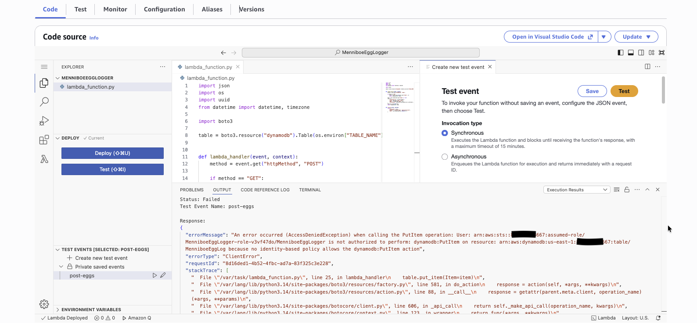

## Step 8–9: Add the least-privilege IAM policy

**Configuration → Permissions →** click the role name (opens IAM) → **Add permissions → Create inline policy → JSON**:

```json
{
  "Version": "2012-10-17",
  "Statement": [
    {
      "Sid": "MenniboeEggLogAccess",
      "Effect": "Allow",
      "Action": [
        "dynamodb:PutItem",
        "dynamodb:Scan"
      ],
      "Resource": "arn:aws:dynamodb:us-east-1:*:table/MenniboeEggLog"
    }
  ]
}
```

**Next** → Policy name `MenniboeEggLogAccess` → **Create policy**. Two actions, one table: least privilege.

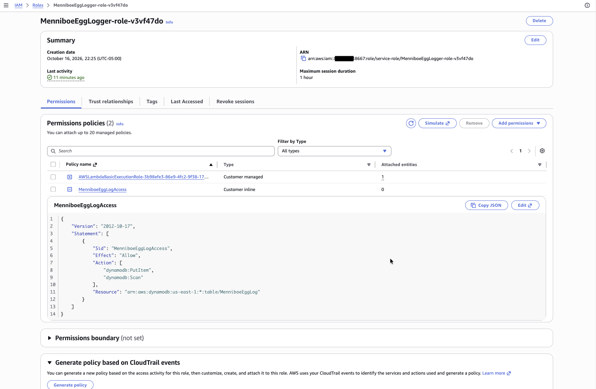

## Step 10: Re-run the test

**Test** again → **Status: Succeeded**, `statusCode: 201`, item for `north` with 12 eggs.

| REPORT field | Value | Meaning |
|---|---|---|
| Init Duration | 504 ms | Cold start |
| Duration | 523 ms | Handler run |
| Billed Duration | 1028 ms | Init + handler (init is billed) |
| Max Memory Used | 98 MB / 128 MB | Comfortable fit |

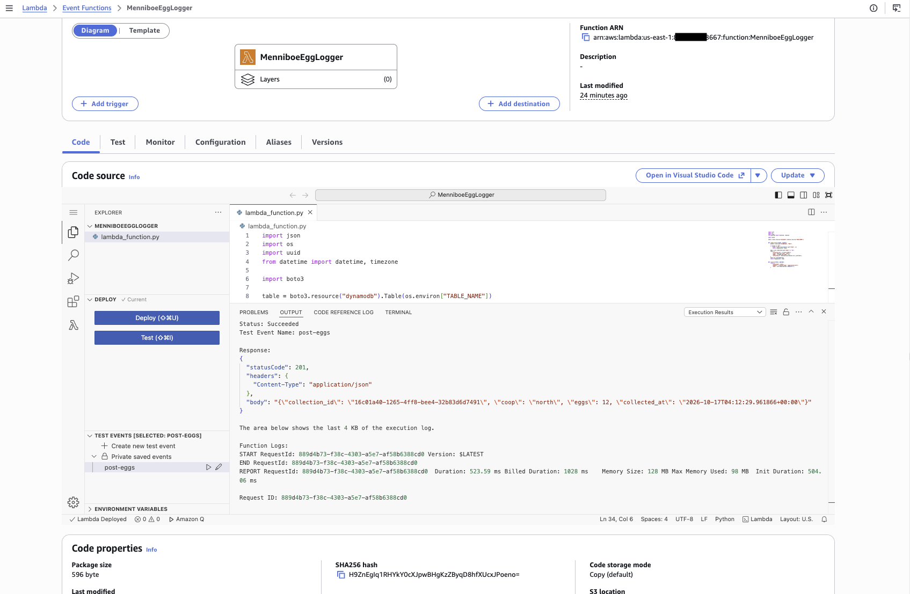

## Step 11: Confirm the item in DynamoDB

**DynamoDB → Explore items → MenniboeEggLog → Run** (Scan). Only `collection_id` shows a type; `coop`, `eggs`, `collected_at` were added freely by code (flexible schema).

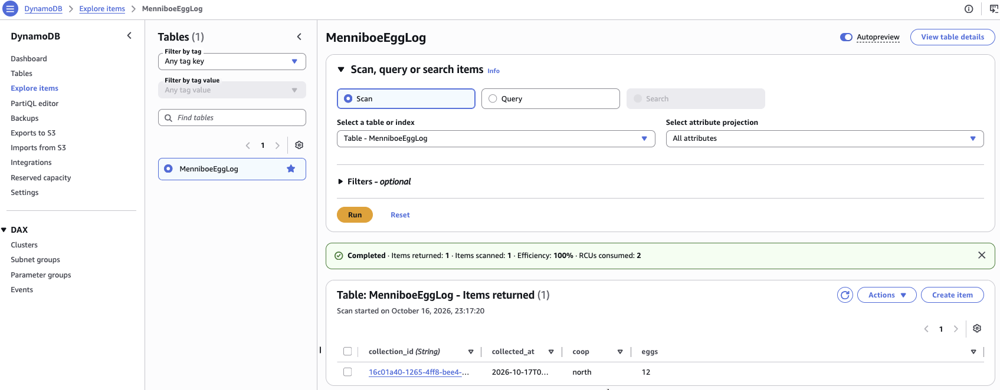

## Step 12: Create the REST API

**API Gateway → Create API → REST API → Build**.

| Setting | Value / meaning |
|---|---|
| API details | **New API** (others: clone, import OpenAPI, example PetStore) |
| API name | `MenniboeEggAPI` |
| Description | `Menniboe Farm egg log` |
| API endpoint type | **Regional** |
| Security policy | **`SecurityPolicy_TLS13_1_3_2025_09 (recommended)`** — minimum TLS 1.3 |
| Endpoint access mode | **Strict (recommended)** — enforces SNI hostname match |
| IP address type | **IPv4** (Dualstack = IPv4 + IPv6) |

Security policy groups: **Legacy** (`TLS_1_0`, `TLS_1_2`, avoid), **TLS 1.3** (modern), **FIPS** (U.S. government), **PQ** (post-quantum), **PFS** (forward secrecy). `_EDGE` policies are grayed out for Regional APIs.

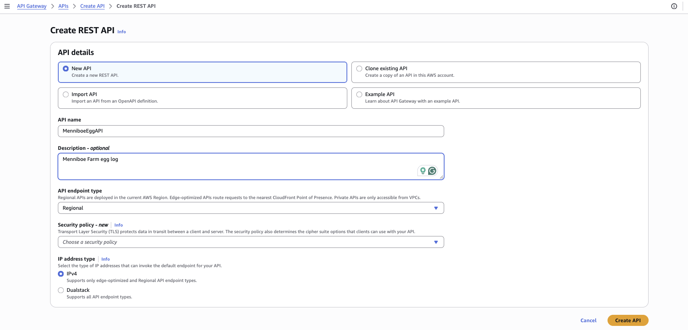
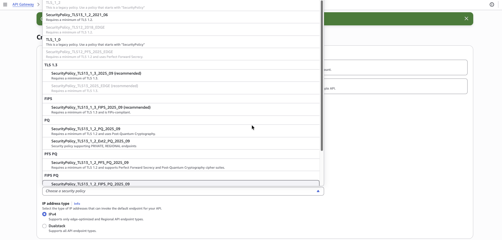
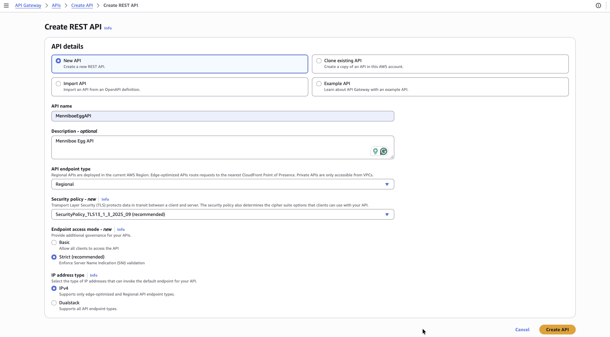
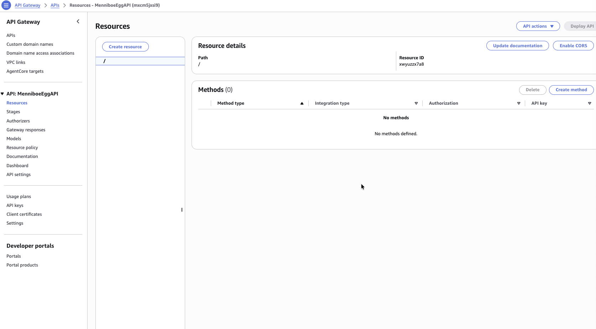

## Step 13: Create the /eggs resource

**Create resource** → Proxy resource **off** → Resource path `/` → Resource name `eggs` → CORS **unchecked** → **Create resource**.

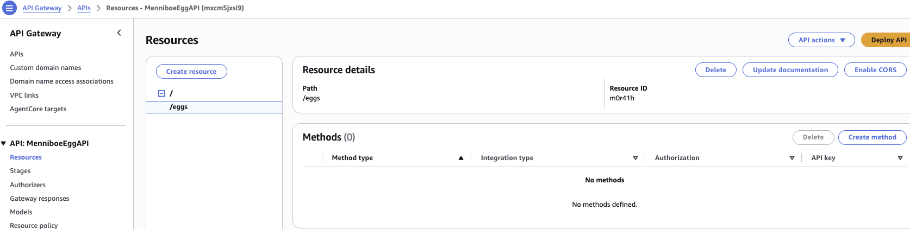

## Step 14–15: Create GET and POST methods

Select `/eggs` → **Create method** (once for `GET`, once for `POST`):

| Setting | Value / meaning |
|---|---|
| Method type | `GET` (then `POST`) |
| Integration type | **Lambda function** (others: HTTP, Mock, AWS service, VPC link) |
| Lambda proxy integration | **on** — whole request passed as `event` |
| Response transfer mode | **Buffered** (Stream = chunked, e.g., LLM tokens, up to 15 min) |
| Lambda function | us-east-1 → `MenniboeEggLogger` |
| Grant permission | auto — adds the Lambda resource-based policy |
| Integration timeout | `29000` ms |
| Authorization / validator / API key | None / None / off |

Method execution flow: **Client → Method request → Integration request → Lambda → Integration response → Method response → Client**.

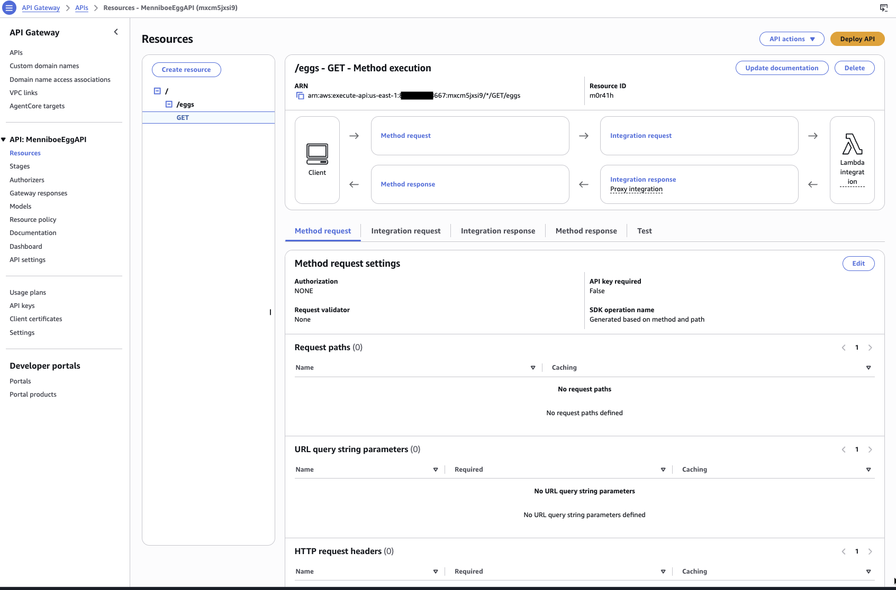
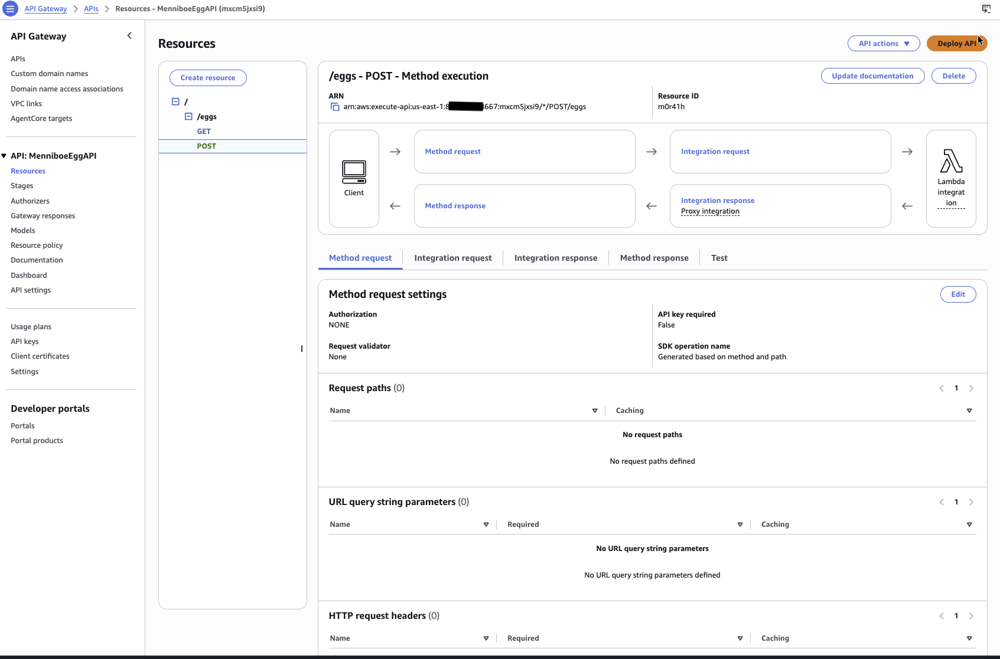

## Step 16: Deploy to the dev stage

**Deploy API** → Stage **\*New stage\*** → name `dev` → description `First deploy - GET and POST /eggs` → **Deploy**.

Invoke URL: `https://<api-id>.execute-api.us-east-1.amazonaws.com/dev`

Stage settings seen: Rate **10000** / Burst **5000** (429 beyond), cache cluster off, Web ACL (WAF), logs and X-Ray off, Canary tab.

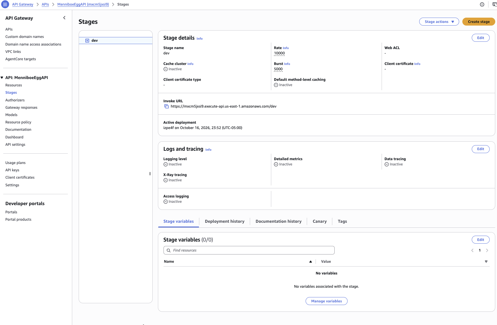

## Step 17–19: Test GET and POST

1. **GET** in a browser: `https://<api-id>.execute-api.us-east-1.amazonaws.com/dev/eggs` → the `north` item.

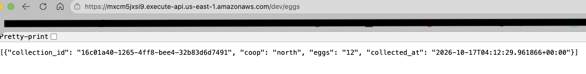

> [!NOTE]
> `"eggs": "12"` comes back as a string: DynamoDB returns numbers as Python `Decimal`, and `default=str` converts them. In production, convert `Decimal` to `int`.

2. **POST** via **Resources → POST → Test tab** → Request body `{"coop": "south", "eggs": 9}` → **Test** → **Status 201**, latency 812 ms.

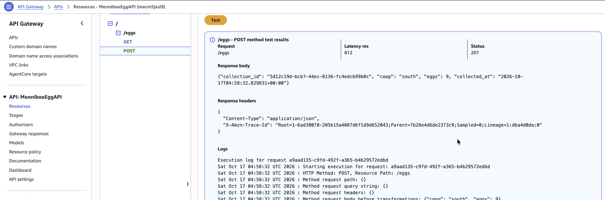

> [!WARNING]
> The full test log shows your **account number, a security token, and your IAM user ARN**. Crop to status and response body before pushing.

3. Refresh the browser GET → both items.

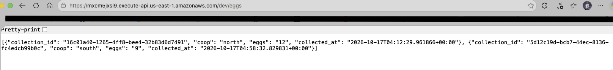

## Step 20: Clean up

Order: **API Gateway → Lambda (+ log group) → IAM role → DynamoDB table**. Done by CLI; see [commands.md](commands.md).

- IAM: delete the inline policy, **detach and delete** the customer managed `AWSLambdaBasicExecutionRole-<id>` policy, then delete the role (a role can't be deleted with policies attached).
- Leftover check: every query returned `[]`.

> [!WARNING]
> **Error:** `zsh: command not found: #` when pasting commands with comments.
> **Fix:** harmless; interactive zsh doesn't treat `#` as a comment. Run `setopt interactivecomments` (add to `~/.zshrc` to make it permanent).

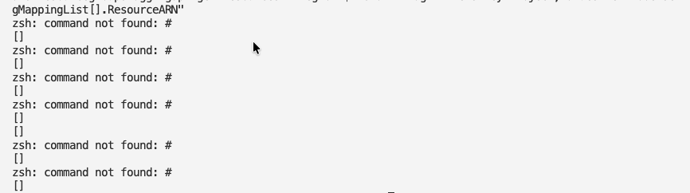

---

# Part 3: Reference

## Errors and fixes

| Where | Error | Fix |
|---|---|---|
| DynamoDB create | Standard-IA selected, tag missing | Switch to Standard; add `Project` tag |
| Lambda code editor | `Unable to retrieve source code...` | Browser extensions/cookies; private window or other browser; or upload .zip |
| Lambda test | `AccessDeniedException` on `dynamodb:PutItem` | Inline policy allowing `PutItem` + `Scan` on the table |
| GET response | `eggs` returned as string | DynamoDB `Decimal` + `default=str`; convert to `int` in production |
| zsh cleanup | `command not found: #` | `setopt interactivecomments` |

## Questions I asked

- **What do RCU and WCU stand for?** Read Capacity Unit and Write Capacity Unit (4 KB reads, 1 KB writes).
- **Why does On-demand fit this lab better than Provisioned?** We don't know how many reads/writes there will be, and it costs nothing while idle.
- **Can the basic Lambda role write to DynamoDB?** No. It only has CloudWatch Logs permissions; the test proved it.
- **Why put `boto3.resource(...)` outside the handler?** It's created once at cold start and reused by every warm invocation.
- **Which DynamoDB action does the GET branch need?** `dynamodb:Scan` (from `table.scan`). `GetObject` is an S3 action; `GetItem` reads one item by key.
- **Can I clean up with a CLI command?** Yes; see commands.md.
- **How do I check for leftovers?** Query each service by name, plus a tag search; see commands.md.

## Exam memory hooks

- Speed, size, or capacity problem? Memory only fixes speed.
- Sync throttle = phone call busy signal (**429**). Async throttle = letter waits in the mailbox (**retries 6 h → DLQ**).
- Reserved = capacity (free). Provisioned = latency (paid, version/alias).
- Anything touching CloudFront → **us-east-1**.
- DAX = reads go faster. Streams = writes trigger actions.
- Every DynamoDB restore creates a **new** table.
- User Pool = ID badge. Identity Pool = room key.
- Long step in Step Functions (> 15 min) → **Fargate task**.
- Old file after release via CloudFront → **new file name** or **invalidation**.

## Acronyms

| Acronym | Meaning |
|---|---|
| ACM | AWS Certificate Manager |
| ALB / ELB | Application Load Balancer / Elastic Load Balancing |
| API | Application Programming Interface |
| ARN | Amazon Resource Name |
| AZ | Availability Zone |
| CDN | Content Delivery Network |
| CORS | Cross-Origin Resource Sharing |
| DAX | DynamoDB Accelerator |
| DLQ | Dead-Letter Queue |
| ECS | Elastic Container Service |
| EFS | Elastic File System |
| ENI | Elastic Network Interface |
| FIPS | Federal Information Processing Standards |
| GB-s | Gigabyte-second (Lambda compute billing unit) |
| GSI / LSI | Global / Local Secondary Index |
| IA | Infrequent Access |
| IAM | Identity and Access Management |
| JWT | JSON Web Token |
| KCL | Kinesis Client Library |
| KMS | Key Management Service |
| MFA | Multi-Factor Authentication |
| NAT | Network Address Translation |
| OAC | Origin Access Control |
| PFS | Perfect Forward Secrecy |
| PITR | Point-In-Time Recovery |
| POP | Point of Presence |
| PQ | Post-Quantum (cryptography) |
| RAG | Retrieval-Augmented Generation |
| RCU / WCU | Read / Write Capacity Unit |
| SAA | Solutions Architect Associate |
| SDK | Software Development Kit |
| SES | Simple Email Service |
| SNI | Server Name Indication |
| SNS / SQS | Simple Notification Service / Simple Queue Service |
| STS | Security Token Service |
| TLS | Transport Layer Security |
| TTL | Time To Live |
| VPC | Virtual Private Cloud |
| WAF | Web Application Firewall |
