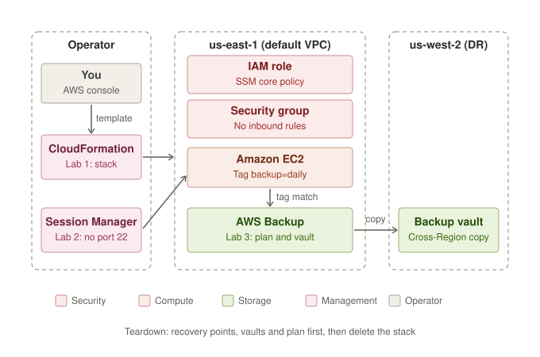

# AWS SAA-C03: DR, Migrations, Architectures, Other Services and Exam Prep

The final content block of the AWS Solutions Architect Associate course (Sections 28 to 32): disaster recovery and migrations, more solution architectures, other services, the Well-Architected whitepapers and exam strategy, plus a three-part hands-on lab.

## What I learned

- **DR design is a math problem first.** Work out the current RPO and RTO, compare them to the targets, and fix only the number that fails. Pilot light keeps the database replicating with the app tier off; warm standby keeps a scaled-down full stack that can serve traffic immediately.
- **Migrations have one tool per job:** Application Discovery for inventory and dependencies, MGN to rehost servers with test launches, DMS with CDC to move live databases, SCT when the engines differ, and the transfer formula to choose between network and offline.
- **Architectures follow patterns:** SNS and SQS fan-out for independent consumers, DAX vs ElastiCache vs CloudFront for caching, WAF at the first hop that still sees the client IP, cluster placement group plus EFA plus FSx for Lustre for HPC, and an Auto Scaling group of one for single-instance HA.
- **Other services map to clear keywords:** CloudFormation and StackSets, SES, Systems Manager, Cost Explorer and Cost Anomaly Detection, Batch, AppFlow, Amplify, Outposts and Instance Scheduler.
- **The Well-Architected Framework** is the yardstick behind every exam scenario, with the WA Tool for workload reviews and Trusted Advisor for automated checks.

## Lab results

| Lab | Result |
|---|---|
| CloudFormation stack | Role, instance profile, zero-inbound security group and tagged EC2 instance: `CREATE_COMPLETE` in about **2 min 50 s**; the instance profile was the slowest resource (about **2 min 11 s**) |
| Session Manager | Shell on an instance with **no key pair and zero inbound rules**; two outbound `ESTAB` connections to port 443 proved the channel; `StartSession` recorded in CloudTrail with MFA |
| AWS Backup | Tag-based plan (`backup=daily`) with a cross-Region copy rule; EC2 backup completed in **7 min 17 s** (8 GiB volume, **1.68 GiB** snapshot); copy `Available` in **us-west-2** |
| Teardown | One script removed recovery points, plan, vaults, stack, template bucket and service role; the verification sweep came back **empty in both Regions** |

## Issues solved

| Issue | Fix |
|---|---|
| Backup assignment matched the billing tag `project=day7-lab` | Assignments are immutable; deleted and recreated it with `backup=daily` |
| Backup plan retention left at the 35-day default and copy Region empty | Set 1-day retention and US West (Oregon) before creating the plan |
| Vault tag `Project` vs `project` | Tags are case-sensitive; standardized on lowercase |
| EC2 backup snapshot not encrypted | EC2/EBS backups follow source-volume encryption; enable EBS encryption by default |
| On-demand backup did not copy to the DR Region | Copy rules only run on schedule; copied the recovery point manually |

## Files

| File | Contents |
|---|---|
| [notes.md](notes.md) | All 19 modules with diagrams, the full lab walkthrough with console values and screenshots, troubleshooting log, cheat sheet and acronyms |
| [commands.md](commands.md) | Every command by stage, the teardown script and a CLI-only redo |
| [templates/day7-ssm-backup-lab.yaml](templates/day7-ssm-backup-lab.yaml) | CloudFormation template for the lab |
| [scripts/day7-teardown.sh](scripts/day7-teardown.sh) | Full CLI teardown with verification |
| `images/diagrams/` | 23 architecture diagrams (SVG) |
| `images/screenshots/` | 29 redacted lab screenshots |
