# AWS SAA-C03: DR and Migrations, More Architectures, Other Services, Whitepapers and Exam Prep

Reference notes for the final content block of the AWS Solutions Architect Associate course (Sections 28 to 32), plus a three-part hands-on lab: a CloudFormation stack, Session Manager access with no port 22, and AWS Backup with a cross-Region copy.

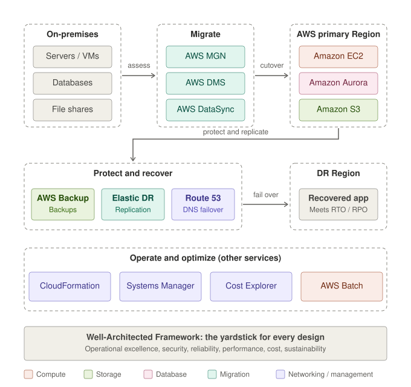

> [!NOTE]
> Service status was checked in November 2026. Several services in this section have changed. Exam answers still use the exam's terms; the current replacement is noted next to each one.

## Table of contents

- [Service status notes](#service-status-notes)
- **Block 1: Disaster recovery and migrations**
  - [Module 1 RPO and RTO](#module-1-rpo-and-rto)
  - [Module 2 DR strategies and Elastic Disaster Recovery](#module-2-dr-strategies-and-elastic-disaster-recovery)
  - [Module 3 DMS and SCT](#module-3-dms-and-sct)
  - [Module 4 On-premises migration strategies](#module-4-on-premises-migration-strategies)
  - [Module 5 AWS Backup](#module-5-aws-backup)
  - [Module 6 Transferring large datasets](#module-6-transferring-large-datasets)
- **Block 2: More solution architectures**
  - [Module 7 Event processing patterns](#module-7-event-processing-patterns)
  - [Module 8 Caching strategies](#module-8-caching-strategies)
  - [Module 9 Blocking an IP address](#module-9-blocking-an-ip-address)
  - [Module 10 High performance computing](#module-10-high-performance-computing)
  - [Module 11 Highly available single EC2 instance](#module-11-highly-available-single-ec2-instance)
- **Block 3: Other services**
  - [Module 12 CloudFormation and StackSets](#module-12-cloudformation-and-stacksets)
  - [Module 13 Amazon SES](#module-13-amazon-ses)
  - [Module 14 AWS Systems Manager](#module-14-aws-systems-manager)
  - [Module 15 Cost Explorer and Cost Anomaly Detection](#module-15-cost-explorer-and-cost-anomaly-detection)
  - [Module 16 Batch AppFlow Amplify Outposts and Instance Scheduler](#module-16-batch-appflow-amplify-outposts-and-instance-scheduler)
- **Block 4: Whitepapers and architectures**
  - [Module 17 Well-Architected Framework WA Tool and Trusted Advisor](#module-17-well-architected-framework-wa-tool-and-trusted-advisor)
  - [Module 18 Reference architectures](#module-18-reference-architectures)
- **Block 5: Exam prep**
  - [Module 19 SAA-C03 exam strategy](#module-19-saa-c03-exam-strategy)
- **Hands-on lab**
  - [Lab overview](#lab-overview)
  - [Lab 1 Step 1 Set the Region and confirm the default VPC](#lab-1-step-1-set-the-region-and-confirm-the-default-vpc)
  - [Lab 1 Step 2 Write the CloudFormation template](#lab-1-step-2-write-the-cloudformation-template)
  - [Lab 1 Step 3 Create the stack in the console](#lab-1-step-3-create-the-stack-in-the-console)
  - [Lab 1 Step 4 Verify what the stack built](#lab-1-step-4-verify-what-the-stack-built)
  - [Lab 2 Step 1 Confirm the managed node and empty inbound rules](#lab-2-step-1-confirm-the-managed-node-and-empty-inbound-rules)
  - [Lab 2 Step 2 Open a shell and prove the channel is outbound](#lab-2-step-2-open-a-shell-and-prove-the-channel-is-outbound)
  - [Lab 2 Step 3 Find the session in CloudTrail](#lab-2-step-3-find-the-session-in-cloudtrail)
  - [Lab 3 Step 1 Create the DR vault in us-west-2](#lab-3-step-1-create-the-dr-vault-in-us-west-2)
  - [Lab 3 Step 2 Create the primary vault in us-east-1](#lab-3-step-2-create-the-primary-vault-in-us-east-1)
  - [Lab 3 Step 3 Create the backup plan with a cross-Region copy rule](#lab-3-step-3-create-the-backup-plan-with-a-cross-region-copy-rule)
  - [Lab 3 Step 4 Assign resources by tag](#lab-3-step-4-assign-resources-by-tag)
  - [Lab 3 Step 5 Run an on-demand backup](#lab-3-step-5-run-an-on-demand-backup)
  - [Lab 3 Step 6 Copy the recovery point to us-west-2](#lab-3-step-6-copy-the-recovery-point-to-us-west-2)
  - [Teardown](#teardown)
- [Troubleshooting log](#troubleshooting-log)
- [Questions from the session](#questions-from-the-session)
- [Service selection cheat sheet](#service-selection-cheat-sheet)
- [Acronyms](#acronyms)

---

## Service status notes

| Service | Status (Nov 2026) | Replacement or note |
|---|---|---|
| Amazon Pinpoint | End of support October 30, 2026; no new customers since May 20, 2025 | SMS, MMS, push, WhatsApp and voice became **AWS End User Messaging**; email moves to **Amazon SES**; campaigns and journeys move to **Amazon Connect** |
| AWS Snow Family | Snowball Edge closed to new customers November 7, 2025; Snowcone and Snowmobile discontinued | **DataSync** (online), **AWS Data Transfer Terminal** (physical), Partner solutions; **Outposts** for edge compute |
| AWS Migration Hub, Application Discovery Service | Closed to new customers November 7, 2025 | **AWS Transform** |
| Amazon Elastic Transcoder | Discontinued November 13, 2025 | **AWS Elemental MediaConvert** |
| VMware Cloud on AWS | Not resold by AWS since April 30, 2024; sold by Broadcom | **Amazon Elastic VMware Service (EVS)** |
| AWS Support plans | Developer, Business and Enterprise On-Ramp discontinued January 1, 2027 | **Business Support+**, Enterprise Support, Unified Operations. Full Trusted Advisor checks need Business Support+ or higher (exam: Business or Enterprise) |

---

# Block 1: Disaster recovery and migrations

## Module 1 RPO and RTO

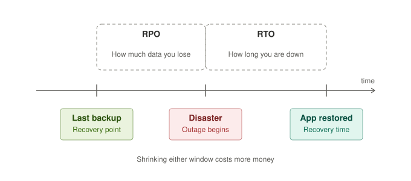

A **disaster** is any event that damages business continuity or finances: a Region outage, deleted data, ransomware or a bad deployment. Two numbers describe how well you recover from one.

**RPO (Recovery Point Objective)** is how much data you can afford to lose, measured from the last good copy of the data back to the moment of the disaster. It is set by how often you back up or replicate. Hourly backups mean an RPO of up to one hour. **RTO (Recovery Time Objective)** is how long the business can be down, measured from the disaster until the application serves users again. It is set by how much infrastructure is already running at the recovery site.

Both numbers are business decisions, usually written into an SLA (Service Level Agreement). The architect's job is to choose the **cheapest design that meets both**. Tighter numbers always cost more, because they need continuous replication (for RPO) and pre-running infrastructure (for RTO). DR can run on-premises to on-premises (expensive), hybrid (on-premises to AWS), or entirely within AWS (Region A to Region B).

| Lever | Services |
|---|---|
| Improve RPO | EBS snapshots, RDS automated backups, S3 Cross-Region Replication, Aurora Global Database, DynamoDB global tables |
| Improve RTO | AMIs, CloudFormation, Auto Scaling, Route 53 failover, AWS Elastic Disaster Recovery |

| Exam clue | Points to |
|---|---|
| "Lose no more than X minutes of data" | RPO: look at replication frequency |
| "Back online within X minutes" | RTO: look at how warm the standby is |
| "Most cost-effective that meets RPO and RTO" | The cheapest strategy that meets both numbers |

> [!TIP]
> Method for any RPO/RTO question: work out the current RPO and RTO, compare each to the target, and fix only the number that fails. Example: 6-hour snapshots against a 1-hour RPO fail on RPO, so add continuous replication; a warm standby would fix RTO, which may already pass.

**Menniboe Farm example:** the farm's order database takes nightly snapshots, so its RPO is 24 hours. If losing a day of goat and tilapia orders is unacceptable but two hours of downtime is fine, the farm needs replication (tighter RPO) but not a running standby, so pilot light rather than multi-site.

---

## Module 2 DR strategies and Elastic Disaster Recovery

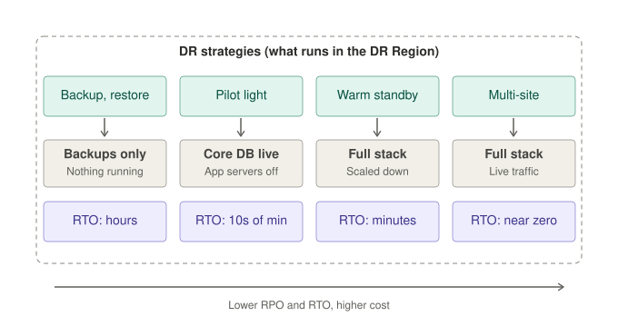

The four standard DR strategies differ in one thing: **how much is already running in the DR Region before the disaster happens**.

**Backup and restore** keeps only backups (EBS and RDS snapshots, AMIs, AWS Backup recovery points, S3/Glacier, Storage Gateway for on-premises data). After a disaster you rebuild everything, usually from CloudFormation. RPO equals the backup interval and RTO is hours. It is the cheapest.

**Pilot light** keeps only the critical core running: the database replicates continuously (an RDS cross-Region read replica or an Aurora Global Database secondary), while the application tier exists only as AMIs or templates. At failover you launch the app tier, promote the database and switch Route 53. RPO is seconds to minutes; RTO is tens of minutes.

**Warm standby** runs a complete copy of the stack at minimum size: a small Auto Scaling group behind an ALB plus a replicating database. At failover, Route 53 shifts traffic and the group scales out. Because servers are already running, the DR site can **serve traffic immediately**. RPO is seconds and RTO is minutes.

**Multi-site (hot site, active-active)** runs full production capacity in two or more Regions, all serving traffic through Route 53 latency or weighted routing, with Aurora Global Database or DynamoDB global tables underneath. RPO and RTO are near zero, at roughly double the cost.

**AWS Elastic Disaster Recovery (DRS)**, formerly CloudEndure Disaster Recovery, is the managed option for servers. An agent on each source server (on-premises, another cloud or another Region) does continuous block-level replication into a low-cost staging subnet. At failover DRS launches full-size recovery instances in minutes, and it supports **failback** to the original site. That gives seconds of RPO and minutes of RTO at roughly pilot-light cost.

| Strategy | Database in DR | App tier in DR | RTO | Cost |
|---|---|---|---|---|
| Backup and restore | Backups only | None | Hours | Lowest |
| Pilot light | Running (replicating) | **Off** (AMIs/templates) | Tens of minutes | Low |
| Warm standby | Running (replicating) | **On**, minimum size | Minutes | Medium |
| Multi-site | Running, active | Full size, live | Near zero | Highest |

| DR toolkit goal | Services |
|---|---|
| Backup | EBS snapshots, RDS automated backups, S3 lifecycle to Glacier, AWS Backup |
| High availability | Route 53 health checks, RDS and ElastiCache Multi-AZ, EFS, S3, Site-to-Site VPN as backup for Direct Connect |
| Replication | RDS cross-Region replicas, Aurora Global Database, DynamoDB global tables, S3 CRR, Storage Gateway |
| Automation | CloudFormation, Elastic Beanstalk, CloudWatch alarm actions to recover EC2, Lambda |
| Testing | Chaos engineering, for example AWS Fault Injection Service (FIS) |

| Exam clue | Points to |
|---|---|
| "Only the core / database is running" | Pilot light |
| "Scaled-down but fully functional copy", "serve traffic immediately", "RTO of minutes" | Warm standby |
| "Active-active", "zero downtime", "both Regions serve traffic" | Multi-site |
| "Cheapest, hours of downtime acceptable" | Backup and restore |
| "Continuous replication of on-premises servers", "failback", "CloudEndure" | Elastic Disaster Recovery |
| "Region failure, Aurora, RPO about 1 second" | Aurora Global Database |

**Menniboe Farm example:** the shop runs in us-east-1 with product photos in S3 (CRR to us-west-2) and an Aurora orders database with a Global Database secondary in us-west-2, which is pilot light. Adding a small Auto Scaling group in us-west-2 behind Route 53 failover upgrades it to warm standby for harvest-season sales.

---

## Module 3 DMS and SCT

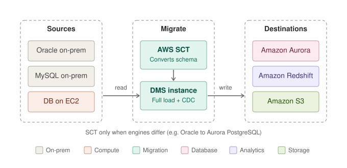

**AWS Database Migration Service (DMS)** moves databases into AWS while the source **stays fully available**. It runs on a **replication instance** (an EC2 instance you size) or on DMS Serverless, and supports a Multi-AZ replication instance for resilience.

DMS has three task types. A **full load** copies the existing data once. **Full load plus CDC (Change Data Capture)** copies the data and then replays every insert, update and delete made during the copy, so at cutover the target is seconds behind and downtime is minimal. **CDC only** provides ongoing replication.

A **homogeneous** migration (same engine, such as MySQL to Aurora MySQL) needs only DMS. A **heterogeneous** migration (different engines, such as Oracle or SQL Server to Aurora PostgreSQL) needs the **AWS Schema Conversion Tool (SCT)** first, or DMS Schema Conversion in the console, to convert tables, data types, indexes, stored procedures and views. DMS moves data; it does not convert engine-specific code. Sources include on-premises and EC2 databases, Azure SQL, RDS/Aurora, S3 and DocumentDB; targets include RDS/Aurora, Redshift, DynamoDB, S3, OpenSearch, Kinesis Data Streams, Kafka, DocumentDB, Neptune and Redis.

| From | To | Methods |
|---|---|---|
| RDS MySQL | Aurora MySQL | Snapshot restore (downtime), or **Aurora read replica then promote** (less downtime) |
| External MySQL | Aurora MySQL | Percona XtraBackup to S3 then restore, or `mysqldump` (slower) |
| RDS PostgreSQL | Aurora PostgreSQL | Snapshot restore, or Aurora read replica then promote |
| External PostgreSQL | Aurora PostgreSQL | Back up to S3 and import with the `aws_s3` extension |
| Any database still in use | Aurora | DMS with continuous replication |

| Pros | Cons |
|---|---|
| Near-zero downtime with CDC; source stays online | You size and pay for the replication instance |
| Many sources and targets, including streams | Heterogeneous moves need SCT work; some code needs manual fixes |

| Exam clue | Points to |
|---|---|
| "Minimal downtime while the source stays in use" | DMS full load + CDC |
| Different engines | SCT + DMS |
| Same engine | DMS alone (SCT is a distractor) |
| "RDS MySQL to Aurora with least downtime" | Aurora read replica, then promote |

> [!WARNING]
> A native SQL Server `.bak` backup can only restore into SQL Server. It cannot become a PostgreSQL database, and it captures nothing written after the backup.

**Menniboe Farm example:** the old SQL Server inventory system (feed, latex yield, vegetable stock) moves to Aurora PostgreSQL. SCT converts the schema, then DMS runs full load plus CDC so workers keep logging harvests until cutover.

---

## Module 4 On-premises migration strategies

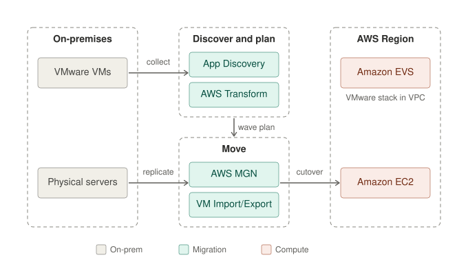

Every application in a migration takes one of the **7 Rs**:

| R | Meaning | Example |
|---|---|---|
| Retire | Turn it off | Unused reporting server |
| Retain | Leave on-premises for now | App with a hardware dongle |
| Relocate | Move a hypervisor-level stack as-is | VMware to Amazon EVS |
| Rehost | Lift and shift to EC2 | AWS MGN |
| Replatform | Lift, tinker and shift | Self-managed MySQL to RDS |
| Repurchase | Drop and shop (move to SaaS) | Local CRM to a SaaS CRM |
| Refactor | Re-architect cloud-native | Monolith to Lambda and DynamoDB |

**AWS Application Discovery Service** inventories servers before a migration. The **Agentless Collector** (a VMware appliance) gathers VM inventory, configuration and CPU, memory and disk usage. The **Discovery Agent**, installed on each server, also captures running processes and network connections, which is how **dependency maps** are built. Results appear in **AWS Migration Hub**. Both are closed to new customers; AWS Transform replaces them.

**AWS Application Migration Service (MGN)** is the rehost service, successor to CloudEndure Migration and Server Migration Service. A replication agent does continuous block-level replication into a low-cost staging area; you launch **test instances**, then cut over to full-size EC2 with minimal downtime. It works for physical, virtual and other-cloud servers. **VM Import/Export** is the simpler, one-time option: it imports VMware, Hyper-V or Citrix images as AMIs, with no ongoing sync. Amazon Linux 2 and AL2023 can also be downloaded as VM images to develop on-premises with the same OS you will run in AWS. **VMware Cloud on AWS** lets teams keep vSphere, vSAN and NSX while running on AWS hardware.

| Tool | Pros | Cons |
|---|---|---|
| Discovery (agentless) | No install, quick VMware inventory | No process or dependency detail |
| Discovery (agent) | Dependencies and processes | Install on every server |
| MGN | Continuous replication, test launches, short cutover | Rehost only; agent per server |
| VM Import/Export | Simple, no extra service | One-time, no sync |
| VMware on AWS / EVS | No VM conversion, same tools | Dedicated hosts, VMware licensing |

| Exam clue | Points to |
|---|---|
| "Collect utilization and dependency data" | Application Discovery Service (agent for dependencies) |
| "Lift and shift many servers with minimal downtime, test before cutover" | AWS MGN |
| "Import a VM image as an AMI" | VM Import/Export |
| "Keep using vCenter / vSphere" | VMware Cloud on AWS |
| One-way move vs ongoing protection with failback | MGN vs DRS (same replication engine, different purpose) |

**Menniboe Farm example:** three VMware VMs (website, point of sale, accounting) and a physical tank-monitoring server. The Agentless Collector inventories the VMs, a Discovery Agent maps the monitoring server's link to the POS, and MGN rehosts all four in one wave. Accounting is repurchased as SaaS.

---

## Module 5 AWS Backup

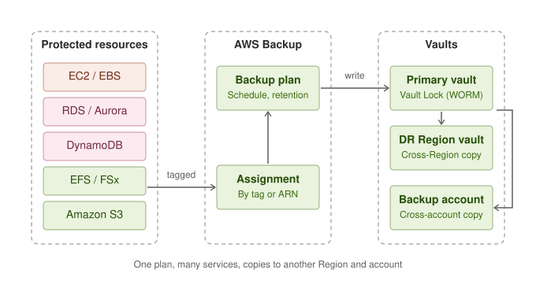

**AWS Backup** is one managed place to define, schedule and audit backups across many services instead of a script per service. It covers EC2, EBS, S3, RDS (all engines), Aurora, DynamoDB, DocumentDB, Neptune, EFS, FSx (all four types), Storage Gateway volumes, Redshift, CloudFormation stacks and on-premises VMware VMs.

A **backup plan** is the policy: frequency (every 12 hours, daily, weekly, monthly or cron), backup window, transition to cold storage and retention. A **resource assignment** (API name: backup selection) chooses targets by **tag** or by resource ID/ARN; tag-based assignment covers new resources automatically. Recovery points live in a **backup vault**, and restores always create a **new** resource. Plans can **copy** recovery points to a vault in another Region (DR) or another account (protection if the production account is compromised; uses AWS Organizations).

**Backup Vault Lock** enforces WORM (Write Once, Read Many). In **governance mode**, users with special IAM permissions can still change or remove the lock. In **compliance mode**, after a grace period nobody can delete recovery points or shorten retention, not even the root user. That makes compliance mode the ransomware and regulator answer, and also means a mistake cannot be undone. A newer option, the **logically air-gapped vault**, stores copies in an isolated AWS-owned account, supports cross-account and cross-organization sharing for direct restore, and always has Vault Lock.

| Pros | Cons |
|---|---|
| One plan for many services | Restore takes time; RTO still hours |
| Tags auto-cover new resources | Cold storage has a 90-day minimum |
| Cross-Region and cross-account copies built in | Compliance-mode lock is irreversible |

| Exam clue | Points to |
|---|---|
| "Centrally manage backups across services" | AWS Backup |
| "Cannot be deleted, even by root", "WORM" | Vault Lock, compliance mode |
| "Copy backups to another Region" | Cross-Region copy rule |
| "Protect backups if the account is compromised" | Cross-account copy |
| "Back up everything tagged X" | Tag-based resource assignment |

> [!IMPORTANT]
> For **EC2 and EBS**, a backup's encryption comes from the **source volume**, not from the vault's `aws/backup` key. The vault key only encrypts backups of services AWS Backup fully manages (for example EFS, DynamoDB with advanced features, S3). Turn on **EBS encryption by default** so snapshots, AMIs and copies are encrypted from the start. The lab confirmed this: the EC2 backup snapshot showed *Not encrypted*.

> [!NOTE]
> S3 Object Lock protects objects in a bucket; Backup Vault Lock protects recovery points in a vault. Both have governance and compliance modes with the same meaning.

**Menniboe Farm example:** resources tagged `backup=daily` are backed up nightly (shop EC2, Aurora orders database, EFS breeding records), kept 35 days, copied to a us-west-2 vault, with Vault Lock in compliance mode against ransomware.

---

## Module 6 Transferring large datasets

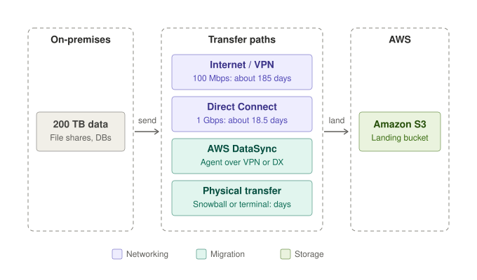

For a big one-time move, compare network time against shipping a device. The formula:

```text
days = (TB x 8,000,000) / Mbps / 86,400
```

| Example | Calculation | Result |
|---|---|---|
| 200 TB over 100 Mbps | 1.6 billion Mb / 100 / 86,400 | about 185 days |
| 200 TB over 1 Gbps Direct Connect | 1.6 billion Mb / 1,000 / 86,400 | about 18.5 days, plus weeks to provision |
| 120 TB over 200 Mbps free bandwidth | 960 million Mb / 200 / 86,400 | about 55.6 days |
| 50 GB nightly over 200 Mbps | 50 x 8,000 / 200 | about 33 minutes |
| Physical device | order, load, ship, ingest | about one week |

| Option | Use when | Notes |
|---|---|---|
| Internet / Site-to-Site VPN | Small data, or a link needed this week | Minutes to set up; encrypted but slow |
| Direct Connect | Large or ongoing transfers | Private, consistent; weeks to provision |
| DataSync | Online, scheduled file sync (NFS, SMB, HDFS, other clouds) to S3, EFS or FSx | Agent on-premises; keeps metadata; bandwidth throttling |
| Snowball Edge (exam answer) | More than about 10 TB, or the network takes more than a week | Real world: Data Transfer Terminal or Partner devices |
| Ongoing sync after the bulk move | Keep changes flowing | VPN or Direct Connect with DMS (databases) or DataSync (files) |

| Exam clue | Points to |
|---|---|
| "Hundreds of TB, limited bandwidth, finish in weeks" | Snowball |
| "Private, consistent throughput, ongoing" | Direct Connect |
| "Sync an NFS/SMB share to S3 on a schedule" | DataSync |
| Bulk plus nightly changes | Offline for the bulk, DataSync or DMS for the trickle |

> [!TIP]
> A VPN adds encryption, not bandwidth. S3 Transfer Acceleration speeds long-distance uploads through edge locations but is still capped by your uplink.

**Menniboe Farm example:** 30 TB of drone footage of the rubber trees over a 50 Mbps link would take about 56 days, so the bulk ships physically and DataSync syncs each night's new footage over the VPN.

---

# Block 2: More solution architectures

## Module 7 Event processing patterns

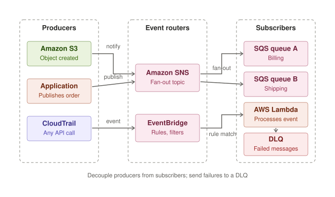

These patterns decouple the producer of an event from the systems that react to it, so each part scales and fails on its own.

With **SQS to Lambda**, Lambda polls in batches; a message that keeps failing returns to the queue until `maxReceiveCount`, then moves to an **SQS dead-letter queue (DLQ)** configured on the queue. With **SQS FIFO**, order is preserved, but a failing message blocks the rest of its message group. With **SNS to Lambda** (asynchronous invocation), Lambda retries about three times total, then sends the event to a Lambda DLQ or an on-failure destination.

**SNS plus SQS fan-out** publishes once to a topic that many SQS queues subscribe to. Each consumer gets its own copy, processes at its own pace, and fails in isolation, and new consumers subscribe without changing the producer. The queue access policy must allow SNS to write. It is also the fix for an S3 limitation: S3 rejects overlapping notification configurations for the same event type and prefix, so one S3 notification to SNS fans out to many queues. A single shared SQS queue does **not** work for this, because SQS consumers compete: each message reaches one poller.

**S3 Event Notifications** fire on object created, removed, restored or replicated, with prefix and suffix filters, to SNS, SQS or Lambda. **S3 to EventBridge** adds advanced filtering (metadata, size, name), many more targets, archive and replay. **EventBridge plus CloudTrail** reacts to any API call, such as a `DeleteTable`. **API Gateway to Kinesis Data Streams to Data Firehose to S3** is a serverless ingestion pipeline.

| Pattern | Pros | Cons |
|---|---|---|
| SQS + Lambda | Buffers spikes, retries, DLQ | Polling cost; possible duplicates (standard) |
| SNS + SQS fan-out | One publish, independent consumers | More components |
| S3 notifications | Simple, built in | Limited filters and targets |
| EventBridge | Rich filters, many targets, replay | More setup, quotas |

| Exam clue | Points to |
|---|---|
| "Each system gets its own copy", "add consumers later" | SNS + SQS fan-out |
| "Isolate messages that keep failing" | DLQ |
| "React to an API call" | EventBridge + CloudTrail |
| "Preserve order" | SQS FIFO |

**Menniboe Farm example:** one order publishes to an `orders` SNS topic; billing, delivery and inventory each have their own queue and Lambda, and a malformed order moves to the DLQ after five tries.

---

## Module 8 Caching strategies

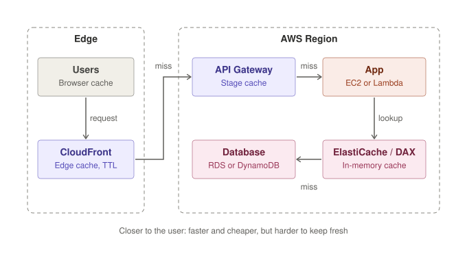

Caching keeps a copy of an answer at some layer so the request never travels further. The closer the cache is to the user, the faster and cheaper each hit is, but the harder stale data is to clear.

| Layer | Service | What it caches | Freshness control |
|---|---|---|---|
| Edge | CloudFront | Static files, some dynamic responses | TTL, cache policy, invalidations |
| API | API Gateway caching | Responses per stage | TTL (default 300 s, max 3600 s) |
| Application | ElastiCache (Redis OSS, Valkey, Memcached) | Query results, sessions | Your code: lazy loading or write-through |
| Database | DynamoDB Accelerator (DAX) | DynamoDB reads in microseconds | Item and query cache TTL |
| Database | RDS / Aurora read replicas | Not a cache; offloads reads | Replication lag |

**DAX** is API-compatible with DynamoDB, so you swap the client and keep the same calls: minimal code change. **ElastiCache** is just as fast but you write the cache logic yourself, which makes it the answer for SQL query results and sessions. **CloudFront** caches HTTP content at the edge and cannot sit in front of DynamoDB. Per-user dynamic content belongs in ElastiCache, not at the edge. CloudFront **Origin Shield** adds a regional cache layer to protect the origin.

| Exam clue | Points to |
|---|---|
| "Static content, global users" | CloudFront |
| "Repeated identical API calls" | API Gateway caching |
| "DynamoDB, microseconds, minimal code change" | DAX |
| "SQL query results or sessions" | ElastiCache |
| "Users see old content after deploy" | Invalidation, shorter TTL or versioned file names |

**Menniboe Farm example:** livestock photos are cached at CloudFront for a day, the daily tilapia price API for 5 minutes in API Gateway, carts in ElastiCache, and the catalog in DynamoDB behind DAX.

---

## Module 9 Blocking an IP address

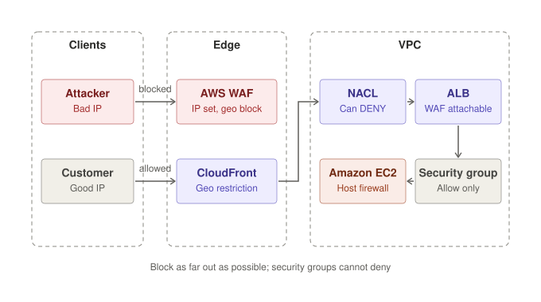

Where you can stop a specific IP depends on what sits in front of the application. The rule: **block at the first hop that still sees the real client IP.**

**Security groups** have allow rules only, so they cannot deny one IP. **Network ACLs** are stateless, subnet-level and support DENY rules evaluated by rule number; they suit a few IPs (rule quotas apply). A host firewall on the instance is the last resort.

Behind an **ALB**, the instance's security group sees the ALB's IP; the NACL on the ALB subnet can still deny the client, but **AWS WAF on the ALB** is better (IP sets, rate-based rules, managed rules such as SQL injection). An **NLB** preserves the client IP but does not support WAF, so use NACLs or security groups. Behind **CloudFront**, CloudFront opens a new connection to the origin, so everything reaching the VPC comes from CloudFront edge IPs; only the `X-Forwarded-For` header carries the attacker's address, which network controls cannot read. The block must happen at the edge: **WAF on CloudFront**, or **CloudFront geo restriction** for whole countries. Shield Standard (free) covers DDoS; Firewall Manager pushes WAF rules across accounts.

| Hop | Source IP it sees |
|---|---|
| CloudFront (WAF here) | Attacker's real IP |
| ALB subnet NACL | CloudFront edge IP |
| EC2 security group | ALB's private IP |

| Control | Can deny an IP | Notes |
|---|---|---|
| Security group | No | Allow-only, stateful |
| NACL | Yes | Stateless; useless behind CloudFront |
| WAF (CloudFront, ALB, API Gateway, AppSync, Cognito) | Yes | IP sets, rate limits, layer 7 inspection; not on NLB |
| CloudFront geo restriction | Countries only | Too coarse for single IPs |

> [!WARNING]
> NACLs work at layers 3 and 4 (IPs and ports). They cannot inspect HTTP content, so they cannot stop SQL injection. That takes WAF at layer 7.

**Menniboe Farm example:** a bot hammers checkout during the vegetable-box sale; the shop is behind CloudFront, so the fix is a WAF web ACL on the distribution with an IP set block and a rate-based rule.

---

## Module 10 High performance computing

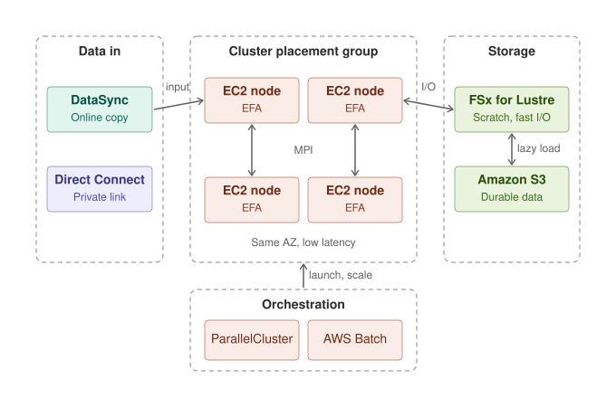

HPC means many nodes working on one large problem (genomics, weather models, fluid dynamics, ML training), rented for hours and deleted afterward.

For **networking**, a **cluster placement group** packs instances close together in one AZ for the lowest latency and highest throughput. **Enhanced Networking (SR-IOV)** raises bandwidth and packets per second: **ENA** delivers up to 100 Gbps on many instances (newer types go higher), and the Intel 82599 VF is legacy (10 Gbps). The **Elastic Fabric Adapter (EFA)** builds on ENA and **bypasses the operating system** for low-latency, reliable node-to-node traffic using **MPI (Message Passing Interface)**. EFA is Linux only and made for **tightly coupled** workloads.

| Placement group | Placement | Optimizes for | Use when |
|---|---|---|---|
| **Cluster** | Packed together, one AZ | Lowest latency, highest throughput | Tightly coupled HPC, MPI |
| Partition | Separate rack groups, up to 7 per AZ | Containing failures | HDFS, Cassandra, Kafka |
| Spread | One instance per rack, max 7 per AZ | Maximum isolation | A few critical instances |

For **storage**, EBS io2 Block Express reaches 256,000 IOPS; **instance store** reaches millions of IOPS but is lost on stop or terminate; S3 is object storage, not a working file system; EFS scales with size. **FSx for Lustre** is the HPC parallel file system: millions of IOPS and hundreds of GB/s, and it **links to an S3 bucket**, presents objects as files, lazy-loads them and can write results back. For **orchestration**, **AWS Batch** runs managed batch jobs including multi-node parallel jobs, and **AWS ParallelCluster** builds a whole cluster (VPC, head node, Slurm scheduler, EFA) from a text config file. Data arrives through Direct Connect, Snowball or DataSync.

| Choice | Pros | Cons |
|---|---|---|
| Cluster placement group | Lowest latency | Single rack/AZ failure domain |
| EFA | OS bypass, MPI at scale | Linux only, supported types only |
| FSx for Lustre | Massive parallel I/O, S3-linked | Scratch type not replicated |
| Spot | Up to 90 percent cheaper | Interruptions: checkpoint jobs |

| Exam clue | Points to |
|---|---|
| "Tightly coupled, MPI, lowest inter-node latency" | Cluster placement group + EFA |
| "Shared high-performance file system for HPC with S3 data" | FSx for Lustre |
| "Improve bandwidth or PPS" | Enhanced Networking (ENA) |
| "Build HPC clusters from a config file" | ParallelCluster |

> [!NOTE]
> FSx for Windows File Server is SMB file sharing for Windows applications, not an HPC file system.

**Menniboe Farm example:** a 20-year rubber tree growth simulation runs on 32 Spot nodes with EFA in a cluster placement group, reading climate data from S3 through FSx for Lustre, then the cluster is deleted.

---

## Module 11 Highly available single EC2 instance

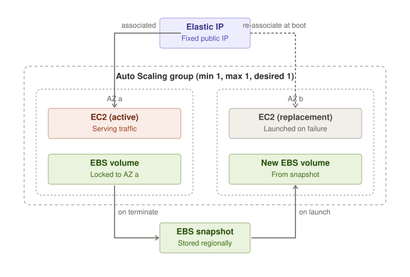

Some applications can only run as one instance (licensing, legacy state) but still must survive failures. Four patterns cover this.

With **Elastic IP plus monitoring plus Lambda**, a CloudWatch alarm or EventBridge rule triggers Lambda to start a standby instance in another AZ and re-associate the EIP. With an **Auto Scaling group of one** (min, max and desired all 1) across two AZs, a failed instance is replaced, possibly in the other AZ, and **user data** calls `ec2:AssociateAddress` at boot (the instance role must allow it), so clients keep the same IP. Because **EBS volumes are locked to one AZ**, keeping disk data across AZs needs **lifecycle hooks**: snapshot on terminate (snapshots are Regional), then create and attach a volume from it on launch. The simplest option, **EC2 auto recovery**, moves the instance to new hardware keeping its ID, IPs and EBS volumes, but **only within the same AZ**.

| Pattern | Pros | Cons |
|---|---|---|
| EIP + Lambda | Fast switch to warm standby | Custom code; pays for standby |
| ASG of 1 + user data | No standby cost, cross-AZ | Boot time is downtime |
| ASG + EBS snapshots | Keeps disk state across AZs | Data since last snapshot lost |
| EC2 auto recovery | No code, same IP and ID | Same AZ only |

| Exam clue | Points to |
|---|---|
| "One instance only, survive an AZ failure" | ASG min/max 1 across two AZs |
| "Fixed IP for clients" | Elastic IP re-associated at boot |
| "Keep EBS data across AZs" | Lifecycle hooks + snapshots |
| "Recover from hardware failure, keep IP and ID" | EC2 auto recovery |

**Menniboe Farm example:** the single-license tank-monitoring app runs in an ASG of one across two AZs; user data claims the farm's Elastic IP, and lifecycle hooks carry the readings volume across AZs.

---

# Block 3: Other services

## Module 12 CloudFormation and StackSets

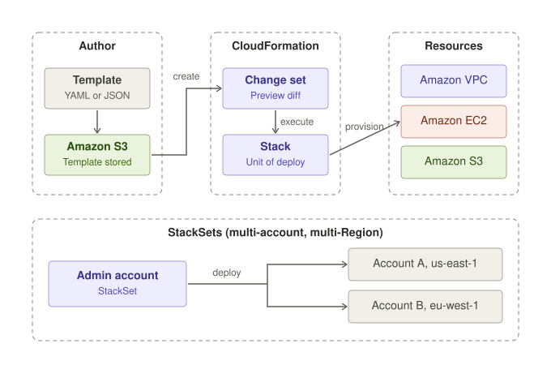

**AWS CloudFormation** is AWS-native infrastructure as code (IaC). You declare resources in a template, and CloudFormation works out the build order from the references between them (`!Ref`, `!GetAtt`), creating independent resources in parallel. A **stack** owns everything one template created, so deleting the stack deletes those resources.

Templates have `Parameters`, `Mappings`, `Conditions`, `Resources` (the only required section) and `Outputs`. **Change sets** preview an update before it runs. **Drift detection** finds manual changes. A failed create or update **rolls back** automatically. **DeletionPolicy** can be `Retain`, `Snapshot` (EBS, RDS) or `Delete` (default). A **service role** lets CloudFormation deploy with its own IAM role so users only need `iam:PassRole`. **Stack policies** protect critical resources during updates. CloudFormation itself is free; you pay for what it creates. A template that creates IAM resources needs the `CAPABILITY_IAM` acknowledgement (`CAPABILITY_NAMED_IAM` if it names them).

**StackSets** deploy one template to many accounts and Regions from an administrator account. With **service-managed permissions** through AWS Organizations, the required roles are created for you and **automatic deployment** adds the stack to every new account that joins a targeted OU. Nested stacks, by contrast, reuse templates inside one stack, in one account. Elastic Beanstalk, SAM and CDK all generate CloudFormation underneath; the visual designer is Infrastructure Composer.

| Pros | Cons |
|---|---|
| Free, native, repeatable, reviewable | AWS-only (Terraform is multi-cloud) |
| Change sets, drift detection, rollback | Verbose YAML |
| StackSets for multi-account, multi-Region | 500 resources per stack |

| Exam clue | Points to |
|---|---|
| "Repeatable infrastructure", "recreate environments quickly" | CloudFormation |
| "Same resources in many accounts or Regions, including new accounts" | StackSets, service-managed, automatic deployment |
| "Preview changes" | Change sets |
| "Find manual changes" | Drift detection |
| "Keep the database when the stack is deleted" | `DeletionPolicy: Retain` or `Snapshot` |

**Menniboe Farm example:** one template with an `EnvName` parameter builds dev and prod shop stacks; a StackSet rolls CloudTrail and a budget alarm into every farm account.

---

## Module 13 Amazon SES

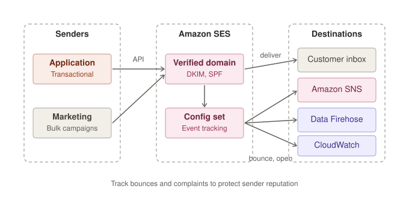

**Amazon Simple Email Service (SES)** sends transactional and bulk email at scale from your own verified domain, through the SES API/SDK or an SMTP endpoint, and can also receive mail. New accounts start in a **sandbox** (send only to verified addresses) until production access is granted. **DKIM, SPF and DMARC** authenticate your mail so it is not flagged as spam. The **reputation dashboard** tracks bounce and complaint rates.

**Configuration sets** tag outgoing mail and publish send, delivery, bounce, complaint, open and click events to SNS, Data Firehose, CloudWatch or EventBridge, so bad addresses can be removed automatically. Shared IPs are the default; dedicated IPs and managed pools need warm-up. Receipt rules can store inbound mail in S3, trigger Lambda or notify SNS.

**Amazon Pinpoint** (end of support October 30, 2026) was the multichannel marketing service with segments, campaigns and journeys. Its channels became AWS End User Messaging, email moved to SES, and campaigns moved to Amazon Connect. The exam may still name Pinpoint for multichannel campaigns.

| Exam clue | Points to |
|---|---|
| "Transactional or bulk email", "SMTP for an app" | SES |
| "Track bounces, complaints, opens" | SES configuration sets + event destinations |
| "Multichannel campaigns, segments, journeys" | Pinpoint (exam term) |
| Basic notifications to subscribers | SNS, not SES |

**Menniboe Farm example:** each order sends an SES receipt from the farm's verified domain; a configuration set sends bounces to SNS to clean the list before the weekly fresh-fish newsletter.

---

## Module 14 AWS Systems Manager

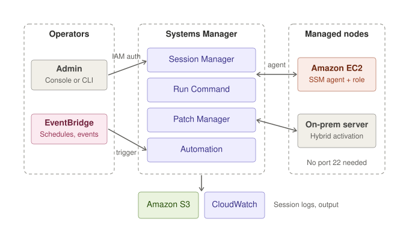

**AWS Systems Manager (SSM)** operates fleets of servers (EC2 and on-premises) without SSH keys. A node becomes a **managed node** when three prerequisites are met: the **SSM Agent** (preinstalled on Amazon Linux and many Windows and Ubuntu AMIs), an **IAM instance role** with `AmazonSSMManagedInstanceCore`, and a **network path** to the SSM endpoints (internet, NAT gateway, or interface VPC endpoints for `ssm`, `ssmmessages` and `ec2messages`). On-premises servers join through a **hybrid activation**.

**Session Manager** gives shell access with no inbound port 22, no SSH keys and no bastion. The agent connects **outbound** on 443, access is controlled by IAM, every `StartSession` is recorded in CloudTrail, and sessions can be logged to S3 or CloudWatch Logs. **Run Command** runs a script across many nodes selected by tag, with rate control and error thresholds. **Patch Manager** patches Linux, Windows and macOS using **patch baselines** (which patches are approved), **patch groups** (tag-based sets of nodes) and **compliance reports**, usually inside a **Maintenance Window** (schedule, duration, targets, tasks). **Automation** runs multi-step runbooks (restart, create AMIs, remediate), triggered by EventBridge, Maintenance Windows or AWS Config remediation. Related capabilities include Parameter Store, Fleet Manager, Inventory and State Manager.

| Pros | Cons |
|---|---|
| No SSH or bastion; IAM-controlled, logged access | Needs agent, role and network path |
| Fleet-wide commands and patching | Interface endpoints cost per hour per AZ |
| Works on-premises too | Many sub-features to learn |

| Exam clue | Points to |
|---|---|
| "Shell access without port 22, keys or bastion; audit sessions" | Session Manager |
| "Run a script on hundreds of instances" | Run Command |
| "Patch on a schedule, approved updates, compliance report" | Patch Manager + baselines + patch groups + Maintenance Window |
| "Auto-remediate a Config rule violation" | SSM Automation |
| "Instance not showing in Systems Manager" | Role, agent or network/endpoints |

> [!TIP]
> Private-subnet nodes also need a path to patch repositories. Amazon Linux repositories live in S3, reachable through a free S3 gateway endpoint.

**Menniboe Farm example:** private-subnet EC2 with no SSH; sessions logged to S3; Patch Manager patches `PatchGroup=farm-prod` on Sunday nights; the on-premises sensor server joins through a hybrid activation.

---

## Module 15 Cost Explorer and Cost Anomaly Detection

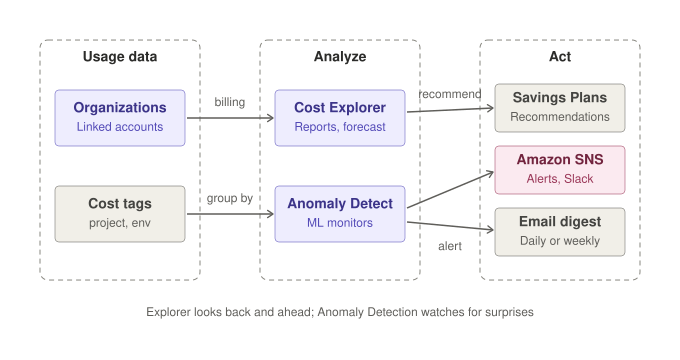

**AWS Cost Explorer** visualizes cost and usage over time, grouped by service, account, Region, usage type or cost allocation tag, at monthly, daily, hourly or resource granularity. It shows totals across an Organization, **forecasts** future spend, and recommends **Savings Plans and Reserved Instances** with utilization and coverage reports.

**AWS Cost Anomaly Detection** uses machine learning to learn your normal spending pattern, including growth and weekly cycles, so there are **no thresholds to maintain**. Monitors watch AWS services, member accounts, cost allocation tags or cost categories. Each alert includes a **root-cause analysis** (service, account, Region, usage type) and is delivered through SNS or as daily or weekly email summaries.

| Tool | Job |
|---|---|
| Cost Explorer | Analyze, forecast, Savings Plans recommendations |
| Cost Anomaly Detection | Alert on unusual spend, with root cause |
| AWS Budgets | Alert when spend or usage crosses **your** threshold; budget actions |
| Cost and Usage Report / Data Exports | Most detailed billing data to S3 for Athena |
| Compute Optimizer | Right-sizing |
| Trusted Advisor | Idle and underused resources |

| Exam clue | Points to |
|---|---|
| "Visualize, forecast, which Savings Plan" | Cost Explorer |
| "Unusual spend, no thresholds, root cause" | Cost Anomaly Detection |
| "Alert when spend exceeds $X" | AWS Budgets |
| "Cost by team or project" | Cost allocation tags |

**Menniboe Farm example:** resources tagged `project=shop` or `project=sensors`; a looping Lambda on the sensor feed triggers an anomaly alert overnight that names Lambda in us-east-1.

---

## Module 16 Batch AppFlow Amplify Outposts and Instance Scheduler

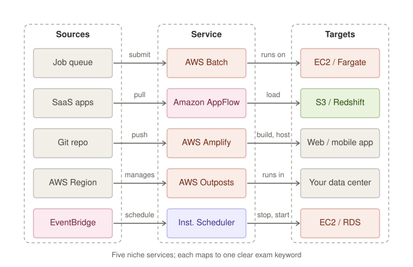

**AWS Batch** runs batch jobs (a start and an end) at any scale. Jobs are Docker images submitted to job queues; managed compute environments launch EC2 On-Demand, **Spot** or Fargate and scale back to zero between batches. Batch supports array jobs, multi-node parallel jobs and retry strategies.

| | Lambda | Batch |
|---|---|---|
| Time limit | 15 minutes | None |
| Runtime | Supported runtimes or container image | Any Docker image |
| Disk | `/tmp` up to 10 GB | EBS or instance store |

**Amazon AppFlow** moves data between SaaS apps (Salesforce, SAP, Zendesk, Slack, ServiceNow) and AWS (S3, Redshift) on a schedule, an event or on demand, with filtering, validation, masking and mapping, optionally over AWS PrivateLink. **AWS Amplify** provides tools and hosting for full-stack web and mobile apps (Cognito auth, S3 storage, AppSync or REST APIs, Lambda functions), and Amplify Hosting builds and deploys from a Git repository on every push. **AWS Outposts** puts AWS-managed racks or servers in your own facility running EC2, EBS, S3 on Outposts, ECS, EKS, RDS and EMR, for low latency to on-premises systems, local processing and data residency; you handle physical security and power. **Instance Scheduler on AWS** is an AWS Solution deployed with CloudFormation: Lambda reads schedules from DynamoDB and starts and stops EC2 and RDS across accounts and Regions.

| Exam clue | Points to |
|---|---|
| "Jobs longer than 15 minutes, Docker, Spot, scale to zero" | AWS Batch |
| "SaaS data to S3 or Redshift without code" | AppFlow |
| "Full-stack web or mobile app with auth, API, CI/CD" | Amplify |
| "AWS on-premises, low latency, data stays local" | Outposts |
| "Stop dev EC2/RDS outside business hours" | Instance Scheduler on AWS |

**Menniboe Farm example:** nightly Batch jobs on Spot process sensor data (40 minutes, too long for Lambda); AppFlow pulls CRM records hourly; the storefront is hosted on Amplify; Instance Scheduler stops dev every evening.

---

# Block 4: Whitepapers and architectures

## Module 17 Well-Architected Framework WA Tool and Trusted Advisor

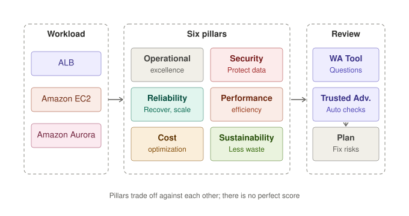

The **AWS Well-Architected Framework** is AWS's yardstick for good design. Its general principles are to stop guessing capacity, test at production scale, automate to make experiments easy, allow architectures to evolve, drive decisions with data, and practice through game days. The six pillars trade off against each other; you balance them against business needs rather than maximizing all six.

| Pillar | Design principles (short) | Key services |
|---|---|---|
| Operational excellence | Operations as code, small reversible changes, learn from failure | CloudFormation, Systems Manager, Config, CloudTrail, CloudWatch, X-Ray |
| Security | Least privilege, traceability, security at every layer, protect data, prepare for incidents | IAM, Identity Center, KMS, WAF, Shield, GuardDuty, Security Hub, Macie |
| Reliability | Recover automatically, test recovery, scale horizontally, automate change | Route 53, Auto Scaling, Multi-AZ, AWS Backup, Service Quotas |
| Performance efficiency | Managed and serverless tech, go global, experiment | Lambda, CloudFront, ElastiCache, DynamoDB, EBS |
| Cost optimization | Consumption model, measure, attribute spend | Cost Explorer, Budgets, CUR, Savings Plans, Spot |
| Sustainability | Maximize utilization, efficient hardware, managed services | Graviton, Auto Scaling, Spot, serverless, S3 lifecycle |

The **Well-Architected Tool** is a free console questionnaire per workload that produces high and medium risk issues (HRIs and MRIs), an improvement plan and milestones; **lenses** add domain questions (Serverless, SaaS, Machine Learning, Generative AI). **AWS Trusted Advisor** runs **automated** account checks in six categories: cost optimization, performance, security, fault tolerance, service limits and operational excellence. Every account gets all service-limit checks and selected security and fault-tolerance checks; the full set and the Trusted Advisor API need Business Support+ or higher (exam: Business or Enterprise). The organizational view aggregates results across accounts.

| Exam clue | Points to |
|---|---|
| "Review a workload against best practices, find high-risk issues" | Well-Architected Tool |
| "Automated checks: open port 22, idle EC2, quotas near limits, via API" | Trusted Advisor (full checks) |
| "Recover from failure" | Reliability pillar |
| "Least privilege" | Security pillar |
| "Reduce idle resources or environmental impact" | Cost or Sustainability |

**Menniboe Farm example:** a WA Tool review flags single-AZ Aurora (Reliability) and dev running 24/7 (Cost); Trusted Advisor's free checks catch an open S3 bucket and a security group open on port 22.

---

## Module 18 Reference architectures

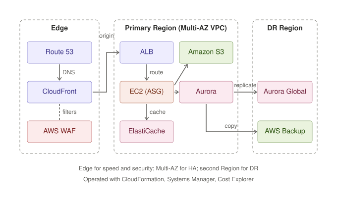

AWS publishes proven designs in the **AWS Architecture Center**, deployable solutions in the **AWS Solutions Library** (Instance Scheduler is one), and step-by-step patterns in **AWS Prescriptive Guidance**. Whitepapers worth skimming: the Well-Architected Framework and pillar papers, *Disaster Recovery of Workloads on AWS*, *Overview of Amazon Web Services* and *AWS Security Best Practices*.

Most long exam scenarios are the reference three-tier architecture with one requirement changed. Find the changed requirement and swap the matching block.

| Requirement | Building block |
|---|---|
| Global users, low latency | CloudFront + S3 |
| Block bad IPs, SQL injection, bots | WAF on CloudFront or ALB |
| DNS failover, latency routing | Route 53 health checks and routing policies |
| Web tier survives AZ loss | ALB + Auto Scaling across two or more AZs |
| Read-heavy, reduce DB load | ElastiCache, DAX, read replicas |
| HA relational database | Aurora or RDS Multi-AZ |
| Region DR, RPO about 1 second | Aurora Global Database, DynamoDB global tables |
| Decouple components | SQS, SNS fan-out, EventBridge |
| Backups and ransomware protection | AWS Backup, Vault Lock, cross-Region and cross-account copy |
| Repeatable deploys | CloudFormation, StackSets |
| Operate without SSH | Session Manager |
| Cost visibility | Tags, Cost Explorer, Anomaly Detection, Budgets |

> [!TIP]
> "Most operationally efficient" usually means managed or serverless. "Least cost" usually means a simpler DR strategy, Spot, S3 lifecycle or scheduling. Shield Advanced is DDoS protection, not SQL injection protection.

**Menniboe Farm example:** Route 53, CloudFront plus WAF, ALB, EC2 Auto Scaling across two AZs, ElastiCache for carts, Aurora Multi-AZ with a Global Database secondary, S3 for photos, AWS Backup with Vault Lock, deployed by CloudFormation and patched by Systems Manager.

---

# Block 5: Exam prep

## Module 19 SAA-C03 exam strategy

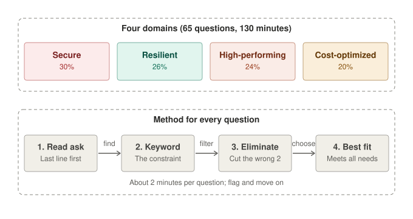

The exam is **SAA-C03**: 65 questions (50 scored, 15 unscored and indistinguishable), 130 minutes, multiple choice and multiple response, scaled passing score 720 out of 1000, no penalty for guessing, valid three years, at a test center or online proctored. Check the official exam page before booking, since some blogs claim a newer version that AWS does not list.

| Domain | Weight | Focus |
|---|---|---|
| Design secure architectures | 30% | IAM, KMS, VPC security, WAF, Shield, encryption |
| Design resilient architectures | 26% | Multi-AZ, DR, decoupling, Auto Scaling, Route 53 |
| Design high-performing architectures | 24% | Storage and database choice, caching, edge, compute fit |
| Design cost-optimized architectures | 20% | Purchasing options, storage tiers, right-sizing, cost tools |

| Phrase | Usually points to |
|---|---|
| Most cost-effective | Cheapest option that meets every requirement |
| Least operational overhead | Managed or serverless |
| Highly available | Multi-AZ, load balancer, Auto Scaling |
| Fault tolerant, no downtime | Redundancy that keeps running through failure |
| Decouple | SQS, SNS, EventBridge |
| Real-time, streaming | Kinesis Data Streams, MSK |
| Minimal application changes | Rehost: MGN, same-engine RDS, homogeneous DMS |
| Hybrid, existing on-premises | Direct Connect, VPN, Storage Gateway, Outposts, DataSync |
| Audit, who did what | CloudTrail |
| Configuration compliance | AWS Config |

**Method for every question:** read the last sentence first to learn what is being asked; underline the constraint (RPO/RTO numbers, cost, deadlines, "no code changes"); eliminate two answers quickly (features that do not exist, custom scripts when a managed option exists, answers to a different problem); then pick the option that meets **all** requirements. Pace about 2 minutes per question, flag anything slower and return to it, and never leave a blank.

**Worked example:** logs kept 7 years, rarely read after 30 days, retrievable within 12 hours, most cost-effective. S3 Standard then lifecycle to **Glacier Deep Archive** wins, because Deep Archive is the cheapest class and its standard retrieval completes within 12 hours. If the question said "within minutes", Deep Archive would fail.

**Practice approach:** take practice exams timed in one sitting, review every question including correct ones, keep an error log by domain and service, and book when fresh practice exams consistently reach 75 to 80 percent.

---

# Hands-on lab

## Lab overview

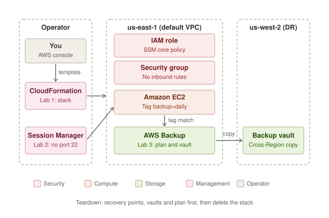

| Lab | What was built | What it proved |
|---|---|---|
| Lab 1 | One CloudFormation stack: IAM role for SSM, instance profile, security group with zero inbound rules, tagged t3.micro instance | Infrastructure created and destroyed repeatably from one template |
| Lab 2 | A shell through Session Manager plus a CloudTrail audit record | Access with no SSH key, no bastion, no port 22, fully audited |
| Lab 3 | Two vaults, a backup plan with a cross-Region copy rule, a tag-based assignment, one backup and one copy | Tag-driven backup policy and backup-and-restore DR across two Regions |

**How the pieces connect:** the template's IAM role is what lets Session Manager reach the instance, and the template's `backup=daily` tag is what lets AWS Backup find it. The instance launched in the default VPC with a public IP, giving the SSM Agent an outbound path without a NAT gateway or paid interface endpoints.

**Cost:** a few cents in total (about one hour of t3.micro, an 8 GB EBS snapshot and about 1.7 GB of cross-Region transfer). Everything was torn down the same day.

---

## Lab 1 Step 1 Set the Region and confirm the default VPC

**Why this step:** the template sets no `VpcId` or `SubnetId`, so the security group and instance land in the default VPC. Default subnets auto-assign a public IPv4 address, which gives the instance a free outbound path to the Systems Manager endpoints. If the default VPC had been deleted in an earlier lab, the stack would fail.

**Console:** Region selector **US East (N. Virginia)** → **VPC → Your VPCs** → find the row with **Default VPC = Yes** → **Subnets**, filtered by that VPC, confirm **Auto-assign public IPv4 address = Yes**. If missing: **Actions → Create default VPC**.

| Field | Value seen |
|---|---|
| VPC ID | `vpc-0e9fbd566390d83da` |
| IPv4 CIDR | `172.31.0.0/16` |
| State / Default VPC | Available / Yes |
| Block Public Access | Off (on would block the outbound path to SSM) |

```bash
aws ec2 describe-vpcs --region us-east-1 \
  --filters Name=isDefault,Values=true \
  --query "Vpcs[].{VpcId:VpcId,Cidr:CidrBlock}" --output table
```

---

## Lab 1 Step 2 Write the CloudFormation template

**Why this step:** the template is the infrastructure as code for the whole lab. Defining the role, security group and instance together means CloudFormation creates them in the right order and deletes them in one action at teardown. The file only needs to be on the local computer for the console upload; it is stored in this folder as [`templates/day7-ssm-backup-lab.yaml`](templates/day7-ssm-backup-lab.yaml).

| Logical ID | Type | Purpose |
|---|---|---|
| `SsmInstanceRole` | IAM role | Trusts `ec2.amazonaws.com`; attaches `AmazonSSMManagedInstanceCore` |
| `SsmInstanceProfile` | Instance profile | Attaches the role to the instance |
| `NoInboundSG` | Security group | No ingress rules; default egress allows outbound |
| `LabInstance` | EC2 instance | Amazon Linux 2023, t3.micro, tagged `Name`, `backup=daily`, `project=day7-lab` |

> [!NOTE]
> The AMI comes from the public SSM parameter `/aws/service/ami-amazon-linux-latest/al2023-ami-kernel-default-x86_64`, so the template always gets the latest Amazon Linux 2023 without a Region-specific AMI ID. The role has no `RoleName`, so the stack only needs `CAPABILITY_IAM`, not `CAPABILITY_NAMED_IAM`.

```yaml
AWSTemplateFormatVersion: '2010-09-09'
Description: Day 7 lab - SSM-managed EC2 with no inbound ports, tagged for AWS Backup

Parameters:
  LatestAmiId:
    Type: AWS::SSM::Parameter::Value<AWS::EC2::Image::Id>
    Default: /aws/service/ami-amazon-linux-latest/al2023-ami-kernel-default-x86_64
  InstanceType:
    Type: String
    Default: t3.micro
    AllowedValues: [t3.micro, t2.micro]
  EnvName:
    Type: String
    Default: day7-lab

Resources:
  SsmInstanceRole:
    Type: AWS::IAM::Role
    Properties:
      AssumeRolePolicyDocument:
        Version: '2012-10-17'
        Statement:
          - Effect: Allow
            Principal:
              Service: ec2.amazonaws.com
            Action: sts:AssumeRole
      ManagedPolicyArns:
        - arn:aws:iam::aws:policy/AmazonSSMManagedInstanceCore
      Tags:
        - Key: project
          Value: !Ref EnvName

  SsmInstanceProfile:
    Type: AWS::IAM::InstanceProfile
    Properties:
      Roles:
        - !Ref SsmInstanceRole

  NoInboundSG:
    Type: AWS::EC2::SecurityGroup
    Properties:
      GroupDescription: No inbound rules - access through Session Manager only
      Tags:
        - Key: Name
          Value: !Sub '${EnvName}-no-inbound-sg'
        - Key: project
          Value: !Ref EnvName

  LabInstance:
    Type: AWS::EC2::Instance
    Properties:
      ImageId: !Ref LatestAmiId
      InstanceType: !Ref InstanceType
      IamInstanceProfile: !Ref SsmInstanceProfile
      SecurityGroupIds:
        - !GetAtt NoInboundSG.GroupId
      Tags:
        - Key: Name
          Value: !Sub '${EnvName}-ssm-host'
        - Key: backup
          Value: daily
        - Key: project
          Value: !Ref EnvName

Outputs:
  InstanceId:
    Value: !Ref LabInstance
  SecurityGroupId:
    Value: !GetAtt NoInboundSG.GroupId
  InstanceRoleName:
    Value: !Ref SsmInstanceRole
```

---

## Lab 1 Step 3 Create the stack in the console

**Why this step:** this turns the template into resources. CloudFormation reads the `!Ref` and `!GetAtt` references to build a dependency graph, so the stack ends up owning all four resources and can delete them together.

**Console:** **CloudFormation → Stacks → Create stack → With new resources (standard)**.

| Page | Field | Value |
|---|---|---|
| 1 Create stack | Prepare template | Choose an existing template |
| | Template source | Upload a template file → `day7-ssm-backup-lab.yaml` |
| 2 Stack details | Stack name | `day7-ssm-backup-lab` |
| | Parameters | `EnvName` = `day7-lab`, `InstanceType` = `t3.micro`, `LatestAmiId` = default path |
| 3 Options | Tags | `project` = `day7-lab` |
| | Permissions › IAM role | blank (uses your console permissions) |
| | Stack deployment options › Express mode | not enabled |
| | Behavior on provisioning failure | Roll back all resources |
| | Delete newly created resources during a rollback | Use deletion policy |
| | Validations › Disable deployment validations | not checked |
| | Stack policy | No stack policy |
| | Rollback configuration | empty |
| | Notification options | none |
| | Timeout / Termination protection | blank / Deactivated |
| | Capabilities | acknowledge that CloudFormation might create IAM resources |
| 4 Review | | Submit (not Create change set) |

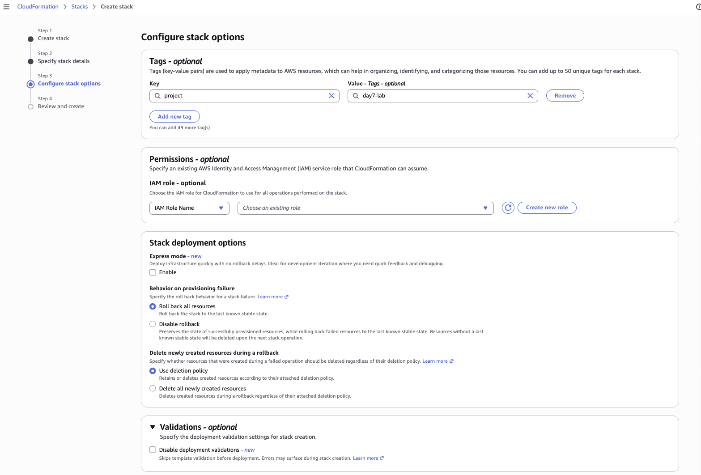

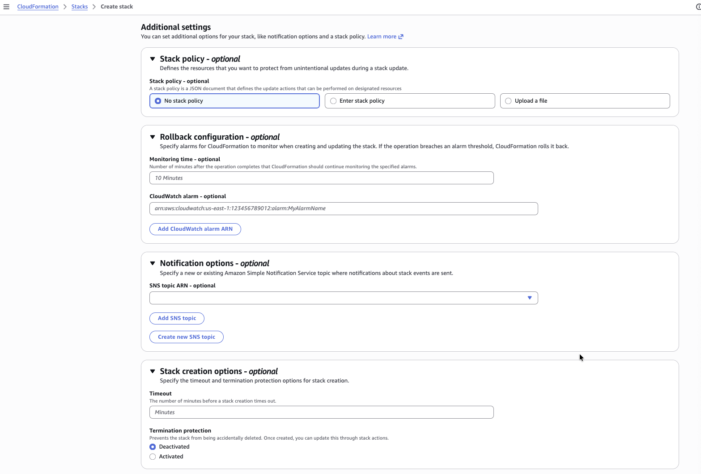

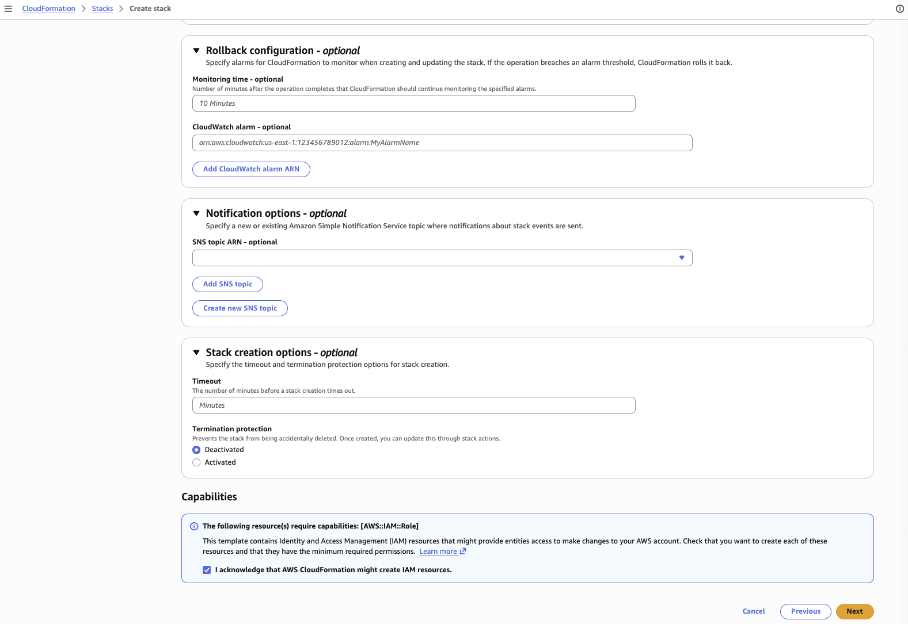

> [!NOTE]
> Newer console options: **Express mode** skips rollback waits for faster development deploys but leaves failed resources half-built, so it stays off. **Disable deployment validations** turns off pre-deployment template checks, so it stays off. The failure option once called *Preserve successfully provisioned resources* is now **Disable rollback**.

> [!IMPORTANT]
> Without the IAM capabilities checkbox, Submit fails with `Requires capabilities: [CAPABILITY_IAM]`. Uploading a template file also makes CloudFormation create an S3 bucket named `cf-templates-<random>-us-east-1`, which goes on the teardown list.

**Result: CREATE_COMPLETE in about 2 minutes 50 seconds.**

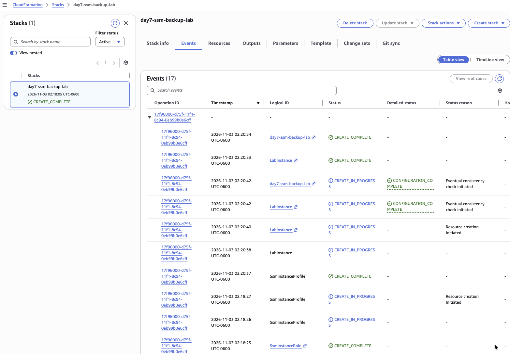

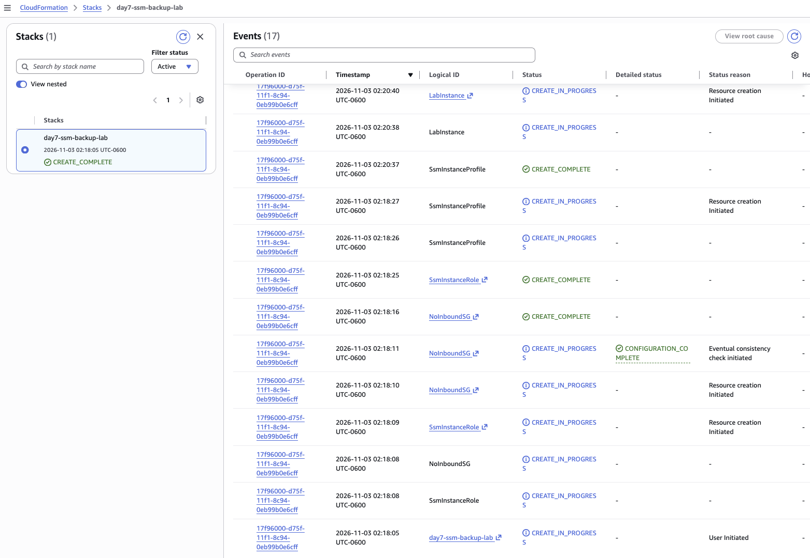

| Elapsed | Logical ID | Event | Why |
|---|---|---|---|
| 0:00 | stack | CREATE_IN_PROGRESS, User Initiated | Submit clicked |
| 0:03 | `SsmInstanceRole` + `NoInboundSG` | Both started together | No dependencies, so they run in parallel |
| 0:11 | `NoInboundSG` | CREATE_COMPLETE (8 s) | |
| 0:20 | `SsmInstanceRole` | CREATE_COMPLETE (17 s) | |
| 0:21 | `SsmInstanceProfile` | Started after the role | It references `!Ref SsmInstanceRole` |
| 2:32 | `SsmInstanceProfile` | CREATE_COMPLETE (about 2 min 11 s, slowest) | IAM is global; CloudFormation waits until the profile is usable everywhere |
| 2:33 | `LabInstance` | Started last | Needs the profile and the SG ID |
| 2:49 | stack | CREATE_COMPLETE | |

> [!TIP]
> Some events show **CONFIGURATION_COMPLETE** with *Eventual consistency check initiated*. The resource is built, and CloudFormation is confirming AWS reports it consistently before moving on, so the next resource does not fail because something does not exist yet.

---

## Lab 1 Step 4 Verify what the stack built

**Why this step:** `CREATE_COMPLETE` means CloudFormation ran without errors, not that the result fits the next labs. Session Manager needs the public IP and the IAM role; the security test needs zero inbound rules; AWS Backup needs the tag.

**Console:** **CloudFormation → Outputs** (InstanceId, SecurityGroupId, InstanceRoleName) → click the InstanceId → check the Details, Security and Tags tabs.

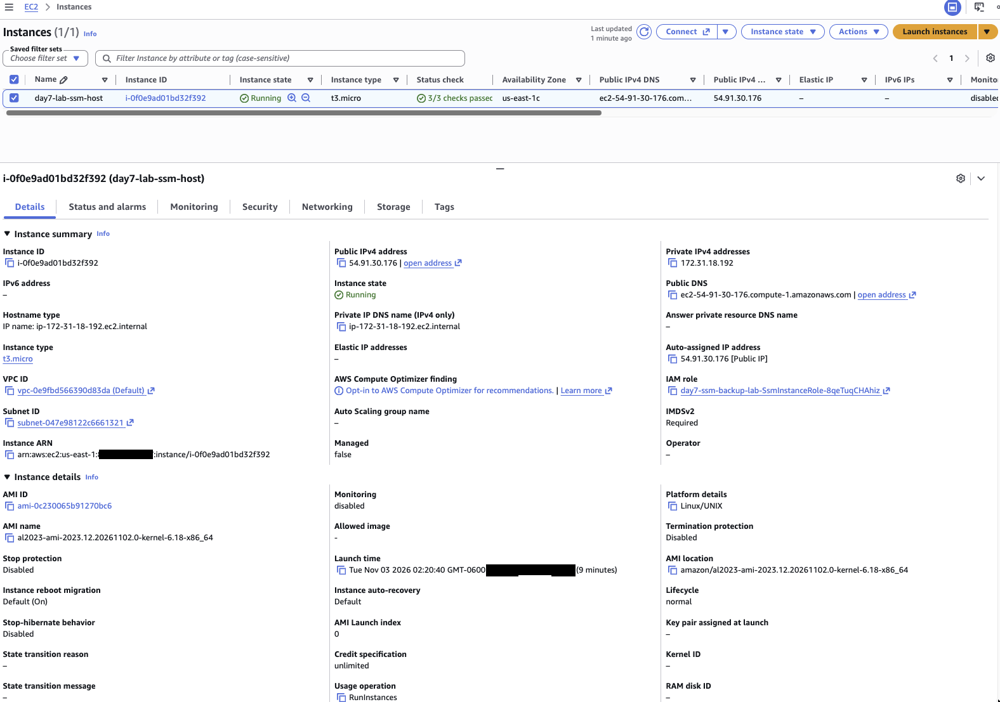

| Check | Value seen |
|---|---|
| Instance | `i-0f0e9ad01bd32f392`, `day7-lab-ssm-host`, t3.micro, us-east-1c |
| State / status checks | Running, 3/3 checks passed |
| Public IPv4 | auto-assigned (proves the default subnet works) |
| Private IPv4 | `172.31.18.192` |
| IAM role | `day7-ssm-backup-lab-SsmInstanceRole-<suffix>` |
| Security group | `sg-0b61438215633ae87` |
| Key pair assigned at launch | none |
| IMDSv2 | Required (AL2023 default) |
| Instance auto-recovery | Default (same-AZ recovery from Module 11) |

```bash
aws ec2 describe-instances --region us-east-1 \
  --filters "Name=tag:project,Values=day7-lab" "Name=instance-state-name,Values=running" \
  --query "Reservations[].Instances[].{Id:InstanceId,PublicIp:PublicIpAddress,Role:IamInstanceProfile.Arn,SG:SecurityGroups[0].GroupId}" \
  --output table
```

---

## Lab 2 Step 1 Confirm the managed node and empty inbound rules

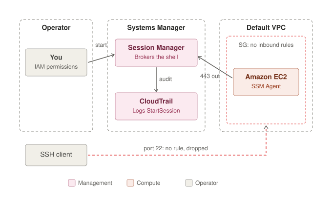

**Why this step:** Session Manager can only open a shell on a **managed node**, an instance whose SSM Agent has registered. Lab 1 provided all three prerequisites: the agent (preinstalled), the role and the network path. Confirming the inbound rules are empty at the same time is the point of the lab.

**Console:** **EC2 → Instances → `day7-lab-ssm-host` → Security tab**, then **Systems Manager → Node tools → Fleet Manager**.

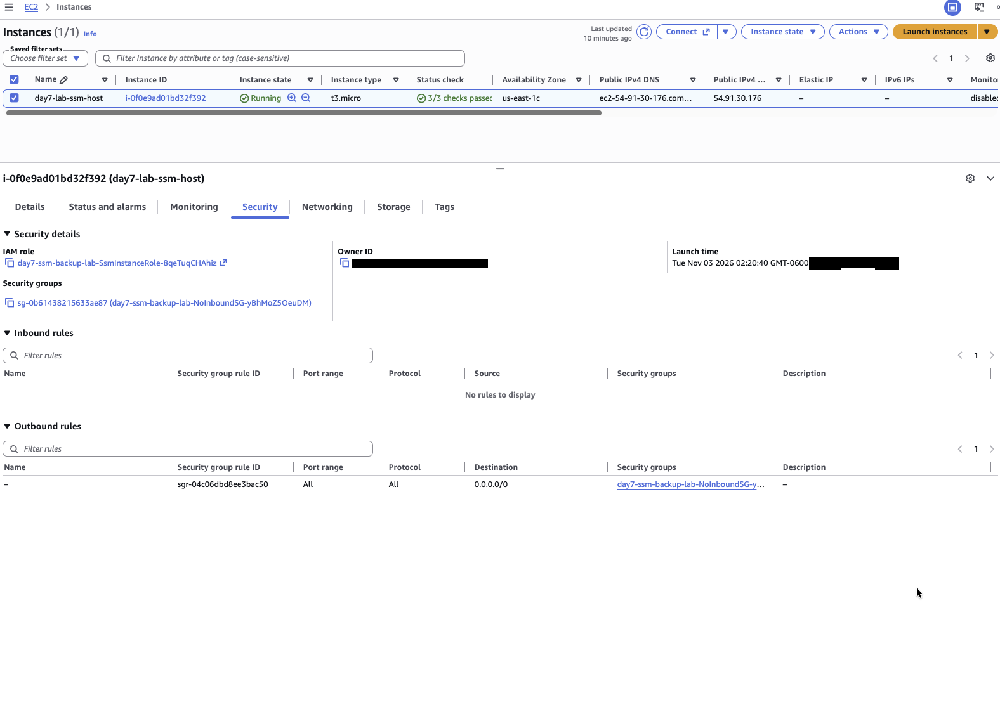

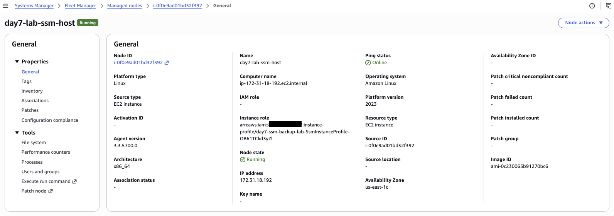

| Check | Value seen |
|---|---|
| Inbound rules | No rules to display |
| Outbound rules | All traffic → `0.0.0.0/0` |
| Ping status | Online |
| Agent version | 3.3.5700.0 |
| Key name | none |

> [!NOTE]
> Fleet Manager shows **IAM role: –** and **Instance role: …SsmInstanceProfile…**. The *IAM role* field is only for hybrid activations (on-premises servers); EC2 instances get permissions through the instance profile. Patch group and patch counts are empty because no Patch Manager baseline has run.

```bash
aws ssm describe-instance-information --region us-east-1 \
  --filters "Key=InstanceIds,Values=i-0f0e9ad01bd32f392" \
  --query "InstanceInformationList[].{Id:InstanceId,Ping:PingStatus,Platform:PlatformName,Agent:AgentVersion}" \
  --output table

aws ec2 describe-security-groups --region us-east-1 --group-ids sg-0b61438215633ae87 \
  --query "SecurityGroups[0].{Inbound:IpPermissions,OutboundCount:length(IpPermissionsEgress)}"
```

---

## Lab 2 Step 2 Open a shell and prove the channel is outbound

**Why this step:** Session Manager does not connect to the instance. It relays keystrokes over the connection the SSM Agent already opened **outward** on 443, and access is decided by IAM, not by holding a key. The commands below show both sides from inside the instance.

**Console:** **EC2 → Instances → select `day7-lab-ssm-host` → Connect → Session Manager tab → Connect**.

| Connect tab | What it means here |
|---|---|
| EC2 Instance Connect | Fails: it pushes a temporary key and connects inbound on 22 |
| Session Manager | Ready, because the agent is Online |
| SSH client | Needs a key pair, and none exists |
| EC2 serial console | Separate opt-in feature |

```bash
whoami
hostname
cat /etc/os-release | head -2
systemctl is-active amazon-ssm-agent
sudo ss -tnp | grep -i ssm
sudo ss -tlnp | grep ':22'
```

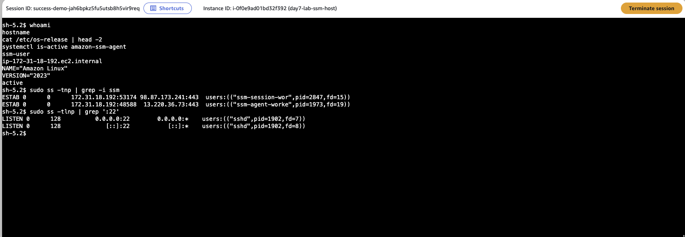

| Output | What it proves |
|---|---|
| `ssm-user`, AL2023, agent `active` | A dedicated low-privilege user (in sudoers), no key used |
| `ESTAB 172.31.18.192:53174 → …:443` (`ssm-session-worker`) | This session's data channel, opened outbound |
| `ESTAB 172.31.18.192:48588 → …:443` (`ssm-agent-worker`) | The always-on control channel that keeps the node Online |
| `sshd LISTEN 0.0.0.0:22` and `[::]:22` | SSH listens in the OS, but the security group drops every packet: two independent layers |

> [!TIP]
> The Session ID starts with the IAM user name, so every session is stamped with who opened it. That leads to the next step.

---

## Lab 2 Step 3 Find the session in CloudTrail

**Why this step:** with SSH keys, anyone holding the key looks the same and AWS records nothing. With Session Manager, starting a session is an API call (`StartSession`) recorded with the IAM identity, time, source IP and target; ending it records `TerminateSession`.

**Console:** **CloudTrail → Event history** (free, 90 days, no trail needed) → **Lookup attributes: Event name = `StartSession`** → open the event.

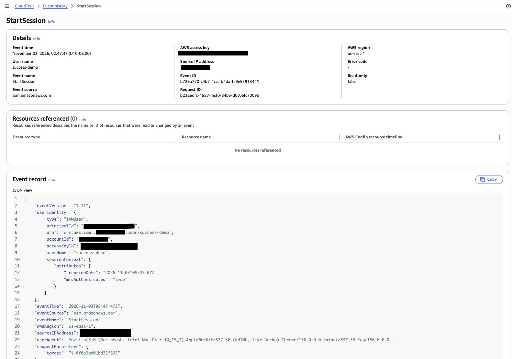

| Field | Value |
|---|---|
| Event source / Region | `ssm.amazonaws.com` / us-east-1 |
| `userIdentity.type` | `IAMUser` |
| `mfaAuthenticated` | `true` |
| `accessKeyId` prefix | `ASIA`: temporary STS credentials from the console sign-in, not a long-term `AKIA` key |
| `requestParameters.target` | `i-0f0e9ad01bd32f392` |
| Resources referenced | 0 (normal; the target stays in `requestParameters`) |

```bash
aws cloudtrail lookup-events --region us-east-1 \
  --lookup-attributes AttributeKey=EventName,AttributeValue=StartSession \
  --max-results 3 \
  --query "Events[].{Time:EventTime,User:Username,Event:EventName}" --output table
```

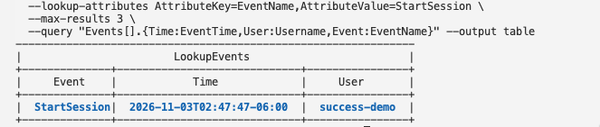

> [!WARNING]
> The event record JSON contains the account ID, access key ID and your source IP in several places. Redact all of them before publishing; the Details panel and the JSON both need it.

---

## Lab 3 Step 1 Create the DR vault in us-west-2

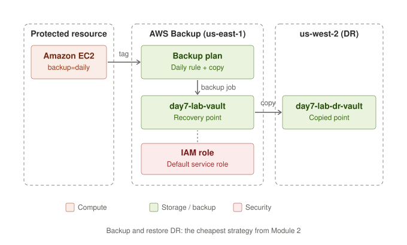

**Why this step:** a vault holds recovery points and lives in one Region. A copy rule must point at a vault that already exists in the destination Region, so the far end is built first. Named vaults (rather than `Default`) keep teardown clean.

**Console:** Region **US West (Oregon)** → **AWS Backup → Vaults → Create vault**.

| Field | Value |
|---|---|
| Vault name | `day7-lab-dr-vault` |
| Vault type | Backup vault (not Logically air-gapped vault) |
| Encryption key | (default) aws/backup |
| Tags | `project` = `day7-lab` |

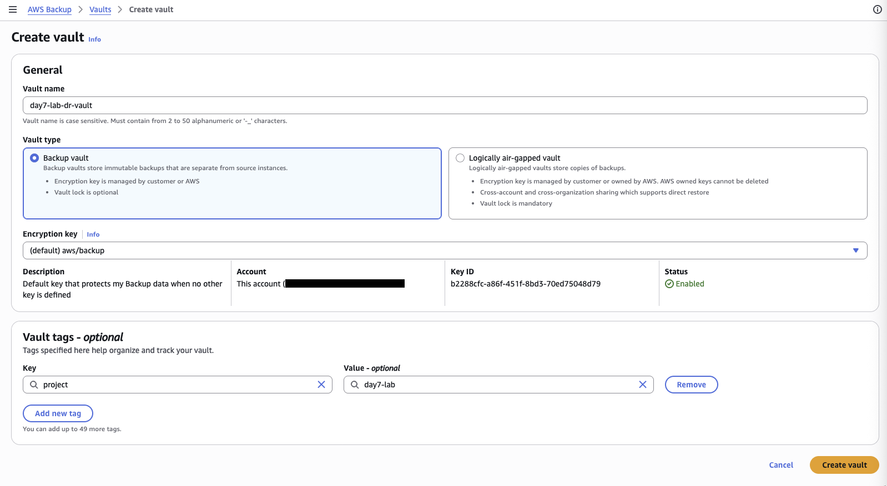

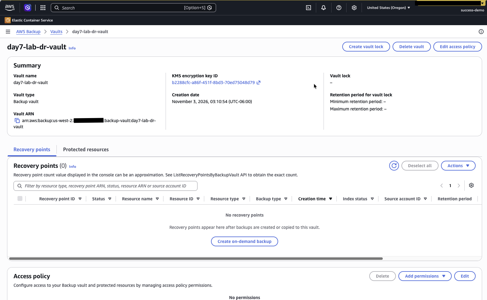

> [!WARNING]
> Do not enable **Vault Lock** in a lab. In compliance mode, after the grace period nobody can delete recovery points before retention expires, which would block teardown. The vault's **Access policy** stays empty; it is only needed to let another account copy into the vault.

---

## Lab 3 Step 2 Create the primary vault in us-east-1

**Why this step:** backups are created in the resource's own Region first, then copied out. The plan's rule will write to this vault and copy to the one from Step 1.

**Console:** Region **US East (N. Virginia)** → **AWS Backup → Vaults → Create vault**: name `day7-lab-vault`, type Backup vault, key (default) aws/backup, tag `project` = `day7-lab`.

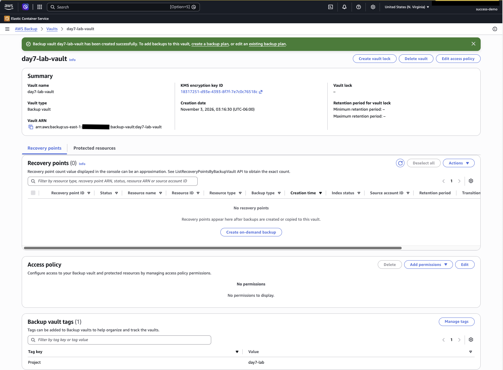

```bash
for R in us-east-1 us-west-2; do
  aws backup list-backup-vaults --region "$R" \
    --query "BackupVaultList[?starts_with(BackupVaultName,'day7-lab')].{Region:'$R',Name:BackupVaultName,Points:NumberOfRecoveryPoints}" \
    --output table
done
```

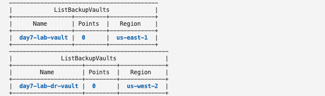

> [!NOTE]
> The KMS key ID differs between the two vaults because `aws/backup` is an AWS managed key created **per Region**.

> [!WARNING]
> **Issue found:** this vault was tagged `Project` with a capital P while the DR vault used `project`. Tags are case-sensitive, so these are two different keys and a cost report grouped by `project` would miss this vault. Fix with **Manage tags**. It did not break the lab because vault tags are not used to select resources.

---

## Lab 3 Step 3 Create the backup plan with a cross-Region copy rule

**Why this step:** the plan is the policy: when to back up, how long to keep it and where to copy it. The daily frequency sets RPO at up to 24 hours, and the copy action turns a local backup into a DR backup in another Region.

**Console:** us-east-1 → **AWS Backup → Backup plans → Create backup plan**.

| Section | Field | Value |
|---|---|---|
| Start options | Backup plan options | Build a new plan |
| | Backup plan name | `day7-lab-plan` |
| | Tags added to backup plan | `project` = `day7-lab` |
| Backup rule | Rule name | `daily-with-dr-copy` |
| | Backup vault | `day7-lab-vault` |
| | Logically air-gapped vault | No vault selected |
| | Backup frequency | Daily |
| | Backup window | Defaults (start within 8 hours, complete within 7 days) |
| | Point-in-time recovery | off (applies to Aurora, RDS, S3, SAP HANA) |
| | Cold storage | off (requires at least 90 days) |
| | Total retention period | **1 day** |
| | Backup indexes (S3, EBS) | off |
| | Scan mode / Malware protection | None / off |
| Copy to destination | Region | **US West (Oregon)** |
| | Destination backup vault | `day7-lab-dr-vault` |
| | Copy retention / cold storage | 1 day / never |
| | Tags added to recovery points | `project` = `day7-lab` |
| Advanced backup settings | Windows VSS | off (Linux instance) |

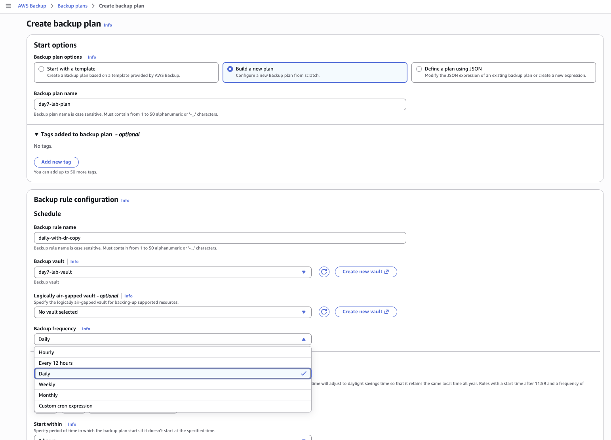

> [!WARNING]
> **Issues caught before Create plan:**
> 1. **Total retention** was still the default **35 days**; changed to **1 day**.
> 2. **Copy to destination › Region** was empty, which would mean no cross-Region copy; set to **US West (Oregon)** and `day7-lab-dr-vault`.

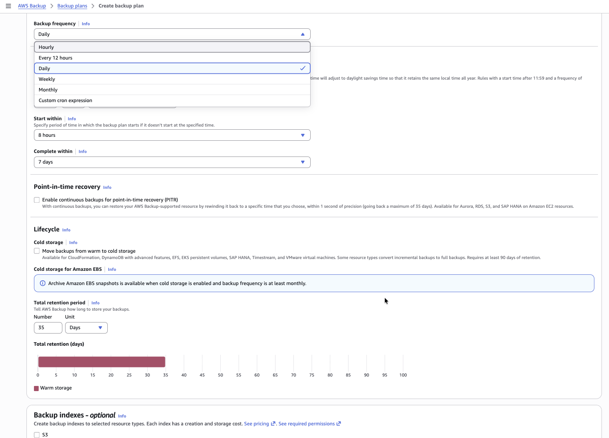

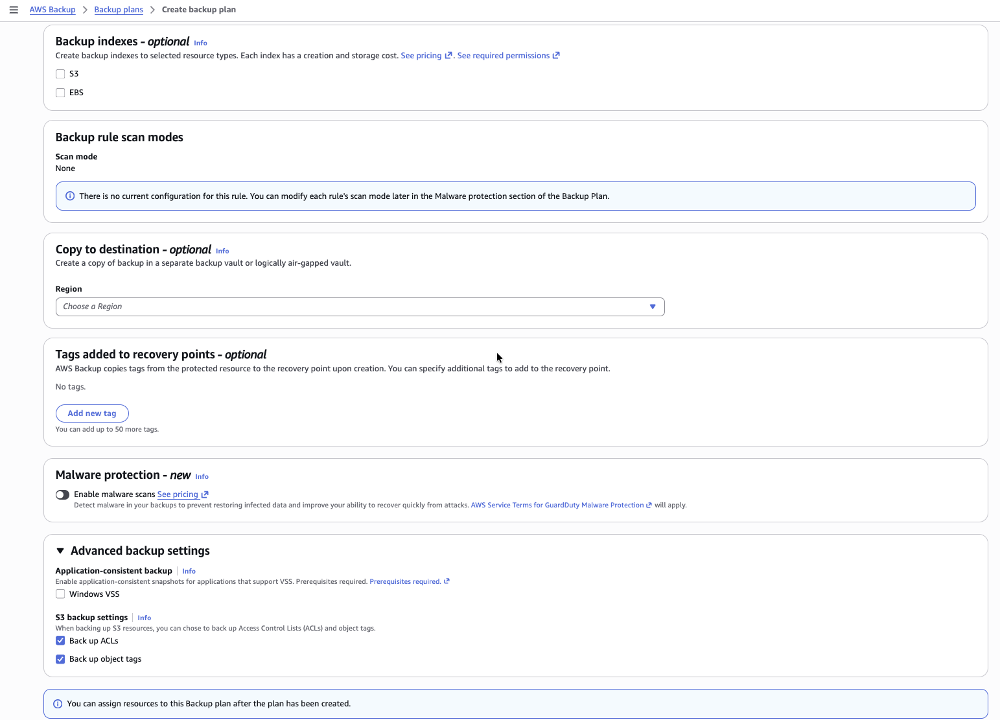

**Result after the fixes:**

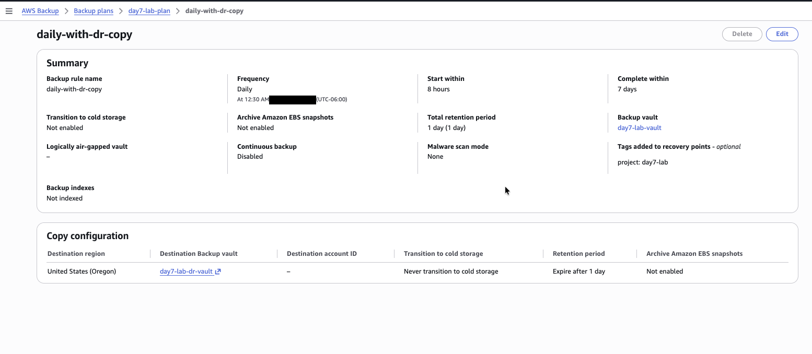

> [!NOTE]
> The console shows the schedule in the browser's local time zone. If the plan had not been torn down, it would have run on its own that night. Newer options on this page: **Malware protection** (GuardDuty scanning of backups, extra cost), **Backup indexes** (searchable file index for item-level restore of S3/EBS, extra cost), and a rule-level **Logically air-gapped vault** target.

---

## Lab 3 Step 4 Assign resources by tag

**Why this step:** a resource assignment decides what gets backed up. Selecting by tag protects the Lab 1 instance and any future resource with the same tag automatically. The IAM role chosen here is the identity AWS Backup assumes to create the AMI, take the snapshot and run the copy.

**Console:** `day7-lab-plan` → **Assign resources**.

| Field | Value |
|---|---|
| Resource assignment name | `day7-lab-tagged-resources` |
| IAM role | Use default role (creates `AWSBackupDefaultServiceRole` if missing) |
| Define resource selection | Include all resource types |
| Refine selection using tags | Key **`backup`**, Equals, Value **`daily`** |

> [!WARNING]
> **Issue found: wrong tag condition.** The first assignment was saved with `project` = `day7-lab` instead of `backup` = `daily`. With *Include all resource types*, that matches **every** supported resource with the billing tag, including the CloudFormation stack itself (AWS Backup can back up stacks). Keep the backup policy tag separate from billing and ownership tags; otherwise tagging something for a cost report silently enrolls it in backups.

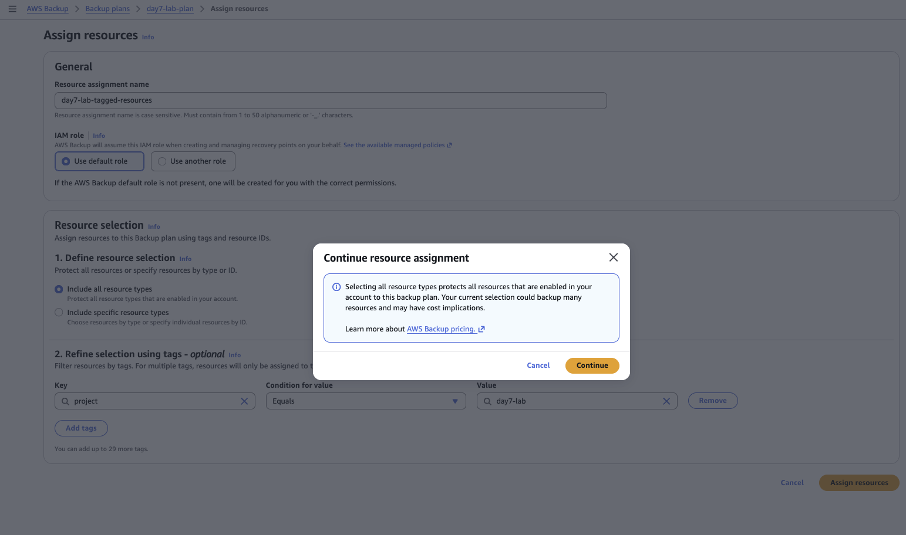

**Fix:** resource assignments (backup selections) **cannot be edited**. Delete it (**Resource assignments → select → Delete**) and recreate it with `backup` = `daily`.

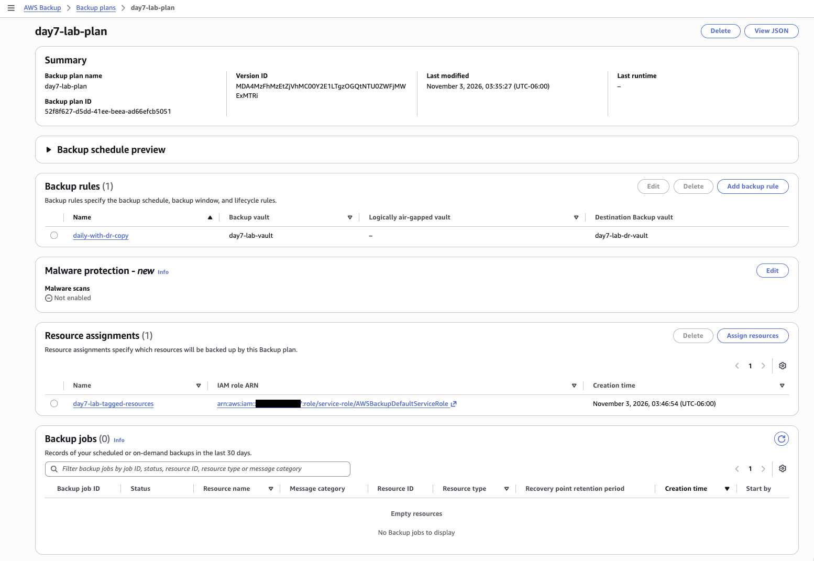

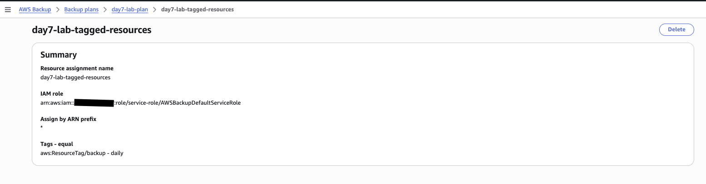

| Field | Final value |
|---|---|
| IAM role | `…:role/service-role/AWSBackupDefaultServiceRole` |
| Assign by ARN prefix | `*` |
| Tags equal | `aws:ResourceTag/backup` = `daily` |

```bash
PLAN_ID=$(aws backup list-backup-plans --region us-east-1 \
  --query "BackupPlansList[?BackupPlanName=='day7-lab-plan'].BackupPlanId" --output text)
SEL_ID=$(aws backup list-backup-selections --region us-east-1 --backup-plan-id "$PLAN_ID" \
  --query "BackupSelectionsList[0].SelectionId" --output text)
aws backup get-backup-selection --region us-east-1 --backup-plan-id "$PLAN_ID" --selection-id "$SEL_ID" \
  --query "BackupSelection.{Name:SelectionName,Resources:Resources,Conditions:Conditions.StringEquals}"
```

> [!TIP]
> `aws:ResourceTag/backup` is the same IAM-style condition key used in attribute-based access control (ABAC) policies.

---

## Lab 3 Step 5 Run an on-demand backup

**Why this step:** the plan only runs in its window, so a manual backup proves the vault and role work. An on-demand backup uses the vault and role but **not** the plan's tag selection or copy rule; those only run on the schedule.

**Console:** us-east-1 → **AWS Backup → Protected resources → Create on-demand backup**.

| Field | Value |
|---|---|
| Resource type / Instance ID | EC2 / `i-0f0e9ad01bd32f392` |
| Backup window | Create backup now |
| Total retention | 1 day |
| Backup vault | `day7-lab-vault` |
| Logically air-gapped vault / Backup indexes | none / none |
| IAM role | Default role |
| Tags added to recovery points | `project` = `day7-lab` |
| Windows VSS | off |

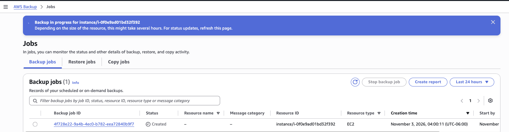

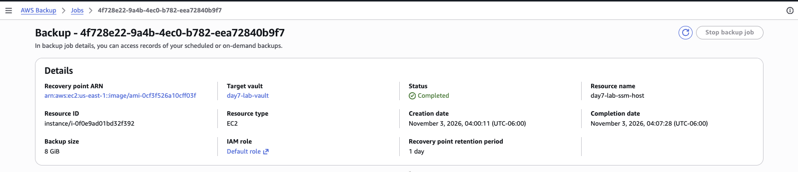

| Result | Value |
|---|---|
| Backup job | `4f728e22-9a4b-4ec0-b782-eea72840b9f7` |
| States | Created → Running → Completed |
| Duration | about 7 min 17 s |
| Recovery point ARN | `arn:aws:ec2:us-east-1::image/ami-0cf3f526a10cff03f` (for EC2 the recovery point **is** an AMI) |
| Backup size vs snapshot size | 8 GiB volume vs 1.68 GiB snapshot (only used blocks are stored) |

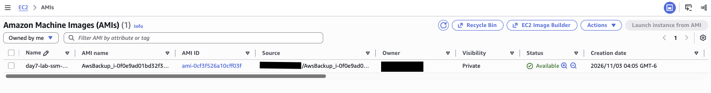

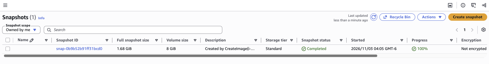

> [!IMPORTANT]
> The snapshot is **Not encrypted**. EC2/EBS backup encryption follows the source volume, not the vault key (see [Module 5](#module-5-aws-backup)). Delete recovery points through AWS Backup so the AMI and snapshot go together.

```bash
JOB=4f728e22-9a4b-4ec0-b782-eea72840b9f7
while true; do
  S=$(aws backup describe-backup-job --region us-east-1 --backup-job-id "$JOB" \
      --query "[State,PercentDone]" --output text)
  echo "$(date +%T)  $S"
  case "$S" in COMPLETED*|FAILED*|ABORTED*|EXPIRED*) break;; esac
  sleep 30
done
```

---

## Lab 3 Step 6 Copy the recovery point to us-west-2

**Why this step:** a backup in us-east-1 does not help if us-east-1 is the Region that fails. Copying it to Oregon is the backup-and-restore DR strategy: RPO is the age of the last copy, RTO is the time to launch and configure from it in the other Region.

**Console:** us-east-1 → **AWS Backup → Vaults → `day7-lab-vault` → Recovery points** → select → **Actions → Copy**.

| Field | Value |
|---|---|
| Destination Region | US West (Oregon) |
| Destination backup vault | `day7-lab-dr-vault` |
| Cold storage | Never |
| Retention | 1 day |
| IAM role | Default role |

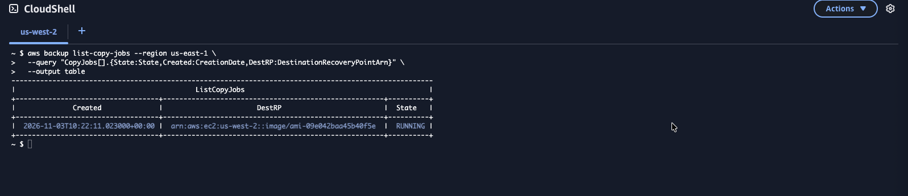


| Result | Value |
|---|---|
| Destination recovery point | `arn:aws:ec2:us-west-2::image/ami-09e042baa45b40f5e` |
| Final state | AMI **Available** in us-west-2 |

> [!NOTE]
> AMI IDs are Regional, so a copy always gets a new ID. Copy jobs are listed in the **source** Region; `--region us-east-1` overrides a CloudShell tab opened in another Region. CLI times are UTC; the console shows local time.

**What a real recovery would involve:** launch from `ami-09e042baa45b40f5e` in a us-west-2 subnet, attach a security group and instance profile there (IAM roles are global, security groups and subnets are Regional), then point Route 53 at it. That time is the RTO.

---

## Teardown

| Step | Delete | Why this order |
|---|---|---|
| T1 | Recovery points in both vaults | Vaults must be empty; these are the only items costing money over time |
| T2 | Resource assignment, then the plan | A plan cannot be deleted with assignments; this also cancels the scheduled run |
| T3 | Both vaults | Empty now |
| T4 | CloudFormation stack | Removes the instance, SG, instance profile and role together |
| T5 | Lab template in the `cf-templates` bucket, then the bucket if empty | Auto-created by the upload |
| T6 | `AWSBackupDefaultServiceRole`, only if created today | Wizard-created role; its policies are AWS managed |
| T7 | Verification sweep | Proves nothing is left |

The full script is in [`scripts/day7-teardown.sh`](scripts/day7-teardown.sh) and in [commands.md](commands.md#teardown-script). Run it in CloudShell as a file (`bash day7-teardown.sh`) to avoid paste quirks.


| Step | Result |
|---|---|
| T1 | Both recovery points deleted; vaults reached 0 in about 17 seconds |
| T2 | Selection deleted, then `day7-lab-plan` deleted |
| T3 | Both vaults deleted |
| T4 | Stack deleted |
| T5 | Template deleted; bucket was empty, so it was deleted |
| T6 | Role created that day: both AWS-managed policies detached, role deleted |
| T7 | Stack does not exist; no instances, vaults, plans, AMIs or snapshots in either Region; role `NoSuchEntity` |

> [!NOTE]
> Free leftovers: the default VPC (kept) and CloudTrail event history (expires after 90 days).

---

## Troubleshooting log

| # | Where | Symptom | Cause | Fix |
|---|---|---|---|---|
| 1 | Lab 3 Step 2 | Vault tag `Project` vs `project` | Tags are case-sensitive | Manage tags → use lowercase `project` everywhere |
| 2 | Lab 3 Step 3 | Retention 35 days | Console default | Set total retention to 1 day before Create plan |
| 3 | Lab 3 Step 3 | Copy to destination empty | Region not selected | Select US West (Oregon) and `day7-lab-dr-vault` |
| 4 | Lab 3 Step 4 | Assignment matched `project=day7-lab` | Billing tag used as the backup selector | Delete and recreate with `backup=daily` (selections are immutable) |
| 5 | Lab 3 Step 5 | Snapshot not encrypted | EC2/EBS encryption follows the source volume | Enable EBS encryption by default in production |
| 6 | Lab 3 Step 6 | Expected the plan's copy rule to run | On-demand jobs do not trigger copy rules | Copy the recovery point manually |
| 7 | Lab 2 Step 3 / Lab 3 Step 5 | Account ID, key ID or IP visible in screenshots | JSON event record and AMI Owner column | Redact before publishing |
| 8 | Teardown | Old `RUNNING` copy-job table above script output | Output from before the copy finished | Ignore; check the copied AMI state instead |

---

## Questions from the session

**Which repo folder does this topic go in?** None of the existing week folders fit (networking, security, storage, three-tier, databases, application integration), so it goes in a new `week-07-dr-architectures-exam-prep/` folder.

**Does the YAML have to be in the GitHub repo during the lab?** No. The console's *Upload a template file* only needs it on the local computer. It is stored afterward in `templates/`.

**Can the whole teardown be done from the CLI?** Yes. See [`scripts/day7-teardown.sh`](scripts/day7-teardown.sh); it deletes in reverse order, guards the shared template bucket and the Backup service role, and is safe to rerun.

**Why did the instance profile take over two minutes when the role took 17 seconds?** IAM is global and eventually consistent; CloudFormation waits until the profile is usable before launching an instance that depends on it.

**Why does Session Manager need no inbound rule?** Security groups are stateful. The agent's outbound connection is allowed by the egress rule, and replies on that same connection are allowed back automatically.

**What changes in a private subnet with no internet path?** The instance needs interface endpoints for `ssm`, `ssmmessages` and `ec2messages` (billed per hour per AZ). Only S3 and DynamoDB have free gateway endpoints.

**Why did EC2 Instance Connect not work?** It pushes a temporary public key and then connects inbound on port 22, which the security group blocks.

**Why does the backup size show 8 GiB but the snapshot 1.68 GiB?** Backup size reports the volume size; the snapshot stores only blocks that contain data.

---

## Service selection cheat sheet

| Need | Service |
|---|---|
| Cheapest DR, hours of downtime OK | Backup and restore (AWS Backup + CloudFormation) |
| DB always replicating, app tier off | Pilot light |
| Scaled-down full stack, serves traffic immediately | Warm standby |
| Active-active, near-zero RTO/RPO | Multi-site |
| DR for on-premises servers with failback | AWS Elastic Disaster Recovery |
| Lift and shift servers with test launches | AWS MGN |
| One-time VM image import | VM Import/Export |
| Database migration, source stays live | DMS full load + CDC |
| Different database engines | SCT + DMS |
| Discover servers and dependencies | Application Discovery Service (AWS Transform) |
| Central backups, WORM | AWS Backup + Vault Lock (compliance) |
| Huge one-time offline transfer | Snowball (exam) / Data Transfer Terminal |
| Scheduled online file sync | DataSync |
| Private consistent link | Direct Connect |
| One event, many independent consumers | SNS + SQS fan-out |
| React to any API call | EventBridge + CloudTrail |
| DynamoDB microsecond reads | DAX |
| SQL query results or sessions | ElastiCache |
| Block IP behind CloudFront | WAF on CloudFront |
| Block IP on EC2 with nothing in front | NACL deny |
| Tightly coupled MPI | Cluster placement group + EFA |
| HPC shared file system with S3 | FSx for Lustre |
| One-instance app surviving AZ loss | ASG of 1 across AZs + Elastic IP |
| IaC for many accounts and Regions | CloudFormation StackSets |
| Transactional email | SES |
| Shell without port 22 | Session Manager |
| Scheduled patching with compliance | Patch Manager + Maintenance Windows |
| Unusual spend alerts | Cost Anomaly Detection |
| Threshold spend alerts | AWS Budgets |
| Long Docker batch jobs on Spot | AWS Batch |
| SaaS to S3 without code | AppFlow |
| Full-stack web/mobile with CI/CD | Amplify |
| AWS in your data center | Outposts |
| Stop non-prod after hours | Instance Scheduler on AWS |
| Best-practice review per workload | Well-Architected Tool |
| Automated account checks | Trusted Advisor |

---

## Acronyms

| Acronym | Meaning |
|---|---|
| ABAC | Attribute-Based Access Control |
| AMI | Amazon Machine Image |
| ARN | Amazon Resource Name |
| ASG | Auto Scaling Group |
| CDC | Change Data Capture |
| CRR | Cross-Region Replication |
| DAX | DynamoDB Accelerator |
| DKIM | DomainKeys Identified Mail |
| DLQ | Dead-Letter Queue |
| DMS | Database Migration Service |
| DR | Disaster Recovery |
| DRS | AWS Elastic Disaster Recovery |
| DX | Direct Connect |
| EBS | Elastic Block Store |
| EFA | Elastic Fabric Adapter |
| EIP | Elastic IP address |
| ENA | Elastic Network Adapter |
| EVS | Amazon Elastic VMware Service |
| FIS | Fault Injection Service |
| HPC | High Performance Computing |
| HRI | High Risk Issue |
| IaC | Infrastructure as Code |
| IMDSv2 | Instance Metadata Service version 2 |
| KMS | Key Management Service |
| MGN | AWS Application Migration Service |
| MPI | Message Passing Interface |
| NACL | Network Access Control List |
| RPO | Recovery Point Objective |
| RTO | Recovery Time Objective |
| SCT | Schema Conversion Tool |
| SES | Simple Email Service |
| SG | Security Group |
| SLA | Service Level Agreement |
| SPF | Sender Policy Framework |
| SR-IOV | Single Root I/O Virtualization |
| SSM | AWS Systems Manager |
| STS | Security Token Service |
| TTL | Time To Live |
| WAF | Web Application Firewall |
| WORM | Write Once, Read Many |
