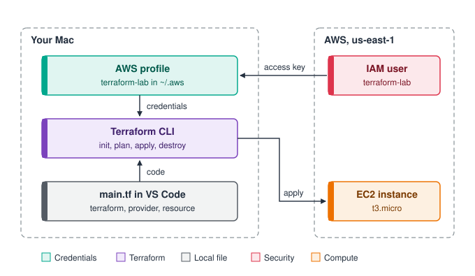

# Terraform Block 1: First EC2 Instance with Code

Built, verified and destroyed an AWS EC2 instance entirely from a hand-written Terraform configuration, using a dedicated least-privilege IAM identity and a named AWS CLI profile so no secrets ever touch the code.

## What I learned

- **Infrastructure as Code:** declarative desired state, idempotence, and why one Terraform workflow works across clouds while the code itself stays provider-specific
- **Providers and HCL:** Terraform core vs provider plugins, the Terraform Registry, provider tiers, block types (`terraform`, `provider`, `resource`), resource addresses, and the `~>` version constraint
- **Core workflow:** `init` → `fmt` → `validate` → `plan` → `apply` → `destroy`, what each one touches, and the plan symbols `+ - ~ -/+`
- **AWS authentication:** the AWS provider's credential search order, why environment variables can override a `profile`, and why permission errors are IAM problems, not code problems

## Results

| Metric | Value |
|---|---|
| Terraform | v1.17.2 (upgraded from 1.15.5) |
| AWS provider | hashicorp/aws v6.73.0 (`~> 6.0`) |
| Resource | `aws_instance.my_first_ec2`, t3.micro, Amazon Linux 2023, us-east-1c |
| Create time | 13 s (`Plan: 1 to add`) |
| Re-apply | `0 added, 0 changed, 0 destroyed` (idempotence proven) |
| Destroy time | 30 s, state verified `terminated` |
| Access keys left | 0 |

## Issues solved

| Issue | Fix |
|---|---|
| Homebrew wouldn't upgrade Terraform (stale tap) | Pulled the HashiCorp tap, then upgraded |
| `>= 6.0` would allow breaking major versions | Pinned with `~> 6.0` |
| `NoRegion` from the AWS CLI while Terraform worked | Profile had no region; set it with `aws configure set` |
| `NoCredentials` with no profile named | No `[default]` profile by design; used `--profile` explicitly |

## Files

| File | Contents |
|---|---|
| [main.tf](main.tf) | The Terraform configuration |
| [.terraform.lock.hcl](.terraform.lock.hcl) | Pinned provider version |
| [notes.md](notes.md) | Concepts, full step-by-step lab, errors and fixes, cheat sheet, acronyms |
| [commands.md](commands.md) | Every command, grouped by stage, plus CLI-only equivalents |
| `images/diagrams/` | Architecture and concept diagrams (SVG) |
| `images/screenshots/` | Redacted lab screenshots |
