# Terraform Block 1: First EC2 Instance with Code

A reference guide for redoing this lab from scratch: Infrastructure as Code concepts, providers and HCL, the core Terraform workflow, AWS authentication, and a full hands-on build of one EC2 instance on AWS.

**Course:** HashiCorp Certified: Terraform Associate (004)
**Tools:** Terraform v1.17.2 · AWS provider v6.73.0 · AWS CLI v2 · VS Code + HashiCorp Terraform extension
**Region:** us-east-1

---

## Table of contents

- [Lab architecture](#lab-architecture)
- [Module 1 Infrastructure as Code and why Terraform](#module-1-infrastructure-as-code-and-why-terraform)
- [Module 2 Providers the Registry and HCL blocks](#module-2-providers-the-registry-and-hcl-blocks)
- [Module 3 The core workflow](#module-3-the-core-workflow)
- [Module 4 How Terraform signs in to AWS](#module-4-how-terraform-signs-in-to-aws)
- [Hands-on lab](#hands-on-lab)
  - [Step 1 Upgrade Terraform and set up VS Code](#step-1-upgrade-terraform-and-set-up-vs-code)
  - [Step 2 Create the terraform-lab IAM user and access key](#step-2-create-the-terraform-lab-iam-user-and-access-key)
  - [Step 3a Create the AWS CLI profile](#step-3a-create-the-aws-cli-profile)
  - [Step 3b Check for leftover AWS environment variables](#step-3b-check-for-leftover-aws-environment-variables)
  - [Step 3c Test the profile](#step-3c-test-the-profile)
  - [Step 4a Create the project folder](#step-4a-create-the-project-folder)
  - [Step 4b Write the terraform block](#step-4b-write-the-terraform-block)
  - [Step 4c Add a Terraform gitignore](#step-4c-add-a-terraform-gitignore)
  - [Step 4d Write the provider block](#step-4d-write-the-provider-block)
  - [Step 4e Find the AMI ID in the console](#step-4e-find-the-ami-id-in-the-console)
  - [Step 4f Write the resource block](#step-4f-write-the-resource-block)
  - [Step 5a terraform init](#step-5a-terraform-init)
  - [Step 5b Prove the gitignore works](#step-5b-prove-the-gitignore-works)
  - [Step 5c terraform fmt](#step-5c-terraform-fmt)
  - [Step 5d terraform validate](#step-5d-terraform-validate)
  - [Step 6 terraform plan](#step-6-terraform-plan)
  - [Step 7a terraform apply](#step-7a-terraform-apply)
  - [Step 7b Verify the instance in the console](#step-7b-verify-the-instance-in-the-console)
  - [Step 7c Apply again to prove idempotence](#step-7c-apply-again-to-prove-idempotence)
  - [Step 8a terraform destroy](#step-8a-terraform-destroy)
  - [Step 8b Verify the termination](#step-8b-verify-the-termination)
  - [Step 8c Delete the access key](#step-8c-delete-the-access-key)
  - [Step 8d Verify the key is gone](#step-8d-verify-the-key-is-gone)
- [Final main.tf](#final-maintf)
- [Troubleshooting log](#troubleshooting-log)
- [Cheat sheet](#cheat-sheet)
- [Acronyms](#acronyms)

---

## Lab architecture

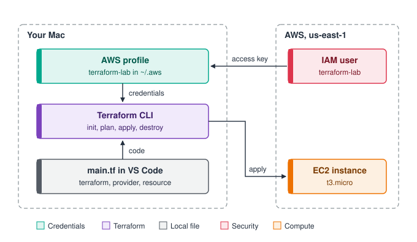

An IAM user (`terraform-lab`) issues an access key that is stored in a named AWS CLI profile on the Mac. The Terraform CLI combines those credentials with the code in `main.tf` and calls the EC2 API to create one t3.micro instance in us-east-1, then destroys it.

---

## Module 1 Infrastructure as Code and why Terraform

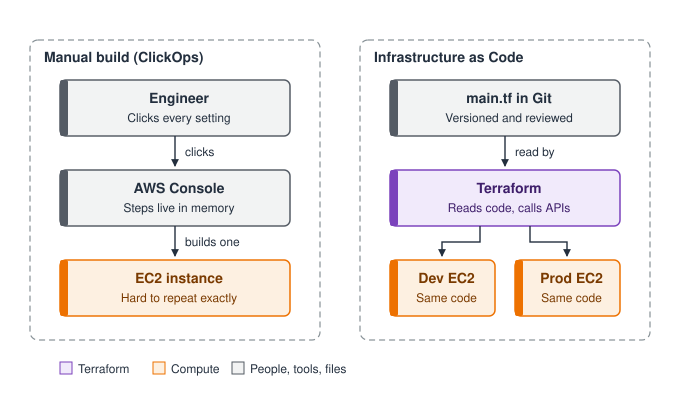

Building in the AWS Management Console ("ClickOps") is great for learning, but the only record of how something was built is memory, screenshots and notes. **IaC (Infrastructure as Code)** writes infrastructure down in text files, and a tool builds it from those files, the same way every time. The `.tf` file is a recipe card; Terraform is the cook who follows it exactly.

Terraform is **declarative**: you describe the end state ("one t3.micro should exist"), and Terraform works out the steps. If it doesn't exist, Terraform creates it; if it matches, Terraform does nothing; if it drifted, Terraform shows the difference and restores it. Running the same configuration twice gives the same result. This is called **idempotence**. An imperative script (`aws ec2 run-instances`) run twice gives two instances.

Terraform uses one language and workflow across AWS, Azure, Google Cloud and hundreds of other services (GitHub, Datadog, Cloudflare). The exam calls this **multi-cloud and service-agnostic**. The *code* is not portable between clouds (an `aws_instance` can't target Azure); the *workflow and language* are.

| | Manual console build | Terraform (IaC) |
|---|---|---|
| Repeatability | Depends on memory | Identical every run |
| Audit trail | Screenshots, CloudTrail | Git history, pull requests |
| Speed to rebuild | Hours of clicking | Minutes, one command |
| Learning curve | Low | Higher: HCL, state, workflow |
| Best for | Learning, one-off exploration | Anything you will rebuild, share or review |

| Tool | Clouds | Language |
|---|---|---|
| Terraform | Multi-cloud + SaaS | HCL |
| AWS CloudFormation | AWS only | JSON/YAML |
| Azure Bicep | Azure only | Bicep |

> [!NOTE]
> Terraform is released under the BSL (Business Source License). The community fork **OpenTofu** exists because of that license change. The Terraform Associate exam covers Terraform only.

**Exam clues:** "auditing who changed infrastructure", "reusing a standard configuration across teams", "consistent environments" → IaC benefits. "Running the same configuration again changes nothing" → declarative / idempotent. "One workflow for many providers" → multi-cloud, service-agnostic.

**Menniboe Farm:** The farm's administrator once built the orders site by hand, and the test copy ended up with a different instance size because nobody remembered the original choice. Now test and live are built from the same `.tf` file in Git, and "who changed the server size?" is one line of Git history.

---

## Module 2 Providers the Registry and HCL blocks

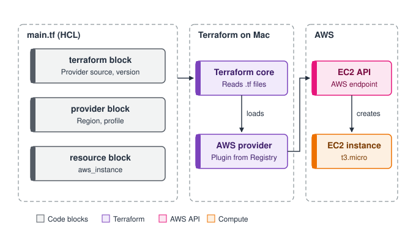

**Terraform core** (the binary installed with Homebrew) reads configuration, compares desired with actual state, and plans. It knows nothing about AWS. A **provider** is a plugin that translates resources into API calls. The AWS provider turns `aws_instance` into the same `RunInstances` call the console's Launch button makes. Providers come from the **Terraform Registry** (registry.terraform.io) and are downloaded by `terraform init` into a hidden `.terraform/` folder.

Configuration is written in **HCL (HashiCorp Configuration Language)**, made of blocks:

```hcl
resource "aws_instance" "my_first_ec2" {
  instance_type = "t3.micro"
}
```

| Part | Example | Meaning |
|---|---|---|
| Block type | `resource` | What kind of block |
| Resource type | `"aws_instance"` | Defined by the provider; the `aws_` prefix maps it to the AWS provider |
| Local name | `"my_first_ec2"` | Your nickname, only inside the code; AWS never sees it |
| Argument | `instance_type = "t3.micro"` | A setting, `name = value` |
| Resource address | `aws_instance.my_first_ec2` | `type.local_name`, used in plan output, commands and state |

### Block family tree

```text
main.tf
├── terraform { }                      ← top level
│   └── required_providers { }         ← child of terraform
│       └── aws = { }                  ← child of required_providers
├── provider "aws" { }                 ← top level (sibling)
└── resource "aws_instance" "..." { }  ← top level (sibling)
    └── tags = { }                     ← child of the resource
```

> [!TIP]
> Blocks that start at the far left edge are top-level **siblings**. Indentation shows **parent → child** nesting. A resource *uses* its provider (matched by the `aws_` prefix) but is never nested inside the provider block.

### Provider addresses and tiers

The AWS provider's source is `hashicorp/aws` (namespace/name). If the source is omitted, Terraform assumes the `hashicorp` namespace, which fails for providers published elsewhere (for example `integrations/github`), so always write the full source.

| Tier | Maintained by | Examples |
|---|---|---|
| Official | HashiCorp | aws, azurerm, google |
| Partner | The technology company, verified by HashiCorp | Many SaaS vendors |
| Community | Individuals or groups | Niche tools |

### Version constraints

| Constraint | Accepts | Notes |
|---|---|---|
| `"~> 6.0"` | 6.0 up to any 6.x, never 7.0 | Pessimistic constraint operator. Recommended. |
| `">= 6.0"` | 6.0 and anything newer, including 7.0, 8.0 | Risky: a breaking major version can arrive on the next `init -upgrade` |
| `"= 6.73.0"` | Exactly one version | Strictest; common for production pinning |

**Exam clues:** "who maintains this provider" → tiers. "How does Terraform know which provider builds a resource" → the resource type prefix. "Prevent breaking changes from a new major version" → `~>`.

**Menniboe Farm:** One project manages the farm's AWS server and its GitHub repository. The same Terraform core loads `hashicorp/aws` and `integrations/github`, and one `terraform init` downloads both.

---

## Module 3 The core workflow

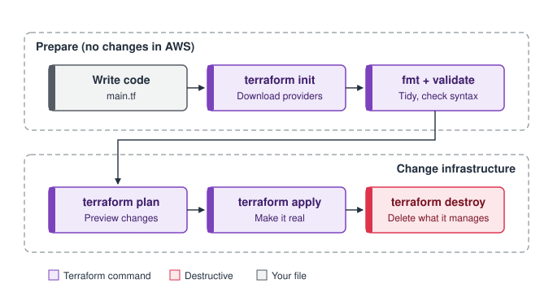

Think of a theater production: `init` sets up the stage (props = providers), `fmt` and `validate` are the script read-through, `plan` is the dress rehearsal, `apply` is opening night, and `destroy` strikes the set.

| Command | What it does | Contacts AWS? |
|---|---|---|
| `terraform init` | Downloads providers into `.terraform/`, writes `.terraform.lock.hcl`, initializes the backend. Rerun after adding a provider or module or changing the backend. Always safe to rerun. | No |
| `terraform fmt` | Rewrites files to HashiCorp style (2-space indent, aligned `=`). `-check` only reports. | No |
| `terraform validate` | Checks syntax, argument names, references. Needs `init` (uses provider schema). Can't detect a bad AMI ID or missing permission. | No |
| `terraform plan` | Reads all `.tf` files in the current folder (not subfolders), refreshes real state, compares, prints the difference. Changes nothing. `-out=tfplan` saves it. | Yes, reads only |
| `terraform apply` | Creates a fresh plan, shows it, waits for exactly `yes`. A saved plan file applies without a prompt. `-auto-approve` skips the prompt. | Yes |
| `terraform destroy` | Plans deletion of everything in state, waits for `yes`. Resources created outside Terraform are untouched. | Yes |

| Plan symbol | Meaning |
|---|---|
| `+` | Create |
| `-` | Destroy |
| `~` | Update in place |
| `-/+` | Destroy, then recreate (setting can't change on a live resource) |

> [!WARNING]
> A saved plan becomes **stale** if the code or real infrastructure changes after it was saved. Terraform refuses to apply it. Run `plan -out` again.

**Exam clues:** "new provider added, plan fails, provider not installed" → rerun `init`. "Check formatting in a pipeline" → `fmt -check`. "Check configuration without contacting the cloud" → `validate`. "Preview changes" → `plan`. "Apply exactly what was reviewed" → `apply tfplan`.

**Menniboe Farm:** Changing the orders server from t3.micro to t3.small, the administrator runs `plan` first, sees `~ update in-place`, and gets the farm manager's approval for a short restart. A later change shows `-/+ must be replaced`, so it's scheduled after the morning orders.

---

## Module 4 How Terraform signs in to AWS

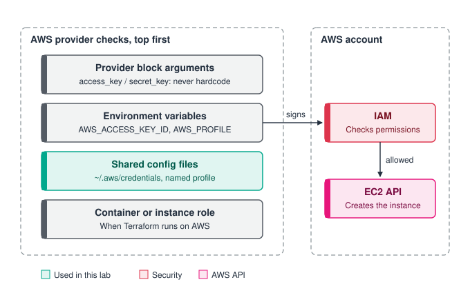

Terraform can't type a password or MFA (Multi-Factor Authentication) code. Every API call is signed with credentials: an access key pair or temporary credentials. The AWS provider searches a fixed order and uses the **first match**:

1. Arguments in the provider block (`access_key`, `secret_key`). Never do this.
2. Environment variables (`AWS_ACCESS_KEY_ID`, `AWS_SECRET_ACCESS_KEY`, `AWS_PROFILE`, `AWS_REGION`)
3. Shared config and credentials files (`~/.aws/config`, `~/.aws/credentials`), selected with `profile =`
4. Container or EC2 instance role (temporary credentials when Terraform runs on AWS)

> [!IMPORTANT]
> `profile = "terraform-lab"` doesn't supply keys itself. It points at the shared credentials file, which comes **after** environment variables. Leftover `AWS_ACCESS_KEY_ID` / `AWS_SECRET_ACCESS_KEY` variables override the profile and can send Terraform to a different identity or account. Diagnose with `env | grep AWS_` and `aws sts get-caller-identity`; fix with `unset`.

Terraform has **no permissions of its own**. It can do exactly what the IAM identity behind its credentials allows. `AccessDenied` or `UnauthorizedOperation` during apply is an IAM policy problem, not a code problem.

Region is separate from credentials: keys prove who you are, region says where to build. Setting `region` in the provider block keeps the code independent of the laptop's configuration. (This lab proved it: Terraform worked while the profile had no region, but the AWS CLI failed.)

| Credential method | Pros | Cons | Where you see it |
|---|---|---|---|
| Hardcoded in provider block | Simple | Leaks with the code; bots scan GitHub for keys | Never |
| Environment variables | Per-session, nothing on disk | Leftovers silently override profiles | Short sessions, CI |
| Named profile (shared files) | Keys outside the repo; code holds only a name | Long-lived keys still on disk | Personal labs |
| IAM Identity Center (SSO) profile | Temporary credentials | More setup | Company laptops |
| OIDC (OpenID Connect) role | No stored keys at all | Pipeline-specific setup | GitHub Actions, CI/CD |
| Instance or container role | Automatic temporary credentials | Only when running on AWS | Terraform runners on EC2/ECS |

**Exam clues:** "never store credentials in configuration" → env vars, profiles, roles. "Terraform built in the wrong account" → credential precedence / leftover env vars.

**Menniboe Farm:** A helper pushed an early `main.tf` with a pasted access key to a public repo, and AWS sent a compromised-key warning within the hour. The farm's administrator deleted that key, created a dedicated `terraform-farm` IAM user with only EC2 permissions, stored its key with `aws configure --profile`, and changed the provider block to reference the profile name.

---

## Hands-on lab

**What we build:** one t3.micro EC2 instance in us-east-1, written in `main.tf`, created and destroyed by Terraform.

**What we prove:**
- Terraform builds real AWS infrastructure from hand-written code
- `plan` shows exactly what will change before it happens
- A second `apply` changes nothing (idempotence)
- `destroy` cleans up everything Terraform created

**Cost:** about $0. One t3.micro for under an hour, covered by free-tier credits, destroyed in the same session.

**Repo location:** `dual-cloud-ai-engineering/terraform/aws/terraform-first-ec2/`

---

### Step 1 Upgrade Terraform and set up VS Code

**Why this step:** Terraform core is the engine for every later step. Upgrading first rules out version problems. The VS Code extension adds syntax highlighting, autocomplete and inline error checking while writing HCL.

```bash
brew update
brew upgrade hashicorp/tap/terraform
terraform version
aws --version
```

> [!WARNING]
> **Error:** `brew upgrade` reported `hashicorp/tap/terraform 1.15.5 already installed`, while `terraform version` reported the latest was 1.17.2.
> **Cause:** The HashiCorp tap's formula list was stale.
> **Fix:** Refresh the tap, then upgrade:
> ```bash
> git -C "$(brew --repository hashicorp/tap)" pull
> brew upgrade hashicorp/tap/terraform
> ```
> The pull printed `no such ref 'refs/heads/master'` (the tap's branch was renamed). It's harmless; Homebrew's auto-update refreshed the tap and the upgrade completed: `1.15.5 -> 1.17.2`.

> [!NOTE]
> The `git pull` triggered a macOS Keychain prompt (`git-credential-osxkeychain wants to access key "github.com"`). This is Git's stored GitHub credential helper. Enter the Mac login password and click **Allow**.

> [!WARNING]
> Never install with `brew install terraform` (no tap prefix). Homebrew core's copy is frozen at 1.5.x after the license change.

**VS Code extension:**

| Setting | Value |
|---|---|
| Extensions panel | Cmd+Shift+X |
| Search | `HashiCorp Terraform` |
| Publisher | **HashiCorp** (verified) |
| Action | Install |

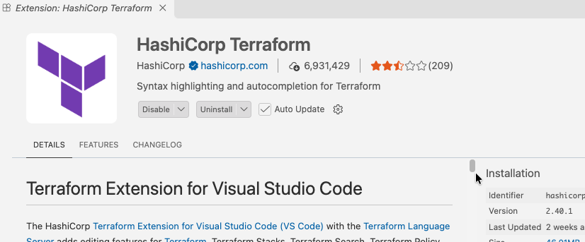

**Optional:** install the `code` terminal shortcut: Cmd+Shift+P → **Shell Command: Install 'code' command in PATH** (fixes `zsh: command not found: code`).

**Result:** Terraform v1.17.2 on darwin_arm64; AWS CLI 2.x.

---

### Step 2 Create the terraform-lab IAM user and access key

**Why this step:** Terraform has no permissions of its own. A dedicated IAM user limits Terraform to EC2 (a smaller blast radius if the key leaks), makes its actions easy to spot in CloudTrail, and can be cleaned up without touching the admin login.

**Console:** IAM → Users → **Create user**

| Page | Field | Value |
|---|---|---|
| Specify user details | User name | `terraform-lab` |
| | Provide user access to the AWS Management Console | Unchecked |
| Set permissions | Permissions options | Attach policies directly |
| | Permissions policies | `AmazonEC2FullAccess` |
| | Permissions boundary | Not set |
| Review and create | Tags | `Project` = `terraform-block1` |
| | | **Create user** |

**Access key:** `terraform-lab` → **Security credentials** → **Access keys** → **Create access key**

| Page | Field | Value |
|---|---|---|
| Access key best practices | Use case | Command Line Interface (CLI) |
| | Confirmation | Checked |
| Set description tag | Description | `terraform-block1-lab` |
| Retrieve access keys | | **Download .csv file** |

> [!NOTE]
> `AmazonEC2FullAccess` is broader than one instance needs but limited to EC2. In production, write a tighter custom policy.

> [!WARNING]
> The secret access key is shown only once. Never paste it into chat, screenshots, code or the repo.

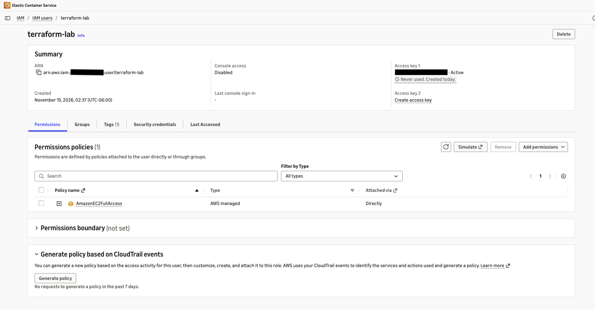

---

### Step 3a Create the AWS CLI profile

**Why this step:** Stores the key in `~/.aws/credentials`, outside the project folder, so the code only ever holds the profile's name.

```bash
aws configure --profile terraform-lab
```

| Prompt | Value |
|---|---|
| AWS Access Key ID | From the .csv |
| AWS Secret Access Key | From the .csv |
| Default region name | `us-east-1` |
| Default output format | `json` |

> [!WARNING]
> Don't leave the region prompt blank. In this lab it was skipped, which caused a `NoRegion` error later (see [Step 8b](#step-8b-verify-the-termination)).

---

### Step 3b Check for leftover AWS environment variables

**Why this step:** Environment variables outrank the profile in the credential search order. Leftovers could silently send Terraform to another identity.

```bash
env | grep AWS_
```

**Result:** no output (clean).

> [!NOTE]
> `env` lists terminal environment variables. It's unrelated to the `(venv)` / `(base)` Python environment labels in the prompt. `(base)` came from Anaconda (removed). `(venv)` appears only in a Python project folder with a virtual environment selected.

---

### Step 3c Test the profile

**Why this step:** `sts get-caller-identity` asks AWS "who am I?" and needs no permissions, so a failure means a bad key, not IAM. It's better to find this now than in the middle of a `plan`.

```bash
aws sts get-caller-identity --profile terraform-lab
```

```json
{
    "UserId": "XXXXXXXXXXXXXXXXXXXXX",
    "Account": "XXXXXXXXXXXX",
    "Arn": "arn:aws:iam::XXXXXXXXXXXX:user/terraform-lab"
}
```

**Result:** the `Arn` ends in `user/terraform-lab`, so the profile belongs to the new user.

### Understanding the profiles on this Mac

`terraform-lab` is a name used in three places, not a folder in the repo:

| Where | What it is |
|---|---|
| AWS account (IAM) | The IAM user `terraform-lab` |
| `~/.aws/credentials` | A profile `[terraform-lab]` holding that user's access key |
| `main.tf` | `profile = "terraform-lab"`, a pointer to that profile |

Header formats differ between the two files:

| File | Header format |
|---|---|
| `~/.aws/config` | `[profile name]` |
| `~/.aws/credentials` | `[name]` |

```bash
cat ~/.aws/config                    # safe: settings only, no keys
grep '^\[' ~/.aws/credentials        # safe: section headers only
aws sts get-caller-identity          # which identity "default" resolves to
```

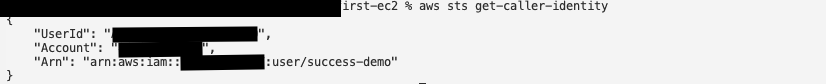

> [!TIP]
> This Mac has **no `[default]` profile** in `~/.aws/credentials` (the admin profile is named `[success-demo]`). Any command or Terraform run without an explicit profile fails loudly with `NoCredentials` instead of silently running as the admin user. That's a deliberate safety setup.

---

### Step 4a Create the project folder

**Why this step:** Terraform reads every `.tf` file in the folder it runs from, and only that folder. Each project needs its own folder so its code, providers and state stay separate from other labs.

```bash
mkdir -p terraform-first-ec2 && cd terraform-first-ec2 && touch main.tf && code main.tf
```

The VS Code status bar should show `{ } Terraform` for `main.tf`. (VS Code shows the language only while a code file is the active tab.)

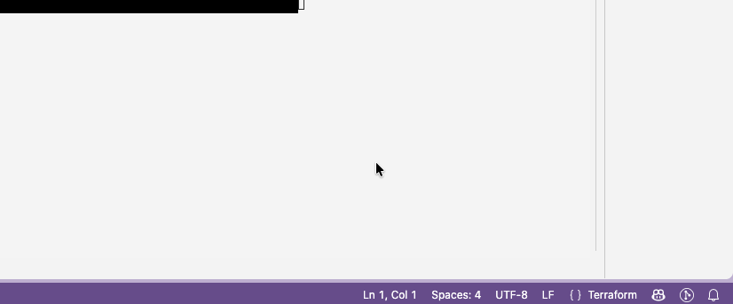

---

### Step 4b Write the terraform block

**Why this step:** Declares which provider the project needs, where to get it, and which versions are allowed. `terraform init` reads this block to decide what to download.

```hcl
terraform {
  required_version = ">= 1.12"

  required_providers {
    aws = {
      source  = "hashicorp/aws"
      version = "~> 6.0"
    }
  }
}
```

| Line | Meaning |
|---|---|
| `terraform { }` | Settings for Terraform itself; takes no labels |
| `required_version = ">= 1.12"` | Refuses older Terraform versions |
| `required_providers { }` | Every provider the project needs |
| `aws = { }` | Local provider name, the reason resource types start with `aws_` |
| `source = "hashicorp/aws"` | Registry address (Official tier) |
| `version = "~> 6.0"` | Any 6.x, never 7.0 |

> [!WARNING]
> **Error:** the first draft used `version = ">= 6.0"`.
> **Cause:** `>=` accepts every future major version, including breaking ones.
> **Fix:** changed to `"~> 6.0"` (pessimistic constraint operator).

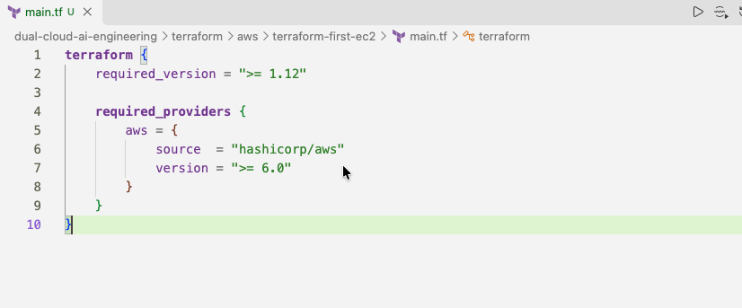

---

### Step 4c Add a Terraform gitignore

**Why this step:** `init` and `apply` create files that must never reach GitHub: the large `.terraform/` provider folder, state files (which can hold secrets), variable files and saved plans. Placing the `.gitignore` in the repo's `terraform/` folder covers every Terraform project below it.

```bash
code ../../.gitignore
```

Path: `dual-cloud-ai-engineering/terraform/.gitignore`

```gitignore
# Provider plugins and modules downloaded by terraform init
.terraform/

# State files: can contain secrets and real resource details
*.tfstate
*.tfstate.*

# Saved plan files
tfplan
*.tfplan

# Variable files that often hold secrets
*.tfvars
*.tfvars.json

# Crash logs
crash.log
crash.*.log

# Local override files
override.tf
override.tf.json
*_override.tf
*_override.tf.json

# Terraform CLI config
.terraformrc
terraform.rc
```

> [!IMPORTANT]
> Do **not** ignore `.terraform.lock.hcl`. HashiCorp recommends committing it so every clone uses the same provider versions.

---

### Step 4d Write the provider block

**Why this step:** Configures the AWS provider: where to build (`region`) and which credentials to use (`profile`). It connects the Step 3 profile to the code without putting any secret in the file.

```hcl
provider "aws" {
  region  = "us-east-1"
  profile = "terraform-lab"
}
```

| Line | Meaning |
|---|---|
| `provider "aws"` | Label must match the local name in `required_providers` |
| `region` | Where every resource in this project is built |
| `profile` | Name of the shared-credentials profile; not a secret |

Placement: after the `terraform` block's closing `}`, at the left edge, as a sibling.

> [!TIP]
> The underline under `"aws"` in VS Code is a link. Cmd+click it to open the provider's Registry documentation.

---

### Step 4e Find the AMI ID in the console

**Why this step:** Terraform needs the exact AMI (Amazon Machine Image) ID. IDs differ per region and change with updates. (A data source automates this in a later block.)

| Where | Selection |
|---|---|
| Region | US East (N. Virginia) us-east-1 |
| EC2 → Images | AMI Catalog |
| Tab | Quick Start AMIs |
| Image | Amazon Linux 2023 AMI (kernel 6.18) |
| Architecture | **64-bit (x86)** |

**Result:** `ami-096ef200a877f36af` (x86, us-east-1, at the time of this lab).

> [!IMPORTANT]
> t3 instance types are x86. An Arm AMI on a t3.micro fails with an architecture mismatch. The Mac being Apple Silicon is irrelevant, since the instance runs in AWS.

---

### Step 4f Write the resource block

**Why this step:** The desired state itself: "one t3.micro running Amazon Linux 2023 should exist." Anything omitted uses AWS defaults.

```hcl
resource "aws_instance" "my_first_ec2" {
  ami           = "ami-096ef200a877f36af"
  instance_type = "t3.micro"

  tags = {
    Name    = "first-terraform-ec2"
    Project = "terraform-block1"
  }
}
```

| Code | Launch wizard equivalent |
|---|---|
| `ami` | Application and OS Images |
| `instance_type` | Instance type |
| `tags.Name` | Name and tags |
| *(omitted)* key pair | None, so no SSH |
| *(omitted)* network | Default VPC, default subnet, default security group |
| *(omitted)* storage | AMI default 8 GiB gp3 root volume |

Resource address: `aws_instance.my_first_ec2`.

---

### Step 5a terraform init

**Why this step:** Downloads the AWS provider the code requires and records its exact version. It doesn't contact AWS.

```bash
terraform init
```

```text
Initializing the backend...
Initializing provider plugins...
- Finding hashicorp/aws versions matching "~> 6.0"...
- Installing hashicorp/aws v6.73.0...
- Installed hashicorp/aws v6.73.0 (signed by HashiCorp)
Terraform has created a lock file .terraform.lock.hcl ...
Terraform has been successfully initialized!
```

| Output | Meaning |
|---|---|
| `Initializing the backend` | Default local backend: state stored in this folder |
| `matching "~> 6.0"` | The version constraint in action |
| `v6.73.0` | Newest 6.x at the time |
| `signed by HashiCorp` | Signature verified (Official tier) |
| lock file created | Exact version recorded; `init -upgrade` changes it |

---

### Step 5b Prove the gitignore works

**Why this step:** Confirms the provider folder is ignored while `main.tf` and the lock file will be committed.

```bash
git check-ignore -v .terraform/ .terraform.lock.hcl main.tf
```

```text
terraform/.gitignore:2:.terraform/      .terraform/
```

**Result:** only `.terraform/` is ignored; `main.tf` and `.terraform.lock.hcl` are not.

---

### Step 5c terraform fmt

**Why this step:** Rewrites the code into HashiCorp's standard style. It changes only whitespace and never contacts AWS.

```bash
terraform fmt
```

Output: `main.tf` (the file it changed). It converted 4-space indentation to 2, aligned the `=` signs, and removed a trailing space.

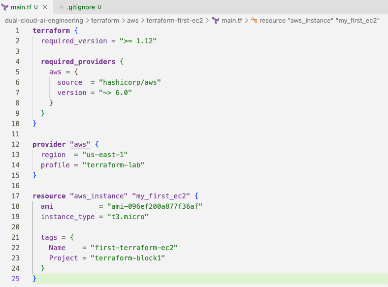

---

### Step 5d terraform validate

**Why this step:** Checks syntax and argument names against the provider schema. It's the last check before contacting AWS, and it can't detect bad AMI IDs or missing permissions.

```bash
terraform validate
```

```text
Success! The configuration is valid.
```

---

### Step 6 terraform plan

**Why this step:** The dress rehearsal and the first command that contacts AWS (read only). It confirms credentials, region and read permissions before anything is built.

```bash
terraform plan
```

```text
Terraform will perform the following actions:

  # aws_instance.my_first_ec2 will be created
  + resource "aws_instance" "my_first_ec2" {
      + ami                                  = "ami-096ef200a877f36af"
      + arn                                  = (known after apply)
      + availability_zone                    = (known after apply)
      + id                                   = (known after apply)
      + instance_type                        = "t3.micro"
      + public_ip                            = (known after apply)
      + region                               = "us-east-1"
      + tags                                 = {
          + "Name"    = "first-terraform-ec2"
          + "Project" = "terraform-block1"
        }
      + tags_all                             = { ... }
      ...
    }

Plan: 1 to add, 0 to change, 0 to destroy.
```

| Output | Meaning |
|---|---|
| `(known after apply)` | Values AWS assigns at creation: id, IPs, subnet, AZ |
| `region = "us-east-1"` | AWS provider v6 records a per-resource region (multi-region support) |
| `tags` vs `tags_all` | `tags_all` = your tags + provider `default_tags` (none here) |
| `-out` note | The plan wasn't saved; `apply` will re-plan and prompt |

---

### Step 7a terraform apply

**Why this step:** Opening night: the first command that creates something real and costs money.

```bash
terraform apply
```

Type exactly `yes` at the prompt.

```text
aws_instance.my_first_ec2: Creating...
aws_instance.my_first_ec2: Still creating... [00m10s elapsed]
aws_instance.my_first_ec2: Creation complete after 13s [id=i-0c3528b067ca05338]

Apply complete! Resources: 1 added, 0 changed, 0 destroyed.
```

`terraform.tfstate` is created in the folder, recording the mapping `aws_instance.my_first_ec2` → `i-0c3528b067ca05338`.

---

### Step 7b Verify the instance in the console

**Why this step:** Terraform reports, the engineer verifies at the source.

**Console:** EC2 → us-east-1 → Instances

| Console | Matches |
|---|---|
| Name `first-terraform-ec2` | `tags.Name` |
| Instance ID `i-0c3528b067ca05338` | apply output |
| Running, `t3.micro` | `instance_type` |
| `us-east-1c` | AWS-chosen default subnet (`known after apply`) |
| Public IPv4 assigned | Default subnet auto-assigns public IPs |

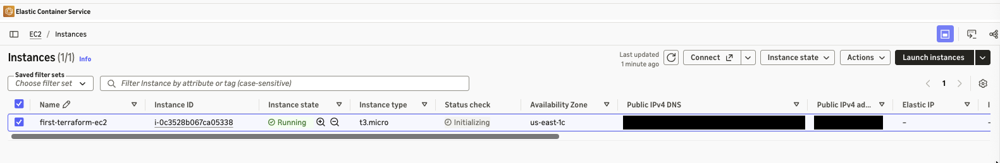

---

### Step 7c Apply again to prove idempotence

**Why this step:** Proves the declarative model: the same configuration applied twice still gives one instance.

```bash
terraform apply
```

```text
aws_instance.my_first_ec2: Refreshing state... [id=i-0c3528b067ca05338]

No changes. Your infrastructure matches the configuration.

Apply complete! Resources: 0 added, 0 changed, 0 destroyed.
```

No `yes` prompt, because there was nothing to approve.

---

### Step 8a terraform destroy

**Why this step:** Removes everything recorded in state. Anything created outside Terraform is untouched.

```bash
terraform destroy
```

Type `yes`.

```text
aws_instance.my_first_ec2: Destroying... [id=i-0c3528b067ca05338]
aws_instance.my_first_ec2: Still destroying... [00m30s elapsed]
aws_instance.my_first_ec2: Destruction complete after 30s

Destroy complete! Resources: 1 destroyed.
```

---

### Step 8b Verify the termination

**Why this step:** Confirms the deletion from the AWS side.

**Console:** EC2 → Instances → refresh → `first-terraform-ec2` shows **Terminated** (visible for about an hour, no charge).

```bash
aws ec2 describe-instances --instance-ids i-0c3528b067ca05338 --profile terraform-lab --query "Reservations[].Instances[].State.Name" --output text
```

> [!WARNING]
> **Error:** `An error occurred (NoRegion): You must specify a region.`
> **Cause:** the `terraform-lab` profile was saved without a region in Step 3a. Terraform still worked because the provider block sets `region` explicitly; the AWS CLI has no `main.tf` and relies on the profile. (`sts get-caller-identity` worked earlier because STS is global; EC2 is regional.)
> **Fix:**
> ```bash
> aws configure set region us-east-1 --profile terraform-lab
> ```

**Result:** `terminated`

---

### Step 8c Delete the access key

**Why this step:** A long-lived, unused access key is the biggest leftover risk. The `terraform-lab` user is kept for future Terraform labs. With no key and no console password it can do nothing and costs nothing. A fresh key is created at the start of each Terraform session and deleted at the end.

**Console:** IAM → Users → `terraform-lab` → Security credentials → Access keys

| Action | Selection |
|---|---|
| Select key | `terraform-block1-lab` |
| Actions | Deactivate → confirm |
| Actions | Delete → paste key ID → Delete |

Delete the downloaded `.csv` and empty the Trash.

---

### Step 8d Verify the key is gone

**Why this step:** Verifies from the AWS side using the admin profile (`terraform-lab` has no IAM permissions and no key).

```bash
aws configure set region us-east-1 --profile success-demo
aws iam list-access-keys --user-name terraform-lab --profile success-demo
```

> [!WARNING]
> **Error:** `An error occurred (NoCredentials): Unable to locate credentials.` when run without `--profile`.
> **Diagnosis:**
> ```bash
> aws configure list              # profile <not set>, access_key <not set>
> grep '^\[' ~/.aws/credentials   # [success-demo] [glory_jr] [terraform-lab]
> ```
> **Cause:** there is no `[default]` section (the admin profile is named `success-demo`), so a command with no profile finds no keys.
> **Fix:** name the profile explicitly with `--profile success-demo`, and set its region.

```json
{
    "AccessKeyMetadata": []
}
```

**Result:** no access keys remain on `terraform-lab`.

---

## Final main.tf

```hcl
terraform {
  required_version = ">= 1.12"

  required_providers {
    aws = {
      source  = "hashicorp/aws"
      version = "~> 6.0"
    }
  }
}

provider "aws" {
  region  = "us-east-1"
  profile = "terraform-lab"
}

resource "aws_instance" "my_first_ec2" {
  ami           = "ami-096ef200a877f36af"
  instance_type = "t3.micro"

  tags = {
    Name    = "first-terraform-ec2"
    Project = "terraform-block1"
  }
}
```

> [!NOTE]
> AMI IDs change over time. On a redo, look up the current Amazon Linux 2023 x86 AMI in the AMI Catalog (Step 4e) before `plan`.

---

## Troubleshooting log

| # | Step | Symptom | Cause | Fix |
|---|---|---|---|---|
| 1 | 1 | `terraform 1.15.5 already installed`, but latest is 1.17.2 | Stale HashiCorp tap | `git -C "$(brew --repository hashicorp/tap)" pull` then `brew upgrade hashicorp/tap/terraform` |
| 2 | 1 | `no such ref 'refs/heads/master'` | Tap branch renamed | Harmless; Homebrew auto-update refreshed the tap |
| 3 | 1 | Keychain prompt for `github.com` | Git osxkeychain credential helper | Enter Mac login password → Allow |
| 4 | 4a | `zsh: command not found: code` | VS Code shell command not installed | Cmd+Shift+P → Shell Command: Install 'code' command in PATH |
| 5 | 4a | No language shown in status bar | Extension page was the active tab | Click the `main.tf` tab |
| 6 | 4b | `version = ">= 6.0"` | Allows future breaking major versions | `version = "~> 6.0"` |
| 7 | 8b | `NoRegion` from AWS CLI | Profile saved without region | `aws configure set region us-east-1 --profile terraform-lab` |
| 8 | 8d | `NoCredentials` | No `[default]` profile on this Mac | Use `--profile success-demo` |

---

## Cheat sheet

| I need to… | Use |
|---|---|
| Download providers / after adding a provider | `terraform init` |
| Upgrade providers within constraints | `terraform init -upgrade` |
| Format code | `terraform fmt` |
| Check formatting in CI | `terraform fmt -check` |
| Check config without contacting AWS | `terraform validate` |
| Preview changes | `terraform plan` |
| Save a plan for later apply | `terraform plan -out=tfplan` |
| Apply exactly what was reviewed | `terraform apply tfplan` |
| Build | `terraform apply` |
| Tear down everything Terraform manages | `terraform destroy` |
| Check which AWS identity is active | `aws sts get-caller-identity --profile <name>` |
| Check for overriding env vars | `env \| grep AWS_` |
| Allow 6.x only | `version = "~> 6.0"` |

---

## Acronyms

| Acronym | Meaning |
|---|---|
| AMI | Amazon Machine Image |
| API | Application Programming Interface |
| ARN | Amazon Resource Name |
| AWS | Amazon Web Services |
| AZ | Availability Zone |
| BSL | Business Source License |
| CI/CD | Continuous Integration / Continuous Delivery |
| CLI | Command Line Interface |
| EC2 | Elastic Compute Cloud |
| HCL | HashiCorp Configuration Language |
| IaC | Infrastructure as Code |
| IAM | Identity and Access Management |
| MFA | Multi-Factor Authentication |
| OIDC | OpenID Connect |
| SSH | Secure Shell |
| SSO | Single Sign-On |
| STS | Security Token Service |
| VPC | Virtual Private Cloud |
| vCPU | Virtual Central Processing Unit |
